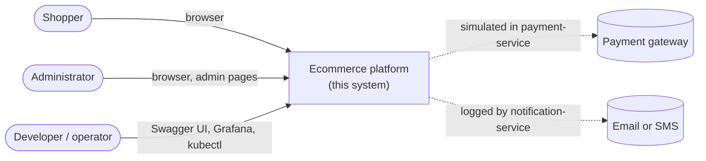
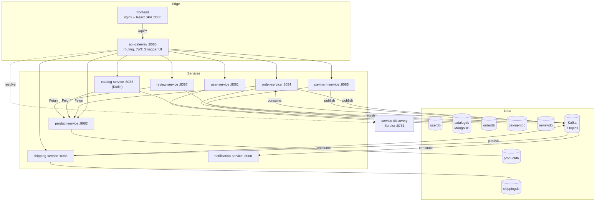
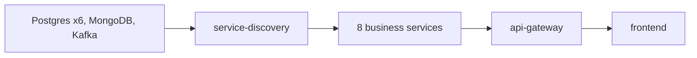

# Architecture

An e-commerce platform built as a set of small Spring services behind an API
gateway, with a React storefront. Customers register, browse a product
catalogue, build a cart, check out with a simulated payment, get a shipment
with a tracking number, and review products. Administrators manage products,
categories, orders and reviews through the same API. The platform is also a
learning project. Its explicit goals are practising microservices, Kubernetes
and CI/CD, and that shows in a well-engineered runtime (discovery tuning,
contract tests, a full observability stack) next to business logic that is
still simple.

## System context

Nothing outside the platform is called. The payment gateway is a random draw
inside payment-service, and notifications are log lines. Both are natural
integration points for later.

## Containers

Not drawn: the monitoring stack, which observes everything. It is Prometheus,
Grafana, Loki, promtail, Tempo and Alertmanager plus twelve exporters (18
containers), with Kafka UI alongside. See [Observability](observability.md).

## Service catalog

| Service | Responsibility | Store | Calls | Publishes | Consumes | Page |
|---|---|---|---|---|---|---|
| api-gateway | single entry point: routing, JWT validation, identity headers, CORS, retries, Swagger UI | — | every service | — | — | [api-gateway](services/api-gateway.md) |
| service-discovery | Eureka registry | memory | — | — | — | [service-discovery](services/service-discovery.md) |
| user-service | accounts, registration, login, JWT issuing, profiles | `userdb` | — | — | — | [user-service](services/user-service.md) |
| product-service | products, categories, stock (the source of truth) | `productdb` | — | — | — | [product-service](services/product-service.md) |
| catalog-service | denormalised storefront read model, search, merchandising flags | `catalogdb` (Mongo) | product-service | — | — | [catalog-service](services/catalog-service.md) |
| order-service | orders and lines, stock reservation, order lifecycle | `orderdb` | product-service | `order.placed`, `order.cancelled` | `payment.completed`, `payment.failed` | [order-service](services/order-service.md) |
| payment-service | payments, simulated gateway, refunds | `paymentdb` | — | `payment.completed`, `payment.failed`, `payment.refunded` | — | [payment-service](services/payment-service.md) |
| shipping-service | shipments, tracking numbers, delivery status history | `shippingdb` | — | `shipment.created`, `shipment.updated` | `payment.completed` | [shipping-service](services/shipping-service.md) |
| review-service | reviews, moderation, votes, rating summaries | `reviewdb` | product-service | — | — | [review-service](services/review-service.md) |
| notification-service | reacts to every business event (log lines today) | — | — | — | all seven topics | [notification-service](services/notification-service.md) |
| frontend | storefront, cart, checkout, tracking, admin pages | browser `localStorage` | api-gateway | — | — | [frontend](frontend.md) |

## Technology

| Area | Choice (version) |
|---|---|
| Language and runtime | Java 25 (Eclipse Temurin JRE, Alpine images). Kotlin 2.3.0 for catalog-service. |
| Framework | Spring Boot 4.0.1 (Spring Framework 7.0.2), Spring Cloud 2025.1.1 |
| Edge | Spring Cloud Gateway Server WebFlux 5.0.1 on Reactor Netty, JJWT 0.12.6 |
| Discovery and calls | Netflix Eureka 2.0.5, Spring Cloud LoadBalancer, OpenFeign 5.0.4 (feign-core 13.6, Apache HttpClient 5), resilience4j 2.3.0 through Spring Cloud CircuitBreaker (catalog, order, payment, review) |
| Persistence | PostgreSQL 16 with Spring Data JPA 4.0.1, Hibernate 7.2 and Flyway 11.14. MongoDB 8.0 with Spring Data MongoDB 5.0.1 (driver 5.6.2). |
| Messaging | Kafka (Confluent cp-kafka 7.6.0, KRaft, one broker), spring-kafka 4.0.8 with kafka-clients 4.1.2, Jackson 3 JSON |
| JSON | Jackson 3.0.3 (REST and Kafka) |
| API docs | springdoc-openapi 2.8.5 (services, Spring MVC) and 3.0.3 (gateway, WebFlux UI) |
| Observability | Micrometer 1.16 with the Prometheus registry, OpenTelemetry 1.55 tracing to Tempo 2.5, Prometheus 2.52, Grafana 11.1, Loki 3.1 with promtail, Alertmanager 0.27 |
| Frontend | React 18, TypeScript 5.9, Vite 6, MUI 6.5, TanStack Query 5, zustand 5, axios, React Router 6, react-hook-form with zod, served by nginx 1.27 |
| Testing | JUnit 5, Mockito, Spring test slices, H2 2.4, Testcontainers 2.0.3 (`postgres:16-alpine`, `cp-kafka:7.6.0`, `mongo:8.0`), maven-failsafe, WireMock 3.13.1, pact-jvm 4.7.5 and pact-js 17.1.4, Vitest 2 with MSW 2 and coverage-v8, Playwright 1.64.1 (browser end to end), k6 0.54.0 (load) |
| Delivery | Maven 3.9, Docker, Docker Compose, Kubernetes (Docker Desktop, Kustomize), CircleCI and GitHub Actions, Docker Hub |

## Design in brief

Each point is backed by an [architecture decision record](adr/README.md).

- **One repository, one database and one deployable per service** ([ADR-001](adr/ADR-001-microservices-one-repo-each.md), [ADR-002](adr/ADR-002-database-per-service.md)). No shared code and no cross-service joins. Data owned by another service arrives by API or event.
- **The catalog is a MongoDB read model** of product-service, refreshed on demand ([ADR-003](adr/ADR-003-mongodb-catalog-read-model.md)).
- **The gateway authenticates and the services trust its headers** ([ADR-004](adr/ADR-004-jwt-at-the-gateway.md)). Authorization was never added on top, which is the platform's largest gap ([Security](security.md)).
- **Client-side discovery with Eureka**, kept even on Kubernetes and tuned for hitless rollouts ([ADR-005](adr/ADR-005-eureka-client-side-discovery.md)).
- **Synchronous calls for lookups and stock, Kafka for state changes**, with the purchase saga choreographed by events ([ADR-006](adr/ADR-006-sync-queries-async-state-changes.md), [Communication](communication.md)).
- **JSON events without a schema registry.** Consumers keep mirror classes, and Pact pins every field ([ADR-007](adr/ADR-007-json-events-mirrored-classes.md), [ADR-008](adr/ADR-008-pact-without-broker.md)).
- **Retries only where a request provably never arrived**, meaning connect failures ([ADR-010](adr/ADR-010-retry-only-connection-failures.md)).
- **Metrics, logs and traces in one Grafana** ([ADR-011](adr/ADR-011-observability-stack.md)), and **one topology for compose and Kubernetes** ([ADR-012](adr/ADR-012-kubernetes-mirrors-compose.md)).

## Deployment

Both deployments run the same 38 workloads with the same names, ports and
credentials. Only one can run at a time on a machine, because both bind the
same localhost ports.

| | Docker Compose | Kubernetes |
|---|---|---|
| Definition | `ecommerce-platform/docker-compose.yml` | `ecommerce-platform/k8s/` (Kustomize), namespace `ecommerce` |
| Images | built locally from each repo's `docker/Dockerfile` | `ecommerce/<name>:local`, built by `k8s/build-images.sh` |
| Start-up order | `depends_on: condition: service_healthy` | busybox init containers that wait for each port |
| Health | wget on `/actuator/health` | startup and readiness on `/actuator/health/readiness`, liveness on `/actuator/health/liveness` |
| Exposure | every container port published on the host | `LoadBalancer` Services for the frontend, gateway, Eureka, databases and monitoring UIs. Service ports stay internal. |
| Memory | `mem_limit` per container (768 MB for most services), JVMs at `MaxRAMPercentage=55` | limits equal to compose, requests at about 40 % |
| Restarts | in place, with a few seconds of Eureka warm-up | rolling and hitless: `preStop` drains to `OUT_OF_SERVICE` for 15 s, then graceful shutdown |
| Docs | [Platform README](../README.md) | [k8s/README.md](../k8s/README.md) |

A cold start takes 2 to 4 minutes, almost all of it JVM start-up under
contention.

## Build and delivery

- **Build locally.** Maven builds each service's jar on the host, and the Dockerfiles only copy it into a JRE image ([ADR-009](adr/ADR-009-runtime-only-images-prebuilt-jars.md)). `build-all.sh` and `rebuild.sh` (with PowerShell twins) orchestrate all ten repositories. The trap to know about: an image built without a fresh Maven build ships the old code.
- **CI** runs in each repository on every push and pull request, in three stages:
  1. **verify:** `mvn verify` with the unit tests, the Testcontainers integration tests and the Pact contracts.
  2. **validate-image:** a Docker build without registry credentials.
  3. **publish-image:** push to Docker Hub as `bmcnpnr/ecommerce-<name>`.
- **Publishing** happens only from trusted refs. `develop` publishes `develop` and `sha-<commit>`, `main` publishes `latest`, and `v*` tags publish the tag name.
- **CI providers:** ten repositories run CircleCI (`.circleci/config.yml`). Three (service-discovery, shipping-service, user-service) have moved to GitHub Actions (`.github/workflows/ci-cd.yml`) with the same three stages, using repository secrets instead of the CircleCI context. [CICD.md](../CICD.md) describes the CircleCI side.
- **Deploying published images:** `docker-compose.registry.yml` swaps the local builds for Docker Hub images. Nothing deploys automatically beyond that; continuous delivery stops at the registry.

## Testing strategy

For commands and how to write each kind of test, see the [Testing guide](testing.md).

| Layer | What | Where it runs | Size (2026-10-30) |
|---|---|---|---|
| Unit and slice (`*Test`, Surefire) | services with Mockito; controllers with `@WebMvcTest`; `GlobalExceptionHandler`, `CorrelationIdFilter`, Kafka producers and consumers, Feign fallbacks and retryers in every service; the gateway's `JwtAuthenticationFilter` and `CorsConfig`; repositories on H2 (JPA) or real MongoDB via Testcontainers (catalog); log-volume assertions for every failure path | `mvn verify`, CI. No Docker needed, except catalog's repository test | 2,290 tests across ten repositories (pact and security tests included): gateway 240, user 266, product 270, catalog 200, order 384, payment 257, shipping 240, review 259, notification 145, discovery 29 |
| Integration (`*IT`, Failsafe) | the whole service as `@SpringBootTest(RANDOM_PORT)` against **production images** in Testcontainers (`postgres:16-alpine`, `confluentinc/cp-kafka:7.6.0`, `mongo:8.0`): real Flyway migrations with `ddl-auto: validate`, HTTP to database to Kafka flows, repository constraints, and outages injected on purpose (paused broker, held or killed connections, held locks, slow peers; see [Testing guide](testing.md#testing-failure-behaviour)). Downstream Feign calls are stubbed with WireMock. The gateway IT puts a WireMock behind every route, and `EurekaServerIT` boots the registry | `mvn verify` (package `<base>.integration`), CI. Needs Docker: without it the container-backed ITs fail at startup (only order-service's skip). The gateway and Eureka ITs never need it | 898 tests: gateway 112, user 112, product 94, catalog 117, review 116, order 117, payment 92, shipping 72, notification 26, discovery 40 |
| Contract | Pact, consumer-driven. Service to service (pact-jvm): Feign calls, gateway identity headers, the JWT format, all seven event types. Frontend to services (pact-js): every call the SPA makes to six providers | the pact-jvm pacts run inside `mvn verify`. The frontend pacts are generated by `npm run test:pact` and verified by each provider's `mvn verify` ([ADR-008](adr/ADR-008-pact-without-broker.md)) | 10 service pacts with 24 interactions, plus 6 frontend pacts with 40 (user 6, product 11, order 7, payment 4, shipping 4, review 8) |
| Frontend unit | components, hooks, stores, the API client and its interceptors, every page, the validators, and the failure paths (error boundaries, corrupt storage, outages, double submits, paging), with Vitest and MSW. About 99% of lines, 95% of functions and 94.6% of branches | `npx vitest run`, CI | 860 tests in 62 files |
| End to end | checks through the gateway: authentication and authorization, routing, Feign, MongoDB catalog, the Kafka round trip through the outbox | `ecommerce-platform/smoke-test.sh` against compose or Kubernetes | 28 checks |
| Browser end to end | the real SPA in Chromium against a running stack: sign-up and login, route guards, search, cart and stock reservation, checkout through payment, cancel, tracking after `payment.completed`, the admin pages. Each test seeds its own users and products through the gateway | `npm run e2e` in `ecommerce-frontend` (or `scripts/e2e-docker.sh`); CircleCI only on demand, since no pipeline starts a stack | 26 functional tests (25 pass on 2026-10-30; review moderation fails, see [Findings](findings.md#resilience-findings-2026-10-30)) and 106 penetration tests, with the open S-5, S-15 and S-16 pinned (`test.fail`) |
| Load | k6 scripts `browse.js` (anonymous reads) and `checkout.js` (create order, add item, confirm) through the gateway, profiles `smoke`, `load` and `stress`, with error-rate, check and per-request p95 thresholds | `ecommerce-platform/load-tests/run-load.sh` in the `grafana/k6:0.54.0` container, against a running stack. Manual: no pipeline runs it | 2 scripts ([README](../load-tests/README.md)) |

How each layer is wired:

- **Two runners.** Surefire runs `*Test` in the `test` phase and Failsafe runs `*IT` in `verify`, in every Maven repository. `mvn test` is the fast loop and `mvn verify` is what CI runs. Reports land in `target/surefire-reports` and `target/failsafe-reports`.
- **The integration tests use what production uses.** The slice tests still run on H2 with `ddl-auto: create-drop` and Flyway off, but the `*IT` classes start Postgres and apply the real migrations under `ddl-auto: validate`. That closes the old gap where no test exercised the migrations (T-1), and it catches drift between H2 and Postgres. The H2 test profile has no foreign keys, for example, so three product-service requests that fail a foreign key and return 500 on Postgres passed silently on H2.
- **Kafka.** The unit, slice and pact tests use an embedded broker. The ITs use a real `cp-kafka:7.6.0` container, so the HTTP to database to Kafka flows run for real.
- **The catalog's MongoDB tests** (its repository test and ITs) use `mongo:8.0`. The repository test skips when Docker isn't running; the ITs fail.
- **Bugs found by tests stay in the suite.** A test that finds a defect asserts the **correct** behaviour and is marked `@Disabled("BUG: ...")` (Java and Kotlin) or `it.fails` (frontend, where the test turns red once the bug is fixed). Remove the marker when you fix the bug. The list is in [Findings](findings.md#bugs-pinned-by-tests), and each service page names its disabled tests.
- The smoke test, the Playwright suite and the load tests need the running stack, and nothing runs them automatically (T-2).
- The Playwright suite writes `reports/html/`, `reports/junit.xml`, `reports/results.json` and `reports/summary.md` on every run. Details: [Frontend: end-to-end tests](frontend.md#end-to-end-tests-playwright).

There are no security-scanning tests. See
[Findings](findings.md) for the gaps that matter most.

## Quality attributes at a glance

| Attribute | State |
|---|---|
| Deployability | Strong: one command per environment, rolling restarts verified hitless on Kubernetes |
| Observability | Broad: metrics, logs and traces with one log pattern and a trace id in every line, 58 alert rules with unit tests, 9 dashboards, and a size bound on every store. Still not joined up at Feign and Kafka hops, and no alert is delivered anywhere ([Observability](observability.md)) |
| Contract safety | Strong: every cross-service interface, and every call the SPA makes, is pinned by Pact. Proven on 2026-10-29, when the Kafka serializers were swapped for their Jackson 3 replacements and the pacts confirmed an unchanged wire format. |
| Security | Roles and ownership on every endpoint, no committed secrets, validated input. Open: published infrastructure ports and unauthenticated Kafka (S-5), the token in `localStorage` (S-7), registration enumeration and no token revocation ([Security](security.md)) |
| Data integrity | Payments verified against the order, state transitions checked, optimistic locking, atomic stock; a declined payment and an abandoned cart return their stock. Open: stock changes over Feign aren't idempotent, and there are no refunds or shipment cancellation ([Flows](flows.md), [Findings](findings.md)) |
| Resilience | One fault stays one fault: events go through a transactional outbox, every consumer dead-letters with back-off, every wait is bounded, every Feign caller has a working breaker, logging is throttled, and the frontend survives render errors and outages ([resilience fix spec](resilience-fix-spec.md)). Open: no per-client rate limiting, alerts not delivered |
| Scalability | Stateless services scale horizontally. Kafka consumers can't, because every topic has one partition. |
