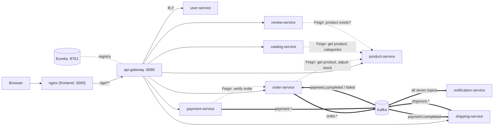

# Communication

How the services find and talk to each other. There are three kinds of hop,
each with its own rules:

1. **Client → gateway → service** over HTTP/JSON, authenticated at the gateway.
2. **Service → service, synchronous**: Feign over HTTP, discovered through Eureka. Three services call product-service, and payment-service calls order-service.
3. **Service → services, asynchronous**: Kafka events. Every published event is listed in the [Event catalog](events.md).

Every JVM service also registers with Eureka and sends heartbeats. Those links
are left out of the diagram for readability.

## 1. Client → gateway → service

- The browser calls its own origin. nginx in the frontend container proxies `/api/` to `api-gateway:8080`, so there is no CORS in the normal path. Other clients call `:8080` directly.
- The gateway matches the path prefix to a route (`/api/v1/<resource>/**`), authenticates the JWT unless the path is public, sets the identity headers, and forwards the request unchanged to an instance chosen from Eureka. The full rules are in [api-gateway](services/api-gateway.md).
- Responses pass back untouched. Every service uses the same error body (`timestamp`, `status`, `error`, `message`, `path`, `correlationId`, `fieldErrors`). See the [API conventions](api/README.md#conventions).
- Timeouts nest from the inside out, so the innermost layer answers first and its error body reaches the browser: Feign read timeouts (10 s; payment-service 5 s) < the gateway's `response-timeout` of 20 s (a 504, never retried) < the SPA's 30 s < nginx's 35 s `proxy_read_timeout`. When nginx can't reach the gateway at all, it answers a JSON 503 itself.
- A service whose database, MongoDB or Feign peer doesn't answer returns **503** `Service temporarily unavailable` and logs one WARN without a stack trace per cause and 10 s ([resilience-fix-spec.md](resilience-fix-spec.md) rule L4). A Kafka outage doesn't reach the caller: no request path publishes to Kafka, the outbox relay does. Request bodies over 1 MB are refused with 413 by the gateway.

### Headers that cross service boundaries

| Header | Set by | Read by | Purpose |
|---|---|---|---|
| `Authorization: Bearer <jwt>` | the client | the gateway only | authentication |
| `X-Username` | the gateway, from `sub` | every service with an HTTP API | identity and ownership |
| `X-User-Id` | the gateway, from `userId` | user-service | identity |
| `X-User-Role` | the gateway, from `role` | every service with an HTTP API | authorization (`ADMIN` or `CUSTOMER`, exact case) |
| `X-Correlation-Id` | the client, optionally | each service's `CorrelationIdFilter`, which generates one when the header is absent | a per-service request id in logs and error bodies. The gateway doesn't create one, and no service forwards it on Feign calls or Kafka messages, so it never links two services. |
| `traceparent` (W3C) | the gateway's tracing | the services' server observation | links the gateway span to the service span. It goes no further. |

Every service checks roles and ownership from these headers, and the gateway
strips any copy a client sends. The rules are in the
[security fix spec](security-fix-spec.md) and [Security](security.md).

## 2. Synchronous calls between services (Feign)

Three services call product-service, and payment-service calls order-service.
Each caller has an `@FeignClient` interface in `client/` and resolves it through
Spring Cloud LoadBalancer over Eureka. No call is made while a database
transaction is open ([resilience-fix-spec.md](resilience-fix-spec.md) rule H2).

| Caller | Endpoint | Called when | Fields used | On failure |
|---|---|---|---|---|
| order-service | `GET /api/v1/products/{id}` | adding a line to an order | `name`, `price`, `stockQuantity` (`sku` in error messages) | 404 → 404, 400 → 400, 409 → 409; 503, no response or an open breaker → 503; other → 502 |
| order-service | `PATCH /api/v1/products/{id}/stock` `{"delta": n}` | adding a line (`-qty`), cancelling (`+qty` per line) | response ignored | add-line: as above, and a reservation is released again if the line can't be saved. Cancel: the cancellation commits first, then stock is returned outside the transaction; the first "peer unavailable" stops the loop with one throttled WARN naming the lines not returned. A timed-out delta has an unknown outcome and is not repeated. |
| catalog-service | `GET /api/v1/products/{id}` | `POST /api/v1/catalog/sync/{id}` | `sku`, `name`, `description`, `price`, `stockQuantity`, `brand`, `categoryId` (`status` decoded, then ignored) | 404 → 404; no answer or an open breaker → 503; another 5xx, an undecodable or implausible body → 502 |
| catalog-service | `GET /api/v1/categories` | the same sync, for a product with a category | `id`, `name` | a failed lookup keeps the stored category name |
| review-service | `GET /api/v1/products/{id}` | creating a review (existence check) | none; the body is discarded | 404 → 404; no answer or an open breaker → 503; another 5xx or an undecodable body → 502 |
| payment-service | `GET /internal/v1/orders/{id}` | initiating a payment | `status`, `customerId`, `totalAmount` | 404 → 404; any other failure → 503 `Order service unavailable. Please try again later.` The order must be `CONFIRMED` (409), owned by the payer (403) and match the amount (400). |

### Client configuration

| Setting | order-service | catalog-service | review-service | payment-service |
|---|---|---|---|---|
| Connect / read timeout | 2 s / 10 s | 2 s / 10 s | 2 s / 10 s | 2 s / 5 s |
| HTTP client | Apache HttpClient 5, automatic retries **disabled** (R-6) | same | same | JDK `HttpURLConnection` |
| Retry | `ConnectionFailureRetryer`: 3 attempts, 100 ms then 200 ms, **only** when the TCP connect failed | same | same | none (Feign's default) |
| Circuit breaker | Spring Cloud CircuitBreaker (`spring.cloud.openfeign.circuitbreaker.enabled`) over resilience4j, one breaker named `product-service`. Window 10 calls, minimum 5, opens for 10 s at 50 % failures or when 80 % of calls take over 5 s. Ignores 400, 404, 409 and 422. | same, but ignores every 4xx | same as catalog | named `order-service`; slow above 4 s; ignores 400 and 404 |
| Breaker thread pool, TimeLimiter, bulkhead | disabled, so the Feign timeouts are the only time limit | same | same | same |
| Fallback | a fallback factory that maps the cause (see the table above) and logs nothing per call; the breaker logs its state changes | same | same | same |
| LoadBalancer cache | 5 s | 5 s | 5 s | 5 s |
| Converter race workaround | thread-safe `HttpMessageConverters` subclass in `FeignConfig` | same | same | same |
| Tracing | none (`feign-micrometer` missing) | none | none | none |

Two details explain the table:

- **Why the breaker settings matter.** With the Feign breaker enabled, Spring Cloud CircuitBreaker by default runs each call on a worker thread behind a 1 s TimeLimiter and a bulkhead of one thread per CPU. In the 2-CPU containers that allowed two concurrent calls, cut every call slower than 1 s, and handed the fallback an `ExecutionException` wrapper, so a 404 no longer looked like a 404. All three are disabled, and the ITs prove that a 2.5 s answer succeeds, that 24 concurrent calls overlap and that a 404 neither trips the breaker nor becomes a 503.
- **Why the converter workaround exists.** OpenFeign 5.0.1 publishes its message-converter list before filling it, without synchronisation. The first concurrent calls on a fresh instance could fail with `'messageConverters' must not be empty`. Each caller's `FeignConfig` overrides the bean with a version that is safe to share.

The retry-on-connect-failure-only policy matches the gateway's, and the reasons
are recorded in [ADR-010](adr/ADR-010-retry-only-connection-failures.md).

## 3. Asynchronous events (Kafka)

| Producer | Topics | Consumers |
|---|---|---|
| order-service | `order.placed`, `order.cancelled` | notification-service |
| payment-service | `payment.completed`, `payment.failed`, `payment.refunded` | order-service (completed, failed), shipping-service (completed), notification-service (all) |
| shipping-service | `shipment.created`, `shipment.updated` | notification-service |

Key properties (details, payloads and failure modes in the [Event catalog](events.md)):

- JSON values, keyed by order ID, one partition per topic, at-least-once delivery.
- Producers write each event into an `outbox_event` table in the same transaction as the state change, and a relay publishes it within about half a second ([ADR-013](adr/ADR-013-transactional-outbox.md)). A broker outage delays events but never loses them and never blocks a request.
- Consumers are idempotent. An infrastructure failure is retried with back-off for as long as it lasts. Any other failure is retried twice, then the record goes to `<topic>.DLT` (see [Failure handling](events.md#failure-handling) for what the copy keeps), and the partition moves on.
- No trace propagation across Kafka.

## 4. Discovery and load balancing

All nine Spring services register with Eureka, under their
`spring.application.name`, by **IP address**. Callers (the gateway and the
three Feign clients) fetch the registry every 5 s and cache instance lists for
5 s. Instances renew their lease every 5 s, and a silent instance expires after
15 s. Kubernetes Services exist but are not in the request path. Details and
the reasons behind the tuning are in [service-discovery](services/service-discovery.md)
and [ADR-005](adr/ADR-005-eureka-client-side-discovery.md).

## 5. Consistency model

There are no distributed transactions. Consistency across services is
eventual, and the purchase saga is **choreographed**: each service reacts to
events, and no coordinator tracks the whole. Its only compensations return
reserved stock: after a declined payment, and when an abandoned cart expires.

| Situation | What happens |
|---|---|
| Stock reserved, then the payment is declined | The order is `CANCELLED`, and its stock is returned once that has committed. A new payment attempt for the order is refused (409). |
| A cart is abandoned | After 24 h without a change the `PENDING` order is cancelled, its stock returned and `order.cancelled` published. `CONFIRMED` orders never expire. |
| A paid order is cancelled | Stock is released. The payment stays `COMPLETED` and the shipment carries on. |
| A payment is refunded | The order stays `PAID` and the shipment carries on |
| A shipment is delivered | The order stays `PAID` until someone PATCHes it |
| The catalog's copy of a product goes stale | It stays stale until someone calls `sync` |
| Order service writes, then Kafka is down | The event waits in the outbox and is published once Kafka is back |

These are tracked as findings with suggested fixes in [Findings](findings.md).
The transactional outbox and idempotent, state-guarded consumers are in place
([ADR-013](adr/ADR-013-transactional-outbox.md)). The remaining gaps need
compensating events (refund, shipment cancellation) and an orchestrated, or at
least state-machine-checked, saga.
