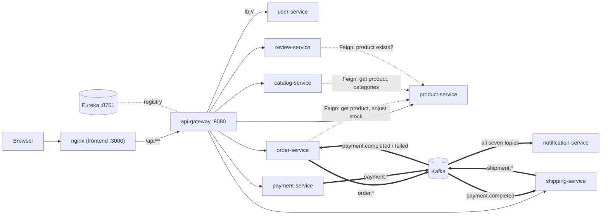

# Communication

How the services find and talk to each other. There are three kinds of hop,
each with its own rules:

1. **Client → gateway → service** over HTTP/JSON, authenticated at the gateway.
2. **Service → service, synchronous**: Feign over HTTP, discovered through Eureka. Every such call goes to product-service.
3. **Service → services, asynchronous**: Kafka events. Every published event is listed in the [Event catalog](events.md).

Every JVM service also registers with Eureka and sends heartbeats. Those links
are left out of the diagram for readability.

## 1. Client → gateway → service

- The browser calls its own origin. nginx in the frontend container proxies `/api/` to `api-gateway:8080`, so there is no CORS in the normal path. Other clients call `:8080` directly.
- The gateway matches the path prefix to a route (`/api/v1/<resource>/**`), authenticates the JWT unless the path is public, sets the identity headers, and forwards the request unchanged to an instance chosen from Eureka. The full rules are in [api-gateway](services/api-gateway.md).
- Responses pass back untouched. Every service uses the same error body (`timestamp`, `status`, `error`, `message`, `path`, `correlationId`, `fieldErrors`). See the [API conventions](api/README.md#conventions).

### Headers that cross service boundaries

| Header | Set by | Read by | Purpose |
|---|---|---|---|
| `Authorization: Bearer <jwt>` | the client | the gateway only | authentication |
| `X-Username` | the gateway, from `sub` | user-service (`/me`), review-service (author of a review or vote) | identity |
| `X-User-Id` | the gateway, from `userId` | nobody | — |
| `X-User-Role` | the gateway, from `role` | review-service (delete) | authorization |
| `X-Correlation-Id` | the client, optionally | each service's `CorrelationIdFilter`, which generates one when the header is absent | a per-service request id in logs and error bodies. The gateway doesn't create one, and no service forwards it on Feign calls or Kafka messages, so it never links two services. |
| `traceparent` (W3C) | the gateway's tracing | the services' server observation | links the gateway span to the service span. It goes no further. |

Only two services look at identity at all. Order, payment, shipping, product
and catalog never read the identity headers, which is why any authenticated
user can act on any of their resources. See [Security](security.md).

## 2. Synchronous calls between services (Feign)

Three services call product-service, and nothing else is called
synchronously. Each caller has an `@FeignClient(name = "product-service")`
interface in `client/ProductServiceClient`, and resolves it through Spring
Cloud LoadBalancer over Eureka.

| Caller | Endpoint | Called when | Fields used | On failure |
|---|---|---|---|---|
| order-service | `GET /api/v1/products/{id}` | adding a line to an order | `name`, `price`, `stockQuantity` (`sku` in error messages) | 404 → 404, 400 → 400, 409 → 409, 503 or no response → 503, other → 502, open breaker → 500 |
| order-service | `PATCH /api/v1/products/{id}/stock` `{"delta": n}` | adding a line (`-qty`), cancelling (`+qty` per line) | response ignored | add-line: as above. Cancel: **logged and swallowed**, so the stock release is lost. |
| catalog-service | `GET /api/v1/products/{id}` | `POST /api/v1/catalog/sync/{id}` | `sku`, `name`, `description`, `price`, `stockQuantity`, `brand`, `categoryId` (`status` decoded, then ignored) | every failure, a 404 included → 500 |
| catalog-service | `GET /api/v1/categories` | the same sync | `id`, `name` | swallowed: an empty list, and the category name becomes null |
| review-service | `GET /api/v1/products/{id}` | creating a review (existence check) | none; the body is discarded | every failure, a 404 included → 500 |

### Client configuration

| Setting | order-service | catalog-service | review-service |
|---|---|---|---|
| Connect / read timeout | 2 s / 10 s | 2 s / 10 s | 2 s / 10 s |
| Retry | `ConnectionFailureRetryer`: 3 attempts, 100 ms then 200 ms, **only** when the TCP connect failed | same | same |
| Circuit breaker | **active**: resilience4j `@CircuitBreaker("product-service")` on the client methods. Window 10 calls, minimum 5, opens at 50 % failures for 10 s, ignores 400/404/409/422. | configured but **inactive** | configured but **inactive** |
| Fallback class | present, never used | present, never used | present, never used |
| LoadBalancer cache | 5 s | 5 s | 5 s |
| Converter race workaround | thread-safe `HttpMessageConverters` subclass in `FeignConfig` | same | same |
| Tracing | none (`feign-micrometer` missing) | none | none |

Two details explain the table:

- **Why the fallbacks never run.** Spring Cloud OpenFeign wraps clients in a circuit breaker only when `spring.cloud.openfeign.circuitbreaker.enabled=true`, and no service sets it. order-service has a working breaker anyway, because it puts resilience4j's own annotation on the interface methods. The `resilience4j.*` blocks in catalog's and review's YAML govern nothing.
- **Why the converter workaround exists.** OpenFeign 5.0.1 publishes its message-converter list before filling it, without synchronisation. The first concurrent calls on a fresh instance could fail with `'messageConverters' must not be empty`. Each caller's `FeignConfig` overrides the bean with a version that is safe to share.

The retry-on-connect-failure-only policy matches the gateway's, and the reasons
are recorded in [ADR-010](adr/ADR-010-retry-only-connection-failures.md).

## 3. Asynchronous events (Kafka)

| Producer | Topics | Consumers |
|---|---|---|
| order-service | `order.placed`, `order.cancelled` | notification-service |
| payment-service | `payment.completed`, `payment.failed`, `payment.refunded` | order-service (completed, failed), shipping-service (completed), notification-service (all) |
| shipping-service | `shipment.created`, `shipment.updated` | notification-service |

Key properties (details, payloads and failure modes in the [Event catalog](events.md)):

- JSON values, keyed by order ID, one partition per topic, at-least-once delivery.
- Producers send inside the database transaction, before commit, and never check the result. There is no outbox.
- No dead-letter topic. order- and shipping-service skip a record they can't convert. notification-service loops forever on one. A listener exception is retried 10 times, then skipped.
- No trace propagation across Kafka.

## 4. Discovery and load balancing

All nine Spring services register with Eureka, under their
`spring.application.name`, by **IP address**. Callers (the gateway and the
three Feign clients) fetch the registry every 5 s and cache instance lists for
5 s. Instances renew their lease every 5 s, and a silent instance expires after
15 s. Kubernetes Services exist but are not in the request path. Details and
the reasons behind the tuning are in [service-discovery](services/service-discovery.md)
and [ADR-005](adr/ADR-005-eureka-client-side-discovery.md).

## 5. Consistency model

There are no distributed transactions. Consistency across services is
eventual, and the purchase saga is **choreographed**: each service reacts to
events, and no coordinator tracks the whole. It also has **no compensations**.

| Situation | What happens |
|---|---|
| Stock reserved, then the payment is declined | The order is `CANCELLED` and the stock stays reserved |
| A paid order is cancelled | Stock is released. The payment stays `COMPLETED` and the shipment carries on. |
| A payment is refunded | The order stays `PAID` and the shipment carries on |
| A shipment is delivered | The order stays `PAID` until someone PATCHes it |
| The catalog's copy of a product goes stale | It stays stale until someone calls `sync` |
| Order service writes, then Kafka is down | The DB commit can succeed while the event is lost (no outbox) |

These are tracked as findings with suggested fixes in [Findings](findings.md).
Most of them are the classic remedies: a transactional outbox, idempotent and
state-guarded consumers, compensating events, and an orchestrated or at least
state-machine-checked saga.
