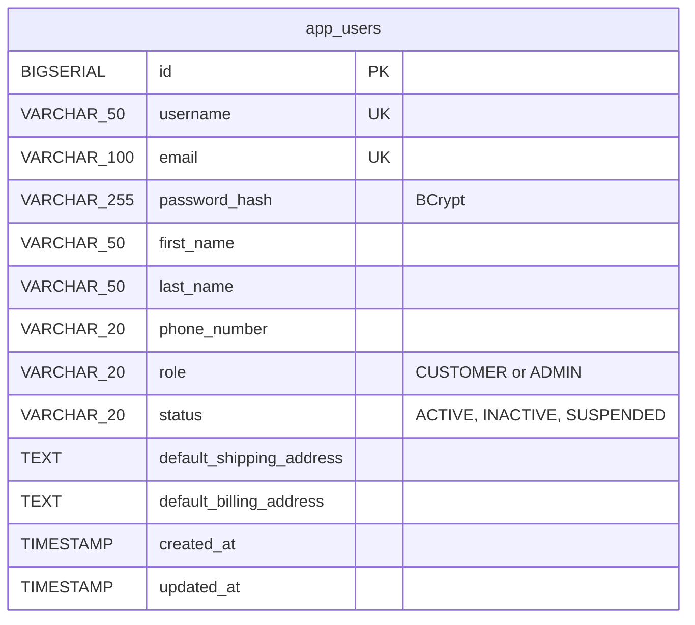
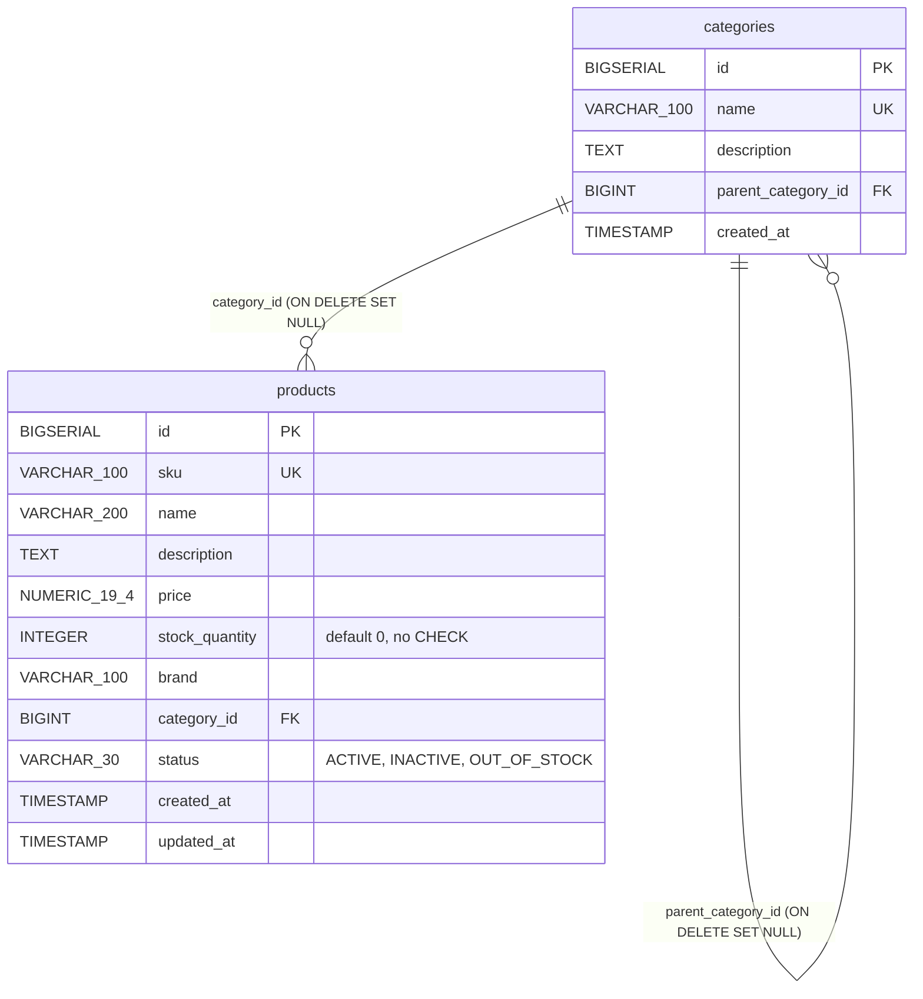
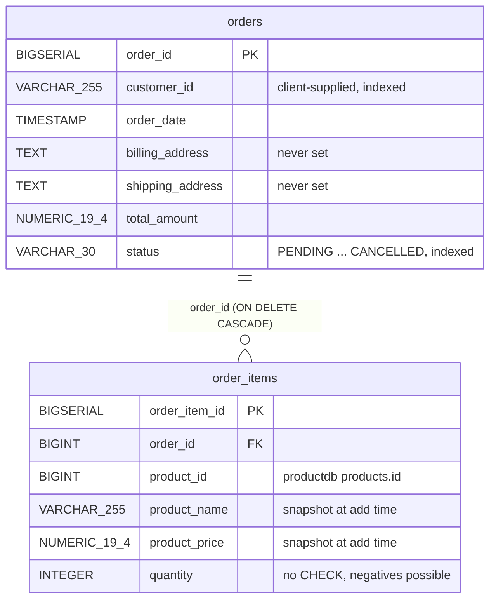
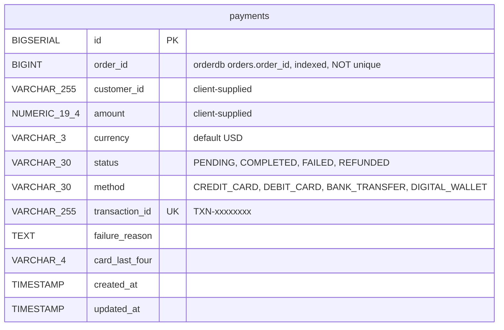
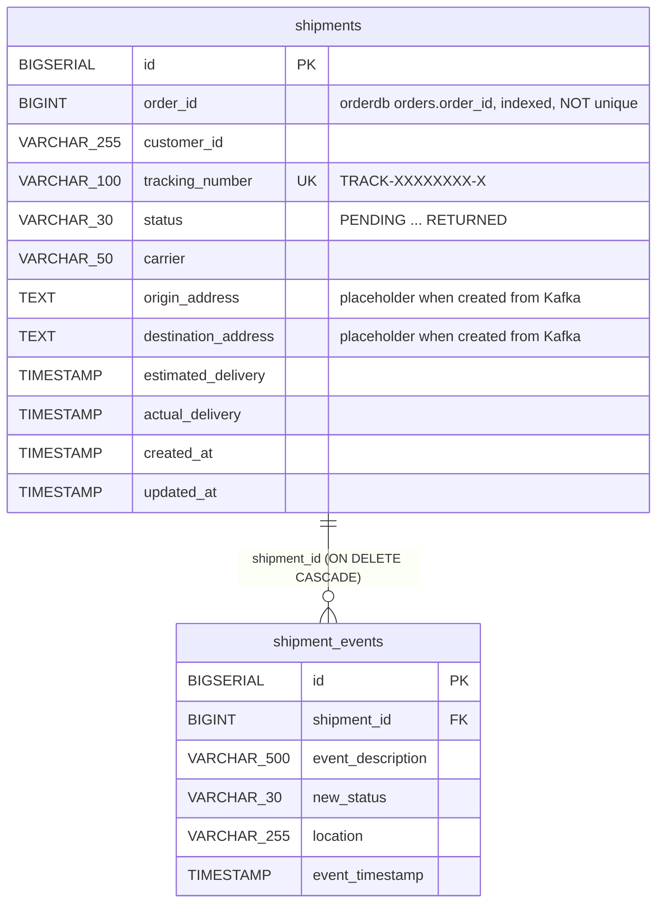
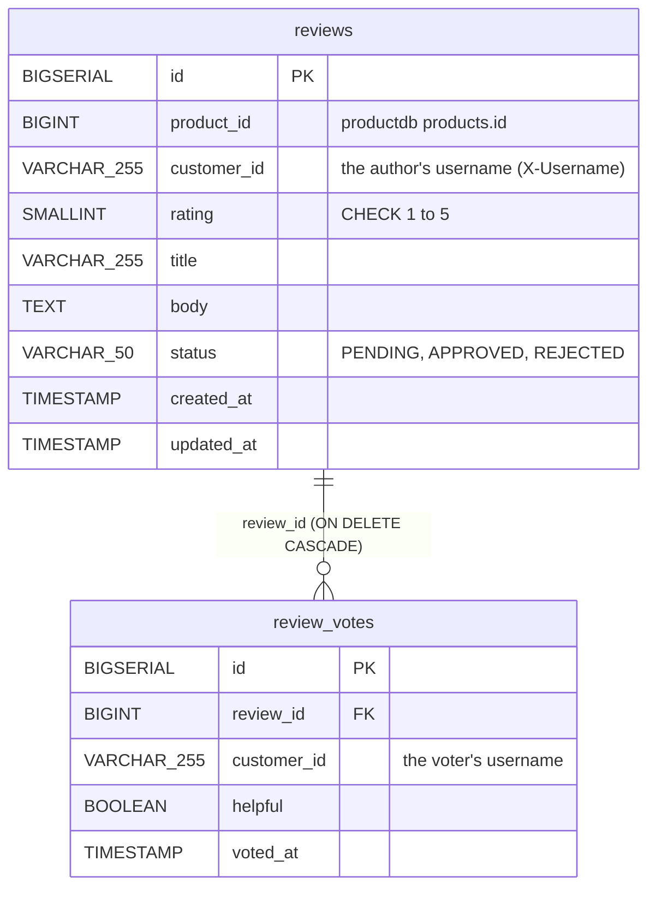
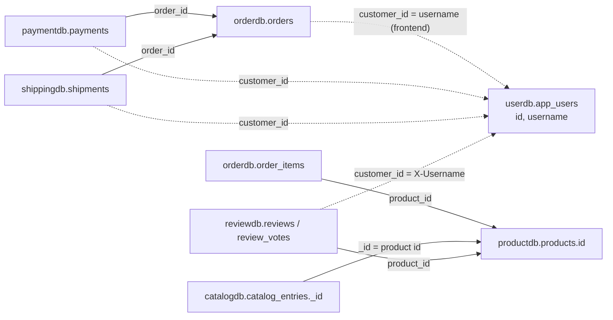

# Data model

Every database on the platform, what it holds, and how records in different
databases refer to each other. Each service owns its store outright. No
service reads another's tables, and there are no foreign keys between
services ([ADR-002](adr/ADR-002-database-per-service.md)). The schemas below
come from the Flyway migrations. Hibernate runs with `ddl-auto: validate`, so
the migrations are the single authority.

## Stores

| Database | Engine | Owner | Contents | Migrations | Host port |
|---|---|---|---|---|---|
| `userdb` | PostgreSQL 16 | user-service | `app_users` | `V1__create_app_users.sql` | 5432 |
| `productdb` | PostgreSQL 16 | product-service | `categories`, `products` | `V1__create_categories.sql`, `V2__create_products.sql` | 5433 |
| `catalogdb` | MongoDB 8.0 | catalog-service | `catalog_entries` collection | indexes created at startup by `CatalogCollectionInitializer` | 27017 |
| `orderdb` | PostgreSQL 16 | order-service | `orders`, `order_items` | `V1__create_orders.sql`, `V2__create_order_items.sql` | 5434 |
| `paymentdb` | PostgreSQL 16 | payment-service | `payments` | `V1__create_payments.sql` | 5436 |
| `shippingdb` | PostgreSQL 16 | shipping-service | `shipments`, `shipment_events` | `V1__create_shipments.sql`, `V2__create_shipment_events.sql` | 5437 |
| `reviewdb` | PostgreSQL 16 | review-service | `reviews`, `review_votes` | `V1__create_reviews.sql`, `V2__create_review_votes.sql` | 5438 |

notification-service and the gateway are stateless. Eureka keeps its registry
in memory, and Kafka keeps events for its default retention (7 days) on the
`kafka-data` volume.

## Schemas

### user-service

An `admin` row (role `ADMIN`) is inserted at startup by `DataInitializer`, not
by a migration. Deleting a user sets `status = INACTIVE`.

### product-service

`products` has no version column, so stock updates are unprotected
read-modify-writes. Deletion is soft (`status = INACTIVE`).

### catalog-service (MongoDB)

One document per product in `catalog_entries`. `_id` **is** the product ID.

| Field | BSON type | Source |
|---|---|---|
| `_id` | Int64 | product `id` |
| `productSku`, `productName`, `description`, `brand` | string | product, overwritten on every sync |
| `price` | Decimal128 (2 dp) | product `price` rounded to cents, overwritten on every sync. A `PATCH` can change it until the next sync. |
| `categoryId` / `categoryName` | Int64 / string | product `categoryId`, plus its name from `GET /api/v1/categories` (null if that lookup fails) |
| `stockStatus` | string | derived: `OUT_OF_STOCK` at 0 or less, `LOW_STOCK` from 1 to 9, `AVAILABLE` at 10 or more |
| `featured`, `imageUrl` | bool, string | catalog-only. `PATCH` sets them, and a sync keeps them. |
| `createdAt`, `updatedAt` | date | |
| `version` | Int64 | optimistic lock (`@Version`) |

Indexes: `categoryId`, `featured`, `stockStatus`, and a weighted text index
(`productName` 10, `brand` 5, `description` 1). `_class` is not stored.

### order-service

### payment-service

### shipping-service

### review-service

Unique constraints: `(product_id, customer_id)` on `reviews`, giving one review
per user per product, and `(review_id, customer_id)` on `review_votes`, giving
one vote per user per review.

## References between services

Nothing enforces these. Each one is a value copied in by an API call or an
event, and it can dangle.

| Reference | Arrives by | Can it dangle? |
|---|---|---|
| `order_items.product_id` → product | the client's add-item call, checked by Feign at add time | Yes. Products are only soft-deleted, so the ID stays valid, but an `INACTIVE` product can still be ordered. |
| `catalog_entries._id` → product | `POST /catalog/sync/{id}` | Yes. Entries of deleted products are never removed. |
| `reviews.product_id` → product | checked by Feign at create time | Only through deletion later |
| `payments.order_id` → order | client request body | **Yes, from the start.** Never verified. |
| `shipments.order_id` → order | `payment.completed` | Yes. It inherits whatever the payment said. |
| `*.customer_id` → user | client input (orders, payments), the gateway header (reviews), or events (shipments) | Yes, and its **meaning differs**. The SPA uses the username for orders and payments, the smoke test passes `1`, and reviews use `X-Username`. No service uses `X-User-Id`. |

## Conventions and their consequences

| Topic | Convention |
|---|---|
| Keys | `BIGSERIAL` surrogate keys everywhere except Mongo, which reuses the product ID. IDs are sequential and guessable, and since no endpoint checks ownership, any record is one increment away. |
| Money | `NUMERIC(19,4)` in Postgres (so `39.98` reads back as `39.9800`), Decimal128 rounded to cents in Mongo. Only `payments` has a currency column, and it defaults to `USD`. |
| Time | `TIMESTAMP` without a time zone, written from `LocalDateTime.now()` in the container's zone (UTC in the Alpine images). REST returns ISO strings without an offset, and Kafka carries integer arrays. |
| Enums | stored as their names in `VARCHAR`. An unknown value sent to most endpoints causes a 500 (`valueOf`). |
| Deletion | Soft for users and products (status flag). Hard for reviews, and their votes cascade. Orders are never deleted, because cancelling sets a status. Nothing is ever purged. |
| Audit columns | `created_at` defaults exist, but the entities set them in Java. `updated_at` is null until the first update in most tables. |
| Schema change | add a new `V<n>__*.sql`. Never edit an applied migration, because Flyway's checksum check fails the next start (see the [Runbook](runbook.md#reset-one-database)). |

## Known data issues

| Issue | Where | Impact |
|---|---|---|
| No unique constraint on `payments.order_id` or `shipments.order_id` | V1 migrations | duplicate payments or shipments per order are possible, and lookups by order then fail with 500 |
| No `CHECK (quantity > 0)` on `order_items`, no `CHECK (stock_quantity >= 0)` on `products` | V2 migrations | the legacy add-item endpoint stores negative quantities (verified: total −480.00 and stock raised) |
| Addresses never written to `orders` | order-service API | shipping has to invent addresses |
| Redundant indexes duplicating unique constraints (`idx_products_sku`, `idx_app_users_username`, `idx_app_users_email`, `idx_shipments_tracking`) | migrations | extra write cost, no benefit |
| `idx_products_name` (B-tree) can't serve `LIKE '%q%'` searches | product V2 | product search scans the table |
| Customer identity is a free string with three meanings | orders, payments, shipments, reviews | per-user queries across services don't line up |
