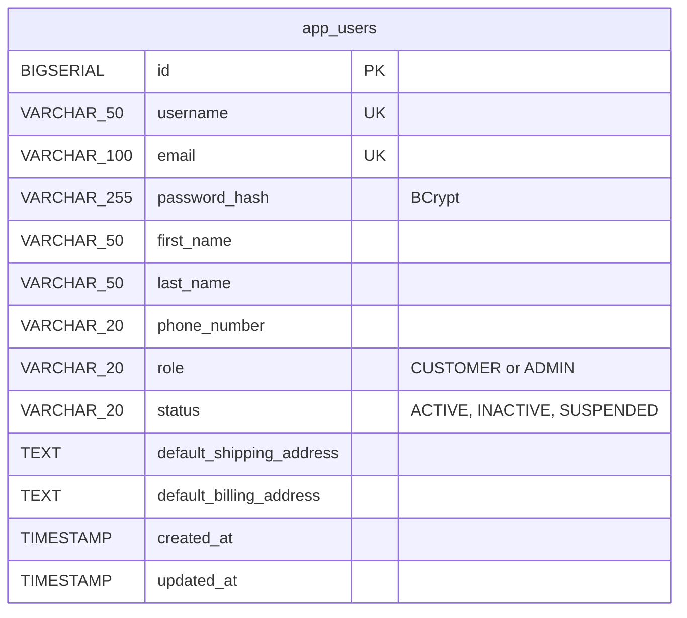
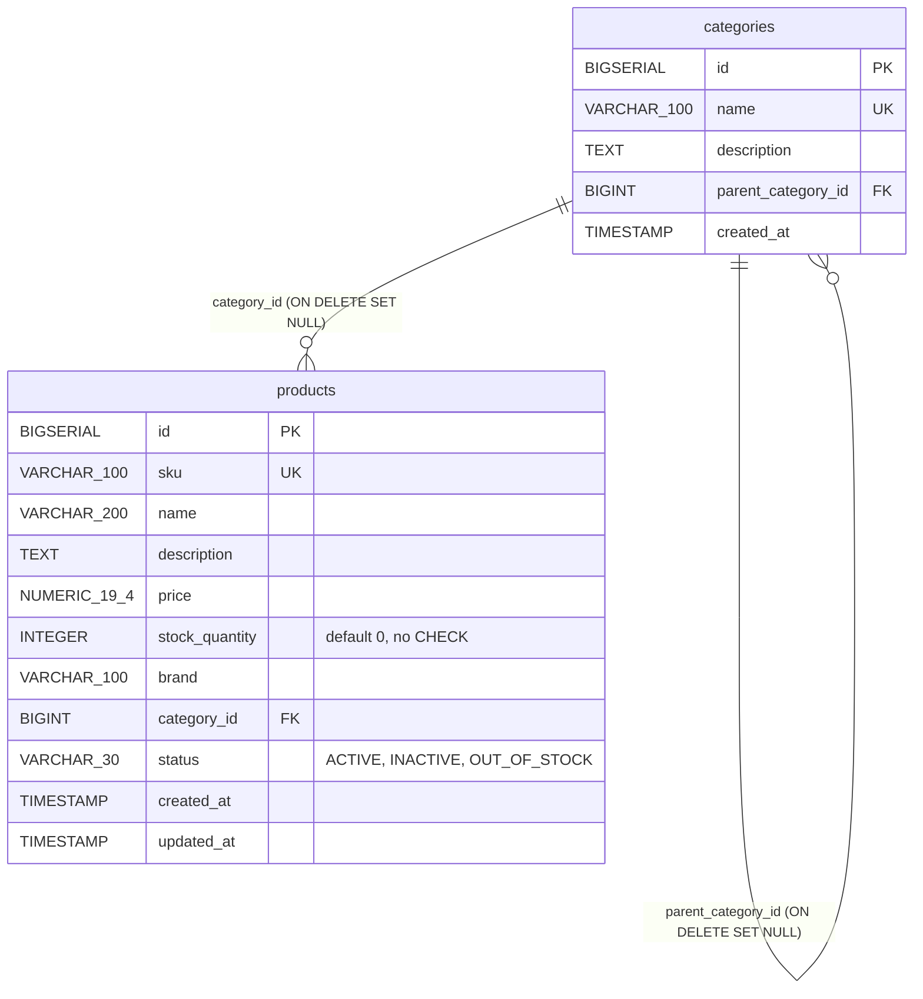
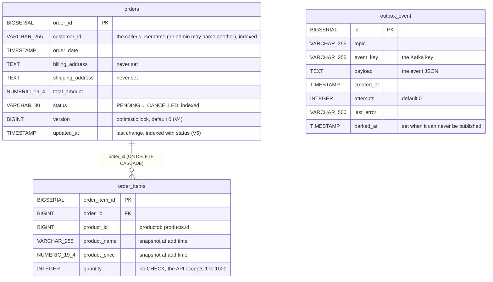
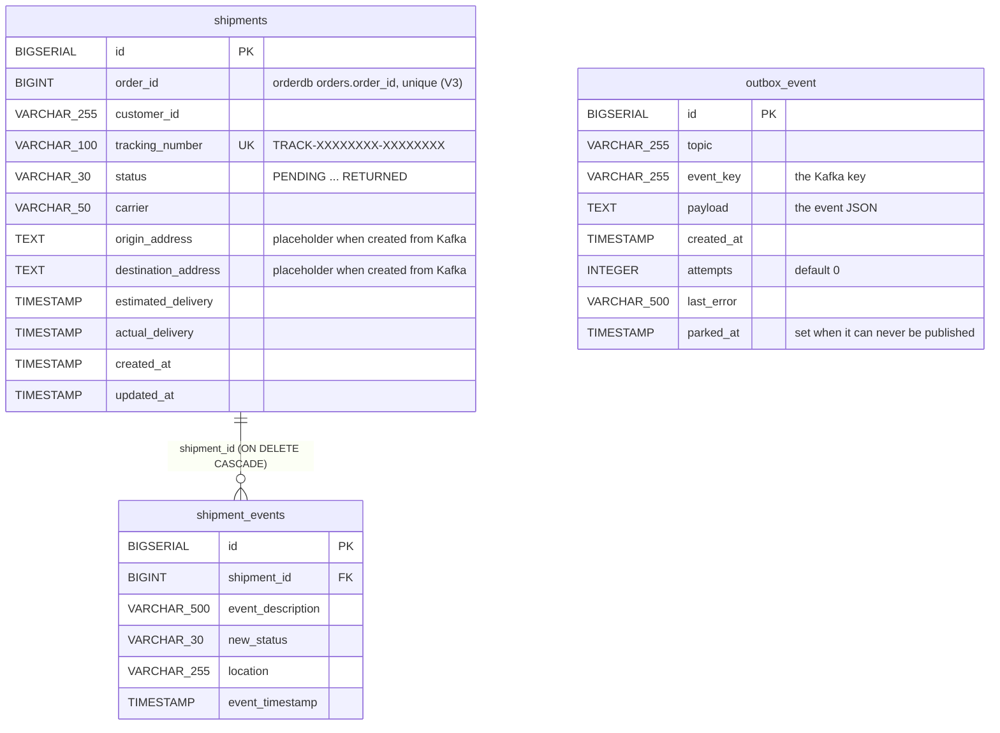
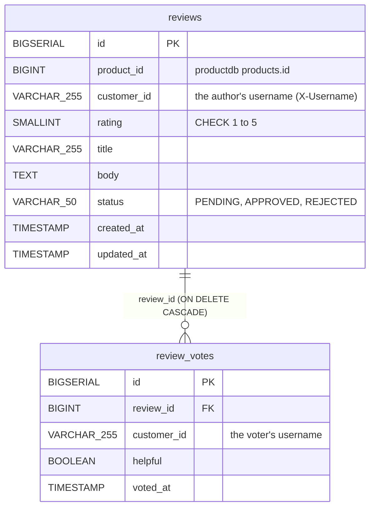
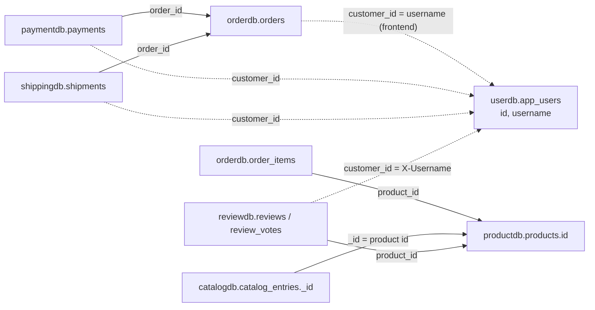

# Data model

Every database on the platform, what it holds, and how records in different
databases refer to each other. Each service owns its store outright. No
service reads another's tables, and there are no foreign keys between
services ([ADR-002](adr/ADR-002-database-per-service.md)). The schemas below
come from the Flyway migrations. Hibernate runs with `ddl-auto: validate`, so
the migrations are the single authority.

## Stores

| Database | Engine | Owner | Contents | Migrations | Host port |
|---|---|---|---|---|---|
| `userdb` | PostgreSQL 16 | user-service | `app_users` | `V1__create_app_users.sql` | 5432 |
| `productdb` | PostgreSQL 16 | product-service | `categories`, `products` | `V1__create_categories.sql`, `V2__create_products.sql` | 5433 |
| `catalogdb` | MongoDB 8.0 | catalog-service | `catalog_entries` collection | indexes created at startup by `CatalogCollectionInitializer` | 27017 |
| `orderdb` | PostgreSQL 16 | order-service | `orders`, `order_items`, `outbox_event` | `V1__create_orders.sql`, `V2__create_order_items.sql`, `V3__create_outbox_event.sql`, `V4__order_version.sql`, `V5__order_updated_at.sql` | 5434 |
| `paymentdb` | PostgreSQL 16 | payment-service | `payments`, `outbox_event` | `V1__create_payments.sql`, `V2__unique_payment_order_id.sql`, `V3__payment_version.sql`, `V4__create_outbox_event.sql` | 5436 |
| `shippingdb` | PostgreSQL 16 | shipping-service | `shipments`, `shipment_events`, `outbox_event` | `V1__create_shipments.sql`, `V2__create_shipment_events.sql`, `V3__unique_shipment_per_order.sql`, `V4__create_outbox_event.sql` | 5437 |
| `reviewdb` | PostgreSQL 16 | review-service | `reviews`, `review_votes` | `V1__create_reviews.sql`, `V2__create_review_votes.sql` | 5438 |

notification-service and the gateway are stateless. Eureka keeps its registry
in memory, and Kafka keeps events for its default retention (7 days) on the
`kafka-data` volume.

## Schemas

### user-service

An `admin` row (role `ADMIN`) is inserted at startup by `DataInitializer`, not
by a migration. Deleting a user sets `status = INACTIVE`.

### product-service

A stock update loads the product row under a pessimistic write lock (on
PostgreSQL `SELECT ... FOR NO KEY UPDATE`) with a 5 s lock timeout, so concurrent
updates serialize. `products` has no version column, so a concurrent `PUT` can
still write back a stale `stock_quantity`.
Deletion is soft (`status = INACTIVE`).

### catalog-service (MongoDB)

One document per product in `catalog_entries`. `_id` **is** the product ID.

| Field | BSON type | Source |
|---|---|---|
| `_id` | Int64 | product `id` |
| `productSku`, `productName`, `description`, `brand` | string | product, overwritten on every sync |
| `price` | Decimal128 (2 dp) | product `price` rounded to cents, overwritten on every sync. A `PATCH` can change it until the next sync. |
| `categoryId` / `categoryName` | Int64 / string | product `categoryId`, plus its name from `GET /api/v1/categories` (null if that lookup fails) |
| `stockStatus` | string | derived: `OUT_OF_STOCK` at 0 or less, `LOW_STOCK` from 1 to 9, `AVAILABLE` at 10 or more |
| `featured`, `imageUrl` | bool, string | catalog-only. `PATCH` sets them, and a sync keeps them. |
| `createdAt`, `updatedAt` | date | |
| `version` | Int64 | optimistic lock (`@Version`) |

Indexes: `categoryId`, `featured`, `stockStatus`, and a weighted text index
(`productName` 10, `brand` 5, `description` 1). `_class` is not stored.

### order-service

`orders.version` (V4) is the optimistic lock: a writer that started from an
older version fails (409) instead of overwriting a newer state. `orders.updated_at`
(V5) is set on insert and on every update, and `idx_orders_status_updated
(status, updated_at)` serves the job that cancels PENDING carts idle for more
than 24 hours. Existing rows got `version` 0 and the migration time as
`updated_at`. `outbox_event` is described [below](#outbox_event).

### payment-service

```mermaid
erDiagram
    payments {
        BIGSERIAL id PK
        BIGINT order_id "orderdb orders.order_id, unique"
        VARCHAR_255 customer_id "the payer, who must own the order"
        NUMERIC_19_4 amount "equal to the order total, checked with order-service"
        VARCHAR_3 currency "default USD"
        VARCHAR_30 status "PENDING, COMPLETED, FAILED, REFUNDED"
        VARCHAR_30 method "CREDIT_CARD, DEBIT_CARD, BANK_TRANSFER, DIGITAL_WALLET"
        VARCHAR_255 transaction_id UK "TXN- and 16 hex digits"
        TEXT failure_reason
        VARCHAR_4 card_last_four
        TIMESTAMP created_at
        TIMESTAMP updated_at
        BIGINT version "optimistic lock, default 0 (V3)"
    }
    outbox_event {
        BIGSERIAL id PK
        VARCHAR_255 topic
        VARCHAR_255 event_key "the Kafka key"
        TEXT payload "the event JSON"
        TIMESTAMP created_at
        INTEGER attempts "default 0"
        VARCHAR_500 last_error
        TIMESTAMP parked_at "set when it can never be published"
    }
```

`order_id` is unique (V2), so a payment row is reused while it is `PENDING` and a
`FAILED` one is final for its order. `transaction_id` is `TXN-` followed by 16
upper-case hex digits (64 random bits). `outbox_event` is described
[below](#outbox_event).

### shipping-service

`outbox_event` is described [below](#outbox_event).

### outbox_event

order-, payment- and shipping-service each keep an `outbox_event` table in their
own database, with the same columns (order `V3`, payment `V4`, shipping `V4`). A
service inserts the event in the same transaction as the state change it
announces. `OutboxRelay` publishes the oldest rows every 500 ms and deletes a row
once Kafka has acknowledged it, so the table normally holds only the events that
wait for the next run, plus parked rows
([ADR-013](adr/ADR-013-transactional-outbox.md)).

| Column | Type | Notes |
|---|---|---|
| `id` | `BIGSERIAL` | primary key, and the publish order |
| `topic` | `VARCHAR(255)` NOT NULL | for example `order.placed` |
| `event_key` | `VARCHAR(255)` | the Kafka key, the order id as text |
| `payload` | `TEXT` NOT NULL | the event JSON as it goes on the wire (`LocalDateTime` as an integer array) |
| `created_at` | `TIMESTAMP` NOT NULL | |
| `attempts` | `INTEGER` NOT NULL, default 0 | failed publish attempts of the row |
| `last_error` | `VARCHAR(500)` | the last publish failure, cut at 500 characters |
| `parked_at` | `TIMESTAMP` | set when the row can never be published (too large, invalid topic, serialization), `NULL` otherwise |

The index `idx_outbox_event_pending (parked_at, id)` serves the relay's query:
unparked rows, oldest first. A parked row stays until someone releases it with
`UPDATE outbox_event SET parked_at = NULL WHERE id = ?`
(see the [runbook](runbook.md#check-the-outbox)). There are no foreign keys: the
table is a queue, not part of the domain model.

### review-service

Unique constraints: `(product_id, customer_id)` on `reviews`, giving one review
per user per product, and `(review_id, customer_id)` on `review_votes`, giving
one vote per user per review.

## References between services

Nothing enforces these. Each one is a value copied in by an API call or an
event, and it can dangle.

| Reference | Arrives by | Can it dangle? |
|---|---|---|
| `order_items.product_id` → product | the client's add-item call, checked by Feign at add time | Yes. Products are only soft-deleted, so the ID stays valid, but an `INACTIVE` product can still be ordered. |
| `catalog_entries._id` → product | `POST /catalog/sync/{id}` | Yes. Entries of deleted products are never removed. |
| `reviews.product_id` → product | checked by Feign at create time | Only through deletion later |
| `payments.order_id` → order | client request body, checked with order-service (`GET /internal/v1/orders/{id}`: the order exists, is `CONFIRMED`, belongs to the payer and costs exactly the amount) | Practically no. Orders are never deleted, only cancelled. |
| `shipments.order_id` → order | `payment.completed` | Practically no. The payment behind the event was checked against the order. |
| `*.customer_id` → user | the gateway header `X-Username` (a non-admin can only use their own, an admin may name another), or the event (shipments) | Yes. Nothing links the string to `app_users`. The value is the **username** in orders, payments, shipments and reviews. |

## Conventions and their consequences

| Topic | Convention |
|---|---|
| Keys | `BIGSERIAL` surrogate keys everywhere except Mongo, which reuses the product ID. IDs are sequential and guessable, so what protects a record is the ownership check in the service (order, payment, shipping and review answer 403 to anyone but the owner or an admin), not the ID. |
| Money | `NUMERIC(19,4)` in Postgres (so `39.98` reads back as `39.9800`), Decimal128 rounded to cents in Mongo. Only `payments` has a currency column, and it defaults to `USD`. |
| Time | `TIMESTAMP` without a time zone, written from `LocalDateTime.now()` in the container's zone (UTC in the Alpine images). REST returns ISO strings without an offset, and Kafka carries integer arrays. |
| Enums | stored as their names in `VARCHAR`. An unknown value sent to most endpoints causes a 500 (`valueOf`). |
| Deletion | Soft for users and products (status flag). Hard for reviews, and their votes cascade. Orders are never deleted, because cancelling sets a status. Nothing is purged, except `outbox_event` rows, which the relay deletes once Kafka has acknowledged them. |
| Audit columns | `created_at` defaults exist, but the entities set them in Java. `updated_at` is null until the first update in most tables. |
| Schema change | add a new `V<n>__*.sql`. Never edit an applied migration, because Flyway's checksum check fails the next start (see the [Runbook](runbook.md#reset-one-database)). |

## Known data issues

| Issue | Where | Impact |
|---|---|---|
| ~~No unique constraint on `payments.order_id` or `shipments.order_id`~~ | fixed: payment `V2`, shipping `V3` | one row per order; a concurrent or replayed create is a 409 (payment) or an already-done skip (shipping) |
| No `CHECK (quantity > 0)` on `order_items`, no `CHECK (stock_quantity >= 0)` on `products` | V2 migrations | the API refuses non-positive quantities (order-service accepts 1 to 1000) and a stock change below zero, so only a manual insert can store them |
| Addresses never written to `orders` | order-service API | shipping has to invent addresses |
| Redundant indexes duplicating unique constraints (`idx_products_sku`, `idx_app_users_username`, `idx_app_users_email`, `idx_shipments_tracking`) | migrations | extra write cost, no benefit |
| `idx_products_name` (B-tree) can't serve `LIKE '%q%'` searches | product V2 | product search scans the table |
| Customer identity is a free string with no link to `app_users` | orders, payments, shipments, reviews | it is the username, so per-user queries line up, but an admin can store any string and nothing checks that the user exists |
