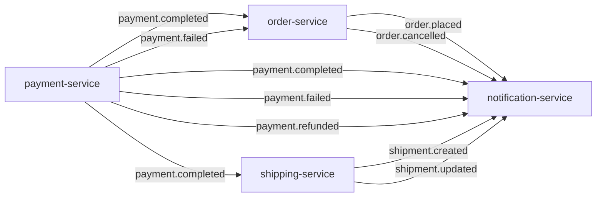

# Event catalog

Every Kafka topic on the platform: who publishes it and when, who consumes it
and what they do with it, the exact payload, and what happens when something
goes wrong. Payloads were checked field by field on both sides of each topic.
Every consumer's copy of an event class matches its producer's in names and
types.

## Topology



| Topic | Producer | Published when | Consumers (group → effect) |
|---|---|---|---|
| `order.placed` | order-service | `POST /api/v1/orders/{id}/confirm` | `notification-service` → log line |
| `order.cancelled` | order-service | `DELETE /api/v1/orders/{id}` (only; a cancel caused by `payment.failed` publishes nothing) | `notification-service` → log line |
| `payment.completed` | payment-service | `POST /api/v1/payments/{id}/process`, gateway approved (80 %) | `order-service` → order `PAID`; `shipping-service` → create shipment; `notification-service` → log line |
| `payment.failed` | payment-service | `POST /api/v1/payments/{id}/process`, gateway declined (20 %) | `order-service` → order `CANCELLED`; `notification-service` → log line |
| `payment.refunded` | payment-service | `POST /api/v1/payments/{id}/refund` (no client calls it today) | `notification-service` → log line |
| `shipment.created` | shipping-service | its `payment.completed` consumer created a shipment (the REST create publishes nothing) | `notification-service` → log line |
| `shipment.updated` | shipping-service | `PATCH /api/v1/shipments/{id}/status` | `notification-service` → log line |

Nothing consumes `order.placed` except notification-service. In particular,
payment-service does **not** start a payment from it. The client starts
payments over REST; see [End-to-end flows](flows.md#5-checkout-and-payment).

## Conventions shared by every topic

| Aspect | Behaviour |
|---|---|
| Broker | One KRaft node (`confluentinc/cp-kafka:7.6.0`), plaintext. In-cluster `kafka:29092`, host `localhost:9092`. |
| Topic creation | Implicit: `KAFKA_AUTO_CREATE_TOPICS_ENABLE=true`, so each topic is created on first use with the broker defaults of **1 partition** and replication factor 1. No service declares topics. |
| Record key | `orderId.toString()` on every topic. With one partition this changes nothing today. With more partitions it would keep each order's events in order. |
| Value | JSON from spring-kafka's `JacksonJsonSerializer` (Jackson 3), **without type headers** (`.noTypeInfo()`). The consumer decides the target class. The serializer is passed to `DefaultKafkaProducerFactory` as a configured instance, not as a class name, because its mapper is customised (next row). |
| Dates | `LocalDateTime` is written as an **integer array** `[year, month, day, hour, minute, second, nanos]`, not an ISO string. Trailing zero fields are dropped, so `nanos` is absent when it is 0. Jackson 3 writes ISO strings by default, so each producer's `KafkaProducerConfig.eventJsonMapper()` enables `DateTimeFeature.WRITE_DATES_AS_TIMESTAMPS` to keep the array form that every consumer and Pact contract expects (it was the default of the Jackson 2 serializer used before). REST APIs use ISO strings; Kafka does not. |
| Money | `BigDecimal` as a JSON number, e.g. `39.98`. Amounts read back from Postgres carry scale 4, e.g. `39.9800`. |
| Producer settings | Kafka client defaults: `acks=all`, idempotent producer, retries for up to 2 minutes (`delivery.timeout.ms`). |
| Kafka wiring | Each service builds its own producer and consumer beans in `config/KafkaProducerConfig.java` or `KafkaConsumerConfig.java` with `@EnableKafka`. Boot's Kafka auto-configuration module is not on the classpath (the poms depend on plain `spring-kafka`), so the `spring.kafka.*` keys in the YAML files are **ignored**, except `spring.kafka.bootstrap-servers`, which the config classes read with `@Value`. |
| Tracing | Not propagated. Kafka observation is not enabled on any template or listener, so a consumer starts a new trace instead of continuing the producer's. |
| Contracts | Every topic is pinned by a Pact message contract, consumer → producer. See [Contracts](#contracts). |

## Payloads

`LocalDateTime` values are shown in their wire form. Field types are the Java
types on both sides.

### `order.placed`

Producer: `OrderEventProducer.publishOrderPlaced()`, called from
`OrderService.confirmOrder()`. Event class `event/OrderPlacedEvent.java`.

| Field | Java type | JSON | Notes |
|---|---|---|---|
| `orderId` | `Long` | number | |
| `customerId` | `String` | string | Whatever the client passed when creating the order. The frontend sends the username. |
| `totalAmount` | `BigDecimal` | number | running sum of `productPrice × quantity` |
| `orderDate` | `LocalDateTime` | int array | the order's **creation** time, not the confirmation time |
| `items[]` | `List<OrderItemEvent>` | array | `productId` (Long), `productName` (String), `productPrice` (BigDecimal), `quantity` (Integer): snapshots taken when each line was added |

notification-service's mirror omits `items`. That is safe because Jackson's
`FAIL_ON_UNKNOWN_PROPERTIES` is off in its deserializer.

```json
{"orderId":42,"customerId":"alice","totalAmount":39.98,"orderDate":[2026,10,29,18,7,12,345678000],
 "items":[{"productId":7,"productName":"Smoke Test Widget","productPrice":19.99,"quantity":2}]}
```

### `order.cancelled`

Producer: `OrderEventProducer.publishOrderCancelled()`, called from
`OrderService.cancelOrder()`, which serves `DELETE /api/v1/orders/{id}`.

| Field | Java type | JSON |
|---|---|---|
| `orderId` | `Long` | number |
| `customerId` | `String` | string |
| `cancelledAt` | `LocalDateTime` | int array |

```json
{"orderId":42,"customerId":"alice","cancelledAt":[2026,10,29,18,9,3,120000000]}
```

### `payment.completed`

Producer: `PaymentEventProducer`, called from `PaymentService.processPayment()`
on the success branch.

| Field | Java type | JSON | Notes |
|---|---|---|---|
| `paymentId` | `Long` | number | |
| `orderId` | `Long` | number | client-supplied when the payment was created, never verified |
| `customerId` | `String` | string | client-supplied |
| `amount` | `BigDecimal` | number | client-supplied, never compared with the order total |
| `transactionId` | `String` | string | `TXN-` + 8 upper-case hex digits |
| `completedAt` | `LocalDateTime` | int array | |

```json
{"paymentId":17,"orderId":42,"customerId":"alice","amount":39.9800,"transactionId":"TXN-1A2B3C4D",
 "completedAt":[2026,10,29,18,7,15,2000000]}
```

### `payment.failed`

Producer: `PaymentService.processPayment()`, decline branch.

| Field | Java type | JSON | Notes |
|---|---|---|---|
| `paymentId` | `Long` | number | |
| `orderId` | `Long` | number | |
| `customerId` | `String` | string | |
| `failureReason` | `String` | string | always `Payment declined by gateway` |
| `failedAt` | `LocalDateTime` | int array | |

### `payment.refunded`

Producer: `PaymentService.refundPayment()`. Only `COMPLETED` payments are
refunded, and always in full.

| Field | Java type | JSON |
|---|---|---|
| `paymentId` | `Long` | number |
| `orderId` | `Long` | number |
| `customerId` | `String` | string |
| `amount` | `BigDecimal` | number |
| `refundedAt` | `LocalDateTime` | int array |

### `shipment.created`

Producer: `ShipmentEventProducer`, called from shipping-service's
`messaging/PaymentEventConsumer` after it creates a shipment for a
`payment.completed`.

| Field | Java type | JSON | Notes |
|---|---|---|---|
| `shipmentId` | `Long` | number | |
| `orderId` | `Long` | number | |
| `customerId` | `String` | string | copied from the payment event |
| `trackingNumber` | `String` | string | `TRACK-XXXXXXXX-X` |
| `carrier` | `String` | string | always `DHL` on this path |
| `estimatedDelivery` | `LocalDateTime` | int array | now + 5 days. **This field caused the 992 GB incident** when the consumer declared it as `LocalDate`. |

```json
{"shipmentId":5,"orderId":42,"customerId":"alice","trackingNumber":"TRACK-9F3A21C4-7","carrier":"DHL",
 "estimatedDelivery":[2026,11,3,18,7,15,30000000]}
```

### `shipment.updated`

Producer: `ShipmentEventProducer.publishShipmentUpdated()`, called from
`ShipmentService.updateShipmentStatus()`, which serves
`PATCH /api/v1/shipments/{id}/status`.

| Field | Java type | JSON | Notes |
|---|---|---|---|
| `shipmentId` | `Long` | number | |
| `orderId` | `Long` | number | |
| `trackingNumber` | `String` | string | |
| `newStatus` | `String` | string | a `ShipmentStatus` name: `PENDING`, `PROCESSING`, `SHIPPED`, `OUT_FOR_DELIVERY`, `DELIVERED`, `RETURNED` |
| `location` | `String` | string or null | free text from the request |
| `updatedAt` | `LocalDateTime` | int array | |

## Consumers

| Group | Service | Topics | How values are read | Concurrency | On redelivery |
|---|---|---|---|---|---|
| `order-service` | order-service, `messaging/PaymentEventConsumer` | `payment.completed`, `payment.failed` | `StringDeserializer`, then `JacksonJsonMessageConverter` binds to the event class in the listener adapter | 1 | **Not idempotent in effect, and unguarded.** It sets `PAID` or `CANCELLED` whatever the current status, so a late or replayed event can resurrect a cancelled order as `PAID`. |
| `shipping-service` | shipping-service, `messaging/PaymentEventConsumer` | `payment.completed` | as above | 1 | Skips with a WARN if a shipment already exists for the order. The check-then-insert is not race-safe, because `shipments.order_id` is not unique. |
| `notification-service` | notification-service, `consumer/*EventConsumer` | all seven | a per-topic `JacksonJsonDeserializer<T>` inside the Kafka consumer (trusted packages `*`, type headers off) | 1 per topic | Logs the event again. Harmless today, because nothing is sent. |

All three use `auto.offset.reset=earliest`. Offsets are committed by the
listener container after each batch (`enable.auto.commit` forced to false,
AckMode `BATCH`), so delivery is **at least once**. A crash between processing
and commit replays the batch.

## Failure handling

There is no dead-letter topic and no custom error handler anywhere. What
happens to a bad record depends on where it fails:

| Failure | order-service, shipping-service | notification-service |
|---|---|---|
| The value is not valid JSON for the target class | Conversion fails in the listener adapter. Spring Kafka classifies conversion errors as not retryable, so the record is **logged and skipped at once**. | Deserialization fails inside `poll()`. spring-kafka 4.0.1's `DefaultErrorHandler` can't skip a `SerializationException` there, so the container re-polls the same offset **forever**, logging a stack trace each time. Health stays `UP`. This is the [poison pill](runbook.md#skip-a-poison-pill). |
| The listener throws, e.g. a database outage | `DefaultErrorHandler` with `FixedBackOff(0, 9)`: 10 immediate attempts, then logs and commits past the record. **The status change is lost.** | Same, though its listener only logs. |
| The referenced order or shipment does not exist | Logged at WARN and skipped. | — |

Producer-side failure modes, the same in all three producers:

- **Sent inside the database transaction, before commit.** `kafkaTemplate.send()` runs inside the `@Transactional` service method, and its future is never checked. If the commit then fails, consumers act on a change that never happened. If the send fails after the commit, the change happened but nobody hears about it, and only the `LoggingProducerListener` error line records it. There is no transactional outbox.
- **Broker unavailable.** `send()` blocks for metadata for up to `max.block.ms` (60 s), so the HTTP request that triggered it hangs.

## Ordering and consistency

- Each topic has a single partition, so events within a topic are consumed in publish order. Nothing orders events **across** topics. A `DELETE` cancel and a `payment.completed` for the same order can be processed in either order, and the last writer wins.
- The purchase saga is choreographed with no compensations. A declined payment cancels the order but leaves its stock reserved. A refund changes nothing outside payment-service. See [End-to-end flows](flows.md) and [Findings](findings.md).

## Contracts

Every event type is pinned by a Pact message pact, written by the consumer and
verified by the producer on every build. Each pact covers every field type and
the record key. See [ADR-008](adr/ADR-008-pact-without-broker.md).

| Pact | Topics |
|---|---|
| `notification-service` ← `order-service` | `order.placed`, `order.cancelled` |
| `notification-service` ← `payment-service` | `payment.completed`, `payment.failed`, `payment.refunded` |
| `notification-service` ← `shipping-service` | `shipment.created`, `shipment.updated` |
| `order-service` ← `payment-service` | `payment.completed`, `payment.failed` |
| `shipping-service` ← `payment-service` | `payment.completed` |

### Changing an event safely

1. **Adding a field** is backwards compatible. Consumers ignore unknown properties. Add it to the producer, then to the consumers that need it, then re-sync the pacts.
2. **Renaming or removing a field, or changing its type**, breaks consumers. The provider pact test fails, which is the point. Add the new field alongside the old one, migrate the consumers, then remove the old field in a later release.
3. Keep the `LocalDateTime` wire form, an integer array. Every consumer mirror and every pact assumes it.
4. Run `ecommerce-platform/sync-pacts.sh` and commit the updated `src/test/resources/pacts/*.json` in the producer's repository.

## Inspecting topics

Kafka UI at http://localhost:8090 shows topics, messages and consumer lag.
For the CLI, offset resets and replays, see the [Runbook](runbook.md#inspect-topics-consumer-groups-and-lag).
