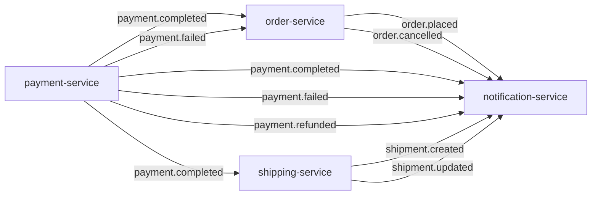

# Event catalog

Every Kafka topic on the platform: who publishes it and when, who consumes it
and what they do with it, the exact payload, and what happens when something
goes wrong. Payloads were checked field by field on both sides of each topic.
Every consumer's copy of an event class matches its producer's in names and
types.

## Topology



| Topic | Producer | Published when | Consumers (group → effect) |
|---|---|---|---|
| `order.placed` | order-service | `POST /api/v1/orders/{id}/confirm` | `notification-service` → log line |
| `order.cancelled` | order-service | `DELETE /api/v1/orders/{id}` (only; a cancel caused by `payment.failed` publishes nothing) | `notification-service` → log line |
| `payment.completed` | payment-service | `POST /api/v1/payments/{id}/process`, gateway approved (80 %) | `order-service` → order `PAID`; `shipping-service` → create shipment; `notification-service` → log line |
| `payment.failed` | payment-service | `POST /api/v1/payments/{id}/process`, gateway declined (20 %) | `order-service` → order `CANCELLED`; `notification-service` → log line |
| `payment.refunded` | payment-service | `POST /api/v1/payments/{id}/refund` (no client calls it today) | `notification-service` → log line |
| `shipment.created` | shipping-service | its `payment.completed` consumer created a shipment (the REST create publishes nothing) | `notification-service` → log line |
| `shipment.updated` | shipping-service | `PATCH /api/v1/shipments/{id}/status` | `notification-service` → log line |

Nothing consumes `order.placed` except notification-service. In particular,
payment-service does **not** start a payment from it. The client starts
payments over REST; see [End-to-end flows](flows.md#5-checkout-and-payment).

## Conventions shared by every topic

| Aspect | Behaviour |
|---|---|
| Broker | One KRaft node (`confluentinc/cp-kafka:7.6.0`), plaintext. In-cluster `kafka:29092`, host `localhost:9092`. |
| Topic creation | Implicit: `KAFKA_AUTO_CREATE_TOPICS_ENABLE=true`, so each topic is created on first use with the broker defaults of **1 partition** and replication factor 1. No service declares topics. |
| Record key | `orderId.toString()` on every topic. With one partition this changes nothing today. With more partitions it would keep each order's events in order. |
| Value | JSON from spring-kafka's `JacksonJsonSerializer` (Jackson 3), **without type headers** (`.noTypeInfo()`). The consumer decides the target class. The serializer is passed to `DefaultKafkaProducerFactory` as a configured instance, not as a class name, because its mapper is customised (next row). |
| Dates | `LocalDateTime` is written as an **integer array** `[year, month, day, hour, minute, second, nanos]`, not an ISO string. Trailing zero fields are dropped, so `nanos` is absent when it is 0. Jackson 3 writes ISO strings by default, so each producer's `KafkaProducerConfig.eventJsonMapper()` enables `DateTimeFeature.WRITE_DATES_AS_TIMESTAMPS` to keep the array form that every consumer and Pact contract expects (it was the default of the Jackson 2 serializer used before). REST APIs use ISO strings; Kafka does not. |
| Money | `BigDecimal` as a JSON number, e.g. `39.98`. Amounts read back from Postgres carry scale 4, e.g. `39.9800`. |
| Producer settings | Set explicitly in every producer: `acks=all`, idempotent producer, `max.block.ms` 5000, `request.timeout.ms` 10000, `delivery.timeout.ms` 30000, reconnect back-off 1 s to 10 s. A dead broker can't hold a thread for long. |
| Publishing | Through a **transactional outbox** ([ADR-013](adr/ADR-013-transactional-outbox.md)). The service writes the serialized event into its `outbox_event` table in the same transaction as the state change. `OutboxRelay` publishes rows every 500 ms, oldest first, and deletes each one once Kafka has acknowledged it. An event exists if and only if its change committed, and leaves up to about half a second later. Delivery is at least once. |
| Kafka wiring | Each service builds its own producer and consumer beans in `config/KafkaProducerConfig.java` or `KafkaConsumerConfig.java` with `@EnableKafka`. Boot's Kafka auto-configuration module is not on the classpath (the poms depend on plain `spring-kafka`), so the `spring.kafka.*` keys in the YAML files are **ignored**, except `spring.kafka.bootstrap-servers`, which the config classes read with `@Value`. |
| Tracing | Not propagated. Kafka observation is not enabled on any template or listener, so a consumer starts a new trace instead of continuing the producer's. |
| Contracts | Every topic is pinned by a Pact message contract, consumer → producer. See [Contracts](#contracts). |

## Payloads

`LocalDateTime` values are shown in their wire form. Field types are the Java
types on both sides.

### `order.placed`

Producer: `OrderEventProducer.publishOrderPlaced()`, called from
`OrderService.confirmOrder()`. Event class `event/OrderPlacedEvent.java`.

| Field | Java type | JSON | Notes |
|---|---|---|---|
| `orderId` | `Long` | number | |
| `customerId` | `String` | string | Whatever the client passed when creating the order. The frontend sends the username. |
| `totalAmount` | `BigDecimal` | number | running sum of `productPrice × quantity` |
| `orderDate` | `LocalDateTime` | int array | the order's **creation** time, not the confirmation time |
| `items[]` | `List<OrderItemEvent>` | array | `productId` (Long), `productName` (String), `productPrice` (BigDecimal), `quantity` (Integer): snapshots taken when each line was added |

notification-service's mirror omits `items`. That is safe because Jackson's
`FAIL_ON_UNKNOWN_PROPERTIES` is off in its deserializer.

```json
{"orderId":42,"customerId":"alice","totalAmount":39.98,"orderDate":[2026,10,29,18,7,12,345678000],
 "items":[{"productId":7,"productName":"Smoke Test Widget","productPrice":19.99,"quantity":2}]}
```

### `order.cancelled`

Producer: `OrderEventProducer.publishOrderCancelled()`, called from
`OrderService.cancelOrder()`, which serves `DELETE /api/v1/orders/{id}`, and from
`ReservationExpiryJob`, which cancels `PENDING` carts left unchanged for
`orders.reservation.pending-ttl` (24 h by default) the same way. A cancellation
after a declined payment publishes nothing (`payment.failed` already said it).

| Field | Java type | JSON |
|---|---|---|
| `orderId` | `Long` | number |
| `customerId` | `String` | string |
| `cancelledAt` | `LocalDateTime` | int array |

```json
{"orderId":42,"customerId":"alice","cancelledAt":[2026,10,29,18,9,3,120000000]}
```

### `payment.completed`

Producer: `PaymentEventProducer`, called from `PaymentService.processPayment()`
on the success branch.

| Field | Java type | JSON | Notes |
|---|---|---|---|
| `paymentId` | `Long` | number | |
| `orderId` | `Long` | number | checked with order-service when the payment was initiated: the order is `CONFIRMED` |
| `customerId` | `String` | string | the payer, who must own the order |
| `amount` | `BigDecimal` | number | equal to the order total (checked at initiation) |
| `transactionId` | `String` | string | `TXN-` + 16 upper-case hex digits |
| `completedAt` | `LocalDateTime` | int array | |

```json
{"paymentId":17,"orderId":42,"customerId":"alice","amount":39.9800,"transactionId":"TXN-1A2B3C4D5E6F7A8B",
 "completedAt":[2026,10,29,18,7,15,2000000]}
```

### `payment.failed`

Producer: `PaymentService.processPayment()`, decline branch. The decline ends the
order: order-service cancels it and returns its stock, and payment-service refuses
a new attempt for it (409). The customer places a new order.

| Field | Java type | JSON | Notes |
|---|---|---|---|
| `paymentId` | `Long` | number | |
| `orderId` | `Long` | number | |
| `customerId` | `String` | string | |
| `failureReason` | `String` | string | always `Payment declined by gateway` |
| `failedAt` | `LocalDateTime` | int array | |

### `payment.refunded`

Producer: `PaymentService.refundPayment()`. Only `COMPLETED` payments are
refunded, and always in full.

| Field | Java type | JSON |
|---|---|---|
| `paymentId` | `Long` | number |
| `orderId` | `Long` | number |
| `customerId` | `String` | string |
| `amount` | `BigDecimal` | number |
| `refundedAt` | `LocalDateTime` | int array |

### `shipment.created`

Producer: `ShipmentEventProducer`, called from shipping-service's
`messaging/PaymentEventConsumer` after it creates a shipment for a
`payment.completed`.

| Field | Java type | JSON | Notes |
|---|---|---|---|
| `shipmentId` | `Long` | number | |
| `orderId` | `Long` | number | |
| `customerId` | `String` | string | copied from the payment event |
| `trackingNumber` | `String` | string | `TRACK-XXXXXXXX-XXXXXXXX`: 16 upper-case hex digits from a `SecureRandom` |
| `carrier` | `String` | string | always `DHL` on this path |
| `estimatedDelivery` | `LocalDateTime` | int array | now + 5 days. **This field caused the 992 GB incident** when the consumer declared it as `LocalDate`. |

```json
{"shipmentId":5,"orderId":42,"customerId":"alice","trackingNumber":"TRACK-9F3A21C4-7B0E55D1","carrier":"DHL",
 "estimatedDelivery":[2026,11,3,18,7,15,30000000]}
```

### `shipment.updated`

Producer: `ShipmentEventProducer.publishShipmentUpdated()`, called from
`ShipmentService.updateShipmentStatus()`, which serves
`PATCH /api/v1/shipments/{id}/status`.

| Field | Java type | JSON | Notes |
|---|---|---|---|
| `shipmentId` | `Long` | number | |
| `orderId` | `Long` | number | |
| `trackingNumber` | `String` | string | |
| `newStatus` | `String` | string | a `ShipmentStatus` name: `PENDING`, `PROCESSING`, `SHIPPED`, `OUT_FOR_DELIVERY`, `DELIVERED`, `RETURNED` |
| `location` | `String` | string or null | free text from the request |
| `updatedAt` | `LocalDateTime` | int array | |

## Consumers

| Group | Service | Topics | How values are read | Concurrency | On redelivery |
|---|---|---|---|---|---|
| `order-service` | order-service, `messaging/PaymentEventConsumer` | `payment.completed`, `payment.failed` | `StringDeserializer`, then `JacksonJsonMessageConverter` binds to the event class in the listener adapter | 1 | **Guarded by state.** `payment.completed` pays only a `CONFIRMED` order. A replay for an order already `PAID`, `SHIPPED` or `DELIVERED` logs one throttled INFO. A payment for a `CANCELLED` or `PENDING` order is not applied and WARNs that it may need a refund. A replayed `payment.failed` changes nothing. |
| `shipping-service` | shipping-service, `messaging/PaymentEventConsumer` | `payment.completed` | as above | 1 | One shipment per order, enforced by a unique `order_id`. A replay, or a lost race on the unique key, counts as already done and logs one throttled INFO. An event without a valid order, customer or positive amount is logged (throttled WARN) and dropped. |
| `notification-service` | notification-service, `consumer/*EventConsumer` | all seven | a per-topic `JacksonJsonDeserializer<T>` wrapped in an `ErrorHandlingDeserializer` (trusted packages `*`, type headers off) | 1 per topic | Logs the event again. Harmless today, because nothing is sent. |

All three use `auto.offset.reset=earliest`. Offsets are committed by the
listener container after each batch (`enable.auto.commit` forced to false,
AckMode `BATCH`), so delivery is **at least once**. A crash between processing
and commit replays the batch.

## Failure handling

Every listener container has a `DefaultErrorHandler` whose recoverer publishes
the failed record to `<topic>.DLT` (partition chosen by the producer). order- and
shipping-service publish the value unchanged. notification-service publishes a
record it couldn't read with its original bytes, and a record whose listener
failed re-serialized from its mirror class, so only the fields that mirror knows.
The headers `kafka_dlt-original-topic`, `-partition` and `-offset` point to the
original. Dead-letter topics are created on first use, like every other topic.
What happens to a bad record depends on why it fails
([resilience-fix-spec.md](resilience-fix-spec.md) rule K1):

| Failure | order-service, shipping-service | notification-service |
|---|---|---|
| The value is not valid JSON for the target class | Conversion errors are not retryable: the record goes to the DLT at once, with one WARN. | The `ErrorHandlingDeserializer` turns it into a failed record, which goes to the DLT. The partition moves on. |
| The database, a lock or the broker fails behind the listener | Retried with back-off from 1 s to 30 s for **as long as it lasts**. Nothing goes to the DLT, and the partition waits. | — (no database) |
| Any other listener exception, for example a bug | Retried twice, a second apart, then sent to the DLT. One ERROR with a stack trace per kind of failure per 10 s. | Same. |
| The dead-letter copy can't be written | Copies carry the exception class and message headers but never the stack trace. A copy that is still too large for the broker is retried bare: the record's own headers plus its original topic, partition and offset. A record the broker can never accept is skipped with one ERROR, counted in `kafka_dlt_dropped_total` and alerted on (`KafkaDeadLetterDropped`). A transient failure is retried four times (1/2/4/8 s), then the round starts again. | Same. |

Each dead letter logs one WARN per topic per 10 s and counts in
`kafka_dlt_published_total{topic}`. DLT growth is alerted on
(`KafkaDeadLetterRecords`, `KafkaDeadLetterFlood`). The [runbook](runbook.md)
shows how to read a DLT and replay its records.

Producer side: events go through the outbox (see [Conventions](#conventions-shared-by-every-topic)), so:

- **Broker unavailable.** Rows wait in `outbox_event` (`outbox_events_pending`). The relay retries from 1 s up to every 30 s, logging one WARN a minute and one INFO when it recovers. Requests are not affected.
- **A record Kafka can never accept** (too large, invalid topic). The row is parked (`parked_at`), and one ERROR gives the SQL to release it once the cause is fixed. The rows behind it are still sent.
- **Duplicates.** A crash between Kafka's acknowledgement and the row's delete publishes the event again, and the consumers' guards absorb it.

## Ordering and consistency

- Each topic has a single partition, so events within a topic are consumed in publish order. Nothing orders events **across** topics. A `DELETE` cancel and a `payment.completed` for the same order can be processed in either order, and the last writer wins.
- `payment.completed` and `payment.failed` are different topics, so nothing orders them against each other. A `FAILED` payment can't be retried for the same order, so one order never sees both.
- The purchase saga is choreographed. Its one compensation: a declined payment cancels the order and order-service returns the stock once the cancellation has committed. Abandoned `PENDING` carts are cancelled after 24 h. A refund still changes nothing outside payment-service. See [End-to-end flows](flows.md) and [Findings](findings.md).

## Contracts

Every event type is pinned by a Pact message pact, written by the consumer and
verified by the producer on every build. Each pact covers every field type and
the record key. See [ADR-008](adr/ADR-008-pact-without-broker.md). The pacts check the
serialized shape only. The Testcontainers `*IT` classes in each producer and consumer repository complement them with real
Kafka round trips: the order, payment and shipping ITs publish to and consume from a `cp-kafka:7.6.0` broker,
and notification-service's `NotificationEventsIT` feeds all seven topics. `PoisonPillIT` and `DeadLetterResilienceIT` there, and
`KafkaErrorHandlingIT` in order and shipping, prove the dead-letter handling against a real broker, including a record too large
to dead-letter followed by one that must still be processed ([R-1](findings.md#messaging-reliability), fixed).

| Pact | Topics |
|---|---|
| `notification-service` ← `order-service` | `order.placed`, `order.cancelled` |
| `notification-service` ← `payment-service` | `payment.completed`, `payment.failed`, `payment.refunded` |
| `notification-service` ← `shipping-service` | `shipment.created`, `shipment.updated` |
| `order-service` ← `payment-service` | `payment.completed`, `payment.failed` |
| `shipping-service` ← `payment-service` | `payment.completed` |

### Changing an event safely

1. **Adding a field** is backwards compatible. Consumers ignore unknown properties. Add it to the producer, then to the consumers that need it, then re-sync the pacts.
2. **Renaming or removing a field, or changing its type**, breaks consumers. The provider pact test fails, which is the point. Add the new field alongside the old one, migrate the consumers, then remove the old field in a later release.
3. Keep the `LocalDateTime` wire form, an integer array. Every consumer mirror and every pact assumes it.
4. Run `ecommerce-platform/sync-pacts.sh` and commit the updated `src/test/resources/pacts/*.json` in the producer's repository.

## Inspecting topics

Kafka UI at http://localhost:8090 shows topics, messages and consumer lag.
For the CLI, offset resets and replays, see the [Runbook](runbook.md#inspect-topics-consumer-groups-and-lag).
