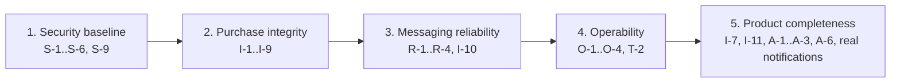

# Findings and roadmap

Everything found to be wrong, risky or missing while the platform was analysed
for these docs (October 2026), in priority order and with a suggested fix for
each. The per-service pages carry the details; this page is the to-do list.

**Verified** marks findings reproduced on 2026-10-29 against a running stack.
**test** marks findings pinned by a disabled test that asserts the correct
behaviour ([Bugs pinned by tests](#bugs-pinned-by-tests)). The others were
established from the code, with file references on the service pages.

Severity: **High** means data can be corrupted, money or stock lost, or any
user can act as any other. **Medium** means a real defect or exposure with a
workaround or a limited blast radius. **Low** means a quality or maintainability
issue.

## Resilience findings (2026-10-30)

A second pass, on branch `feature/resilience-hardening` across all 13 repositories, looked for
points of failure: paths where one fault (a dead database, a slow peer, a bad record, a flood of
requests) grows into a log explosion, a stuck consumer, an exhausted pool, a full disk or a blank
page. The bar was the 2026-08-15 incident, in which one undeserializable record made
notification-service write 992 GB of logs in 17 hours. Every finding below was reproduced or
measured first, then fixed with a test that asserts the correct behaviour, following the
[resilience fix spec](resilience-fix-spec.md). All ten Java builds pass `mvn verify` with nothing
skipped: 2,290 unit, slice and pact tests and 898 integration tests against real Postgres, Kafka and
MongoDB containers. The frontend passes 860 Vitest tests and 40 pact tests with the pact files
unchanged. The alert rules pass their `promtool` unit tests, and the frontend's nginx config passed
`nginx -t` and a live test with the gateway missing. On the live compose stack built from the branch,
`smoke-test.sh` passed 28 of 28, the Playwright suite 25 of 26 functional tests (see the review
moderation item under "Still open") and 104 of 106 penetration tests (the two misses probed host
ports held by a stale Kubernetes deployment on the test machine), with no alert firing and an empty
outbox afterwards.

ID prefixes name the repository: GW api-gateway, DSC service-discovery, USR user, PRD product,
CAT catalog, REV review, ORD order, PAY payment, SHP shipping, NTF notification, FE frontend,
MON ecommerce-monitoring, PLT ecommerce-platform. The service pages describe each fix.

### Log explosions

| Point of failure | Measured before the fix | Fix | Findings |
|---|---|---|---|
| A dead letter that can't be written (the copy with its exception headers exceeds `max.request.size`) is re-published forever | about 2 rounds/s and 100 stack-trace lines/s, partition blocked: the shape of the 992 GB incident | one `DeadLetterRecoverer` in every consumer: no stack-trace header, a bare copy when still too large, otherwise skip with one ERROR, `kafka_dlt_dropped_total` and the `KafkaDeadLetterDropped` alert | NTF-1, ORD-3 |
| Catch-all handlers log a stack trace per failed request | gateway: 2,011 lines per 100 requests to a service refusing connections | `LogThrottle`: one ERROR with trace per failure site per 10 s, the rest counted | GW-1, USR-1, PRD-3, REV-6, CAT-8, ORD-10, PAY-3, SHP-4 |
| A dead dependency is handled as a bug: a 500 and a trace per request | user-service with Postgres stopped: 4 WARN lines per request, and a ~560-line trace per broken transaction | 503 `Service temporarily unavailable` with one WARN without trace per cause and 10 s; Hibernate's JDBC error logger and `TransactionInterceptor` off; a failed rollback with a connection cause is a 503 | USR-1, PRD-3, PRD-4, REV-6, CAT-1, ORD-11, ORD-17, PAY-3, PAY-9, SHP-8 |
| Lines anyone can trigger at request or consumer rate | bad JWTs: 200 lines for 200 requests; failed logins; unknown ids; duplicate or forged events (Kafka is unauthenticated) | throttled per key | GW-3, USR-4, CAT-8, ORD-13, SHP-5 |
| Third-party loggers per request | a WARN per request while a route has no instance; a reactor-netty trace per reset connection | muted; the gateway handler writes one line per route and 10 s | GW-1, GW-2 |
| DEBUG by default, per-event INFO | `com.ecommerce: DEBUG` in the main configs | INFO by default, per-read lines DEBUG | ORD-12, PAY-7, PRD-3, SHP-5, USR-6, DSC-1 |
| Failures nobody sees | dead-lettering wrote 0 lines; a failed login wrote nothing | one WARN per dead letter per topic and 10 s; throttled failure lines | NTF-2, USR-4 |
| Every `@Scheduled` run is traced | about 170k traces a day per service for a 500 ms relay | scheduled-task observations excluded | ORD-15, SHP-9 |
| Promtail ships dropped containers without labels | Loki answered 400, and Promtail logged an error about once a second for as long as it ran | the allow-list is a `docker_sd` filter | MON-4 |
| Chatty infrastructure | mongod: ~23 lines per healthcheck run; Kafka controller loggers at TRACE | mongod `--quiet`, Kafka loggers at WARN | PLT-7 |

### Lost, duplicated or stuck events

| Point of failure | Effect | Fix | Findings |
|---|---|---|---|
| Dual write: events sent inside or after the database transaction | broker down: a request held a connection and a thread for 60 s, then 500; a failed commit published a phantom event, a failed send lost one; ~10 concurrent writes drained the pool | transactional outbox ([ADR-013](adr/ADR-013-transactional-outbox.md)) | ORD-1, PAY-1, SHP-1, SHP-3 |
| No dead-letter topic in order and shipping | a database blip gave 10 immediate attempts, then the record was dropped: a paid order never got its shipment | infrastructure failures back off from 1 s to 30 s for as long as needed; anything else is retried twice, then goes to `<topic>.DLT` | ORD-2, SHP-2 |
| Kafka client defaults | a dead broker blocked each send for 60 s; consumers reconnected every 50 ms with 3 lines each | bounded producer and reconnect settings (rule K3) | NTF-3, ORD-1, SHP-3 |
| A transient dead-letter failure | 3 stack traces per round in order-service | the shared recoverer and a silent producer listener | ORD-18 |
| Consumers that weren't race-safe | duplicate history rows and events | state guards; a lost unique-key race counts as done | SHP-1, SHP-7, ORD-13 |
| Dead-letter producers never closed | threads and connections leaked on context close | closed on shutdown | NTF-4 |

### Exhausted threads, connections and memory

| Point of failure | Effect | Fix | Findings |
|---|---|---|---|
| Remote calls or BCrypt inside a database transaction; `open-in-view` | a slow product-service plus 10 concurrent requests drained the pool and stalled every endpoint; a connection was held across 40 ms of BCrypt | remote and CPU work outside transactions, short programmatic transactions, `open-in-view: false` | ORD-4, REV-1, USR-2, SHP-11 |
| Spring Cloud CircuitBreaker defaults | a 1 s TimeLimiter and one thread per CPU: slower calls failed, 2 concurrent calls in a 2-CPU container, 404 checks stopped matching | thread pool, TimeLimiter and bulkhead disabled; one breaker per client; slow-call opening | ORD-8, REV-2, CAT-3 |
| Breakers that never ran | fallbacks unused; an open breaker became a 500 with a trace; payment's order lookup had no breaker | breakers enabled with typed fallbacks (503, 502, 404) | ORD-7, REV-3, CAT-3, PAY-2 |
| Hidden HTTP retries (R-6) | Apache HttpClient 5 re-sent on a 503 or a reset, doubling the load on a struggling peer | automatic retries disabled | ORD-9, REV-4 |
| Unbounded waits | Hikari 30 s per request; no pgjdbc socket timeout (a frozen database held threads for minutes); a stock row lock without timeout; MongoDB 30 s server selection with no socket timeout | Hikari 5 s; pgjdbc connect 5 s, socket 30 s, keepalive; lock timeout 5 s → 503; MongoDB 3/2/5/2 s and `maxTimeMS` 4 s | USR-5, PRD-1, PRD-2, PRD-9, REV-8, CAT-1, SHP-6, SHP-7, ORD-19, PAY-9 |
| A gateway without limits | an upstream that never answered held the connection forever; pooled connections the service had closed failed; an anonymous POST declaring 300 MB was buffered before authentication and got no answer | response timeout 20 s → 504; pool idle 20 s and life 5 m; a 1 MB `WebFilter` → 413; idle timeout 2 m | GW-4, GW-5, GW-6, GW-8 |
| Netty direct memory sized like the heap | heap plus direct memory could reach 848 MiB in a 768 MiB container | `-XX:MaxDirectMemorySize=128m` | PLT-9 |
| Unbounded BCrypt | 42 ms of CPU per attempt: ~47/s saturates a 2-CPU pod, and the health probe starves | one hash per CPU, 32 waiting, then 503 with `Retry-After` | USR-3 |
| No body limit in the services | | 413 above 1 MB | PRD-6, REV-7, CAT-7 |

### Data integrity under failure

| Point of failure | Effect | Fix | Findings |
|---|---|---|---|
| A declined payment kept its stock reserved (I-4) | the simulated gateway declines 20 % of payments | the cancellation commits, then the stock is returned once, also on replay | I-4 |
| Abandoned carts | every cart holds reserved stock forever | `PENDING` carts expire after 24 h through the normal cancel path | ORD-16 |
| A retry of a declined payment | a retry before order-service consumed `payment.failed` was charged, and the order was then cancelled and its stock returned | a `FAILED` payment is final for its order: 409 | PAY-8, FE-20 |
| No optimistic locking on orders | two concurrent cancels returned the stock twice; totals overwritten | `@Version` → 409 | ORD-5 |
| No compensation inside a request | stock leaked when a line couldn't be saved; a cancel returned stock before its commit | release on a failed save; commit first, then return | ORD-6 |
| Concurrent shipment status changes | duplicate history and events; a terminal state overwritten | row lock with a 5 s timeout | SHP-7 |
| Catalog sync during an outage | category names overwritten with null; implausible prices (`1E+999999999`) stored or crashing the sync | keep the stored name; validate peer data → 502 | CAT-4, CAT-5 |
| 32-bit transaction ids | a collision after ~10⁴–10⁵ payments failed an approved payment's commit | 64 bits | PAY-4 |
| Two replicas seeding the admin | the loser failed startup | the race is tolerated | USR-7 |
| `int` stock arithmetic | an overflow gave a misleading 409 | `long`, 400 when out of range | PRD-7 |

### Unbounded input and results

| Point of failure | Effect | Fix | Findings |
|---|---|---|---|
| Unpaged lists | every product of a category; every review with a query per review (10,000 reviews: over 10,000 queries); every catalog entry; every order and payment of a customer | `page`/`size`, default and maximum 100, still JSON arrays; the SPA asks for the next page on "Show more" | PRD-5, REV-5, CAT-6, ORD-14, PAY-5, FE-15, FE-19 |
| Unbounded fields | `q` unbounded (a NUL gave 500); descriptions unbounded; 200+ lines pushed `order.placed` past 1 MB; totals overflowing `NUMERIC(19,4)` | caps → 400 | PRD-6, CAT-6, ORD-14, FE-16 |
| Log forging through input | a SKU with CR/LF forged log lines | sanitized | PRD-8 |

### Startup, health and shutdown

| Point of failure | Effect | Fix | Findings |
|---|---|---|---|
| The catalog initializer blocked startup on MongoDB | a crash loop while MongoDB was down; an index conflict never healed | background retries from 1 s to 30 s; the service starts without MongoDB | CAT-2 |
| Health `UP` with the broker down | | readiness includes the listeners; in k8s the startup probe uses liveness, and a NotReady pod is still scraped | NTF-5, PLT-10 |
| Loki's 4 GB WAL replay ceiling in a 512 MB container | OOM-killed on every restart after a flood | 192 MB ceiling, startup probe | MON-2 |
| 1 s probe timeouts in k8s | a stall on a busy node restarted healthy JVMs | 5 s | PLT-4 |
| Kafka and kafka-ui kept running after an OOM | half-dead containers | exit on OOM | PLT-5 |
| The blocking Docker log driver | a slow disk froze application threads inside the logger | non-blocking with an 8 MB buffer | PLT-6 |
| Shutdown cut short | compose killed JVMs after Docker's 10 s default; k8s's 60 s was below drain + graceful phase + relay (65 s) | `stop_grace_period` 60 s; `terminationGracePeriodSeconds` 90 | PLT-11 |
| Startup arguments (A-5) | user-service ignored them | passed through | USR-8 |

### Storage and monitoring

| Point of failure | Effect | Fix | Findings |
|---|---|---|---|
| Storage bounded by time only | Loki accepted 16 MB/s for 31 days, so the 992 GB flood was stored in full; Tempo's worst case was 2.6 TB; Prometheus and Kafka had no size limit | Loki 0.5 MB/s and 128 KB/s per stream, Tempo 1 MB/s, Prometheus 5 GB, Kafka 128 MiB per partition, Promtail 300 lines/s per container | MON-1, MON-3, PLT-1, PLT-2, MON-5 |
| A fragile Promtail | two log layouts (O-3); stack traces split into one entry per line; positions in `/tmp`, so a recreate re-read every log; 8.5 minutes of retries stalling all shipping | one parser for the single log pattern in compose and k8s (parity-checked), multiline, a positions volume, 85 s of retries | MON-5, MON-6, MON-7, PLT-3 |
| No alerts for these failure modes | nothing alerted on log volume, discards, dead letters, stuck consumers, the outbox, pool timeouts or filling disks | 31 new rules (58 in total), with `promtool` unit tests in CI | MON-8, MON-12 |
| Alerts that could not fire (O-4) | isolated deadlocks, leaderless partitions, the Docker disk, half-open breakers | rewritten and tested | MON-9 |
| The k8s frontend nginx config | none of S-6, S-7 or the timeouts applied on k8s | synced to the compose image, parity-checked | PLT-8 |
| Log and trace links | Grafana couldn't jump from a log line to its trace | derived field and tags fixed, a logging dashboard | MON-10 |
| CI | nothing validated Loki, Promtail, Tempo or the manifests | validation stages | MON-11 |

### Frontend

| Point of failure | Effect | Fix | Findings |
|---|---|---|---|
| No error boundary | any render error blanked the whole app | a top-level boundary and one per routed page | FE-1 |
| Stale chunks after a redeploy | a white page | one reload per 30 s, `index.html` revalidated | FE-2, FE-12 |
| Retries and redirects | 4xx retried (a 404 sent twice); a reload loop on `/login`; an expired session broke login | one jittered retry for network and 5xx errors only; no redirect from `/login` | FE-3, FE-13, FE-14 |
| Double submits | Place Order, Clear Cart and stock changes ran twice; two quick adds made two carts | single-flight | FE-4 |
| Trusted browser storage | a corrupt saved session crashed every start; blocked storage broke every API call | validated, migrated and guarded | FE-5, FE-17 |
| Data the types don't promise | crashes on null fields, `$NaN` | null-safe rendering | FE-6 |
| A dead saved cart | every Add to Cart failed forever | heals on 404, 403 or a closed status | FE-7, FE-8 |
| An outage shown as "empty" | "Your cart is empty", "No orders yet" during an outage | error panel and Retry | FE-9, FE-10 |
| nginx with the gateway down | an HTML 502 after 60 s; a timed-out GET replayed | 5 s connect, 35 s read, no replay, a JSON 503 | FE-11 |
| Access log volume | dominated by successful asset hits | only failed asset requests logged | FE-18 |

**Existing findings closed by this pass:** R-1, R-2, R-3, R-4, R-6, I-4 and O-3 are fixed, and so is
A-5. O-2 is partly fixed: every log line carries its trace id, but traces still stop at Feign and
Kafka hops. O-4 is partly fixed: the alerts can fire, but the gateway dashboard's route panels are
unchanged. I-5's stock lock now waits at most 5 s.

**Still open after this pass:**

- Stock deltas aren't idempotent. A timed-out reservation or release has an unknown outcome, and a crash between a cancellation's commit and its stock release leaks stock. A fix needs an idempotency key in product-service, which is a contract change.
- `CONFIRMED` orders that are never paid hold their stock until someone cancels them. If `payment.failed` is lost, the order stays `CONFIRMED` and can't be paid. Money taken for a cancelled order is only logged ("may need a refund"); refunds aren't automated (I-10).
- The outbox keeps per-key order only with one relay per service. The relay holds a database connection while it waits for Kafka.
- Alerts still notify no one (O-1).
- Loki and Tempo are bounded by rate times retention, not by size: about 44 GB a day of raw logs at the cap, kept 31 days. Shortening the retention is a choice.
- On Docker Desktop's kubeadm Kubernetes, node container logs grow without limit unless `daemon.json` sets `log-opts` ([k8s README](../k8s/README.md)). That was the 992 GB incident's path.
- No per-client rate limiting anywhere (nginx sees one address for everyone; the gateway has none). Public tracking reads the database for anonymous callers.
- user-, order-, payment- and shipping-service rely on the gateway's 1 MB body cap, and compose publishes their ports (S-5).
- With Eureka down, every client logs about 4 lines a second (third-party, bounded by the heartbeat).
- notification-service's seven consumers share one group, and `auto.offset.reset=earliest` replays retained events after offsets expire.
- The SPA reports caught render errors nowhere, and removing a cart line is still cancel-and-recreate.
- **Review moderation can't work through the gateway** (found by the live run; caused by the security fixes,
  not by this pass). On public `GET` routes the gateway forwards no identity, even with a valid token, so
  `GET /api/v1/reviews/product/{id}?approvedOnly=false` never sees `X-User-Role: ADMIN`. The admin Reviews page
  lists no pending reviews (`admin.spec.ts` fails), and authors don't see their own pending review. Fix: on
  public routes, validate a token if one is present and set the identity headers from it (anonymous
  otherwise), then check what an admin identity changes on product and catalog reads.
- Two Playwright penetration tests probe Eureka (`:8761`) and Grafana (`:3001`) directly, so they only mean
  something where those ports belong to the stack under test.

## Resolved on 2026-10-30 (security)

The security fixes on branch `feature/security-hardening`, across all 13 repositories. The rules every
service follows are in the [security fix spec](security-fix-spec.md), and [Security](security.md) describes the result.
Every fixed finding's test marker was removed, and each test now passes. All 10 Java builds pass `mvn verify`.
The frontend passes 525 Vitest tests and 40 pact tests, and `sync-pacts.sh` regenerates and verifies every contract.

| Findings | Fix | Where |
|---|---|---|
| S-98, S-99 | Spring Boot 4.0.1 → 4.0.9 and Spring Cloud 2025.1.4 (every flagged library now at or above its fixed version). axios 1.21, zod 4, react-router 7. `npm audit --omit=dev` is clean. | all poms, frontend |
| S-4, S-19, S-3, S-18, S-10 | No committed secrets: `init-secrets.sh` / `.ps1` generate the git-ignored `.env`, compose requires it, and `k8s/deploy.sh` turns it into Secrets. The JWT secret must be at least 64 bytes or the gateway and user-service refuse to start. Pact tokens are signed with a test-only constant. The admin is seeded only from `ADMIN_PASSWORD`, and an existing `admin`/`admin` is rotated once. The Grafana password is generated and reset on deploy. Eureka requires HTTP Basic. | platform, gateway, user, discovery, frontend, monitoring |
| S-1, S-2, S-9, S-12, S-13 | Gateway: path-pattern public list, non-normal paths 400, `/internal/` 404, admin-only operations 403, tokens need `sub`/`exp`, sanitised logging. Services: roles and ownership on every endpoint (401/403), exact-case `ADMIN`. `/users/internal/{username}` deleted. | gateway, every service |
| I-1, I-2, I-8, I-9, S-63, S-64, S-67, S-75..S-77, S-79, S-82..S-84, I-6 | Payments are verified against the order (CONFIRMED, owner, exact total) through an internal order-service endpoint. `payment.completed` only pays a matching CONFIRMED order. Quantities are integers 1–1000, lines go only on PENDING orders, and order and shipment status follow transition tables. No payment takeover or re-opening. Optimistic locking makes process/refund publish once. Tracking numbers carry 64 bits, and there is one shipment per order. | order, payment, shipping |
| S-8, S-33 | Public tracking returns status, carrier, ETA and history only. Unapproved reviews are visible to their author and admins. | shipping, review, frontend |
| S-11, S-14, S-17, S-20, S-23 | Generic login errors. A username locks after 5 failures in 15 minutes (429). Passwords are 10–72 bytes, not containing the username, not common. Constant-cost login for unknown users. | user, frontend |
| S-30..S-32, S-37 | Exact-case admin, no anonymous reviewer, no self-votes or votes on unpublished reviews, `X-Username` length checked. | review |
| S-40..S-57, S-61, S-62, S-65, S-66, S-70..S-74, S-78, S-80, S-81, S-86, S-87, S-21, S-22, S-24, S-34..S-36 | Client errors are 4xx (404/405/406/409/415), never 500. Error bodies carry fixed messages without type names. Every field is validated (lengths, NUL, decimals, currency, card digits, URLs, page sizes, sort fields). Every service sends `nosniff`/`no-store` and validates `X-Correlation-Id`. | every service |
| S-6, S-97 | Health details are hidden. `/actuator/serviceregistry` answers only localhost (the k8s `preStop` drain). nginx no longer proxies `/actuator/`. | every service, frontend |
| S-7 (headers), S-90..S-94 | CSP and the usual headers, `server_tokens off`. The token goes only to the API's origin. Guards require a live session. The post-login redirect is validated. The tracking number is URL-encoded. | frontend |
| S-95, S-96 | Logged event fields have control characters stripped and are capped at 256 characters. | notification |

**Still open:** S-5 (published infrastructure ports, unauthenticated Kafka and Kafka UI), S-7 (token in `localStorage`),
S-15 (registration enumeration), S-16 (no token revocation), and advisories in the dev-only vitest toolchain. Their tests stay
pinned. [Security: Open](security.md#open) explains why each needs a design change rather than a patch.

## Resolved on 2026-10-29

Changes made while writing these docs, all built and tested (the smoke test 24/24
on Kubernetes, the Playwright suite 26/26; the backend and frontend suites grew
as the last rows describe):

| Change | Where |
|---|---|
| The gateway's Swagger UI crashed with `NoSuchMethodError`: springdoc 2.8.5's WebFlux UI isn't compatible with Spring Framework 7. Upgraded the gateway to springdoc 3.0.3, and added one **unified Swagger UI** for all seven APIs at `:8080/swagger-ui.html`. | api-gateway `pom.xml`, `application.yaml` |
| Every service now advertises a relative OpenAPI server (`/`), so Try it out goes through the gateway. payment- and shipping-service now serve their spec at `/api-docs` like the rest. | each service's `OpenApiConfig`, two `application.yaml` |
| **Deprecated-for-removal spring-kafka classes** (`JsonSerializer`, `JsonDeserializer`, `JsonMessageConverter`) replaced by their Jackson 3 successors. The producers keep `WRITE_DATES_AS_TIMESTAMPS` on, so the wire format is unchanged. The Pact tests and raw records on the live cluster both confirm this. | order, payment, shipping, notification |
| Hibernate deprecation `HHH90000025`: explicit dialect settings removed. A side effect fixes the tests, which had been running the **PostgreSQL** dialect against H2, because the main YAML outranked the test profile. | six services, test profiles |
| Removed the unused ModelMapper dependency, the source of a JDK `sun.misc.Unsafe` terminal-deprecation warning at order-service startup, from six services. The dead bean and its test went with it. | poms, order-service `AppConfig` |
| Removed the never-read `spring.kafka.producer/consumer` YAML blocks, which named the deprecated classes and contradicted the code. | order, payment, shipping, notification |
| `smoke-test.sh`: the Kafka check now works against Kubernetes as well as compose, and no longer matches order 6 inside order 60. | ecommerce-platform |
| New `export-openapi.sh`: regenerates the committed OpenAPI files through the gateway, deterministically. | ecommerce-platform |
| New **Playwright browser end-to-end suite** (26 tests, `e2e/`): runs locally, on any CI agent with Node, or in the Playwright Docker image (`scripts/e2e-docker.sh`), and writes HTML, JUnit, JSON and Markdown reports on every run. CircleCI gained an opt-in `e2e` workflow. It found A-6. | ecommerce-frontend |

| **Flyway migrations are now exercised by tests (T-1).** Every Maven repository gained maven-failsafe and `*IT` classes that start `postgres:16-alpine` (and `cp-kafka:7.6.0` or `mongo:8.0` where the service uses them) with Testcontainers, apply the real migrations and run with `ddl-auto: validate`. They also drive full HTTP to database to Kafka flows, with WireMock for the Feign downstreams. About 195 integration tests. | each service's `src/test/.../integration` |
| **Unit tests everywhere.** Every service now covers its `GlobalExceptionHandler`, `CorrelationIdFilter`, Kafka producers and consumers, Feign fallbacks and controllers. notification-service and api-gateway (`JwtAuthenticationFilter`, `CorsConfig`) went from none to full suites. About 680 Surefire tests, from 146. | each service's `src/test` |
| **Frontend: 42 to 391 unit tests** at about 99% line coverage (`npm run test:coverage` now works, with `@vitest/coverage-v8`), and **frontend consumer pacts** (pact-js, `npm run test:pact`): 6 pacts with 40 interactions that the user, product, order, payment, shipping and review services verify, closing the "no contract tests for the frontend" gap. | ecommerce-frontend |
| New **k6 load tests** (`browse.js`, `checkout.js`; smoke, load and stress profiles). | ecommerce-platform/load-tests |
| The new tests found **a batch of bugs**, each kept as a disabled test (`@Disabled("BUG: ...")` or `it.fails`). S-11, I-13, R-6 and A-7 to A-11 are new, and the rest sharpened existing findings. See [Bugs pinned by tests](#bugs-pinned-by-tests). | this page |

Deprecation status after these changes:

- javac with `-Xlint:deprecation` reports no deprecations in main or test code for any of the ten repositories. Kotlin and the frontend's TypeScript (`@deprecated` usage) are also clean.
- Spring Boot's properties migrator finds no deprecated configuration keys in any service.
- What remains is third-party code that calls JDK internals and needs upstream releases: kafka-clients 4.1.1, XStream 1.4.21 inside the Eureka server, and Lombok at compile time. See D-2 below.

## Overview

The table is the state found in October 2026. For what has been fixed since, see [Resilience findings (2026-10-30)](#resilience-findings-2026-10-30), [Resolved on 2026-10-30 (security)](#resolved-on-2026-10-30-security) and [Resolved on 2026-10-29](#resolved-on-2026-10-29).

| ID | Finding | Area | Severity | Verified |
|---|---|---|---|---|
| S-1 | No authorization: any user can act on any account, product, order, payment, shipment or review | Security | High | yes |
| S-2 | `/api/v1/users/internal/{username}` returns any full profile without a token | Security | High | yes, test |
| S-3 | `admin`/`admin` seeded on every start, password logged | Security | High | yes |
| I-1 | Payment amount comes from the client; any `payment.completed` marks an order `PAID` | Integrity | High | |
| I-2 | Legacy add-line endpoint accepts zero or negative quantities | Integrity | High | yes |
| I-3 | Cancelling twice releases stock twice; cancelling a paid order neither refunds nor stops shipping | Integrity | High | test |
| I-4 | A declined payment cancels the order but keeps its stock reserved | Integrity | High | |
| I-5 | Stock updates are unprotected read-modify-writes, so concurrent buyers can oversell | Integrity | High | test |
| R-1 | No dead-letter handling: one bad record stops notification-service forever, and others drop records silently | Reliability | High | test |
| S-4 | Committed default JWT secret, so anyone with the repository can mint `ADMIN` tokens | Security | Medium | |
| S-5 | Services, Eureka, Kafka and databases are reachable directly, bypassing the gateway | Security | Medium | |
| S-6 | Writable `/actuator/serviceregistry` without auth, also proxied by the frontend's nginx | Security | Medium | |
| S-7 | Token in `localStorage` and no security headers (no CSP) | Security | Medium | |
| S-8 | Public tracking reveals customer ID, order ID and addresses | Privacy | Medium | |
| I-6 | Duplicate payments per order are possible, and lookups then return 500 | Integrity | Medium | test |
| I-7 | Checkout addresses are never sent or stored; shipments get placeholder addresses | Functional | Medium | |
| I-8 | Lines can be added to confirmed, shipped or delivered orders | Integrity | Medium | |
| I-9 | `PATCH /orders/{id}/status` applies any transition with no side effects | Integrity | Medium | |
| I-10 | Refunds, cancellations and shipment progress don't propagate between services | Consistency | Medium | |
| I-11 | The catalog is never synced automatically; price overrides vanish on re-sync | Consistency | Medium | |
| I-13 | Restocking a soft-deleted product reactivates it: draining an `INACTIVE` product to 0 makes it `OUT_OF_STOCK`, and the next restock makes it `ACTIVE` | Integrity | Medium | test |
| I-12 | "Customer ID" means a username, `1` or anything else depending on the caller | Data | Medium | |
| R-2 | Events sent inside the DB transaction, no outbox (dual write) | Reliability | Medium | |
| R-3 | Consumers neither idempotent nor state-guarded | Reliability | Medium | |
| R-4 | Circuit breakers and fallbacks inactive in catalog and review; product 404 becomes 500 | Resilience | Medium | test |
| O-1 | No alert is delivered anywhere | Operations | Medium | |
| O-2 | Traces stop at Feign and Kafka hops; logs carry no trace IDs | Operations | Medium | |
| A-1 | The SPA reports a declined payment as a successful order | UX | Medium | |
| A-2 | Public tracking page calls a JWT-only endpoint; anonymous visitors get sent to login | UX | Medium | |
| A-3 | Admin pages expect endpoints that don't exist (all orders, pending reviews) | Functional | Medium | |
| A-6 | Checkout never shows its confirmation screen: after Place Order the customer sees "Your cart is empty" | UX | Medium | yes (e2e) |
| T-2 | The smoke test, the Playwright suite and the load tests need a running stack, and no pipeline runs them automatically | Testing | Low | |
| S-9 | Gateway forwards client `X-User-*` headers on public routes and matches public paths on the raw path | Security | Low | yes (not exploitable today), test |
| S-10 | Eureka registry is unauthenticated and published | Security | Low (dev) | |
| S-11 | Login checks the account status before the password, so anyone can learn that an account is suspended or inactive | Security | Low | test |
| R-5 | One partition per topic: consumers can't scale out | Scalability | Low | |
| R-6 | Apache HttpClient 5 under Feign retries idempotent GETs once on a 503 or a reset connection, contradicting the `FeignConfig` comments | Resilience | Low | test |
| O-3 | Log formats differ between services; the compose and k8s promtail parsers each misread half | Operations | Low | |
| O-4 | Some alerts can never fire; the gateway dashboard's route panels are empty | Operations | Low | |
| A-4 | Many client errors return 500 (bad enum, wrong content type, unknown URL, shipping validation, unknown foreign keys, catalog parameters) | API | Low | yes, test |
| A-5 | user-service ignores command-line arguments (`SpringApplication.run` without `args`) | DevEx | Low | yes |
| A-7 | Every product card shows "Adding..." while any one is added (one shared `isAdding` flag in `useCart`) | UX | Low | test |
| A-8 | `ProductListPage` shows a failed category load as "No products found" | UX | Low | test |
| A-9 | `AdminProductsPage` declares `ProductForm` inside its render, so an admin loses typed input after a failed submit | UX | Low | test |
| A-10 | `paymentSchema` accepts non-digit card digits (it only checks the length) | UX | Low | test |
| A-11 | `AdminReviewsPage` "All Reviews (n)" counts pending reviews that the list omits | UX | Low | |
| D-1 | CI split between CircleCI (10 repos) and GitHub Actions (3); CICD.md covers CircleCI only | Delivery | Low | |
| D-2 | Third-party JDK terminal-deprecation warnings remain | Maintenance | Low | yes |
| D-3 | Services run springdoc 2.8.5, built for Boot 3 | Maintenance | Low | |

## Details and fixes

### Security

**S-1. No authorization.** The gateway authenticates and nothing authorizes.
product, catalog, order, payment and shipping never read the identity headers.
user-service lets anyone read, edit or deactivate any account by ID.
review-service lets anyone moderate. *Verified:* a `CUSTOMER` created a product,
created an order for another customer, and approved their own review. Two disabled tests pin holes in it:
`UserApiIT.customerCannotDeleteAnotherUsersAccount` (DELETE and PUT `/api/v1/users/{id}` have no ownership or `ADMIN` check) and
`ReviewControllerTest.moderate_byNonAdmin_returns403` (`PATCH /reviews/{id}/moderate` never checks the role).
**Fix:**

1. Role rules at the gateway for admin paths (product, category and catalog writes, order status, shipment status, refunds, review moderation).
2. Ownership checks in the services: compare `X-User-Id` with the resource owner.
3. Stop taking `customerId` from the client. Derive it from `X-User-Id`, and use the numeric user ID everywhere (fixes I-12 too).

**S-2. Public internal endpoint.** No service calls
`/api/v1/users/internal/{username}`. Pinned by the disabled
`JwtAuthenticationFilterTest.internalUserEndpoint_isNotPublicAtTheEdge`. **Fix:** delete it, or remove it from the
gateway's public list and restrict it to service-to-service calls.

**S-3. Default admin.** **Fix:** seed only under a `dev` profile, with a
generated password supplied by environment variable and never logged, or add
an admin bootstrap endpoint that is disabled after first use.

**S-4. Default JWT secret.** **Fix:** no default value. Fail at startup when
`JWT_SECRET` is unset or shorter than 64 bytes (which also makes the algorithm
an explicit HS512). Keep secrets out of the committed k8s manifests.

**S-5, S-6, S-10. Exposure.**

- Publish only the frontend and gateway ports by default, and move the rest to a compose `dev` profile.
- Have the gateway strip incoming `X-User-*` headers on every route.
- Restrict actuator exposure to `health,info,prometheus`.
- Move management to a separate port bound to localhost. The k8s `preStop` hook calls `localhost` already.
- Drop the `/actuator/` location from nginx.
- Secure Eureka with basic auth.

**S-11. Status leak at login.** `UserService.login` checks `INACTIVE` and `SUSPENDED` before the password, so a caller who doesn't know the password learns the account's state.
Pinned by the disabled `UserServiceTest.login_suspendedAccountWithWrongPassword_givesGenericError`.
**Fix:** verify the password first, then the status.

**S-7.** Add a CSP and the usual headers in nginx. Consider an httpOnly cookie
for the token.

**S-8.** Return only status, carrier, ETA and history from the public tracking
endpoint.

**S-9.** On public paths the filter returns early and forwards whatever `X-Username`, `X-User-Id` and `X-User-Role` the client sent.
review-service trusts `X-User-Role`, so this becomes a spoofing hole as soon as a public route reads the headers. Pinned by the disabled
`JwtAuthenticationFilterTest.spoofedIdentityHeaders_areStrippedOnPublicRequests` and
`GatewayRoutingIT.spoofedIdentityHeaders_doNotReachServicesOnPublicRoutes`. (On authenticated routes the filter overwrites the headers, and a passing test shows it.)
Strip the three headers before the public-path check. Also reject non-normalised paths (`..`, `%2e`) at the gateway, and match
public paths with Spring path patterns rather than `startsWith`. Not
exploitable today, because Spring MVC 7 doesn't resolve `..`, but the gateway
shouldn't depend on that.

### Purchase integrity

**I-1. Client-supplied amount.** **Fix:** payment-service fetches the order
from order-service and takes the amount from it, refusing unless the order is
`CONFIRMED` and owned by the caller. order-service then accepts
`payment.completed` only for a `CONFIRMED` order with a matching amount, and
ignores it otherwise.

**I-2. Negative quantities.** *Verified: stock 98 → 148, order total −480.00.*
**Fix:** delete the legacy `/products` endpoint, or validate `@Min(1)`. Add
`CHECK (quantity > 0)` and `CHECK (stock_quantity >= 0)` constraints.

**I-3, I-4. Stock leaks and double releases.** Pinned by the disabled
`OrderServiceTest.cancelOrder_alreadyCancelled_isRejectedWithoutRestoringStockAgain`: cancelling a `CANCELLED` order restores stock a
second time and publishes a duplicate `order.cancelled`. **Fix:**

- Cancel only from `PENDING` or `CONFIRMED`, and make it idempotent.
- On `payment.failed`, release stock and publish `order.cancelled`.
- Let payment-service refund on `order.cancelled`, and shipping-service cancel the shipment.
- Expire stale `PENDING` carts with a scheduled job.

**2026-10-30:** a declined payment cancels the order and returns its stock once (I-4 fixed), the
payment can't be retried for that order (PAY-8), and `PENDING` carts expire after 24 h (ORD-16).
Refunds and shipment cancellation (I-10) are still missing.

**I-5. Oversell race.** Pinned by the disabled `ProductApiIT.concurrentDecrements_neverOversell`: 40 concurrent `-1` updates
against stock 10 all succeed. **Fix:** make the update atomic, for example
`UPDATE products SET stock_quantity = stock_quantity + :delta WHERE id = :id AND stock_quantity + :delta >= 0`
with a check on the affected row count. An `@Version` column with a retry
also works.

**I-6.** The disabled `PaymentFlowIT.initiateTwiceForSameOrder_keepsOrderLookupWorking` shows the failure: a retry after a failed payment adds a second row, and then
`GET /payments/order/{id}` and further initiates return 500. Add unique constraints on `payments.order_id` (or on order ID plus an
active status) and on `shipments.order_id`.

**I-7.** Accept addresses on order creation or confirmation and store them.
Carry the shipping address in `order.placed`, and let shipping read it from
there or from the order.

**I-13. Soft-deleted products come back.** `ProductService.updateStock` sets `OUT_OF_STOCK` at 0 whatever the current status, and the next restock sets `ACTIVE`, so a soft-deleted product
returns to the shop. Pinned by the disabled `ProductServiceTest.updateStock_drainingInactiveProduct_staysInactive`. **Fix:** move only between `ACTIVE` and `OUT_OF_STOCK`, and leave `INACTIVE` alone.

**I-8, I-9.** Reading order-service for its tests also showed that `PaymentEventConsumer` overwrites the status whatever it is, so a late
`payment.completed` flips a `CANCELLED` order to `PAID` (see R-3). No test pins these three gaps, because the intended rules are a design decision.
Put an explicit state machine in `Order`, so that each endpoint
and each consumer asks it whether a transition is legal.

**I-10.** Model the compensations listed under I-3 and I-4. Have order-service
consume `shipment.updated` to move to `SHIPPED` and `DELIVERED`.

**I-11.** Have product-service publish `product.changed` events and
catalog-service consume them. Store catalog-only price overrides in a separate
field that a sync doesn't overwrite. Remove entries for deleted products.

### Messaging reliability

**R-1. Poison pills and lost records.** *Confirmed live by `PoisonPillIT`* (two disabled tests in notification-service): with a bare
`JacksonJsonDeserializer`, `DefaultErrorHandler` refuses `SerializationException`s, so the container re-polls the same offset in a tight loop (about 185,000 error lines
in 30 seconds, around 3.9 GB of logs a minute) and the partition stays blocked. A non-JSON record and a wrong-typed field (the `shipment.created` incident) both do it. **Fix:**

- Wrap notification-service's deserializer in `ErrorHandlingDeserializer`.
- Give every listener factory a `DefaultErrorHandler` with a `DeadLetterPublishingRecoverer` (topics `<topic>.DLT`) and a back-off.
- Alert on DLT growth.

**Fixed (2026-10-29 and 2026-10-30):** all three consumers dead-letter with back-off, the dead-letter write itself can no longer loop (NTF-1, ORD-3), and DLT growth, floods and drops are alerted on. See [Resilience findings](#resilience-findings-2026-10-30).

**R-2. Dual writes.** **Fix:** a transactional outbox table polled or tailed by
a relay. At minimum, send after commit (`TransactionSynchronization`) and log
send failures loudly. **Fixed 2026-10-30:** a transactional outbox in order-,
payment- and shipping-service ([ADR-013](adr/ADR-013-transactional-outbox.md)).

**R-3.** Guard consumers by state (see I-1) and record processed event IDs, or
rely on the state machine, so that a replay is harmless. **Fixed:** order-service's
consumer is state-guarded, and shipping-service creates one shipment per order and
treats a replay or a lost unique-key race as already done.

**R-4.** `spring.cloud.openfeign.circuitbreaker.enabled` is never set, so `ProductServiceClientFallback` and the resilience4j configuration are dead in order, review and catalog.
Pinned by the disabled `ReviewApiIT.productClient_whenProductServiceFails_goesThroughTheFallback`. The 404 that becomes 500 is pinned by
`ReviewApiIT.unknownProduct_isAClientError` and by the catalog's `ProductServiceFailureIT` test "syncing a product that does not exist upstream is a 404".
**Fix:** either set `spring.cloud.openfeign.circuitbreaker.enabled=true`
(catalog, review) or use resilience4j annotations as order-service does. Map
product-service 404 to 404 instead of 500. **Fixed 2026-10-30:** every Feign caller
runs through a Spring Cloud breaker with typed fallbacks (404 stays 404, no answer is
503, a bad answer 502), with the default TimeLimiter and bulkhead disabled (ORD-8, REV-2, CAT-3).

**R-6. Hidden GET retry.** The Feign clients run on Apache HttpClient 5, whose default retry strategy re-sends an idempotent `GET` once on a 503 or a reset connection, underneath
Feign's own `Retryer`. The `FeignConfig` comments say only connect failures are retried. It shows up as two requests at the wire in
`ReviewApiIT` and `ProductServiceFailureIT`. **Fix:** set the client's retry strategy explicitly (disable it, or keep it and fix the comments). **Fixed 2026-10-30:** automatic retries are disabled in order, review and catalog; ITs assert exactly one request per call.

**R-5.** Declare topics with `NewTopic` beans and several partitions. The key
is already the order ID, so per-order ordering survives.

### Operations

**O-1.** Configure at least one Alertmanager receiver (email, Slack or a
webhook) and fix the unreachable routes. See [Observability](observability.md#known-gaps).

**O-2.** Add `feign-micrometer`, enable Kafka observation on templates and
listeners, and print `traceId`/`spanId` in every log pattern. **Partly fixed
2026-10-30:** every log line carries its trace id, and Grafana links logs and traces;
Feign and Kafka hops still aren't traced.

**O-3.** Use one log pattern everywhere, or JSON logs, and one promtail parser.
**Fixed 2026-10-30:** one pattern in every service and one Promtail pipeline,
parity-checked between compose and k8s.

**O-4.** Remove or rewrite the alerts that can't fire, and base the gateway
panels on `http_client_requests_seconds` by route ID. **Partly fixed 2026-10-30:**
the alerts are rewritten and unit-tested with `promtool` (MON-9); the gateway's
route panels are unchanged.

### Frontend and API

**A-1.** Read the payment `status` and show a decline, with a retry path.
**A-2.** Make status history public with tracking, or don't call it from the
public page.
**A-3.** Add `GET /api/v1/orders` (admin) and `GET /api/v1/reviews?status=PENDING`
(admin), or remove those screens.
**A-4.** Map `IllegalArgumentException`, `HttpMediaTypeNotSupportedException`,
`NoResourceFoundException` and `MethodArgumentNotValidException` (shipping) in
each handler. The tests found these 500s, each pinned by a disabled test:

- payment: a non-JSON body (not 415), an unknown URL (not 404), an unknown `method` (not 400).
- shipping: no `MethodArgumentNotValidException` handler, so validation fails with 500; a blank or unknown status on `PATCH /{id}/status` is a 500.
- product: an unknown `status` on update, an unknown `categoryId` on update, and an unknown `parentCategoryId` on a new category (foreign-key violations on Postgres).
- review: a review for a product that product-service answers 404 for (see R-4).
- catalog: a non-numeric id, a missing `q`, `size=0` and an unreadable `PATCH` body, because the catch-all swallows Spring MVC's own 400s.
**A-5.** Pass `args` to `SpringApplication.run` in `UserServiceApplication`.

**A-6.** In `CheckoutPage.handlePlaceOrder()` the SPA clears `cartOrderId` and sets
`orderComplete` in one batched render, and the empty-cart early return is checked
before the `orderComplete` branch. The "Order Placed!" screen, with the order number
and its View Order button, therefore never renders; only the "Order placed
successfully!" toast shows. *Verified* by the Playwright suite, which keeps it as a
`test.fail` test and a Vitest `it.fails`. **Fix:** check `orderComplete` before the empty-cart condition, then
remove the `test.fail` line in `e2e/tests/checkout.spec.ts` and switch the Vitest `it.fails` to `it`.

**A-7 to A-11. Found by the frontend unit tests** (A-7 to A-10 are `it.fails` tests):

- **A-7.** `useCart` has one `isAdding` flag, so adding one product puts "Adding..." on every card. **Fix:** track the pending product ID.
- **A-8.** `ProductListPage` swallows an error from `/products/category/{id}` and renders "No products found". **Fix:** render the query error.
- **A-9.** `AdminProductsPage` declares `ProductForm` inside its render, so each render remounts the form and the typed fields reset after a failed submit. **Fix:** hoist the component or inline the JSX.
- **A-10.** `paymentSchema` checks only the length of the card number, so letters pass. **Fix:** add a digits-only rule.
- **A-11.** The admin reviews page's "All Reviews (n)" counts pending reviews that the list below omits. **Fix:** count what is shown.

The known frontend bugs M1, M4 and M8 have `it.fails` tests too ([Frontend](frontend.md#known-issues-and-limitations)).

### Testing, delivery, maintenance

**T-2.** Start the stack in a pipeline (compose on a machine executor, or a kind
cluster) after the images are built, then run `smoke-test.sh`, the Playwright
suite and a `smoke`-profile load test against it, or trigger the frontend's `e2e` workflow after each deployment to
a shared environment.

**D-1.** Choose one CI system, and update [CICD.md](../CICD.md) until then.

**D-2.** The remaining terminal-deprecation warnings come from third-party
code: kafka-clients 4.1.1 `ByteBufferUnmapper`, XStream 1.4.21 in the Eureka
server, and Lombok at compile time. Pick up newer versions as Spring Boot
patch releases bring them.

**D-3.** Move the services to springdoc 3.0.x like the gateway, and keep the
whole platform on one version.

## Security test findings (2026-10-29)

A dedicated security suite was added at every level (see [Testing: security tests](testing.md#security-tests)).
It found the holes below. Every one is pinned by a test that asserts the secure behaviour: `@Disabled("BUG S-<n>: ...")` in Java and Kotlin,
`it.fails` in Vitest, `test.fail(true, 'S-<n>: ...')` in Playwright. Each was run enabled and seen failing for the stated reason.
Ids that would duplicate an older finding reuse it (S-1, S-3, S-4, S-6 to S-11, I-1, I-2, I-6, I-8 are re-pinned at more levels).

**Status:** all of these were fixed on 2026-10-30 except S-5, S-7 (token storage), S-15 and S-16; see [Resolved on 2026-10-30 (security)](#resolved-on-2026-10-30-security).

### High and medium

| Id | Finding | Severity | Pinned in |
|---|---|---|---|
| S-19 | `ecommerce-frontend/pacts/*.json` (and the provider copies) commit bearer tokens signed with the default secret and valid until 2100, **one of them `ADMIN`**. Against any stack that runs the default `JWT_SECRET` (S-4), they are working admin credentials. Verified live. Fix: rotate the secret (S-4) and give the pact tokens a test-only secret. | High | e2e `authentication.spec.ts`, Gitleaks |
| S-98 | **Known-vulnerable dependencies in every service jar.** Trivy, scanning the built jars: 111 critical and 435 high findings across the 10 jars. Most come from the Spring Boot 4.0.1 managed stack: spring-boot (fixed in 4.0.6), spring-webmvc and spring-webflux 7.0.2 (7.0.9), tomcat-embed-core 11.0.15 (11.0.25) and spring-security-web 7.0.2 (7.0.4). The rest: bcprov-jdk18on 1.81 (1.85), kafka-clients 4.1.1 (4.1.2), netty-handler in the gateway, and freemarker in Eureka. Fix: bump the Boot parent to the latest 4.0.x in all ten poms and re-run `run-security.sh sca`. | High | `security-tests/run-security.sh sca`, `images` |
| S-99 | Frontend dependencies: axios 1.13.6 has 12 HIGH advisories (fixed in 1.20.0), and form-data 4.0.5 has one (4.0.6). `npm audit --audit-level=critical` passes. | Medium | `run-security.sh sca`, `npm` |
| S-75 | Payment takeover: re-initiating a payment for an unpaid order overwrites another customer's PENDING or FAILED payment row (customer, amount, card) | High | payment `PaymentSecurityIT`, `PaymentServiceSecurityTest` |
| S-76 | A REFUNDED payment can be re-initiated and completed again | Medium | payment |
| S-77 | `/payments/{id}/process` has no locking: concurrent calls each publish `payment.completed` | Medium | payment `PaymentSecurityIT` |
| S-84 | shipping creates a shipment from a `payment.completed` with a zero, negative or missing amount (no producer authentication on the topic) | Medium | shipping `ShipmentSecurityIT` |
| S-63 | order accepts a negative or null price from product-service, so a total goes negative or an item is free | Medium | order `OrderServiceSecurityTest` |
| S-82 | Shipment status can skip states or move backwards (PENDING→DELIVERED, SHIPPED→PENDING) and publishes `shipment.updated` | Medium | shipping |
| S-83 | Tracking numbers carry 36 random bits on an unauthenticated endpoint that returns personal data (S-8) | Medium | shipping `ShipmentServiceSecurityTest` |
| S-14 | No rate limiting, lockout or CAPTCHA on login | Medium | e2e |
| S-16 | No token revocation: a deactivated account keeps working for the token's lifetime | Medium | e2e |
| S-18 | Grafana runs with `admin`/`admin` on a published port | Medium | e2e `exposure.spec.ts` |
| S-31 | review-service turns a missing or blank `X-Username` into a shared user `anonymous` that can create reviews, vote and take the per-product review slot (reachable directly or after any gateway mistake) | Medium | review |
| S-33 | Unapproved (PENDING, REJECTED) reviews are readable by anyone, by id, by customer and with `approvedOnly=false` | Medium | review `ReviewSecurityIT` |
| S-52 | catalog stores any `imageUrl`: `javascript:`, `data:text/html`, `file:`, 1 MB strings. The SPA doesn't render `imageUrl` today, so it is latent stored XSS. | Medium | catalog `CatalogDataIntegritySecurityIT` |
| S-13 | Log forging at the gateway: an unauthenticated token's `alg` header is logged verbatim, so CR/LF writes fake lines into the gateway log (and Loki) | Medium | gateway `JwtAuthenticationFilterSecurityTest` |
| S-95 | Log forging in notification-service: CR/LF in event fields (customer id, failure reason, tracking number, ...) writes fake log lines | Medium | notification `NotificationLogSecurityTest` |
| S-94 | The SPA interpolates the tracking number into the API path unencoded, so a crafted `/tracking/<n>` link sends the visitor's authenticated GET to another API path | Medium | frontend `tokenHandling.security.test.tsx` |
| S-17 | The only password rule is a length of 8 (`password` and `12345678` are accepted) | Medium | e2e |

### Low

| Id | Finding | Pinned in |
|---|---|---|
| S-12 | The gateway accepts signed tokens with no `exp` (eternal) or no `sub` (forwarded as `X-Username: ""`) | gateway unit |
| S-15 | Registration answers 409 naming the existing username or email (account enumeration) | e2e |
| S-20 | Login for an unknown user skips BCrypt, so it is measurably faster than a wrong password (timing enumeration) | user unit |
| S-30 | review-service compares the role case-insensitively (`admin`, `Admin` count as `ADMIN`) | review |
| S-32 | Authors can vote on their own review, and votes count on unpublished reviews | review |
| S-42, S-48, S-50, S-51, S-70 to S-74 | Missing input bounds: fractional stock deltas truncated; prices and amounts beyond NUMERIC(19,4) or below a cent; negative or zero catalog prices; arbitrary currency strings; non-digit `cardLastFour`; `orderId` 0 or negative | product, catalog, payment |
| S-44 | Soft-deleted products are still served by id and SKU | product |
| S-53 | catalog has no maximum page size (`size=100000000` returns everything) | catalog |
| S-64, S-65 | Items can be added after confirmation (also I-8); blank `customerId` accepted | order |
| S-90 | The axios interceptor attaches the bearer token to absolute third-party URLs (no caller today) | frontend |
| S-91, S-92 | The SPA's guards trust the persisted `isAuthenticated` flag and ignore expiry (UI only; the API still refuses) | frontend |
| S-93 | Open redirect: after login the SPA navigates to an unvalidated `intendedPath` (`//evil.com`, `javascript:`) | frontend |
| S-96 | notification-service logs event fields without a length cap | notification |
| S-97 | `health.show-details: always` on notification-service and discovery (S-6 for the others) | notification, discovery |
| S-21, S-34, S-41, S-56, S-61, S-78, S-81 | 400 bodies echo framework text and Java type names; order's Feign error also leaks the internal URL, client interface and downstream body | per service |
| S-23, S-24, S-35, S-37, S-40, S-45 to S-47, S-54, S-62, S-66, S-79, S-80, S-86, S-87 | Client input answered with 500: passwords over 72 bytes, unknown paths, wrong Content-Type, NUL bytes, over-long strings, page offset overflow, unknown sort property, a concurrent-initiate race | per service |
| S-22 | Address fields have no size limit (200 KB accepted) | user |
| S-36, S-43, S-57 | No `X-Content-Type-Options: nosniff` on service responses (S-7 at the edge) | review, product, catalog |
| S-49, S-55 | `X-Correlation-Id` is reflected and logged unvalidated, at any length | product, catalog |

### Corrections from the suite

- S-1 is narrower than its row above says. user-service `PUT`/`DELETE /users/{id}` do check owner or `ADMIN`, and review moderation does check the role (case-insensitively, S-30). `GET /users/{id}` still has no ownership check.
- S-11: the code checks the password before the status. The status message only reaches someone who already has the password.
- What was verified secure (tests pass, keep them green): JWT signature, `alg` and expiry handling at the gateway; header stripping in any letter case; SQL injection in every Postgres service (LIKE wildcards escaped too); Mongo operator, regex and ReDoS input in catalog; XSS payloads render as text in every SPA view; mass assignment of server-controlled fields; Kafka type-header and polymorphic-JSON attacks; XXE in Eureka; payload size and CL/TE smuggling at the gateway.

## Bugs pinned by tests

A test that finds a bug asserts the correct behaviour and is disabled, so `mvn verify` stays green. Remove the `@Disabled` (or switch `it.fails` to `it`) in the same change that fixes the bug.

**All of the bugs below were fixed on 2026-10-29 and their markers removed.** After the 2026-10-30 security fixes the only
pinned tests left are the open security findings: S-5 and S-15/S-16 (`test.fail` in `ecommerce-frontend/e2e/security`) and
S-7's token-storage test (`it.fails` in `src/test/security/tokenHandling.security.test.tsx`). The findings themselves stay open where the fix was partial (S-1 covers only user update/delete and review moderation; R-1 only notification-service; I-3 only the double cancel; I-6 only payments, not shipments). What changed:

| Finding | Fix |
|---|---|
| S-9, S-2 | Gateway strips client `X-User-*` headers on every request; `/api/v1/users/internal/**` is no longer public |
| S-1 | user-service `PUT`/`DELETE /users/{id}` require the owner (`X-User-Id`) or `ADMIN` (403 otherwise); review moderation requires `ADMIN` |
| S-11 | Login checks the password before the account status |
| I-5 | `ProductService.updateStock` takes a row lock (`SELECT ... FOR UPDATE`) before the read-modify-write |
| I-13 | `updateStock` moves only between `ACTIVE` and `OUT_OF_STOCK` |
| I-6 | payment-service `V2__unique_payment_order_id.sql` (unique `order_id`); a repeat initiate reuses the non-completed row, a completed one is 409. The migration fails on a database that already holds duplicates |
| I-3 | Cancelling a `CANCELLED` order is rejected before stock or events are touched |
| R-1 | notification-service: `ErrorHandlingDeserializer` plus `DefaultErrorHandler` with `DeadLetterPublishingRecoverer` (`<topic>.DLT`, 2 retries 1 s apart) |
| R-4 | Feign circuit breaker enabled in review and catalog; a fallback factory passes product-service 404 through as 404 (also ignored by the breaker) |
| A-4 | 400/404/415 handlers in payment, shipping, product and catalog as listed under A-4; product checks `categoryId`/`parentCategoryId` exist |
| A-6, M1, M4, M8, A-7 to A-10 | SPA fixes in `CheckoutPage`, `axios.ts` (no redirect for login 401s or requests flagged `skipAuthRedirect`, used by the tracking history call), `useCart`, `ProductListPage`, `AdminProductsPage`, `validators.ts` |

The tests that pinned them:

| Finding | Formerly disabled test |
|---|---|
| S-9 | `JwtAuthenticationFilterTest.spoofedIdentityHeaders_areStrippedOnPublicRequests`, `GatewayRoutingIT.spoofedIdentityHeaders_doNotReachServicesOnPublicRoutes` |
| S-2 | `JwtAuthenticationFilterTest.internalUserEndpoint_isNotPublicAtTheEdge` |
| S-1 | `UserApiIT.customerCannotDeleteAnotherUsersAccount`, `ReviewControllerTest.moderate_byNonAdmin_returns403` |
| S-11 | `UserServiceTest.login_suspendedAccountWithWrongPassword_givesGenericError` |
| I-5 | `ProductApiIT.concurrentDecrements_neverOversell` |
| I-6 | `PaymentFlowIT.initiateTwiceForSameOrder_keepsOrderLookupWorking` |
| I-3 | `OrderServiceTest.cancelOrder_alreadyCancelled_isRejectedWithoutRestoringStockAgain` |
| I-13 | `ProductServiceTest.updateStock_drainingInactiveProduct_staysInactive` |
| R-1 | `PoisonPillIT` (both tests) |
| R-4 | `ReviewApiIT.productClient_whenProductServiceFails_goesThroughTheFallback` and `unknownProduct_isAClientError`; catalog `ProductServiceFailureIT` "syncing a product that does not exist upstream is a 404" |
| A-4 | payment: `GlobalExceptionHandlerTest` (415 and 404), `PaymentFlowIT.initiate_unknownMethod_returns400`. shipping: `ShipmentControllerTest` (2 tests), `ShipmentLifecycleIT.unknownStatus_is400_andChangesNothing`. product: `ProductApiIT.updateProduct_unknownStatus_is400`, `updateProduct_unknownCategory_is404`, `createCategory_unknownParent_is404`. catalog: `CatalogApiIT` "malformed requests are client errors, not server errors" |
| A-6, M1, M4, M8 | `it.fails` in `CheckoutPage.test.tsx` (A-6, M4), `TrackingPage.test.tsx` (M1), `axiosInterceptors.test.ts` (M8) |
| A-7 to A-10 | `it.fails` in `ProductComponents.test.tsx`, `ProductListPage.test.tsx`, `AdminPages.test.tsx`, `validators.test.ts` |

## Roadmap

1. **Security baseline.** Close the account and admin holes before anything else. S-1 is the largest item. The rest are configuration changes.
2. **Purchase integrity.** A server-verified payment amount, an order state machine, atomic stock, constraints. Most fixes are local to order-, payment- and product-service.
3. **Messaging reliability.** Dead-letter topics first, because they are cheap and prevent the worst incident this platform has had. Then the outbox and the compensating events.
4. **Operability.** Deliver alerts, connect traces end to end, and run the end-to-end suites in a pipeline.
5. **Product completeness.** Addresses, catalog sync by events, admin endpoints, the SPA fixes, and a real notification channel.

Status on 2026-10-30: steps 1 and 2 are done apart from the open security items (S-5, S-7, S-15,
S-16). From step 3, the dead-letter topics, the outbox and the stock compensation are done; refunds
and shipment cancellation (I-10) are not. From step 4, the alerts exist and are tested but nothing
delivers them (O-1), traces still stop at Feign and Kafka hops, and no pipeline runs the end-to-end
suites (T-2).

Each fix that changes a contract between services needs a pact update
(`ecommerce-platform/sync-pacts.sh`), and the [Event catalog](events.md) and
[API reference](api/README.md) must be updated in the same change.
