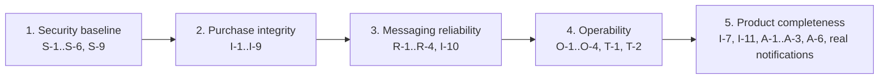

# Findings and roadmap

Everything found to be wrong, risky or missing while the platform was analysed
for these docs (October 2026), in priority order and with a suggested fix for
each. The per-service pages carry the details; this page is the to-do list.

**Verified** marks findings reproduced on 2026-10-29 against a running stack.
The others were established from the code, with file references on the service
pages.

Severity: **High** means data can be corrupted, money or stock lost, or any
user can act as any other. **Medium** means a real defect or exposure with a
workaround or a limited blast radius. **Low** means a quality or maintainability
issue.

## Resolved on 2026-10-29

Changes made while writing these docs, all built and tested (146 backend tests,
42 frontend tests, the smoke test 24/24 on Kubernetes, the Playwright suite 26/26):

| Change | Where |
|---|---|
| The gateway's Swagger UI crashed with `NoSuchMethodError`: springdoc 2.8.5's WebFlux UI isn't compatible with Spring Framework 7. Upgraded the gateway to springdoc 3.0.3, and added one **unified Swagger UI** for all seven APIs at `:8080/swagger-ui.html`. | api-gateway `pom.xml`, `application.yaml` |
| Every service now advertises a relative OpenAPI server (`/`), so Try it out goes through the gateway. payment- and shipping-service now serve their spec at `/api-docs` like the rest. | each service's `OpenApiConfig`, two `application.yaml` |
| **Deprecated-for-removal spring-kafka classes** (`JsonSerializer`, `JsonDeserializer`, `JsonMessageConverter`) replaced by their Jackson 3 successors. The producers keep `WRITE_DATES_AS_TIMESTAMPS` on, so the wire format is unchanged. The Pact tests and raw records on the live cluster both confirm this. | order, payment, shipping, notification |
| Hibernate deprecation `HHH90000025`: explicit dialect settings removed. A side effect fixes the tests, which had been running the **PostgreSQL** dialect against H2, because the main YAML outranked the test profile. | six services, test profiles |
| Removed the unused ModelMapper dependency, the source of a JDK `sun.misc.Unsafe` terminal-deprecation warning at order-service startup, from six services. The dead bean and its test went with it. | poms, order-service `AppConfig` |
| Removed the never-read `spring.kafka.producer/consumer` YAML blocks, which named the deprecated classes and contradicted the code. | order, payment, shipping, notification |
| `smoke-test.sh`: the Kafka check now works against Kubernetes as well as compose, and no longer matches order 6 inside order 60. | ecommerce-platform |
| New `export-openapi.sh`: regenerates the committed OpenAPI files through the gateway, deterministically. | ecommerce-platform |
| New **Playwright browser end-to-end suite** (26 tests, `e2e/`): runs locally, on any CI agent with Node, or in the Playwright Docker image (`scripts/e2e-docker.sh`), and writes HTML, JUnit, JSON and Markdown reports on every run. CircleCI gained an opt-in `e2e` workflow. It found A-6. | ecommerce-frontend |

Deprecation status after these changes:

- javac with `-Xlint:deprecation` reports no deprecations in main or test code for any of the ten repositories. Kotlin and the frontend's TypeScript (`@deprecated` usage) are also clean.
- Spring Boot's properties migrator finds no deprecated configuration keys in any service.
- What remains is third-party code that calls JDK internals and needs upstream releases: kafka-clients 4.1.1, XStream 1.4.21 inside the Eureka server, and Lombok at compile time. See D-2 below.

## Overview

| ID | Finding | Area | Severity | Verified |
|---|---|---|---|---|
| S-1 | No authorization: any user can act on any account, product, order, payment, shipment or review | Security | High | yes |
| S-2 | `/api/v1/users/internal/{username}` returns any full profile without a token | Security | High | yes |
| S-3 | `admin`/`admin` seeded on every start, password logged | Security | High | yes |
| I-1 | Payment amount comes from the client; any `payment.completed` marks an order `PAID` | Integrity | High | |
| I-2 | Legacy add-line endpoint accepts zero or negative quantities | Integrity | High | yes |
| I-3 | Cancelling twice releases stock twice; cancelling a paid order neither refunds nor stops shipping | Integrity | High | |
| I-4 | A declined payment cancels the order but keeps its stock reserved | Integrity | High | |
| I-5 | Stock updates are unprotected read-modify-writes, so concurrent buyers can oversell | Integrity | High | |
| R-1 | No dead-letter handling: one bad record stops notification-service forever, and others drop records silently | Reliability | High | |
| S-4 | Committed default JWT secret, so anyone with the repository can mint `ADMIN` tokens | Security | Medium | |
| S-5 | Services, Eureka, Kafka and databases are reachable directly, bypassing the gateway | Security | Medium | |
| S-6 | Writable `/actuator/serviceregistry` without auth, also proxied by the frontend's nginx | Security | Medium | |
| S-7 | Token in `localStorage` and no security headers (no CSP) | Security | Medium | |
| S-8 | Public tracking reveals customer ID, order ID and addresses | Privacy | Medium | |
| I-6 | Duplicate payments per order are possible, and lookups then return 500 | Integrity | Medium | |
| I-7 | Checkout addresses are never sent or stored; shipments get placeholder addresses | Functional | Medium | |
| I-8 | Lines can be added to confirmed, shipped or delivered orders | Integrity | Medium | |
| I-9 | `PATCH /orders/{id}/status` applies any transition with no side effects | Integrity | Medium | |
| I-10 | Refunds, cancellations and shipment progress don't propagate between services | Consistency | Medium | |
| I-11 | The catalog is never synced automatically; price overrides vanish on re-sync | Consistency | Medium | |
| I-12 | "Customer ID" means a username, `1` or anything else depending on the caller | Data | Medium | |
| R-2 | Events sent inside the DB transaction, no outbox (dual write) | Reliability | Medium | |
| R-3 | Consumers neither idempotent nor state-guarded | Reliability | Medium | |
| R-4 | Circuit breakers and fallbacks inactive in catalog and review; product 404 becomes 500 | Resilience | Medium | |
| O-1 | No alert is delivered anywhere | Operations | Medium | |
| O-2 | Traces stop at Feign and Kafka hops; logs carry no trace IDs | Operations | Medium | |
| A-1 | The SPA reports a declined payment as a successful order | UX | Medium | |
| A-2 | Public tracking page calls a JWT-only endpoint; anonymous visitors get sent to login | UX | Medium | |
| A-3 | Admin pages expect endpoints that don't exist (all orders, pending reviews) | Functional | Medium | |
| A-6 | Checkout never shows its confirmation screen: after Place Order the customer sees "Your cart is empty" | UX | Medium | yes (e2e) |
| T-1 | Flyway migrations are never exercised by any test | Testing | Medium | |
| T-2 | The smoke test and the Playwright suite need a running stack, and no pipeline runs them automatically | Testing | Low | |
| S-9 | Gateway forwards client `X-User-*` headers on public routes and matches public paths on the raw path | Security | Low | yes (not exploitable today) |
| S-10 | Eureka registry is unauthenticated and published | Security | Low (dev) | |
| R-5 | One partition per topic: consumers can't scale out | Scalability | Low | |
| O-3 | Log formats differ between services; the compose and k8s promtail parsers each misread half | Operations | Low | |
| O-4 | Some alerts can never fire; the gateway dashboard's route panels are empty | Operations | Low | |
| A-4 | Many client errors return 500 (bad enum, wrong content type, shipping validation) | API | Low | yes |
| A-5 | user-service ignores command-line arguments (`SpringApplication.run` without `args`) | DevEx | Low | yes |
| D-1 | CI split between CircleCI (10 repos) and GitHub Actions (3); CICD.md covers CircleCI only | Delivery | Low | |
| D-2 | Third-party JDK terminal-deprecation warnings remain | Maintenance | Low | yes |
| D-3 | Services run springdoc 2.8.5, built for Boot 3 | Maintenance | Low | |

## Details and fixes

### Security

**S-1. No authorization.** The gateway authenticates and nothing authorizes.
product, catalog, order, payment and shipping never read the identity headers.
user-service lets anyone read, edit or deactivate any account by ID.
review-service lets anyone moderate. *Verified:* a `CUSTOMER` created a product,
created an order for another customer, and approved their own review.
**Fix:**

1. Role rules at the gateway for admin paths (product, category and catalog writes, order status, shipment status, refunds, review moderation).
2. Ownership checks in the services: compare `X-User-Id` with the resource owner.
3. Stop taking `customerId` from the client. Derive it from `X-User-Id`, and use the numeric user ID everywhere (fixes I-12 too).

**S-2. Public internal endpoint.** No service calls
`/api/v1/users/internal/{username}`. **Fix:** delete it, or remove it from the
gateway's public list and restrict it to service-to-service calls.

**S-3. Default admin.** **Fix:** seed only under a `dev` profile, with a
generated password supplied by environment variable and never logged, or add
an admin bootstrap endpoint that is disabled after first use.

**S-4. Default JWT secret.** **Fix:** no default value. Fail at startup when
`JWT_SECRET` is unset or shorter than 64 bytes (which also makes the algorithm
an explicit HS512). Keep secrets out of the committed k8s manifests.

**S-5, S-6, S-10. Exposure.**

- Publish only the frontend and gateway ports by default, and move the rest to a compose `dev` profile.
- Have the gateway strip incoming `X-User-*` headers on every route.
- Restrict actuator exposure to `health,info,prometheus`.
- Move management to a separate port bound to localhost. The k8s `preStop` hook calls `localhost` already.
- Drop the `/actuator/` location from nginx.
- Secure Eureka with basic auth.

**S-7.** Add a CSP and the usual headers in nginx. Consider an httpOnly cookie
for the token.

**S-8.** Return only status, carrier, ETA and history from the public tracking
endpoint.

**S-9.** Reject non-normalised paths (`..`, `%2e`) at the gateway, and match
public paths with Spring path patterns rather than `startsWith`. Not
exploitable today, because Spring MVC 7 doesn't resolve `..`, but the gateway
shouldn't depend on that.

### Purchase integrity

**I-1. Client-supplied amount.** **Fix:** payment-service fetches the order
from order-service and takes the amount from it, refusing unless the order is
`CONFIRMED` and owned by the caller. order-service then accepts
`payment.completed` only for a `CONFIRMED` order with a matching amount, and
ignores it otherwise.

**I-2. Negative quantities.** *Verified: stock 98 → 148, order total −480.00.*
**Fix:** delete the legacy `/products` endpoint, or validate `@Min(1)`. Add
`CHECK (quantity > 0)` and `CHECK (stock_quantity >= 0)` constraints.

**I-3, I-4. Stock leaks and double releases.** **Fix:**

- Cancel only from `PENDING` or `CONFIRMED`, and make it idempotent.
- On `payment.failed`, release stock and publish `order.cancelled`.
- Let payment-service refund on `order.cancelled`, and shipping-service cancel the shipment.
- Expire stale `PENDING` carts with a scheduled job.

**I-5. Oversell race.** **Fix:** make the update atomic, for example
`UPDATE products SET stock_quantity = stock_quantity + :delta WHERE id = :id AND stock_quantity + :delta >= 0`
with a check on the affected row count. An `@Version` column with a retry
also works.

**I-6.** Add unique constraints on `payments.order_id` (or on order ID plus an
active status) and on `shipments.order_id`.

**I-7.** Accept addresses on order creation or confirmation and store them.
Carry the shipping address in `order.placed`, and let shipping read it from
there or from the order.

**I-8, I-9.** Put an explicit state machine in `Order`, so that each endpoint
and each consumer asks it whether a transition is legal.

**I-10.** Model the compensations listed under I-3 and I-4. Have order-service
consume `shipment.updated` to move to `SHIPPED` and `DELIVERED`.

**I-11.** Have product-service publish `product.changed` events and
catalog-service consume them. Store catalog-only price overrides in a separate
field that a sync doesn't overwrite. Remove entries for deleted products.

### Messaging reliability

**R-1. Poison pills and lost records.** **Fix:**

- Wrap notification-service's deserializer in `ErrorHandlingDeserializer`.
- Give every listener factory a `DefaultErrorHandler` with a `DeadLetterPublishingRecoverer` (topics `<topic>.DLT`) and a back-off.
- Alert on DLT growth.

**R-2. Dual writes.** **Fix:** a transactional outbox table polled or tailed by
a relay. At minimum, send after commit (`TransactionSynchronization`) and log
send failures loudly.

**R-3.** Guard consumers by state (see I-1) and record processed event IDs, or
rely on the state machine, so that a replay is harmless.

**R-4.** Either set `spring.cloud.openfeign.circuitbreaker.enabled=true`
(catalog, review) or use resilience4j annotations as order-service does. Map
product-service 404 to 404 instead of 500.

**R-5.** Declare topics with `NewTopic` beans and several partitions. The key
is already the order ID, so per-order ordering survives.

### Operations

**O-1.** Configure at least one Alertmanager receiver (email, Slack or a
webhook) and fix the unreachable routes. See [Observability](observability.md#known-gaps).

**O-2.** Add `feign-micrometer`, enable Kafka observation on templates and
listeners, and print `traceId`/`spanId` in every log pattern.

**O-3.** Use one log pattern everywhere, or JSON logs, and one promtail parser.

**O-4.** Remove or rewrite the alerts that can't fire, and base the gateway
panels on `http_client_requests_seconds` by route ID.

### Frontend and API

**A-1.** Read the payment `status` and show a decline, with a retry path.
**A-2.** Make status history public with tracking, or don't call it from the
public page.
**A-3.** Add `GET /api/v1/orders` (admin) and `GET /api/v1/reviews?status=PENDING`
(admin), or remove those screens.
**A-4.** Map `IllegalArgumentException`, `HttpMediaTypeNotSupportedException`,
`NoResourceFoundException` and `MethodArgumentNotValidException` (shipping) in
each handler.
**A-5.** Pass `args` to `SpringApplication.run` in `UserServiceApplication`.

**A-6.** In `CheckoutPage.handlePlaceOrder()` the SPA clears `cartOrderId` and sets
`orderComplete` in one batched render, and the empty-cart early return is checked
before the `orderComplete` branch. The "Order Placed!" screen, with the order number
and its View Order button, therefore never renders; only the "Order placed
successfully!" toast shows. *Verified* by the Playwright suite, which keeps it as a
`test.fail` test. **Fix:** check `orderComplete` before the empty-cart condition, then
remove the `test.fail` line in `e2e/tests/checkout.spec.ts`.

### Testing, delivery, maintenance

**T-1.** Run the repository tests against Postgres with Testcontainers and
Flyway enabled. The CI machines already support Testcontainers.

**T-2.** Start the stack in a pipeline (compose on a machine executor, or a kind
cluster) after the images are built, then run `smoke-test.sh` and the Playwright
suite against it, or trigger the frontend's `e2e` workflow after each deployment to
a shared environment.

**D-1.** Choose one CI system, and update [CICD.md](../CICD.md) until then.

**D-2.** The remaining terminal-deprecation warnings come from third-party
code: kafka-clients 4.1.1 `ByteBufferUnmapper`, XStream 1.4.21 in the Eureka
server, and Lombok at compile time. Pick up newer versions as Spring Boot
patch releases bring them.

**D-3.** Move the services to springdoc 3.0.x like the gateway, and keep the
whole platform on one version.

## Roadmap

1. **Security baseline.** Close the account and admin holes before anything else. S-1 is the largest item. The rest are configuration changes.
2. **Purchase integrity.** A server-verified payment amount, an order state machine, atomic stock, constraints. Most fixes are local to order-, payment- and product-service.
3. **Messaging reliability.** Dead-letter topics first, because they are cheap and prevent the worst incident this platform has had. Then the outbox and the compensating events.
4. **Operability.** Deliver alerts, connect traces end to end, and test the migrations.
5. **Product completeness.** Addresses, catalog sync by events, admin endpoints, the SPA fixes, and a real notification channel.

Each fix that changes a contract between services needs a pact update
(`ecommerce-platform/sync-pacts.sh`), and the [Event catalog](events.md) and
[API reference](api/README.md) must be updated in the same change.
