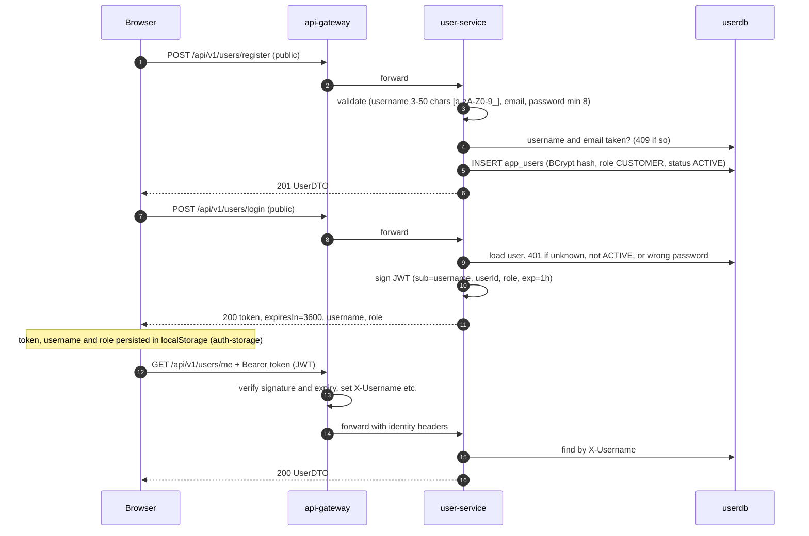
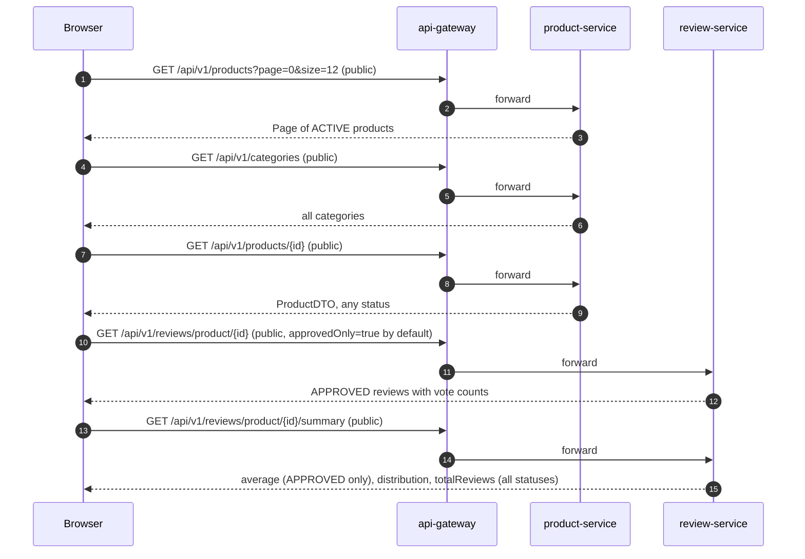
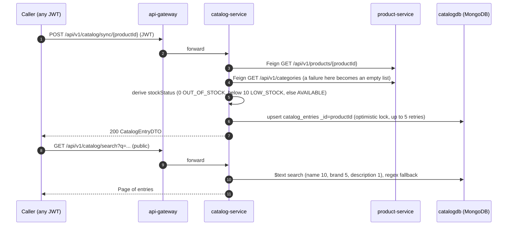
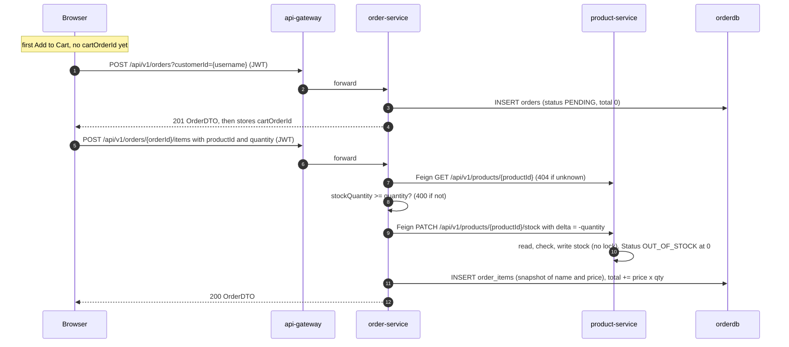
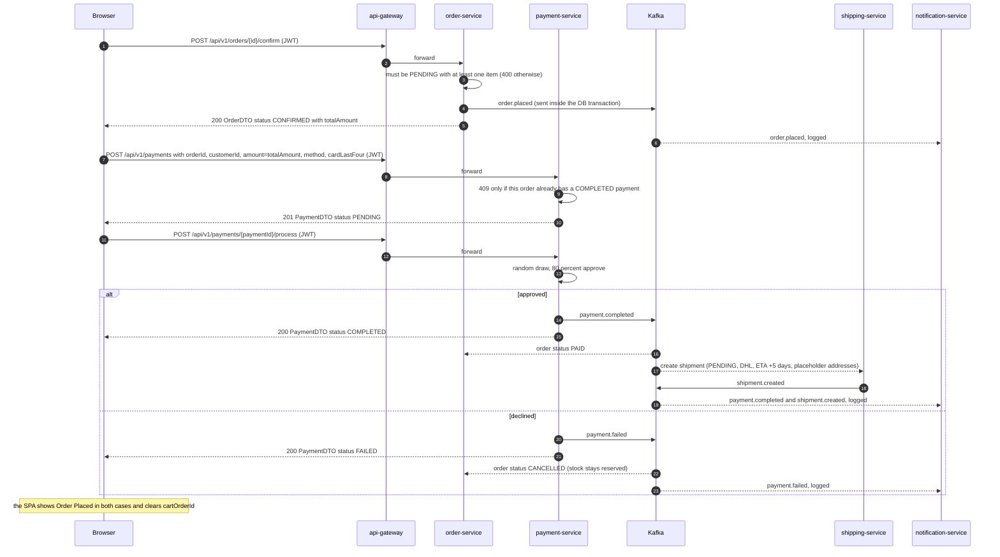
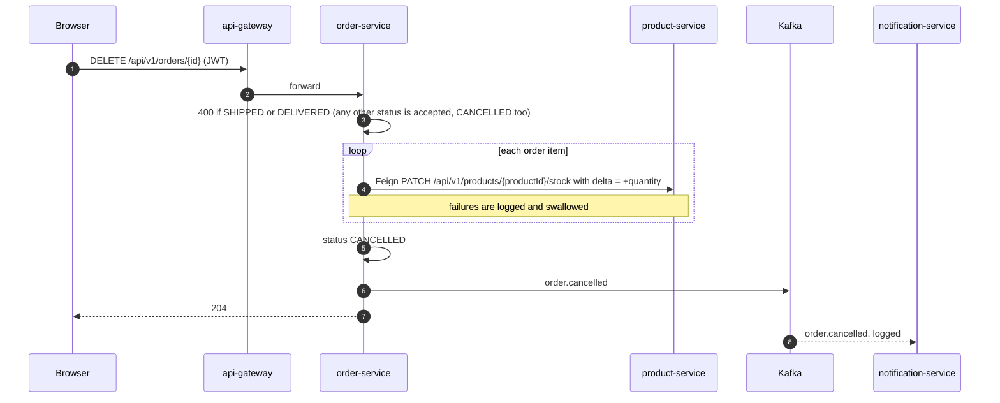
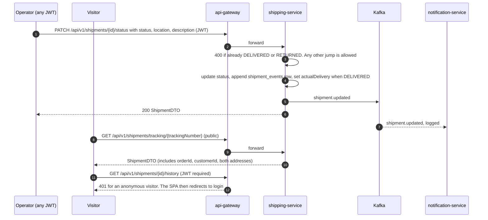
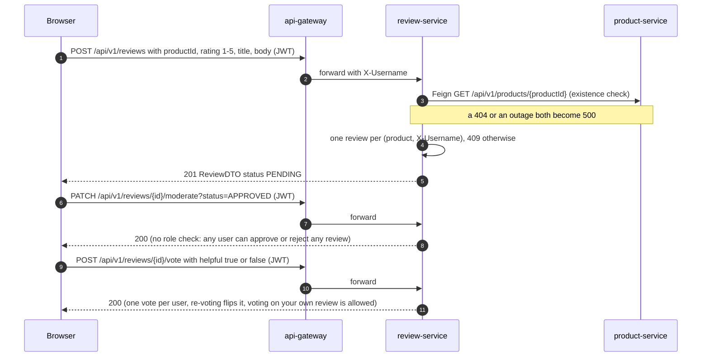
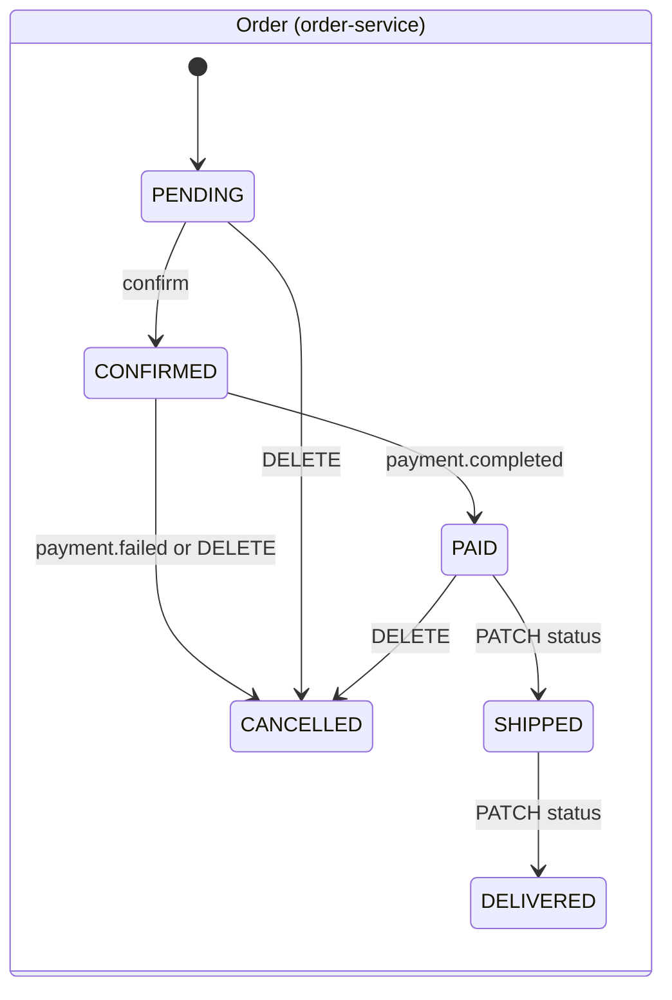

# End-to-end flows

How the services work together for each user journey: every call in order,
what each step writes, which events fire, and where the flow is known to go
wrong. Paths are as the client sends them to the gateway, which forwards them
unchanged. The browser's side of each flow (pages, hooks, local state) is in
[Frontend](frontend.md#key-user-flows), and each service's internals are on its
own page.

Throughout, **JWT** means the gateway requires `Authorization: Bearer <token>`
and injects `X-Username`, `X-User-Id` and `X-User-Role`. **Public** means it
doesn't.

## 1. Registration and login

- The SPA takes the role from the login response. It never decodes the token. Admin pages are hidden client-side only (see [Security](security.md)).
- An `admin`/`admin` account is seeded on every start of user-service, and it is the only way an `ADMIN` exists.
- Tokens can't be revoked. Deactivating a user (`DELETE /api/v1/users/{id}`) leaves their token valid until it expires.

## 2. Browsing and product detail

All reads are public.

- Listings, search (`/products/search?q=`, a name-contains match) and category pages return only `ACTIVE` products. Out-of-stock and soft-deleted products disappear from every list, the admin table included.
- The storefront does **not** read from catalog-service. The catalog read model is complete and reachable at `/api/v1/catalog/**`, but nothing in the SPA calls it (flow 3).

## 3. Catalog synchronization

catalog-service holds one MongoDB document per product, filled on demand.

- **Nothing triggers a sync automatically.** There is no Kafka consumer and no scheduler. A product change reaches the catalog only when someone calls `sync` for that product, and a deleted product's entry is never removed.
- A re-sync keeps the catalog-only `featured` and `imageUrl`, but **overwrites `price`** with product-service's price, so a price set through `PATCH /api/v1/catalog/product/{id}` lasts only until the next sync.
- Any product-service failure, including a 404, surfaces as a 500. The Feign circuit breaker and fallback are configured but not enabled.

## 4. Building a cart

The cart is not client-side state. It is an order in status `PENDING`, and the
browser stores only its ID. Adding to the cart **reserves stock immediately**.

- `customerId` is whatever the client sends. The SPA sends the username, while the smoke test sends `1`. order-service never compares it with the caller's identity.
- There is no endpoint to remove a line. The SPA cancels the whole order and rebuilds it (flow 6), and every rebuild leaves a cancelled order in the history.
- Stock is reserved per line and released only by an explicit cancel. An abandoned cart, a logout or a second browser keeps the reservation forever.
- product-service's stock update is a read-modify-write with no locking, so two concurrent reservations can both succeed against the same last unit.

## 5. Checkout and payment

The client orchestrates the purchase with three calls in sequence. Kafka
carries the outcome to the other services.

What a successful purchase leaves behind:

| Service | Record | State after the flow |
|---|---|---|
| order-service | `orders` + `order_items` | `PAID`. Addresses null: the checkout form's addresses are never sent. |
| product-service | `products.stock_quantity` | reduced at add-to-cart time |
| payment-service | `payments` | `COMPLETED`, `transaction_id` set |
| shipping-service | `shipments` + one `shipment_events` row | `PENDING`. Origin `Warehouse, 123 Storage St`, destination `Customer Address`. |
| notification-service | — | three log lines (`order.placed`, `payment.completed`, `shipment.created`) |

Known gaps in this flow:

- **The amount is the client's word.** payment-service never checks that the order exists, is `CONFIRMED`, belongs to the caller, or costs `amount`. order-service marks the order `PAID` on any `payment.completed`, whatever its current status. One cent "pays" for any order, including an unconfirmed or cancelled one.
- **A declined payment cancels the order but keeps its stock reserved**, and it publishes no `order.cancelled`. With an 80 % success rate, about one checkout in five leaks stock.
- The SPA never reads the payment status, so a decline is shown as success.
- The order never moves past `PAID` by itself. Shipment events are not consumed by order-service (flow 8).
- If any call after `confirm` fails, the cart order is stuck in `CONFIRMED`, and retrying fails with 400. See [Frontend](frontend.md#cart-checkout-order-creation-and-payment).

## 6. Cancellation

- Cancelling a **paid** order neither refunds the payment nor stops the shipment. Nothing listens to `order.cancelled` except notification-service.
- Cancelling an **already cancelled** order is accepted. It releases the stock again and republishes the event, so repeated cancels inflate stock.
- A stock release that fails (product-service down) is lost. The order still ends up `CANCELLED`.

## 7. Refund

`POST /api/v1/payments/{id}/refund` (JWT) moves a `COMPLETED` payment to
`REFUNDED` for its full amount and publishes `payment.refunded`. Only
notification-service consumes it: the order stays `PAID`, the shipment carries
on, and stock is untouched. No page in the SPA calls this endpoint, and nothing
checks who is asking.

## 8. Shipping progress and tracking

- Nothing advances a shipment automatically: no scheduler, no carrier integration, and no page in the SPA. Statuses change only through this PATCH.
- order-service never hears about shipment progress, so orders stay `PAID`. `SHIPPED` and `DELIVERED` are reachable only through `PATCH /api/v1/orders/{id}/status`, which applies any status without checks or side effects.

## 9. Reviews

- Editing a review (`PUT`, author only) sends it back to `PENDING`. Deleting is allowed for the author or a caller with `X-User-Role: ADMIN`.
- The product page loads approved reviews only, so authors don't see their own pending review. Submitting again returns 409.
- There is no verified-purchase check. review-service never asks order-service whether the author bought the product.

## 10. Administration

The SPA's admin area (`/admin/**`) manages products, categories, orders and
reviews. The backend has **no role checks** on any of the endpoints it uses:
product and category writes, `PATCH /api/v1/orders/{id}/status`, review
moderation, catalog writes, shipment status and refunds all accept any valid
token. "Admin" is a UI convention, not a permission. Some admin screens also
have no backing endpoint (listing all orders, listing pending reviews). See
[Frontend: admin flows](frontend.md#admin-flows) and [Findings](findings.md).

## Status models side by side

| Entity | Statuses | Changed by |
|---|---|---|
| Order | `PENDING`, `CONFIRMED`, `PAID`, `SHIPPED`, `DELIVERED`, `CANCELLED` | REST (create, confirm, cancel, PATCH status) and Kafka (`payment.*`). The diagram shows the intended paths: the Kafka handlers and `PATCH status` apply their status from **any** state. |
| Payment | `PENDING`, `PROCESSING` (never persisted), `COMPLETED`, `FAILED`, `REFUNDED` | REST only |
| Shipment | `PENDING`, `PROCESSING`, `SHIPPED`, `OUT_FOR_DELIVERY`, `DELIVERED`, `RETURNED` | created by Kafka (`payment.completed`) or REST, then REST only. Any jump is allowed except out of `DELIVERED` or `RETURNED`. |
| Product | `ACTIVE`, `INACTIVE` (soft delete), `OUT_OF_STOCK` | REST. Stock reaching 0 forces `OUT_OF_STOCK`, and restocking makes it `ACTIVE` again, even after a soft delete. |
| Review | `PENDING`, `APPROVED`, `REJECTED` | create and edit set `PENDING`; moderation sets any |
| User | `ACTIVE`, `INACTIVE` (soft delete), `SUSPENDED` (never set by any code) | REST |
| Catalog entry stock | `AVAILABLE`, `LOW_STOCK`, `OUT_OF_STOCK` | derived at sync time |
