# End-to-end flows

How the services work together for each user journey: every call in order,
what each step writes, which events fire, and where the flow is known to go
wrong. Paths are as the client sends them to the gateway, which forwards them
unchanged. The browser's side of each flow (pages, hooks, local state) is in
[Frontend](frontend.md#key-user-flows), and each service's internals are on its
own page.

Throughout, **JWT** means the gateway requires `Authorization: Bearer <token>`
and injects `X-Username`, `X-User-Id` and `X-User-Role`. **Public** means it
doesn't.

## 1. Registration and login

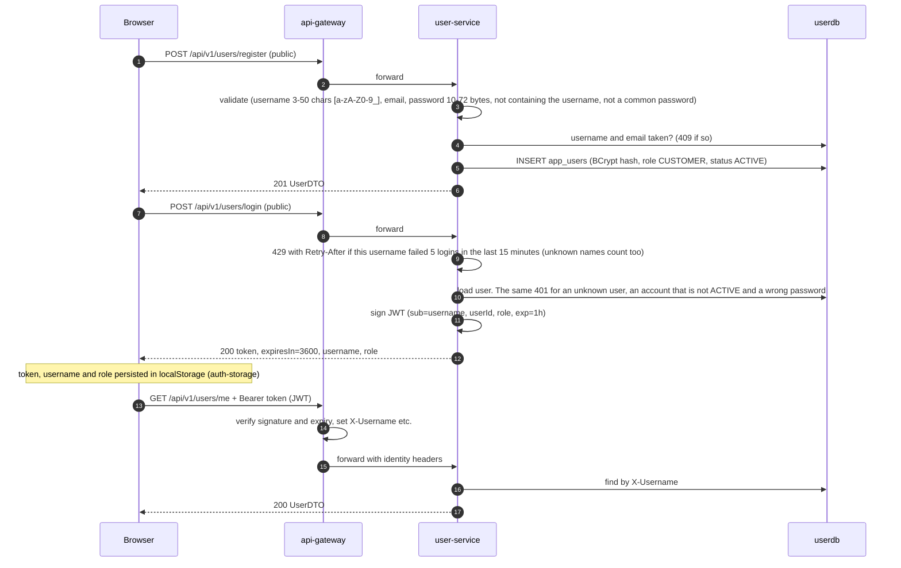

- The SPA takes the role from the login response. It never decodes the token. It hides the admin pages from other roles, and the backend enforces the role on every admin endpoint (flow 10, [Security](security.md)).
- The lockout counter is in memory, per user-service instance. A password longer than 72 bytes is refused at registration, because BCrypt rejects anything beyond that.
- The admin account is seeded from `ADMIN_USERNAME` / `ADMIN_PASSWORD` (generated into `.env`), and it is the only way an `ADMIN` exists.
- Tokens can't be revoked. Deactivating a user (`DELETE /api/v1/users/{id}`) leaves their token valid until it expires.

## 2. Browsing and product detail

The reads on this page are public.

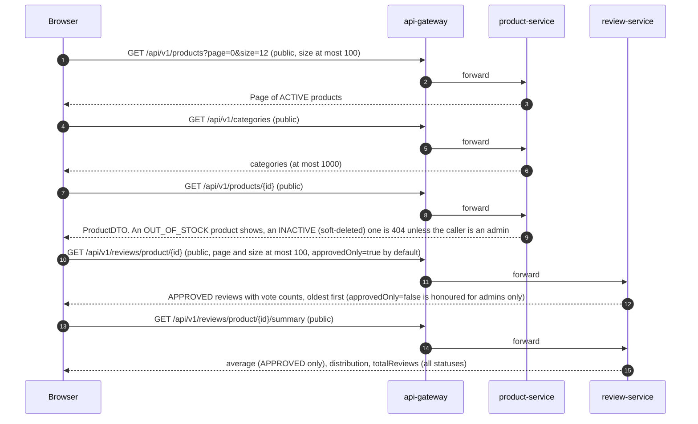

- Listings, search (`/products/search?q=`, a name-contains match) and category pages return only `ACTIVE` products. Out-of-stock and soft-deleted products disappear from every list, the admin table included.
- The storefront does **not** read from catalog-service. The catalog read model is complete and reachable at `/api/v1/catalog/**`, but nothing in the SPA calls it (flow 3).

## 3. Catalog synchronization

catalog-service holds one MongoDB document per product, filled on demand.

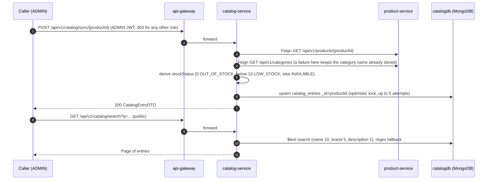

- **Nothing triggers a sync automatically.** There is no Kafka consumer and no scheduler. A product change reaches the catalog only when an admin calls `sync` for that product, and a deleted product's entry is never removed.
- A re-sync keeps the catalog-only `featured` and `imageUrl`, but **overwrites `price`** with product-service's price, so a price set through `PATCH /api/v1/catalog/product/{id}` lasts only until the next sync.
- A product-service failure goes through the `product-service` circuit breaker and a fallback factory, and the sync answers by what it means: an unknown product is 404, no answer from product-service or an open breaker is 503, and any other bad answer (a 5xx, an undecodable body, an implausible price) is 502. A 404 does not count against the breaker.

## 4. Building a cart

The cart is not client-side state. It is an order in status `PENDING`, and the
browser stores only its ID. Adding to the cart **reserves stock immediately**.

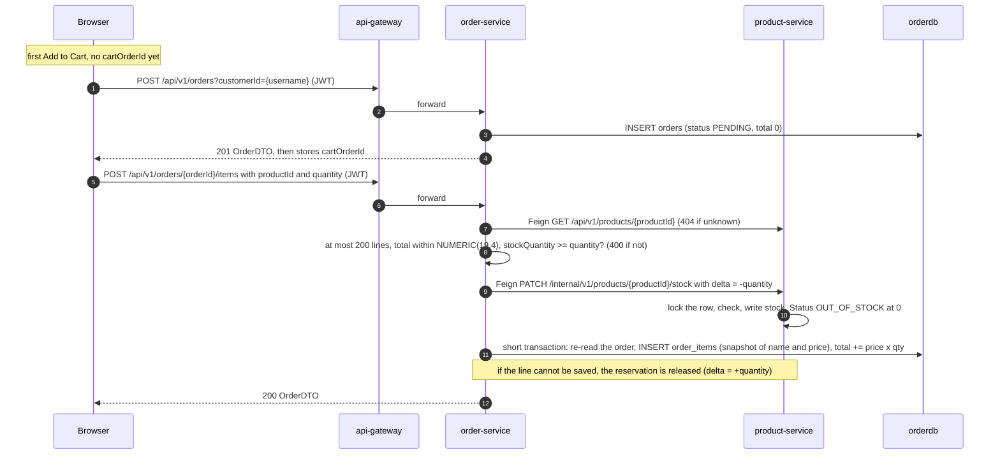

- No database transaction is open during the two Feign calls. Two writers on one order are told apart by its version: the later one gets 409, and its reservation is released.
- `customerId` defaults to the caller's `X-Username`. A non-admin who names someone else gets 403. The SPA sends the username.
- There is no endpoint to remove a line. The SPA cancels the whole order and rebuilds it (flow 6), and every rebuild leaves a cancelled order in the history.
- Stock is reserved per line and given back by a cancel, by a declined payment (flow 5) or when the cart is abandoned: a `PENDING` order that nobody has changed for 24 hours is cancelled and its stock returned (flow 6). A logout or a second browser does not release it.
- product-service locks the product row while it changes the stock, so two concurrent reservations of the last unit run one after the other, and the second one is refused with 400.

## 5. Checkout and payment

The client orchestrates the purchase with three calls in sequence. Kafka
carries the outcome to the other services. Every event leaves its producer
through a transactional outbox ([ADR-013](adr/ADR-013-transactional-outbox.md)):
the service writes the event row in the same transaction as the state change,
and a relay publishes it about half a second after the commit. An event
therefore exists exactly when its change committed, and a Kafka outage delays
events without failing the request.

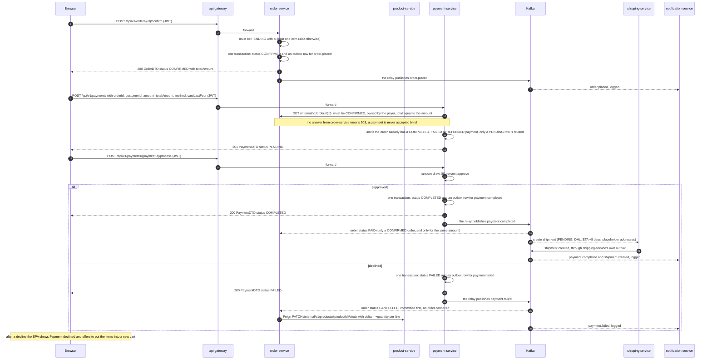

What a successful purchase leaves behind:

| Service | Record | State after the flow |
|---|---|---|
| order-service | `orders` + `order_items` | `PAID`. Addresses null: the checkout form's addresses are never sent. |
| product-service | `products.stock_quantity` | reduced at add-to-cart time |
| payment-service | `payments` | `COMPLETED`, `transaction_id` set |
| shipping-service | `shipments` + one `shipment_events` row | `PENDING`. Origin `Warehouse, 123 Storage St`, destination `Customer Address`. |
| notification-service | — | three log lines (`order.placed`, `payment.completed`, `shipment.created`) |

Each producer's outbox row is deleted once Kafka has acknowledged it, so after the flow the three `outbox_event` tables are empty again.

### A declined payment

A decline is final for the order. In order:

1. `POST /api/v1/payments/{id}/process` answers **200** with `status` `FAILED`, so the caller has to read `status`. The row and the `payment.failed` outbox row commit together.
2. order-service consumes `payment.failed`, normally within a second. It commits `CANCELLED` first, then returns the stock of every line to product-service, outside any transaction. It publishes no `order.cancelled`, because `payment.failed` already said it. A replayed event finds the order `CANCELLED` and does nothing, so the stock goes back once. If product-service does not answer, the order is cancelled anyway and one WARN names the lines whose stock was not returned.
3. A retry for that order is refused with **409** and charges nothing. Until order-service has consumed the event the order still reads `CONFIRMED`, so the order check passes and payment-service refuses on its own `FAILED` row with the fixed message "The payment for this order was declined and the order is cancelled. Place a new order to try again." Once the order is `CANCELLED`, the order check answers first: `Order {id} is not awaiting payment`.
4. The SPA shows "Payment declined" and offers to put the same items into a new cart: a new order, then one add per line. Each add reserves stock again, so a line can be refused if the stock is gone meanwhile.

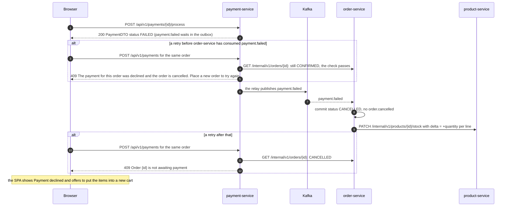

The two events of one order travel on different topics, so nothing orders them against each other. That is why the `FAILED` row is terminal instead of reusable (see [payment-service](services/payment-service.md#business-rules)).

Known gaps in this flow:

- **A payment can still arrive for an order that was cancelled meanwhile.** payment-service checks the order when the payment is created. If the customer cancels the `CONFIRMED` order before `/process` runs, `payment.completed` finds it `CANCELLED`: order-service does not apply it and logs one WARN that the payment may need a refund. Nothing refunds it automatically.
- **If `payment.failed` never reaches order-service**, for example because the record ended on the dead-letter topic, the order stays `CONFIRMED` and cannot be paid (payment-service refuses another attempt). It holds its stock until somebody cancels it. `CONFIRMED` orders do not expire.
- The order never moves past `PAID` by itself. Shipment events are not consumed by order-service (flow 8).
- If a call after `confirm` fails (the payment request times out, for example), the order stays `CONFIRMED` and holds its stock until it is paid, declined or cancelled. Confirming it again is a 400, so the client has to continue from the payment step; the SPA reads the order's status first and does. See [Frontend](frontend.md#cart-checkout-order-creation-and-payment).

## 6. Cancellation

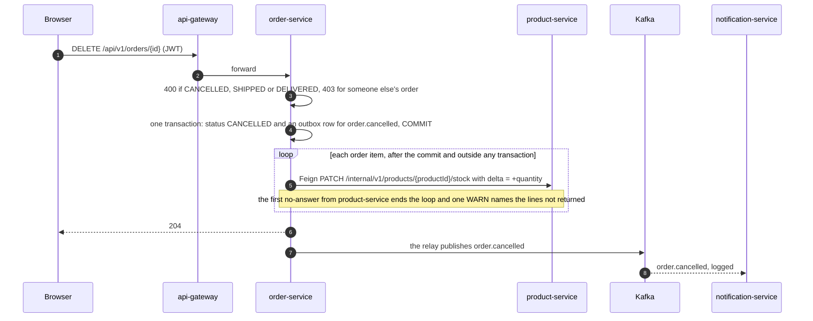

- The cancellation commits first and the stock follows, so a slow or dead product-service can neither hold a database connection nor undo the cancellation. The order is `CANCELLED` either way.
- Cancelling a **paid** order neither refunds the payment nor stops the shipment. Nothing listens to `order.cancelled` except notification-service.
- Cancelling an **already cancelled** order is a 400 (`Cannot cancel order in status: CANCELLED`) and publishes nothing, so stock goes back once. Two cancels at the same moment cannot both succeed: the later commit fails on the order's version (409) and never reaches the stock.
- A stock release that fails is not retried, and a call that timed out has an unknown outcome, so it is not repeated either. A crash between the commit and the restore leaves the stock reserved. The residual risks are listed on [order-service](services/order-service.md#known-issues-and-limitations).
- A declined payment cancels the order the same way (flow 5), except that it publishes no `order.cancelled`. An admin `PATCH /api/v1/orders/{id}/status` to `CANCELLED` runs this same code, event included.

### Abandoned carts

A cart is a `PENDING` order, and it reserves stock from the first item. `ReservationExpiryJob` in order-service cancels the carts nobody comes back to, so their stock returns to the shop.

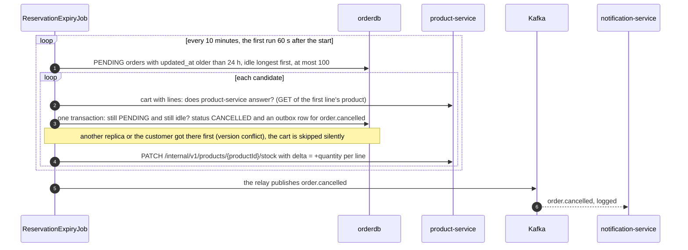

- Only `PENDING` carts expire, after `orders.reservation.pending-ttl` (24 hours) without a change. Adding an item counts as a change. `CONFIRMED` and `PAID` orders never expire: a `payment.completed` can wait in payment-service's outbox during a Kafka outage, so age alone could cancel an order that has already been paid.
- A cart with lines is cancelled only while product-service answers, because stock that cannot be returned is lost. If it does not answer, the run stops with one WARN (at most one a minute) and the cart waits for the next run. An empty cart holds nothing and always expires.
- With several replicas, whoever commits first cancels the cart and returns its stock. The others skip it without a log line.
- A run that expired nothing writes no log line; one that did writes one INFO. `orders_reservations_expired_total` counts the carts. Existing orders got `updated_at` = the time of the migration, so the first expiry comes 24 hours after the deploy at the earliest.
- The SPA drops a cart id whose order has become `CANCELLED`, and the next Add to Cart starts a new cart.

## 7. Refund

`POST /api/v1/payments/{id}/refund` (JWT) moves a `COMPLETED` payment to
`REFUNDED` for its full amount and publishes `payment.refunded` (through
payment-service's outbox). Only notification-service consumes it: the order stays
`PAID`, the shipment carries on, and stock is untouched. The endpoint is
admin-only (403 for anyone else), and no page in the SPA calls it.

## 8. Shipping progress and tracking

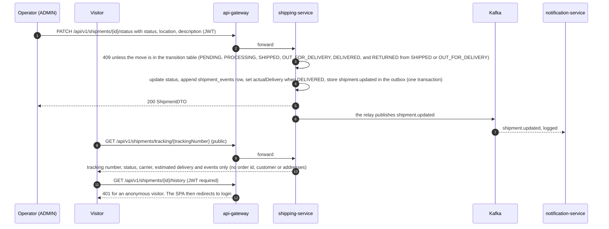

- Nothing advances a shipment automatically: no scheduler, no carrier integration, and no page in the SPA. Statuses change only through this PATCH.
- order-service never hears about shipment progress, so orders stay `PAID`. `SHIPPED` and `DELIVERED` are reachable only through `PATCH /api/v1/orders/{id}/status`, which is admin-only and follows the transition table (`PAID` to `SHIPPED` to `DELIVERED`; any other move is 409). It publishes nothing for those two statuses.

## 9. Reviews

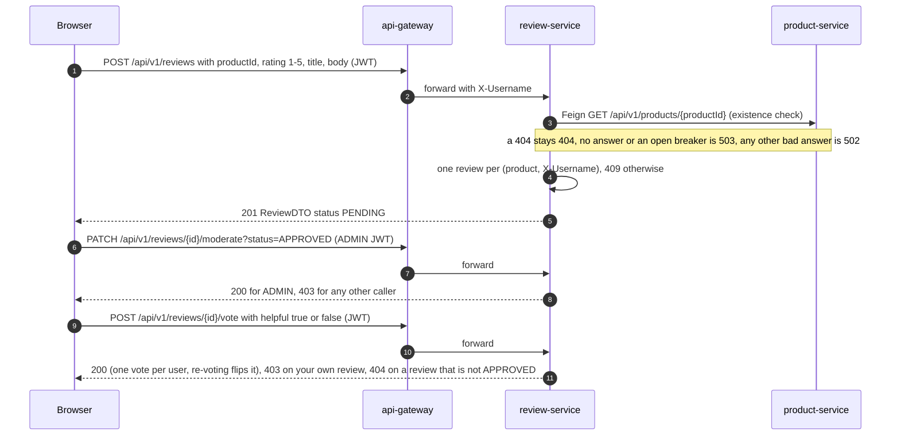

- Editing a review (`PUT`, author only) sends it back to `PENDING`. Deleting is allowed for the author or a caller with `X-User-Role: ADMIN`.
- The product page loads approved reviews only, so authors don't see their own pending review there. Submitting again returns 409. Unapproved reviews are readable only by their author (`GET /api/v1/reviews/customer/{username}` or `GET /api/v1/reviews/{id}`) and by admins.
- There is no verified-purchase check. review-service never asks order-service whether the author bought the product.

## 10. Administration

The SPA's admin area (`/admin/**`) manages products, categories, orders and
reviews. The backend enforces the role on the endpoints it uses: product and
category writes, `PATCH /api/v1/orders/{id}/status`, review moderation, catalog
writes, shipment creation and status changes, and refunds need the exact role
`ADMIN` (403 for any other caller, 401 without an identity). Hiding the admin
pages in the SPA is a convenience, not the control. Some admin screens also
have no backing endpoint (listing all orders, listing pending reviews). See
[Frontend: admin flows](frontend.md#admin-flows), [Security](security.md) and
[Findings](findings.md).

## Status models side by side

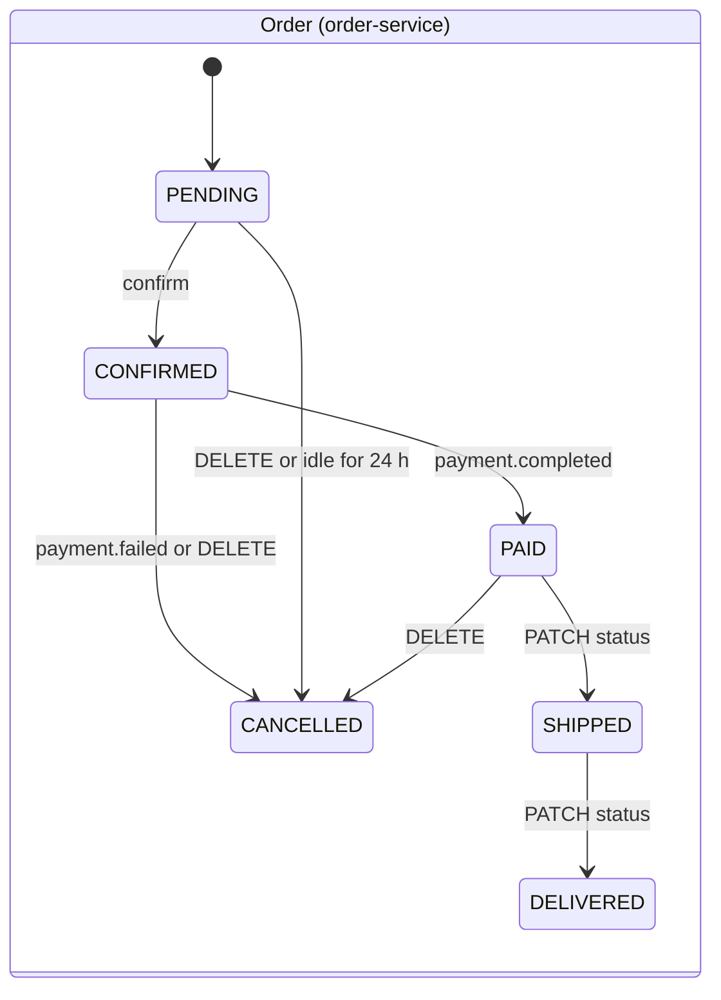

| Entity | Statuses | Changed by |
|---|---|---|
| Order | `PENDING`, `CONFIRMED`, `PAID`, `SHIPPED`, `DELIVERED`, `CANCELLED` | REST (create, confirm, cancel, PATCH status), Kafka (`payment.*`) and the abandoned-cart job. Every change is checked against the current status: the Kafka handlers apply only the moves in the diagram (a late event for another status is ignored), and `PATCH status` is admin-only and follows the transition table (409 otherwise). |
| Payment | `PENDING`, `PROCESSING` (never committed), `COMPLETED`, `FAILED`, `REFUNDED` | REST only. `FAILED` is final: a new payment for the order is refused (409). |
| Shipment | `PENDING`, `PROCESSING`, `SHIPPED`, `OUT_FOR_DELIVERY`, `DELIVERED`, `RETURNED` | created by Kafka (`payment.completed`) or REST, then REST only (admin). Moves follow a transition table: `PENDING`, `PROCESSING`, `SHIPPED`, `OUT_FOR_DELIVERY`, `DELIVERED`, and `RETURNED` from `SHIPPED` or `OUT_FOR_DELIVERY`; `DELIVERED` and `RETURNED` are final (409 otherwise). |
| Product | `ACTIVE`, `INACTIVE` (soft delete), `OUT_OF_STOCK` | REST. Stock reaching 0 forces `OUT_OF_STOCK`, and restocking makes it `ACTIVE` again, even after a soft delete. |
| Review | `PENDING`, `APPROVED`, `REJECTED` | create and edit set `PENDING`; moderation sets any |
| User | `ACTIVE`, `INACTIVE` (soft delete), `SUSPENDED` (never set by any code) | REST |
| Catalog entry stock | `AVAILABLE`, `LOW_STOCK`, `OUT_OF_STOCK` | derived at sync time |
