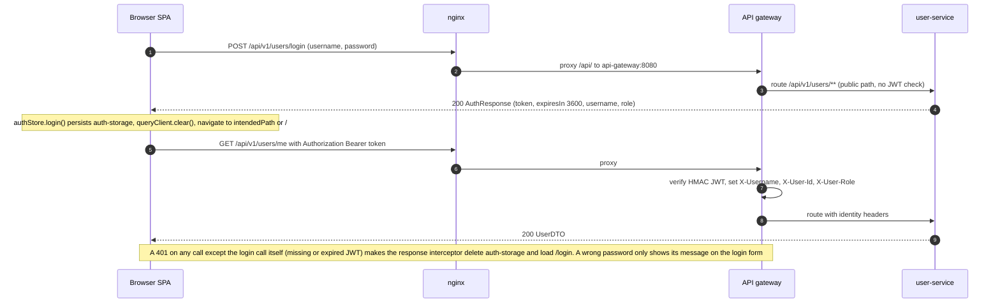
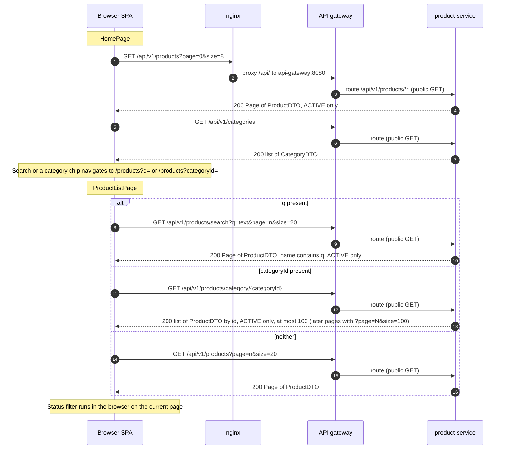
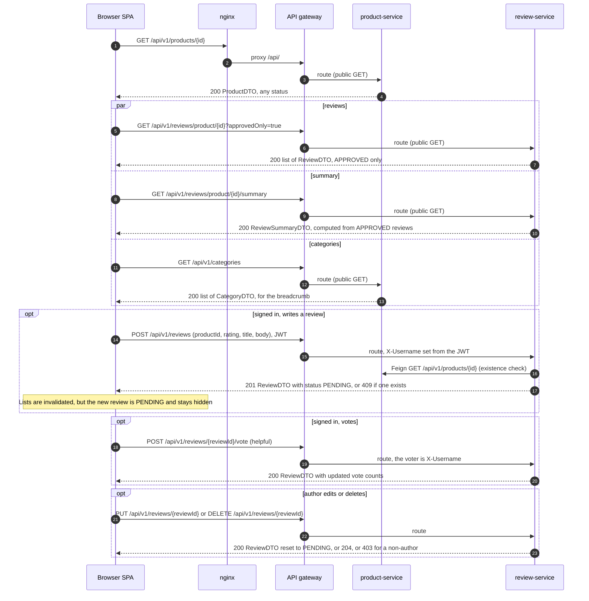
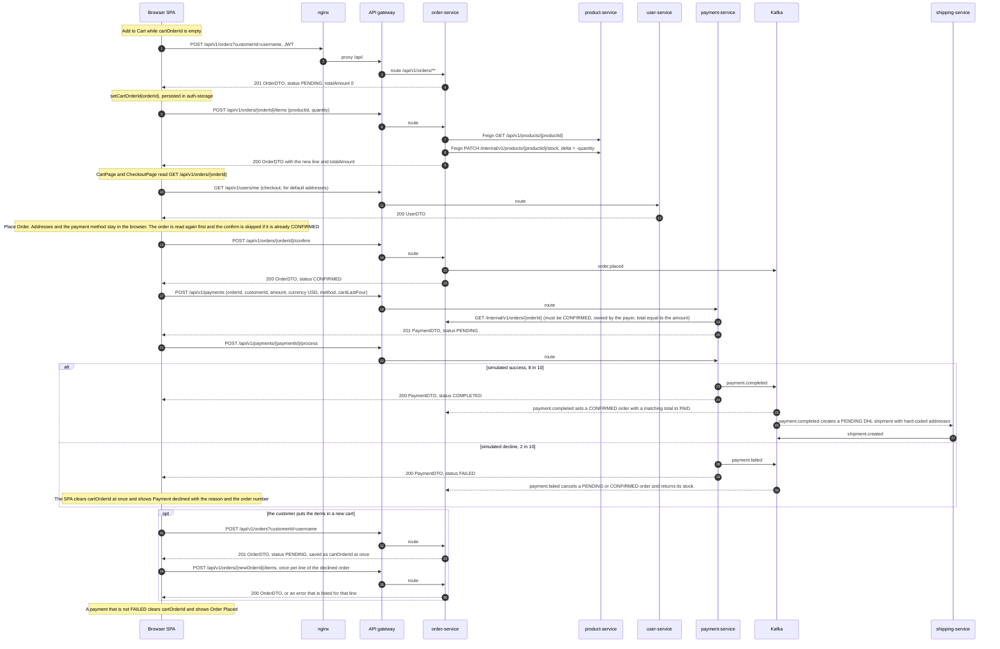
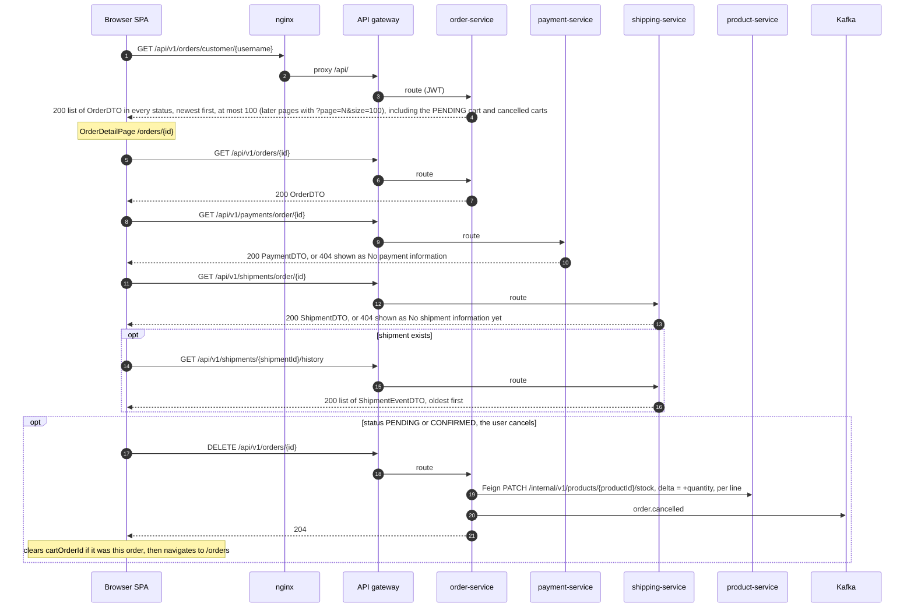
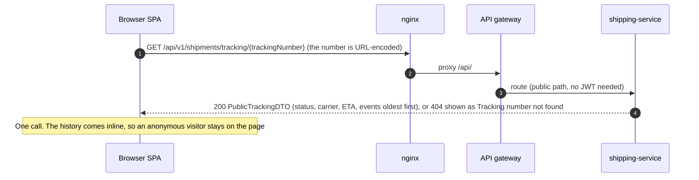
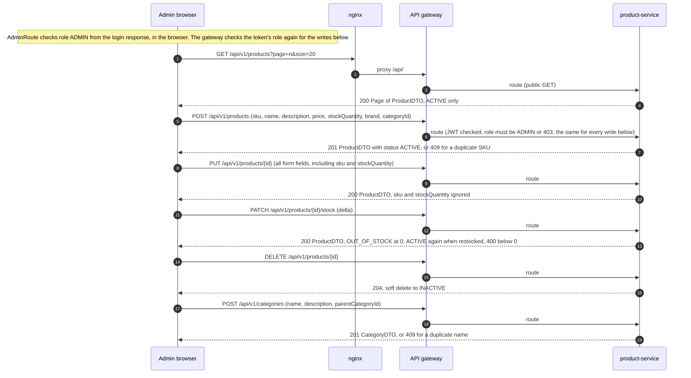
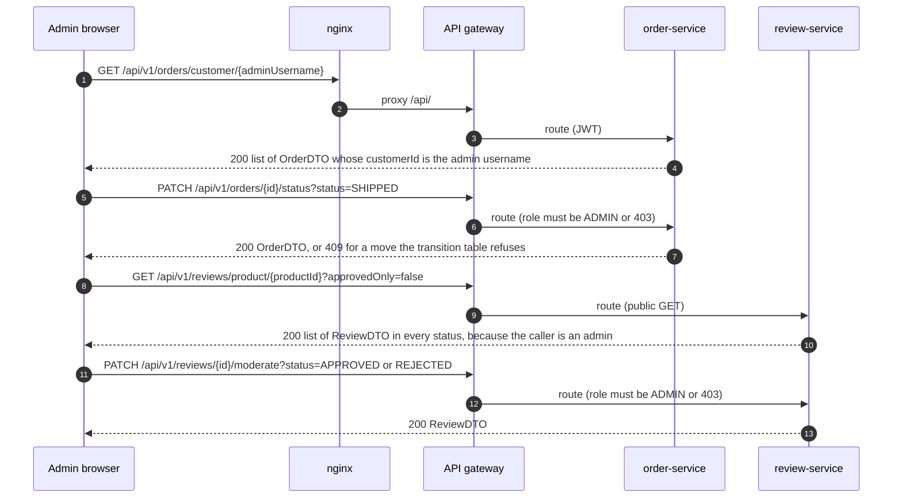
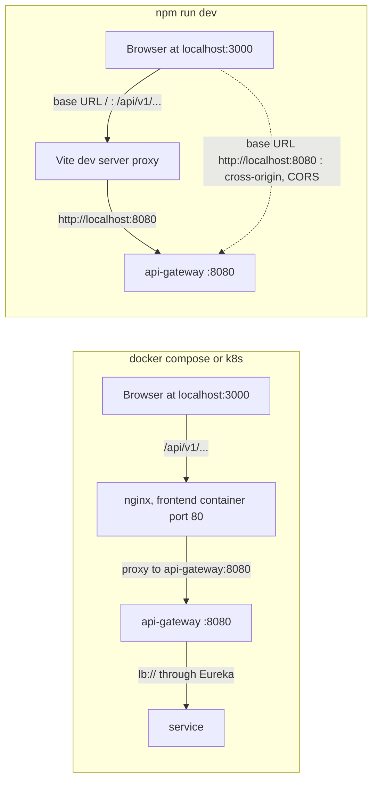

# Frontend (`ecommerce-frontend`)

The frontend is the platform's only user interface. It is a React single-page application, branded "ShopMicro", with a storefront for shoppers and an admin area. Shoppers browse and search products, read and write reviews, keep a cart, check out and pay, follow their orders and track shipments. Administrators manage products, categories, order statuses and review moderation. The frontend owns no data. Every screen reads and writes the REST APIs of six services through the API gateway, and the only state it keeps is the session and the id of the cart order, both in the browser's localStorage.

| | |
|---|---|
| Repository | `ecommerce-frontend` |
| Stack | React 18.3.1 · TypeScript 5.9.3 · Vite 6.4.5 · MUI 6.5.0 (plus `@mui/lab` for Timeline) · React Router 7.18.5 · TanStack Query 5.90.21 · zustand 5.0.11 · axios 1.21.0 · react-hook-form 7.71.2 with zod 4.6.7 · date-fns 4.1.0 |
| Tests | Vitest 2.1.9 (jsdom 26) · Testing Library 16 · MSW 2.12.10. 860 unit tests in 62 files at about 99% line coverage (@vitest/coverage-v8, measured on 2026-10-30), plus 40 pact-js interactions ([details](#testing)). Browser end to end: Playwright 1.64.1, 26 functional and 106 penetration tests against a running stack ([details](#end-to-end-tests-playwright)) |
| Dev server | `npm run dev`: Vite on port 3000, `/api` proxied to `http://localhost:8080` |
| Container | `nginx:1.27-alpine` listening on port 80. Host port 3000 (compose maps `3000:80`, the k8s Service `frontend-lb` listens on 3000) |
| How it reaches the API | Images are built with `VITE_API_BASE_URL=/`, so axios calls the same-origin path `/api/v1/...`. nginx proxies `/api/` to `api-gateway:8080`, and the gateway routes by path prefix to the services through Eureka |
| Services it calls | user-service, product-service, order-service, payment-service, shipping-service and review-service. It never calls catalog-service (`/api/v1/catalog`) and has no use for notification-service |
| Session | JWT from `POST /api/v1/users/login`, persisted by zustand in the localStorage key `auth-storage` and sent as `Authorization: Bearer <token>` |
| CI | CircleCI jobs `test`, `build`, `validate-image` and `publish-image` (Docker Hub), plus an `e2e` job run only on demand |

The versions are the ones `package-lock.json` resolves. `package.json` declares caret ranges.

Related docs: [api-gateway](services/api-gateway.md), [user-service](services/user-service.md), [product-service](services/product-service.md), [order-service](services/order-service.md), [payment-service](services/payment-service.md), [shipping-service](services/shipping-service.md), [review-service](services/review-service.md).

## Project structure

| Path | Role |
|---|---|
| `index.html` | Vite entry page (title "ShopMicro - Ecommerce Platform", `#root`, a `<noscript>` message asking to enable JavaScript, loads `src/main.tsx`) |
| `src/main.tsx` | Mounts `<App/>` inside `React.StrictMode` |
| `src/App.tsx` | A top-level `ErrorBoundary` (last-resort screen `AppErrorFallback`) around the provider stack: TanStack `QueryClientProvider` (client from `createQueryClient()`), MUI `ThemeProvider` and `CssBaseline`, `SnackbarProvider`, `BrowserRouter`. Also mounts React Query Devtools, which the package leaves out of production builds |
| `src/routes/` | `AppRouter.tsx` (route table, lazy pages, `Suspense`), `ProtectedRoute.tsx`, `AdminRoute.tsx`, `lazyWithReload.ts` (`React.lazy` that reloads the page once when a chunk has vanished after a deploy) |
| `src/layouts/` | `MainLayout` (Navbar, page, Footer), `AuthLayout` (centred card for login and register), `AdminLayout` (Navbar, permanent `Sidebar`, page). Each wraps its routed page in a `PageBoundary` |
| `src/pages/` | One folder per area: `auth`, `home`, `products`, `cart`, `checkout`, `orders`, `tracking`, `profile`, `admin`, plus `NotFoundPage.tsx` |
| `src/api/` | `axios.ts` (shared instance and interceptors) and one client object per backend area: `auth.api.ts`, `products.api.ts`, `categories.api.ts`, `orders.api.ts`, `payments.api.ts`, `shipments.api.ts`, `reviews.api.ts`. Also `errors.ts` (`ApiRequestError`, an `Error` whose `status` is the HTTP status, plus `isGone` and `isTransientError`), `queryClient.ts` (`createQueryClient`, `shouldRetryQuery`, `queryRetryDelay`), `normalize.ts` (`asList` and `asPage`, applied to the nine list and page calls so that a body of another shape reads as empty) and `paging.ts` (`SERVER_PAGE_SIZE` = 100, which must equal the default and maximum page size of the list endpoints the services cap, and `pageParams`, which sends nothing for page 0 and `page` and `size` for later pages) |
| `src/hooks/` | TanStack Query hooks per area (`useAuth`, `useProducts`, `useOrders`, `usePayments`, `useShipments`, `useReviews`) and `useCart`, the cart logic built on the order hooks (it also exports `useCartOrder`, the saved cart order, which drops a dead id). `usePagedList` is the infinite query behind the five capped lists. Small helpers: `useSingleFlight` (refuses a second call while the first is running), `useShowMore` (draws a long list in slices, then fetches the server's next page on each click) and `useLoadMore` in the same file (the fetch-only variant for the admin pages) |
| `src/store/authStore.ts` | The only zustand store: session (token, username, role, expiry) and `cartOrderId`, persisted to localStorage |
| `src/store/authStorage.ts` | The only code that touches localStorage: the session sanitizer, guarded get, set and remove that never throw, the JSON storage handed to zustand's `persist` (it drops a value that is not usable JSON) and `readStoredCredentials` for the axios interceptor |
| `src/types/index.ts` | TypeScript mirrors of the backend DTOs and enums, `Page<T>`, `ApiError` |
| `src/constants/index.ts` | `API_BASE_URL`, `API_ENDPOINTS` path prefixes, status label and colour maps, `PAYMENT_METHODS` and `ROUTES` (both unused) |
| `src/utils/` | `validators.ts` (zod schemas and the form types inferred from them), `formatters.ts` (currency, dates through date-fns, `humanize` for enum names; a missing or non-numeric amount, a missing date and a missing enum value show the placeholder "—", and an unparseable date shows its raw text), `safeSession.ts` (sessionStorage get, set and remove that never throw) |
| `src/components/common/` | `ConfirmDialog`, `EmptyState`, `ErrorAlert`, `ErrorBoundary`, `ErrorFallbacks` (the page panel and the last-resort screen), `LoadingSpinner`, `PageBoundary` (`ErrorBoundary` plus an inner `Suspense`), `ShowMoreButton` (the "Show more" control, with "Could not load more" and the message when the last fetch failed), `SnackbarProvider` (toast context, 4 s auto-hide) |
| `src/components/layout/` | `Navbar` (search box, cart badge, account menu, admin link), `Sidebar` (admin menu, 240 px), `Footer` |
| `src/components/product/` | `ProductCard`, `ProductGrid` (wires Add to Cart to `useCart`), `RatingStars`, `StockBadge` |
| `src/components/order/` | `OrderCard`, `OrderItemRow`, `OrderStatusChip`, `PaymentDeclinedPanel` (the checkout screen after a declined payment) |
| `src/components/review/` | `ReviewCard` (votes, edit and delete for the author, approve and reject for moderation), `ReviewForm`, `ReviewSummary`, `RatingDistribution` |
| `src/theme/theme.ts` | MUI theme (primary `#1976d2`, secondary `#9c27b0`, 8 px radius, buttons without uppercase) |
| `src/test/` | Vitest suites (including `security/`, the security tests, and `resilience/`, the guards over `nginx.conf` and the source), MSW `handlers.ts` and `server.ts`, `setup.ts`, `utils/renderWithProviders.tsx`, `utils/storage.ts` (`blockStorage` and `failStorageWrites`, which simulate blocked and full browser storage), `utils/paged.ts` (`servePaged` and `serveUncapped`, which serve a list the way the capped endpoints and an older uncapped server do) |
| `e2e/` | Playwright suite: `tests/*.spec.ts`, `fixtures.ts` (per-test customer and products, `signIn`), `support/api.ts` (gateway client for seeding), `global-setup.ts` (waits for the stack), `reporters/summary-reporter.ts`, its own `tsconfig.json` and `README.md`, and `security/` (penetration tests with their own `README.md` and `support.ts`) |
| `playwright.config.ts` | Playwright settings: target from `E2E_BASE_URL`, retries and workers on CI, the reporters writing to `reports/`, and two projects: `chromium` (`e2e/tests`) and `security` (`e2e/security`) |
| `scripts/e2e-docker.sh` | Runs the Playwright suite in the `mcr.microsoft.com/playwright` image |
| `public/favicon.svg` | Favicon, copied to `dist/` as is (no content hash) |
| `vite.config.ts` | React plugin, `@` alias to `src` (configured, but every import is relative), dev server and proxy, Vitest settings (which exclude `e2e/`) |
| `tsconfig.json`, `tsconfig.node.json` | Strict TypeScript for `src` (`noEmit`, bundler module resolution) and a separate project for `vite.config.ts` |
| `Dockerfile`, `nginx.conf`, `.dockerignore` | Two-stage image build and the nginx server config baked into it |
| `.env.example` | Documents `VITE_API_BASE_URL`. `.env` itself is ignored by git and by Docker |
| `.circleci/config.yml` | CI pipeline |

## Routing

`AppRouter` lazy-loads every page through `lazyWithReload` (a `React.lazy` wrapper, see "Failures while a page loads or renders" below) under one `Suspense` that shows a full-screen spinner. Routes are grouped by layout: `AuthLayout` for login and register, `AdminRoute` wrapping `AdminLayout` for `/admin/*`, and `MainLayout` for everything else, including the `*` catch-all. Paths are written out in `AppRouter.tsx`; the `ROUTES` constant is not used. API paths in this table leave out the `/api/v1` prefix.

| Path | Page component | Guard | What the page does |
|---|---|---|---|
| `/login` | `pages/auth/LoginPage` | public (AuthLayout) | Username and password form (zod: both required), submitted through `useLogin`. The API's error message is shown in an alert |
| `/register` | `pages/auth/RegisterPage` | public (AuthLayout) | Registration form (username 3 to 50 letters, digits or underscores, email, password of 10 to 72 bytes that does not contain the username, optional first name, last name and phone). `POST /users/register`, then straight to `/login` |
| `/` | `pages/home/HomePage` | public | Hero search box (goes to `/products?q=`), the first 10 categories as chips (go to `/products?categoryId=`), and "Featured Products", which are simply the first 8 results of `GET /products?page=0&size=8` |
| `/products` | `pages/products/ProductListPage` | public | Reads `q` and `categoryId` from the query string. Search mode calls `GET /products/search`, category mode calls `GET /products/category/{id}` (the first 100 products, the rest through "Show more", no page selector), otherwise `GET /products` in pages of 20. Sidebar with the category list and a status filter that runs in the browser |
| `/products/:id` | `pages/products/ProductDetailPage` | public. Review actions need a login | Product, approved reviews, rating summary, category breadcrumb. Quantity field and Add to Cart (only for status ACTIVE). Write, edit and delete your own review, vote on reviews |
| `/tracking`, `/tracking/:trackingNumber` | `pages/tracking/TrackingPage` | public | Looks a shipment up by tracking number and shows its status, carrier, estimated delivery and the event history (no order, customer or addresses) |
| `/cart` | `pages/cart/CartPage` | ProtectedRoute | Items and total of the cart order. Remove an item, clear the cart, go to checkout |
| `/checkout` | `pages/checkout/CheckoutPage` | ProtectedRoute | Three steps: addresses, payment method (with the card's last four digits for card methods), review. Place Order confirms the order, then creates and processes a payment. A declined payment ends in the "Payment declined" panel, which offers to put the items in a new cart |
| `/orders` | `pages/orders/OrderListPage` | ProtectedRoute | `GET /orders/customer/{username}`, newest first, as cards, with "Show more" for older orders |
| `/orders/:id` | `pages/orders/OrderDetailPage` | ProtectedRoute | Items and total, addresses, payment panel, shipment panel with a tracking link, shipment timeline. Cancel button for PENDING and CONFIRMED orders |
| `/profile` | `pages/profile/ProfilePage` | ProtectedRoute | `GET /users/me`, then edit first name, last name, phone and the default addresses with `PUT /users/{id}` |
| `/admin` | `pages/admin/AdminDashboard` | AdminRoute (AdminLayout) | Cards for the product count (`totalElements` of `GET /products?page=0&size=1`) and the category count. The Orders and Reviews cards show a fixed "—". Quick links |
| `/admin/products` | `pages/admin/AdminProductsPage` | AdminRoute | Paged product table (20 per page) with create, edit, stock delta and delete |
| `/admin/categories` | `pages/admin/AdminCategoriesPage` | AdminRoute | Two-level category list and a create dialog (the parent is picked from the root categories) |
| `/admin/orders` | `pages/admin/AdminOrdersPage` | AdminRoute | The signed-in admin's own orders, because no endpoint lists all orders. It uses the same query as My Orders and draws every loaded order, with "Show more orders" for the next server page. A status dropdown per row calls `PATCH /orders/{id}/status` |
| `/admin/reviews` | `pages/admin/AdminReviewsPage` | AdminRoute | Enter a product id to load all its reviews (`approvedOnly=false`), 100 per server page with "Show more reviews", with Approve and Reject on the PENDING ones |
| `*` | `pages/NotFoundPage` | public | 404 page inside MainLayout |

Guards:

- **ProtectedRoute** (`src/routes/ProtectedRoute.tsx`): if the store has no live session (`hasLiveSession`, below), it saves `pathname + search` in the sessionStorage key `intendedPath` (through `utils/safeSession.ts`, so blocked or full storage only costs the return trip) and redirects to `/login` with `replace`. After a successful login, `useLogin` navigates back there, but only to a plain same-origin path (see [Login](#login)).
- **AdminRoute** (`src/routes/AdminRoute.tsx`): no live session leads to `/login` (no `intendedPath` is saved); `role !== 'ADMIN'` leads to `/`.
- Both use `hasLiveSession` (`src/store/authStore.ts`): `isAuthenticated` is true, a token is present and, when `loginAt` and `expiresIn` are known, the clock is still inside `loginAt + expiresIn * 1000` (S-91, S-92). A flag edited by hand in localStorage, or a persisted session that has outlived its token, therefore does not unlock a protected route. The check runs when a guard renders and reads the zustand store. The role is `ADMIN` or `CUSTOMER` (the login response's role, with anything other than `ADMIN` stored as `CUSTOMER`), and anyone can edit it in localStorage to `ADMIN`; a stored role that is neither makes the next load start signed out. Editing it to `ADMIN` only shows the admin screens: the gateway answers 403 to a token whose role is not exactly `ADMIN` for the admin-only operations, and the services check roles and ownership again (see "Authorization behind the calls" under [Verification](#verification)). So the guards shape the UI, and the API enforces the roles.
- `/login` and `/register` are not guest-only, although the repo README says they are. A signed-in user can open both.

Failures while a page loads or renders:

- **A chunk that cannot be fetched.** A tab opened before a deploy asks for hashed files that no longer exist. `lazyWithReload` (`src/routes/lazyWithReload.ts`) wraps `React.lazy` and, when an import fails with a chunk-load error, reloads the page once, because the fresh `index.html` names the current chunks. The spinner stays on screen while the reload starts. It does not reload while the browser is offline (the reload would replace the app with the browser's offline page), when a reload was already recorded in the last 30 s (sessionStorage key `chunk-reload-at`), or when that marker cannot be stored (the reload could repeat forever). In those cases the error goes to the page boundary below.
- **A render error or a failed chunk in a page.** Each layout (`MainLayout`, `AdminLayout`, `AuthLayout`) wraps its `Outlet` in `PageBoundary`, an `ErrorBoundary` around an inner `Suspense`. The routed page is replaced by the panel "This page could not be displayed", while the Navbar, Sidebar and Footer stay, and while a chunk loads the layout stays on screen with a "Loading..." spinner. The panel offers "Reload page", "Try again" and "Go to home page". For a chunk-load error it leaves out "Try again", because `React.lazy` keeps a failed import failed and only a reload fetches it again. The boundary is keyed on the router location, so any navigation clears the error.
- **Anything outside the routed page.** `App` wraps everything, providers included, in a top-level `ErrorBoundary`. Its fallback is plain DOM and needs no theme, router or query context: "Something went wrong" with "Reload page", a link to the home page and "Sign out and reload", which removes the stored session and loads `/` for the case where saved state crashes the app on every start.

Failed loads, bad ids, long input and odd data:

- **An outage is not "empty".** When a request fails, the page says so instead of showing an empty or "not found" state. CartPage and CheckoutPage show "Could not load your cart" with a Retry button (unless the order is gone: a 404 or 403 drops the saved id and they show the empty cart). OrderListPage shows an error alert with Retry and no "No orders yet". ProfilePage shows "Could not load your profile" with Retry and keeps the form fields and Save disabled until the profile has loaded. ProductListPage shows its error alert in every mode (search, category, all products) and no "No products found" next to it. The review list of ProductDetailPage shows "Could not load reviews" with a Retry button instead of "No reviews yet". OrderDetailPage shows "Payment details are temporarily unavailable." and "Shipment details are temporarily unavailable." when those requests fail without a response or with a 5xx, and keeps "No payment information" and "No shipment information yet" for a 404. TrackingPage shows "Tracking is temporarily unavailable. Please try again in a moment." for such a failure and "Tracking number not found" only for other errors.
- **Ids that cannot exist.** `/products/abc` and `/products/0` show "Product not found", and `/orders/abc` and `/orders/0` show "Order not found". The page sends no request for the id. A `categoryId` in `/products` that is not a positive integer (`abc`, `0`, `-1`, `1.5`) is ignored, and the page lists all products.
- **Input caps.** Search text is capped at 200 characters (the Navbar and hero search boxes, and `q` read from the URL), and a tracking number at 100 (the form refuses a longer one with "Tracking number is too long", and in the URL it shows "Tracking number not found" and sends no request).
- **Long lists.** The services cap five lists at one page of 100 rows (default and maximum): orders and payments by customer (newest first), reviews by product and by customer (oldest first) and the ACTIVE products of a category (by id). `SERVER_PAGE_SIZE` in `src/api/paging.ts` is that number and has to match the services. Page 0 is the plain request; later pages send `?page=N&size=100` (see "Paged lists" under [Queries](#queries)). The pages draw what is loaded in slices (OrderListPage 100 orders, ProductDetailPage 50 reviews, ProductListPage 100 category products), and "Show more" first reveals the next slice. Once every loaded row is drawn and the server's last page was full, the next click asks the server for the next page and the new rows are drawn one slice at a time. One click is one request (`useSingleFlight`), and nothing loads by itself. A page that fails to load leaves the rows already loaded in place, and the button shows "Could not load more" with the message; clicking it again retries. The admin pages draw every loaded row and only fetch: AdminOrdersPage has "Show more orders", AdminReviewsPage "Show more reviews", and its counts ("Pending Reviews (n)", "All Reviews (n)") get a "+" while the server has more.
- **Missing and unknown values.** A missing or non-numeric amount, a missing date and a missing enum value show the placeholder "—" (`formatCurrency`, the date formatters, `humanize`), and an unparseable date shows its raw text. A status the UI does not know still gets a label instead of an empty chip (`StockBadge`, the shipment status chips, the payment method), and the AdminOrdersPage status dropdown adds a current status it does not list as an extra option. `ReviewSummary`, `RatingStars` and `RatingDistribution` read a missing number as 0 (a distribution bar is capped at 100 %), and an order without `orderItems` reads as an empty list (OrderCard, OrderDetailPage, AdminOrdersPage). Long unbroken text wraps (`overflowWrap: anywhere`) in alerts, review text and the product name and description.

## Authentication and session

### Login

1. `LoginPage` validates the form with `loginSchema` and calls `useLogin().mutate`.
2. `authApi.login` sends `POST /api/v1/users/login` with `{username, password}`. The gateway lets the path through without a token. user-service `UserService.login()` answers 200 with `AuthResponse` `{token, expiresIn, username, role}`. `expiresIn` is in seconds: `jwt.expiration-ms` is 3600000, divided by 1000. A wrong password, an unknown user or an INACTIVE or SUSPENDED account gives 401.
3. `useLogin` first checks the 200 body: one without a non-empty `token` string and `username` string (an empty body, the page of a proxy) is rejected with "Sign-in failed: unexpected response from the server. Please try again." and nothing is stored. `useLogin.onSuccess` then calls `authStore.login({token, username, role, expiresIn})`, which also sets `loginAt = Date.now()` and `isAuthenticated = true`. The role is passed as `ADMIN` or `CUSTOMER` (any other value becomes `CUSTOMER`), and `login()` keeps the saved `cartOrderId` only when the same username signs in again. It then calls `queryClient.clear()` and navigates to `intendedPath` (removing it) or to `/`. Only a plain same-origin path is followed (`safeReturnPath`): `//evil.com`, `/\evil.com`, `https:` and `javascript:` values, which any script on the origin could have written to sessionStorage, fall back to `/` (S-93).

### Register

`RegisterPage` sends `POST /api/v1/users/register` (no token needed) and gets 201 with a `UserDTO`. `useRegister.onSuccess` navigates to `/login` at once, so the "Account created" alert is effectively never seen. There is no automatic login. New users always get the role CUSTOMER. The only ADMIN account is the one user-service seeds at startup (`DataInitializer`: username `admin`, password `admin`).

### Where the session lives

All of it is in `useAuthStore` (`src/store/authStore.ts`). zustand's `persist` middleware writes the fields below to the localStorage key `auth-storage` as `{"state": {...}, "version": 1}`. `src/store/authStorage.ts` is the only code that touches localStorage, and sessionStorage goes through `src/utils/safeSession.ts`. Both wrappers swallow the exceptions that blocked or full storage throws: with localStorage unavailable the session lives in memory only, and with sessionStorage unavailable the return path and the reload marker are lost. sessionStorage holds `intendedPath` and, after a chunk-load reload, the timestamp `chunk-reload-at`. No cookies are used.

| Field | Persisted | Meaning |
|---|---|---|
| `token` | yes | The JWT |
| `username` | yes | The JWT subject. Sent as `customerId` for orders and payments, and compared with `customerId` to find the user's own reviews |
| `role` | yes | `CUSTOMER` or `ADMIN`, from the login response |
| `expiresIn` | yes | Seconds, from the login response |
| `loginAt` | yes | `Date.now()` at login |
| `isAuthenticated` | yes | Drives the guards and the Navbar |
| `cartOrderId` | yes | Id of the PENDING order that serves as the cart (see [The cart](#the-cart)) |

What is read back from localStorage is treated as input, because the user can edit it and it outlives deploys:

- `sanitizePersistedState` keeps a stored session only when it has a `token` (visible ASCII, at most 8192 characters), a `username` (at most 100 characters from letters, digits and `_ . @ + -`), a `role` of `CUSTOMER` or `ADMIN`, and `isAuthenticated === true`. Anything else, or a value that is not an object, becomes the signed-out state. `expiresIn` and `loginAt` must be positive numbers and `cartOrderId` a positive integer, otherwise each becomes null.
- The store is version 1. `migrate` runs older blobs (version 0) through the same sanitizer, so a valid older blob keeps its session, and `merge` sanitizes whatever hydration finds, so a hand-edited blob cannot leave the store half valid. With nothing stored, the defaults stay.
- The JSON storage drops a value that is not usable JSON, or is JSON but not an object (a bare string, an array), instead of throwing while the app starts.
- A role other than `ADMIN` in a login response is stored as `CUSTOMER`.

### How the role is known

The role comes from the login response body. The browser never decodes the JWT. The same role is signed into the JWT's `role` claim, which the gateway copies into the `X-User-Role` header. Only review-service reads that header, in `deleteReview`.

### Axios instance and interceptors

`src/api/axios.ts` creates one instance with `baseURL = API_BASE_URL`, `Content-Type: application/json` and a 30 000 ms timeout.

The request interceptor runs on every request:

1. For a request to the API's own origin (`isApiRequest`), other than login and register (`isCredentialCall`: a URL ending in `/users/login` or `/users/register`), it reads the stored session through `readStoredCredentials()` in `src/store/authStorage.ts`, straight from localStorage and not from the in-memory store. The read validates the blob: a value that is not a session blob is removed, and a missing, malformed or unreadable one counts as no session. Login and register skip steps 2 to 4, so a stale token neither rides along with them nor blocks them. A request to another origin gets no session either: axios ignores `baseURL` for an absolute URL, so without the origin check the bearer token would go to any host that the shared instance is pointed at (S-90).
2. If there is a token and `loginAt + expiresIn * 1000` has passed, it calls `leaveForLogin()` (deletes `auth-storage` and sets `window.location.href = '/login'`, unless the page already is `/login`) and rejects the request with an `ApiRequestError` "Session expired. Please log in again." and status 401. Public calls are affected too, so a visitor whose stored session has expired is sent to the login page even while browsing products.
3. Otherwise it sets `Authorization: Bearer <token>`.
4. If the URL contains `/me`, it sets `X-Username: <username>`. `authApi.getMe` passes the same header explicitly. Both are redundant through the gateway, which overwrites `X-Username` with the JWT subject on every authenticated route.

The response interceptor handles errors:

1. A 401 from any call other than the login call (or one that passes `skipAuthRedirect`) runs `leaveForLogin()`: it deletes `auth-storage` and sets `window.location.href = '/login'`. That is a full page load, which throws away in-memory state, the query cache and unsaved form input. When the page already is `/login`, only the stored session is deleted and nothing reloads, so a 401 from a call that was still in flight cannot start a reload loop. The gateway's own 401 (token missing, invalid or expired) has an empty body.
2. It then turns the failure into an `ApiRequestError` whose `status` is the HTTP status (undefined when no response arrived). A rejection that already is an `ApiRequestError`, such as the expired-session one from the request interceptor, passes through unchanged. If the body has `fieldErrors`, the message is `field: message; field: message`. Otherwise it is the body's `message`, or "An error occurred" when the JSON body has no `message`. A body that is not JSON, empty included, gives "Service temporarily unavailable" for 502, 503 and 504 (the HTML page of a proxy in front of a gateway that is down). For other statuses a non-empty body that is not JSON gives "An error occurred", and an empty one falls back to axios' own message ("Request failed with status code 401"). Server-supplied messages are clipped to 300 characters, followed by an ellipsis. With no response at all, axios' own message is used ("Network Error", "timeout of 30000ms exceeded"). Pages show `error.message` in alerts and snackbars, and the query retry policy and the "order is gone" check read `status`.

### Logout

The Navbar's Logout calls `authStore.logout()`, which clears the token, username, role, expiry fields, `isAuthenticated` and `cartOrderId`, then navigates to `/`. No API call is made. The JWT stays valid until it expires, since tokens are stateless and cannot be revoked. Logout does not clear the query cache (the next login does). The cart order is not cancelled: it stays PENDING on the server and keeps its stock reserved.

### Token expiry

There are two independent checks. The client-side one is the clock check in the request interceptor: one hour with the default `jwt.expiration-ms`. The server-side one is the gateway, which rejects an expired JWT with 401, and the response interceptor then redirects. There is no refresh token, so the user logs in again. The route guards check the clock as well (`hasLiveSession`), so a persisted session that has already expired sends the user to `/login` when a guard renders, before any API call. One that expires while a page is open is caught by the request interceptor's clock check or by the gateway's 401.

## State and data fetching

### zustand

There is exactly one store, `useAuthStore`, described in [Where the session lives](#where-the-session-lives). Its actions are `login`, `logout`, `setCartOrderId` and `clearCart` (unused). Toasts go through a React context, `SnackbarProvider`, not a store.

### TanStack Query defaults

`createQueryClient()` in `src/api/queryClient.ts` builds the `QueryClient` that `src/App.tsx` uses. Queries use `staleTime` 60 s and `refetchOnWindowFocus` false, and `gcTime` keeps its default of 5 minutes. A failed query is retried once (`shouldRetryQuery`), and only when the error is an `ApiRequestError` without a status (no response arrived) or with a 5xx status. A 4xx answer is never retried, because asking again gets the same answer, and neither is an error raised by the app's own code. The retry waits about one second (`queryRetryDelay`: 1 s with a jitter of 25 % either way, so tabs that failed together do not retry together). Mutations use `retry` 0, because a mutation is not idempotent in general (stock deltas, payments). No query overrides this policy or sets `refetchInterval`, so changes that arrive through Kafka (an order becoming PAID or CANCELLED, a shipment being created) appear only when a query refetches after it went stale or was invalidated.

### Queries

API paths leave out `/api/v1`. The Retry column shows 1 for the default policy above (one retry, only for a failure without a response or with a 5xx status).

| Hook (file) | Query key | Endpoint | staleTime | Enabled when | Retry | Used by |
|---|---|---|---|---|---|---|
| `useCurrentUser` (`useAuth.ts`) | `['me', username]` | `GET /users/me` | 5 min | signed in and username set | 1 | ProfilePage, CheckoutPage |
| `useProducts(page, size, enabled)` (`useProducts.ts`) | `['products', page, size]` | `GET /products?page&size` | 2 min | `enabled` (default true). ProductListPage passes true only with no search text and no category | 1 | HomePage (0, 8), ProductListPage (page, 20), AdminDashboard (0, 1), AdminProductsPage (page, 20) |
| `useProduct(id)` | `['product', id]` | `GET /products/{id}` | 60 s | id > 0 | 1 | ProductDetailPage |
| `useProductSearch(q, page, size)` | `['products', 'search', q, page, size]` | `GET /products/search` | 60 s | `q` not empty | 1 | ProductListPage |
| `useProductsByCategory(id)` (paged) | `['products', 'category', id]` | `GET /products/category/{id}` | 60 s | id > 0 | 1 | ProductListPage |
| inline `useQuery` | `['categories']` | `GET /categories` | 10 min in HomePage, ProductListPage, ProductDetailPage; 60 s in the admin pages | always | 1 | HomePage, ProductListPage, ProductDetailPage, AdminDashboard, AdminProductsPage, AdminCategoriesPage |
| `useOrder(id)` (`useOrders.ts`) | `['order', id]` | `GET /orders/{id}` | 60 s | id > 0 | 1 | `useCartOrder` (in `useCart.ts`, used by `useCart` for the Navbar badge, ProductGrid and ProductDetailPage, and by CartPage and CheckoutPage), OrderDetailPage |
| `useCustomerOrders()` (paged) | `['orders', 'customer', username]` | `GET /orders/customer/{username}` | 60 s | username set | 1 | OrderListPage and AdminOrdersPage, which share the query |
| `usePaymentByOrder(id)` (`usePayments.ts`) | `['payment', 'order', id]` | `GET /payments/order/{id}` | 60 s | id > 0 | 1 | OrderDetailPage |
| `useCustomerPayments()` (paged) | `['payments', 'customer', username]` | `GET /payments/customer/{username}` | 60 s | username set | 1 | unused |
| `useShipmentByOrder(id)` (`useShipments.ts`) | `['shipment', 'order', id]` | `GET /shipments/order/{id}` | 60 s | id > 0 | 1 | OrderDetailPage |
| `useShipmentByTracking(tn)` | `['shipment', 'tracking', tn]` | `GET /shipments/tracking/{tn}` | 60 s | tn set | 1 | TrackingPage |
| `useShipmentHistory(id)` | `['shipment', 'history', id]` | `GET /shipments/{id}/history` | 60 s | id > 0 | 1 | OrderDetailPage |
| `useProductReviews(id, approvedOnly = true)` (paged, `useReviews.ts`) | `['reviews', 'product', id, approvedOnly]` | `GET /reviews/product/{id}?approvedOnly=` | 60 s | id > 0 | 1 | ProductDetailPage; AdminReviewsPage with `approvedOnly` false |
| `useReviewSummary(id)` | `['reviewSummary', id]` | `GET /reviews/product/{id}/summary` | 60 s | id > 0 | 1 | ProductDetailPage |
| `useCustomerReviews(customerId)` (paged) | `['reviews', 'customer', customerId]` | `GET /reviews/customer/{customerId}` | 60 s | id set | 1 | unused |
| `usePendingReviews()` | `['reviews', 'pending']` | none, the function returns `[]` | 60 s | always | 1 | unused stub |

**Paged lists.** The five rows marked "paged" are infinite queries built by `usePagedList` (`src/hooks/usePagedList.ts`) under the same hook names and keys as before, so the cached value is `{pages, pageParams}`. The hook returns the rows as one flat list, deduplicated by id (a row that shifted onto two pages counts once), in `data`, together with `hasMoreOnServer`, `loadMore`, `isLoadingMore` and `loadMoreError`. The first request is page 0 with no paging parameters, as the pacts pin it; later pages send `?page=N&size=100` (reviews `?approvedOnly=…&page=N&size=100`). A next page exists only when the last page had exactly 100 rows and brought at least one id that the earlier pages did not have, so a server that ignores `page` and repeats the list stops at once, and a list of exactly 100 rows costs one click that returns nothing. A next page is fetched only by `loadMore`, which a click calls: there is no effect and no prefetch, so one click is one request, plus the query client's single retry of a transient failure. A failed next page leaves every loaded row in place and is reported as `loadMoreError`; `error` keeps meaning that the list itself could not be loaded or refreshed.

### Mutations and invalidation

Invalidation uses TanStack's prefix matching, so `['products']` also covers `['products', 'search', ...]` and `['products', 'category', ...]`. Invalidating a paged list (orders, reviews, a category's products) refetches every page loaded so far, one after the other.

| Hook | Call | On success | Used by |
|---|---|---|---|
| `useLogin` | `authApi.login` | `authStore.login()`, `queryClient.clear()`, navigate to `intendedPath` or `/` | LoginPage |
| `useRegister` | `authApi.register` | navigate to `/login` | RegisterPage |
| `useUpdateUser(userId)` | `authApi.updateUser` | invalidate `['me', username]` | ProfilePage |
| `useCreateOrder` | `ordersApi.createOrder(username)` | invalidate `['orders', 'customer', username]` | `useCart`, CartPage |
| `useAddOrderItem` | `ordersApi.addItem` | invalidate `['order', orderId]`, also on error (a refused add can mean the cart changed, so it is read again) | `useCart`, CartPage |
| `useConfirmOrder` | `ordersApi.confirmOrder` | invalidate `['order', id]` and `['orders', 'customer', username]` | CheckoutPage |
| `useUpdateOrderStatus` | `ordersApi.updateOrderStatus` | invalidate `['order', id]` and `['orders']` | AdminOrdersPage (OrderDetailPage creates one and never calls it) |
| `useDeleteOrder` | `ordersApi.deleteOrder` (a cancel) | invalidate `['orders', 'customer', username]` | CartPage, OrderDetailPage |
| `useCreatePayment` | `paymentsApi.createPayment` | invalidate `['payment', 'order', orderId]` | CheckoutPage |
| `useProcessPayment` | `paymentsApi.processPayment` | invalidate `['payment', 'order', orderId]` and `['payments']` | CheckoutPage |
| `useRefundPayment` | `paymentsApi.refundPayment` | invalidate `['payment', 'order', orderId]` | unused |
| `useCreateProduct` | `productsApi.createProduct` | invalidate `['products']` | AdminProductsPage |
| `useUpdateProduct` | `productsApi.updateProduct` | invalidate `['products']` and `['product', id]` | AdminProductsPage |
| `useUpdateStock` | `productsApi.updateStock` | invalidate `['products']` and `['product', id]` | AdminProductsPage |
| `useDeleteProduct` | `productsApi.deleteProduct` | invalidate `['products']` | AdminProductsPage |
| inline `useMutation` | `categoriesApi.createCategory` | invalidate `['categories']`, toast, close the dialog | AdminCategoriesPage |
| `useCreateReview` | `reviewsApi.createReview` | invalidate `['reviews', 'product', productId]` and `['reviewSummary', productId]` | ProductDetailPage |
| `useUpdateReview` | `reviewsApi.updateReview` | same as create | ProductDetailPage |
| `useDeleteReview` | `reviewsApi.deleteReview` | invalidate `['reviews']` and `['reviewSummary']` | ProductDetailPage |
| `useModerateReview` | `reviewsApi.moderateReview` | invalidate `['reviews']` | AdminReviewsPage |
| `useVoteReview` | `reviewsApi.voteReview` | invalidate `['reviews', 'product', productId]` | ProductDetailPage |
| `useUpdateShipmentStatus` | `shipmentsApi.updateShipmentStatus` | invalidate `['shipment', 'order', orderId]` and `['shipment', 'history', id]` | unused |

Gaps in the invalidation rules: adding items to the cart and cancelling orders change stock in product-service, but no product query is invalidated, so stock badges stay stale until the product queries expire. Moderation does not invalidate `['reviewSummary', ...]`.

### The cart

The cart is not client-side state. It is an order in status PENDING held by order-service, and the browser keeps only its id.

- **Where the id lives:** `cartOrderId` in the zustand store, persisted in `auth-storage`. It belongs to one browser. Logout clears it, and `login()` clears it when a different user signs in (the same user keeps it). `useCartOrder` also drops it when order-service answers 404 or 403 for the order, or when the order is PAID, SHIPPED, DELIVERED or CANCELLED, so that the next Add to Cart starts a new cart instead of failing for good. It keeps the id for PENDING, CONFIRMED, any other status, and for a failed read such as a 503, because none of those shows that the order is gone.
- **Add to cart** (`useCart.addToCart(productId, quantity)`; ProductCard adds 1, the detail page adds the chosen quantity): a signed-out user gets the toast "Please login to add items to cart". Without a `cartOrderId`, the hook first calls `POST /api/v1/orders?customerId=<username>` and stores the returned `orderId`. It then calls `POST /api/v1/orders/{orderId}/items` with `{productId, quantity}`. order-service checks stock through Feign and decrements it straight away (`PATCH /internal/v1/products/{id}/stock` with `delta = -quantity`; the gateway never routes `/internal/`, and the public stock endpoint is admin-only), so stock is reserved when the item goes into the cart. order-service accepts items only while the order is PENDING. Adding the same product twice creates two line items. Adding is single-flight: a second click on a product is ignored until its request has finished, and adds that start before the cart exists share one create-order request, so only one order is created. A failed add invalidates the cart query, so the cart is read again.
- **Badge and display:** the Navbar badge is the sum of `quantity` over the `orderItems` of `GET /api/v1/orders/{cartOrderId}`. CartPage lists the same items and the server-computed `totalAmount` (`Order.addItem()` adds price times quantity).
- **Remove one item:** no endpoint removes an item, so CartPage cancels the whole order (`DELETE /api/v1/orders/{id}`, which restores stock for every item and publishes `order.cancelled`), creates a new order and adds the other items back one by one. Each cancelled cart stays in the user's order history.
- **Clear cart:** `DELETE /api/v1/orders/{id}`, then `cartOrderId = null`. Clear cart and remove-item each run through `useSingleFlight`, so a double click on the dialog's confirm button does not cancel twice.
- **Turning it into an order:** checkout confirms that same order (`POST /api/v1/orders/{id}/confirm`), then creates and processes a payment. Place Order sends the confirm only if the order is not already CONFIRMED: it reuses the order it confirmed earlier in the page session, or else reads the order's real status first. `cartOrderId` is set to null once the process call has returned a payment, whatever its outcome: together with the "Order Placed!" screen when the payment is not FAILED, and at the decline when it is FAILED, because order-service cancels a declined order. The decline shows the "Payment declined" panel, whose "Put these items in a new cart" action makes a new order the saved cart. See [Cart, checkout, order creation and payment](#cart-checkout-order-creation-and-payment).
- **Consequences of storing only the id in the browser:** logging out, or opening the shop in another browser, orphans the PENDING order. It keeps its stock reserved and shows up as "Pending" under My Orders until order-service's expiry job cancels it: a PENDING order that has not changed for 24 hours (`orders.reservation.pending-ttl`, checked every 10 minutes) is cancelled and its stock returned. CONFIRMED orders are never expired.

## API client map

### Call table

The 45 functions in `src/api/*.ts` are listed below. "Gateway" is what the gateway's `JwtAuthenticationFilter` requires: "Public" needs no token, "JWT" a valid token, and "JWT, ADMIN" a valid token whose role is exactly `ADMIN` (any other role gets 403). "Result" is the outcome of checking the call against the backend controllers and DTOs; the M numbers refer to [Mismatches](#mismatches).

| # | Function | Method and path | Gateway | Service and handler | Used by | Result |
|---|---|---|---|---|---|---|
| 1 | `authApi.login` | `POST /api/v1/users/login` | Public | user-service `UserController.login()` | `useLogin` in LoginPage | OK |
| 2 | `authApi.register` | `POST /api/v1/users/register` | Public | `UserController.register()` (201) | `useRegister` in RegisterPage | OK |
| 3 | `authApi.getMe` | `GET /api/v1/users/me` plus `X-Username` | JWT | `UserController.getMe()` | `useCurrentUser` in ProfilePage, CheckoutPage | OK |
| 4 | `authApi.getUserById` | `GET /api/v1/users/{id}` | JWT | `UserController.getUserById()` | unused | OK |
| 5 | `authApi.updateUser` | `PUT /api/v1/users/{id}` | JWT | `UserController.updateUser()` | `useUpdateUser` in ProfilePage | OK |
| 6 | `authApi.deleteUser` | `DELETE /api/v1/users/{id}` | JWT | `UserController.deleteUser()` (204, sets INACTIVE) | unused | OK |
| 7 | `productsApi.getProducts` | `GET /api/v1/products?page&size` | Public | product-service `ProductController.getAllProducts()` | `useProducts` in HomePage, ProductListPage, AdminDashboard, AdminProductsPage | OK, see M5 |
| 8 | `productsApi.getProductById` | `GET /api/v1/products/{id}` | Public | `ProductController.getProductById()` (any status) | `useProduct` in ProductDetailPage | OK |
| 9 | `productsApi.getProductBySku` | `GET /api/v1/products/sku/{sku}` | Public | `ProductController.getProductBySku()` | unused | OK |
| 10 | `productsApi.searchProducts` | `GET /api/v1/products/search?q&page&size` | Public | `ProductController.searchProducts()` | `useProductSearch` in ProductListPage | OK, see M5 |
| 11 | `productsApi.getProductsByCategory` | `GET /api/v1/products/category/{categoryId}`, later pages `?page=N&size=100` | Public | `ProductController.getProductsByCategory()` (a list of at most 100 ACTIVE products by id per page) | `useProductsByCategory` in ProductListPage | OK, see M5 |
| 12 | `productsApi.createProduct` | `POST /api/v1/products` | JWT, ADMIN | `ProductController.createProduct()` (201) | `useCreateProduct` in AdminProductsPage | OK |
| 13 | `productsApi.updateProduct` | `PUT /api/v1/products/{id}` | JWT, ADMIN | `ProductController.updateProduct()` | `useUpdateProduct` in AdminProductsPage | M2 |
| 14 | `productsApi.updateStock` | `PATCH /api/v1/products/{id}/stock`, body `{delta}` | JWT, ADMIN | `ProductController.updateStock()` | `useUpdateStock` in AdminProductsPage | OK |
| 15 | `productsApi.deleteProduct` | `DELETE /api/v1/products/{id}` | JWT, ADMIN | `ProductController.deleteProduct()` (204, sets INACTIVE) | `useDeleteProduct` in AdminProductsPage | OK |
| 16 | `categoriesApi.getCategories` | `GET /api/v1/categories` | Public | `CategoryController.getAllCategories()` | inline `useQuery(['categories'])` in six pages | OK |
| 17 | `categoriesApi.getCategoryById` | `GET /api/v1/categories/{id}` | Public | `CategoryController.getCategoryById()` | unused | OK |
| 18 | `categoriesApi.createCategory` | `POST /api/v1/categories` | JWT, ADMIN | `CategoryController.createCategory()` (201, 409 on a duplicate name) | inline `useMutation` in AdminCategoriesPage | OK |
| 19 | `ordersApi.createOrder` | `POST /api/v1/orders?customerId=` (no body) | JWT | order-service `OrderController.createOrder()` (201) | `useCreateOrder` in `useCart`, CartPage | OK |
| 20 | `ordersApi.getOrderById` | `GET /api/v1/orders/{orderId}` | JWT | `OrderController.getOrderById()` | `useOrder`, through `useCartOrder` in `useCart`, CartPage and CheckoutPage, and directly in OrderDetailPage | OK |
| 21 | `ordersApi.getOrdersByCustomer` | `GET /api/v1/orders/customer/{customerId}`, later pages `?page=N&size=100` | JWT | `OrderController.getOrdersByCustomer()` (a list of at most 100 orders per page, newest first) | `useCustomerOrders` in OrderListPage and AdminOrdersPage | OK, see M9 |
| 22 | `ordersApi.addItem` | `POST /api/v1/orders/{orderId}/items`, body `{productId, quantity}` | JWT | `OrderController.addItemToOrder()` | `useAddOrderItem` in `useCart`, CartPage | OK |
| 23 | `ordersApi.confirmOrder` | `POST /api/v1/orders/{orderId}/confirm` (no body) | JWT | `OrderController.confirmOrder()` | `useConfirmOrder` in CheckoutPage | OK, see M3 |
| 24 | `ordersApi.updateOrderStatus` | `PATCH /api/v1/orders/{orderId}/status?status=` | JWT, ADMIN | `OrderController.updateStatus()` | `useUpdateOrderStatus` in AdminOrdersPage | OK |
| 25 | `ordersApi.deleteOrder` | `DELETE /api/v1/orders/{orderId}` | JWT | `OrderController.cancelOrder()` (204, a cancel and not a delete) | `useDeleteOrder` in CartPage, OrderDetailPage | OK |
| 26 | `paymentsApi.createPayment` | `POST /api/v1/payments` | JWT | payment-service `PaymentController.initiatePayment()` (201) | `useCreatePayment` in CheckoutPage | OK |
| 27 | `paymentsApi.getPaymentById` | `GET /api/v1/payments/{id}` | JWT | `PaymentController.getPaymentById()` | unused | OK |
| 28 | `paymentsApi.getPaymentByOrder` | `GET /api/v1/payments/order/{orderId}` | JWT | `PaymentController.getByOrderId()` (one object) | `usePaymentByOrder` in OrderDetailPage | OK |
| 29 | `paymentsApi.getPaymentsByCustomer` | `GET /api/v1/payments/customer/{customerId}`, later pages `?page=N&size=100` | JWT | `PaymentController.getByCustomer()` (a list of at most 100 payments per page, newest first) | `useCustomerPayments` (unused) | OK |
| 30 | `paymentsApi.processPayment` | `POST /api/v1/payments/{id}/process` | JWT | `PaymentController.processPayment()` | `useProcessPayment` in CheckoutPage | OK |
| 31 | `paymentsApi.refundPayment` | `POST /api/v1/payments/{id}/refund` | JWT, ADMIN | `PaymentController.refundPayment()` | `useRefundPayment` (unused) | OK |
| 32 | `shipmentsApi.createShipment` | `POST /api/v1/shipments` | JWT, ADMIN | shipping-service `ShipmentController.createShipment()` | unused | M11 |
| 33 | `shipmentsApi.getShipmentByOrder` | `GET /api/v1/shipments/order/{orderId}` | JWT | `ShipmentController.getByOrderId()` | `useShipmentByOrder` in OrderDetailPage | OK |
| 34 | `shipmentsApi.getShipmentByTracking` | `GET /api/v1/shipments/tracking/{trackingNumber}` | Public | `ShipmentController.trackShipment()` (a `PublicTrackingDTO` with the events inline) | `useShipmentByTracking` in TrackingPage | OK |
| 35 | `shipmentsApi.updateShipmentStatus` | `PATCH /api/v1/shipments/{id}/status` | JWT, ADMIN | `ShipmentController.updateStatus()` | `useUpdateShipmentStatus` (unused) | OK |
| 36 | `shipmentsApi.getShipmentHistory` | `GET /api/v1/shipments/{id}/history` | JWT | `ShipmentController.getHistory()` (owner or admin) | `useShipmentHistory` in OrderDetailPage | M7 |
| 37 | `reviewsApi.createReview` | `POST /api/v1/reviews` | JWT | review-service `ReviewController.createReview()` (201) | `useCreateReview` in ProductDetailPage | OK, see M6 |
| 38 | `reviewsApi.getReviewById` | `GET /api/v1/reviews/{id}` | JWT | `ReviewController.getById()` | unused | OK |
| 39 | `reviewsApi.getReviewsByProduct` | `GET /api/v1/reviews/product/{productId}?approvedOnly=`, later pages `&page=N&size=100` | Public | `ReviewController.getByProduct()` (a list of at most 100 reviews per page, oldest first, `approvedOnly=false` honoured for admins only) | `useProductReviews` in ProductDetailPage and AdminReviewsPage | OK, see M6 |
| 40 | `reviewsApi.getReviewSummary` | `GET /api/v1/reviews/product/{productId}/summary` | Public | `ReviewController.getSummary()` | `useReviewSummary` in ProductDetailPage | OK |
| 41 | `reviewsApi.getReviewsByCustomer` | `GET /api/v1/reviews/customer/{customerId}`, later pages `?page=N&size=100` | JWT | `ReviewController.getByCustomer()` (a list of at most 100 reviews per page, oldest first) | `useCustomerReviews` (unused) | OK |
| 42 | `reviewsApi.updateReview` | `PUT /api/v1/reviews/{id}` | JWT | `ReviewController.updateReview()` | `useUpdateReview` in ProductDetailPage | OK |
| 43 | `reviewsApi.deleteReview` | `DELETE /api/v1/reviews/{id}` | JWT | `ReviewController.deleteReview()` (204) | `useDeleteReview` in ProductDetailPage | OK |
| 44 | `reviewsApi.moderateReview` | `PATCH /api/v1/reviews/{id}/moderate?status=` | JWT, ADMIN | `ReviewController.moderate()` | `useModerateReview` in AdminReviewsPage | OK |
| 45 | `reviewsApi.voteReview` | `POST /api/v1/reviews/{id}/vote`, body `{helpful}` | JWT | `ReviewController.vote()` | `useVoteReview` in ProductDetailPage | OK |

Seven functions are never called (rows 4, 6, 9, 17, 27, 32, 38). Four more (rows 29, 31, 35, 41) are called only from hooks that no page uses. `usePendingReviews` is a stub that calls no API at all.

### Verification

**Paths, methods and parameters.** All 45 method and path pairs exist on the controllers, and every query parameter and body field name matches: `page` and `size` bind to Spring `Pageable` in product-service and are `@RequestParam`s with a default and maximum of 100 in order-, payment- and review-service, `q`, `customerId`, `status` and `approvedOnly` are `@RequestParam`s, and the bodies bind to the DTOs below. No path is wrong and no endpoint is missing for a function that exists.

**Response shapes: pages and lists.** No page-vs-list mismatches. `getProducts` and `searchProducts` are typed `Page<T>`, and product-service returns `Page<ProductDTO>`. Every other collection (`getProductsByCategory`, `getCategories`, orders, payments and reviews by customer or product, shipment history) is typed as an array, and the backend returns a `List`. Five of those lists are capped by the services at one page of at most 100 rows, with `page` and `size` parameters whose default and maximum are both 100: orders by customer and payments by customer (newest first), reviews by product and by customer (oldest first) and the ACTIVE products of a category (by id). A `List` carries no total, so the SPA (`src/api/paging.ts`, `usePagedList`) reads a page of exactly `SERVER_PAGE_SIZE` = 100 rows as "another page may follow" and a shorter one as the last. The constant has to equal the services' default and maximum: a smaller server default would hide "Show more" while rows are still missing, and a `size` above the maximum is a 400. Boot 4.0.9 defaults `spring.data.web.pageable.serialization-mode` to `direct`, and no service changes it, so `PageImpl` is serialized as is (Spring Data logs a warning about it). The JSON carries `content`, `totalElements`, `totalPages`, `size`, `number`, `first`, `last`, which are the fields `Page<T>` declares, plus `pageable`, `sort`, `numberOfElements` and `empty`.

**DTO fields.** Checked field by field:

| Frontend type (`src/types/index.ts`) | Backend DTO | Result |
|---|---|---|
| `LoginRequest`, `LoginResponse` | user `LoginRequest`, `AuthResponse` | Match. `expiresIn` is a `long` in seconds, which is how `axios.ts` uses it. `role` is a String holding the enum name |
| `RegisterRequest` | user `RegisterRequest` | Match. The client checks username (3 to 50, letters, digits, underscore), email and password (10 to 72 bytes, not containing the username) as the server does. Limits only the server enforces: email at most 100, first and last name at most 50, phone at most 20, and a password that is in its list of common passwords |
| `UserDTO`, `UpdateUserRequest` | user `UserDTO`, `UpdateUserRequest` | Match |
| `ProductDTO` | product `ProductDTO` | Match. `price` is a `BigDecimal` and arrives as a JSON number |
| `CreateProductRequest` | product `CreateProductRequest` | Match. Limits only the server enforces: sku at most 100, name at most 200, brand at most 100 |
| `UpdateProductRequest` | product `UpdateProductRequest` (`name`, `description`, `price`, `brand`, `categoryId`, `status`) | Mismatch M2: the frontend type declares `stockQuantity`, and the page also sends `sku` |
| `StockUpdateRequest` | product `StockUpdateRequest` (`delta`, `@NotNull Integer`) | Match |
| `CategoryDTO`, `CreateCategoryRequest` | product `CategoryDTO`, `CreateCategoryRequest` | Match. Server-only limit: name at most 100 |
| `OrderDTO`, `OrderItemDTO` | order `OrderDTO`, `OrderItemDTO` | Match. `billingAddress` and `shippingAddress` exist but nothing ever fills them (M3) |
| `AddItemRequest` | order `AddItemRequest` (`productId` `@NotNull`, `quantity` `@NotNull @Min(1)`) | Match |
| `CreatePaymentRequest` | payment `InitiatePaymentRequest` | Match. `method` is a String that the service converts with `PaymentMethod.valueOf` |
| `PaymentDTO` | payment `PaymentDTO` | Match |
| `ShipmentDTO`, `ShipmentEventDTO` | shipping `ShipmentDTO`, `ShipmentEventDTO` | Match. `estimatedDelivery`, `actualDelivery` and `eventTimestamp` are `LocalDateTime` strings |
| `PublicTrackingDTO`, `PublicTrackingEventDTO` | shipping `PublicTrackingDTO`, `PublicTrackingEventDTO` | Match. Tracking number, status, carrier, estimated delivery and the events (status, location, description, timestamp), with no id, customer, order or address (S-8) |
| `CreateShipmentRequest` | shipping `CreateShipmentRequest` | Field names match, but `estimatedDelivery` is accepted and ignored (M11) |
| `UpdateShipmentStatusRequest` | shipping `UpdateShipmentStatusRequest` | Match |
| `ReviewDTO`, `ReviewSummaryDTO` | review `ReviewDTO`, `ReviewSummaryDTO` | Match. `ratingDistribution` is a `Map<Integer, Long>`, serialized as an object keyed `"1"` to `"5"`, which `RatingDistribution` reads by number |
| `CreateReviewRequest`, `UpdateReviewRequest`, `VoteRequest` | review DTOs | Match (rating 1 to 5, title 3 to 255, body 10 to 2000 on both sides). `updateReview` also sends `productId`, which the service ignores |
| `ApiError` | every service's `ErrorResponse` (`timestamp`, `status`, `error`, `message`, `path`, `correlationId`, `fieldErrors[{field, message}]`) | Match. The frontend type leaves out `correlationId` |

**Enum values.** The value sets are identical on both sides: UserRole (CUSTOMER, ADMIN), UserStatus (ACTIVE, INACTIVE, SUSPENDED), ProductStatus (ACTIVE, INACTIVE, OUT_OF_STOCK), OrderStatus (PENDING, CONFIRMED, PAID, SHIPPED, DELIVERED, CANCELLED), PaymentStatus (PENDING, PROCESSING, COMPLETED, FAILED, REFUNDED), PaymentMethod (CREDIT_CARD, DEBIT_CARD, BANK_TRANSFER, DIGITAL_WALLET), ShipmentStatus (PENDING, PROCESSING, SHIPPED, OUT_FOR_DELIVERY, DELIVERED, RETURNED), ReviewStatus (PENDING, APPROVED, REJECTED). The only enum problem is semantic (M5): the UI filters on statuses the list endpoints never return.

**Wire conventions** the UI depends on:

- Timestamps are Java `LocalDateTime` values written by Jackson 3.1.7, whose `WRITE_DATES_AS_TIMESTAMPS` default is false. No service sets a `spring.jackson` date option (order-service and product-service set only `deserialization.accept-float-as-int: false`, and order-service also `mapper.allow-coercion-of-scalars: false`), and order-service's own `ObjectMapper` bean is a plain Jackson 3 mapper with the same default. So timestamps arrive as ISO-8601 strings without an offset, for example `2026-10-29T11:00:00.123456`, and `date-fns` `parseISO` reads them as browser-local time.
- Money is a `BigDecimal` serialized as a JSON number and formatted as USD by `formatCurrency`.
- Unknown request properties are ignored, because Jackson 3.1.7's `FAIL_ON_UNKNOWN_PROPERTIES` default is false and Boot does not change it. That is why M2 fails silently instead of with a 400.

**Authorization behind the calls.** The gateway verifies the JWT, strips any `X-Username`, `X-User-Id` and `X-User-Role` that the client sent, and sets them from the token. Roles are exactly `ADMIN` or `CUSTOMER`, and the owner of a resource is its `customerId` compared with `X-Username`. Two layers decide:

- The gateway answers 403 unless the role is exactly `ADMIN` for the admin-only operations: writes (POST, PUT, PATCH, DELETE) on `/products`, `/categories` and `/catalog`, `PATCH` on `/orders/*/status`, `/shipments/*/status` and `/reviews/*/moderate`, and `POST` on `/shipments` and `/payments/*/refund`. The public GETs (products, categories, reviews by product, tracking) need no token.
- The services check again and add ownership. user-service: `/users/{id}` for the owner (`X-User-Id`) or an admin, `/users/me` for the caller. order-service: every order operation for the owner or an admin, a non-admin can create orders only for themselves (`customerId` defaults to the caller), status changes for admins only, in legal transitions only. payment-service: a payment only from its payer for a CONFIRMED order of that payer at exactly the order total (it asks order-service through an internal endpoint), reads and process for the owner or an admin, refunds for admins. shipping-service: the order lookup and the history for the owner or an admin, creating a shipment and changing its status for admins. review-service: only the author edits a review, the author or an admin deletes it, only admins moderate it, `approvedOnly=false` is honoured for admins only, and the voter is `X-Username`. product-service: writes, stock changes and category creation are `@AdminOnly`.

### Mismatches

**M1. Shipment history needs a JWT, but the tracking page is public (resolved).**
The public lookup `GET /api/v1/shipments/tracking/{tn}` returns a `PublicTrackingDTO` with the events inline (status, carrier, estimated delivery and history, with no id, order or address, S-8), so `TrackingPage` makes that one call and a signed-out visitor stays on the page. `GET /api/v1/shipments/{id}/history` stays JWT-only (owner or admin) because the gateway's public list covers `/api/v1/shipments/tracking/*` only, and only `OrderDetailPage` calls it. `getShipmentHistory` passes `skipAuthRedirect`, so a 401 from it does not send the user to `/login`. Frontend: `pages/tracking/TrackingPage.tsx`, `api/shipments.api.ts`, `types/index.ts`. Backend: shipping `ShipmentController.trackShipment()` and `getHistory()`, gateway `JwtAuthenticationFilter`.

**M2. Product update sends fields `UpdateProductRequest` does not have.**
The Edit dialog in `AdminProductsPage` reuses the create form and sends the whole `CreateProductFormData`, including `sku` (disabled in the form) and `stockQuantity` (editable). The frontend type `UpdateProductRequest` also declares `stockQuantity`. product-service's `UpdateProductRequest` has `name`, `description`, `price`, `brand`, `categoryId` and `status` only, and `ProductService.updateProduct()` changes only those. Jackson ignores the extra fields, so a stock change made in the Edit dialog is silently dropped and the request still returns 200. Stock can only change through the separate stock-delta dialog (`PATCH /stock`). The form also cannot set `status` or clear a category, since an empty category is sent as `undefined` and the service only applies non-null values.

**M3. Checkout addresses are never sent.**
`CheckoutPage` collects a shipping and a billing address (zod: at least 5 characters each, pre-filled from the profile defaults only if `['me', username]` is already cached) and keeps them in component state for the review step. `handlePlaceOrder` calls `confirmOrder(cartOrderId)`, which sends no body, and the payment request has no address fields. No order-service endpoint accepts addresses: `OrderService.createOrder()` and `confirmOrder()` never set `Order.shippingAddress` or `billingAddress`, so `OrderDTO` always returns them as null and OrderDetailPage always shows "No address information". The shipment that shipping-service creates on `payment.completed` uses the hard-coded origin "Warehouse, 123 Storage St" and destination "Customer Address" (`PaymentEventConsumer.createShipment()`, called from `handlePaymentCompleted()`).

**M4. The payment outcome is ignored (resolved).**
`POST /api/v1/payments/{id}/process` simulates a gateway: `PaymentService.processPayment()` succeeds 8 times out of 10 and otherwise sets status FAILED with `failureReason` "Payment declined by gateway". It answers 200 in both cases and publishes `payment.completed` or `payment.failed`. `handlePlaceOrder` reads the returned status. After a payment that is not FAILED it stores the order id, clears `cartOrderId` and shows the "Order Placed!" screen with a View Order button, next to the "Order placed successfully!" toast. After FAILED the order is final: order-service's `payment.failed` listener (`OrderService.cancelAfterFailedPayment()`) cancels a PENDING or CONFIRMED order and returns its reserved stock, without publishing `order.cancelled`, and payment-service refuses a new payment for it. So the SPA sets `cartOrderId` to null (in memory and in storage) and `CheckoutPage` shows `PaymentDeclinedPanel`: the heading "Payment declined", the platform's sentence "The payment for this order was declined and the order is cancelled. Place a new order to try again." (`PAYMENT_DECLINED_MESSAGE` in `constants`, word for word payment-service's `DECLINED_ORDER_MESSAGE`), "Reason: …" when the gateway gave one, and "Order #N". It does not offer to place that order again.

"Put these items in a new cart" (one run at a time) creates one order, makes it the saved cart at once and adds each line of the declined order in turn. When every line is accepted, a toast says so and the page opens `/cart`. Otherwise the panel shows "Added X of Y items to a new cart" (or "None of the items could be added to a new cart") with each refused line and the server's message, and the new cart stays. It stops at the first transient failure and reports the remaining lines with that message. If the new cart cannot be created, nothing is left behind and the button stays. A new `POST /payments` for an order whose payment was declined is answered 409 with the same sentence, and the SPA treats a 409 from that call whose message says "declined" like the decline itself. payment-service checks the order first, though: once order-service has cancelled it, the answer is 409 "Order N is not awaiting payment", which is not recognised as a decline and takes the generic path (the message is shown and the cart id is kept).

**M5. Product list endpoints return ACTIVE products only.**
`ProductService.getAllProducts()` uses `findByStatus(ACTIVE)`, `searchProducts()` filters ACTIVE, and `getProductsByCategory()` drops anything not ACTIVE. Effects in the UI:

- ProductListPage's status filter offers "Out of Stock" and "Inactive", but it filters client-side over results that are always ACTIVE, so those two options always show "No products found".
- AdminProductsPage lists products through the same public endpoint. A product disappears from the admin table when its stock reaches 0 (the service sets OUT_OF_STOCK) or when it is deleted (soft delete to INACTIVE). The admin can then neither restock it nor reactivate it from the UI.
- The dashboard's "Total Products" counts ACTIVE products only.

**M6. New and edited reviews are PENDING, but the product page loads APPROVED only.**
`ReviewService.createReview()` saves new reviews as PENDING, and `updateReview()` resets an edited review to PENDING. ProductDetailPage loads `approvedOnly=true` and derives "my review" (`userReview`) from that list, that is, from the reviews loaded so far (100 per server page, oldest first). After submitting, the author's review is not visible, "Write a Review" appears again, and a second submission fails with 409 "Customer X has already reviewed product Y" (`DuplicateReviewException`). Authors cannot see, edit or delete their own pending or rejected review, and an approved review vanishes from the page as soon as it is edited.

**M7. Shipment history order.**
`ShipmentService.getShipmentHistory()` returns events oldest first (`findByShipmentIdOrderByEventTimestampAsc`). The timelines in TrackingPage and OrderDetailPage style index 0 as the current event (filled, primary-coloured dot), so the oldest event is highlighted as if it were the latest.

**M8. Login failures go through the session-expiry path (resolved).**
user-service answers a wrong password, an unknown user or a disabled account with 401 and "Invalid username or password" (`GlobalExceptionHandler.handleInvalidCredentials()`), and with 429 once an account is locked after repeated failures. The response interceptor does not run `leaveForLogin()` for the login call (a URL ending in `/users/login`) or for a call that passes `skipAuthRedirect`, so the login form stays mounted, keeps the typed username and shows the server's message in its alert.

**M9. No collection endpoints for the admin pages.**
order-service has no endpoint that lists all orders, so AdminOrdersPage shows `GET /orders/customer/{adminUsername}`, which is the admin's own orders (the page says so in an info alert). review-service has no endpoint for pending reviews across products, so AdminReviewsPage needs a product id, `usePendingReviews` is a stub that returns `[]`, and the dashboard's Orders and Reviews cards show "—".

**M10. Customer identity and payment amount come from the client (resolved: the services check them).**
`createOrder` passes `customerId=<username>` as a query parameter, and `createPayment` sends `customerId` and `amount` (the confirmed order's `totalAmount`) in the body, so the browser still names both. order-service accepts `customerId` only when it is the caller (an admin may name anyone, and an omitted value defaults to the caller). payment-service accepts the payer only when it is the caller, and asks order-service (internal endpoint) whether the order is CONFIRMED, belongs to the payer and costs exactly `amount`: another payer gets 403, an order that is not CONFIRMED 409, a different amount 400, and an unreachable order-service 503. order-service marks the order PAID on `payment.completed` only for a CONFIRMED order whose total equals the event's amount. Reads and writes by id (`/orders/{id}`, `/payments/order/{id}`, `/shipments/order/{id}`, `/users/{id}`) are owner-or-admin, and someone else's resource answers 403.

**M11. `createShipment` sends `estimatedDelivery`, which the backend ignores.**
`CreateShipmentRequest` accepts `estimatedDelivery` (a String), but `ShipmentService.createShipment()` always sets now plus 5 days. No page calls `createShipment`.

**M12. The MSW mocks diverge from the backend.**
The login mock returns `expiresIn: 3600000`, a millisecond value, where the backend sends 3600 seconds (`authStore.test.ts` uses the same value). The default `/api/v1/products/search` handler is registered before `/api/v1/products/:id`, because the id handler would otherwise match "search" as an id.

## Key user flows

Every `/api` call goes Browser to nginx (`location ^~ /api/`) to the gateway (`api-gateway:8080`) to the service chosen by path prefix. Each diagram draws that full chain for its first call. After that, calls are drawn from the browser to the gateway, and the nginx hop is implied. "public" and "JWT" refer to the gateway rule. `notification-service` also consumes `order.placed`, `order.cancelled`, `payment.*` and `shipment.*`, and is left out of the diagrams.

### Browse and search products

- When both `q` and `categoryId` are present, search wins and the category is ignored, although the sidebar still highlights it.
- The unfiltered page is requested only when there is neither search text nor a category (`useProducts(page, 20, enabled)`). `q` is cut at 200 characters, and a `categoryId` that is not a positive integer (`abc`, `0`, `-1`, `1.5`) is ignored, so the page lists all products.
- In category mode, the page selector is hidden. The plain request returns the first 100 ACTIVE products of the category, by id, and the page draws them in slices of 100. When every loaded product is drawn and the last page was full, "Show more" fetches `?page=N&size=100`, so a category of any size can be reached. The search and the full list keep their own page selector (20 per page). An API error in any mode (for example 404 for an unknown category) is shown in an error alert, and the "No products found" panel is not drawn next to it, so a failed load is not reported as an empty list.
- Category results include only products whose `categoryId` is exactly that category, not those in child categories.

### Product detail with reviews

- Add to Cart on this page follows the cart flow below, with the chosen quantity: a whole number from 1 to `stockQuantity` (the box truncates decimals, turns non-numeric input into 1, and uses 1 as the maximum when the stock is missing or 0). The button is disabled unless the status is ACTIVE.
- The Edit and Delete chips appear only on reviews whose `customerId` equals the signed-in username. Voting is offered to any signed-in user, including on their own review.
- An id that is not a positive integer (`/products/abc`, `/products/0`) shows "Product not found" and sends no product, review or category request. review-service sends the reviews 100 per page, oldest first, and the page draws 50 at a time: "Show more reviews" reveals the next 50 and, once every loaded review is drawn and the last page was full, fetches the next server page. A review list that cannot be loaded shows "Could not load reviews" with a Retry button instead of "No reviews yet". Creating, editing and deleting a review, and voting, each ignore a second call while one is running (`useSingleFlight`). A failed vote shows an error toast.
- The page decides "my review" (`userReview`) from the reviews loaded so far. With more than 100 approved reviews, a customer whose review is newer than the loaded ones sees "Write a Review" until they load more, and a submit then gets 409 from review-service (M6).

### Cart, checkout, order creation and payment

- **Step order in `CheckoutPage`:** step 1 collects the addresses, step 2 the payment method (CREDIT_CARD, DEBIT_CARD, BANK_TRANSFER, DIGITAL_WALLET) and, for card methods, `cardLastFour` (exactly 4 characters or empty), step 3 reviews and places the order. The three calls run in sequence (`handlePlaceOrder`), behind `useSingleFlight`, so a double click starts one run. Currency is always `USD`, and `amount` is the `totalAmount` of the confirmed order (the confirm call's answer, or the order as read when it was already CONFIRMED).
- **Failures after the confirm.** If the confirm succeeds and a later call fails, `cartOrderId` still points at the CONFIRMED order, and `useCartOrder` keeps the id because CONFIRMED is not a closed status. Place Order does not confirm twice: it reuses the order it already confirmed in this page session, and otherwise reads the order and sends the confirm only if the status is not CONFIRMED. A retry therefore goes straight on to the payment instead of failing with 400 "Can only confirm PENDING orders. Current status: CONFIRMED", and that also covers a confirm whose response was lost to a timeout. The cart page still shows the items. Add to Cart still sends its item to the saved order, and order-service refuses items for an order that is not PENDING (400 "Cannot add items to order in status: CONFIRMED"); the failed add reads the cart again. Clear Cart, which cancels the order, is the other way out. A declined payment is not one of these failures: `process` answers 200 with status FAILED, and the order is final (M4). A new attempt for an order whose payment was declined is refused by payment-service with a 409 whose message says "declined" (while order-service still reads the order as CONFIRMED, see M4), and the SPA treats that 409 like the decline itself. Any other 409 from `POST /payments` (already paid, a payment being created, an order that cannot be paid) takes the generic path: the server message is shown and the cart id is kept.
- **Removing one cart item** is `DELETE /api/v1/orders/{id}` (order-service restores stock for all lines through Feign and publishes `order.cancelled`), then `POST /api/v1/orders?customerId=`, then one `POST .../items` per remaining line. If a re-add fails, for example because the stock was taken in between, the loop stops and the remaining lines are lost.

### Order list, detail and cancel

- order-service sorts the list newest first (by order id) and sends at most 100 orders per page. The SPA asks for page 0 without parameters, sorts what it holds by `orderDate` in the browser (an order with an unreadable date sorts last) and draws it in slices of 100. "Show more" draws the next slice and, once every loaded order is drawn and the last page was full, fetches `?page=N&size=100`, so older orders are reachable. A page that fails to load keeps the orders already loaded and shows "Could not load more" with the message.
- The order detail page requests whatever id is in the URL. order-service answers 403 for an order that belongs to someone else and 404 for an unknown id, unless the caller is an admin (M10).
- An id that is not a positive integer (`/orders/abc`, `/orders/0`) shows "Order not found" and sends no request. If the payment or shipment request fails without a response or with a 5xx, its panel says "temporarily unavailable" instead of "No payment information" or "No shipment information yet" (a 404 keeps those texts). The Cancel confirmation runs once per click (`useSingleFlight`).
- order-service refuses to cancel an order that is already CANCELLED, SHIPPED or DELIVERED (400 "Cannot cancel order in status: X"), so the stock of an order is returned once. It accepts cancelling a PAID order (no refund is triggered, because payment-service consumes no events). The UI shows Cancel only for PENDING and CONFIRMED, but its order data can be out of date because nothing polls.
- A newly created shipment has no history events. Events are added only by `PATCH /api/v1/shipments/{id}/status`, and no screen calls it.

### Shipment tracking

- Submitting the form calls `navigate('/tracking/{tn}', {replace: true})`, so a tracking URL can be shared. OrderDetailPage links to it. The number comes from the URL bar of a public page, so `getShipmentByTracking` URL-encodes it (`encodeURIComponent`): a value such as `x/../../orders/1` stays inside the tracking path and cannot point the request, with the user's token attached, at another endpoint (S-94). shipping-service also answers 404 for a number longer than 100 characters or with control characters.
- A tracking number is capped at 100 characters: the form refuses a longer one ("Tracking number is too long"), and in the URL it shows "Tracking number not found" and sends no request. A lookup that fails without a response or with a 5xx shows "Tracking is temporarily unavailable. Please try again in a moment." instead of "not found".
- Tracking numbers are `TRACK-` followed by the first 10 characters of a random UUID in upper case, so they contain a hyphen (for example `TRACK-1A2B3C4D-5E`). In practice every shipment stays PENDING, because no screen advances shipments (the status endpoint is admin-only and follows a transition table), and the destination stored on every shipment is the hard-coded "Customer Address" (M3), which the owner-only order lookup returns and no page shows.

### Admin flows

- `PATCH /orders/{id}/status` is admin-only and follows a transition table: PENDING to CONFIRMED or CANCELLED, CONFIRMED to PAID or CANCELLED, PAID to SHIPPED or CANCELLED, SHIPPED to DELIVERED, and nothing out of DELIVERED or CANCELLED. A move the table refuses is a 409, which AdminOrdersPage shows as an error toast. CANCELLED and CONFIRMED go through the same code as the customer endpoints, so CANCELLED restores the stock and publishes `order.cancelled`, and CONFIRMED publishes `order.placed`. The other moves only change the status: setting PAID creates no shipment, and orders reach SHIPPED and DELIVERED only through this dropdown, because nothing consumes the shipment events to advance orders.
- `GET /reviews/product/{id}?approvedOnly=false` is a public GET, but review-service honours the flag for admins only. For anyone else it is ignored and the answer holds APPROVED reviews only.
- The stock-delta dialog refuses a zero or fractional delta with the warning "Enter a non-zero whole number" and sends no request.
- AdminReviewsPage offers Approve and Reject only on PENDING reviews. An APPROVED or REJECTED review cannot be moderated again from the UI.
- AdminCategoriesPage shows root categories and their direct children only. Deeper levels, which can exist when created through the API, are not shown, and the parent picker offers only root categories.
- Creating, editing and deleting a product, and the stock delta, on AdminProductsPage each run through `useSingleFlight`, so a double click does not send the write twice (a stock delta would move the stock twice).

## Configuration

`VITE_API_BASE_URL` is the only environment variable the app reads.

| Variable | Read in | Value when unset or empty | Set to | Effect |
|---|---|---|---|---|
| `VITE_API_BASE_URL` | `src/constants/index.ts` (`API_BASE_URL`, the axios `baseURL`) | `http://localhost:8080` (code fallback) | `/` by the Dockerfile `ARG` default, by compose (`${VITE_API_BASE_URL:-/}`), by the CircleCI image jobs (`${VITE_API_BASE_URL:-/}`) and by Vitest (`test.env`). `.env.example` suggests `http://localhost:8080` for `npm run dev` | Prefix of every API call |

- **Build-time only.** Vite inlines `import.meta.env.VITE_*` into the bundle when it builds. The served files have no runtime configuration (no `env.js`, no `window` config), so changing the API location means rebuilding the image. nginx's upstream (`api-gateway:8080`) is hard-coded in `nginx.conf` and in the k8s ConfigMap.
- **Dev mode, two ways.** With `VITE_API_BASE_URL=/`, calls are same-origin and go through the Vite proxy (`/api` to `http://localhost:8080`, hard-coded in `vite.config.ts`). With the value from `.env.example` (`http://localhost:8080`), the browser calls the gateway directly and cross-origin, and the Vite proxy is not used. That works only because the gateway's `CorsConfig` allows any origin pattern (credentials disabled). The `.env.example` comment "Vite proxies /api to this address" is wrong: the variable does not set the proxy target.
- **The fallback matters.** Builds that do not set the variable target `http://localhost:8080`. The CircleCI `build` job runs `npm run build` without setting it, so unless `VITE_API_BASE_URL` is defined in the CircleCI project settings, the `dist` it stores as an artifact points at `http://localhost:8080`. The image jobs pass `/` explicitly.
- **Values hard-coded in source:** dev server port 3000 and proxy target (`vite.config.ts`), axios timeout 30 000 ms, currency `USD`, the payment methods, the query stale times.
- `.env` is ignored by git and by Docker (`.dockerignore`), so a local `.env` never reaches an image build.

## Build, run and deploy

### npm scripts

| Script | Command | What it does |
|---|---|---|
| `dev` | `vite` | Dev server on port 3000 with hot module replacement and the `/api` proxy |
| `build` | `tsc && vite build` | Type-checks `src` (`noEmit`), then bundles to `dist/`. A type error fails the build, and with it the Docker image build |
| `preview` | `vite preview` | Serves `dist/` on Vite's default port 4173. `preview.proxy` defaults to `server.proxy`, so `/api` is proxied as in dev |
| `test` | `vitest` | Watch mode locally. CI runs `npm test -- --run` |
| `test:ui` | `vitest --ui` | Vitest browser UI (`@vitest/ui` is installed) |
| `test:coverage` | `vitest run --coverage` | Unit tests with `@vitest/coverage-v8`, over `src/**` except the tests, mocks, `main.tsx` and type declarations. Writes text, HTML and `json-summary` reports |
| `test:pact` | `vitest run --config vitest.pact.config.ts` | The pact-js consumer tests (Node environment, one fork). Writes `pacts/ecommerce-frontend-<provider>.json`. Excluded from `npm test` |
| `e2e` | `playwright test` | Both Playwright projects (the functional suite and the penetration tests) against `E2E_BASE_URL` (default `http://localhost:3000`); needs a running stack |
| `e2e:security` | `playwright test --project=security` | Only the penetration tests in `e2e/security/` against the same stack |
| `e2e:install` | `playwright install --with-deps chromium` | Downloads Chromium and its OS dependencies, once per machine |
| `e2e:report` | `playwright show-report playwright-report` | Opens the folder `playwright-report`, which the configuration never writes: the HTML report goes to `reports/html`, so open it with `npx playwright show-report reports/html` |

The dev server and the compose `frontend` container both use host port 3000, so they cannot run at the same time.

### Request path

### Dockerfile (two stages)

1. **`builder`** (`node:24-alpine`): `WORKDIR /app`. It copies `package*.json` and runs `npm ci --ignore-scripts`, a layer that is reused until the package files change. It then copies the source; `.dockerignore` drops `node_modules`, `dist`, `.git`, `.circleci`, `*.md`, `coverage` and every `.env` file. `ARG VITE_API_BASE_URL=/` is promoted to an `ENV`, and `npm run build` type-checks and bundles. Tests do not run in the image build.
2. **Serve** (`nginx:1.27-alpine`): removes the default `conf.d/default.conf`, copies `nginx.conf` in its place, copies `/app/dist` to `/usr/share/nginx/html`, `EXPOSE 80`, `CMD ["nginx", "-g", "daemon off;"]`.

### nginx.conf (compose image)

Server settings: `listen 80` and `listen [::]:80` (the IPv6 listener is there because container tooling resolves `localhost` to `::1` first), `server_name _`, root `/usr/share/nginx/html`, `index index.html`, `server_tokens off`, `client_header_timeout` and `client_body_timeout` of 15 s, `send_timeout` of 30 s, `client_max_body_size 1m` (the SPA uploads nothing, and the gateway also caps request bodies at 1 MB), `resolver 127.0.0.11 valid=10s ipv6=off` with `resolver_timeout 5s`, and gzip on (`gzip_vary on`, `gzip_min_length 1024`) for `text/plain`, `text/css`, `application/json`, `application/javascript`, `text/xml`, `application/xml`, `application/xml+rss`, `text/javascript` and `image/svg+xml`. The five security headers are set at server level (see "Security headers" below). One directive sits above the `server` block: `map $status $log_asset_failures`, which is 0 for a 2xx or 3xx response and 1 for anything else and feeds the access-log filter of the static-asset location.

| Location | Behaviour |
|---|---|
| `= /stub_status` | `stub_status` for nginx-prometheus-exporter, access log off. Allows 10.0.0.0/8, 172.16.0.0/12, 192.168.0.0/16 and 127.0.0.1, denies everything else. Without this block the exporter's scrape would fall through to the SPA fallback, get HTML, and every `nginx_*` metric would be missing |
| `^~ /api/` | `set $api_gateway api-gateway` and `proxy_pass http://$api_gateway:8080$request_uri`, HTTP/1.1, headers `Host`, `X-Real-IP`, `X-Forwarded-For`, `X-Forwarded-Proto`, `proxy_connect_timeout 5s`, `proxy_send_timeout 35s`, `proxy_read_timeout 35s`, `proxy_next_upstream off` and `error_page 502 503 504 = @api_unavailable`. It adds no header of its own, so it inherits the server-level security headers |
| `@api_unavailable` (named location, reached only through that `error_page`) | `default_type application/json` and `return 503` with the body `{"status":503,"error":"Service Unavailable","message":"Service temporarily unavailable"}`, plus `Cache-Control: no-store`, `Retry-After: 5` and the five security headers. Only nginx's own failures reach it (502 when the gateway cannot be reached, 504 when it does not answer in time) and the browser sees a 503 in every case. A status that the gateway itself sends passes through with its own body |
| `= /favicon.svg` | `Cache-Control: public, max-age=86400` (one day, because the file has no content hash), the five security headers, `try_files $uri =404` |
| static-file regex (js, css, png, jpg, jpeg, gif, ico, svg, woff, woff2, ttf, eot) | One `Cache-Control: public, max-age=31536000, immutable` header (no `expires`), the five security headers, `try_files $uri =404`, and `access_log` with `if=$log_asset_failures`, so successful hits are not logged and 4xx and 5xx ones are |
| `/` | `try_files $uri $uri/ /index.html`, the SPA fallback for client-side routes, with `Cache-Control: no-cache` and the five security headers |

Why the configuration is shaped this way, from the comments in `nginx.conf`:

- **Resolver and variable.** A literal host name in `proxy_pass` is resolved once at startup. When `api-gateway` is recreated it gets a new container IP, and nginx would keep dialling the old one, so every `/api` call would fail with 502 until nginx restarted. Putting the host in a variable forces resolution on each request through Docker's embedded DNS at `127.0.0.11`, and the variable form then needs `$request_uri` because it no longer forwards the original URI on its own.
- **`^~` on `/api/`.** The prefix match has to win over the static-file regex. Without it, a request such as `/api/v1/products/logo.png` would be matched by the regex and answered with 404 instead of being proxied. There is no `/actuator/` location: the gateway's management endpoints (`serviceregistry` can take it out of load balancing) are not proxied to the public origin (S-6).
- **Timeouts and the JSON 503.** The gateway answers its own 504 (as JSON) once a service is too slow, and the SPA gives up after 30 s, so nginx waits a little longer than both: 5 s to connect and 35 s to send and to read. A timed-out request is never replayed (`proxy_next_upstream off`), because the retry decision belongs to the SPA, which retries a failed read once and never a write. `error_page 502 503 504 = @api_unavailable` replaces nginx's own HTML error page with the JSON 503 above, the same message the services use for an unavailable dependency, so the axios interceptor shows it as it is. `proxy_intercept_errors` stays off, so an error that the gateway sends keeps its own body.
- **Caching.** Vite's bundles under `/assets/` have content hashes, so they get one `Cache-Control: public, max-age=31536000, immutable` header (`expires` is not used, because it would add a second `Cache-Control` header). A hashed file that a deploy removed is a 404 (`try_files $uri =404`) and not the `index.html` fallback, so a stale tab's module import fails and `lazyWithReload` reloads the page. `index.html` and every SPA route get `Cache-Control: no-cache`: the browser revalidates (`ETag`) on each load and never keeps a copy that names deleted bundles. `favicon.svg` has no hash, so it is cached for one day (`max-age=86400`) and not as immutable.
- **Security headers (S-7).** The server level sets `Content-Security-Policy`, `X-Frame-Options: DENY`, `X-Content-Type-Options: nosniff`, `Referrer-Policy: strict-origin-when-cross-origin` and `Permissions-Policy`, each with `always`, and `server_tokens` is off. The CSP allows scripts and connections from the same origin only, with `'unsafe-inline'` for styles because MUI injects `<style>` elements at runtime. `add_header` is inherited only by a location that defines none of its own, so every location that adds a header (`@api_unavailable`, `= /favicon.svg`, the static-file regex and `/`) repeats all five with the same values, and `/api/` adds none and inherits them. No `Strict-Transport-Security` is set: the container serves plain HTTP on port 80, so TLS has to be terminated in front of it.
- **Access log.** Successful static-asset hits are most of the log and say nothing, so the static-asset location logs only when `$log_asset_failures` is 1 (4xx and 5xx). API requests and everything else are logged in full, and `/stub_status` has its log off.

### Kubernetes override (`ecommerce-platform/k8s/50-frontend.yaml`)

The k8s Deployment runs the same image, `ecommerce/frontend:local`, which `k8s/build-images.sh` builds through `docker compose build` and retags, so it carries `VITE_API_BASE_URL=/`. The baked-in `nginx.conf` is replaced by the ConfigMap `frontend-nginx` (key `default.conf`), mounted with `subPath` at `/etc/nginx/conf.d/default.conf`. Differences from the compose config:

- No `resolver` lines. `127.0.0.11` is Docker's embedded DNS and does not exist in a pod, so nginx would fail every proxied request.
- `proxy_pass http://api-gateway:8080;` with a literal host and no URI part, so the original URI is forwarded unchanged. A Service's ClusterIP is stable for the life of the Service, so resolving it once at startup is correct again and the variable trick is dropped, along with the `set $api_gateway` line and the `$request_uri` it required.

These are the only differences. The rest of the ConfigMap is the same as `nginx.conf`: the access-log `map`, `server_tokens off`, the client timeouts and body limit, the security headers, gzip, the `/stub_status` allow list, the `/api/` timeouts and `error_page`, the `@api_unavailable` JSON 503, and the cache headers of the favicon, the static files and `/`. `subPath` mounts do not hot-reload ConfigMap changes, so the pod annotation `checksum/nginx-config` is bumped with every edit of the ConfigMap, which rolls the pods.

Other k8s details:

- Two Services: `frontend` (port 80, which nginx-exporter and blackbox address by that name) and `frontend-lb` (type LoadBalancer, port 3000, matching compose).
- One replica, `imagePullPolicy: IfNotPresent`, request 25m CPU and 32Mi memory, memory limit 128Mi.
- Readiness probe `GET /` (5 s initial delay, every 15 s, 5 failures). Liveness probe `GET /` (15 s, every 20 s, 5 failures).
- The pod template carries the annotation `checksum/nginx-config` so that pods roll when the proxy config changes. The value is a fixed string that must be bumped by hand, and `subPath` mounts do not receive ConfigMap updates, so an edited ConfigMap reaches nginx only after that bump or a pod restart.

### docker compose and monitoring

- The `frontend` service builds `../ecommerce-frontend` with build arg `VITE_API_BASE_URL: ${VITE_API_BASE_URL:-/}`. It has `container_name: frontend`, `mem_limit: 128m`, ports `3000:80`, and `depends_on` `api-gateway` being healthy. Its health check runs `wget --spider http://127.0.0.1:80` every 15 s (5 s timeout, 5 retries, 10 s start period). It uses `127.0.0.1` because busybox `wget` resolves `localhost` to `::1` first.
- `nginx-exporter` (`nginx/nginx-prometheus-exporter:1.1.0`, port 9113) scrapes `http://frontend:80/stub_status`. Prometheus scrapes it as job `nginx-exporter` (labels `service: frontend-nginx`, `group: frontend`), and the `blackbox-http` job probes `http://frontend:80/`. Promtail ships the `frontend` container's logs. The k8s exporter Deployment uses the same scrape URI.

### CircleCI (`.circleci/config.yml`)

- Executor `cimg/node:24.18`. The `install-dependencies` command restores the cache `npm-v3-{{ checksum "package-lock.json" }}`, runs `npm ci` and saves `~/.npm`.
- `test`: `npm test -- --run`.
- `build`: `npm run build`, then stores `dist` as the artifact `frontend`.
- `validate-image` (after `test` and `build`): `docker build --pull` with `VITE_API_BASE_URL=${VITE_API_BASE_URL:-/}` and OCI labels for revision and source, tagged `local/ecommerce-frontend:sha-<12 chars>`. Nothing is pushed.
- `publish-image` (after `validate-image`, context `ecommerce-dockerhub`, only on `develop`, `main`, `master` or tags matching `^v.*`): fails unless `DOCKERHUB_USERNAME` and `DOCKERHUB_ACCESS_TOKEN` are set. It normalises CircleCI's literal `<nil>` for an unset tag or branch, which previously produced the invalid reference `<user>/<image>:<nil>`. It builds and pushes `<user>/ecommerce-frontend:sha-<12 chars>`, then adds a delivery tag: the git tag, else `develop` on the develop branch, else `latest`.
- `e2e` (workflow `e2e`, only when the pipeline parameter `run-e2e` is true; the `ci-cd` workflow is skipped then): runs `npx playwright test` (the functional and the security project) in `mcr.microsoft.com/playwright:v1.64.1-noble` against the pipeline parameter `e2e-base-url`. The test exit code is saved, the JUnit file is stored as test results and `reports/` and `test-results/e2e` as artifacts, and a last step fails the job if a test failed. The pipeline starts no stack, so the URL must point at a running environment.

## Testing

`npm test` runs Vitest with `globals`, the `jsdom` environment and `src/test/setup.ts`: 860 tests in 62 files under `src/test/`, at about 99% of lines, 95% of functions and 94.6% of branches (`npm run test:coverage`, measured on 2026-10-30). The pact tests in `src/test/pact/` are excluded and run with `npm run test:pact`.

| Folder | What it covers |
|---|---|
| `api/` | Every API module against MSW (auth, products, categories, orders, payments, reviews, shipments), and `axiosInterceptors` (token injection, the expiry check, the 401 redirect, error-message mapping, with `window.location` replaced because jsdom cannot navigate) |
| `components/` | `ProductCard`, the product, review, order, layout and common components, `ProtectedRoute` and `AdminRoute` |
| `hooks/` | `useAuth`, `useCart`, `useOrders`, `usePayments`, `useProducts`, `useReviews`, `useShipments`: queries, mutations, cache invalidation and error paths |
| `pages/` | Login, register, home and routing, product list and detail, cart, checkout, orders, profile, tracking and the admin pages |
| `store/`, `utils/` | `authStore`; the formatters and the zod validators |
| `security/` | Route guards (a tampered or expired persisted session does not unlock a route, role checks, the post-login redirect accepts only same-origin paths), token handling (where the bearer token is sent, never to a third-party URL, never in a URL or the console, session lifecycle, a tracking number cannot redirect the request), hostile API data rendered as text in the components, client validators, source scans for dangerous sinks, and `nginx.conf` (no `/actuator/` proxy, `server_tokens off`, the security headers, `stub_status` restricted, only the gateway as a proxy target) |
| `resilience/` | `nginx.conf` (balanced braces and semicolons, the timeouts and the JSON 503 for a gateway that is down, cache headers, the asset access-log filter, the security headers repeated with the same values in every location that adds a header) and source scans for the resilience rules: nothing polls, nothing retries more than once, every `QueryClient` comes from `createQueryClient`, every layout wraps its page in `PageBoundary`, pages load through `lazyWithReload`, application code writes nothing to the console, localStorage and sessionStorage are touched only through `authStorage.ts` and `safeSession.ts`, and the persisted auth store validates what it reads |

Infrastructure:

- **`setup.ts`** loads the jest-dom matchers and starts the MSW node server with `onUnhandledRequest: 'warn'`, resetting the handlers after each test and closing the server at the end.
- **`mocks/handlers.ts`** defines relative-path handlers for the endpoints the pages use. Tests override them per case with `server.use()` to drive error and edge paths.
- **`utils/renderWithProviders.tsx`** wraps a component in a fresh `QueryClient` (no retries, `gcTime` 0, `staleTime` 0), the MUI theme, `SnackbarProvider` and a `MemoryRouter`, and seeds the auth store as anonymous, customer or admin. `createHookWrapper.tsx` does the same for hooks, `fixtures.ts` holds the shared DTOs and `LocationDisplay.tsx` exposes the router location for redirect assertions.

**Open findings are `it.fails` tests.** A test that finds a defect asserts the correct behaviour and is wrapped in `it.fails`, so the suite stays green while the defect exists, and turns **red when it is fixed**. Switch it to `it` in the fix. One exists in the Vitest suite: S-7, the bearer token is readable from localStorage after login (`security/tokenHandling.security.test.tsx`). The defects that earlier `it.fails` tests pinned (M1, M4, M8, A-6 and [A-7 to A-10](findings.md#frontend-and-api)) are fixed, and their tests are plain `it`. See [Findings](findings.md#bugs-pinned-by-tests).

**The MSW relative-URL caveat** (platform README): the handlers use relative URLs (`BASE_URL = ''`) so that they track `VITE_API_BASE_URL=/`, and MSW resolves them against the jsdom origin. If the app is switched back to an absolute base URL, the mocks must move with it, or every request falls through unmatched. For the same reason, `vite.config.ts` pins `test.env.VITE_API_BASE_URL = '/'`. `.env` is gitignored and absent on a CI checkout, and without the pin the constant would fall back to the absolute `http://localhost:8080`, the relative handlers would stop matching, and the suite would pass locally while failing in CI.

### Consumer contract tests (pact-js)

`npm run test:pact` runs `@pact-foundation/pact` 17.1.4 (`PactV4`, specification V4) in a Node environment, with one fork and no file parallelism, because every file drives the same shared axios instance and the native mock server writes the pact files. The tests drive the **real** `src/api/*` modules and the real axios interceptors against a Pact mock server, and record exactly what the SPA sends, including `Authorization: Bearer <jwt>`. Each run rewrites `pacts/ecommerce-frontend-<provider>.json` (committed):

| Provider | Interactions |
|---|---|
| user-service | 6 |
| product-service | 11 |
| order-service | 7 |
| payment-service | 4 |
| shipping-service | 4 |
| review-service | 8 |

The browser talks to the gateway, never to a service. A provider therefore verifies these pacts with gateway emulation: its test decodes the bearer token and sets `X-Username`, `X-User-Id` and `X-User-Role`, as the gateway's filter does. user, product and review extended their existing provider test. order and payment verify from `src/test/resources/pacts-frontend/` in `FrontendHttpProviderPactTest`, because their `pacts/` folder holds message pacts only. shipping uses `FrontendHttpProviderPactTest` with `@Consumer` filters in `pacts/`. `ecommerce-platform/sync-pacts.sh` (and the `.ps1`) run the frontend consumer and copy the files into each provider, into `pacts-frontend/` when that folder exists. See [Architecture: testing strategy](architecture.md#testing-strategy) and the repository README's "Contract tests (Pact)".

Gaps:

- The MSW mocks are still hand-written, so the Vitest suite alone can pass while the real contract differs (M12). The pacts now pin what the SPA sends and which response fields it reads, and the providers verify them, which covers that drift for the six services.
- Unmocked calls only warn (`onUnhandledRequest: 'warn'`), so a request without a handler goes to the real network instead of failing the test.
- Some older assertions are weak. The LoginPage submit test only checks that no alert is visible, and the TrackingPage URL-parameter test only checks that the input exists, not that a lookup ran.
- Neither CircleCI pipeline runs `test:pact`. The providers verify the committed copies in their own `mvn verify`, so regenerate with `sync-pacts.sh` after changing an API call.
- The remaining uncovered lines are mostly `main.tsx` (excluded) and defensive branches.

### End-to-end tests (Playwright)

`e2e/` holds a Playwright suite (`@playwright/test` 1.64.1, Chromium) that drives the built SPA against a running stack, with nothing mocked. Each test registers its own customer and creates its own products through the gateway, so the suite runs in parallel and can be repeated against a long-lived environment. The `chromium` project (`e2e/tests`, 26 tests) covers registration and login, the route guards, search and product detail, the cart (stock reserved on add, released on clear), the full checkout through payment (the `checkOut()` helper waits for the "Order placed successfully!" toast, which only a payment that is not declined produces, so the two tests that place an order through the UI fail whenever the simulated gateway declines, about one payment in five; the checks after it, that the order ends PAID or CANCELLED to match the payment and that the "Order Placed!" screen shows, never run for a decline), order cancel, shipment tracking after `payment.completed` (the public page shows status, carrier and history and never the order or addresses, and an anonymous visitor stays on it), and the admin product, category and review-moderation pages. The `security` project (`e2e/security`, 106 tests) attacks the same stack black-box: forged and tampered tokens, brute force and enumeration, IDOR between two customers, admin-only operations, path and header tricks, SQL, NoSQL and stored XSS injection, business-logic abuse such as underpayment and double payment, and the reachability of infrastructure ports. Findings that are still open are kept as `test.fail` tests with their id (S-5, S-15, S-16); the functional suite has none.

`npm run e2e` targets `E2E_BASE_URL` (default `http://localhost:3000`). `scripts/e2e-docker.sh` runs the same suite in the `mcr.microsoft.com/playwright` image for agents without Node, and CircleCI has an opt-in `e2e` workflow (pipeline parameters `run-e2e` and `e2e-base-url`). Every run writes `reports/html/`, `reports/junit.xml`, `reports/results.json` and `reports/summary.md`. Details: `ecommerce-frontend/e2e/README.md`.

## Known issues and limitations

| Issue | Where | Impact | Severity |
|---|---|---|---|
| The admin screens are gated only in the browser. `AdminRoute` and the Navbar check the `role` string from the login response, which is persisted in localStorage and editable | `src/routes/AdminRoute.tsx`, `src/store/authStore.ts` | Setting `role` to `ADMIN` in `auth-storage` shows the admin screens to a customer. The operations behind them are refused: the gateway answers 403 to a token whose role is not exactly `ADMIN` for the admin-only writes, and the services check again, so the customer sees the screens, gets error toasts for the writes, and reads nothing that a customer could not read anyway | Low |
| Checkout addresses are discarded (M3) | `src/pages/checkout/CheckoutPage.tsx`; `OrderService.createOrder()` and `confirmOrder()`; shipping `PaymentEventConsumer.createShipment()` | Every shipment goes to "Customer Address". Order detail always shows "No address information" | High |
| Stock edits in the product Edit dialog are silently dropped (M2) | `src/pages/admin/AdminProductsPage.tsx`, `UpdateProductRequest` in `src/types/index.ts`; product `UpdateProductRequest`, `ProductService.updateProduct()` | The admin believes stock changed. The request still returns 200 | Medium |
| List endpoints return ACTIVE products only (M5) | `ProductListPage`, `AdminProductsPage`, `AdminDashboard`; `ProductService.getAllProducts()`, `searchProducts()`, `getProductsByCategory()` | Out-of-stock and deleted products vanish from the admin table and cannot be restocked or reactivated from the UI. The "Out of Stock" and "Inactive" filters are always empty | Medium |
| A user's own pending review is invisible (M6) | `ProductDetailPage`, `useProductReviews`; `ReviewService.createReview()`, `updateReview()` | A second attempt fails with 409. Authors cannot edit or delete a pending or rejected review. Edited reviews disappear until approved | Medium |
| The cart is a server-side PENDING order whose stock is reserved on add, tracked only by an id in one browser's localStorage. Item removal cancels and recreates the order | `src/hooks/useCart.ts`, `src/pages/cart/CartPage.tsx`, `src/store/authStore.ts`; `OrderService.addItemToOrder()` and `cancelOrder()` | Abandoned or logged-out carts keep their stock reserved until order-service's expiry job cancels the PENDING order after 24 hours without a change. Each removal leaves a cancelled order in My Orders and emits `order.cancelled`. A failed re-add drops the remaining lines | Medium |
| Checkout is three separate calls, not one transaction | `CheckoutPage.handlePlaceOrder()`; `OrderService.confirmOrder()` and `addItemToOrder()` | A failure after the confirm leaves the cart order CONFIRMED. Place Order can be repeated, because it does not confirm twice, but Add to Cart still sends its item to that order and order-service refuses it | Low |
| The admin pages are limited by missing collection endpoints (M9) | `AdminOrdersPage`, `AdminReviewsPage`, `AdminDashboard`, `usePendingReviews`; `OrderController`, `ReviewController` | Admins cannot list customers' orders or pending reviews. Dashboard counts show "—" | Medium |
| Nothing advances shipments or orders past PAID: no screen changes a shipment's status, and nothing consumes shipment events | `AdminOrdersPage`; `OrderService.updateOrderStatus()`; `useUpdateShipmentStatus` is unused | Shipments stay PENDING with no history. Orders reach SHIPPED and DELIVERED only by hand, through the admin status dropdown, which follows the order transition table | Medium |
| Shipment timeline highlights the oldest event (M7) | `TrackingPage`, `OrderDetailPage`; `ShipmentService.getShipmentHistory()` | The wrong event looks current | Low |
| Status changes driven by Kafka are not refreshed (no polling), and cart and cancel actions do not invalidate product queries | `src/hooks/useOrders.ts`, `usePayments.ts`, `useShipments.ts`, `useProducts.ts` | Order, payment and stock data can be out of date. Cancel can stay visible after the server has marked the order PAID, and order-service accepts cancelling a PAID order without a refund | Low |
| Timestamps have no offset. The service images set no time zone (Alpine-based JRE, so the JVMs run in UTC), and the UI parses the strings as browser-local time | `src/utils/formatters.ts`, every `LocalDateTime` field in the DTOs | Displayed times are shifted by the browser's UTC offset | Low |
| Session hardening: the JWT lives in localStorage (finding S-7), and logout does not revoke the token | `src/store/authStorage.ts`, `src/store/authStore.ts` | An XSS bug would expose the token for its remaining lifetime. The CSP and the other nginx security headers limit where scripts can come from, but they do not remove that risk | Low |
| The k8s ConfigMap is mounted with `subPath`, and the pod's checksum annotation is a fixed string that has to be bumped by hand | `ecommerce-platform/k8s/50-frontend.yaml` | ConfigMap edits do not reach nginx until the annotation is bumped or the pod restarts | Low |
| Test tooling: the MSW mocks have drifted (M12), unhandled requests only warn, and CI does not run `test:pact` | `src/test/mocks/handlers.ts`, `src/test/setup.ts` | The Vitest suite can pass while the real contract differs. The pacts catch this only when `sync-pacts.sh` is run | Low |
| The admin reviews page's "All Reviews (n)" counts pending reviews that the list below omits ([findings](findings.md) A-11) | `src/pages/admin/AdminReviewsPage.tsx` | The count does not match the rows shown | Low |
| Documentation drift. README: login and register "Guest only" (not enforced), `/admin/orders` "View and update all orders" (own orders only), "no CORS needed in dev" (true only with `VITE_API_BASE_URL=/`). `.env.example` claims the variable sets the proxy target | `README.md`, `.env.example` | Misleads new developers | Low |
| `@mui/lab` resolves to the dev nightly `6.0.0-dev.20240529-082515-213b5e33ab`, because a dev pre-release satisfies the range `^6.0.0-beta.25` | `package.json`, `package-lock.json` | An unreleased build ships in the production bundle (Timeline components) | Low |
| Dead code: 7 uncalled API functions, 5 unused hooks (including the `usePendingReviews` stub), the `ROUTES` and `PAYMENT_METHODS` constants, the `updateProductSchema`, `updateReviewSchema` and `stockUpdateSchema` schemas, `clearCart`, the `CartState` type, several formatters, a `useUpdateOrderStatus` instance in OrderDetailPage that is never called, and `createShipment`'s ignored `estimatedDelivery` (M11) | `src/api/`, `src/hooks/`, `src/constants/index.ts`, `src/utils/`, `src/types/index.ts` | Maintenance noise and an API surface that suggests features the UI does not have | Low |
| Product list quirks: search overrides the category (the category request is still sent), and the category tree shows two levels only | `ProductListPage`, `AdminCategoriesPage` | A category can look selected while the results ignore it, and categories below the second level are not shown in the admin | Low |
| No rate limit in nginx (`limit_req`). Everyone behind the Docker NAT or the LoadBalancer reaches nginx from one client address, so a per-IP limit would throttle the whole shop | `nginx.conf`, the k8s ConfigMap | nginx adds no limit in front of the gateway. Rate limiting has to come from the gateway, which knows the user | Low |
| Caught render errors are reported nowhere. `ErrorBoundary` shows its fallback and logs nothing: there is no telemetry endpoint, and application code may not write to the console (source guards in `sourceGuard.security.test.ts` and `sourceGuard.resilience.test.ts`), because the output could carry tokens or personal data | `src/components/common/ErrorBoundary.tsx` | Nobody collects these crashes, so one in production is known only to the user who saw it | Low |
| A payment `process` call that times out, followed by a retry, relies on server-side behaviour. The call can fail by timeout while the payment still completes on the server. Place Order again then sends `POST /payments` for the same order, and payment-service reuses a PENDING payment of the same customer, but answers 409 when the order is no longer CONFIRMED (a paid order, for example) or the payment is COMPLETED, PROCESSING, REFUNDED or FAILED (a declined payment is final for the order). The request carries no idempotency key, which a real fix would need | `CheckoutPage.handlePlaceOrder()`; payment `PaymentService.initiatePayment()` | A user can see an error, or a 409, for a payment that went through | Low |
| A render error in the Navbar, Sidebar or Footer falls to the last-resort screen. `PageBoundary` wraps only the routed page, so these errors reach the top-level boundary, whose plain-DOM screen replaces the whole app | `src/layouts/MainLayout.tsx`, `src/layouts/AdminLayout.tsx`, `src/App.tsx` | The user loses the whole view, not only the content area, until a reload | Low |
