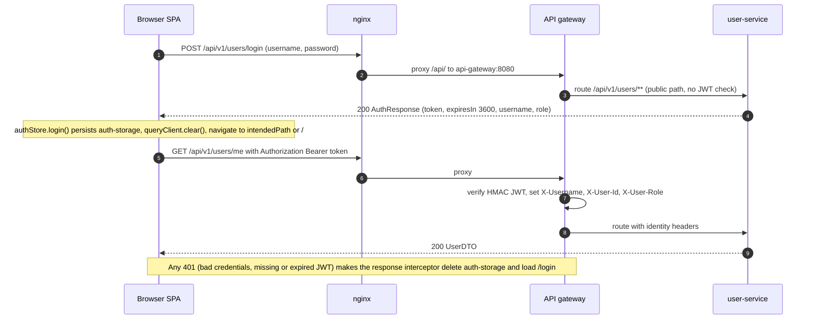
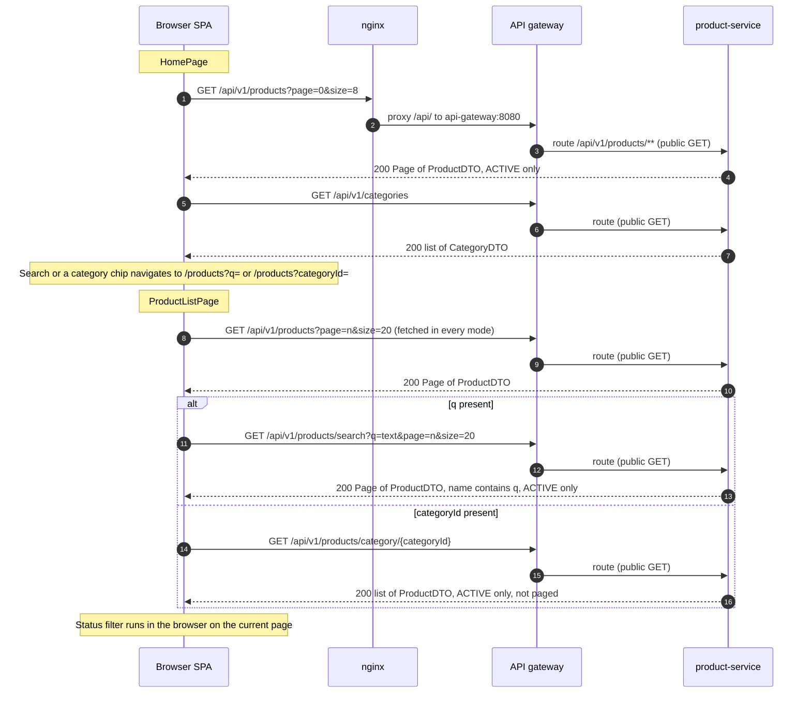
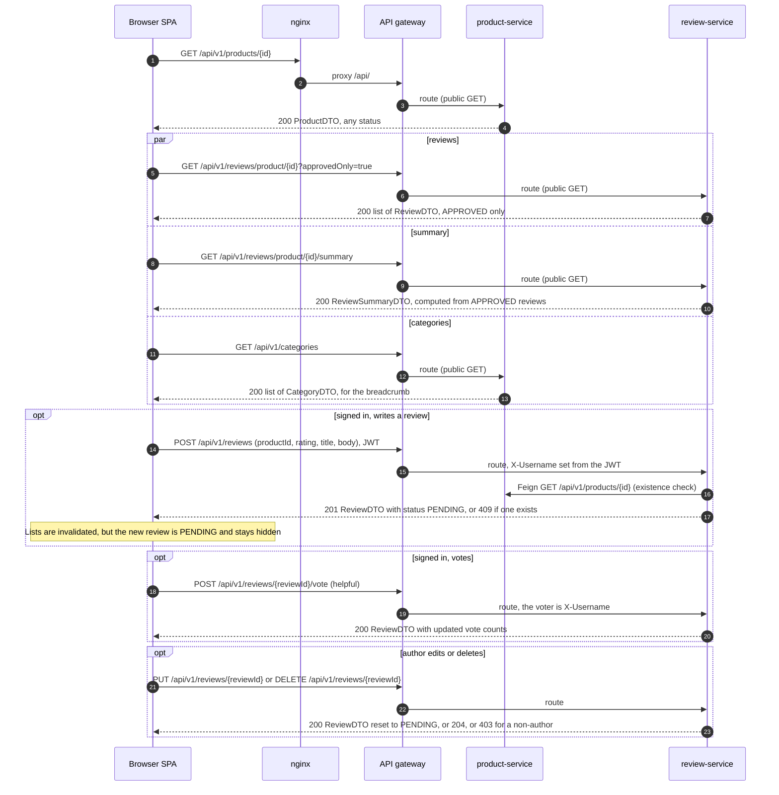
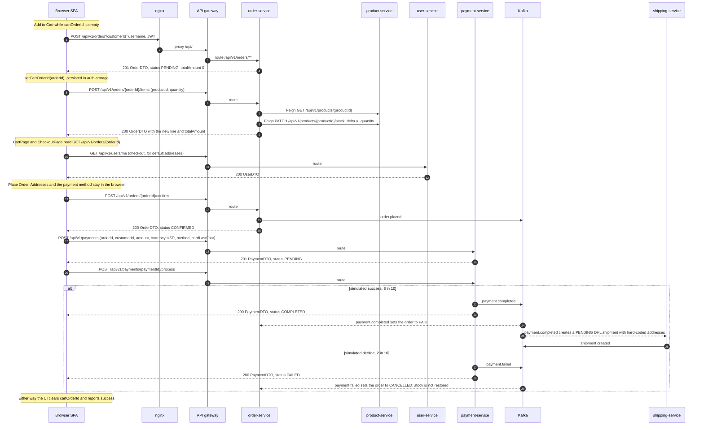
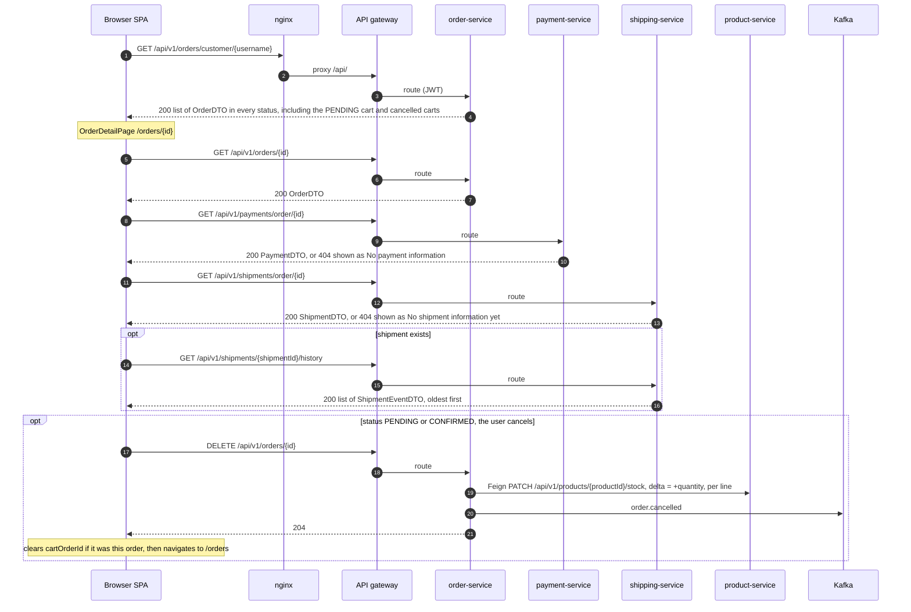
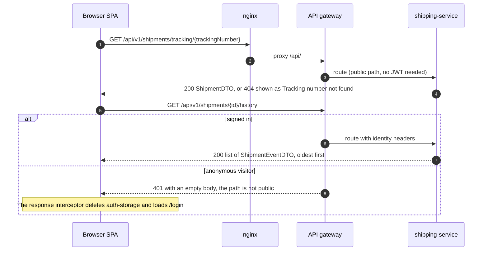
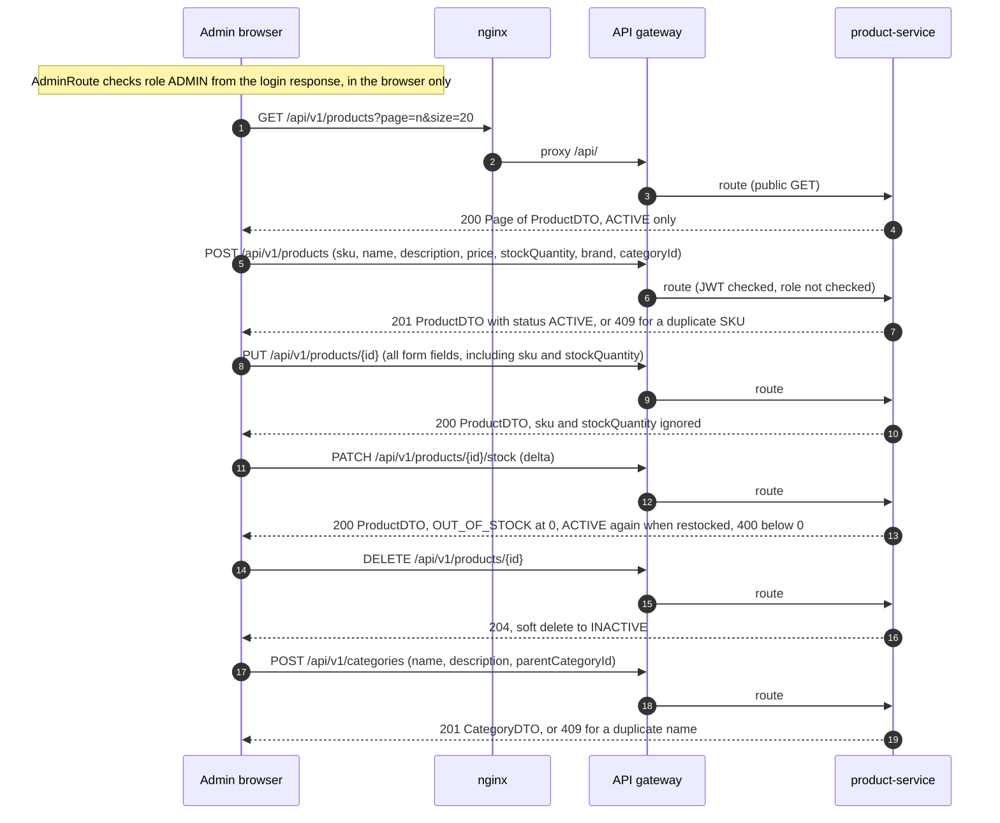
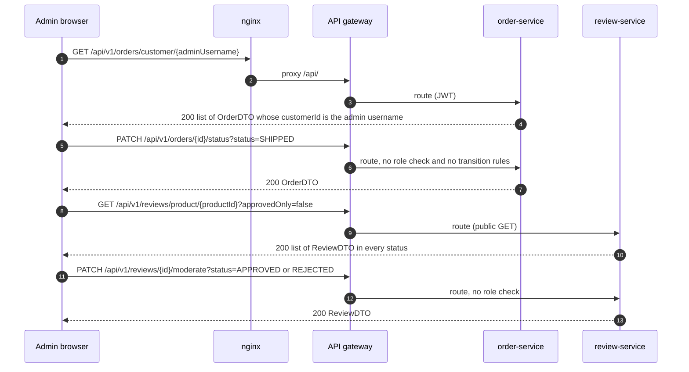
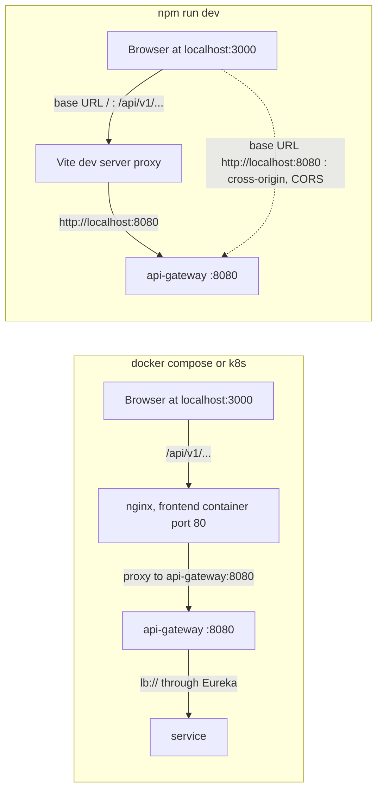

# Frontend (`ecommerce-frontend`)

The frontend is the platform's only user interface. It is a React single-page application, branded "ShopMicro", with a storefront for shoppers and an admin area. Shoppers browse and search products, read and write reviews, keep a cart, check out and pay, follow their orders and track shipments. Administrators manage products, categories, order statuses and review moderation. The frontend owns no data. Every screen reads and writes the REST APIs of six services through the API gateway, and the only state it keeps is the session and the id of the cart order, both in the browser's localStorage.

| | |
|---|---|
| Repository | `ecommerce-frontend` |
| Stack | React 18.3.1 · TypeScript 5.9.3 · Vite 6.4.1 · MUI 6.5.0 (plus `@mui/lab` for Timeline) · React Router 6.30.3 · TanStack Query 5.90.21 · zustand 5.0.11 · axios 1.13.6 · react-hook-form 7.71.2 with zod 3.25.76 · date-fns 4.1.0 |
| Tests | Vitest 2.1.9 (jsdom 26) · Testing Library 16 · MSW 2.12.10. 391 unit tests at about 99% line coverage (@vitest/coverage-v8), plus 40 pact-js interactions ([details](#testing)). Browser end to end: Playwright 1.64.1, 26 tests against a running stack ([details](#end-to-end-tests-playwright)) |
| Dev server | `npm run dev`: Vite on port 3000, `/api` proxied to `http://localhost:8080` |
| Container | `nginx:1.27-alpine` listening on port 80. Host port 3000 (compose maps `3000:80`, the k8s Service `frontend-lb` listens on 3000) |
| How it reaches the API | Images are built with `VITE_API_BASE_URL=/`, so axios calls the same-origin path `/api/v1/...`. nginx proxies `/api/` to `api-gateway:8080`, and the gateway routes by path prefix to the services through Eureka |
| Services it calls | user-service, product-service, order-service, payment-service, shipping-service and review-service. It never calls catalog-service (`/api/v1/catalog`) and has no use for notification-service |
| Session | JWT from `POST /api/v1/users/login`, persisted by zustand in the localStorage key `auth-storage` and sent as `Authorization: Bearer <token>` |
| CI | CircleCI jobs `test`, `build`, `validate-image` and `publish-image` (Docker Hub), plus an `e2e` job run only on demand |

The versions are the ones `package-lock.json` resolves. `package.json` declares caret ranges.

Related docs: [api-gateway](services/api-gateway.md), [user-service](services/user-service.md), [product-service](services/product-service.md), [order-service](services/order-service.md), [payment-service](services/payment-service.md), [shipping-service](services/shipping-service.md), [review-service](services/review-service.md).

## Project structure

| Path | Role |
|---|---|
| `index.html` | Vite entry page (title "ShopMicro - Ecommerce Platform", `#root`, loads `src/main.tsx`) |
| `src/main.tsx` | Mounts `<App/>` inside `React.StrictMode` |
| `src/App.tsx` | Provider stack: TanStack `QueryClientProvider` (global query defaults), MUI `ThemeProvider` and `CssBaseline`, `SnackbarProvider`, `BrowserRouter`. Also mounts React Query Devtools, which the package leaves out of production builds |
| `src/routes/` | `AppRouter.tsx` (route table, lazy pages, `Suspense`), `ProtectedRoute.tsx`, `AdminRoute.tsx` |
| `src/layouts/` | `MainLayout` (Navbar, page, Footer), `AuthLayout` (centred card for login and register), `AdminLayout` (Navbar, permanent `Sidebar`, page) |
| `src/pages/` | One folder per area: `auth`, `home`, `products`, `cart`, `checkout`, `orders`, `tracking`, `profile`, `admin`, plus `NotFoundPage.tsx` |
| `src/api/` | `axios.ts` (shared instance and interceptors) and one client object per backend area: `auth.api.ts`, `products.api.ts`, `categories.api.ts`, `orders.api.ts`, `payments.api.ts`, `shipments.api.ts`, `reviews.api.ts` |
| `src/hooks/` | TanStack Query hooks per area (`useAuth`, `useProducts`, `useOrders`, `usePayments`, `useShipments`, `useReviews`) and `useCart`, the cart logic built on the order hooks |
| `src/store/authStore.ts` | The only zustand store: session (token, username, role, expiry) and `cartOrderId`, persisted to localStorage |
| `src/types/index.ts` | TypeScript mirrors of the backend DTOs and enums, `Page<T>`, `ApiError` |
| `src/constants/index.ts` | `API_BASE_URL`, `API_ENDPOINTS` path prefixes, status label and colour maps, `PAYMENT_METHODS` and `ROUTES` (both unused) |
| `src/utils/` | `validators.ts` (zod schemas and the form types inferred from them), `formatters.ts` (currency, dates through date-fns) |
| `src/components/common/` | `ConfirmDialog`, `EmptyState`, `ErrorAlert`, `LoadingSpinner`, `SnackbarProvider` (toast context, 4 s auto-hide) |
| `src/components/layout/` | `Navbar` (search box, cart badge, account menu, admin link), `Sidebar` (admin menu, 240 px), `Footer` |
| `src/components/product/` | `ProductCard`, `ProductGrid` (wires Add to Cart to `useCart`), `RatingStars`, `StockBadge` |
| `src/components/order/` | `OrderCard`, `OrderItemRow`, `OrderStatusChip` |
| `src/components/review/` | `ReviewCard` (votes, edit and delete for the author, approve and reject for moderation), `ReviewForm`, `ReviewSummary`, `RatingDistribution` |
| `src/theme/theme.ts` | MUI theme (primary `#1976d2`, secondary `#9c27b0`, 8 px radius, buttons without uppercase) |
| `src/test/` | Vitest suites, MSW `handlers.ts` and `server.ts`, `setup.ts`, `utils/renderWithProviders.tsx` |
| `e2e/` | Playwright suite: `tests/*.spec.ts`, `fixtures.ts` (per-test customer and products, `signIn`), `support/api.ts` (gateway client for seeding), `global-setup.ts` (waits for the stack), `reporters/summary-reporter.ts`, its own `tsconfig.json` and `README.md` |
| `playwright.config.ts` | Playwright settings: target from `E2E_BASE_URL`, retries and workers on CI, the reporters writing to `reports/` |
| `scripts/e2e-docker.sh` | Runs the Playwright suite in the `mcr.microsoft.com/playwright` image |
| `public/favicon.svg` | Favicon, copied to `dist/` as is (no content hash) |
| `vite.config.ts` | React plugin, `@` alias to `src` (configured, but every import is relative), dev server and proxy, Vitest settings (which exclude `e2e/`) |
| `tsconfig.json`, `tsconfig.node.json` | Strict TypeScript for `src` (`noEmit`, bundler module resolution) and a separate project for `vite.config.ts` |
| `Dockerfile`, `nginx.conf`, `.dockerignore` | Two-stage image build and the nginx server config baked into it |
| `.env.example` | Documents `VITE_API_BASE_URL`. `.env` itself is ignored by git and by Docker |
| `.circleci/config.yml` | CI pipeline |

## Routing

`AppRouter` lazy-loads every page with `React.lazy` under one `Suspense` that shows a full-screen spinner. Routes are grouped by layout: `AuthLayout` for login and register, `AdminRoute` wrapping `AdminLayout` for `/admin/*`, and `MainLayout` for everything else, including the `*` catch-all. Paths are written out in `AppRouter.tsx`; the `ROUTES` constant is not used. API paths in this table leave out the `/api/v1` prefix.

| Path | Page component | Guard | What the page does |
|---|---|---|---|
| `/login` | `pages/auth/LoginPage` | public (AuthLayout) | Username and password form (zod: both required), submitted through `useLogin`. The API's error message is shown in an alert |
| `/register` | `pages/auth/RegisterPage` | public (AuthLayout) | Registration form (username 3 to 50 letters, digits or underscores, email, password of at least 8, optional first name, last name and phone). `POST /users/register`, then straight to `/login` |
| `/` | `pages/home/HomePage` | public | Hero search box (goes to `/products?q=`), the first 10 categories as chips (go to `/products?categoryId=`), and "Featured Products", which are simply the first 8 results of `GET /products?page=0&size=8` |
| `/products` | `pages/products/ProductListPage` | public | Reads `q` and `categoryId` from the query string. Search mode calls `GET /products/search`, category mode calls `GET /products/category/{id}` (no pagination), otherwise `GET /products` in pages of 20. Sidebar with the category list and a status filter that runs in the browser |
| `/products/:id` | `pages/products/ProductDetailPage` | public. Review actions need a login | Product, approved reviews, rating summary, category breadcrumb. Quantity field and Add to Cart (only for status ACTIVE). Write, edit and delete your own review, vote on reviews |
| `/tracking`, `/tracking/:trackingNumber` | `pages/tracking/TrackingPage` | public | Looks a shipment up by tracking number and shows carrier, dates, origin and destination, and the event history |
| `/cart` | `pages/cart/CartPage` | ProtectedRoute | Items and total of the cart order. Remove an item, clear the cart, go to checkout |
| `/checkout` | `pages/checkout/CheckoutPage` | ProtectedRoute | Three steps: addresses, payment method (with the card's last four digits for card methods), review. Place Order confirms the order, then creates and processes a payment |
| `/orders` | `pages/orders/OrderListPage` | ProtectedRoute | `GET /orders/customer/{username}`, newest first, as cards |
| `/orders/:id` | `pages/orders/OrderDetailPage` | ProtectedRoute | Items and total, addresses, payment panel, shipment panel with a tracking link, shipment timeline. Cancel button for PENDING and CONFIRMED orders |
| `/profile` | `pages/profile/ProfilePage` | ProtectedRoute | `GET /users/me`, then edit first name, last name, phone and the default addresses with `PUT /users/{id}` |
| `/admin` | `pages/admin/AdminDashboard` | AdminRoute (AdminLayout) | Cards for the product count (`totalElements` of `GET /products?page=0&size=1`) and the category count. The Orders and Reviews cards show a fixed "—". Quick links |
| `/admin/products` | `pages/admin/AdminProductsPage` | AdminRoute | Paged product table (20 per page) with create, edit, stock delta and delete |
| `/admin/categories` | `pages/admin/AdminCategoriesPage` | AdminRoute | Two-level category list and a create dialog (the parent is picked from the root categories) |
| `/admin/orders` | `pages/admin/AdminOrdersPage` | AdminRoute | The signed-in admin's own orders, because no endpoint lists all orders. A status dropdown per row calls `PATCH /orders/{id}/status` |
| `/admin/reviews` | `pages/admin/AdminReviewsPage` | AdminRoute | Enter a product id to load all its reviews (`approvedOnly=false`), with Approve and Reject on the PENDING ones |
| `*` | `pages/NotFoundPage` | public | 404 page inside MainLayout |

Guards:

- **ProtectedRoute** (`src/routes/ProtectedRoute.tsx`): if `isAuthenticated` is false in the store, it saves `pathname + search` in the sessionStorage key `intendedPath` and redirects to `/login` with `replace`. After a successful login, `useLogin` navigates back there.
- **AdminRoute** (`src/routes/AdminRoute.tsx`): not signed in leads to `/login` (no `intendedPath` is saved); `role !== 'ADMIN'` leads to `/`.
- Both read only the persisted store. Neither looks at the token or its expiry. The role is the string the login response returned, and anyone can edit it in localStorage. The backend does not check roles for any admin operation (see [Known issues](#known-issues-and-limitations)), so these guards shape the UI and protect nothing.
- `/login` and `/register` are not guest-only, although the repo README says they are. A signed-in user can open both.

## Authentication and session

### Login

1. `LoginPage` validates the form with `loginSchema` and calls `useLogin().mutate`.
2. `authApi.login` sends `POST /api/v1/users/login` with `{username, password}`. The gateway lets the path through without a token. user-service `UserService.login()` answers 200 with `AuthResponse` `{token, expiresIn, username, role}`. `expiresIn` is in seconds: `jwt.expiration-ms` is 3600000, divided by 1000. A wrong password, an unknown user or an INACTIVE or SUSPENDED account gives 401.
3. `useLogin.onSuccess` calls `authStore.login({token, username, role, expiresIn})`, which also sets `loginAt = Date.now()` and `isAuthenticated = true`. It then calls `queryClient.clear()` and navigates to `intendedPath` (removing it) or to `/`.

### Register

`RegisterPage` sends `POST /api/v1/users/register` (no token needed) and gets 201 with a `UserDTO`. `useRegister.onSuccess` navigates to `/login` at once, so the "Account created" alert is effectively never seen. There is no automatic login. New users always get the role CUSTOMER. The only ADMIN account is the one user-service seeds at startup (`DataInitializer`: username `admin`, password `admin`).

### Where the session lives

All of it is in `useAuthStore` (`src/store/authStore.ts`). zustand's `persist` middleware writes the fields below to the localStorage key `auth-storage` as `{"state": {...}, "version": 0}`. sessionStorage holds only `intendedPath`. No cookies are used.

| Field | Persisted | Meaning |
|---|---|---|
| `token` | yes | The JWT |
| `username` | yes | The JWT subject. Sent as `customerId` for orders and payments, and compared with `customerId` to find the user's own reviews |
| `role` | yes | `CUSTOMER` or `ADMIN`, from the login response |
| `expiresIn` | yes | Seconds, from the login response |
| `loginAt` | yes | `Date.now()` at login |
| `isAuthenticated` | yes | Drives the guards and the Navbar |
| `cartOrderId` | yes | Id of the PENDING order that serves as the cart (see [The cart](#the-cart)) |

### How the role is known

The role comes from the login response body. The browser never decodes the JWT. The same role is signed into the JWT's `role` claim, which the gateway copies into the `X-User-Role` header. Only review-service reads that header, in `deleteReview`.

### Axios instance and interceptors

`src/api/axios.ts` creates one instance with `baseURL = API_BASE_URL`, `Content-Type: application/json` and a 30 000 ms timeout.

The request interceptor runs on every request:

1. It reads and parses `auth-storage` straight from localStorage, not from the in-memory store.
2. If there is a token and `loginAt + expiresIn * 1000` has passed, it deletes `auth-storage`, sets `window.location.href = '/login'` and rejects the request with "Session expired. Please log in again.". Public calls are affected too, so a visitor whose stored session has expired is sent to the login page even while browsing products.
3. Otherwise it sets `Authorization: Bearer <token>`.
4. If the URL contains `/me`, it sets `X-Username: <username>`. `authApi.getMe` passes the same header explicitly. Both are redundant through the gateway, which overwrites `X-Username` with the JWT subject on every authenticated route.

The response interceptor handles errors:

1. Any 401 deletes `auth-storage` and sets `window.location.href = '/login'`. That is a full page load, which throws away in-memory state, the query cache and unsaved form input. The gateway's own 401 (token missing, invalid or expired) has an empty body. Login failures are 401s as well and take the same path (mismatch M8).
2. It then turns the failure into a plain `Error`. If the body has `fieldErrors`, the message is `field: message; field: message`. Otherwise it is the body's `message`, or "An error occurred" when the body has no `message` (for example the HTML of an nginx 502). With no response at all, axios' own message is used ("Network Error", "timeout of 30000ms exceeded"). Pages show `error.message` in alerts and snackbars.

### Logout

The Navbar's Logout calls `authStore.logout()`, which clears the token, username, role, expiry fields, `isAuthenticated` and `cartOrderId`, then navigates to `/`. No API call is made. The JWT stays valid until it expires, since tokens are stateless and cannot be revoked. Logout does not clear the query cache (the next login does). The cart order is not cancelled: it stays PENDING on the server and keeps its stock reserved.

### Token expiry

There are two independent checks. The client-side one is the clock check in the request interceptor: one hour with the default `jwt.expiration-ms`. The server-side one is the gateway, which rejects an expired JWT with 401, and the response interceptor then redirects. There is no refresh token, so the user logs in again. The route guards do not check expiry, so a protected page renders until its first API call triggers the redirect.

## State and data fetching

### zustand

There is exactly one store, `useAuthStore`, described in [Where the session lives](#where-the-session-lives). Its actions are `login`, `logout`, `setCartOrderId` and `clearCart` (unused). Toasts go through a React context, `SnackbarProvider`, not a store.

### TanStack Query defaults

`src/App.tsx` creates the `QueryClient` with these defaults: queries use `staleTime` 60 s, `retry` 1 and `refetchOnWindowFocus` false, mutations use `retry` 0, and `gcTime` keeps its default of 5 minutes. No query sets `refetchInterval`, so changes that arrive through Kafka (an order becoming PAID or CANCELLED, a shipment being created) appear only when a query refetches after it went stale or was invalidated.

### Queries

API paths leave out `/api/v1`.

| Hook (file) | Query key | Endpoint | staleTime | Enabled when | Retry | Used by |
|---|---|---|---|---|---|---|
| `useCurrentUser` (`useAuth.ts`) | `['me', username]` | `GET /users/me` | 5 min | signed in and username set | 1 | ProfilePage, CheckoutPage |
| `useProducts(page, size)` (`useProducts.ts`) | `['products', page, size]` | `GET /products?page&size` | 2 min | always | 1 | HomePage (0, 8), ProductListPage (page, 20), AdminDashboard (0, 1), AdminProductsPage (page, 20) |
| `useProduct(id)` | `['product', id]` | `GET /products/{id}` | 60 s | id > 0 | 1 | ProductDetailPage |
| `useProductSearch(q, page, size)` | `['products', 'search', q, page, size]` | `GET /products/search` | 60 s | `q` not empty | 1 | ProductListPage |
| `useProductsByCategory(id)` | `['products', 'category', id]` | `GET /products/category/{id}` | 60 s | id > 0 | 1 | ProductListPage |
| inline `useQuery` | `['categories']` | `GET /categories` | 10 min in HomePage, ProductListPage, ProductDetailPage; 60 s in the admin pages | always | 1 | HomePage, ProductListPage, ProductDetailPage, AdminDashboard, AdminProductsPage, AdminCategoriesPage |
| `useOrder(id)` (`useOrders.ts`) | `['order', id]` | `GET /orders/{id}` | 60 s | id > 0 | 1 | `useCart` (Navbar badge, ProductGrid, ProductDetailPage), CartPage, CheckoutPage, OrderDetailPage |
| `useCustomerOrders()` | `['orders', 'customer', username]` | `GET /orders/customer/{username}` | 60 s | username set | 1 | OrderListPage. AdminOrdersPage runs the same key inline |
| `usePaymentByOrder(id)` (`usePayments.ts`) | `['payment', 'order', id]` | `GET /payments/order/{id}` | 60 s | id > 0 | none | OrderDetailPage |
| `useCustomerPayments()` | `['payments', 'customer', username]` | `GET /payments/customer/{username}` | 60 s | username set | 1 | unused |
| `useShipmentByOrder(id)` (`useShipments.ts`) | `['shipment', 'order', id]` | `GET /shipments/order/{id}` | 60 s | id > 0 | none | OrderDetailPage |
| `useShipmentByTracking(tn)` | `['shipment', 'tracking', tn]` | `GET /shipments/tracking/{tn}` | 60 s | tn set | none | TrackingPage |
| `useShipmentHistory(id)` | `['shipment', 'history', id]` | `GET /shipments/{id}/history` | 60 s | id > 0 | 1 | OrderDetailPage, TrackingPage |
| `useProductReviews(id, approvedOnly = true)` (`useReviews.ts`) | `['reviews', 'product', id, approvedOnly]` | `GET /reviews/product/{id}?approvedOnly=` | 60 s | id > 0 | 1 | ProductDetailPage |
| `useReviewSummary(id)` | `['reviewSummary', id]` | `GET /reviews/product/{id}/summary` | 60 s | id > 0 | 1 | ProductDetailPage |
| `useCustomerReviews(customerId)` | `['reviews', 'customer', customerId]` | `GET /reviews/customer/{customerId}` | 60 s | id set | 1 | unused |
| inline `useQuery` (AdminReviewsPage) | `['reviews', 'admin', 'product', id]` | `GET /reviews/product/{id}?approvedOnly=false` | 60 s | a product id was entered | 1 | AdminReviewsPage |
| `usePendingReviews()` | `['reviews', 'pending']` | none, the function returns `[]` | 60 s | always | 1 | unused stub |

### Mutations and invalidation

Invalidation uses TanStack's prefix matching, so `['products']` also covers `['products', 'search', ...]` and `['products', 'category', ...]`.

| Hook | Call | On success | Used by |
|---|---|---|---|
| `useLogin` | `authApi.login` | `authStore.login()`, `queryClient.clear()`, navigate to `intendedPath` or `/` | LoginPage |
| `useRegister` | `authApi.register` | navigate to `/login` | RegisterPage |
| `useUpdateUser(userId)` | `authApi.updateUser` | invalidate `['me', username]` | ProfilePage |
| `useCreateOrder` | `ordersApi.createOrder(username)` | invalidate `['orders', 'customer', username]` | `useCart`, CartPage |
| `useAddOrderItem` | `ordersApi.addItem` | invalidate `['order', orderId]` | `useCart`, CartPage |
| `useConfirmOrder` | `ordersApi.confirmOrder` | invalidate `['order', id]` and `['orders', 'customer', username]` | CheckoutPage |
| `useUpdateOrderStatus` | `ordersApi.updateOrderStatus` | invalidate `['order', id]` and `['orders']` | AdminOrdersPage (OrderDetailPage creates one and never calls it) |
| `useDeleteOrder` | `ordersApi.deleteOrder` (a cancel) | invalidate `['orders', 'customer', username]` | CartPage, OrderDetailPage |
| `useCreatePayment` | `paymentsApi.createPayment` | invalidate `['payment', 'order', orderId]` | CheckoutPage |
| `useProcessPayment` | `paymentsApi.processPayment` | invalidate `['payment', 'order', orderId]` and `['payments']` | CheckoutPage |
| `useRefundPayment` | `paymentsApi.refundPayment` | invalidate `['payment', 'order', orderId]` | unused |
| `useCreateProduct` | `productsApi.createProduct` | invalidate `['products']` | AdminProductsPage |
| `useUpdateProduct` | `productsApi.updateProduct` | invalidate `['products']` and `['product', id]` | AdminProductsPage |
| `useUpdateStock` | `productsApi.updateStock` | invalidate `['products']` and `['product', id]` | AdminProductsPage |
| `useDeleteProduct` | `productsApi.deleteProduct` | invalidate `['products']` | AdminProductsPage |
| inline `useMutation` | `categoriesApi.createCategory` | invalidate `['categories']`, toast, close the dialog | AdminCategoriesPage |
| `useCreateReview` | `reviewsApi.createReview` | invalidate `['reviews', 'product', productId]` and `['reviewSummary', productId]` | ProductDetailPage |
| `useUpdateReview` | `reviewsApi.updateReview` | same as create | ProductDetailPage |
| `useDeleteReview` | `reviewsApi.deleteReview` | invalidate `['reviews']` and `['reviewSummary']` | ProductDetailPage |
| `useModerateReview` | `reviewsApi.moderateReview` | invalidate `['reviews']` | AdminReviewsPage |
| `useVoteReview` | `reviewsApi.voteReview` | invalidate `['reviews', 'product', productId]` | ProductDetailPage |
| `useUpdateShipmentStatus` | `shipmentsApi.updateShipmentStatus` | invalidate `['shipment', 'order', orderId]` and `['shipment', 'history', id]` | unused |

Gaps in the invalidation rules: adding items to the cart and cancelling orders change stock in product-service, but no product query is invalidated, so stock badges stay stale until the product queries expire. Moderation does not invalidate `['reviewSummary', ...]`.

### The cart

The cart is not client-side state. It is an order in status PENDING held by order-service, and the browser keeps only its id.

- **Where the id lives:** `cartOrderId` in the zustand store, persisted in `auth-storage`. It belongs to one browser and logout clears it.
- **Add to cart** (`useCart.addToCart(productId, quantity)`; ProductCard adds 1, the detail page adds the chosen quantity): a signed-out user gets the toast "Please login to add items to cart". Without a `cartOrderId`, the hook first calls `POST /api/v1/orders?customerId=<username>` and stores the returned `orderId`. It then calls `POST /api/v1/orders/{orderId}/items` with `{productId, quantity}`. order-service checks stock through Feign and decrements it straight away (`PATCH /api/v1/products/{id}/stock` with `delta = -quantity`), so stock is reserved when the item goes into the cart. Adding the same product twice creates two line items.
- **Badge and display:** the Navbar badge is the sum of `quantity` over the `orderItems` of `GET /api/v1/orders/{cartOrderId}`. CartPage lists the same items and the server-computed `totalAmount` (`Order.addItem()` adds price times quantity).
- **Remove one item:** no endpoint removes an item, so CartPage cancels the whole order (`DELETE /api/v1/orders/{id}`, which restores stock for every item and publishes `order.cancelled`), creates a new order and adds the other items back one by one. Each cancelled cart stays in the user's order history.
- **Clear cart:** `DELETE /api/v1/orders/{id}`, then `cartOrderId = null`.
- **Turning it into an order:** checkout confirms that same order (`POST /api/v1/orders/{id}/confirm`), then creates and processes a payment. `cartOrderId` is set to null once the process call returns, whatever the payment outcome. See [Cart, checkout, order creation and payment](#cart-checkout-order-creation-and-payment).
- **Consequences of storing only the id in the browser:** logging out, or opening the shop in another browser, orphans the PENDING order. It keeps its stock reserved and shows up as "Pending" under My Orders.

## API client map

### Call table

The 45 functions in `src/api/*.ts` are listed below. "Gateway" is what the gateway's `JwtAuthenticationFilter` requires. "Result" is the outcome of checking the call against the backend controllers and DTOs; the M numbers refer to [Mismatches](#mismatches).

| # | Function | Method and path | Gateway | Service and handler | Used by | Result |
|---|---|---|---|---|---|---|
| 1 | `authApi.login` | `POST /api/v1/users/login` | Public | user-service `UserController.login()` | `useLogin` in LoginPage | OK (401 path: M8) |
| 2 | `authApi.register` | `POST /api/v1/users/register` | Public | `UserController.register()` (201) | `useRegister` in RegisterPage | OK |
| 3 | `authApi.getMe` | `GET /api/v1/users/me` plus `X-Username` | JWT | `UserController.getMe()` | `useCurrentUser` in ProfilePage, CheckoutPage | OK |
| 4 | `authApi.getUserById` | `GET /api/v1/users/{id}` | JWT | `UserController.getUserById()` | unused | OK |
| 5 | `authApi.updateUser` | `PUT /api/v1/users/{id}` | JWT | `UserController.updateUser()` | `useUpdateUser` in ProfilePage | OK (no owner check: M10) |
| 6 | `authApi.deleteUser` | `DELETE /api/v1/users/{id}` | JWT | `UserController.deleteUser()` (204, sets INACTIVE) | unused | OK |
| 7 | `productsApi.getProducts` | `GET /api/v1/products?page&size` | Public | product-service `ProductController.getAllProducts()` | `useProducts` in HomePage, ProductListPage, AdminDashboard, AdminProductsPage | OK, see M5 |
| 8 | `productsApi.getProductById` | `GET /api/v1/products/{id}` | Public | `ProductController.getProductById()` (any status) | `useProduct` in ProductDetailPage | OK |
| 9 | `productsApi.getProductBySku` | `GET /api/v1/products/sku/{sku}` | Public | `ProductController.getProductBySku()` | unused | OK |
| 10 | `productsApi.searchProducts` | `GET /api/v1/products/search?q&page&size` | Public | `ProductController.searchProducts()` | `useProductSearch` in ProductListPage | OK, see M5 |
| 11 | `productsApi.getProductsByCategory` | `GET /api/v1/products/category/{categoryId}` | Public | `ProductController.getProductsByCategory()` (a list) | `useProductsByCategory` in ProductListPage | OK, see M5 |
| 12 | `productsApi.createProduct` | `POST /api/v1/products` | JWT | `ProductController.createProduct()` (201) | `useCreateProduct` in AdminProductsPage | OK |
| 13 | `productsApi.updateProduct` | `PUT /api/v1/products/{id}` | JWT | `ProductController.updateProduct()` | `useUpdateProduct` in AdminProductsPage | M2 |
| 14 | `productsApi.updateStock` | `PATCH /api/v1/products/{id}/stock`, body `{delta}` | JWT | `ProductController.updateStock()` | `useUpdateStock` in AdminProductsPage | OK |
| 15 | `productsApi.deleteProduct` | `DELETE /api/v1/products/{id}` | JWT | `ProductController.deleteProduct()` (204, sets INACTIVE) | `useDeleteProduct` in AdminProductsPage | OK |
| 16 | `categoriesApi.getCategories` | `GET /api/v1/categories` | Public | `CategoryController.getAllCategories()` | inline `useQuery(['categories'])` in six pages | OK |
| 17 | `categoriesApi.getCategoryById` | `GET /api/v1/categories/{id}` | Public | `CategoryController.getCategoryById()` | unused | OK |
| 18 | `categoriesApi.createCategory` | `POST /api/v1/categories` | JWT | `CategoryController.createCategory()` (201, 409 on a duplicate name) | inline `useMutation` in AdminCategoriesPage | OK |
| 19 | `ordersApi.createOrder` | `POST /api/v1/orders?customerId=` (no body) | JWT | order-service `OrderController.createOrder()` (201) | `useCreateOrder` in `useCart`, CartPage | OK, see M10 |
| 20 | `ordersApi.getOrderById` | `GET /api/v1/orders/{orderId}` | JWT | `OrderController.getOrderById()` | `useOrder` in `useCart`, CartPage, CheckoutPage, OrderDetailPage | OK |
| 21 | `ordersApi.getOrdersByCustomer` | `GET /api/v1/orders/customer/{customerId}` | JWT | `OrderController.getOrdersByCustomer()` (a list) | `useCustomerOrders` in OrderListPage, inline in AdminOrdersPage | OK, see M9 |
| 22 | `ordersApi.addItem` | `POST /api/v1/orders/{orderId}/items`, body `{productId, quantity}` | JWT | `OrderController.addItemToOrder()` | `useAddOrderItem` in `useCart`, CartPage | OK |
| 23 | `ordersApi.confirmOrder` | `POST /api/v1/orders/{orderId}/confirm` (no body) | JWT | `OrderController.confirmOrder()` | `useConfirmOrder` in CheckoutPage | OK, see M3 |
| 24 | `ordersApi.updateOrderStatus` | `PATCH /api/v1/orders/{orderId}/status?status=` | JWT | `OrderController.updateStatus()` | `useUpdateOrderStatus` in AdminOrdersPage | OK |
| 25 | `ordersApi.deleteOrder` | `DELETE /api/v1/orders/{orderId}` | JWT | `OrderController.cancelOrder()` (204, a cancel and not a delete) | `useDeleteOrder` in CartPage, OrderDetailPage | OK |
| 26 | `paymentsApi.createPayment` | `POST /api/v1/payments` | JWT | payment-service `PaymentController.initiatePayment()` (201) | `useCreatePayment` in CheckoutPage | OK, see M10 |
| 27 | `paymentsApi.getPaymentById` | `GET /api/v1/payments/{id}` | JWT | `PaymentController.getPaymentById()` | unused | OK |
| 28 | `paymentsApi.getPaymentByOrder` | `GET /api/v1/payments/order/{orderId}` | JWT | `PaymentController.getByOrderId()` (one object) | `usePaymentByOrder` in OrderDetailPage | OK |
| 29 | `paymentsApi.getPaymentsByCustomer` | `GET /api/v1/payments/customer/{customerId}` | JWT | `PaymentController.getByCustomer()` | `useCustomerPayments` (unused) | OK |
| 30 | `paymentsApi.processPayment` | `POST /api/v1/payments/{id}/process` | JWT | `PaymentController.processPayment()` | `useProcessPayment` in CheckoutPage | M4 |
| 31 | `paymentsApi.refundPayment` | `POST /api/v1/payments/{id}/refund` | JWT | `PaymentController.refundPayment()` | `useRefundPayment` (unused) | OK |
| 32 | `shipmentsApi.createShipment` | `POST /api/v1/shipments` | JWT | shipping-service `ShipmentController.createShipment()` | unused | M11 |
| 33 | `shipmentsApi.getShipmentByOrder` | `GET /api/v1/shipments/order/{orderId}` | JWT | `ShipmentController.getByOrderId()` | `useShipmentByOrder` in OrderDetailPage | OK |
| 34 | `shipmentsApi.getShipmentByTracking` | `GET /api/v1/shipments/tracking/{trackingNumber}` | Public | `ShipmentController.trackShipment()` | `useShipmentByTracking` in TrackingPage | OK |
| 35 | `shipmentsApi.updateShipmentStatus` | `PATCH /api/v1/shipments/{id}/status` | JWT | `ShipmentController.updateStatus()` | `useUpdateShipmentStatus` (unused) | OK |
| 36 | `shipmentsApi.getShipmentHistory` | `GET /api/v1/shipments/{id}/history` | JWT | `ShipmentController.getHistory()` | `useShipmentHistory` in OrderDetailPage, TrackingPage | M1, M7 |
| 37 | `reviewsApi.createReview` | `POST /api/v1/reviews` | JWT | review-service `ReviewController.createReview()` (201) | `useCreateReview` in ProductDetailPage | OK, see M6 |
| 38 | `reviewsApi.getReviewById` | `GET /api/v1/reviews/{id}` | JWT | `ReviewController.getById()` | unused | OK |
| 39 | `reviewsApi.getReviewsByProduct` | `GET /api/v1/reviews/product/{productId}?approvedOnly=` | Public | `ReviewController.getByProduct()` | `useProductReviews` in ProductDetailPage, inline in AdminReviewsPage | OK, see M6 |
| 40 | `reviewsApi.getReviewSummary` | `GET /api/v1/reviews/product/{productId}/summary` | Public | `ReviewController.getSummary()` | `useReviewSummary` in ProductDetailPage | OK |
| 41 | `reviewsApi.getReviewsByCustomer` | `GET /api/v1/reviews/customer/{customerId}` | JWT | `ReviewController.getByCustomer()` | `useCustomerReviews` (unused) | OK |
| 42 | `reviewsApi.updateReview` | `PUT /api/v1/reviews/{id}` | JWT | `ReviewController.updateReview()` | `useUpdateReview` in ProductDetailPage | OK |
| 43 | `reviewsApi.deleteReview` | `DELETE /api/v1/reviews/{id}` | JWT | `ReviewController.deleteReview()` (204) | `useDeleteReview` in ProductDetailPage | OK |
| 44 | `reviewsApi.moderateReview` | `PATCH /api/v1/reviews/{id}/moderate?status=` | JWT | `ReviewController.moderate()` | `useModerateReview` in AdminReviewsPage | OK |
| 45 | `reviewsApi.voteReview` | `POST /api/v1/reviews/{id}/vote`, body `{helpful}` | JWT | `ReviewController.vote()` | `useVoteReview` in ProductDetailPage | OK |

Seven functions are never called (rows 4, 6, 9, 17, 27, 32, 38). Four more (rows 29, 31, 35, 41) are called only from hooks that no page uses. `usePendingReviews` is a stub that calls no API at all.

### Verification

**Paths, methods and parameters.** All 45 method and path pairs exist on the controllers, and every query parameter and body field name matches: `page` and `size` bind to Spring `Pageable`, `q`, `customerId`, `status` and `approvedOnly` are `@RequestParam`s, and the bodies bind to the DTOs below. No path is wrong and no endpoint is missing for a function that exists.

**Response shapes: pages and lists.** No page-vs-list mismatches. `getProducts` and `searchProducts` are typed `Page<T>`, and product-service returns `Page<ProductDTO>`. Every other collection (`getProductsByCategory`, `getCategories`, orders, payments and reviews by customer or product, shipment history) is typed as an array, and the backend returns a `List`. Boot 4.0.1 defaults `spring.data.web.pageable.serialization-mode` to `direct`, and no service changes it, so `PageImpl` is serialized as is (Spring Data logs a warning about it). The JSON carries `content`, `totalElements`, `totalPages`, `size`, `number`, `first`, `last`, which are the fields `Page<T>` declares, plus `pageable`, `sort`, `numberOfElements` and `empty`.

**DTO fields.** Checked field by field:

| Frontend type (`src/types/index.ts`) | Backend DTO | Result |
|---|---|---|
| `LoginRequest`, `LoginResponse` | user `LoginRequest`, `AuthResponse` | Match. `expiresIn` is a `long` in seconds, which is how `axios.ts` uses it. `role` is a String holding the enum name |
| `RegisterRequest` | user `RegisterRequest` | Match. The client checks username (3 to 50, letters, digits, underscore), email and password (at least 8) as the server does. Limits only the server enforces: email at most 100, first and last name at most 50, phone at most 20 |
| `UserDTO`, `UpdateUserRequest` | user `UserDTO`, `UpdateUserRequest` | Match |
| `ProductDTO` | product `ProductDTO` | Match. `price` is a `BigDecimal` and arrives as a JSON number |
| `CreateProductRequest` | product `CreateProductRequest` | Match. Limits only the server enforces: sku at most 100, name at most 200, brand at most 100 |
| `UpdateProductRequest` | product `UpdateProductRequest` (`name`, `description`, `price`, `brand`, `categoryId`, `status`) | Mismatch M2: the frontend type declares `stockQuantity`, and the page also sends `sku` |
| `StockUpdateRequest` | product `StockUpdateRequest` (`delta`, `@NotNull Integer`) | Match |
| `CategoryDTO`, `CreateCategoryRequest` | product `CategoryDTO`, `CreateCategoryRequest` | Match. Server-only limit: name at most 100 |
| `OrderDTO`, `OrderItemDTO` | order `OrderDTO`, `OrderItemDTO` | Match. `billingAddress` and `shippingAddress` exist but nothing ever fills them (M3) |
| `AddItemRequest` | order `AddItemRequest` (`productId` `@NotNull`, `quantity` `@NotNull @Min(1)`) | Match |
| `CreatePaymentRequest` | payment `InitiatePaymentRequest` | Match. `method` is a String that the service converts with `PaymentMethod.valueOf` |
| `PaymentDTO` | payment `PaymentDTO` | Match |
| `ShipmentDTO`, `ShipmentEventDTO` | shipping `ShipmentDTO`, `ShipmentEventDTO` | Match. `estimatedDelivery`, `actualDelivery` and `eventTimestamp` are `LocalDateTime` strings |
| `CreateShipmentRequest` | shipping `CreateShipmentRequest` | Field names match, but `estimatedDelivery` is accepted and ignored (M11) |
| `UpdateShipmentStatusRequest` | shipping `UpdateShipmentStatusRequest` | Match |
| `ReviewDTO`, `ReviewSummaryDTO` | review `ReviewDTO`, `ReviewSummaryDTO` | Match. `ratingDistribution` is a `Map<Integer, Long>`, serialized as an object keyed `"1"` to `"5"`, which `RatingDistribution` reads by number |
| `CreateReviewRequest`, `UpdateReviewRequest`, `VoteRequest` | review DTOs | Match (rating 1 to 5, title 3 to 255, body 10 to 2000 on both sides). `updateReview` also sends `productId`, which the service ignores |
| `ApiError` | every service's `ErrorResponse` (`timestamp`, `status`, `error`, `message`, `path`, `correlationId`, `fieldErrors[{field, message}]`) | Match. The frontend type leaves out `correlationId` |

**Enum values.** The value sets are identical on both sides: UserRole (CUSTOMER, ADMIN), UserStatus (ACTIVE, INACTIVE, SUSPENDED), ProductStatus (ACTIVE, INACTIVE, OUT_OF_STOCK), OrderStatus (PENDING, CONFIRMED, PAID, SHIPPED, DELIVERED, CANCELLED), PaymentStatus (PENDING, PROCESSING, COMPLETED, FAILED, REFUNDED), PaymentMethod (CREDIT_CARD, DEBIT_CARD, BANK_TRANSFER, DIGITAL_WALLET), ShipmentStatus (PENDING, PROCESSING, SHIPPED, OUT_FOR_DELIVERY, DELIVERED, RETURNED), ReviewStatus (PENDING, APPROVED, REJECTED). The only enum problem is semantic (M5): the UI filters on statuses the list endpoints never return.

**Wire conventions** the UI depends on:

- Timestamps are Java `LocalDateTime` values written by Jackson 3.0.3, whose `WRITE_DATES_AS_TIMESTAMPS` default is false. No service sets `spring.jackson.*`, and order-service's own `ObjectMapper` bean is a plain Jackson 3 mapper with the same default. So timestamps arrive as ISO-8601 strings without an offset, for example `2026-10-29T11:00:00.123456`, and `date-fns` `parseISO` reads them as browser-local time.
- Money is a `BigDecimal` serialized as a JSON number and formatted as USD by `formatCurrency`.
- Unknown request properties are ignored, because Jackson 3.0.3's `FAIL_ON_UNKNOWN_PROPERTIES` default is false and Boot does not change it. That is why M2 fails silently instead of with a 400.

**Authorization behind the calls.** The gateway only decides JWT or no JWT. The service-side checks are few. user-service `UserController.getMe()` reads `X-Username`. review-service checks that the caller is the author in `ReviewService.updateReview()`, and the author or `X-User-Role` ADMIN in `ReviewService.deleteReview()`, and records the voter from `X-Username` in `voteOnReview()`. Every other call is accepted from any authenticated user, on any id or `customerId`: product-service, order-service, payment-service and shipping-service read none of the `X-User-*` headers.

### Mismatches

**M1. Shipment history needs a JWT, but the tracking page is public.**
`TrackingPage` loads `GET /api/v1/shipments/tracking/{tn}`, which the gateway lets through without a token, and then `useShipmentHistory(shipment.id)` calls `GET /api/v1/shipments/{id}/history`. That path is not on the gateway's public list, which only covers `/api/v1/shipments/tracking/`. A signed-out visitor gets a 401 with an empty body, the response interceptor deletes `auth-storage` and loads `/login`. Public tracking therefore always ends on the login page for visitors who are not signed in. Frontend: `pages/tracking/TrackingPage.tsx`, `hooks/useShipments.ts` `useShipmentHistory`, `api/axios.ts`. Backend: gateway `JwtAuthenticationFilter.isPublicEndpoint()`, shipping `ShipmentController.getHistory()`.

**M2. Product update sends fields `UpdateProductRequest` does not have.**
The Edit dialog in `AdminProductsPage` reuses the create form and sends the whole `CreateProductFormData`, including `sku` (disabled in the form) and `stockQuantity` (editable). The frontend type `UpdateProductRequest` also declares `stockQuantity`. product-service's `UpdateProductRequest` has `name`, `description`, `price`, `brand`, `categoryId` and `status` only, and `ProductService.updateProduct()` changes only those. Jackson ignores the extra fields, so a stock change made in the Edit dialog is silently dropped and the request still returns 200. Stock can only change through the separate stock-delta dialog (`PATCH /stock`). The form also cannot set `status` or clear a category, since an empty category is sent as `undefined` and the service only applies non-null values.

**M3. Checkout addresses are never sent.**
`CheckoutPage` collects a shipping and a billing address (zod: at least 5 characters each, pre-filled from the profile defaults only if `['me', username]` is already cached) and keeps them in component state for the review step. `handlePlaceOrder` calls `confirmOrder(cartOrderId)`, which sends no body, and the payment request has no address fields. No order-service endpoint accepts addresses: `OrderService.createOrder()` and `confirmOrder()` never set `Order.shippingAddress` or `billingAddress`, so `OrderDTO` always returns them as null and OrderDetailPage always shows "No address information". The shipment that shipping-service creates on `payment.completed` uses the hard-coded origin "Warehouse, 123 Storage St" and destination "Customer Address" (`PaymentEventConsumer.handlePaymentCompleted()`).

**M4. The payment outcome is ignored.**
`POST /api/v1/payments/{id}/process` simulates a gateway: `PaymentService.processPayment()` succeeds 8 times out of 10 and otherwise sets status FAILED with `failureReason` "Payment declined by gateway". It answers 200 in both cases and publishes `payment.completed` or `payment.failed`. `handlePlaceOrder` awaits the call but never reads the returned status. It always clears `cartOrderId` and reports success (the "Order placed successfully!" toast; the "Order Placed!" screen meant to say payment "is being processed" never renders, see [Known issues](#known-issues-and-limitations)). After a decline, order-service's `payment.failed` listener sets the order to CANCELLED without restoring stock, and the user learns about it only on the order detail page.

**M5. Product list endpoints return ACTIVE products only.**
`ProductService.getAllProducts()` uses `findByStatus(ACTIVE)`, `searchProducts()` filters ACTIVE, and `getProductsByCategory()` drops anything not ACTIVE. Effects in the UI:

- ProductListPage's status filter offers "Out of Stock" and "Inactive", but it filters client-side over results that are always ACTIVE, so those two options always show "No products found".
- AdminProductsPage lists products through the same public endpoint. A product disappears from the admin table when its stock reaches 0 (the service sets OUT_OF_STOCK) or when it is deleted (soft delete to INACTIVE). The admin can then neither restock it nor reactivate it from the UI.
- The dashboard's "Total Products" counts ACTIVE products only.

**M6. New and edited reviews are PENDING, but the product page loads APPROVED only.**
`ReviewService.createReview()` saves new reviews as PENDING, and `updateReview()` resets an edited review to PENDING. ProductDetailPage loads `approvedOnly=true` and derives "my review" (`userReview`) from that list. After submitting, the author's review is not visible, "Write a Review" appears again, and a second submission fails with 409 "Customer X has already reviewed product Y" (`DuplicateReviewException`). Authors cannot see, edit or delete their own pending or rejected review, and an approved review vanishes from the page as soon as it is edited.

**M7. Shipment history order.**
`ShipmentService.getShipmentHistory()` returns events oldest first (`findByShipmentIdOrderByEventTimestampAsc`). The timelines in TrackingPage and OrderDetailPage style index 0 as the current event (filled, primary-coloured dot), so the oldest event is highlighted as if it were the latest.

**M8. Login failures go through the session-expiry path.**
user-service answers a wrong password, an unknown user or a disabled account with 401 (`GlobalExceptionHandler.handleInvalidCredentials()`). The response interceptor treats every 401 as an expired session: it deletes `auth-storage` and sets `window.location.href = '/login'`. On the login page that reloads the page, so the "Invalid username or password" alert shows for a moment and is lost along with the typed username.

**M9. No collection endpoints for the admin pages.**
order-service has no endpoint that lists all orders, so AdminOrdersPage shows `GET /orders/customer/{adminUsername}`, which is the admin's own orders (the page says so in an info alert). review-service has no endpoint for pending reviews across products, so AdminReviewsPage needs a product id, `usePendingReviews` is a stub that returns `[]`, and the dashboard's Orders and Reviews cards show "—".

**M10. Customer identity and payment amount come from the client.**
`createOrder` passes `customerId=<username>` as a query parameter, and `createPayment` sends `customerId` and `amount` (the confirmed order's `totalAmount`) in the body. order-service and payment-service take these values as given: nothing binds `customerId` to the JWT subject, and payment-service never compares `amount` with the order. order-service marks the order PAID on `payment.completed` regardless of the amount. Reads and writes by id (`/orders/{id}`, `/payments/order/{id}`, `/shipments/order/{id}`, `/users/{id}`) have no owner check either.

**M11. `createShipment` sends `estimatedDelivery`, which the backend ignores.**
`CreateShipmentRequest` accepts `estimatedDelivery` (a String), but `ShipmentService.createShipment()` always sets now plus 5 days. No page calls `createShipment`.

**M12. The MSW mocks diverge from the backend.**
The login mock returns `expiresIn: 3600000`, a millisecond value, where the backend sends 3600 seconds (`authStore.test.ts` uses the same value). The `/api/v1/products/:id` handler is registered before `/api/v1/products/search`, so the default search handler is shadowed by the id handler. `productsApi.test.ts` re-registers search with `server.use` to work around it.

## Key user flows

Every `/api` call goes Browser to nginx (`location ^~ /api/`) to the gateway (`api-gateway:8080`) to the service chosen by path prefix. Each diagram draws that full chain for its first call. After that, calls are drawn from the browser to the gateway, and the nginx hop is implied. "public" and "JWT" refer to the gateway rule. `notification-service` also consumes `order.placed`, `order.cancelled`, `payment.*` and `shipment.*`, and is left out of the diagrams.

### Browse and search products

- When both `q` and `categoryId` are present, search wins and the category is ignored, although the sidebar still highlights it.
- In category mode, pagination is hidden and an API error (for example 404 for an unknown category) shows as "No products available in this category", because the page displays errors only for the search and unfiltered queries.
- Category results include only products whose `categoryId` is exactly that category, not those in child categories.

### Product detail with reviews

- Add to Cart on this page follows the cart flow below, with the chosen quantity, which the page bounds to between 1 and `stockQuantity`. The button is disabled unless the status is ACTIVE.
- The Edit and Delete chips appear only on reviews whose `customerId` equals the signed-in username. Voting is offered to any signed-in user, including on their own review.

### Cart, checkout, order creation and payment

- **Step order in `CheckoutPage`:** step 1 collects the addresses, step 2 the payment method (CREDIT_CARD, DEBIT_CARD, BANK_TRANSFER, DIGITAL_WALLET) and, for card methods, `cardLastFour` (exactly 4 characters or empty), step 3 reviews and places the order. The three calls run in sequence (`handlePlaceOrder`). Currency is always `USD`, and `amount` is the `totalAmount` returned by the confirm call.
- **Failures are not recoverable from the UI.** If the confirm succeeds and a later call fails, `cartOrderId` still points at the now CONFIRMED order. Retrying Place Order fails with 400 "Can only confirm PENDING orders. Current status: CONFIRMED". The cart page still shows the items, and Add to Cart keeps adding lines to the confirmed order, since order-service rejects new items only for CANCELLED and PAID orders. The user's only way out is Clear Cart, which cancels the order.
- **Removing one cart item** is `DELETE /api/v1/orders/{id}` (order-service restores stock for all lines through Feign and publishes `order.cancelled`), then `POST /api/v1/orders?customerId=`, then one `POST .../items` per remaining line. If a re-add fails, for example because the stock was taken in between, the loop stops and the remaining lines are lost.

### Order list, detail and cancel

- The list is sorted newest first by `orderDate` in the browser.
- The order detail page accepts any order id, and order-service returns any order to any authenticated user (M10).
- order-service itself refuses to cancel only SHIPPED and DELIVERED orders. It accepts cancelling a PAID order (no refund is triggered, because payment-service consumes no events) and cancelling an already CANCELLED order (stock is restored a second time). The UI shows Cancel only for PENDING and CONFIRMED, but its order data can be out of date because nothing polls.
- A newly created shipment has no history events. Events are added only by `PATCH /api/v1/shipments/{id}/status`, and no screen calls it.

### Shipment tracking

- Submitting the form calls `navigate('/tracking/{tn}', {replace: true})`, so a tracking URL can be shared. OrderDetailPage links to it.
- Tracking numbers are `TRACK-` followed by the first 10 characters of a random UUID in upper case, so they contain a hyphen (for example `TRACK-1A2B3C4D-5E`). In practice every shipment stays PENDING, because no screen advances shipments, and the destination is always "Customer Address" (M3).

### Admin flows

- `PATCH /orders/{id}/status` sets any status from any status. Setting CANCELLED this way restores no stock and publishes no `order.cancelled`, unlike `DELETE`. Setting PAID creates no shipment. Orders reach SHIPPED and DELIVERED only through this dropdown, because nothing consumes the shipment events to advance orders.
- `GET /reviews/product/{id}?approvedOnly=false` is a public GET, so anyone can read PENDING and REJECTED reviews.
- AdminReviewsPage offers Approve and Reject only on PENDING reviews. An APPROVED or REJECTED review cannot be moderated again from the UI.
- AdminCategoriesPage shows root categories and their direct children only. Deeper levels, which can exist when created through the API, are not shown, and the parent picker offers only root categories.

## Configuration

`VITE_API_BASE_URL` is the only environment variable the app reads.

| Variable | Read in | Value when unset or empty | Set to | Effect |
|---|---|---|---|---|
| `VITE_API_BASE_URL` | `src/constants/index.ts` (`API_BASE_URL`, the axios `baseURL`) | `http://localhost:8080` (code fallback) | `/` by the Dockerfile `ARG` default, by compose (`${VITE_API_BASE_URL:-/}`), by the CircleCI image jobs (`${VITE_API_BASE_URL:-/}`) and by Vitest (`test.env`). `.env.example` suggests `http://localhost:8080` for `npm run dev` | Prefix of every API call |

- **Build-time only.** Vite inlines `import.meta.env.VITE_*` into the bundle when it builds. The served files have no runtime configuration (no `env.js`, no `window` config), so changing the API location means rebuilding the image. nginx's upstream (`api-gateway:8080`) is hard-coded in `nginx.conf` and in the k8s ConfigMap.
- **Dev mode, two ways.** With `VITE_API_BASE_URL=/`, calls are same-origin and go through the Vite proxy (`/api` to `http://localhost:8080`, hard-coded in `vite.config.ts`). With the value from `.env.example` (`http://localhost:8080`), the browser calls the gateway directly and cross-origin, and the Vite proxy is not used. That works only because the gateway's `CorsConfig` allows any origin pattern (credentials disabled). The `.env.example` comment "Vite proxies /api to this address" is wrong: the variable does not set the proxy target.
- **The fallback matters.** Builds that do not set the variable target `http://localhost:8080`. The CircleCI `build` job runs `npm run build` without setting it, so unless `VITE_API_BASE_URL` is defined in the CircleCI project settings, the `dist` it stores as an artifact points at `http://localhost:8080`. The image jobs pass `/` explicitly.
- **Values hard-coded in source:** dev server port 3000 and proxy target (`vite.config.ts`), axios timeout 30 000 ms, currency `USD`, the payment methods, the query stale times.
- `.env` is ignored by git and by Docker (`.dockerignore`), so a local `.env` never reaches an image build.

## Build, run and deploy

### npm scripts

| Script | Command | What it does |
|---|---|---|
| `dev` | `vite` | Dev server on port 3000 with hot module replacement and the `/api` proxy |
| `build` | `tsc && vite build` | Type-checks `src` (`noEmit`), then bundles to `dist/`. A type error fails the build, and with it the Docker image build |
| `preview` | `vite preview` | Serves `dist/` on Vite's default port 4173. `preview.proxy` defaults to `server.proxy`, so `/api` is proxied as in dev |
| `test` | `vitest` | Watch mode locally. CI runs `npm test -- --run` |
| `test:ui` | `vitest --ui` | Vitest browser UI (`@vitest/ui` is installed) |
| `test:coverage` | `vitest run --coverage` | Unit tests with `@vitest/coverage-v8`, over `src/**` except the tests, mocks, `main.tsx` and type declarations. Writes text, HTML and `json-summary` reports |
| `test:pact` | `vitest run --config vitest.pact.config.ts` | The pact-js consumer tests (Node environment, one fork). Writes `pacts/ecommerce-frontend-<provider>.json`. Excluded from `npm test` |
| `e2e` | `playwright test` | Playwright suite against `E2E_BASE_URL` (default `http://localhost:3000`); needs a running stack |
| `e2e:install` | `playwright install --with-deps chromium` | Downloads Chromium and its OS dependencies, once per machine |
| `e2e:report` | `playwright show-report reports/html` | Opens the last e2e HTML report |

The dev server and the compose `frontend` container both use host port 3000, so they cannot run at the same time.

### Request path

### Dockerfile (two stages)

1. **`builder`** (`node:24-alpine`): `WORKDIR /app`. It copies `package*.json` and runs `npm ci --ignore-scripts`, a layer that is reused until the package files change. It then copies the source; `.dockerignore` drops `node_modules`, `dist`, `.git`, `.circleci`, `*.md`, `coverage` and every `.env` file. `ARG VITE_API_BASE_URL=/` is promoted to an `ENV`, and `npm run build` type-checks and bundles. Tests do not run in the image build.
2. **Serve** (`nginx:1.27-alpine`): removes the default `conf.d/default.conf`, copies `nginx.conf` in its place, copies `/app/dist` to `/usr/share/nginx/html`, `EXPOSE 80`, `CMD ["nginx", "-g", "daemon off;"]`.

### nginx.conf (compose image)

Server settings: `listen 80` and `listen [::]:80` (the IPv6 listener is there because container tooling resolves `localhost` to `::1` first), `server_name _`, root `/usr/share/nginx/html`, `index index.html`, `resolver 127.0.0.11 valid=10s ipv6=off` with `resolver_timeout 5s`, and gzip on for `text/plain`, `text/css`, `application/json`, `application/javascript`, `text/xml`, `application/xml`, `application/xml+rss` and `text/javascript`.

| Location | Behaviour |
|---|---|
| `= /stub_status` | `stub_status` for nginx-prometheus-exporter, access log off. Allows 10.0.0.0/8, 172.16.0.0/12, 192.168.0.0/16 and 127.0.0.1, denies everything else. Without this block the exporter's scrape would fall through to the SPA fallback, get HTML, and every `nginx_*` metric would be missing |
| `^~ /api/` | `set $api_gateway api-gateway` and `proxy_pass http://$api_gateway:8080$request_uri`, HTTP/1.1, headers `Host`, `X-Real-IP`, `X-Forwarded-For`, `X-Forwarded-Proto`, `proxy_read_timeout 60s` |
| `^~ /actuator/` | Same variable form to `api-gateway:8080`, with only `Host` and `X-Real-IP`. It publishes the gateway's actuator on the frontend port |
| static-file regex (js, css, png, jpg, jpeg, gif, ico, svg, woff, woff2, ttf, eot) | `expires 1y` plus `Cache-Control: public, immutable`, `try_files $uri =404` |
| `/` | `try_files $uri $uri/ /index.html`, the SPA fallback for client-side routes |

Why the configuration is shaped this way, from the comments in `nginx.conf`:

- **Resolver and variable.** A literal host name in `proxy_pass` is resolved once at startup. When `api-gateway` is recreated it gets a new container IP, and nginx would keep dialling the old one, so every `/api` call would fail with 502 until nginx restarted. Putting the host in a variable forces resolution on each request through Docker's embedded DNS at `127.0.0.11`, and the variable form then needs `$request_uri` because it no longer forwards the original URI on its own.
- **`^~` on `/api/` and `/actuator/`.** The prefix match has to win over the static-file regex. Without it, a request such as `/api/v1/products/logo.png` would be matched by the regex and answered with 404 instead of being proxied.
- **Caching.** Vite's bundles under `/assets/` have content hashes, so caching them for a year as immutable is safe. `favicon.svg` has no hash but gets the same treatment. `index.html` gets no `Cache-Control` at all (only `ETag` and `Last-Modified`), which leaves its freshness to browser heuristics.
- **Security headers.** None are set: no `Content-Security-Policy`, `X-Frame-Options`, `X-Content-Type-Options`, `Referrer-Policy` or `Strict-Transport-Security`, and `server_tokens` is left on. The container serves plain HTTP on port 80, so TLS has to be terminated in front of it.

### Kubernetes override (`ecommerce-platform/k8s/50-frontend.yaml`)

The k8s Deployment runs the same image, `ecommerce/frontend:local`, which `k8s/build-images.sh` builds through `docker compose build` and retags, so it carries `VITE_API_BASE_URL=/`. The baked-in `nginx.conf` is replaced by the ConfigMap `frontend-nginx` (key `default.conf`), mounted with `subPath` at `/etc/nginx/conf.d/default.conf`. Differences from the compose config:

- No `resolver` lines. `127.0.0.11` is Docker's embedded DNS and does not exist in a pod, so nginx would fail every proxied request.
- `proxy_pass http://api-gateway:8080;` with a literal host and no URI part, so the original URI is forwarded unchanged. A Service's ClusterIP is stable for the life of the Service, so resolving it once at startup is correct again and the variable trick is dropped, along with the `$request_uri` it required. The same applies to `/actuator/`.
- Everything else is the same: listeners, gzip, the `/stub_status` allow list, the `/api/` headers and 60 s read timeout, static caching, the SPA fallback.

Other k8s details:

- Two Services: `frontend` (port 80, which nginx-exporter and blackbox address by that name) and `frontend-lb` (type LoadBalancer, port 3000, matching compose).
- One replica, `imagePullPolicy: IfNotPresent`, request 25m CPU and 32Mi memory, memory limit 128Mi.
- Readiness probe `GET /` (5 s initial delay, every 15 s, 5 failures). Liveness probe `GET /` (15 s, every 20 s, 5 failures).
- The pod template carries `checksum/nginx-config: "v1"` so that pods roll when the proxy config changes. The value is a fixed string that must be bumped by hand, and `subPath` mounts do not receive ConfigMap updates, so an edited ConfigMap reaches nginx only after that bump or a pod restart.

### docker compose and monitoring

- The `frontend` service builds `../ecommerce-frontend` with build arg `VITE_API_BASE_URL: ${VITE_API_BASE_URL:-/}`. It has `container_name: frontend`, `mem_limit: 128m`, ports `3000:80`, and `depends_on` `api-gateway` being healthy. Its health check runs `wget --spider http://127.0.0.1:80` every 15 s (5 s timeout, 5 retries, 10 s start period). It uses `127.0.0.1` because busybox `wget` resolves `localhost` to `::1` first.
- `nginx-exporter` (`nginx/nginx-prometheus-exporter:1.1.0`, port 9113) scrapes `http://frontend:80/stub_status`. Prometheus scrapes it as job `nginx-exporter` (labels `service: frontend-nginx`, `group: frontend`), and the `blackbox-http` job probes `http://frontend:80/`. Promtail ships the `frontend` container's logs. The k8s exporter Deployment uses the same scrape URI.

### CircleCI (`.circleci/config.yml`)

- Executor `cimg/node:24.18`. The `install-dependencies` command restores the cache `npm-v3-{{ checksum "package-lock.json" }}`, runs `npm ci` and saves `~/.npm`.
- `test`: `npm test -- --run`.
- `build`: `npm run build`, then stores `dist` as the artifact `frontend`.
- `validate-image` (after `test` and `build`): `docker build --pull` with `VITE_API_BASE_URL=${VITE_API_BASE_URL:-/}` and OCI labels for revision and source, tagged `local/ecommerce-frontend:sha-<12 chars>`. Nothing is pushed.
- `publish-image` (after `validate-image`, context `ecommerce-dockerhub`, only on `develop`, `main`, `master` or tags matching `^v.*`): fails unless `DOCKERHUB_USERNAME` and `DOCKERHUB_ACCESS_TOKEN` are set. It normalises CircleCI's literal `<nil>` for an unset tag or branch, which previously produced the invalid reference `<user>/<image>:<nil>`. It builds and pushes `<user>/ecommerce-frontend:sha-<12 chars>`, then adds a delivery tag: the git tag, else `develop` on the develop branch, else `latest`.
- `e2e` (workflow `e2e`, only when the pipeline parameter `run-e2e` is true; the `ci-cd` workflow is skipped then): runs `npx playwright test` in `mcr.microsoft.com/playwright:v1.64.1-noble` against the pipeline parameter `e2e-base-url`. The test exit code is saved, the JUnit file is stored as test results and `reports/` and `test-results/e2e` as artifacts, and a last step fails the job if a test failed. The pipeline starts no stack, so the URL must point at a running environment.

## Testing

`npm test` runs Vitest with `globals`, the `jsdom` environment and `src/test/setup.ts`: 391 tests in 37 files under `src/test/`, at about 99% of lines, 93% of functions and 92.6% of branches (`npm run test:coverage`). The pact tests in `src/test/pact/` are excluded and run with `npm run test:pact`.

| Folder | What it covers |
|---|---|
| `api/` | Every API module against MSW (auth, products, categories, orders, payments, reviews, shipments), and `axiosInterceptors` (token injection, the expiry check, the 401 redirect, error-message mapping, with `window.location` replaced because jsdom cannot navigate) |
| `components/` | `ProductCard`, the product, review, order, layout and common components, `ProtectedRoute` and `AdminRoute` |
| `hooks/` | `useAuth`, `useCart`, `useOrders`, `usePayments`, `useProducts`, `useReviews`, `useShipments`: queries, mutations, cache invalidation and error paths |
| `pages/` | Login, register, home and routing, product list and detail, cart, checkout, orders, profile, tracking and the admin pages |
| `store/`, `utils/` | `authStore`; the formatters and the zod validators |

Infrastructure:

- **`setup.ts`** loads the jest-dom matchers and starts the MSW node server with `onUnhandledRequest: 'warn'`, resetting the handlers after each test and closing the server at the end.
- **`mocks/handlers.ts`** defines relative-path handlers for the endpoints the pages use. Tests override them per case with `server.use()` to drive error and edge paths.
- **`utils/renderWithProviders.tsx`** wraps a component in a fresh `QueryClient` (no retries, `gcTime` 0, `staleTime` 0), the MUI theme, `SnackbarProvider` and a `MemoryRouter`, and seeds the auth store as anonymous, customer or admin. `createHookWrapper.tsx` does the same for hooks, `fixtures.ts` holds the shared DTOs and `LocationDisplay.tsx` exposes the router location for redirect assertions.

**Known bugs are `it.fails` tests.** A test that finds a defect asserts the correct behaviour and is wrapped in `it.fails`, so the suite stays green while the bug exists, and turns **red when the bug is fixed**. Switch it to `it` in the fix. Eight exist: M1 (`TrackingPage.test.tsx`), M4 and A-6 (`CheckoutPage.test.tsx`), M8 (`axiosInterceptors.test.ts`), and the new [A-7 to A-10](findings.md#frontend-and-api) (`ProductComponents`, `ProductListPage`, `AdminPages` and `validators` tests). See [Findings](findings.md#bugs-pinned-by-tests).

**The MSW relative-URL caveat** (platform README): the handlers use relative URLs (`BASE_URL = ''`) so that they track `VITE_API_BASE_URL=/`, and MSW resolves them against the jsdom origin. If the app is switched back to an absolute base URL, the mocks must move with it, or every request falls through unmatched. For the same reason, `vite.config.ts` pins `test.env.VITE_API_BASE_URL = '/'`. `.env` is gitignored and absent on a CI checkout, and without the pin the constant would fall back to the absolute `http://localhost:8080`, the relative handlers would stop matching, and the suite would pass locally while failing in CI.

### Consumer contract tests (pact-js)

`npm run test:pact` runs `@pact-foundation/pact` 17.1.4 (`PactV4`, specification V4) in a Node environment, with one fork and no file parallelism, because every file drives the same shared axios instance and the native mock server writes the pact files. The tests drive the **real** `src/api/*` modules and the real axios interceptors against a Pact mock server, and record exactly what the SPA sends, including `Authorization: Bearer <jwt>`. Each run rewrites `pacts/ecommerce-frontend-<provider>.json` (committed):

| Provider | Interactions |
|---|---|
| user-service | 6 |
| product-service | 11 |
| order-service | 7 |
| payment-service | 4 |
| shipping-service | 4 |
| review-service | 8 |

The browser talks to the gateway, never to a service. A provider therefore verifies these pacts with gateway emulation: its test decodes the bearer token and sets `X-Username`, `X-User-Id` and `X-User-Role`, as the gateway's filter does. user, product and review extended their existing provider test. order and payment verify from `src/test/resources/pacts-frontend/` in `FrontendHttpProviderPactTest`, because their `pacts/` folder holds message pacts only. shipping uses `FrontendHttpProviderPactTest` with `@Consumer` filters in `pacts/`. `ecommerce-platform/sync-pacts.sh` (and the `.ps1`) run the frontend consumer and copy the files into each provider, into `pacts-frontend/` when that folder exists. See [Architecture: testing strategy](architecture.md#testing-strategy) and the repository README's "Contract tests (Pact)".

Gaps:

- The MSW mocks are still hand-written, so the Vitest suite alone can pass while the real contract differs (M12). The pacts now pin what the SPA sends and which response fields it reads, and the providers verify them, which covers that drift for the six services.
- Unmocked calls only warn. For example, the history request that TrackingPage makes in its tests (`/api/v1/shipments/1/history`) has no handler and goes to the real network.
- Some older assertions are weak. The LoginPage submit test only checks that no alert is visible, and the TrackingPage URL-parameter test only checks that the input exists, not that a lookup ran.
- Neither CircleCI pipeline runs `test:pact`. The providers verify the committed copies in their own `mvn verify`, so regenerate with `sync-pacts.sh` after changing an API call.
- The remaining uncovered lines are mostly `main.tsx` (excluded) and defensive branches.

### End-to-end tests (Playwright)

`e2e/` holds a Playwright suite (`@playwright/test` 1.64.1, Chromium) that drives the built SPA against a running stack, with nothing mocked. Each test registers its own customer and creates its own products through the gateway, so the suite runs in parallel and can be repeated against a long-lived environment. It covers registration and login, the route guards, search and product detail, the cart (stock reserved on add, released on clear), the full checkout through payment (accepting either simulated payment outcome and checking that the order ends PAID or CANCELLED to match), order cancel, shipment tracking after `payment.completed`, and the admin product, category and review-moderation pages. Known bugs are kept as `test.fail` tests: M1, and the missing confirmation screen ([findings](findings.md) A-6, see [Known issues](#known-issues-and-limitations)).

`npm run e2e` targets `E2E_BASE_URL` (default `http://localhost:3000`). `scripts/e2e-docker.sh` runs the same suite in the `mcr.microsoft.com/playwright` image for agents without Node, and CircleCI has an opt-in `e2e` workflow (pipeline parameters `run-e2e` and `e2e-base-url`). Every run writes `reports/html/`, `reports/junit.xml`, `reports/results.json` and `reports/summary.md`. Details: `ecommerce-frontend/e2e/README.md`.

## Known issues and limitations

| Issue | Where | Impact | Severity |
|---|---|---|---|
| Admin authorization exists only in the browser. `AdminRoute` and the Navbar check the `role` string from the login response, which is persisted in localStorage and editable. The gateway validates the JWT but not the role, and the services do not read `X-User-Role` for admin operations | `src/routes/AdminRoute.tsx`, `src/store/authStore.ts`; product-service `ProductController` (create, update, stock, delete), `CategoryController.createCategory()`; order-service `OrderController.updateStatus()`; review-service `ReviewController.moderate()`; gateway `JwtAuthenticationFilter` | Any registered customer can change the catalog and stock, set any order's status and moderate reviews, with curl or by setting `role` to `ADMIN` in `auth-storage` | High |
| Identity, ownership and amounts come from the client (M10). Orders are created for a `customerId` the browser chooses, payments carry a client-chosen `customerId` and `amount`, and orders, payments, shipments and users are read and changed by id without an owner check | `src/hooks/useOrders.ts` `useCreateOrder`, `src/pages/checkout/CheckoutPage.tsx` `handlePlaceOrder`; `OrderController`, `PaymentService.initiatePayment()`, `UserService.updateUser()` | A user can read, cancel or modify other users' orders and profiles by id, create orders in another user's name, and get an order marked PAID for any amount | High |
| Public tracking redirects signed-out visitors to `/login` (M1) | `src/pages/tracking/TrackingPage.tsx`, `src/hooks/useShipments.ts`, `src/api/axios.ts`; gateway `JwtAuthenticationFilter.isPublicEndpoint()`, `ShipmentController.getHistory()` | Shipment tracking does not work without a login | High |
| Checkout addresses are discarded (M3) | `src/pages/checkout/CheckoutPage.tsx`; `OrderService.createOrder()` and `confirmOrder()`; shipping `PaymentEventConsumer.handlePaymentCompleted()` | Every shipment goes to "Customer Address". Order detail always shows "No address information" | High |
| The checkout confirmation screen never appears. `handlePlaceOrder` sets `cartOrderId` to null and `orderComplete` to true in one batched render, and the empty-cart early return is checked before the `orderComplete` branch, so the page shows "Your cart is empty" (with the "Order placed successfully!" toast) instead of "Order Placed!" and its View Order button. Found by the e2e suite ([findings](findings.md) A-6) | `src/pages/checkout/CheckoutPage.tsx` | The customer is not told the order number and has no link to the order | Medium |
| A declined payment is reported as a placed order (M4) | `CheckoutPage.handlePlaceOrder()`; `PaymentService.processPayment()` | About one checkout in five reports success and empties the cart while the order is cancelled (without restoring stock) | High |
| Stock edits in the product Edit dialog are silently dropped (M2) | `src/pages/admin/AdminProductsPage.tsx`, `UpdateProductRequest` in `src/types/index.ts`; product `UpdateProductRequest`, `ProductService.updateProduct()` | The admin believes stock changed. The request still returns 200 | Medium |
| List endpoints return ACTIVE products only (M5) | `ProductListPage`, `AdminProductsPage`, `AdminDashboard`; `ProductService.getAllProducts()`, `searchProducts()`, `getProductsByCategory()` | Out-of-stock and deleted products vanish from the admin table and cannot be restocked or reactivated from the UI. The "Out of Stock" and "Inactive" filters are always empty | Medium |
| A user's own pending review is invisible (M6) | `ProductDetailPage`, `useProductReviews`; `ReviewService.createReview()`, `updateReview()` | A second attempt fails with 409. Authors cannot edit or delete a pending or rejected review. Edited reviews disappear until approved | Medium |
| Login errors are lost to a page reload (M8) | `src/api/axios.ts` response interceptor; user `GlobalExceptionHandler.handleInvalidCredentials()` | Users do not see why a login failed | Medium |
| The cart is a server-side PENDING order whose stock is reserved on add, tracked only by an id in one browser's localStorage. Item removal cancels and recreates the order | `src/hooks/useCart.ts`, `src/pages/cart/CartPage.tsx`, `src/store/authStore.ts`; `OrderService.addItemToOrder()` and `cancelOrder()` | Abandoned or logged-out carts keep stock reserved indefinitely. Each removal leaves a cancelled order in My Orders and emits `order.cancelled`. A failed re-add drops the remaining lines | Medium |
| Checkout is three separate calls with no recovery path | `CheckoutPage.handlePlaceOrder()`; `OrderService.confirmOrder()` and `addItemToOrder()` | A failure after the confirm leaves the cart order CONFIRMED. Retrying fails with 400, and further items are added to the confirmed order | Medium |
| The admin pages are limited by missing collection endpoints (M9) | `AdminOrdersPage`, `AdminReviewsPage`, `AdminDashboard`, `usePendingReviews`; `OrderController`, `ReviewController` | Admins cannot list customers' orders or pending reviews. Dashboard counts show "—" | Medium |
| The admin status dropdown bypasses order rules, and nothing advances shipments | `AdminOrdersPage`; `OrderService.updateOrderStatus()`; `useUpdateShipmentStatus` is unused | CANCELLED set this way restores no stock and publishes nothing. Shipments stay PENDING with no history. Orders reach SHIPPED and DELIVERED only by hand | Medium |
| Shipment timeline highlights the oldest event (M7) | `TrackingPage`, `OrderDetailPage`; `ShipmentService.getShipmentHistory()` | The wrong event looks current | Low |
| Status changes driven by Kafka are not refreshed (no polling), and cart and cancel actions do not invalidate product queries | `src/hooks/useOrders.ts`, `usePayments.ts`, `useShipments.ts`, `useProducts.ts` | Order, payment and stock data can be out of date. Cancel can stay visible after the server has marked the order PAID, and order-service accepts cancelling a PAID order without a refund | Low |
| Timestamps have no offset. The service images set no time zone (Alpine-based JRE, so the JVMs run in UTC), and the UI parses the strings as browser-local time | `src/utils/formatters.ts`, every `LocalDateTime` field in the DTOs | Displayed times are shifted by the browser's UTC offset | Low |
| Session hardening: the JWT lives in localStorage, nginx sets no CSP or other security headers, `server_tokens` is on, and logout does not revoke the token | `src/store/authStore.ts`, `nginx.conf`, `k8s/50-frontend.yaml` | An XSS bug would expose the token for its remaining lifetime. Framing is not prevented | Low |
| nginx proxies `/actuator/` to the gateway on the public port | `nginx.conf`, the k8s ConfigMap | Exposes the gateway's health details, metrics, Prometheus output and the writable `serviceregistry` endpoint (the one the k8s preStop hook uses to set OUT_OF_SERVICE) to anyone who can reach port 3000 | Low |
| Caching headers: `index.html` has no `Cache-Control`, and the unhashed `favicon.svg` is cached for a year as immutable | `nginx.conf` | A browser may keep an old `index.html` after a deploy. Favicon changes are not picked up | Low |
| The k8s ConfigMap is mounted with `subPath`, and the pod's checksum annotation is the fixed string `"v1"` | `ecommerce-platform/k8s/50-frontend.yaml` | ConfigMap edits do not reach nginx until the annotation is bumped or the pod restarts | Low |
| Test tooling: the MSW mocks have drifted (M12), unhandled requests only warn, and CI does not run `test:pact` | `src/test/mocks/handlers.ts`, `src/test/setup.ts` | The Vitest suite can pass while the real contract differs. The pacts catch this only when `sync-pacts.sh` is run | Low |
| Smaller UI defects found by the unit tests ([findings](findings.md) A-7 to A-11): one shared `isAdding` flag puts "Adding..." on every product card, `ProductForm` is declared inside `AdminProductsPage`'s render and loses typed input after a failed submit, `paymentSchema` accepts non-digit card numbers, and the admin reviews "All Reviews (n)" counts pending reviews that the list omits | `src/hooks/useCart.ts`, `src/pages/admin/AdminProductsPage.tsx`, `src/utils/validators.ts`, `src/pages/admin/AdminReviewsPage.tsx` | Confusing feedback and lost input in forms. Each is an `it.fails` test, except the count | Low |
| Documentation drift. README: builder `node:20-alpine` (the Dockerfile uses `node:24-alpine`), login and register "Guest only" (not enforced), `/admin/orders` "View and update all orders" (own orders only), "no CORS needed in dev" (true only with `VITE_API_BASE_URL=/`). `.env.example` claims the variable sets the proxy target | `README.md`, `.env.example` | Misleads new developers | Low |
| `@mui/lab` resolves to the dev nightly `6.0.0-dev.20240529-082515-213b5e33ab`, because a dev pre-release satisfies the range `^6.0.0-beta.25` | `package.json`, `package-lock.json` | An unreleased build ships in the production bundle (Timeline components) | Low |
| Dead code: 7 uncalled API functions, 5 unused hooks (including the `usePendingReviews` stub), the `ROUTES` and `PAYMENT_METHODS` constants, the `updateProductSchema`, `updateReviewSchema` and `stockUpdateSchema` schemas, `clearCart`, the `CartState` type, several formatters, a `useUpdateOrderStatus` instance in OrderDetailPage that is never called, and `createShipment`'s ignored `estimatedDelivery` (M11) | `src/api/`, `src/hooks/`, `src/constants/index.ts`, `src/utils/`, `src/types/index.ts` | Maintenance noise and an API surface that suggests features the UI does not have | Low |
| Product list quirks: the unfiltered page is fetched in every mode, category errors are shown as "no products", search overrides the category, and the category tree shows two levels only | `ProductListPage`, `AdminCategoriesPage` | Minor wasted requests and misleading empty states | Low |
