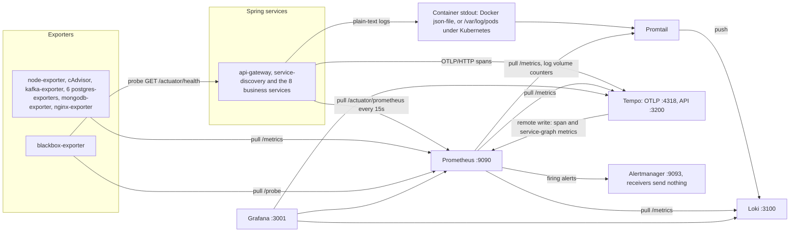
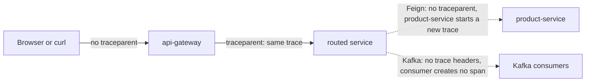

# Observability

How the platform produces, collects and shows metrics, logs and traces, what the
alert rules watch, and how to investigate a problem with them. The monitoring
configuration lives in the `ecommerce-monitoring` repository and is shared
unchanged by Docker Compose and Kubernetes. The containers are defined in
`ecommerce-platform/docker-compose.yml` and `ecommerce-platform/k8s/`. The
instrumentation is configured in each Spring service's `application.yaml` and
`pom.xml`.

Everything below was checked against the configuration files, the service code
and the libraries in the built jars. A running stack was not available while
this was written, so statements about runtime behaviour follow from the code and
the library versions, not from observed data. The size bounds, the log pipeline
and the alert rules added on 2026-10-30 (branch `feature/resilience-hardening`)
were checked against the configuration and code only. They have not been run
against a live stack; the rules have `promtool` unit tests on synthetic series.

## Summary

| Signal | Produced by | Collected by | Stored in | Retention | Viewed in |
|---|---|---|---|---|---|
| Metrics | Micrometer in all 10 Spring apps (`/actuator/prometheus`), 12 exporter jobs, and Loki, Promtail and Tempo | Prometheus, pull every 15 s | Prometheus TSDB | 15 days, at most 5 GB | Grafana dashboards, Prometheus UI |
| Logs | Logback console output, plain text in one pattern that includes the trace id | Promtail (Docker socket under compose, pod log files under Kubernetes) | Loki | 31 days (744 h) | Grafana → Explore → Loki |
| Traces | Micrometer Tracing with the OpenTelemetry SDK, 100 % sampled | Pushed over OTLP/HTTP to Tempo | Tempo, local disk | 48 h | Grafana → Explore → Tempo |
| Alerts | 58 Prometheus rules in 13 groups | Alertmanager | n/a | n/a | Prometheus `/alerts`, Alertmanager UI |

The state of each signal, in short (details in [Known gaps](#known-gaps)):

- **Metrics** cover HTTP servers, JVMs, connection pools, Kafka lag, Postgres
  and MongoDB well, plus the outbox relays, dead-lettered records and the
  logging pipeline itself. There are no business metrics (orders placed,
  payments failed and so on).
- **Traces** cover browser → gateway → first service only. Feign calls
  (catalog, order and review → product-service, payment → order-service) and
  Kafka events are not traced, so the next service starts a new trace or none
  at all.
- **Logs** are plain text in one pattern that carries the correlation id and
  the trace id, and one Promtail pipeline parses it the same way under compose
  and Kubernetes. The Grafana links between logs and traces work for lines
  written inside a traced request. Every store has a size or rate bound (see
  [Disk bounds](#disk-bounds)).
- **Alerts** are evaluated and shown in the UIs, but no receiver sends them
  anywhere, and one Kafka rule (`KafkaUnderReplicatedPartitions`) can never
  fire.



Versions in use: Prometheus v2.52.0, Grafana 11.1.0, Loki and Promtail 3.1.0,
Tempo 2.5.0, Alertmanager v0.27.0. On the application side: Spring Boot 4.0.9,
Micrometer 1.16.8, Micrometer Tracing 1.6.8 (OpenTelemetry bridge),
OpenTelemetry SDK 1.55.0, Prometheus Java client 1.4.3.

Under Kubernetes the same configuration files are used (rendered into
ConfigMaps by `k8s/sync-monitoring-config.sh`; at the time of writing
`k8s/05-monitoring-config.yaml` matched the sources). The differences are
Promtail's discovery and its first two stages (the container runtime's
envelope), the cAdvisor gap, which ports reach the host, and scraping through
Service names. Each is covered in the section it affects;
the reasons are in [k8s/README.md](../k8s/README.md).

## Endpoints

| Component | Compose (host) | Kubernetes | Credentials |
|---|---|---|---|
| Grafana | http://localhost:3001 (container port 3000) | `grafana-lb`, http://localhost:3001 | `GRAFANA_ADMIN_USER` / `GRAFANA_ADMIN_PASSWORD`, generated into `ecommerce-platform/.env` by `init-secrets.sh`; Secret `platform-secrets` in Kubernetes |
| Prometheus | http://localhost:9090 | `prometheus-lb`, http://localhost:9090 | none |
| Alertmanager | http://localhost:9093 | `alertmanager-lb`, http://localhost:9093 | none |
| Loki | http://localhost:3100 (HTTP API, no UI) | in-cluster only, `loki:3100` | none (`auth_enabled: false`) |
| Tempo | http://localhost:3200 (API); OTLP gRPC :4317, OTLP HTTP :4318 | in-cluster only, `tempo:3200`, `:4317`, `:4318` | none |
| Promtail | not published (:9080 inside the network, scraped by Prometheus) | DaemonSet, :9080 in the pod; Service `promtail:9080` in-cluster | none |
| Kafka UI | http://localhost:8090 | `kafka-ui-lb`, http://localhost:8090 | none |
| node-exporter | :9100 | in-cluster | none |
| cAdvisor | http://localhost:9095 (container port 8080) | in-cluster, `cadvisor:8080` | none |
| kafka-exporter | :9308 | in-cluster | none |
| blackbox-exporter | :9115 | in-cluster | none |
| nginx-exporter | :9113 | in-cluster | none |
| postgres-exporter | userdb :9187, productdb :9188, orderdb :9190, paymentdb :9191, shippingdb :9192, reviewdb :9193 (all :9187 in the container) | in-cluster, `postgres-exporter-<db>:9187` | none; each connects with its database's application user |
| mongodb-exporter | :9216 | in-cluster | none; connects as `cataloguser` |
| Actuator, per service | api-gateway :8080, service-discovery :8761, services :8081-8088, under `/actuator` | gateway and Eureka through their `-lb` Services; the 8 services in-cluster only | none |

The frontend's nginx does not proxy `/actuator/`, under compose or Kubernetes
(S-6), so the gateway's actuator is reachable only on the gateway's own port.

## Application instrumentation

### Shared configuration

The `management.*` block is identical in all ten `application.yaml` files,
except that service-discovery does not expose `serviceregistry` (it does not
register with itself) and notification-service adds `kafkaListeners` to its
readiness group. That indicator is also part of the aggregate
`/actuator/health`, which the blackbox probe and the compose healthcheck read:
it is DOWN while a listener container is stopped or none holds a broker
connection, so a Kafka outage turns notification-service's health DOWN.

| Setting | Value | Effect |
|---|---|---|
| `management.endpoints.web.exposure.include` | `health,info,metrics,prometheus,circuitbreakers,serviceregistry` | `circuitbreakers` only exists where resilience4j is on the classpath (catalog, order, payment, review). `serviceregistry` is what the Kubernetes preStop hook uses to mark a pod `OUT_OF_SERVICE`; it answers 403 to anything but localhost. |
| `management.endpoint.health.show-details` | `never` | Health shows the overall status only; component details stay internal (S-6). |
| `management.endpoint.prometheus.access` | `unrestricted` | |
| `management.metrics.tags` | `application: ${spring.application.name}`, `environment: ${ENVIRONMENT:development}` | Every meter carries both tags. Compose (`x-java-env`) and Kubernetes (`java-env`) set `ENVIRONMENT=development`. |
| `management.metrics.distribution.percentiles-histogram.http.server.requests` | `true` | Publishes `_bucket` series, so `histogram_quantile` works. |
| `management.metrics.distribution.slo.http.server.requests` | `50ms,100ms,200ms,500ms,1s,2s` | Adds bucket boundaries at exactly those values. |
| `management.tracing.sampling.probability` | `${TRACING_SAMPLING_PROBABILITY:1.0}` | 100 % everywhere: neither compose nor Kubernetes passes the variable to the containers. |
| `management.opentelemetry.tracing.export.otlp.endpoint` | `${OTEL_EXPORTER_OTLP_ENDPOINT:http://tempo:4318}/v1/traces` | OTLP over HTTP/protobuf (Boot 4's default transport). Compose and Kubernetes set `OTEL_EXPORTER_OTLP_ENDPOINT=http://tempo:4318`. A service started from the IDE needs `OTEL_EXPORTER_OTLP_ENDPOINT=http://localhost:4318`, because `tempo` does not resolve on the host. |
| `management.otlp.metrics.export.enabled` | `false` | `spring-boot-starter-opentelemetry` also brings `micrometer-registry-otlp`; this keeps metrics on the Prometheus pull path only. |
| Trace propagation | Boot default | Produces W3C `traceparent`; accepts W3C, B3 and B3 multi-header. |
| Dependencies | `spring-boot-starter-actuator`, `micrometer-registry-prometheus`, `spring-boot-starter-opentelemetry` | Same three in every pom. |

The `service.name` of every span is `spring.application.name`.

### Per service

All ten services log the same pattern:
`%d{yyyy-MM-dd HH:mm:ss} [%thread] [%X{correlationId:-}] [%X{traceId:-}] %-5level %logger{36} - %msg%n`.
The timestamp has second precision, in the JVM's default zone (UTC in the
`eclipse-temurin:25-jre-alpine` images). An id that is not set prints as `[]`:
the correlation id in the three services without a filter (see the table), and
both ids in Kafka listener threads and in scheduled jobs such as the outbox
relay, which run outside a request and outside a trace. `com.ecommerce` logs at
INFO in all ten services (notification-service sets no level and inherits
Boot's INFO). DEBUG is a switch, `LOGGING_LEVEL_COM_ECOMMERCE=DEBUG`, which
neither compose nor Kubernetes sets.

| Service | Correlation filter | Extra meters | Outbound hops and their tracing |
|---|---|---|---|
| api-gateway (WebFlux) | none, so `[correlationId]` is always empty; the trace id reaches the MDC through `spring.reactor.context-propagation: auto` | `http_client_requests_seconds` per proxied call | to every routed service: traced |
| service-discovery | none, `[correlationId]` always empty | none | none |
| user-service | yes | HikariCP, repositories | none |
| product-service | yes | HikariCP, repositories | none |
| catalog-service (Kotlin, MongoDB) | yes | MongoDB driver, repositories, resilience4j (breaker `product-service`) | Feign → product-service: not traced |
| order-service | yes | HikariCP, repositories, resilience4j (breaker `product-service`), Kafka template and listener timers, outbox, dead-letter counters, `orders_reservations_expired_total` | Feign → product-service and Kafka `order.*`: not traced |
| payment-service | yes | HikariCP, repositories, resilience4j (breaker `order-service`), Kafka template timers, outbox | Feign → order-service and Kafka `payment.*`: not traced |
| shipping-service | yes | HikariCP, repositories, Kafka template and listener timers, outbox, dead-letter counters | Kafka `shipment.*`: not traced |
| review-service | yes | HikariCP, repositories, resilience4j (breaker `product-service`) | Feign → product-service: not traced |
| notification-service | none, `[correlationId]` always empty | Kafka listener timers, dead-letter counters | consumes only |

**The correlation filter** is `filter/CorrelationIdFilter` in user, product,
catalog, order, payment, shipping and review: a `OncePerRequestFilter`
component that reads `X-Correlation-Id`, generates `UUID.randomUUID()` when the
header is missing or blank (catalog's Kotlin version only when it is missing),
puts it in the MDC under `correlationId`, echoes it as a response header and
removes it from the MDC afterwards. Each service's `GlobalExceptionHandler` also
returns it as `correlationId` in error bodies, and the "Unhandled exception on
{} {} (correlationId={})" log lines include it. The gateway's `CorsConfig`
exposes the header to browsers.

Nothing propagates it. The gateway has no filter of its own (it passes a
client-supplied header through unchanged, as it does every header), the
frontend never sends one, and no code copies it onto Feign requests or Kafka
records. In practice every service mints its own id for every request, so the
id joins the log lines of one service for one request, never a request across
services. The trace id is what joins services: the gateway's lines and the
first service's lines for one request carry the same trace id. Feign and Kafka
hops do not carry the trace on.

**What the services log under failure.** Log volume follows the number of
distinct problems, not the traffic:

- A line that a client or an outage can trigger at request rate goes through a
  `LogThrottle`: the first occurrence per key (failure site, route, dependency)
  in a 10 s window is logged, the rest are counted, and the next line for that
  key ends with ` (N similar suppressed)`. One failing site therefore writes at
  most 0.1 ERROR a second.
- A dependency that does not answer (database, MongoDB, product-service,
  order-service) makes the service answer 503 `Service temporarily unavailable`
  and write one WARN per window, without a stack trace. A Kafka outage does not
  reach the caller: events wait in the outbox. Any other unexpected failure
  writes one ERROR with a stack trace per window and failure site.
- Circuit breakers log their state transitions (WARN when a breaker opens, INFO
  when it closes), not their calls.
- Hibernate's JDBC error lines and Spring's rollback-failure lines are switched
  off in the six JPA services, the MongoDB driver is set to WARN in catalog, and
  the gateway mutes the load balancer's and reactor-netty's per-request lines
  and reports an upstream failure itself.
- A Kafka consumer reports a failing record through a throttled line and a
  dead-lettered one through one throttled WARN (see the
  [runbook](runbook.md#dead-letter-topics)). The outbox relay writes at most one
  WARN a minute while Kafka is unreachable and one INFO when it recovers.
- The infrastructure containers are quieted too. mongod runs with `--quiet
  --slowms 1000`: `--quiet` drops the connection accepted, client metadata and
  connection ended lines, about two thirds of the lines per connection (the
  healthcheck alone opens about five connections every 10 s), and only
  operations slower than a second are logged. Kafka's `kafka.controller`,
  `state.change.logger` and `kafka.log.LogCleaner` loggers are set to WARN;
  cp-kafka defaults the first two to TRACE.

**Inconsistencies between services:**

1. api-gateway, notification-service and service-discovery have no correlation
   filter, so the `[correlationId]` bracket of their lines is always empty.
2. `circuitbreakers` is exposed in all ten services but exists in four
   (catalog, order, payment, review).

**Custom metrics: few.** Three kinds of class register their own meters: the
outbox relay (order, payment, shipping), the dead-letter recoverer (order,
shipping, notification) and order-service's `ReservationExpiryJob`; they are the
last three rows of the table. No class uses `@Timed`, `@Counted` or `@Observed`,
and `management.observations.annotations.enabled` stays at its default `false`.
Everything else comes from auto-configuration:

| Prometheus metric family | Services | Source |
|---|---|---|
| `http_server_requests_seconds_{count,sum,max,bucket}`, tags `method`, `uri`, `status`, `outcome`, `exception`, `error` | all 10 | Spring MVC / WebFlux server observation. Actuator requests are included. |
| `http_server_requests_active_seconds_*` | all 10 | Long-task timer of the same observation |
| `jvm_*`, `process_*`, `system_*`, `logback_events_total{level}`, `application_ready_time_seconds` | all 10 | Boot's JVM, system, Logback and startup binders |
| `hikaricp_connections_*`, tag `pool` | user, product, order, payment, shipping, review | Boot DataSource pool metrics |
| `spring_data_repository_invocations_seconds_*`, tags `repository`, `method`, `state`, `exception` | the six above and catalog | Boot Spring Data repository metrics |
| `mongodb_driver_pool_{size,checkedout,waitqueuesize}`, `mongodb_driver_commands_seconds_*` | catalog | Boot MongoDB metrics |
| `resilience4j_circuitbreaker_*`, tags `name`, `state` | catalog, order, review (`name="product-service"`), payment (`name="order-service"`) | resilience4j-micrometer; one breaker per Feign client, named after it |
| `spring_kafka_template_seconds_*`, `spring_kafka_listener_seconds_*`, tags `name`, `result`, `exception` | template: order, payment, shipping. Listener: order, shipping, notification | spring-kafka's built-in Micrometer timers, active because observation is off |
| `http_client_requests_seconds_*`, tags `spring_cloud_gateway_route_id`, `spring_cloud_gateway_route_uri`, `http_method`, `http_status_code` | api-gateway | Spring Cloud Gateway's observation of each proxied call (no histogram) |
| `outbox_events_pending`, `outbox_events_parked` (gauges), `outbox_events_published_total`, `outbox_publish_failures_total` (counters) | order, payment, shipping | `OutboxRelay`, custom. The relay refreshes the gauges itself, at most every 5 s, so a scrape never waits for the database. The failures counter counts relay cycles that ended in a transient failure. |
| `kafka_dlt_published_total`, `kafka_dlt_dropped_total`, tag `topic` (the source topic) | order, shipping, notification | The dead-letter recoverer, custom: records published to `<topic>.DLT`, and records skipped because they could not be dead-lettered either. A series exists only after its first increment. |
| `orders_reservations_expired_total` | order | `ReservationExpiryJob`, custom: PENDING carts unchanged for 24 h (`orders.reservation.pending-ttl`) that it cancelled; their stock goes back and `order.cancelled` is published. One INFO per run, and only when something expired |

Not available: Feign client metrics (`feign-micrometer` is not a dependency),
Kafka client metrics (`kafka_consumer_*`, `kafka_producer_*`: the services
depend on plain `spring-kafka`, not on Boot 4's Kafka module, and build their
own factories), and `spring_cloud_gateway_requests_seconds`
(`spring.cloud.gateway.server.webflux.metrics.enabled` defaults to `false`).

## Metrics

### Scrape jobs

All jobs use the global settings in `ecommerce-monitoring/prometheus/prometheus.yml`:
interval 15 s, timeout 10 s, `sample_limit` 50000, static targets,
`honor_labels` off. A scrape that returns more than 50000 samples fails (the
target shows `up == 0`) and increments
`prometheus_target_scrapes_exceeded_sample_limit_total`, which alert
`PrometheusSampleLimitExceeded` watches; the limit is an estimate, set well above
what a target returns today (the config comment puts a Spring service at 3 to 8
thousand samples and cAdvisor under compose at about 5 thousand). The static
`service`, `group` and `database` labels are what the rules and dashboards
select on.

| Job | Target(s) | Path | Static labels |
|---|---|---|---|
| `prometheus` | `localhost:9090` | `/metrics` | `service=prometheus` |
| `api-gateway` | `api-gateway:8080` | `/actuator/prometheus` | `service=api-gateway`, `group=application` |
| `user-service` | `user-service:8081` | `/actuator/prometheus` | `service=user-service`, `group=application` |
| `product-service` | `product-service:8082` | `/actuator/prometheus` | `service=product-service`, `group=application` |
| `catalog-service` | `catalog-service:8083` | `/actuator/prometheus` | `service=catalog-service`, `group=application` |
| `order-service` | `order-service:8084` | `/actuator/prometheus` | `service=order-service`, `group=application` |
| `payment-service` | `payment-service:8085` | `/actuator/prometheus` | `service=payment-service`, `group=application` |
| `shipping-service` | `shipping-service:8086` | `/actuator/prometheus` | `service=shipping-service`, `group=application` |
| `review-service` | `review-service:8087` | `/actuator/prometheus` | `service=review-service`, `group=application` |
| `notification-service` | `notification-service:8088` | `/actuator/prometheus` | `service=notification-service`, `group=application` |
| `service-discovery` | `service-discovery:8761` | `/actuator/prometheus` | `service=service-discovery`, `group=application` |
| `node-exporter` | `node-exporter:9100` | `/metrics` | `service=node-exporter`, `group=infrastructure` |
| `cadvisor` | `cadvisor:8080` | `/metrics` | `service=cadvisor`, `group=infrastructure` |
| `kafka-exporter` | `kafka-exporter:9308` | `/metrics` | `service=kafka`, `group=messaging` |
| `postgres-exporter-userdb` | `postgres-exporter-userdb:9187` | `/metrics` | `service=postgres`, `database=userdb`, `group=database` |
| `postgres-exporter-productdb` | `postgres-exporter-productdb:9187` | `/metrics` | `service=postgres`, `database=productdb`, `group=database` |
| `postgres-exporter-orderdb` | `postgres-exporter-orderdb:9187` | `/metrics` | `service=postgres`, `database=orderdb`, `group=database` |
| `postgres-exporter-paymentdb` | `postgres-exporter-paymentdb:9187` | `/metrics` | `service=postgres`, `database=paymentdb`, `group=database` |
| `postgres-exporter-shippingdb` | `postgres-exporter-shippingdb:9187` | `/metrics` | `service=postgres`, `database=shippingdb`, `group=database` |
| `postgres-exporter-reviewdb` | `postgres-exporter-reviewdb:9187` | `/metrics` | `service=postgres`, `database=reviewdb`, `group=database` |
| `mongodb-exporter-catalogdb` | `mongodb-exporter-catalogdb:9216` | `/metrics` | `service=mongodb`, `database=catalogdb`, `group=database` |
| `nginx-exporter` | `nginx-exporter:9113` | `/metrics` | `service=frontend-nginx`, `group=frontend` |
| `loki` | `loki:3100` | `/metrics` | `service=loki`, `group=monitoring` |
| `promtail` | `promtail:9080` | `/metrics` | `service=promtail`, `group=monitoring` |
| `tempo` | `tempo:3200` | `/metrics` | `service=tempo`, `group=monitoring` |
| `blackbox-http` | 11 URLs: `http://<service>:<port>/actuator/health` for the 10 apps, and `http://frontend:80/` | `/probe?module=http_2xx` via `blackbox-exporter:9115` | none; relabelling makes `instance` the probed URL |

Because `honor_labels` is off, an exporter label that collides with a static one
is renamed: mongodb-exporter's own `database` label arrives as
`exported_database` (which is why the Databases dashboard filters
`mongodb_dbstats_dataSize{exported_database="catalogdb"}`).

The `loki`, `promtail` and `tempo` jobs make a dead log or trace pipeline
visible (`MonitoringStackDown`) and carry the counters behind the log-volume and
discard alerts.

Not scraped: Grafana, Alertmanager, Kafka UI, the blackbox exporter's own
metrics, and the Kafka broker itself (there is no JMX exporter; kafka-exporter
only sees offsets, partitions and consumer groups).

### Storage

- Prometheus runs with `--storage.tsdb.retention.time=15d`,
  `--storage.tsdb.retention.size=5GB` (whichever limit is reached first deletes
  the oldest block; the WAL and compaction headroom come on top, and alert
  `PrometheusTsdbNearSizeLimit` warns at 90 % of the limit),
  `--web.enable-lifecycle` (so `POST /-/reload` re-reads the config) and
  `--web.enable-remote-write-receiver`, which Tempo's metrics-generator writes
  into. Exemplar storage is not enabled.
- Compose keeps the TSDB in the `prometheus-data` volume; Kubernetes uses a
  10 GiB PVC.
- Rules are evaluated every 30 s (each group sets `interval: 30s`). Prometheus
  attaches `cluster=ecommerce-local` and `environment=development` to the alerts
  it sends to `alertmanager:9093`.

**Under Kubernetes** the same static targets resolve to ClusterIP Services.
With one replica that is equivalent to compose. With more (the k8s README shows
`kubectl scale ... --replicas=3`), each scrape reaches one random pod and all
pods share one series per job. node-exporter, cAdvisor and Promtail are
DaemonSets behind a Service too, which only works on a single-node cluster.

## Alerts

Rules are in `ecommerce-monitoring/prometheus/rules/` (six files, 58 rules in 13
groups). "Can't fire" means the expression cannot become true in this
deployment, as explained in the row. The new and rewritten rules, all but
`PromtailDroppedEntries`, have `promtool test rules` unit tests in
`ecommerce-monitoring/prometheus/tests/` (one file per rule file, run in CI).
The cases use synthetic series, and the thresholds are estimates of normal
volume, not measurements from a long run.

| Group | Alert | Fires when | For | Severity | Meaning, and the first thing to check |
|---|---|---|---|---|---|
| `service.availability` | `ServiceDown` | `up == 0` for a job with `group="application"` | 1m | critical | Prometheus cannot scrape `/actuator/prometheus`. Check Prometheus → Status → Targets for the error, then `docker compose ps` / `docker logs <service>`. |
| `service.availability` | `ServiceEndpointUnhealthy` | Blackbox `probe_success == 0` for any of the 11 URLs | 2m | critical | Health is not 200/204 within 5 s. `curl http://localhost:<port>/actuator/health` gives the overall status only (`show-details: never`), so read the service's log for the cause. A stopped service raises this and `ServiceDown` together. Health also reads DOWN without a stopped service: catalog-service while MongoDB is unreachable (`MongoDown` fires too; its liveness group, which Kubernetes uses, stays 200) and notification-service while no listener holds a broker connection. |
| `service.http` | `HighErrorRate` | Per `service`, 5xx (`outcome="SERVER_ERROR"`) share of `http_server_requests` over 5 min > 5 % | 5m | warning | Open "Top Error-Prone Endpoints" on the Error & Latency dashboard, then search Loki for `Unhandled exception` (a bug). A dependency outage counts too: its 503s are server errors, and the service logs one WARN per window that names the dependency. Actuator traffic is in the denominator, which dilutes the ratio at low traffic. |
| `service.http` | `CriticalErrorRate` | Same ratio > 20 % | 2m | critical | As above. `HighErrorRate` keeps firing too: the inhibition rule does not suppress it. |
| `service.http` | `HighP99Latency` | Per `service`, p99 of `http_server_requests_seconds` over 5 min > 2 s | 5m | warning | "Top Slowest Endpoints"; then [find a slow request](#find-a-slow-request). |
| `service.jvm` | `JvmHeapUsageHigh` | `jvm_memory_used_bytes / jvm_memory_max_bytes` for `area="heap"` > 85 %, per memory pool (`id`) | 5m | warning | The pool named in `id` is nearly full. Max heap is 55 % of the container limit (`-XX:MaxRAMPercentage=55`): about 422 MiB at 768 MiB, 352 MiB at 640 MiB. The gateway also caps Netty direct memory at 128 MiB (`JAVA_TOOL_OPTIONS: -XX:MaxDirectMemorySize=128m`), because it buffers request bodies of up to 1 MB there. Check JVM Metrics → Memory Pools. |
| `service.jvm` | `JvmHeapUsageCritical` | Same ratio > 95 % | 2m | critical | OOM is close; `-XX:+ExitOnOutOfMemoryError` makes the JVM exit and the container restart, and `-XX:-HeapDumpOnOutOfMemoryError` keeps it from writing a heap dump into the container. |
| `service.jvm` | `JvmGcPauseHigh` | Mean GC pause over 5 min > 0.5 s, only while GCs happen | 5m | warning | Usually heap pressure. JVM Metrics → GC Activity. |
| `service.circuitbreaker` | `CircuitBreakerOpen` | `resilience4j_circuitbreaker_state` is 1 for state `open`, `half_open` or `forced_open` (maximum per breaker) | 3m | warning | The dependency behind the breaker is failing or slow, and its callers get 503. Breakers: `product-service` in order-, catalog- and review-service, `order-service` in payment-service. Each wraps the Feign client (`spring.cloud.openfeign.circuitbreaker.enabled`), and 4xx answers do not count as failures. A breaker that cannot close cycles open → half-open → open, so the three states count together; a single trip that closes at its first trial call does not alert. The service logs the transitions only (WARN on open, INFO on close). See the [runbook](runbook.md#symptoms). |
| `service.outbox` | `OutboxBacklog` | `outbox_events_pending` > 50 | 5m | warning | Events written by order-, payment- or shipping-service are not reaching Kafka, so downstream services do not see those orders and payments. Rows normally live for one relay tick (500 ms). Check Kafka and the service's log; [Check the outbox](runbook.md#check-the-outbox). |
| `service.outbox` | `OutboxBacklogGrowing` | `outbox_events_pending` is more than 20 above its value 15 min ago and still rising | 5m | warning | The relay publishes slower than the service writes, or Kafka is slow. Shows long before the level alerts do. |
| `service.outbox` | `OutboxBacklogCritical` | `outbox_events_pending` > 1000 | 5m | critical | The table grows with every request until Kafka is back. |
| `service.outbox` | `OutboxEventsParked` | `outbox_events_parked` > 0 | 5m | warning | A row hit a permanent publish error (record too large, invalid topic, serialization) and is never retried. The ERROR line has the row id, the cause and the `UPDATE` that unparks it; [Check the outbox](runbook.md#check-the-outbox). |
| `service.outbox` | `OutboxPublishFailing` | Rate of `outbox_publish_failures_total` per application > 0 over 5 min | 5m | warning | The relay cannot publish: Kafka is down or unreachable. Requests still succeed and the events wait in the table. |
| `service.outbox` | `OutboxRelayStalled` | `outbox_events_pending` > 0 while neither `outbox_events_published_total` nor `outbox_publish_failures_total` has increased in 10 min | 5m | critical | Rows wait, but the relay neither publishes nor fails: its scheduled task is not running or is stuck. Restart the service. |
| `logging.volume` | `ServiceLogRateHigh` | Per `service`, `logback_events_total` (all levels) of the application jobs > 100/s over 5 min | 10m | warning | An idle service logs a few events a minute, the k6 `load` profile a few dozen a second (estimates). Usual causes: a retry loop, an unthrottled error path, or DEBUG left on (`LOGGING_LEVEL_COM_ECOMMERCE=DEBUG` fills the container log although Promtail does not ship it). Loki → `{service="…"}`, or "Log Events/s by Service" on the Logging & Reliability dashboard. |
| `logging.volume` | `ServiceLogRateCritical` | Same, > 1000/s over 5 min | 2m | critical | Well past what Promtail ships (300 entries/s per container), so Loki holds only part of it. `docker logs --tail 50 <service>`; Docker keeps 150 MB per container. |
| `logging.volume` | `ServiceErrorLogRateHigh` | Per `service`, `logback_events_total{level="error"}` > 0.5/s over 5 min | 10m | warning | One failure site writes at most one ERROR per 10 s window, so 0.5/s for ten minutes means about five sites failing together, or an ERROR that is not throttled. Loki → `{service="…", level="ERROR"}`. |
| `logging.volume` | `ServiceErrorLogRateCritical` | Same, > 10/s over 5 min | 2m | critical | The exception handler is not throttling (`LogThrottle`). Expect disk and Loki pressure within minutes. |
| `logging.volume` | `ContainerLogVolumeHigh` | Per `container`, `promtail_custom_log_bytes_total` > 100 KiB/s over 5 min | 5m | warning | Counted before Promtail drops anything, and for every shipped container, including Kafka and nginx, which have no `logback_events_total`. Docker keeps 150 MB; Loki refuses a stream above 128 KB/s. |
| `logging.volume` | `ContainerLogVolumeCritical` | Same, > 1 MiB/s over 5 min | 2m | critical | Promtail is already dropping the excess; stop the cause (see the [runbook](runbook.md#symptoms)). |
| `logging.pipeline` | `PromtailDroppingLogs` | Per container, `logentry_dropped_lines_by_label_total{label_name="container"}` > 1 line/s over 2 min | 2m | warning | Promtail drops lines above 300 entries/s from that container, so Loki holds only part of what it logged; `docker logs <container>` has the rest. The normal DEBUG filter (`debug_log_dropped`) is not counted here. |
| `logging.pipeline` | `PromtailDroppedEntries` | `promtail_dropped_entries_total` rate per reason > 0 over 5 min | 2m | warning | Promtail gave up on entries: its retries (about 85 s) ran out, or Loki answered with a 4xx. `docker logs promtail`, then the Loki alerts. |
| `logging.pipeline` | `LokiRateLimitingLogs` | `loki_discarded_samples_total` rate > 0 over 5 min, reason `rate_limited` or `per_stream_rate_limit` | 2m | warning | Loki refuses lines over its limits (128 KB/s per stream, 512 KB/s for the stack). Something logs far above normal: see `ServiceLogRateHigh` and `ContainerLogVolumeHigh`. |
| `logging.pipeline` | `LokiRejectingLogs` | The same metric, any other reason, > 0.1/s over 10 min | 10m | warning | `missing_labels` or `invalid_labels` mean a broken Promtail pipeline; `greater_than_max_sample_age` or `too_far_in_future` a clock or timestamp problem. |
| `logging.pipeline` | `PromtailNoActiveTargets` | `promtail_targets_active_total == 0` | 10m | warning | Promtail tails nothing, so no logs reach Loki. Under Kubernetes check the `__host__` relabel and `HOSTNAME` ([k8s/README.md](../k8s/README.md)); under compose, no application container is running. |
| `logging.pipeline` | `TempoDiscardingSpans` | `tempo_discarded_spans_total` rate per reason > 0 over 5 min | 5m | warning | Tempo drops spans over its limits (1 MB/s ingestion, 2 MB per trace). A request storm is traced at 100 %; the traces of that period are incomplete. |
| `logging.pipeline` | `MonitoringStackDown` | `up == 0` for a job with `group="monitoring"` (Loki, Promtail, Tempo) | 2m | critical | Prometheus cannot scrape it, and logs or traces are not being collected. `ServiceDown` covers only `group="application"`. `docker compose ps`, `docker logs <name>`. |
| `infrastructure.containers` | `ContainerHighCpuUsage` | A container (not prometheus, grafana or cadvisor) uses > 1.5 cores over 5 min | 5m | warning | Containers dashboard. Compose sets no CPU limits. Under Kubernetes: can't fire (see the cAdvisor gap). |
| `infrastructure.containers` | `ContainerHighMemoryUsage` | `container_memory_usage_bytes / container_spec_memory_limit_bytes` > 85 % (containers with a limit) | 5m | warning | `container_memory_usage_bytes` includes page cache, so Kafka and the databases can sit near their limit without memory pressure; compare `container_memory_working_set_bytes`. Under Kubernetes: can't fire. |
| `infrastructure.containers` | `ContainerRestarting` | `container_start_time_seconds` increased within 5 min | 0m | warning | The same container restarted (a recreated container has a new id and does not count). `docker logs <name>`; an `ExitOnOutOfMemoryError` exit shows here. Under Kubernetes: can't fire. |
| `infrastructure.host` | `HostHighCpuLoad` | Non-idle CPU of the Docker VM > 80 % | 5m | warning | node-exporter measures the Docker engine's Linux VM, not Windows or macOS. |
| `infrastructure.host` | `HostOutOfMemory` | Available memory < 10 % | 5m | critical | Docker VM memory. Containers dashboard → memory per container. |
| `infrastructure.host` | `HostDiskSpaceLow` | Free space < 15 % on any real filesystem: the minimum per `device` of available / size, for every filesystem type except tmpfs, ramfs, squashfs, iso9660, overlay and nsfs | 5m | warning | The `device` in the alert is a disk of the Docker VM, whatever its mountpoint; the several mountpoints of one device fold into one alert. `docker system df`; the [runbook](runbook.md#disk-space) says how to find the writer and has the WSL2 disk caveats. |
| `infrastructure.host` | `HostDiskSpaceCritical` | Same, < 5 % | 2m | critical | As above, urgently: a full disk stops every container. |
| `infrastructure.host` | `HostDiskWillFillWithin24h` | `predict_linear` over the last 6 h puts a device's free space below zero within 24 h | 30m | warning | A rate-based warning: a runaway fills a disk faster than a percentage threshold can warn (992 GB in 17 h is 58 GB/h). Look for runaway logs (`ServiceLogRateHigh`, `ContainerLogVolumeHigh`) and for Kafka or Loki growth. |
| `infrastructure.host` | `HostDiskWillFillWithin4h` | The same prediction over the last hour puts it below zero within 4 h | 10m | critical | What a log explosion looks like before the disk is full. Find the container writing most (`promtail_custom_log_bytes_total`, `docker ps -s`) and stop it. |
| `infrastructure.monitoring` | `PrometheusTsdbNearSizeLimit` | `prometheus_tsdb_storage_blocks_bytes / prometheus_tsdb_retention_limit_bytes` > 90 % (only while a size limit is set) | 30m | warning | The oldest blocks are about to be deleted before the 15 days are up. Check for a cardinality increase (`prometheus_tsdb_head_series`), or raise `--storage.tsdb.retention.size`. |
| `infrastructure.monitoring` | `PrometheusSampleLimitExceeded` | `increase(prometheus_target_scrapes_exceeded_sample_limit_total[10m])` > 0 | 0m | warning | A target returned more than 50000 samples (`sample_limit`), so its scrape failed and it shows `up == 0`. Prometheus → Status → Targets names it; a label probably carries an id. |
| `infrastructure.monitoring` | `ExporterDown` | `up == 0` for a job in group infrastructure, messaging, database or frontend | 3m | warning | Prometheus cannot scrape that exporter, so the alerts that depend on it (`kafka_brokers`, `pg_up`, `mongodb_up`, …) cannot fire. Does not cover blackbox-exporter: the `blackbox-http` job has no `group` label. |
| `database.postgres` | `PostgresDown` | `pg_up == 0` | 1m | critical | The exporter cannot connect to the database named in the `database` label. `docker compose ps <db>`, `docker logs <db>`. |
| `database.postgres` | `PostgresTooManyConnections` | Connections summed per instance / `max_connections` > 80 % | 5m | warning | Connections by state on the Databases dashboard; each JPA service has one Hikari pool. |
| `database.postgres` | `PostgresDeadlocks` | `increase(pg_stat_database_deadlocks[10m]) > 0` on an application database | 0m | warning | At least one deadlock in the last 10 minutes; with no `for`, a single deadlock is reported. `docker logs <db>`: Postgres logs both statements of each deadlock. |
| `database.postgres` | `PostgresSlowQueries` | `pg_stat_activity_max_tx_duration_max_tx_duration` > 60 s | 5m | warning | Despite the name this is the oldest open transaction among non-idle sessions, including `idle in transaction`. Find it with the `pg_stat_activity` query in [Check a database](#check-a-database). |
| `database.postgres` | `DatabasePoolTimeouts` | Per application, `increase(hikaricp_connections_timeout_total[5m])` > 0 | 0m | warning | A request waited the full Hikari connection timeout (5 s) and got 503. The pool is exhausted (slow statements, a held row lock) or the database stopped answering. Check `PostgresDown` and `PostgresSlowQueries`, compare `hikaricp_connections_active` with `hikaricp_connections_max`, and look for held row locks ([Check a database](#check-a-database)): product-service's stock lock waits at most 5 s and then answers 503, and shipping-service's status lock likewise. |
| `database.postgres` | `DatabasePoolSaturated` | Per application, `hikaricp_connections_pending` > 0 (maximum over instances) | 2m | warning | Threads have waited for a pooled connection for two minutes; requests slow down by up to 5 s and then fail with 503. Same checks as above. |
| `database.mongodb` | `MongoDown` | `mongodb_up == 0` | 1m | critical | mongodb-exporter cannot reach catalogdb. `docker logs catalogdb`. Meanwhile catalog-service's `/actuator/health` reads 503 (so `ServiceEndpointUnhealthy` fires too) and its liveness group stays 200, because a restart cannot bring MongoDB back. |
| `database.mongodb` | `MongoTooManyConnections` | Current / (current + available) connections > 80 % | 5m | warning | Databases dashboard, MongoDB row. |
| `kafka.health` | `KafkaBrokerDown` | `kafka_brokers < 1` | 1m | critical | `docker logs kafka`. Unreliable: the value is the size of the exporter's cached broker list, and if Kafka is down when kafka-exporter starts, the exporter exits and the series disappears. `ExporterDown` then fires for kafka-exporter. |
| `kafka.health` | `KafkaConsumerGroupLag` | `kafka_consumergroup_lag` > 1000 on any partition | 5m | warning | A consumer group is behind; see [Check Kafka consumer lag](#check-kafka-consumer-lag). |
| `kafka.health` | `KafkaConsumerGroupLagCritical` | Same, > 10000 | 5m | critical | As above; fires alongside the warning. |
| `kafka.health` | `KafkaUnderReplicatedPartitions` | Sum of `kafka_topic_partition_under_replicated_partition` > 0 | 5m | warning | **Can't fire:** one broker, and every topic has replication factor 1, so in-sync replicas always equal replicas. |
| `kafka.health` | `KafkaPartitionHasNoLeader` | A topic has more partitions (`kafka_topic_partitions`) than partitions with a leader sample (`kafka_topic_partition_leader`), or no leader sample at all | 5m | critical | Producers and consumers of the topic fail until a leader is elected. kafka-exporter v1.7.0 never reports `-1`: for a partition without a leader it logs an error and emits no sample, so the rule counts missing samples. Covered by `promtool` tests on synthetic series, not by a real leaderless partition. |
| `kafka.health` | `KafkaConsumerGroupNoMembers` | `kafka_consumergroup_members` == 0 for the group `order-service`, `shipping-service` or `notification-service` | 5m | warning | No live consumer, so the group's topics are not being read at all (the lag alerts fire only once the lag is large). Is the service running, and not stuck rebalancing? |
| `kafka.health` | `KafkaConsumerStuck` | `kafka_consumergroup_lag` > 0 while the group's committed offset on that partition has not changed in 10 min | 5m | warning | A hung listener thread, a partition blocked on a record, or a dead dependency. A database outage trips it on purpose: the partition waits for the database (back-off 1 s to 30 s) and nothing is dead-lettered. A bad record does not trip it (it is dead-lettered and committed). A consumer stuck before its first commit has no offset series and is invisible to this rule. See the [runbook](runbook.md#symptoms). |
| `kafka.health` | `KafkaDeadLetterRecords` | A `.DLT` topic gained records in the last 15 min (`kafka_topic_partition_current_offset` increased, or the topic appeared above 0) | 0m | warning | A consumer gave up on a record and moved it to `<topic>.DLT`. The topic is auto-created at the first dead letter, so no series exists before that. [Dead-letter topics](runbook.md#dead-letter-topics). |
| `kafka.health` | `KafkaDeadLetterFlood` | More than 100 records added to one `.DLT` topic in 5 min | 0m | critical | Far more than isolated bad records: a producer is sending something no consumer can process (a schema mismatch after a deploy?). Expect log pressure; the topic itself is capped by Kafka's byte retention. |
| `kafka.health` | `KafkaDeadLetterDropped` | `increase(kafka_dlt_dropped_total[15m])` > 0, or the counter appeared above 0 within 15 min | 0m | critical | A consumer skipped a record it could not even dead-letter (usually too large for the broker), so the event is lost for that consumer; the original stays on its source topic until retention. `docker logs <application>` has one ERROR with the key and the reason; see the [runbook](runbook.md#symptoms). |

### Alertmanager

`ecommerce-monitoring/alertmanager/alertmanager.yml` groups by
`alertname`, `service` and `severity` (`group_wait` 10s, `group_interval` 5m,
`repeat_interval` 1h, `resolve_timeout` 5m). Child routes, first match wins:

| Order | Matcher | Receiver | Overrides | Reached? |
|---|---|---|---|---|
| 1 | `severity = "critical"` | `critical-receiver` | `group_wait: 0s`, `repeat_interval: 15m` | yes |
| 2 | `severity = "warning"` | `warning-receiver` | `repeat_interval: 4h` | yes |
| 3 | `alertname = "KafkaBrokerDown"` | `critical-receiver` | `group_wait: 0s` | never: the alert is critical, so route 1 takes it |
| 4 | `alertname = "PostgresDown"` | `critical-receiver` | `group_wait: 0s` | never, same reason |
| default | none | `default-receiver` | | never: every rule sets a severity |

**No receiver delivers anywhere.** `default-receiver`, `critical-receiver` and
`warning-receiver` declare no notifier; the Slack and webhook blocks are
commented out. The file says this is deliberate (the earlier webhook pointed at
an address where nothing listened). Alerts are visible in Prometheus
(`/alerts`) and in the Alertmanager UI, and nowhere else. If you enable Slack,
note that Alertmanager does not substitute environment variables in its config,
so the commented `api_url: '$SLACK_WEBHOOK_URL'` would be used literally; write
the URL in or use `api_url_file`.

**Inhibition** (a critical alert suppresses warnings with equal `alertname`
and `service`) never matches anything: every alert name has exactly one
severity, so a critical and a warning alert never share an `alertname`. Pairs
such as `HighErrorRate` and `CriticalErrorRate` fire together.

Neither Grafana nor Loki has alert rules: Grafana provisions no alerting, and
Loki's ruler points at Alertmanager but has no rule files.

## Dashboards

Grafana provisions nine dashboards from `ecommerce-monitoring/grafana/dashboards/`
(provider `ecommerce-dashboards`, General folder, files re-read every 30 s,
UI edits allowed but overwritten when the file changes). Open one with
`http://localhost:3001/d/<uid>`. All panels query Prometheus except the last
panel of Logging & Reliability, which queries Loki; none uses Tempo.

| Dashboard (uid) | Purpose | Key panels | Caveats |
|---|---|---|---|
| Platform Overview (`ecommerce-platform-overview`) | One-screen health of the platform | Services up/down, total req/s, overall 5xx ratio, p99, total Kafka lag, service status table, req/s, 5xx ratio and p99 by service, heap by service, container CPU | "Container CPU Usage" is in cores but labelled as percent |
| JVM Metrics (`ecommerce-jvm`) | One JVM at a time, picked with `$application` | Heap used/max/%, live threads, mean GC pause, process CPU, memory pools, GC activity and allocation rate, thread states, loaded classes, connection pool | "HTTP Connection Pool" actually shows HikariCP, so it is empty for api-gateway, catalog, notification and service-discovery |
| API Gateway (`ecommerce-api-gateway`) | Edge traffic | req/s, 5xx ratio, p50/p99, active requests, requests in the last hour, rate by route, status distribution, latency percentiles, p99 by route, 4xx/5xx by route | The "by route" panels group on `uri`, which is `UNKNOWN` for every proxied request (Spring Cloud Gateway never sets a path pattern). Per-route data exists in `http_client_requests_seconds_count` by `spring_cloud_gateway_route_id` |
| Databases (`ecommerce-databases`) | Postgres and MongoDB | Databases up, connections, commits/s, rollbacks/s, cache hit ratio, deadlocks/s, health table, connections and transactions per database, row operations, Hikari pools per service; MongoDB row: up, connections, ops/s, catalogdb data size, catalog-service driver pool, ops by type | `$database` filters only some panels; "Total Active Connections" counts connections in every state |
| Kafka (`ecommerce-kafka`) | Broker, topics, consumer groups | Brokers online, topics, consumer groups, total lag, messages in/s, partitions, lag by group and by topic, message rate by topic, lag detail table, partition offsets | Topic and offset panels include `__consumer_offsets` |
| Containers & Infrastructure (`ecommerce-containers`) | cAdvisor and node-exporter | Docker VM CPU, memory and disk, running containers, network, per-container CPU, memory and network, CPU by mode, disk I/O | Mostly empty under Kubernetes ([k8s/README.md](../k8s/README.md), "cAdvisor drops --docker_only") |
| Frontend & Availability (`ecommerce-frontend`) | nginx and the blackbox probes | Frontend up, nginx req/s and connections, gateway probe, mean probe duration, endpoints available, probe table, probe duration and success over time | |
| Error & Latency Overview (`ecommerce-error-latency`) | Errors and latency across services, 3 h window | 5xx ratio, p50/p90/p99, 5xx and 4xx in the last hour, 5xx ratio per service, p50/p99 per service, top 20 slowest endpoints (p99), top 20 error endpoints, circuit breaker states | "Latency Heatmap (P50/P90/P99)" is a time series with p50 and p99 only; the breaker panel plots the `open` and `half_open` states of every breaker (order, catalog, review, payment) and not `forced_open` |
| Logging & Reliability (`ecommerce-logging`) | Log volume, what the pipeline sheds, dead letters, the outbox and disk headroom, 3 h window | 23 panels: log events/s and ERROR events/s, container log volume per day at the current rate, lines shed by Promtail and refused by Loki, dead-letter records retained; per service: log events/s, ERROR and WARN events/s; per container: log bytes/s and lines shed; Loki refusals by reason and bytes received (limit 512 KB/s); Tempo discards; dead-letter records per topic; consumer lag and commit rate; outbox events waiting, parked rows, publish failures and events published/s; free space per disk, its 24 h prediction, Prometheus TSDB size against its limit; recent ERROR lines | "Recent ERROR Log Lines" is the one panel that queries Loki and lists only lines with a `level` label. "Dead-Letter Records Retained" counts what the topics still hold (newest minus oldest offset), handled or not; retention removes them |

Datasources (`grafana/provisioning/datasources/datasources.yml`, all read-only,
with pinned uids): Prometheus (`prometheus`, default, 15 s interval), Loki
(`loki`), Tempo (`tempo`). Their cross-links are covered under
[Traces](#grafana-links-between-signals).

## Logs

### Pipeline

Every Spring service logs plain text to stdout, in the one pattern shown under
[Per service](#per-service). Nothing writes JSON logs.

**Compose** (`ecommerce-monitoring/promtail/promtail-config.yml`):

1. Discovery: `docker_sd_configs` on `/var/run/docker.sock`, running containers
   only, refreshed every 5 s. The allow-list is a discovery filter on the
   container name: only the 10 Spring services, `kafka` and `frontend` are
   discovered (databases, exporters, Kafka UI and the monitoring stack are not
   shipped). It has to be a filter. Promtail 3.1 still tails a container that a
   relabel `keep` rule dropped and ships its lines with no labels, which Loki
   refuses with a 400 ("at least one label pair is required per stream"), about
   once a second for as long as Promtail runs.
2. Relabelling: `container` and `service` both get the container name; `image`
   and `stream` (stdout or stderr) are added.
3. Pipeline stages, in order:
   - `multiline`: an entry starts at a line that begins with
     `yyyy-MM-dd HH:mm:ss `, so a stack trace stays with the line that started
     it (a block is flushed after 3 s without a new first line, at most 128
     lines). Lines that never match, such as nginx's, pass through. Kafka gets
     its own `multiline` (first line `[yyyy-MM-dd HH:mm:ss,SSS] `) and a `regex`
     for its level;
   - three `regex` stages for the service pattern: the first takes `thread` and
     `level` (one of TRACE, DEBUG, INFO, WARN, ERROR, FATAL), the second
     `correlationId`, the third `traceId`. The last two match only a non-empty
     value, so an empty `[]` is skipped instead of stored;
   - `labels`: `level` becomes the only stream label (six possible values);
   - `structured_metadata`: `correlationId`, `traceId` and `thread` (they are
     unique, or nearly so, per request, so they stay out of the labels to avoid a
     stream per request);
   - `metrics`: the counters `promtail_custom_log_lines_total` and
     `promtail_custom_log_bytes_total` per container, counted before anything is
     dropped, so the volume alerts also see DEBUG floods and the containers that
     have no Logback metric (Kafka, nginx);
   - `drop`: `level` DEBUG or TRACE (counter reason `debug_log_dropped`); those
     lines stay in `docker logs`;
   - `limit`: 300 entries/s per container (burst 2000); the excess is dropped
     and counted in `logentry_dropped_lines_by_label_total`, which the alert and
     the dashboard read.

   There is no `timestamp` stage: an entry keeps the time the container runtime
   recorded, with nanosecond precision and no time-zone assumption, not the
   pattern's whole second.
4. Client: batches of up to 512 KiB, retries with a back-off from 500 ms to 10 s
   and at most 12 retries (about 85 s). That rides out a Loki restart, but a
   batch that Loki keeps refusing is dropped (`promtail_dropped_entries_total`)
   instead of stalling every other stream for the default 8.5 minutes.

Promtail keeps its positions in `/promtail/positions.yaml` on the
`promtail-data` volume, so a recreated container does not re-read every
container's whole log (up to 150 MB each) as one burst.

**Kubernetes** (inline in `k8s/60-monitoring.yaml`, because pods are found
through the Kubernetes API and the compose file cannot be reused):
`kubernetes_sd_configs` for pods in the `ecommerce` namespace, `service` from the
pod label `app`, kept against the same allow-list, plus `pod`, `container` and
`node` labels. The pipeline starts with two `match` stages that unwrap the
container runtime's envelope per line: Docker's JSON (`{"log":...`, kubeadm with
cri-dockerd) goes through `docker` and a `replace` that strips the trailing
newline, anything else (kind, containerd) through `cri`. Nothing has to be
edited when Docker Desktop switches provisioner. Everything after those two
stages is the compose pipeline, character for character:
`k8s/check-promtail-parity.sh` compares the two, and
`k8s/sync-monitoring-config.sh` (run by `deploy.sh`) runs it and prints a warning
when they differ. The client settings match too. Positions are kept on a
hostPath (`/var/lib/promtail`). The DaemonSet always mounts
`/var/lib/docker/containers` (a `DirectoryOrCreate` hostPath, empty under
containerd), which kubeadm needs because the pod log files are symlinks into it,
and a `promtail` Service on :9080 lets Prometheus scrape the counters. Why
`__host__` and `HOSTNAME` must be right is explained in
[k8s/README.md](../k8s/README.md) ("Promtail reads the Kubernetes API").

`service` is the label that means the same thing on both platforms. `container`
differs for the frontend: under Kubernetes its container is named `nginx`.

### What the parser understands

One pipeline runs under both platforms and expects the one service pattern. A
line it does not match is still shipped, with no `level` label and no
`correlationId`, `traceId` or `thread` metadata:

| Services | Their layout | Shared pipeline (compose and Kubernetes) |
|---|---|---|
| The ten Spring services | `[thread] [cid] [traceId]` | Parsed: `level` label; `thread`, `correlationId` and `traceId` as structured metadata, the last two only when not empty. A stack trace is part of the entry of the line that started it |
| kafka | Kafka's own layout | Grouped by its own `multiline` stage and given a `level` label; no structured metadata |
| frontend | nginx's own format | Never parsed: no `level` label, one entry per line |

A line that does not begin with the timestamp is appended to the entry before
it. With no entry open (nginx, or messages the JVM prints before Logback starts)
it is shipped on its own, without a `level`. A multiline block is flushed when
the next entry starts or after 3 s, so the newest line of a quiet container can
reach Loki up to 3 s late.

### Loki

`ecommerce-monitoring/loki/loki-config.yml`: single binary, `auth_enabled: false`,
filesystem storage under `/loki`, schema v13 with the TSDB index (24 h
periods, from 2024-01-01), replication factor 1, in-memory ring.

| Setting | Value |
|---|---|
| `retention_period` | 744h (31 days), enforced by the compactor (`retention_enabled`, runs every 10 min, deletes 2 h after marking, 150 workers) |
| `max_query_lookback` | 744h, kept equal to retention so the oldest retained logs stay queryable |
| `ingestion_rate_mb` / `ingestion_burst_size_mb` | 0.5 / 4, per tenant. The burst has to stay above Promtail's 512 KiB batch, or a full batch is refused whatever the rate |
| `per_stream_rate_limit` / `per_stream_rate_limit_burst` | 128KB / 2MB |
| `max_line_size` | 64KB, with `max_line_size_truncate: true`: a longer entry (a line plus its stack trace) is cut, not refused |
| `max_global_streams_per_user` | 1000 (every open stream holds a chunk, so this bounds memory if a bad label ever appears) |
| `max_query_series` | 10000 |
| `ingester.wal` | enabled in `/loki/wal`, `flush_on_shutdown: true`, `replay_memory_ceiling: 192MB`. The 4 GB default is far above the container's 512 MB limit, so a large WAL would be OOM-killed on every start |
| Query results cache | embedded, 100 MB |

Loki has no size-based retention, so the limits are the disk bound for logs:
what it accepts per second times the retention period is the most it can store.
A push over a limit is refused with HTTP 429 and counted in
`loki_discarded_samples_total{reason}` (alert `LokiRateLimitingLogs`). At the
limits that is about 44 GB a day raw for the whole stack (about 9 GB compressed)
and about 11 GB a day raw for one container. They are sized from roughly 1 KB/s
of logs when idle and about 40 KB/s for the whole stack under the k6 checkout
load. For line floods Promtail's 300 entries/s per container (about 100 KB/s of
ordinary lines) trips first and Loki never has to answer 429; Loki's limits are
the backstop for few but huge entries and for any other client.

Under Kubernetes, Loki and Tempo have a startup probe that allows 10 minutes and
5 s probe timeouts. Replaying the WAL after a flood can take longer than the
liveness probe tolerates, and a process killed mid-replay starts the replay over.

### Querying

Use Grafana → Explore → Loki. LogQL examples with the labels Promtail actually
sets:

```logql
# Everything one service logged
{service="order-service"}

# Errors (every Spring service and Kafka have the level label)
{service="order-service", level="ERROR"}

# Errors and warnings for any service
{service=~".+", level=~"ERROR|WARN"}

# Error lines per service over time
sum by (service) (count_over_time({service=~".+", level="ERROR"} [5m]))

# One request in one service, via structured metadata
{service="order-service"} | correlationId="3f1c2b9e-1111-2222-3333-444455556666"

# Everything one trace logged: the gateway's and the first service's lines
{service=~".+"} | traceId="4bf92f3577b34da6a3ce929d0e0e4736"

# The same correlation id as a plain line filter, which works on any line
{service=~".+"} |= "3f1c2b9e-1111-2222-3333-444455556666"

# One order across services; the services write "orderId=42", "orderId: 42" or "Order 42"
{service=~".+-service"} |~ `(?i)order(id)?[=: ]+42\b`

# Log volume per service: a tight retry loop (like the shipment.created poison pill) stands out
sum by (service) (rate({service=~".+"}[1m]))

# Kubernetes: one pod
{service="order-service", pod=~"order-service-.+"}
```

A line without a `level` label (nginx, or anything outside Logback) is found
with a plain line filter. For an error count that does not depend on parsing,
use the metric `logback_events_total` instead (see [How-to](#how-to)).

## Traces

### Export and storage

Each service exports spans through the OpenTelemetry SDK over OTLP/HTTP to
`http://tempo:4318/v1/traces`, sampling 100 %.

`ecommerce-monitoring/tempo/tempo-config.yml`:

| Setting | Value |
|---|---|
| Receivers | OTLP gRPC `0.0.0.0:4317`, OTLP HTTP `0.0.0.0:4318`; Jaeger thrift_http :14268 and gRPC :14250 are configured but not published and not used |
| Storage | local backend, blocks in `/var/tempo/blocks`, WAL in `/var/tempo/wal` (volume `tempo-data`, 10 GiB PVC under Kubernetes) |
| Retention | `compactor.compaction.block_retention: 48h` |
| Ingester | `max_block_duration: 5m` |
| Streaming | `stream_over_http_enabled: true` (Grafana's `traceQLStreaming` toggle is on) |
| Ingestion limits | `overrides.defaults.ingestion`: `rate_limit_bytes` 1000000 (1 MB/s), `burst_size_bytes` 4000000, `rate_strategy: local`; `overrides.defaults.global.max_bytes_per_trace` 2000000 (2 MB per trace) |
| Metrics-generator | processors `service-graphs` and `span-metrics` (in `overrides.defaults`); `max_active_series` 50000; remote-writes to `http://prometheus:9090/api/v1/write` with `send_exemplars: true` and external labels `source=tempo`, `cluster=ecommerce-local` |

Over the ingestion limit the distributor answers RESOURCE_EXHAUSTED (429), the
services' OTLP exporters drop the batch, and `tempo_discarded_spans_total{reason}`
counts it (alert `TempoDiscardingSpans`). Tempo has no size-based retention
either, so the worst case is the limit times the retention: 1 MB/s for 48 h is
172 GB raw (about 35 GB compressed), and the k6 `stress` profile is clipped at the
limit on purpose. The values rest on estimates in the config comment: a request
makes about 4 spans of roughly 0.4 KB, the k6 `load` profile writes roughly
300 KB/s, and Tempo's default of 15 MB/s would keep a storm for the whole 48 h.
`max_active_series` bounds Prometheus' memory if a span name ever carries an id;
a few thousand series are expected.

The generator's series land in Prometheus, for example
`traces_service_graph_request_total{client, server}` (which feeds Grafana's
service map), `traces_spanmetrics_calls_total` and
`traces_spanmetrics_latency_bucket` (labels `service`, `span_name`,
`span_kind`, `status_code`).

### What a trace contains

- One server span per service per request, named `http <method> <pattern>`
  (for example `http post /api/v1/orders`), with the attributes `method`,
  `uri`, `status`, `outcome`, `exception` and `http.url`.
- In the gateway: a server span (named `http get`, `http post` and so on,
  without a pattern, for proxied requests) and a client span per proxied call
  with `spring.cloud.gateway.route.id`, `spring.cloud.gateway.route.uri`,
  `http.method`, `http.status_code` and `http.uri`. Spring Cloud Gateway's
  tracing support injects `traceparent` into the proxied request, so the
  service's server span joins the gateway's trace.
- Nothing else: no database, MongoDB, Feign or Kafka spans. A trace shows
  which service and endpoint was slow, not what inside it was slow.
- Every actuator request is traced too: Prometheus scrapes (every 15 s),
  blackbox probes (every 15 s) and Docker or Kubernetes health checks. Exclude
  them with `span.uri !~ "/actuator.*"`. Eureka heartbeats and registry fetches
  are traced as well: nine clients, each a heartbeat and a fetch every 5 s, about
  216 requests a minute, estimated at ~3 KB/s, under 0.3 % of the ingestion
  limit. The `@Scheduled` outbox relay (order, payment, shipping) is excluded
  from observation, so its two ticks a second create no traces.

Where the trace context survives:



Feign is not instrumented because Spring Cloud OpenFeign only adds its
Micrometer observation capability when `feign-micrometer` is on the classpath,
and none of catalog, order, payment or review declares it. Kafka is not instrumented
because the hand-built `KafkaTemplate` and listener container factories
(`KafkaProducerConfig` in order, payment and shipping; `KafkaConsumerConfig` in
notification) never enable observation. Boot's `spring.kafka.*.observation-enabled`
properties would not help: these services depend on plain `spring-kafka`, so
Boot 4's Kafka auto-configuration is not on their classpath.

### Grafana links between signals

| Link | Where configured | Works? |
|---|---|---|
| Metric exemplar → trace | Prometheus datasource, `exemplarTraceIdDestinations` (label `traceID` → Tempo) | No. Prometheus runs without `--enable-feature=exemplar-storage`, so it stores no exemplars. Micrometer's exemplars would also carry `trace_id`, not `traceID`. |
| Log line → trace | Loki datasource, derived field `\[([0-9a-f]{32})\]` → Tempo | Yes, for lines written inside a traced request: the trace id is the bracket after the correlation id, 32 hex characters. A correlation id is a UUID with dashes and cannot match, and lines outside a request have `[]`. |
| Trace → logs | Tempo datasource, `tracesToLogsV2` → Loki, tag `service.name` → label `service`, span time ±1 h, `filterByTraceID: true` | Yes. The query is the span's service as `{service="…"}` plus a filter on the trace id, which is in every line of that request. |
| Trace → service map | Tempo datasource, `serviceMap` → Prometheus | Yes, from the metrics-generator's series. It shows gateway → service edges only. |
| Node graph | Tempo datasource, `nodeGraph.enabled` | Yes |

### TraceQL examples

Grafana → Explore → Tempo → TraceQL. The attribute names are the ones listed
under [What a trace contains](#what-a-trace-contains).

| To find | TraceQL |
|---|---|
| Real requests to one service, without actuator noise | `{ resource.service.name = "order-service" && kind = server && span.uri !~ "/actuator.*" }` |
| Slow requests | `{ resource.service.name = "order-service" && kind = server && duration > 500ms }` |
| One endpoint, by span name | `{ name = "http post /api/v1/orders" }` |
| Server-side 5xx anywhere | `{ kind = server && span.outcome = "SERVER_ERROR" }` |
| Gateway calls routed to one service | `{ resource.service.name = "api-gateway" && kind = client && span.spring.cloud.gateway.route.id = "order-service" }` |
| Gateway requests whose order-service part took over a second | `{ resource.service.name = "api-gateway" } >> { resource.service.name = "order-service" && duration > 1s }` |

## Disk bounds

Every store that can grow has a size or rate bound, so that a runaway producer
is dropped and alerted on instead of filling the Docker VM disk (the 992 GB
incident was a log loop). Each bound is configured where the store is described
above; this table collects them.

| Store | Bound | Configured in | At the limit |
|---|---|---|---|
| Container logs (compose) | `json-file`, 50 MB × 3 per container, `mode: non-blocking`, `max-buffer-size: 8m`; all 38 services | `x-default-logging` in `docker-compose.yml` | The oldest file is rotated away. Lines beyond the 8 MB buffer are dropped instead of blocking the application's writes to stdout. Kubernetes: the kubelet rotates at 10 MB × 5 under kind; under kubeadm nothing in the manifests bounds the node's log driver (see [Known gaps](#known-gaps)) |
| Promtail | 300 entries/s per container, burst 2000 | `limit` stage, in `promtail-config.yml` and `k8s/60-monitoring.yaml` | The excess is dropped and counted in `logentry_dropped_lines_by_label_total` (`PromtailDroppingLogs`) |
| Loki | 0.5 MB/s per tenant (burst 4 MB), 128 KB/s per stream (burst 2 MB), 64 KB per entry (longer ones are truncated), 1000 streams, WAL replay ceiling 192 MB; retention 744 h | `loki/loki-config.yml` | HTTP 429, counted in `loki_discarded_samples_total` (`LokiRateLimitingLogs`). Worst case about 44 GB a day raw |
| Tempo | 1 MB/s (burst 4 MB), 2 MB per trace, 50000 generated series; retention 48 h | `tempo/tempo-config.yml` | Spans refused, counted in `tempo_discarded_spans_total` (`TempoDiscardingSpans`). Worst case 172 GB raw per 48 h |
| Prometheus | `--storage.tsdb.retention.size=5GB` of blocks (the WAL and compaction headroom come on top), `sample_limit: 50000` per scrape; retention 15 d | `docker-compose.yml`, `k8s/60-monitoring.yaml`; `prometheus.yml` | The oldest blocks are deleted early (`PrometheusTsdbNearSizeLimit` warns at 90 %); a scrape over the limit fails (`PrometheusSampleLimitExceeded`) |
| Kafka | `KAFKA_LOG_RETENTION_BYTES=134217728` (128 MiB per partition), `KAFKA_LOG_SEGMENT_BYTES=33554432` (32 MiB), retention checked every 60 s; time retention stays at the 7-day default | `docker-compose.yml`, `k8s/20-kafka.yaml` | The oldest closed segments are deleted, so a topic stays under about 160 MiB, the 7 `.DLT` topics included. Auto-create stays on so that the DLTs get created |

Loki and Tempo cannot be capped by size, only by rate × retention: at their
limits Loki would hold about 44 GB a day raw (about 9 GB compressed) for 31 days
and Tempo 172 GB raw (about 35 GB compressed). Under Kubernetes the volumes are
10 GiB for Prometheus, 10 GiB for Loki, 10 GiB for Tempo and 5 GiB for Kafka; the
Prometheus and Kafka bounds fit inside theirs, the Loki and Tempo worst cases do
not. Shortening Loki's retention is a decision for whoever owns the machine. The
rate limits and the alert thresholds are estimates of normal volume.

## Exporters

| Exporter | Image | Exposes | Configuration worth knowing |
|---|---|---|---|
| node-exporter | `prom/node-exporter:v1.8.1` | CPU, memory, filesystems, network and disk of the Docker engine VM (`node_*`) | Reads the host root via `/host`; `/sys`, `/proc`, `/dev`, `/host` and `/etc` mount points excluded. On Docker Desktop it measures the Linux VM, not Windows or macOS. |
| cAdvisor | `gcr.io/cadvisor/cadvisor:v0.49.1` | Per-container CPU, memory, network and filesystem (`container_*`, label `name` = container name) | Compose: `--docker_only=true --housekeeping_interval=15s --store_container_labels=false`, privileged. Kubernetes drops `--docker_only`. |
| kafka-exporter | `danielqsj/kafka-exporter:v1.7.0` | `kafka_brokers`, `kafka_topic_partitions`, `kafka_topic_partition_current_offset`, `..._oldest_offset`, `..._leader`, `..._under_replicated_partition`, `kafka_consumergroup_current_offset`, `kafka_consumergroup_lag`, `kafka_consumergroup_members` | `--kafka.server=kafka:29092`. Exits at startup if Kafka is unreachable. |
| postgres-exporter (×6) | `prometheuscommunity/postgres-exporter:v0.15.0` | `pg_up`, `pg_settings_*`, `pg_stat_activity_count{datname,state}`, `pg_stat_database_*` (commits, rollbacks, blocks, tuples, deadlocks), plus the custom queries below | One per Postgres database, `DATA_SOURCE_NAME` with that database's user; custom queries through `PG_EXPORTER_EXTEND_QUERY_PATH` (a mechanism upstream has deprecated but v0.15.0 still runs). |
| mongodb-exporter | `percona/mongodb_exporter:0.53.0` | `mongodb_up`, `mongodb_ss_*` (serverStatus: connections, opcounters, …), `mongodb_dbstats_*` | `--collector.diagnosticdata --collector.dbstats --compatible-mode` (also emits the pre-0.20 metric names); `MONGODB_URI` authenticates against `admin`. |
| blackbox-exporter | `prom/blackbox-exporter:v0.25.0` | `probe_success`, `probe_duration_seconds`, `probe_http_*` per target | See the modules below. |
| nginx-exporter | `nginx/nginx-prometheus-exporter:1.1.0` | `nginx_connections_*`, `nginx_http_requests_total`, `nginx_up` | Scrapes `http://frontend:80/stub_status`, which the frontend's nginx config allows only from private (RFC 1918) addresses and localhost. |

Custom Postgres queries (`ecommerce-monitoring/postgres-exporter/queries.yml`).
The exporter names each metric `<query key>_<column>`:

| Query key | Metric(s) | Labels | Measures | Used by |
|---|---|---|---|---|
| `pg_stat_activity_max_tx_duration` | `pg_stat_activity_max_tx_duration_max_tx_duration` | `datname` | Age in seconds of the oldest open transaction among non-idle sessions | `PostgresSlowQueries` |
| `pg_stat_table_bloat` | `pg_stat_table_bloat_total_bytes`, `pg_stat_table_bloat_table_bytes` | `schemaname`, `tablename` | Table size with and without indexes and TOAST; despite the name, not bloat | nothing |
| `pg_connections_by_state` | `pg_connections_by_state_count` | `state` | Connections per state, excluding `postgres` and the templates | nothing |
| `pg_slow_queries` | `pg_slow_queries_count` | `datname` | Non-idle statements running for more than 5 s | nothing |

Blackbox modules (`ecommerce-monitoring/blackbox-exporter/blackbox-config.yml`):
`http_2xx` (GET, `Accept: application/json`, 200 or 204, 5 s timeout, IPv4,
follows redirects) is the only one used. `http_post_2xx`, `tcp_connect` and
`dns` (an A query for `service-discovery`) are defined but no job uses them.

## How-to

### Find a slow request

1. Find the service and endpoint. On the Error & Latency Overview dashboard,
   "Top Slowest Endpoints (P99, last 5m)" ranks them. The same query by hand:

   ```promql
   topk(10, histogram_quantile(0.99,
     sum by (le, service, method, uri) (
       rate(http_server_requests_seconds_bucket{group="application", uri!~"/actuator.*"}[5m]))))
   ```

   The share of one service's requests slower than 500 ms (an SLO bucket):

   ```promql
   1 - sum(rate(http_server_requests_seconds_bucket{service="order-service", uri!~"/actuator.*", le="0.5"}[5m]))
     / sum(rate(http_server_requests_seconds_count{service="order-service", uri!~"/actuator.*"}[5m]))
   ```

   The worst single request per endpoint in the last couple of minutes:
   `max by (uri) (http_server_requests_seconds_max{service="order-service"})`.

2. Find example traces in Tempo:
   `{ resource.service.name = "order-service" && kind = server && duration > 500ms && span.uri !~ "/actuator.*" }`.
   The trace shows the gateway hop and the service's server span, nothing
   inside it.

3. Find what inside the service was slow, with metrics, since there are no child
   spans:
   - Waiting for a database connection: `hikaricp_connections_pending{service="order-service"}` and
     `rate(hikaricp_connections_acquire_seconds_sum{service="order-service"}[5m]) / rate(hikaricp_connections_acquire_seconds_count{service="order-service"}[5m])`.
   - Slow repository methods:
     `topk(5, sum by (repository, method) (rate(spring_data_repository_invocations_seconds_sum{service="order-service"}[5m])) / sum by (repository, method) (rate(spring_data_repository_invocations_seconds_count{service="order-service"}[5m])))`.
   - catalog-service's MongoDB commands:
     `sum by (command) (rate(mongodb_driver_commands_seconds_sum{service="catalog-service"}[5m])) / sum by (command) (rate(mongodb_driver_commands_seconds_count{service="catalog-service"}[5m]))`.
   - A Feign call: the caller has no client metric, so read the callee's own
     server latency for the endpoints it is called on. product-service:
     `/api/v1/products/{id}` (catalog, order, review), `/api/v1/categories`
     (catalog) and `/internal/v1/products/{id}/stock` (order). order-service:
     `/internal/v1/orders/{id}` (payment).
   - At the gateway, mean latency per route (no histogram exists for these):
     `sum by (spring_cloud_gateway_route_id) (rate(http_client_requests_seconds_sum{service="api-gateway"}[5m])) / sum by (spring_cloud_gateway_route_id) (rate(http_client_requests_seconds_count{service="api-gateway"}[5m]))`.

### Follow one request across services

No single id spans a whole request, so combine three things:

1. **Gateway → first service:** one trace, and the same trace id in every log
   line either of them wrote for the request. In Tempo, search
   `{ resource.service.name = "api-gateway" && kind = client && span.spring.cloud.gateway.route.id = "order-service" }`
   in the time window, or start from the service side. From a span, the logs
   link opens the lines in Loki; from a log line, the trace id links to the
   trace. By hand: `{service=~".+"} | traceId="<trace id>"`.
2. **Within one service:** the correlation id. Take it from the
   `X-Correlation-Id` response header or the `correlationId` field of an error
   body, then search `{service="order-service"} |= "<id>"`. When calling the API
   by hand you can choose the id: send `-H "X-Correlation-Id: my-test-1"`; the
   gateway forwards it and the routed service logs and echoes it. It stops
   there: Feign and Kafka do not carry it on, and the gateway does not log it.
3. **Across Feign and Kafka hops:** business keys. Every Kafka event is keyed
   by order id and the services log it, so
   `` {service=~".+-service"} |~ `(?i)order(id)?[=: ]+42\b` `` follows order 42
   through order, payment, shipping and notification. Entries carry the
   nanosecond timestamp the runtime recorded, and every container shares the
   Docker VM's clock, so services can be lined up by time.

### Check Kafka consumer lag

The consumer groups are `order-service` (`payment.completed`,
`payment.failed`), `shipping-service` (`payment.completed`) and
`notification-service` (`order.placed`, `order.cancelled`, `payment.completed`,
`payment.failed`, `payment.refunded`, `shipment.created`, `shipment.updated`).
payment-service only produces; it has no listeners.

1. Kafka dashboard: "Consumer Group Lag by Group" and "Consumer Group Lag Detail".
2. By hand:

   ```promql
   # Lag per group and topic
   sum by (consumergroup, topic) (kafka_consumergroup_lag)

   # Is the group committing? Compare with how fast the topic grows
   sum by (consumergroup, topic) (rate(kafka_consumergroup_current_offset[5m]))
   sum by (topic) (rate(kafka_topic_partition_current_offset[5m]))

   # Is anyone connected? 0 members means the consumer is down or not subscribed
   kafka_consumergroup_members

   # Listener invocations and failures, from spring-kafka's own timers
   sum by (service, name, result) (rate(spring_kafka_listener_seconds_count[5m]))

   # Dead letters: records published per source topic, and what the DLT topics hold
   sum by (topic) (increase(kafka_dlt_published_total[1h]))
   sum by (topic) (kafka_topic_partition_current_offset{topic=~".+\\.DLT"} - kafka_topic_partition_oldest_offset{topic=~".+\\.DLT"})
   ```

   The lag alerts use absolute thresholds (1000 and 10000 messages), which a
   stuck consumer on a quiet development stack rarely reaches.
   `KafkaConsumerStuck` covers that case: lag above 0 while the group's
   committed offset has not moved for 10 minutes. A consumer stuck before its
   first commit has no committed-offset series and is invisible to it. A record
   that cannot be processed does not stall a consumer: it is dead-lettered to
   `<topic>.DLT` after two retries (none if it cannot be converted at all), and
   the offset moves on (`KafkaDeadLetterRecords`; see
   [Dead-letter topics](runbook.md#dead-letter-topics)). A failure of the
   infrastructure behind the listener is retried with a back-off of 1 s to 30 s
   instead, and nothing is dead-lettered, so the consumer waits and
   `KafkaConsumerStuck` fires.
3. From the broker:
   `docker exec kafka kafka-consumer-groups --bootstrap-server kafka:29092 --describe --group notification-service`
   (Kubernetes: `kubectl -n ecommerce exec kafka-0 -- kafka-consumer-groups ...`),
   or Kafka UI at http://localhost:8090 → Consumers.

### Check a database

1. Databases dashboard, or by hand for one Postgres database:

   ```promql
   pg_up{database="orderdb"}
   sum by (state) (pg_stat_activity_count{datname="orderdb"})
   pg_stat_activity_max_tx_duration_max_tx_duration{datname="orderdb"}   # oldest open transaction, seconds
   pg_slow_queries_count{datname="orderdb"}                              # statements running > 5 s
   rate(pg_stat_database_xact_rollback{datname="orderdb"}[5m])
   increase(pg_stat_database_deadlocks{datname="orderdb"}[10m])         # what PostgresDeadlocks watches
   topk(10, pg_stat_table_bloat_total_bytes{database="orderdb"})        # largest tables
   ```

2. The application's side: `hikaricp_connections_active`, `_idle`, `_pending`
   and `_max` for the service, `increase(hikaricp_connections_timeout_total[5m])`
   (requests that waited the 5 s connection timeout and got 503; alerts
   `DatabasePoolSaturated` and `DatabasePoolTimeouts`), and the repository timers
   from [Find a slow request](#find-a-slow-request).
3. In the database:

   ```bash
   docker exec -it orderdb psql -U orderuser -d orderdb -c \
     "select pid, state, wait_event_type, wait_event, pg_blocking_pids(pid) as blocked_by,
             now() - xact_start as xact_age, left(query, 80) as query
        from pg_stat_activity where datname = 'orderdb' and state <> 'idle'
        order by xact_age desc nulls last;"
   ```

   A session with `wait_event_type = Lock` waits for a row lock; `blocked_by`
   names the holder. Database logs are not shipped to Loki; use
   `docker logs orderdb`.
4. MongoDB (catalogdb): `mongodb_up`, `mongodb_ss_connections{conn_type="current"}`,
   `rate(mongodb_ss_opcounters[5m])` by `legacy_op_type`, and from
   catalog-service `mongodb_driver_pool_checkedout` and
   `mongodb_driver_commands_seconds_max`. While MongoDB is unreachable,
   catalog-service's `/actuator/health` reads 503 and its liveness group stays
   200. In the database:
   `docker exec -it catalogdb mongosh -u cataloguser -p catalogpass --authenticationDatabase admin catalogdb --eval "db.currentOp()"`.

The Kubernetes equivalents of the `docker exec` commands are in
[k8s/README.md](../k8s/README.md) ("Operating").

### Count errors without Loki

`logback_events_total` counts log events by level in every service, whatever
the log layout:

```promql
sum by (service) (increase(logback_events_total{level="error"}[5m]))
```

### Change an alert, a dashboard or a scrape job

Edit the files in `ecommerce-monitoring`; compose bind-mounts them.

- Prometheus config and rules: `curl -X POST http://localhost:9090/-/reload`.
- Alertmanager: `curl -X POST http://localhost:9093/-/reload`.
- Dashboards: picked up within 30 s. Save edits made in the UI back to the JSON
  file, or they are lost when the file changes.
- Loki, Tempo and Promtail: restart the container.
- Kubernetes: run `k8s/sync-monitoring-config.sh` and re-apply; files mounted
  with `subPath` (`prometheus.yml`, `alertmanager.yml`, `loki-config.yml`,
  `tempo-config.yml`) need a pod restart, for example
  `kubectl -n ecommerce rollout restart deployment/loki`
  ([k8s/README.md](../k8s/README.md), "Monitoring config"). Rules and
  dashboards refresh on their own within about a minute. Promtail's Kubernetes
  config lives in `k8s/60-monitoring.yaml` itself: change the shared pipeline in
  both places (`check-promtail-parity.sh`, run by `sync-monitoring-config.sh`,
  reports a difference) and restart the DaemonSet.
- A changed or new rule goes with a case in `prometheus/tests/`. In
  `ecommerce-monitoring`, `docker build --target prometheus-validation --file .circleci/validate.Dockerfile .`
  runs `promtool check config` and `promtool test rules`.
- CI (`ecommerce-monitoring/.circleci`) checks YAML and JSON syntax, then runs
  these as Docker builds: `promtool check config` (which includes the rule
  files), `promtool test rules` on `prometheus/tests/*.test.yml`,
  `amtool check-config`, and strict checks of the Loki (`-verify-config`),
  Promtail (`-check-syntax`) and Tempo (`-config.verify=true`) configurations,
  which fail the build on an unknown or misspelled key. The platform's CI
  shellchecks the sync and parity scripts in `k8s/` and parses the manifests; it
  does not run the parity checks, which need the sibling repositories.

## Known gaps

Paths starting with `prometheus/`, `alertmanager/`, `grafana/`, `loki/`,
`promtail/`, `tempo/` or `postgres-exporter/` are in `ecommerce-monitoring`;
`k8s/` and `docker-compose.yml` are in `ecommerce-platform`.

| Issue | Where | Impact | Severity |
|---|---|---|---|
| No alert is delivered anywhere: all three receivers have no notifier | `ecommerce-monitoring/alertmanager/alertmanager.yml` | Alerts exist only in the Prometheus and Alertmanager UIs; nobody is told | Medium |
| Under the kubeadm provisioner the node's Docker log driver is unbounded unless `daemon.json` sets `log-opts` | the node's `daemon.json`, set in Docker Desktop → Settings → Docker Engine; [k8s/README.md](../k8s/README.md) | The manifests cannot bound it, and it was the vector of the 992 GB incident. Promtail, Loki and the alerts (`ContainerLogVolumeHigh`, `ServiceLogRateCritical`, `HostDiskWillFillWithin4h`) limit and report what reaches the stores, not what a log loop writes into the node's own files. A pod `ephemeral-storage` limit does not help: the evicted pod's log stays on the node and the Deployment starts a replacement that floods again | Medium |
| Loki and Tempo cannot be capped by size, only by rate × retention | `loki/loki-config.yml`, `tempo/tempo-config.yml` | At their limits Loki would hold about 44 GB a day raw for 31 days and Tempo 172 GB raw, more than their 10 GiB volumes under Kubernetes. The alerts fire first, but nothing deletes data early. Shortening Loki's retention is a decision for whoever owns the machine | Medium |
| Feign calls are neither traced nor measured: `feign-micrometer` is missing | `pom.xml` of catalog, order, payment and review | Every catalog/order/review → product-service and payment → order-service call starts a new trace in the callee; no client-side Feign latency or error metrics | Medium |
| Kafka produce and consume are not traced | `config/KafkaProducerConfig.java` (order, payment, shipping), `config/KafkaConsumerConfig.java` (notification): observation never enabled | The event-driven half of a purchase has no traces at all; consumers create no spans | Medium |
| No usable cross-service correlation id: the gateway and notification-service have no filter, the filters do not propagate the id, the frontend sends none | `ecommerce-api-gateway`, `ecommerce-notification-service`, the seven `CorrelationIdFilter` classes | Each service mints its own id per request; the id only joins log lines within one service. The trace id joins the gateway and the first service, and stops at Feign and Kafka hops | Medium |
| `KafkaUnderReplicatedPartitions` can never fire | `prometheus/rules/kafka-alerts.yml` | One broker with replication factor 1 cannot be under-replicated | Low |
| A consumer stuck before its first commit is invisible to `KafkaConsumerStuck` | `prometheus/rules/kafka-alerts.yml` | The rule needs lag above 0 and a committed offset that stops changing; a group that never committed gives it nothing to compare | Low |
| Kafka lag alerts use absolute thresholds | `prometheus/rules/kafka-alerts.yml` | A consumer that is slow but still committing is not reported until its lag passes 1000; one that stops committing is caught by `KafkaConsumerStuck` | Low |
| The inhibition rule never matches, and two Alertmanager routes are unreachable | `alertmanager/alertmanager.yml` | Warning and critical variants fire together; the `KafkaBrokerDown` and `PostgresDown` routes are dead config | Low |
| Kubernetes: the `Container*` alerts and the Containers dashboard select `name!=""`, which the standalone cAdvisor does not produce there | `prometheus/rules/infrastructure-alerts.yml`, `06-containers.json`; reasons in [k8s/README.md](../k8s/README.md) | No container CPU, memory or restart alerting under Kubernetes | Medium |
| Kubernetes: services are scraped through their Service name | `prometheus/prometheus.yml` (static targets) | With more than one replica each scrape hits a random pod and all pods share one series; rates and gauges become meaningless | Medium |
| Kubernetes: the `subPath`-mounted configs (`prometheus.yml`, `alertmanager.yml`, `loki-config.yml`, `tempo-config.yml`) need a pod restart | `k8s/60-monitoring.yaml`; [k8s/README.md](../k8s/README.md) | A changed disk-bound limit or `sample_limit` does not take effect after `kubectl apply` until the pod is restarted | Low |
| The rate limits, `sample_limit` and alert thresholds are estimates, and the changes were not validated against a live stack | the rule files, `prometheus/prometheus.yml`, `loki/loki-config.yml`, `tempo/tempo-config.yml` | Sized from rough normal volumes (an idle service logs a few events a minute, a Spring service returns 3 to 8 thousand samples per scrape). A false alarm on a quiet day or a missed storm is possible until they are checked against a running stack; the rules are tested only on synthetic series | Low |
| Exemplars are configured in Grafana but never stored, and the label name differs from Micrometer's | `datasources.yml`; Prometheus flags in `docker-compose.yml` and `k8s/60-monitoring.yaml` | No metric → trace jump | Low |
| The API Gateway dashboard's "by route" panels show only `uri="UNKNOWN"` | `grafana/dashboards/03-api-gateway.json` | No per-route view at the edge; use `http_client_requests_seconds_*` by `spring_cloud_gateway_route_id` | Low |
| Actuator, probe and Eureka traffic is traced at 100 % | all services, service-discovery | Under compose about 140 actuator traces a minute (10 scrapes and 10 probes every 15 s, 10 Docker health checks every 10 s) and about 216 Eureka requests a minute crowd Tempo search and the span metrics. The ingestion limit bounds the volume, not the noise | Low |
| `ContainerHighMemoryUsage` uses `container_memory_usage_bytes`, which includes page cache | `prometheus/rules/infrastructure-alerts.yml` | Likely to fire for Kafka and the databases without real memory pressure | Low |
| Actuator endpoints are unauthenticated and reachable from the host (metrics, overall health status) | the `management.*` blocks, compose port mappings | Anyone on the host can read metrics and health (see [Security](security.md)). `serviceregistry` answers only loopback callers, health details are hidden and the frontend's nginx does not proxy `/actuator/` (S-6) | Low |
| No business metrics | all services | Orders placed, payments failed or stock movements can't be graphed or alerted on; the only custom meters are the outbox relays', the dead-letter counters and `orders_reservations_expired_total` | Low |
| Unused configuration | `postgres-exporter/queries.yml` (3 of 4 queries feed nothing), blackbox `http_post_2xx`/`tcp_connect`/`dns`, Tempo's Jaeger receivers, `circuitbreakers` exposure in 6 services | Clutter that suggests coverage that isn't there | Low |
| `ecommerce-monitoring/README.md` and `.env.example` promise behaviour that isn't there | `ecommerce-monitoring/README.md` (HikariCP metrics in "all 10" services, when six use HikariCP; catalog and review breakers "follow once their Feign clients use theirs", although both already route their Feign calls through one; Grafana login `admin` / `admin`, although compose requires a generated `GRAFANA_ADMIN_PASSWORD`); `.env.example` (`TRACING_SAMPLING_PROBABILITY` and `ENVIRONMENT` are never passed to the containers) | Changing those variables does nothing; readers expect metrics, breakers and a login that are not there | Low |
| Dashboard labels | `01-platform-overview.json` (cores shown as percent), `02-jvm-metrics.json` ("HTTP Connection Pool" is HikariCP), `04-databases.json` ("Active" counts every state), `08-error-latency.json` ("Heatmap" is a time series without P90) | Misleading panel titles and units | Low |
