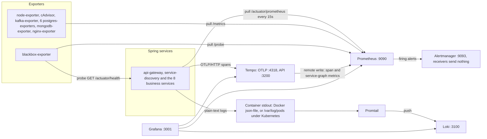
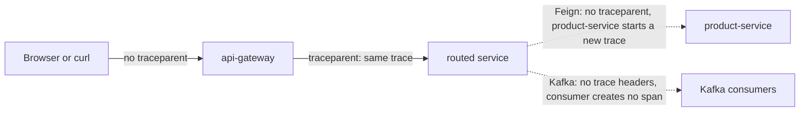

# Observability

How the platform produces, collects and shows metrics, logs and traces, what the
alert rules watch, and how to investigate a problem with them. The monitoring
configuration lives in the `ecommerce-monitoring` repository and is shared
unchanged by Docker Compose and Kubernetes. The containers are defined in
`ecommerce-platform/docker-compose.yml` and `ecommerce-platform/k8s/`. The
instrumentation is configured in each Spring service's `application.yaml` and
`pom.xml`.

Everything below was checked against the configuration files, the service code
and the libraries in the built jars. A running stack was not available while
this was written, so statements about runtime behaviour follow from the code and
the library versions, not from observed data.

## Summary

| Signal | Produced by | Collected by | Stored in | Retention | Viewed in |
|---|---|---|---|---|---|
| Metrics | Micrometer in all 10 Spring apps (`/actuator/prometheus`), 12 exporter jobs | Prometheus, pull every 15 s | Prometheus TSDB | 15 days | Grafana dashboards, Prometheus UI |
| Logs | Logback console output, plain text | Promtail (Docker socket under compose, pod log files under Kubernetes) | Loki | 31 days (744 h) | Grafana → Explore → Loki |
| Traces | Micrometer Tracing with the OpenTelemetry SDK, 100 % sampled | Pushed over OTLP/HTTP to Tempo | Tempo, local disk | 48 h | Grafana → Explore → Tempo |
| Alerts | 27 Prometheus rules in 9 groups | Alertmanager | n/a | n/a | Prometheus `/alerts`, Alertmanager UI |

The state of each signal, in short (details in [Known gaps](#known-gaps)):

- **Metrics** cover HTTP servers, JVMs, connection pools, Kafka lag, Postgres
  and MongoDB well. There are no business metrics (orders placed, payments
  failed and so on).
- **Traces** cover browser → gateway → first service only. Feign calls
  (catalog, order and review → product-service) and Kafka events are not
  traced, so the next service starts a new trace or none at all.
- **Logs** are plain text without trace ids, so the Grafana links between logs
  and traces return nothing. Promtail's parser matches only some services' log
  layout, and the compose and Kubernetes parsers expect opposite field orders.
- **Alerts** are evaluated and shown in the UIs, but no receiver sends them
  anywhere, and two Kafka rules can never fire.



Versions in use: Prometheus v2.52.0, Grafana 11.1.0, Loki and Promtail 3.1.0,
Tempo 2.5.0, Alertmanager v0.27.0. On the application side: Spring Boot 4.0.1,
Micrometer 1.16.1, Micrometer Tracing 1.6.1 (OpenTelemetry bridge),
OpenTelemetry SDK 1.55.0, Prometheus Java client 1.4.3.

Under Kubernetes the same configuration files are used (rendered into
ConfigMaps by `k8s/sync-monitoring-config.sh`; at the time of writing
`k8s/05-monitoring-config.yaml` matched the sources). The differences are
Promtail's discovery and parser, the cAdvisor gap, which ports reach the host,
and scraping through Service names. Each is covered in the section it affects;
the reasons are in [k8s/README.md](../k8s/README.md).

## Endpoints

| Component | Compose (host) | Kubernetes | Credentials |
|---|---|---|---|
| Grafana | http://localhost:3001 (container port 3000) | `grafana-lb`, http://localhost:3001 | `admin` / `admin`: `GRAFANA_ADMIN_USER` / `GRAFANA_ADMIN_PASSWORD` in compose, Secret `platform-secrets` in Kubernetes |
| Prometheus | http://localhost:9090 | `prometheus-lb`, http://localhost:9090 | none |
| Alertmanager | http://localhost:9093 | `alertmanager-lb`, http://localhost:9093 | none |
| Loki | http://localhost:3100 (HTTP API, no UI) | in-cluster only, `loki:3100` | none (`auth_enabled: false`) |
| Tempo | http://localhost:3200 (API); OTLP gRPC :4317, OTLP HTTP :4318 | in-cluster only, `tempo:3200`, `:4317`, `:4318` | none |
| Promtail | not published (:9080 inside the network) | DaemonSet, :9080 in the pod | none |
| Kafka UI | http://localhost:8090 | `kafka-ui-lb`, http://localhost:8090 | none |
| node-exporter | :9100 | in-cluster | none |
| cAdvisor | http://localhost:9095 (container port 8080) | in-cluster, `cadvisor:8080` | none |
| kafka-exporter | :9308 | in-cluster | none |
| blackbox-exporter | :9115 | in-cluster | none |
| nginx-exporter | :9113 | in-cluster | none |
| postgres-exporter | userdb :9187, productdb :9188, orderdb :9190, paymentdb :9191, shippingdb :9192, reviewdb :9193 (all :9187 in the container) | in-cluster, `postgres-exporter-<db>:9187` | none; each connects with its database's application user |
| mongodb-exporter | :9216 | in-cluster | none; connects as `cataloguser` |
| Actuator, per service | api-gateway :8080, service-discovery :8761, services :8081-8088, under `/actuator` | gateway and Eureka through their `-lb` Services; the 8 services in-cluster only | none |

The frontend's nginx also proxies `/actuator/` to the gateway, so the gateway's
actuator answers on http://localhost:3000/actuator/ as well.

## Application instrumentation

### Shared configuration

The `management.*` block is identical in all ten `application.yaml` files,
except that service-discovery does not expose `serviceregistry` (it does not
register with itself).

| Setting | Value | Effect |
|---|---|---|
| `management.endpoints.web.exposure.include` | `health,info,metrics,prometheus,circuitbreakers,serviceregistry` | `circuitbreakers` only exists where resilience4j is on the classpath (catalog, order, review). `serviceregistry` is what the Kubernetes preStop hook uses to mark a pod `OUT_OF_SERVICE`. |
| `management.endpoint.health.show-details` | `always` | Health lists every component (database, disk space, Eureka client and so on) with its details, to anyone. |
| `management.endpoint.prometheus.access` | `unrestricted` | |
| `management.metrics.tags` | `application: ${spring.application.name}`, `environment: ${ENVIRONMENT:development}` | Every meter carries both tags. Compose (`x-java-env`) and Kubernetes (`java-env`) set `ENVIRONMENT=development`. |
| `management.metrics.distribution.percentiles-histogram.http.server.requests` | `true` | Publishes `_bucket` series, so `histogram_quantile` works. |
| `management.metrics.distribution.slo.http.server.requests` | `50ms,100ms,200ms,500ms,1s,2s` | Adds bucket boundaries at exactly those values. |
| `management.tracing.sampling.probability` | `${TRACING_SAMPLING_PROBABILITY:1.0}` | 100 % everywhere: neither compose nor Kubernetes passes the variable to the containers. |
| `management.opentelemetry.tracing.export.otlp.endpoint` | `${OTEL_EXPORTER_OTLP_ENDPOINT:http://tempo:4318}/v1/traces` | OTLP over HTTP/protobuf (Boot 4's default transport). Compose and Kubernetes set `OTEL_EXPORTER_OTLP_ENDPOINT=http://tempo:4318`. A service started from the IDE needs `OTEL_EXPORTER_OTLP_ENDPOINT=http://localhost:4318`, because `tempo` does not resolve on the host. |
| `management.otlp.metrics.export.enabled` | `false` | `spring-boot-starter-opentelemetry` also brings `micrometer-registry-otlp`; this keeps metrics on the Prometheus pull path only. |
| Trace propagation | Boot default | Produces W3C `traceparent`; accepts W3C, B3 and B3 multi-header. |
| Dependencies | `spring-boot-starter-actuator`, `micrometer-registry-prometheus`, `spring-boot-starter-opentelemetry` | Same three in every pom. |

The `service.name` of every span is `spring.application.name`.

### Per service

Every log pattern has the shape
`%d{yyyy-MM-dd HH:mm:ss} <fields> %-5level %logger{36} - %msg%n`: second
precision, in the JVM's default zone (UTC in the `eclipse-temurin:25-jre-alpine`
images), with no trace or span id. The `<fields>` part differs.

| Service | `<fields>` in the log pattern | Correlation filter | `com.ecommerce` log level | Extra meters | Outbound hops and their tracing |
|---|---|---|---|---|---|
| api-gateway (WebFlux) | `[%X{correlationId}] [%thread]`, id always empty | none | INFO | `http_client_requests_seconds` per proxied call | to every routed service: traced |
| service-discovery | `[%thread]` only | none | INFO | none | none |
| user-service | `[%thread] [%X{correlationId}]` | yes | DEBUG | HikariCP, repositories | none |
| product-service | `[%thread] [%X{correlationId}]` | yes | DEBUG | HikariCP, repositories | none |
| catalog-service (Kotlin, MongoDB) | `[%X{correlationId}] [%thread]` | yes | INFO | MongoDB driver, repositories, resilience4j | Feign → product-service: not traced |
| order-service | `[%thread] [%X{correlationId}]` | yes | DEBUG | HikariCP, repositories, resilience4j, Kafka template and listener timers | Feign → product-service and Kafka `order.*`: not traced |
| payment-service | `[%thread] [%X{correlationId}]` | yes | DEBUG | HikariCP, repositories, Kafka template timers | Kafka `payment.*`: not traced |
| shipping-service | `[%thread] [%X{correlationId}]` | yes | DEBUG | HikariCP, repositories, Kafka template and listener timers | Kafka `shipment.*`: not traced |
| review-service | `[%X{correlationId}] [%thread]` | yes | INFO | HikariCP, repositories, resilience4j | Feign → product-service: not traced |
| notification-service | `[%X{correlationId}] [%thread]`, id always empty | none | INFO | Kafka listener timers | consumes only |

**The correlation filter** is `filter/CorrelationIdFilter` in user, product,
catalog, order, payment, shipping and review: a `OncePerRequestFilter`
component that reads `X-Correlation-Id`, generates `UUID.randomUUID()` when the
header is missing or blank (catalog's Kotlin version only when it is missing),
puts it in the MDC under `correlationId`, echoes it as a response header and
removes it from the MDC afterwards. Each service's `GlobalExceptionHandler` also
returns it as `correlationId` in error bodies, and the "Unhandled exception on
{} {} (correlationId={})" log lines include it. The gateway's `CorsConfig`
exposes the header to browsers.

Nothing propagates it. The gateway has no filter of its own (it passes a
client-supplied header through unchanged, as it does every header), the
frontend never sends one, and no code copies it onto Feign requests or Kafka
records. In practice every service mints its own id for every request, so the
id joins the log lines of one service for one request, never a request across
services.

**Inconsistencies between services:**

1. Two field orders: `[%thread] [%X{correlationId}]` in user, product, order,
   payment and shipping; `[%X{correlationId}] [%thread]` in api-gateway,
   catalog, review and notification. service-discovery has neither. This is
   what breaks log parsing (see [What the parser understands](#what-the-parser-understands)).
2. api-gateway and notification-service print `[%X{correlationId}]` but nothing
   ever sets it, so every line starts with `[]`.
3. Five services log `com.ecommerce` at DEBUG. Those lines go to stdout and
   count against Docker's 50 MB × 3 log rotation, then Promtail drops them, so
   they are only visible with `docker logs`.
4. `circuitbreakers` is exposed in all ten services but exists in three.

**Custom metrics: none.** No class in any service's `src/main` uses
`MeterRegistry`, `Counter`, `Timer`, `@Timed`, `@Counted` or `@Observed`, and
`management.observations.annotations.enabled` stays at its default `false`.
Everything below comes from auto-configuration:

| Prometheus metric family | Services | Source |
|---|---|---|
| `http_server_requests_seconds_{count,sum,max,bucket}`, tags `method`, `uri`, `status`, `outcome`, `exception`, `error` | all 10 | Spring MVC / WebFlux server observation. Actuator requests are included. |
| `http_server_requests_active_seconds_*` | all 10 | Long-task timer of the same observation |
| `jvm_*`, `process_*`, `system_*`, `logback_events_total{level}`, `application_ready_time_seconds` | all 10 | Boot's JVM, system, Logback and startup binders |
| `hikaricp_connections_*`, tag `pool` | user, product, order, payment, shipping, review | Boot DataSource pool metrics |
| `spring_data_repository_invocations_seconds_*`, tags `repository`, `method`, `state`, `exception` | the six above and catalog | Boot Spring Data repository metrics |
| `mongodb_driver_pool_{size,checkedout,waitqueuesize}`, `mongodb_driver_commands_seconds_*` | catalog | Boot MongoDB metrics |
| `resilience4j_circuitbreaker_*`, tags `name`, `state` | catalog, order, review | resilience4j-micrometer |
| `spring_kafka_template_seconds_*`, `spring_kafka_listener_seconds_*`, tags `name`, `result`, `exception` | template: order, payment, shipping. Listener: order, shipping, notification | spring-kafka's built-in Micrometer timers, active because observation is off |
| `http_client_requests_seconds_*`, tags `spring_cloud_gateway_route_id`, `spring_cloud_gateway_route_uri`, `http_method`, `http_status_code` | api-gateway | Spring Cloud Gateway's observation of each proxied call (no histogram) |

Not available: Feign client metrics (`feign-micrometer` is not a dependency),
Kafka client metrics (`kafka_consumer_*`, `kafka_producer_*`: the services
depend on plain `spring-kafka`, not on Boot 4's Kafka module, and build their
own factories), and `spring_cloud_gateway_requests_seconds`
(`spring.cloud.gateway.server.webflux.metrics.enabled` defaults to `false`).

## Metrics

### Scrape jobs

All jobs use the global settings in `ecommerce-monitoring/prometheus/prometheus.yml`:
interval 15 s, timeout 10 s, static targets, `honor_labels` off. The static
`service`, `group` and `database` labels are what the rules and dashboards
select on.

| Job | Target(s) | Path | Static labels |
|---|---|---|---|
| `prometheus` | `localhost:9090` | `/metrics` | `service=prometheus` |
| `api-gateway` | `api-gateway:8080` | `/actuator/prometheus` | `service=api-gateway`, `group=application` |
| `user-service` | `user-service:8081` | `/actuator/prometheus` | `service=user-service`, `group=application` |
| `product-service` | `product-service:8082` | `/actuator/prometheus` | `service=product-service`, `group=application` |
| `catalog-service` | `catalog-service:8083` | `/actuator/prometheus` | `service=catalog-service`, `group=application` |
| `order-service` | `order-service:8084` | `/actuator/prometheus` | `service=order-service`, `group=application` |
| `payment-service` | `payment-service:8085` | `/actuator/prometheus` | `service=payment-service`, `group=application` |
| `shipping-service` | `shipping-service:8086` | `/actuator/prometheus` | `service=shipping-service`, `group=application` |
| `review-service` | `review-service:8087` | `/actuator/prometheus` | `service=review-service`, `group=application` |
| `notification-service` | `notification-service:8088` | `/actuator/prometheus` | `service=notification-service`, `group=application` |
| `service-discovery` | `service-discovery:8761` | `/actuator/prometheus` | `service=service-discovery`, `group=application` |
| `node-exporter` | `node-exporter:9100` | `/metrics` | `service=node-exporter`, `group=infrastructure` |
| `cadvisor` | `cadvisor:8080` | `/metrics` | `service=cadvisor`, `group=infrastructure` |
| `kafka-exporter` | `kafka-exporter:9308` | `/metrics` | `service=kafka`, `group=messaging` |
| `postgres-exporter-userdb` | `postgres-exporter-userdb:9187` | `/metrics` | `service=postgres`, `database=userdb`, `group=database` |
| `postgres-exporter-productdb` | `postgres-exporter-productdb:9187` | `/metrics` | `service=postgres`, `database=productdb`, `group=database` |
| `postgres-exporter-orderdb` | `postgres-exporter-orderdb:9187` | `/metrics` | `service=postgres`, `database=orderdb`, `group=database` |
| `postgres-exporter-paymentdb` | `postgres-exporter-paymentdb:9187` | `/metrics` | `service=postgres`, `database=paymentdb`, `group=database` |
| `postgres-exporter-shippingdb` | `postgres-exporter-shippingdb:9187` | `/metrics` | `service=postgres`, `database=shippingdb`, `group=database` |
| `postgres-exporter-reviewdb` | `postgres-exporter-reviewdb:9187` | `/metrics` | `service=postgres`, `database=reviewdb`, `group=database` |
| `mongodb-exporter-catalogdb` | `mongodb-exporter-catalogdb:9216` | `/metrics` | `service=mongodb`, `database=catalogdb`, `group=database` |
| `nginx-exporter` | `nginx-exporter:9113` | `/metrics` | `service=frontend-nginx`, `group=frontend` |
| `blackbox-http` | 11 URLs: `http://<service>:<port>/actuator/health` for the 10 apps, and `http://frontend:80/` | `/probe?module=http_2xx` via `blackbox-exporter:9115` | none; relabelling makes `instance` the probed URL |

Because `honor_labels` is off, an exporter label that collides with a static one
is renamed: mongodb-exporter's own `database` label arrives as
`exported_database` (which is why the Databases dashboard filters
`mongodb_dbstats_dataSize{exported_database="catalogdb"}`).

Not scraped: Loki, Tempo, Grafana, Alertmanager, Promtail, Kafka UI, the
blackbox exporter's own metrics, and the Kafka broker itself (there is no JMX
exporter; kafka-exporter only sees offsets, partitions and consumer groups).

### Storage

- Prometheus runs with `--storage.tsdb.retention.time=15d` (no size limit),
  `--web.enable-lifecycle` (so `POST /-/reload` re-reads the config) and
  `--web.enable-remote-write-receiver`, which Tempo's metrics-generator writes
  into. Exemplar storage is not enabled.
- Compose keeps the TSDB in the `prometheus-data` volume; Kubernetes uses a
  10 GiB PVC.
- Rules are evaluated every 30 s (each group sets `interval: 30s`). Prometheus
  attaches `cluster=ecommerce-local` and `environment=development` to the alerts
  it sends to `alertmanager:9093`.

**Under Kubernetes** the same static targets resolve to ClusterIP Services.
With one replica that is equivalent to compose. With more (the k8s README shows
`kubectl scale ... --replicas=3`), each scrape reaches one random pod and all
pods share one series per job. node-exporter and cAdvisor are DaemonSets behind
a Service too, which only works on a single-node cluster.

## Alerts

Rules are in `ecommerce-monitoring/prometheus/rules/`. "Can't fire" means the
expression cannot become true in this deployment, as explained in the row.

| Group | Alert | Fires when | For | Severity | Meaning, and the first thing to check |
|---|---|---|---|---|---|
| `service.availability` | `ServiceDown` | `up == 0` for a job with `group="application"` | 1m | critical | Prometheus cannot scrape `/actuator/prometheus`. Check Prometheus → Status → Targets for the error, then `docker compose ps` / `docker logs <service>`. |
| `service.availability` | `ServiceEndpointUnhealthy` | Blackbox `probe_success == 0` for any of the 11 URLs | 2m | critical | Health is not 200/204 within 5 s. `curl http://localhost:<port>/actuator/health` shows which component is DOWN (`show-details: always`). A stopped service raises this and `ServiceDown` together. |
| `service.http` | `HighErrorRate` | Per `service`, 5xx (`outcome="SERVER_ERROR"`) share of `http_server_requests` over 5 min > 5 % | 5m | warning | Open "Top Error-Prone Endpoints" on the Error & Latency dashboard, then search Loki for `Unhandled exception`. Actuator traffic is in the denominator, which dilutes the ratio at low traffic. |
| `service.http` | `CriticalErrorRate` | Same ratio > 20 % | 2m | critical | As above. `HighErrorRate` keeps firing too: the inhibition rule does not suppress it. |
| `service.http` | `HighP99Latency` | Per `service`, p99 of `http_server_requests_seconds` over 5 min > 2 s | 5m | warning | "Top Slowest Endpoints"; then [find a slow request](#find-a-slow-request). |
| `service.jvm` | `JvmHeapUsageHigh` | `jvm_memory_used_bytes / jvm_memory_max_bytes` for `area="heap"` > 85 %, per memory pool (`id`) | 5m | warning | The pool named in `id` is nearly full. Max heap is 55 % of the container limit (`-XX:MaxRAMPercentage=55`): about 422 MiB at 768 MiB, 352 MiB at 640 MiB. Check JVM Metrics → Memory Pools. |
| `service.jvm` | `JvmHeapUsageCritical` | Same ratio > 95 % | 2m | critical | OOM is close; `-XX:+ExitOnOutOfMemoryError` makes the JVM exit and the container restart. |
| `service.jvm` | `JvmGcPauseHigh` | Mean GC pause over 5 min > 0.5 s, only while GCs happen | 5m | warning | Usually heap pressure. JVM Metrics → GC Activity. |
| `service.circuitbreaker` | `CircuitBreakerOpen` | `resilience4j_circuitbreaker_state{state="open"} == 1` | 1m | warning | product-service is failing for its callers. Only order-service can trip a breaker: it is the only service with `@CircuitBreaker` (on `ProductServiceClient`). catalog and review configure `resilience4j.circuitbreaker.instances.product-service` but never route a call through it, and `spring.cloud.openfeign.circuitbreaker.enabled` is off, so their breakers stay closed. |
| `infrastructure.containers` | `ContainerHighCpuUsage` | A container (not prometheus, grafana or cadvisor) uses > 1.5 cores over 5 min | 5m | warning | Containers dashboard. Compose sets no CPU limits. Under Kubernetes: can't fire (see the cAdvisor gap). |
| `infrastructure.containers` | `ContainerHighMemoryUsage` | `container_memory_usage_bytes / container_spec_memory_limit_bytes` > 85 % (containers with a limit) | 5m | warning | `container_memory_usage_bytes` includes page cache, so Kafka and the databases can sit near their limit without memory pressure; compare `container_memory_working_set_bytes`. Under Kubernetes: can't fire. |
| `infrastructure.containers` | `ContainerRestarting` | `container_start_time_seconds` increased within 5 min | 0m | warning | The same container restarted (a recreated container has a new id and does not count). `docker logs <name>`; an `ExitOnOutOfMemoryError` exit shows here. Under Kubernetes: can't fire. |
| `infrastructure.host` | `HostHighCpuLoad` | Non-idle CPU of the Docker VM > 80 % | 5m | warning | node-exporter measures the Docker engine's Linux VM, not Windows or macOS. |
| `infrastructure.host` | `HostOutOfMemory` | Available memory < 10 % | 5m | critical | Docker VM memory. Containers dashboard → memory per container. |
| `infrastructure.host` | `HostDiskSpaceLow` | Free space on `/` < 15 % | 5m | warning | `docker system df`; the [runbook](runbook.md) has the WSL2 disk caveats. |
| `infrastructure.host` | `HostDiskSpaceCritical` | Free space on `/` < 5 % | 2m | critical | As above, urgently: a full disk stops every container. |
| `database.postgres` | `PostgresDown` | `pg_up == 0` | 1m | critical | The exporter cannot connect to the database named in the `database` label. `docker compose ps <db>`, `docker logs <db>`. |
| `database.postgres` | `PostgresTooManyConnections` | Connections summed per instance / `max_connections` > 80 % | 5m | warning | Connections by state on the Databases dashboard; each JPA service has one Hikari pool. |
| `database.postgres` | `PostgresDeadlocks` | `rate(pg_stat_database_deadlocks[5m]) > 0` on an application database | 5m | warning | Deadlocks keep happening. A single deadlock keeps the 5-minute rate above zero for one scrape interval less than 5 minutes, so with `for: 5m` it never fires; only repeated deadlocks do. `docker logs <db>`: Postgres logs both statements of each deadlock. |
| `database.postgres` | `PostgresSlowQueries` | `pg_stat_activity_max_tx_duration_max_tx_duration` > 60 s | 5m | warning | Despite the name this is the oldest open transaction among non-idle sessions, including `idle in transaction`. Find it with the `pg_stat_activity` query in [Check a database](#check-a-database). |
| `database.mongodb` | `MongoDown` | `mongodb_up == 0` | 1m | critical | mongodb-exporter cannot reach catalogdb. `docker logs catalogdb`. |
| `database.mongodb` | `MongoTooManyConnections` | Current / (current + available) connections > 80 % | 5m | warning | Databases dashboard, MongoDB row. |
| `kafka.health` | `KafkaBrokerDown` | `kafka_brokers < 1` | 1m | critical | `docker logs kafka`. Unreliable: the value is the size of the exporter's cached broker list, and if Kafka is down when kafka-exporter starts, the exporter exits and the series disappears, which no rule notices. |
| `kafka.health` | `KafkaConsumerGroupLag` | `kafka_consumergroup_lag` > 1000 on any partition | 5m | warning | A consumer group is behind; see [Check Kafka consumer lag](#check-kafka-consumer-lag). |
| `kafka.health` | `KafkaConsumerGroupLagCritical` | Same, > 10000 | 5m | critical | As above; fires alongside the warning. |
| `kafka.health` | `KafkaUnderReplicatedPartitions` | Sum of `kafka_topic_partition_under_replicated_partition` > 0 | 5m | warning | **Can't fire:** one broker, and every topic has replication factor 1, so in-sync replicas always equal replicas. |
| `kafka.health` | `KafkaPartitionHasNoLeader` | `kafka_topic_partition_leader == -1` | 5m | critical | **Can't fire:** kafka-exporter v1.7.0 emits this metric only when it finds a leader, with that broker's id; when there is none it logs an error and emits nothing. |

### Alertmanager

`ecommerce-monitoring/alertmanager/alertmanager.yml` groups by
`alertname`, `service` and `severity` (`group_wait` 10s, `group_interval` 5m,
`repeat_interval` 1h, `resolve_timeout` 5m). Child routes, first match wins:

| Order | Matcher | Receiver | Overrides | Reached? |
|---|---|---|---|---|
| 1 | `severity = "critical"` | `critical-receiver` | `group_wait: 0s`, `repeat_interval: 15m` | yes |
| 2 | `severity = "warning"` | `warning-receiver` | `repeat_interval: 4h` | yes |
| 3 | `alertname = "KafkaBrokerDown"` | `critical-receiver` | `group_wait: 0s` | never: the alert is critical, so route 1 takes it |
| 4 | `alertname = "PostgresDown"` | `critical-receiver` | `group_wait: 0s` | never, same reason |
| default | none | `default-receiver` | | never: every rule sets a severity |

**No receiver delivers anywhere.** `default-receiver`, `critical-receiver` and
`warning-receiver` declare no notifier; the Slack and webhook blocks are
commented out. The file says this is deliberate (the earlier webhook pointed at
an address where nothing listened). Alerts are visible in Prometheus
(`/alerts`) and in the Alertmanager UI, and nowhere else. If you enable Slack,
note that Alertmanager does not substitute environment variables in its config,
so the commented `api_url: '$SLACK_WEBHOOK_URL'` would be used literally; write
the URL in or use `api_url_file`.

**Inhibition** (a critical alert suppresses warnings with equal `alertname`
and `service`) never matches anything: every alert name has exactly one
severity, so a critical and a warning alert never share an `alertname`. Pairs
such as `HighErrorRate` and `CriticalErrorRate` fire together.

Neither Grafana nor Loki has alert rules: Grafana provisions no alerting, and
Loki's ruler points at Alertmanager but has no rule files.

## Dashboards

Grafana provisions eight dashboards from `ecommerce-monitoring/grafana/dashboards/`
(provider `ecommerce-dashboards`, General folder, files re-read every 30 s,
UI edits allowed but overwritten when the file changes). Open one with
`http://localhost:3001/d/<uid>`. All panels query Prometheus; none uses Loki or
Tempo.

| Dashboard (uid) | Purpose | Key panels | Caveats |
|---|---|---|---|
| Platform Overview (`ecommerce-platform-overview`) | One-screen health of the platform | Services up/down, total req/s, overall 5xx ratio, p99, total Kafka lag, service status table, req/s, 5xx ratio and p99 by service, heap by service, container CPU | "Container CPU Usage" is in cores but labelled as percent |
| JVM Metrics (`ecommerce-jvm`) | One JVM at a time, picked with `$application` | Heap used/max/%, live threads, mean GC pause, process CPU, memory pools, GC activity and allocation rate, thread states, loaded classes, connection pool | "HTTP Connection Pool" actually shows HikariCP, so it is empty for api-gateway, catalog, notification and service-discovery |
| API Gateway (`ecommerce-api-gateway`) | Edge traffic | req/s, 5xx ratio, p50/p99, active requests, requests in the last hour, rate by route, status distribution, latency percentiles, p99 by route, 4xx/5xx by route | The "by route" panels group on `uri`, which is `UNKNOWN` for every proxied request (Spring Cloud Gateway never sets a path pattern). Per-route data exists in `http_client_requests_seconds_count` by `spring_cloud_gateway_route_id` |
| Databases (`ecommerce-databases`) | Postgres and MongoDB | Databases up, connections, commits/s, rollbacks/s, cache hit ratio, deadlocks/s, health table, connections and transactions per database, row operations, Hikari pools per service; MongoDB row: up, connections, ops/s, catalogdb data size, catalog-service driver pool, ops by type | `$database` filters only some panels; "Total Active Connections" counts connections in every state |
| Kafka (`ecommerce-kafka`) | Broker, topics, consumer groups | Brokers online, topics, consumer groups, total lag, messages in/s, partitions, lag by group and by topic, message rate by topic, lag detail table, partition offsets | Topic and offset panels include `__consumer_offsets` |
| Containers & Infrastructure (`ecommerce-containers`) | cAdvisor and node-exporter | Docker VM CPU, memory and disk, running containers, network, per-container CPU, memory and network, CPU by mode, disk I/O | Mostly empty under Kubernetes ([k8s/README.md](../k8s/README.md), "cAdvisor drops --docker_only") |
| Frontend & Availability (`ecommerce-frontend`) | nginx and the blackbox probes | Frontend up, nginx req/s and connections, gateway probe, mean probe duration, endpoints available, probe table, probe duration and success over time | |
| Error & Latency Overview (`ecommerce-error-latency`) | Errors and latency across services, 3 h window | 5xx ratio, p50/p90/p99, 5xx and 4xx in the last hour, 5xx ratio per service, p50/p99 per service, top 20 slowest endpoints (p99), top 20 error endpoints, circuit breaker states | "Latency Heatmap (P50/P90/P99)" is a time series with p50 and p99 only; the breaker panel can only move for order-service |

Datasources (`grafana/provisioning/datasources/datasources.yml`, all read-only,
with pinned uids): Prometheus (`prometheus`, default, 15 s interval), Loki
(`loki`), Tempo (`tempo`). Their cross-links are covered under
[Traces](#grafana-links-between-signals).

## Logs

### Pipeline

Every Spring service logs plain text to stdout. Nothing writes JSON logs.

**Compose** (`ecommerce-monitoring/promtail/promtail-config.yml`):

1. Discovery: `docker_sd_configs` on `/var/run/docker.sock`, running containers
   only, refreshed every 5 s.
2. Relabelling: `container` and `service` both get the container name; only the
   10 Spring services, `kafka` and `frontend` are kept (databases, exporters,
   Kafka UI and the monitoring stack are not shipped); `image` and `stream`
   (stdout or stderr) are added.
3. Pipeline stages, in order:
   - `regex` expecting `timestamp [thread] [correlationId] LEVEL logger - message`;
   - `labels`: `level` becomes a stream label;
   - `structured_metadata`: `correlationId` and `thread` (they are unique per
     request, so they are kept out of the labels to avoid a stream per
     request);
   - `timestamp`: the parsed time, format `2006-01-02 15:04:05`, zone UTC;
   - `drop`: any line containing the word `DEBUG` (counter reason
     `debug_log_dropped`);
   - `regex` + `structured_metadata` for `"traceId":"<hex>"`, which only a
     JSON log line could contain.

Promtail keeps its positions in `/tmp/positions.yaml` inside the container.

**Kubernetes** (inline in `k8s/60-monitoring.yaml`; the compose file is not
reused): `kubernetes_sd_configs` for pods in the `ecommerce` namespace,
`service` from the pod label `app` with the same allow-list, plus `pod`,
`container` and `node` labels, a `cri: {}` stage first, and a regex that
expects `[correlationId] [thread]`, the opposite order to compose. The other
stages are the same. Why `__host__`, `HOSTNAME` and the runtime-specific stage
must be right is explained in [k8s/README.md](../k8s/README.md) ("Promtail
reads the Kubernetes API").

`service` is the label that means the same thing on both platforms. `container`
differs for the frontend: under Kubernetes its container is named `nginx`.

### What the parser understands

A line the regex does not match is still shipped, but with no `level` label, no
`correlationId` or `thread` metadata, and the collector's own timestamp. Tested
against lines produced by each pattern:

| Services | Their layout | Compose parser | Kubernetes parser |
|---|---|---|---|
| user, product, order, payment, shipping | `[thread] [cid]` | Parsed | Only lines that have a correlation id, with `thread` and `correlationId` swapped; startup, Kafka-listener and other non-request lines unparsed |
| catalog, review | `[cid] [thread]` | Only request lines, with `thread` and `correlationId` swapped; other lines unparsed | Parsed |
| api-gateway, notification | `[cid] [thread]`, id always empty | Never parsed | Parsed (empty `correlationId`) |
| service-discovery | `[thread]` | Never parsed | Never parsed |
| kafka, frontend | Kafka's and nginx's own formats | Never parsed | Never parsed |

There is no multiline stage, so every line of a stack trace is a separate entry.
Timestamps have one-second precision, so the order of lines within a second is
not reliable, and parsed lines (truncated to the second) can sort before the
unparsed stack-trace lines that follow them.

### Loki

`ecommerce-monitoring/loki/loki-config.yml`: single binary, `auth_enabled: false`,
filesystem storage under `/loki`, schema v13 with the TSDB index (24 h
periods, from 2024-01-01), replication factor 1, in-memory ring.

| Setting | Value |
|---|---|
| `retention_period` | 744h (31 days), enforced by the compactor (`retention_enabled`, runs every 10 min, deletes 2 h after marking, 150 workers) |
| `max_query_lookback` | 744h, kept equal to retention so the oldest retained logs stay queryable |
| `ingestion_rate_mb` / `ingestion_burst_size_mb` | 16 / 32 |
| `max_query_series` | 10000 |
| Query results cache | embedded, 100 MB |

### Querying

Use Grafana → Explore → Loki. LogQL examples with the labels Promtail actually
sets:

```logql
# Everything one service logged
{service="order-service"}

# Errors, where the level was parsed (compose: user, product, order, payment, shipping)
{service="order-service", level="ERROR"}

# Errors and warnings for any service, parsed or not (the level is padded to five characters)
{service=~".+"} |~ `\s(ERROR|WARN)\s`

# Error lines per service over time
sum by (service) (count_over_time({service=~".+"} |~ `\sERROR\s` [5m]))

# One request in one service, via structured metadata
# (compose: user, product, order, payment, shipping; elsewhere the fields may be swapped)
{service="order-service"} | correlationId="3f1c2b9e-1111-2222-3333-444455556666"

# The same, robust on every service and platform: a plain line filter
{service=~".+"} |= "3f1c2b9e-1111-2222-3333-444455556666"

# One order across services; the services write "orderId=42", "orderId: 42" or "Order 42"
{service=~".+-service"} |~ `(?i)order(id)?[=: ]+42\b`

# Log volume per service: a tight retry loop (like the shipment.created poison pill) stands out
sum by (service) (rate({service=~".+"}[1m]))

# Kubernetes: one pod
{service="order-service", pod=~"order-service-.+"}
```

`traceId` structured metadata never exists, so there is nothing to filter on
by trace id. For an error count that does not depend on parsing, use the
metric `logback_events_total` instead (see [How-to](#how-to)).

## Traces

### Export and storage

Each service exports spans through the OpenTelemetry SDK over OTLP/HTTP to
`http://tempo:4318/v1/traces`, sampling 100 %.

`ecommerce-monitoring/tempo/tempo-config.yml`:

| Setting | Value |
|---|---|
| Receivers | OTLP gRPC `0.0.0.0:4317`, OTLP HTTP `0.0.0.0:4318`; Jaeger thrift_http :14268 and gRPC :14250 are configured but not published and not used |
| Storage | local backend, blocks in `/var/tempo/blocks`, WAL in `/var/tempo/wal` (volume `tempo-data`, 10 GiB PVC under Kubernetes) |
| Retention | `compactor.compaction.block_retention: 48h` |
| Ingester | `max_block_duration: 5m` |
| Streaming | `stream_over_http_enabled: true` (Grafana's `traceQLStreaming` toggle is on) |
| Metrics-generator | processors `service-graphs` and `span-metrics` (in `overrides.defaults`); remote-writes to `http://prometheus:9090/api/v1/write` with `send_exemplars: true` and external labels `source=tempo`, `cluster=ecommerce-local` |

The generator's series land in Prometheus, for example
`traces_service_graph_request_total{client, server}` (which feeds Grafana's
service map), `traces_spanmetrics_calls_total` and
`traces_spanmetrics_latency_bucket` (labels `service`, `span_name`,
`span_kind`, `status_code`).

### What a trace contains

- One server span per service per request, named `http <method> <pattern>`
  (for example `http post /api/v1/orders`), with the attributes `method`,
  `uri`, `status`, `outcome`, `exception` and `http.url`.
- In the gateway: a server span (named `http get`, `http post` and so on,
  without a pattern, for proxied requests) and a client span per proxied call
  with `spring.cloud.gateway.route.id`, `spring.cloud.gateway.route.uri`,
  `http.method`, `http.status_code` and `http.uri`. Spring Cloud Gateway's
  tracing support injects `traceparent` into the proxied request, so the
  service's server span joins the gateway's trace.
- Nothing else: no database, MongoDB, Feign or Kafka spans. A trace shows
  which service and endpoint was slow, not what inside it was slow.
- Every actuator request is traced too: Prometheus scrapes (every 15 s),
  blackbox probes (every 15 s) and Docker or Kubernetes health checks. Exclude
  them with `span.uri !~ "/actuator.*"`.

Where the trace context survives:



Feign is not instrumented because Spring Cloud OpenFeign only adds its
Micrometer observation capability when `feign-micrometer` is on the classpath,
and none of catalog, order or review declares it. Kafka is not instrumented
because the hand-built `KafkaTemplate` and listener container factories
(`KafkaProducerConfig` in order, payment and shipping; `KafkaConsumerConfig` in
notification) never enable observation. Boot's `spring.kafka.*.observation-enabled`
properties would not help: these services depend on plain `spring-kafka`, so
Boot 4's Kafka auto-configuration is not on their classpath.

### Grafana links between signals

| Link | Where configured | Works? |
|---|---|---|
| Metric exemplar → trace | Prometheus datasource, `exemplarTraceIdDestinations` (label `traceID` → Tempo) | No. Prometheus runs without `--enable-feature=exemplar-storage`, so it stores no exemplars. Micrometer's exemplars would also carry `trace_id`, not `traceID`. |
| Log line → trace | Loki datasource, derived field `"traceId":"(\w+)"` → Tempo | No. The logs are plain text and contain no trace id. |
| Trace → logs | Tempo datasource, `tracesToLogsV2` → Loki, span time ±1 h, `filterByTraceID: true` | The query it builds filters on the trace id, which no log line contains, so it returns nothing. |
| Trace → service map | Tempo datasource, `serviceMap` → Prometheus | Yes, from the metrics-generator's series. It shows gateway → service edges only. |
| Node graph | Tempo datasource, `nodeGraph.enabled` | Yes |

### TraceQL examples

Grafana → Explore → Tempo → TraceQL. The attribute names are the ones listed
under [What a trace contains](#what-a-trace-contains).

| To find | TraceQL |
|---|---|
| Real requests to one service, without actuator noise | `{ resource.service.name = "order-service" && kind = server && span.uri !~ "/actuator.*" }` |
| Slow requests | `{ resource.service.name = "order-service" && kind = server && duration > 500ms }` |
| One endpoint, by span name | `{ name = "http post /api/v1/orders" }` |
| Server-side 5xx anywhere | `{ kind = server && span.outcome = "SERVER_ERROR" }` |
| Gateway calls routed to one service | `{ resource.service.name = "api-gateway" && kind = client && span.spring.cloud.gateway.route.id = "order-service" }` |
| Gateway requests whose order-service part took over a second | `{ resource.service.name = "api-gateway" } >> { resource.service.name = "order-service" && duration > 1s }` |

## Exporters

| Exporter | Image | Exposes | Configuration worth knowing |
|---|---|---|---|
| node-exporter | `prom/node-exporter:v1.8.1` | CPU, memory, filesystems, network and disk of the Docker engine VM (`node_*`) | Reads the host root via `/host`; `/sys`, `/proc`, `/dev`, `/host` and `/etc` mount points excluded. On Docker Desktop it measures the Linux VM, not Windows or macOS. |
| cAdvisor | `gcr.io/cadvisor/cadvisor:v0.49.1` | Per-container CPU, memory, network and filesystem (`container_*`, label `name` = container name) | Compose: `--docker_only=true --housekeeping_interval=15s --store_container_labels=false`, privileged. Kubernetes drops `--docker_only`. |
| kafka-exporter | `danielqsj/kafka-exporter:v1.7.0` | `kafka_brokers`, `kafka_topic_partitions`, `kafka_topic_partition_current_offset`, `..._leader`, `..._under_replicated_partition`, `kafka_consumergroup_current_offset`, `kafka_consumergroup_lag`, `kafka_consumergroup_members` | `--kafka.server=kafka:29092`. Exits at startup if Kafka is unreachable. |
| postgres-exporter (×6) | `prometheuscommunity/postgres-exporter:v0.15.0` | `pg_up`, `pg_settings_*`, `pg_stat_activity_count{datname,state}`, `pg_stat_database_*` (commits, rollbacks, blocks, tuples, deadlocks), plus the custom queries below | One per Postgres database, `DATA_SOURCE_NAME` with that database's user; custom queries through `PG_EXPORTER_EXTEND_QUERY_PATH` (a mechanism upstream has deprecated but v0.15.0 still runs). |
| mongodb-exporter | `percona/mongodb_exporter:0.53.0` | `mongodb_up`, `mongodb_ss_*` (serverStatus: connections, opcounters, …), `mongodb_dbstats_*` | `--collector.diagnosticdata --collector.dbstats --compatible-mode` (also emits the pre-0.20 metric names); `MONGODB_URI` authenticates against `admin`. |
| blackbox-exporter | `prom/blackbox-exporter:v0.25.0` | `probe_success`, `probe_duration_seconds`, `probe_http_*` per target | See the modules below. |
| nginx-exporter | `nginx/nginx-prometheus-exporter:1.1.0` | `nginx_connections_*`, `nginx_http_requests_total`, `nginx_up` | Scrapes `http://frontend:80/stub_status`, which the frontend's nginx config allows only from private (RFC 1918) addresses and localhost. |

Custom Postgres queries (`ecommerce-monitoring/postgres-exporter/queries.yml`).
The exporter names each metric `<query key>_<column>`:

| Query key | Metric(s) | Labels | Measures | Used by |
|---|---|---|---|---|
| `pg_stat_activity_max_tx_duration` | `pg_stat_activity_max_tx_duration_max_tx_duration` | `datname` | Age in seconds of the oldest open transaction among non-idle sessions | `PostgresSlowQueries` |
| `pg_stat_table_bloat` | `pg_stat_table_bloat_total_bytes`, `pg_stat_table_bloat_table_bytes` | `schemaname`, `tablename` | Table size with and without indexes and TOAST; despite the name, not bloat | nothing |
| `pg_connections_by_state` | `pg_connections_by_state_count` | `state` | Connections per state, excluding `postgres` and the templates | nothing |
| `pg_slow_queries` | `pg_slow_queries_count` | `datname` | Non-idle statements running for more than 5 s | nothing |

Blackbox modules (`ecommerce-monitoring/blackbox-exporter/blackbox-config.yml`):
`http_2xx` (GET, `Accept: application/json`, 200 or 204, 5 s timeout, IPv4,
follows redirects) is the only one used. `http_post_2xx`, `tcp_connect` and
`dns` (an A query for `service-discovery`) are defined but no job uses them.

## How-to

### Find a slow request

1. Find the service and endpoint. On the Error & Latency Overview dashboard,
   "Top Slowest Endpoints (P99, last 5m)" ranks them. The same query by hand:

   ```promql
   topk(10, histogram_quantile(0.99,
     sum by (le, service, method, uri) (
       rate(http_server_requests_seconds_bucket{group="application", uri!~"/actuator.*"}[5m]))))
   ```

   The share of one service's requests slower than 500 ms (an SLO bucket):

   ```promql
   1 - sum(rate(http_server_requests_seconds_bucket{service="order-service", uri!~"/actuator.*", le="0.5"}[5m]))
     / sum(rate(http_server_requests_seconds_count{service="order-service", uri!~"/actuator.*"}[5m]))
   ```

   The worst single request per endpoint in the last couple of minutes:
   `max by (uri) (http_server_requests_seconds_max{service="order-service"})`.

2. Find example traces in Tempo:
   `{ resource.service.name = "order-service" && kind = server && duration > 500ms && span.uri !~ "/actuator.*" }`.
   The trace shows the gateway hop and the service's server span, nothing
   inside it.

3. Find what inside the service was slow, with metrics, since there are no child
   spans:
   - Waiting for a database connection: `hikaricp_connections_pending{service="order-service"}` and
     `rate(hikaricp_connections_acquire_seconds_sum{service="order-service"}[5m]) / rate(hikaricp_connections_acquire_seconds_count{service="order-service"}[5m])`.
   - Slow repository methods:
     `topk(5, sum by (repository, method) (rate(spring_data_repository_invocations_seconds_sum{service="order-service"}[5m])) / sum by (repository, method) (rate(spring_data_repository_invocations_seconds_count{service="order-service"}[5m])))`.
   - catalog-service's MongoDB commands:
     `sum by (command) (rate(mongodb_driver_commands_seconds_sum{service="catalog-service"}[5m])) / sum by (command) (rate(mongodb_driver_commands_seconds_count{service="catalog-service"}[5m]))`.
   - A Feign call to product-service: the caller has no client metric, so read
     product-service's own server latency for the endpoints it is called on:
     `/api/v1/products/{id}` (catalog, order, review), `/api/v1/categories`
     (catalog) and `/api/v1/products/{id}/stock` (order).
   - At the gateway, mean latency per route (no histogram exists for these):
     `sum by (spring_cloud_gateway_route_id) (rate(http_client_requests_seconds_sum{service="api-gateway"}[5m])) / sum by (spring_cloud_gateway_route_id) (rate(http_client_requests_seconds_count{service="api-gateway"}[5m]))`.

### Follow one request across services

There is no single id that spans a whole request, so combine three things:

1. **Gateway → first service:** one trace. In Tempo, search
   `{ resource.service.name = "api-gateway" && kind = client && span.spring.cloud.gateway.route.id = "order-service" }`
   in the time window, or start from the service side.
2. **Within one service:** the correlation id. Take it from the
   `X-Correlation-Id` response header or the `correlationId` field of an error
   body, then search `{service="order-service"} |= "<id>"`. When calling the API
   by hand you can choose the id: send `-H "X-Correlation-Id: my-test-1"`; the
   gateway forwards it and the routed service logs and echoes it. It stops
   there: Feign and Kafka do not carry it on, and the gateway does not log it.
3. **Across Feign and Kafka hops:** business keys. Every Kafka event is keyed
   by order id and the services log it, so
   `` {service=~".+-service"} |~ `(?i)order(id)?[=: ]+42\b` `` follows order 42
   through order, payment, shipping and notification. Allow for one-second
   timestamp precision when lining up services by time.

### Check Kafka consumer lag

The consumer groups are `order-service` (`payment.completed`,
`payment.failed`), `shipping-service` (`payment.completed`) and
`notification-service` (`order.placed`, `order.cancelled`, `payment.completed`,
`payment.failed`, `payment.refunded`, `shipment.created`, `shipment.updated`).
payment-service has a listener factory but no listeners.

1. Kafka dashboard: "Consumer Group Lag by Group" and "Consumer Group Lag Detail".
2. By hand:

   ```promql
   # Lag per group and topic
   sum by (consumergroup, topic) (kafka_consumergroup_lag)

   # Is the group committing? Compare with how fast the topic grows
   sum by (consumergroup, topic) (rate(kafka_consumergroup_current_offset[5m]))
   sum by (topic) (rate(kafka_topic_partition_current_offset[5m]))

   # Is anyone connected? 0 members means the consumer is down or not subscribed
   kafka_consumergroup_members

   # Listener invocations and failures, from spring-kafka's own timers
   sum by (service, name, result) (rate(spring_kafka_listener_seconds_count[5m]))
   ```

   The lag alerts use absolute thresholds (1000 and 10000 messages), which a
   stuck consumer on a quiet development stack rarely reaches. A lag that stays
   above 0 while the group's committed offset stops moving is the better signal.
   A record that fails deserialization never reaches the listener, so it does
   not show as a listener failure. It shows as a committed offset that stops
   moving (lag once newer records arrive) and as a log flood (see the volume
   query under [Querying](#querying)).
3. From the broker:
   `docker exec kafka kafka-consumer-groups --bootstrap-server kafka:29092 --describe --group notification-service`
   (Kubernetes: `kubectl -n ecommerce exec kafka-0 -- kafka-consumer-groups ...`),
   or Kafka UI at http://localhost:8090 → Consumers.

### Check a database

1. Databases dashboard, or by hand for one Postgres database:

   ```promql
   pg_up{database="orderdb"}
   sum by (state) (pg_stat_activity_count{datname="orderdb"})
   pg_stat_activity_max_tx_duration_max_tx_duration{datname="orderdb"}   # oldest open transaction, seconds
   pg_slow_queries_count{datname="orderdb"}                              # statements running > 5 s
   rate(pg_stat_database_xact_rollback{datname="orderdb"}[5m])
   rate(pg_stat_database_deadlocks{datname="orderdb"}[5m])
   topk(10, pg_stat_table_bloat_total_bytes{database="orderdb"})        # largest tables
   ```

2. The application's side: `hikaricp_connections_active`, `_idle`, `_pending`
   and `_max` for the service, and the repository timers from
   [Find a slow request](#find-a-slow-request).
3. In the database:

   ```bash
   docker exec -it orderdb psql -U orderuser -d orderdb -c \
     "select pid, state, now() - xact_start as xact_age, left(query, 80) as query
        from pg_stat_activity where datname = 'orderdb' and state <> 'idle'
        order by xact_age desc nulls last;"
   ```

   Database logs are not shipped to Loki; use `docker logs orderdb`.
4. MongoDB (catalogdb): `mongodb_up`, `mongodb_ss_connections{conn_type="current"}`,
   `rate(mongodb_ss_opcounters[5m])` by `legacy_op_type`, and from
   catalog-service `mongodb_driver_pool_checkedout` and
   `mongodb_driver_commands_seconds_max`. In the database:
   `docker exec -it catalogdb mongosh -u cataloguser -p catalogpass --authenticationDatabase admin catalogdb --eval "db.currentOp()"`.

The Kubernetes equivalents of the `docker exec` commands are in
[k8s/README.md](../k8s/README.md) ("Operating").

### Count errors without Loki

`logback_events_total` counts log events by level in every service, whatever
the log layout:

```promql
sum by (service) (increase(logback_events_total{level="error"}[5m]))
```

### Change an alert, a dashboard or a scrape job

Edit the files in `ecommerce-monitoring`; compose bind-mounts them.

- Prometheus config and rules: `curl -X POST http://localhost:9090/-/reload`.
- Alertmanager: `curl -X POST http://localhost:9093/-/reload`.
- Dashboards: picked up within 30 s. Save edits made in the UI back to the JSON
  file, or they are lost when the file changes.
- Loki, Tempo and Promtail: restart the container.
- Kubernetes: run `k8s/sync-monitoring-config.sh` and re-apply; files mounted
  with `subPath` need a pod restart ([k8s/README.md](../k8s/README.md),
  "Monitoring config"). Promtail's Kubernetes config lives in
  `k8s/60-monitoring.yaml` itself.
- CI (`ecommerce-monitoring/.circleci`) checks YAML and JSON syntax, runs
  `promtool check config` (which includes the rule files) and
  `amtool check-config`. Nothing checks the Loki, Promtail or Tempo configs,
  and there are no `promtool test rules` unit tests.

## Known gaps

Paths starting with `prometheus/`, `alertmanager/`, `grafana/`, `loki/`,
`promtail/` or `postgres-exporter/` are in `ecommerce-monitoring`; `k8s/` and
`docker-compose.yml` are in `ecommerce-platform`.

| Issue | Where | Impact | Severity |
|---|---|---|---|
| No alert is delivered anywhere: all three receivers have no notifier | `ecommerce-monitoring/alertmanager/alertmanager.yml` | Alerts exist only in the Prometheus and Alertmanager UIs; nobody is told | Medium |
| Trace ids never reach the logs. No log pattern prints `traceId`/`spanId`, and the Loki derived field and Promtail's `traceId` stage expect JSON | the ten `logging.pattern.console` values; `grafana/provisioning/datasources/datasources.yml`; `promtail/promtail-config.yml` | Log → trace and trace → log links return nothing; a log line can't be tied to its trace. Adding `%X{traceId}` to the patterns and matching it in the derived field would fix it | Medium |
| Feign calls are neither traced nor measured: `feign-micrometer` is missing | `pom.xml` of catalog, order and review | Every catalog/order/review → product-service call starts a new trace in product-service; no client-side Feign latency or error metrics | Medium |
| Kafka produce and consume are not traced | `config/KafkaProducerConfig.java` (order, payment, shipping), `config/KafkaConsumerConfig.java` (notification): observation never enabled | The event-driven half of a purchase has no traces at all; consumers create no spans | Medium |
| The Promtail parsers do not match the log patterns, and compose and Kubernetes expect opposite field orders | `promtail/promtail-config.yml`, `k8s/60-monitoring.yaml`, the log patterns | Depending on service and platform: no `level` label, `thread` and `correlationId` swapped, or no parsing at all; `{level="ERROR"}` silently misses whole services | Medium |
| No usable cross-service correlation id: the gateway and notification-service have no filter, the filters do not propagate the id, the frontend sends none | `ecommerce-api-gateway`, `ecommerce-notification-service`, the seven `CorrelationIdFilter` classes | Each service mints its own id per request; the id only joins log lines within one service | Medium |
| `KafkaPartitionHasNoLeader` can never fire | `prometheus/rules/kafka-alerts.yml` | kafka-exporter emits `kafka_topic_partition_leader` only with a real broker id; a leaderless partition has no sample instead of `-1` | Low |
| `KafkaUnderReplicatedPartitions` can never fire | `prometheus/rules/kafka-alerts.yml` | One broker with replication factor 1 cannot be under-replicated | Low |
| `KafkaBrokerDown` depends on the exporter, and no rule covers a down exporter | `kafka-alerts.yml`; `ServiceDown` only selects `group="application"` | If kafka-exporter starts while Kafka is down it exits and `kafka_brokers` disappears; the same blind spot hides `pg_up` and `mongodb_up` when their exporters die | Medium |
| `PostgresDeadlocks` misses isolated deadlocks: `rate(...[5m]) > 0` stays true for one scrape interval less than its `for: 5m` | `prometheus/rules/database-alerts.yml` | A single deadlock is never reported; only a sustained series of them is | Low |
| The inhibition rule never matches, and two Alertmanager routes are unreachable | `alertmanager/alertmanager.yml` | Warning and critical variants fire together; the `KafkaBrokerDown` and `PostgresDown` routes are dead config | Low |
| `CircuitBreakerOpen` only means something for order-service | catalog and review `application.yaml` (breaker configured, never used) | The alert and the dashboard panel stay flat for catalog and review even when product-service fails | Low |
| Kubernetes: the `Container*` alerts and the Containers dashboard select `name!=""`, which the standalone cAdvisor does not produce there | `prometheus/rules/infrastructure-alerts.yml`, `06-containers.json`; reasons in [k8s/README.md](../k8s/README.md) | No container CPU, memory or restart alerting under Kubernetes | Medium |
| Kubernetes: services are scraped through their Service name | `prometheus/prometheus.yml` (static targets) | With more than one replica each scrape hits a random pod and all pods share one series; rates and gauges become meaningless | Medium |
| Exemplars are configured in Grafana but never stored, and the label name differs from Micrometer's | `datasources.yml`; Prometheus flags in `docker-compose.yml` and `k8s/60-monitoring.yaml` | No metric → trace jump | Low |
| The API Gateway dashboard's "by route" panels show only `uri="UNKNOWN"` | `grafana/dashboards/03-api-gateway.json` | No per-route view at the edge; use `http_client_requests_seconds_*` by `spring_cloud_gateway_route_id` | Low |
| The monitoring stack is not monitored, and there are no log-based or error-log alerts | `prometheus/prometheus.yml`, `loki/loki-config.yml` (ruler without rules) | A dead Promtail, Loki or Tempo goes unnoticed; error-log floods (`logback_events_total`) alert nobody | Low |
| Actuator and probe traffic is traced at 100 % | all services | Under compose about 140 actuator traces a minute (10 scrapes and 10 probes every 15 s, 10 Docker health checks every 10 s) crowd Tempo search and the span metrics | Low |
| `ContainerHighMemoryUsage` uses `container_memory_usage_bytes`, which includes page cache | `prometheus/rules/infrastructure-alerts.yml` | Likely to fire for Kafka and the databases without real memory pressure | Low |
| Kafka lag alerts use absolute thresholds | `prometheus/rules/kafka-alerts.yml` | A consumer stuck on a quiet topic (the `shipment.created` poison pill) stays below 1000 indefinitely | Low |
| Actuator endpoints are unauthenticated and reachable from the host; the gateway's also through http://localhost:3000/actuator/; `serviceregistry` is writable; health details are public | the `management.*` blocks, compose port mappings, `ecommerce-frontend/nginx.conf` | Anyone on the host can read metrics and health or take an instance out of Eureka (see [Security](security.md)) | Medium |
| No business metrics and no custom instrumentation | all services | Orders, payments or stock movements can't be graphed or alerted on | Low |
| Logs lose detail: one-second timestamps, no multiline stage, DEBUG written to stdout and then dropped | the log patterns, `promtail/promtail-config.yml` | Ordering within a second is lost, stack traces are split into one entry per line, DEBUG output is only in `docker logs` | Low |
| Unused configuration | `postgres-exporter/queries.yml` (3 of 4 queries feed nothing), blackbox `http_post_2xx`/`tcp_connect`/`dns`, Tempo's Jaeger receivers, `circuitbreakers` exposure in 7 services | Clutter that suggests coverage that isn't there | Low |
| Documentation and `.env.example` promise behaviour that isn't there | `ecommerce-monitoring/README.md` (trace ids in logs, `correlationId`/`traceId` labels, HikariCP and resilience4j in all 10 services, Mongo alerts missing from its table); `.env.example` (`TRACING_SAMPLING_PROBABILITY` and `ENVIRONMENT` are never passed to the containers) | Changing those variables does nothing; readers expect working log-trace correlation | Low |
| Dashboard labels | `01-platform-overview.json` (cores shown as percent), `02-jvm-metrics.json` ("HTTP Connection Pool" is HikariCP), `04-databases.json` ("Active" counts every state), `08-error-latency.json` ("Heatmap" is a time series without P90) | Misleading panel titles and units | Low |
