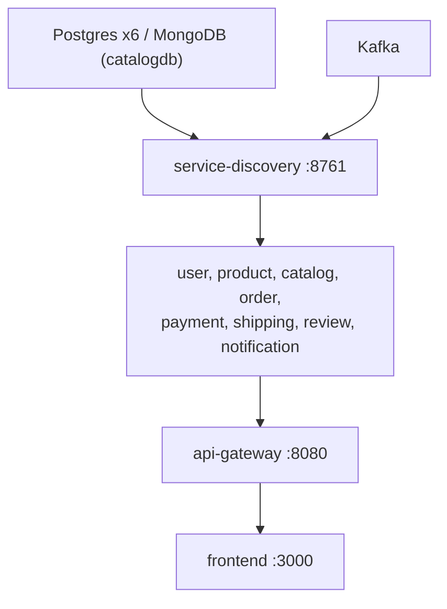

# Runbook

How to diagnose and fix the platform when something is wrong, and how to
carry out the routine operational tasks. Commands assume the Docker Compose
stack and are run from `ecommerce-platform/`. Kubernetes equivalents are given
where they differ (namespace `ecommerce`). Use Git Bash for anything with a
JSON body.

## First five minutes

```bash
docker compose ps --format 'table {{.Name}}\t{{.Status}}'          # who is unhealthy or restarting
curl -s -H 'Accept: application/json' localhost:8761/eureka/apps | grep -o '"app":"[A-Z-]*"' | sort -u   # who registered
docker compose logs --tail 100 <service>                            # the failing service
docker compose logs --since 10m <its database> kafka service-discovery   # its dependencies
```

Work **upward** through the dependency chain before blaming a service. A
failing service is usually a symptom of something above it:



For a crash loop, read the **first** stack trace of the current boot, not the
last line. Spring wraps the real cause in `BeanCreationException` layers; the
innermost `Caused by:` is the one that matters. Correlate timestamps across
containers: a gateway 503 at 12:04:31 and a Eureka restart at 12:04:28 are one
event. For anything that crosses services, use Grafana → Explore → Loki
(`{service="order-service"}`) and Tempo (search by service name). See
[Observability](observability.md).

## Symptoms

| Symptom | Likely cause | Fix |
|---|---|---|
| `503` / `Load balancer does not contain an instance for the service X` | Eureka warm-up. The instance restarted, or Eureka itself did, and the registry hasn't propagated yet (≤ 5 s heartbeat + ≤ 5 s fetch). | Wait until X shows at `:8761`, then retry. Not a bug. |
| `401` on every authenticated call | The token expired (1 h), or the gateway's `JWT_SECRET` differs from user-service's. | Log in again. If it persists, check that both containers got the same `JWT_SECRET`. |
| `401` with an obviously valid token right after a deploy | The two services are running different secrets after a partial redeploy. | Recreate both: `docker compose up -d user-service api-gateway`. |
| `404` on a path that should exist | No gateway route matches the prefix. | Check the route table in [api-gateway](services/api-gateway.md#routing). |
| A customer retries paying an order whose payment was declined and gets `409` "The payment for this order was declined and the order is cancelled. Place a new order to try again." | Expected. A declined payment is final for its order: payment-service answers 409 to any retry, and order-service cancels the order and returns its stock when it consumes `payment.failed`. | Nothing to fix. The customer places a new order. |
| Code change has no effect | A stale jar. The Dockerfile copies `target/*.jar`, and `docker compose build` happily packages the old one. | `mvn -B clean package -DskipTests` in the repo, then `docker compose up -d --build <service>`. |
| A service restart-loops right after start | Its database or Kafka is not healthy yet, or the credentials in its compose `environment` are wrong. | Check the dependency's logs first. On Kubernetes every probe waits 5 s for an answer (compose's healthcheck timeout) instead of the default 1 s, so a JVM that stalls briefly on a saturated node is not restarted; repeated restarts mean a real failure or a longer stall, so look at the host and log-volume alerts too. |
| Flyway `checksum mismatch` or `relation ... does not exist` | A migration changed, but the named volume holds the old schema. | [Reset that database](#reset-one-database). Never edit an applied migration. Add a new `V<n>__...sql` instead. |
| catalog-service: `MongoSecurityException` / `Authentication failed` | `DB_USERNAME`/`DB_PASSWORD` don't match catalogdb's `MONGO_INITDB_ROOT_*` (the user lives in `admin`, the authSource), or `catalogdb-data` still holds files from the old Postgres catalogdb. | Fix the credentials, or drop the volume once (`docker compose down --volumes` or a targeted reset). |
| `feign.codec.DecodeException: 'messageConverters' must not be empty` on the first concurrent Feign calls of a fresh instance | Spring Cloud OpenFeign 5.0.1 builds its converter list lazily, without synchronisation. | catalog-, order- and review-service override the bean with a thread-safe subclass in `config/FeignConfig`. A service that shows this error lacks it. |
| Records appear in a `<topic>.DLT` topic (alert `KafkaDeadLetterRecords`; `KafkaDeadLetterFlood` above 100 in 5 minutes) | A **poison pill**: a record a consumer can't process for a reason of its own (invalid JSON, a field of the wrong type, a bug). It is retried twice, a second apart (a record that cannot be deserialized or converted skips the retries), then published to `<topic>.DLT` (what the copy holds is under [Dead-letter topics](#dead-letter-topics)), and the partition moves on. Nothing loops and nothing blocks. | Not an outage. [Read the record and replay it](#dead-letter-topics) after fixing the cause, usually a field type that differs between the producer's event class and the consumer's mirror class. See [Event catalog](events.md#failure-handling). |
| A consumer has records waiting but its committed offset does not move (alert `KafkaConsumerStuck`), and its log has a throttled WARN about an unreachable dependency | The infrastructure behind the listener is failing: database down, lock timeout, broker hiccup. That says nothing about the record, so every consumer retries it with a back-off of 1 s growing to 30 s for as long as it takes, and **nothing goes to the DLT**. Good events wait instead of being lost. | Fix the dependency (`docker compose logs --tail 100 <its database> kafka`); the consumer resumes by itself. With a healthy dependency, read the service's log for the failing record (`Listener failed for <topic>-<partition>@<offset>`) and the group's offsets ([Inspect topics, consumer groups and lag](#inspect-topics-consumer-groups-and-lag)); restarting the service releases a hung listener thread. |
| Alert `KafkaDeadLetterDropped` | A consumer skipped a record it could not even dead-letter: the broker refuses its copy for good, usually because it is too large. The event is lost for that consumer. The original stays on its source topic until retention (7 days, at most 128 MiB per partition). | `docker logs <application>` has one ERROR with the record's `topic-partition@offset`, its key and the reason. Fix the cause, then replay the original from the source topic if its effect is still needed ([Replay events](#replay-events); `--to-offset` takes the offset from the ERROR line). |
| Alert `OutboxBacklog`, `OutboxBacklogGrowing`, `OutboxBacklogCritical`, `OutboxPublishFailing`, `OutboxRelayStalled` or `OutboxEventsParked` | order-, payment- and shipping-service write each event to the `outbox_event` table in the business transaction, and a relay publishes the rows every 500 ms. While Kafka is unreachable the rows pile up (`outbox_events_pending`) and requests keep succeeding; the relay backs off from 1 s to 30 s, logs one WARN a minute and one INFO when it recovers. A permanent failure (record too large, invalid topic) **parks** the row with one ERROR that contains the SQL to unpark it. | [Check the outbox](#check-the-outbox). A backlog drains by itself, oldest first, once Kafka is back. Parked rows need a person: fix the cause, then unpark. `OutboxRelayStalled` (rows pending, nothing published or failed for 10 minutes) means the relay is not running: restart the service. |
| Alert `CircuitBreakerOpen` (a breaker open, half-open or forced-open for 3 minutes) | The dependency behind the breaker is failing or slow: `product-service` for order-, catalog- and review-service, `order-service` for payment-service (the `name` label). Calls fail fast with 503 `Service temporarily unavailable`. A breaker that cannot close cycles between open and half-open. The service logs the transitions (WARN when it opens, INFO when it closes), not each call. | Fix the dependency the breaker names: its health and logs first (`docker compose logs --tail 100 product-service`). The breaker tries again after 10 s and closes once its trial calls succeed; 4xx answers do not count against it. States: `resilience4j_circuitbreaker_state`, or "Circuit Breaker States" on the Error & Latency dashboard. |
| Alert `DatabasePoolTimeouts` or `DatabasePoolSaturated` | Requests wait for a pooled database connection: each pool waits at most 5 s, then the request fails with 503. The pool is exhausted by slow statements or a held row lock, or the database stopped answering. | Check `PostgresDown` and `PostgresSlowQueries`, and compare `hikaricp_connections_active` with `hikaricp_connections_max` for the service. Look for held row locks with the `pg_stat_activity` query in [Check a database](observability.md#check-a-database): product-service's stock lock waits at most 5 s and then answers 503, and shipping-service's status lock likewise. |
| notification-service reads `unhealthy` (compose) or `NotReady` (Kubernetes) while everything else is up, and `ServiceEndpointUnhealthy` fires after 2 minutes | Its health includes the Kafka listeners: `/actuator/health` is DOWN while a listener container is stopped or none holds a broker connection, so a Kafka outage shows up here. Kubernetes keeps scraping the pod (its Service publishes not-ready addresses), and its startup probe uses the liveness endpoint so that a long broker outage at start does not restart-loop it. | Fix Kafka (`docker compose logs --tail 100 kafka`); the service recovers on its own, and a restart would not help. |
| Alert `ServiceLogRateHigh`, `ServiceLogRateCritical`, `ServiceErrorLogRateHigh`, `ServiceErrorLogRateCritical`, `ContainerLogVolumeHigh`, `ContainerLogVolumeCritical` or `PromtailDroppingLogs` | A log storm: a service or container writes far above normal (an idle service logs a few events a minute). Usual causes: a dependency that is down and a path that logs every failure, a retry loop, or `LOGGING_LEVEL_COM_ECOMMERCE=DEBUG` left on. | Find the writer with `topk(5, sum by (service) (rate(logback_events_total{group="application"}[5m])))` (add `level="error"` for errors) or, for Kafka and nginx too, `topk(5, sum by (container) (rate(promtail_custom_log_bytes_total[5m])))`. Read it with `docker logs --tail 50 <service>`: Promtail ships at most 300 entries/s per container, so Loki may hold only part of it. Failures that repeat are logged once per 10 s window and failure site, and the next line ends with `(N similar suppressed)`, the number skipped since the last logged one. Fix the cause. |
| Docker Desktop disk full; containers stop writing (alerts `HostDiskSpaceLow`, `HostDiskSpaceCritical`; `HostDiskWillFillWithin24h` and `HostDiskWillFillWithin4h` warn earlier) | Unbounded writes. `notification-service` once wrote **992 GB** in 17 hours from a poison-pill loop. The stores the platform runs are size- or rate-bounded now, so a full disk means a runaway writer that outlasted the alerts, Loki or Tempo filled to their limits (they cap by rate × retention, not by size), or, under the kubeadm provisioner, the node's Docker log driver, which the manifests do not bound. | [Disk space](#disk-space) says how to find the writer. Compose caps each container's log at 50 MB × 3, non-blocking (`x-default-logging`). On Kubernetes with the kubeadm provisioner, set `log-opts` in Docker Desktop → Settings → Docker Engine; see [k8s/README.md](../k8s/README.md). Space freed inside the VM is **not** returned to Windows. |
| Exit code `137` / `OOMKilled` | The container memory limit (768 MiB for most services) was reached. A Java `OutOfMemoryError` ends differently: `-XX:+ExitOnOutOfMemoryError` stops the JVM so the container restarts (compose: alert `ContainerRestarting`), and `-XX:-HeapDumpOnOutOfMemoryError` keeps it from writing a heap-sized dump into the container. | Check `JAVA_OPTS` still carries `-XX:MaxRAMPercentage=55`. The gateway also needs `JAVA_TOOL_OPTIONS: -XX:MaxDirectMemorySize=128m`: it buffers request bodies (up to 1 MB per POST) in Netty direct memory, and without the cap heap plus direct memory can pass its 768 MiB limit. Raise `mem_limit` only with evidence from the JVM dashboard. |
| Gateway `500` with `ConnectException` to a `10.244.x.x` IP right after a rollout (Kubernetes) | Should no longer happen, because rollouts are hitless. | If it does, something regressed: the `preStop` hook in `40-services.yaml`, `serviceregistry` in actuator exposure, `use-read-only-response-cache: false` on Eureka, the gateway Retry filter, or `terminationGracePeriodSeconds: 90` (the 15 s drain, the 30 s graceful phase and an outbox relay batch of up to 20 s have to fit). |
| A Kubernetes pod still runs the old code after `build-images` | The **kind** provisioner caches `:local` tags on its node. | `build-images.sh` runs `crictl pull` when it detects kind. Then `kubectl -n ecommerce rollout restart deployment/<svc>`. |
| Kafka pod exits about 1 s after `Running in KRaft mode...` (Kubernetes) | Kubernetes injected `KAFKA_PORT=tcp://...`, which cp-kafka reads as the deprecated `port` setting. | `enableServiceLinks: false` must stay on the Kafka pod. The tell is a `port is deprecated` warning in the log. |
| Loki shows no logs (Kubernetes) | Promtail is discarding every target: the `__host__` relabel or `HOSTNAME` is missing (`promtail_targets_active_total` is 0, and the alert `PromtailNoActiveTargets` fires after 10 minutes). The container runtime is not a cause: the pipeline picks `docker` or `cri` per line, and the DaemonSet always mounts `/var/lib/docker/containers`. | See [k8s/README.md](../k8s/README.md) ("Promtail reads the Kubernetes API"). If logs arrive but a Spring service's lines have no `level` label, run `k8s/check-promtail-parity.sh`. |
| The smoke test's last check fails (`no notification logged`) | notification-service is stuck on an earlier record, or it is still catching up. The check reads compose logs when the compose stack is up, and `kubectl` logs otherwise. | `docker compose logs --tail 50 notification-service` (Kubernetes: `kubectl -n ecommerce logs deployment/notification-service --tail 50`); [check consumer lag](#inspect-topics-consumer-groups-and-lag). |

## Procedures

### Start, stop, rebuild

| Goal | Compose | Kubernetes |
|---|---|---|
| Start | `docker compose up -d` | `k8s/deploy.sh` |
| Stop, keep data | `docker compose down` | `k8s/teardown.sh` |
| Stop and wipe all data | `docker compose down --volumes` | `k8s/teardown.sh --with-data` |
| One service after a code change | `mvn -B clean package -DskipTests` in its repo, then `docker compose up -d --build <svc>` | Maven, then `k8s/build-images.sh`, then `kubectl -n ecommerce rollout restart deployment/<svc>` |
| Several services | `./rebuild.sh --skip-tests --keep-data` | `../build-all.sh --skip-tests`, then `build-images.sh`, then restart each |
| Full rebuild with fresh databases | `./rebuild.sh --skip-tests` | `teardown.sh --with-data`, then `deploy.sh` |

After any restart, wait for Eureka before testing:
`until curl -s localhost:8080/api/v1/products -o /dev/null -w '%{http_code}' | grep -q 200; do sleep 5; done`.

A Java service can take up to a minute to stop. Boot finishes in-flight requests first (up to 30 s), then the scheduler lets an outbox relay batch finish (up to 20 s). Compose gives the Java services `stop_grace_period: 60s` (the `x-java-stop-grace-period` anchor; Docker's default of 10 s would cut both phases short), and Kubernetes gives the pods `terminationGracePeriodSeconds: 90`, where the 15 s `preStop` drain comes first. A stop or rollout that takes that long is normal.

### Inspect topics, consumer groups and lag

Kafka UI at http://localhost:8090 shows all of this. From the CLI:

```bash
docker compose exec kafka kafka-topics --bootstrap-server kafka:29092 --list
docker compose exec kafka kafka-consumer-groups --bootstrap-server kafka:29092 --describe --group notification-service
docker compose exec kafka kafka-console-consumer --bootstrap-server kafka:29092 \
  --topic order.placed --from-beginning --property print.key=true --max-messages 5
```

On Kubernetes, replace `docker compose exec kafka` with `kubectl -n ecommerce exec kafka-0 --`.

| Consumer group | Topics |
|---|---|
| `order-service` | `payment.completed`, `payment.failed` |
| `shipping-service` | `payment.completed` |
| `notification-service` | all seven topics |

Every topic is auto-created with **one partition**, and every record is keyed by
order ID. Each topic also gets a `<topic>.DLT` when its first record is
dead-lettered (auto-create stays on), so `--list` shows the dead-letter topics
only after something failed. Kafka keeps at most 128 MiB per partition (32 MiB
segments) and 7 days of records, the dead-letter topics included.

### Skip a poison pill

A poison pill does not block a partition. Every consumer retries a record that fails for its own reasons twice, a second apart (one that cannot be deserialized or converted skips the retries), publishes it to `<topic>.DLT` and moves on. Failures of the infrastructure behind the listener (database down, lock timeout, broker hiccup) are retried with a back-off of 1 s to 30 s and never reach the DLT. A record that cannot be dead-lettered either (too large) is skipped with one ERROR and counted by `KafkaDeadLetterDropped`. Read and replay dead letters as described in [Dead-letter topics](#dead-letter-topics).

Skipping a record by hand is the last resort, for a consumer that stays stuck on one record although its dependencies are healthy (`KafkaConsumerStuck`, and no `Dead-lettered` lines in its log):

1. Find the stuck topic and offset: the consumer's log shows them in the `Listener failed for <topic>-<partition>@<offset>` line, and `--describe` shows `CURRENT-OFFSET` not moving.
2. Stop the consumer, because a group can only be reset while it has no members: `docker compose stop notification-service` (Kubernetes: `kubectl -n ecommerce scale deployment/notification-service --replicas=0`).
3. Move past the record:
   ```bash
   docker compose exec kafka kafka-consumer-groups --bootstrap-server kafka:29092 \
     --group notification-service --topic shipment.created:0 --reset-offsets --shift-by 1 --execute
   ```
4. Start the consumer again and confirm that the lag drains.
5. Fix the cause, usually a field type that differs between the producer's event class and the consumer's mirror class. Add a Pact interaction so it can't recur. See [Event catalog](events.md).

### Dead-letter topics

A record a consumer cannot process lands in `<source topic>.DLT`, in a partition the producer picks. order- and shipping-service publish the original record, and notification-service publishes the original bytes of a record it could not read. A record that failed inside a notification-service listener is different: it is re-serialized from notification-service's own mirror class, so its copy carries only the fields that class knows. The headers name the source (`kafka_dlt-original-topic`, `kafka_dlt-original-partition`, `kafka_dlt-original-offset`) and, normally, the exception (`kafka_dlt-exception-fqcn`, `kafka_dlt-exception-message`). The consumer logs one WARN per 10 s window (`Dead-lettered <topic>-<partition>@<offset> ...: <cause>`), and `kafka_dlt_published_total{topic=...}` counts them. Alerts: `KafkaDeadLetterRecords` for any new record, `KafkaDeadLetterFlood` above 100 in 5 minutes (a producer is sending something no consumer can process, for example after a deploy that changed an event), `KafkaDeadLetterDropped` for a record that could not be dead-lettered.

**Inspect.** Kafka UI at http://localhost:8090 → Topics → `<topic>.DLT` → Messages shows key, value and headers. From the CLI:

```bash
docker compose exec kafka kafka-console-consumer --bootstrap-server kafka:29092 \
  --topic shipment.created.DLT --from-beginning --timeout-ms 5000 \
  --property print.key=true --property print.headers=true
```

**Replay.** Fix the cause first (the producer's event, the consumer's mirror class, the bug), or the record fails again and comes back. Then publish the record to its original topic with its key (records are keyed by order ID). This copies the DLT record at partition 0, offset 3:

```bash
docker compose exec -T kafka kafka-console-consumer --bootstrap-server kafka:29092 \
  --topic shipment.created.DLT --partition 0 --offset 3 --max-messages 1 --property print.key=true \
| docker compose exec -T kafka kafka-console-producer --bootstrap-server kafka:29092 \
  --topic shipment.created --property parse.key=true
```

Do not replay a notification-service listener-failure copy this way. It holds only the fields of notification-service's mirror class, so publishing it to the source topic gives the other consumers of that topic, which need other fields, an incomplete event. The `Dead-lettered <topic>-<partition>@<offset>` WARN shows which service dead-lettered a record. Replay the original instead: the headers `kafka_dlt-original-topic`, `kafka_dlt-original-partition` and `kafka_dlt-original-offset` name it, and the source topic still holds it until retention removes it (7 days, at most 128 MiB per partition). Copy it with the same pipeline, reading `--topic <source topic> --partition <P> --offset <N>` instead of the DLT, or reset the notification-service group to that offset ([Replay events](#replay-events)).

On Kubernetes use `kubectl -n ecommerce exec -i kafka-0 --` in place of `docker compose exec -T kafka`. A record published to the original topic reaches **every** consumer group on that topic, including groups that already processed the original: check the idempotency notes under [Replay events](#replay-events) first. To redeliver to one group only, reset that group's offset instead.

A dead letter needs no cleanup; retention removes it.

### Replay events

Reset a group to an earlier point while its service is stopped, then start the
service:

```bash
docker compose exec kafka kafka-consumer-groups --bootstrap-server kafka:29092 \
  --group order-service --topic payment.completed --reset-offsets --to-datetime 2026-10-29T10:00:00.000 --execute
```

Before replaying, read the **idempotency** notes for that consumer in its
service page and in the [Event catalog](events.md#consumers). Not every
consumer is safe to replay. A duplicate `payment.completed` must not create a
second shipment. To replay a record that is in a dead-letter topic, see
[Dead-letter topics](#dead-letter-topics).

### Check the outbox

order-, payment- and shipping-service write each event to the `outbox_event` table in the same transaction as the state change. A relay publishes the rows every 500 ms, oldest first, and deletes a row once Kafka has acknowledged it. Delivery is at least once: a crash between the acknowledgement and the delete publishes the row again, so consumers must be idempotent. The design is recorded in [ADR-013](adr/ADR-013-transactional-outbox.md).

Per service the metrics are `outbox_events_pending` (rows waiting), `outbox_events_parked`, `outbox_events_published_total` and `outbox_publish_failures_total`; the Logging & Reliability dashboard plots them. To list the parked rows (payment: `paymentdb` / `paymentuser`, shipping: `shippingdb` / `shippinguser`):

```bash
docker compose exec orderdb psql -U orderuser orderdb -c \
  "SELECT id, topic, attempts, last_error, parked_at FROM outbox_event WHERE parked_at IS NOT NULL;"
```

- **Rows waiting** (`parked_at IS NULL`, alerts `OutboxBacklog*`, `OutboxPublishFailing`): Kafka is unreachable or slow. Requests keep succeeding. The relay backs off from 1 s to 30 s, logs `Outbox relay cannot publish ...` at most once a minute and `Outbox relay resumed ...` when it recovers; fix Kafka and the table drains by itself. If rows wait while nothing is published and nothing fails for 10 minutes (`OutboxRelayStalled`), the relay is not running: restart the service.
- **Parked rows** (`OutboxEventsParked`): a permanent failure, such as a record too large for the broker, an invalid topic or a serialization error. The relay logged one ERROR for the row with the cause and the statement to release it. Fix the cause, then:

  ```bash
  docker compose exec orderdb psql -U orderuser orderdb -c "UPDATE outbox_event SET parked_at = NULL WHERE id = 42;"
  ```

  The relay publishes the row on its next tick. A parked row stays in the table, and the alert keeps firing, until it is released or deleted.

### Reset one database

Compose (the volume name is prefixed with the compose project, `ecommerce-platform_`):

```bash
docker compose stop order-service orderdb
docker compose rm -f orderdb
docker volume rm ecommerce-platform_orderdb-data
docker compose up -d orderdb order-service        # Flyway recreates the schema on start
```

Kubernetes (PVCs are named `data-<db>-0`):

```bash
kubectl -n ecommerce delete statefulset orderdb
kubectl -n ecommerce delete pvc data-orderdb-0
kubectl apply -k k8s/ && kubectl -n ecommerce rollout restart deployment/order-service
```

Data in other services that references the wiped rows (order IDs in payments,
shipments and so on) is **not** cleaned up. There are no cross-service foreign
keys. For a consistent state, reset everything: `docker compose down --volumes`.

### Connect to a database

```bash
docker compose exec userdb psql -U useruser userdb            # productdb/productuser, orderdb/orderuser, ...
docker compose exec catalogdb mongosh -u cataloguser -p catalogpass --authenticationDatabase admin catalogdb
```

Kubernetes: `kubectl -n ecommerce exec -it userdb-0 -- psql -U useruser userdb`.

### Rotate the JWT secret

The gateway and user-service must change **together**. Every issued token
becomes invalid, so users have to log in again.

The secret lives only in the git-ignored `ecommerce-platform/.env` and must be at
least 64 bytes; both services refuse to start otherwise.

1. Delete the `JWT_SECRET=` line from `.env` and run `./init-secrets.sh`, which generates a new one and leaves every other value alone.
2. Compose: `docker compose up -d user-service api-gateway`.
3. Kubernetes: `k8s/deploy.sh` (recreates `platform-secrets` from `.env`), then `kubectl -n ecommerce rollout restart deployment/user-service deployment/api-gateway`.

The same steps rotate `ADMIN_PASSWORD`, `EUREKA_PASSWORD` (restart every Java
service) and `GRAFANA_ADMIN_PASSWORD` (`deploy.sh` resets Grafana's stored one).
An existing admin account keeps its password when `ADMIN_PASSWORD` changes;
change it through the API or delete the account first.

### Scale a service

Kubernetes only:
`kubectl -n ecommerce scale deployment/product-service --replicas=3`. Eureka
and the client-side LoadBalancer spread the load with no other change. Under
compose, `--scale` conflicts with the fixed `container_name` and host port of
every service.

Kafka consumers don't scale beyond **one active instance per group**, because
each topic has a single partition. Extra replicas of order-, shipping- or
notification-service sit idle as standby consumers.

### Take an instance out of rotation

`/actuator/serviceregistry` answers 403 to any caller that is not loopback, so call it from inside the container, as the Kubernetes `preStop` hook does:

```bash
docker compose exec product-service wget -qO- --header='Content-Type: application/json' --post-data='{"status":"OUT_OF_SERVICE"}' http://localhost:8082/actuator/serviceregistry
docker compose exec product-service wget -qO- --header='Content-Type: application/json' --post-data='{"status":"UP"}'             http://localhost:8082/actuator/serviceregistry
```

On Kubernetes use `kubectl -n ecommerce exec deployment/product-service --` instead of `docker compose exec product-service`.

Status changes reach the server quickly, but an `UP` after `OUT_OF_SERVICE` can
take about 25 s to propagate because Eureka rate-limits status replication.

### Disk space

Every store the platform runs is bounded (the table is under [Disk bounds](observability.md#disk-bounds)): container logs at 50 MB × 3 each, Promtail at 300 entries/s per container, Loki and Tempo by ingestion rate, Prometheus at 5 GB of blocks, Kafka at 128 MiB per partition. A disk that fills anyway has a runaway writer, and the alerts name it early: `HostDiskWillFillWithin24h` and `HostDiskWillFillWithin4h` (the trend of the last 6 h and 1 h), `HostDiskSpaceLow` and `HostDiskSpaceCritical` (under 15 % and 5 % free), and `ServiceLogRateCritical` or `ContainerLogVolumeHigh` for the usual cause. The Logging & Reliability dashboard plots free space per disk, its 24 h prediction and the Prometheus TSDB size against its limit.

- Find the writer: `docker system df -v` (images, containers, volumes), `docker ps -s` (writable layers), and `topk(5, sum by (container) (rate(promtail_custom_log_bytes_total[1h])))` for logs.
- Loki and Tempo cap by rate, not by size. At their limits Loki keeps up to about 44 GB a day raw (about 9 GB compressed) for 31 days, and Tempo up to 172 GB raw for 48 h. Shortening `retention_period` in `ecommerce-monitoring/loki/loki-config.yml` is the lever, and a decision for whoever owns the machine.
- Docker: `docker system df`, `docker builder prune`, `docker image prune`. Removing volumes deletes data.
- Kubernetes with the kubeadm provisioner: the node's Docker log driver is unbounded unless `daemon.json` sets `log-opts`, and it was the vector of the 992 GB incident. Set `"log-driver": "json-file", "log-opts": { "max-size": "50m", "max-file": "3" }` in Docker Desktop → Settings → Docker Engine; Docker Desktop rewrites `daemon.json` from its own settings, so editing the file by hand does not last. Under kind the kubelet rotates logs at 10 MB × 5. `docker desktop kubernetes status` shows which provisioner runs; details are in [k8s/README.md](../k8s/README.md).
- On Windows, the WSL2 virtual disk (`docker_data.vhdx`) never shrinks by itself. Freeing space inside Docker gives nothing back to Windows. Reclaiming it means compacting the vhdx (`wsl --shutdown`, then `Optimize-VHD` or `diskpart compact vdisk`) or recreating it from Docker Desktop's troubleshoot menu, which deletes all images and volumes.

### Collect diagnostics for a bug report

1. The exact request: method, path, body, and the response status and body.
2. The `correlationId` from the error body. Every service puts it in error responses and in its own log lines, so `{service="order-service"} |= "<correlationId>"` finds that service's side of the request. It doesn't cross services: the gateway creates none and no service forwards it.
3. The trace: Grafana → Explore → Tempo, service `api-gateway`, in the time window. It shows the gateway → service hop and its timing. Feign calls and Kafka consumers are not part of it. Every log line written inside the traced request carries the trace ID, so the span's logs link in Grafana, or `{service=~".+"} | traceId="<trace id>"` in Loki, lists the gateway's and the first service's lines for that request.
4. The logs across services for that window, by business key: `{service=~".+"} |= "<orderId or username>"`.
5. `docker compose ps` and the Eureka registry at the time.

## Incident history

Earlier incidents and their fixes, so they aren't relearned.

| Incident | Root cause | Fix in place |
|---|---|---|
| notification-service wrote 992 GB of logs in 17 h and filled the Docker VM disk; the node was tainted with DiskPressure | `shipment.created` carried `estimatedDelivery` as `LocalDateTime`, but the consumer's mirror class declared `LocalDate`. Deserialization failed, and with no error handler the record was re-polled forever, each attempt logging a stack trace. | Mirror class fixed, a Pact contract pins every field type, compose log rotation (50 MB × 3, non-blocking), and kubelet rotation under kind. Every consumer now dead-letters a record it cannot process after two retries and retries infrastructure failures with a back-off, so nothing loops. Repeated log lines are throttled, Promtail drops above 300 entries/s per container, Loki and Tempo refuse above their ingestion limits, and alerts cover log volume and the disk trend. **Still open:** under the kubeadm provisioner the node's Docker log driver is unbounded unless `daemon.json` sets `log-opts`, and Loki and Tempo cap by rate, not by size. |
| Rolling restarts caused 30 s hangs and 500s for up to a minute | Callers kept dialling terminated pods, because of Eureka's 30 s read-only cache, 30 s fetches and 90 s leases. | Eureka cache off, 5 s fetch and renew, 15 s expiry, `preStop` drain to `OUT_OF_SERVICE`, connect-only retries. Measured 0 failed requests afterwards. |
| Every authenticated request returned 401 | The gateway read the numeric `userId` claim as `String.class`, and JJWT threw `RequiredTypeException`. | The claim is read untyped. Pinned by `UserServiceJwtConsumerPactTest`. |
| 500s on the first concurrent Feign calls of fresh pods | The lazy, unsynchronised converter list in OpenFeign 5.0.1. | Thread-safe subclass in `FeignConfig` (catalog, order, review). |
| catalog-service could not start after the move to MongoDB | The reused `catalogdb-data` volume held Postgres files. | Drop the volume once. Documented in the platform README. |
| A rebuilt image still ran the old code on Kubernetes (kind) | The node's containerd cache kept the old `:local` tag, and `IfNotPresent` never refreshes it. | `build-images` runs `crictl pull` under kind. |
