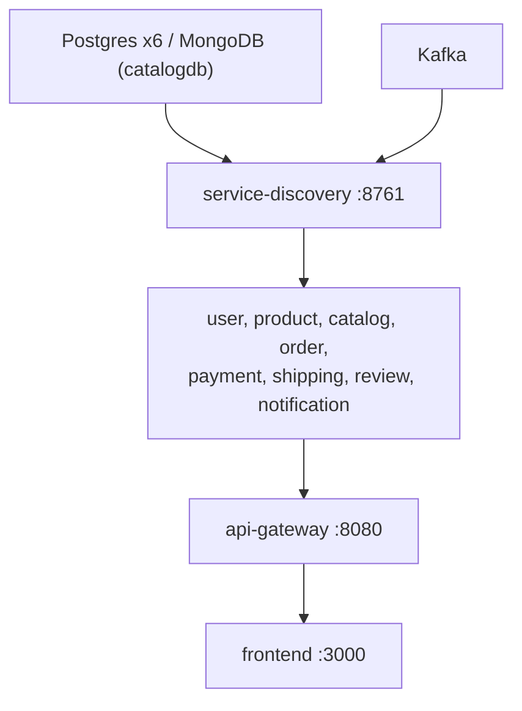

# Runbook

How to diagnose and fix the platform when something is wrong, and how to
carry out the routine operational tasks. Commands assume the Docker Compose
stack and are run from `ecommerce-platform/`. Kubernetes equivalents are given
where they differ (namespace `ecommerce`). Use Git Bash for anything with a
JSON body.

## First five minutes

```bash
docker compose ps --format 'table {{.Name}}\t{{.Status}}'          # who is unhealthy or restarting
curl -s -H 'Accept: application/json' localhost:8761/eureka/apps | grep -o '"app":"[A-Z-]*"' | sort -u   # who registered
docker compose logs --tail 100 <service>                            # the failing service
docker compose logs --since 10m <its database> kafka service-discovery   # its dependencies
```

Work **upward** through the dependency chain before blaming a service. A
failing service is usually a symptom of something above it:



For a crash loop, read the **first** stack trace of the current boot, not the
last line. Spring wraps the real cause in `BeanCreationException` layers; the
innermost `Caused by:` is the one that matters. Correlate timestamps across
containers: a gateway 503 at 12:04:31 and a Eureka restart at 12:04:28 are one
event. For anything that crosses services, use Grafana → Explore → Loki
(`{service="order-service"}`) and Tempo (search by service name). See
[Observability](observability.md).

## Symptoms

| Symptom | Likely cause | Fix |
|---|---|---|
| `503` / `Load balancer does not contain an instance for the service X` | Eureka warm-up. The instance restarted, or Eureka itself did, and the registry hasn't propagated yet (≤ 5 s heartbeat + ≤ 5 s fetch). | Wait until X shows at `:8761`, then retry. Not a bug. |
| `401` on every authenticated call | The token expired (1 h), or the gateway's `JWT_SECRET` differs from user-service's. | Log in again. If it persists, check that both containers got the same `JWT_SECRET`. |
| `401` with an obviously valid token right after a deploy | The two services are running different secrets after a partial redeploy. | Recreate both: `docker compose up -d user-service api-gateway`. |
| `404` on a path that should exist | No gateway route matches the prefix. | Check the route table in [api-gateway](services/api-gateway.md#routing). |
| Code change has no effect | A stale jar. The Dockerfile copies `target/*.jar`, and `docker compose build` happily packages the old one. | `mvn -B clean package -DskipTests` in the repo, then `docker compose up -d --build <service>`. |
| A service restart-loops right after start | Its database or Kafka is not healthy yet, or the credentials in its compose `environment` are wrong. | Check the dependency's logs first. |
| Flyway `checksum mismatch` or `relation ... does not exist` | A migration changed, but the named volume holds the old schema. | [Reset that database](#reset-one-database). Never edit an applied migration. Add a new `V<n>__...sql` instead. |
| catalog-service: `MongoSecurityException` / `Authentication failed` | `DB_USERNAME`/`DB_PASSWORD` don't match catalogdb's `MONGO_INITDB_ROOT_*` (the user lives in `admin`, the authSource), or `catalogdb-data` still holds files from the old Postgres catalogdb. | Fix the credentials, or drop the volume once (`docker compose down --volumes` or a targeted reset). |
| `feign.codec.DecodeException: 'messageConverters' must not be empty` on the first concurrent Feign calls of a fresh instance | Spring Cloud OpenFeign 5.0.1 builds its converter list lazily, without synchronisation. | catalog-, order- and review-service override the bean with a thread-safe subclass in `config/FeignConfig`. A service that shows this error lacks it. |
| One consumer logs the same deserialization stack trace over and over, and its lag never drops | A **poison pill**: a record the consumer can't deserialize. With no `ErrorHandlingDeserializer` configured, the container re-polls it forever. | [Skip the record](#skip-a-poison-pill), then fix the schema mismatch. See [Event catalog](events.md#failure-handling). |
| A consumer logs an exception about 10 times for one record, then moves on | The listener threw, not the deserializer. Spring Kafka's default error handler retries 9 times, then logs and commits past the record. There is no dead-letter topic, so the event is lost for that consumer. | Find the record in the logs or Kafka UI, fix the cause, and [replay](#replay-events) if the effect is needed. |
| Docker Desktop disk full; containers stop writing | Unbounded logs. `notification-service` once wrote **992 GB** in 17 hours from a poison-pill loop. | Compose caps each container at 50 MB × 3 (`x-default-logging`). On Kubernetes with the kubeadm provisioner, set the log options in Docker Desktop → Settings → Docker Engine. See [k8s/README.md](../k8s/README.md). Space freed inside the VM is **not** returned to Windows; see [Disk space](#disk-space). |
| Exit code `137` / `OOMKilled` | The container memory limit (768 MiB for most services) was reached. | Check `JAVA_OPTS` still carries `-XX:MaxRAMPercentage=55`. Raise `mem_limit` only with evidence from the JVM dashboard. |
| Gateway `500` with `ConnectException` to a `10.244.x.x` IP right after a rollout (Kubernetes) | Should no longer happen, because rollouts are hitless. | If it does, something regressed: the `preStop` hook in `40-services.yaml`, `serviceregistry` in actuator exposure, `use-read-only-response-cache: false` on Eureka, or the gateway Retry filter. |
| A Kubernetes pod still runs the old code after `build-images` | The **kind** provisioner caches `:local` tags on its node. | `build-images.sh` runs `crictl pull` when it detects kind. Then `kubectl -n ecommerce rollout restart deployment/<svc>`. |
| Kafka pod exits about 1 s after `Running in KRaft mode...` (Kubernetes) | Kubernetes injected `KAFKA_PORT=tcp://...`, which cp-kafka reads as the deprecated `port` setting. | `enableServiceLinks: false` must stay on the Kafka pod. The tell is a `port is deprecated` warning in the log. |
| Loki shows no logs (Kubernetes) | Promtail is dropping every target: the `__host__` relabel or `HOSTNAME` is missing, or the pipeline stage doesn't match the runtime. | See [k8s/README.md](../k8s/README.md) ("Promtail reads the Kubernetes API"). |
| The smoke test's last check fails (`no notification logged`) | notification-service is stuck on an earlier record, or it is still catching up. The check reads compose logs when the compose stack is up, and `kubectl` logs otherwise. | `docker compose logs --tail 50 notification-service` (Kubernetes: `kubectl -n ecommerce logs deployment/notification-service --tail 50`); [check consumer lag](#inspect-topics-consumer-groups-and-lag). |

## Procedures

### Start, stop, rebuild

| Goal | Compose | Kubernetes |
|---|---|---|
| Start | `docker compose up -d` | `k8s/deploy.sh` |
| Stop, keep data | `docker compose down` | `k8s/teardown.sh` |
| Stop and wipe all data | `docker compose down --volumes` | `k8s/teardown.sh --with-data` |
| One service after a code change | `mvn -B clean package -DskipTests` in its repo, then `docker compose up -d --build <svc>` | Maven, then `k8s/build-images.sh`, then `kubectl -n ecommerce rollout restart deployment/<svc>` |
| Several services | `./rebuild.sh --skip-tests --keep-data` | `../build-all.sh --skip-tests`, then `build-images.sh`, then restart each |
| Full rebuild with fresh databases | `./rebuild.sh --skip-tests` | `teardown.sh --with-data`, then `deploy.sh` |

After any restart, wait for Eureka before testing:
`until curl -s localhost:8080/api/v1/products -o /dev/null -w '%{http_code}' | grep -q 200; do sleep 5; done`.

### Inspect topics, consumer groups and lag

Kafka UI at http://localhost:8090 shows all of this. From the CLI:

```bash
docker compose exec kafka kafka-topics --bootstrap-server kafka:29092 --list
docker compose exec kafka kafka-consumer-groups --bootstrap-server kafka:29092 --describe --group notification-service
docker compose exec kafka kafka-console-consumer --bootstrap-server kafka:29092 \
  --topic order.placed --from-beginning --property print.key=true --max-messages 5
```

On Kubernetes, replace `docker compose exec kafka` with `kubectl -n ecommerce exec kafka-0 --`.

| Consumer group | Topics |
|---|---|
| `order-service` | `payment.completed`, `payment.failed` |
| `shipping-service` | `payment.completed` |
| `notification-service` | all seven topics |

Every topic is auto-created with **one partition**, and every record is keyed by
order ID.

### Skip a poison pill

1. Find the stuck topic and offset: the consumer's log shows the topic, partition and offset in the `SerializationException`, and `--describe` shows `CURRENT-OFFSET` not moving.
2. Stop the consumer, because a group can only be reset while it has no members: `docker compose stop notification-service` (Kubernetes: `kubectl -n ecommerce scale deployment/notification-service --replicas=0`).
3. Move past the record:
   ```bash
   docker compose exec kafka kafka-consumer-groups --bootstrap-server kafka:29092 \
     --group notification-service --topic shipment.created:0 --reset-offsets --shift-by 1 --execute
   ```
4. Start the consumer again and confirm that the lag drains.
5. Fix the cause, usually a field type that differs between the producer's event class and the consumer's mirror class. Add a Pact interaction so it can't recur. See [Event catalog](events.md).

### Replay events

Reset a group to an earlier point while its service is stopped, then start the
service:

```bash
docker compose exec kafka kafka-consumer-groups --bootstrap-server kafka:29092 \
  --group order-service --topic payment.completed --reset-offsets --to-datetime 2026-10-29T10:00:00.000 --execute
```

Before replaying, read the **idempotency** notes for that consumer in its
service page and in the [Event catalog](events.md#consumers). Not every
consumer is safe to replay. A duplicate `payment.completed` must not create a
second shipment.

### Reset one database

Compose (the volume name is prefixed with the compose project, `ecommerce-platform_`):

```bash
docker compose stop order-service orderdb
docker compose rm -f orderdb
docker volume rm ecommerce-platform_orderdb-data
docker compose up -d orderdb order-service        # Flyway recreates the schema on start
```

Kubernetes (PVCs are named `data-<db>-0`):

```bash
kubectl -n ecommerce delete statefulset orderdb
kubectl -n ecommerce delete pvc data-orderdb-0
kubectl apply -k k8s/ && kubectl -n ecommerce rollout restart deployment/order-service
```

Data in other services that references the wiped rows (order IDs in payments,
shipments and so on) is **not** cleaned up. There are no cross-service foreign
keys. For a consistent state, reset everything: `docker compose down --volumes`.

### Connect to a database

```bash
docker compose exec userdb psql -U useruser userdb            # productdb/productuser, orderdb/orderuser, ...
docker compose exec catalogdb mongosh -u cataloguser -p catalogpass --authenticationDatabase admin catalogdb
```

Kubernetes: `kubectl -n ecommerce exec -it userdb-0 -- psql -U useruser userdb`.

### Rotate the JWT secret

The gateway and user-service must change **together**. Every issued token
becomes invalid, so users have to log in again.

- Compose: put `JWT_SECRET=<at least 32 random characters>` in `ecommerce-platform/.env`, then run `docker compose up -d user-service api-gateway`.
- Kubernetes: change `JWT_SECRET` in the `platform-secrets` Secret (`k8s/01-secrets.yaml`), run `kubectl apply -k k8s/`, then `kubectl -n ecommerce rollout restart deployment/user-service deployment/api-gateway`.

Generate one with `openssl rand -base64 48`.

### Scale a service

Kubernetes only:
`kubectl -n ecommerce scale deployment/product-service --replicas=3`. Eureka
and the client-side LoadBalancer spread the load with no other change. Under
compose, `--scale` conflicts with the fixed `container_name` and host port of
every service.

Kafka consumers don't scale beyond **one active instance per group**, because
each topic has a single partition. Extra replicas of order-, shipping- or
notification-service sit idle as standby consumers.

### Take an instance out of rotation

```bash
curl -X POST -H 'Content-Type: application/json' -d '{"status":"OUT_OF_SERVICE"}' localhost:8082/actuator/serviceregistry
curl -X POST -H 'Content-Type: application/json' -d '{"status":"UP"}'             localhost:8082/actuator/serviceregistry
```

Status changes reach the server quickly, but an `UP` after `OUT_OF_SERVICE` can
take about 25 s to propagate because Eureka rate-limits status replication.

### Disk space

- Docker: `docker system df`, `docker builder prune`, `docker image prune`. Removing volumes deletes data.
- On Windows, the WSL2 virtual disk (`docker_data.vhdx`) never shrinks by itself. Freeing space inside Docker gives nothing back to Windows. Reclaiming it means compacting the vhdx (`wsl --shutdown`, then `Optimize-VHD` or `diskpart compact vdisk`) or recreating it from Docker Desktop's troubleshoot menu, which deletes all images and volumes.

### Collect diagnostics for a bug report

1. The exact request: method, path, body, and the response status and body.
2. The `correlationId` from the error body. Every service puts it in error responses and in its own log lines, so `{service="order-service"} |= "<correlationId>"` finds that service's side of the request. It doesn't cross services: the gateway creates none and no service forwards it.
3. The trace: Grafana → Explore → Tempo, service `api-gateway`, in the time window. It shows the gateway → service hop and its timing. Feign calls and Kafka consumers are not part of it, and log lines carry no trace ID, so a trace can't be joined to logs automatically.
4. The logs across services for that window, by business key: `{service=~".+"} |= "<orderId or username>"`.
5. `docker compose ps` and the Eureka registry at the time.

## Incident history

Earlier incidents and their fixes, so they aren't relearned.

| Incident | Root cause | Fix in place |
|---|---|---|
| notification-service wrote 992 GB of logs in 17 h and filled the Docker VM disk; the node was tainted with DiskPressure | `shipment.created` carried `estimatedDelivery` as `LocalDateTime`, but the consumer's mirror class declared `LocalDate`. Deserialization failed, and with no error handler the record was re-polled forever, each attempt logging a stack trace. | Mirror class fixed, a Pact contract pins every field type, compose log rotation (50 MB × 3), and kubelet rotation under kind. **Still open:** no `ErrorHandlingDeserializer` or DLT anywhere. |
| Rolling restarts caused 30 s hangs and 500s for up to a minute | Callers kept dialling terminated pods, because of Eureka's 30 s read-only cache, 30 s fetches and 90 s leases. | Eureka cache off, 5 s fetch and renew, 15 s expiry, `preStop` drain to `OUT_OF_SERVICE`, connect-only retries. Measured 0 failed requests afterwards. |
| Every authenticated request returned 401 | The gateway read the numeric `userId` claim as `String.class`, and JJWT threw `RequiredTypeException`. | The claim is read untyped. Pinned by `UserServiceJwtConsumerPactTest`. |
| 500s on the first concurrent Feign calls of fresh pods | The lazy, unsynchronised converter list in OpenFeign 5.0.1. | Thread-safe subclass in `FeignConfig` (catalog, order, review). |
| catalog-service could not start after the move to MongoDB | The reused `catalogdb-data` volume held Postgres files. | Drop the volume once. Documented in the platform README. |
| A rebuilt image still ran the old code on Kubernetes (kind) | The node's containerd cache kept the old `:local` tag, and `IfNotPresent` never refreshes it. | `build-images` runs `crictl pull` under kind. |
