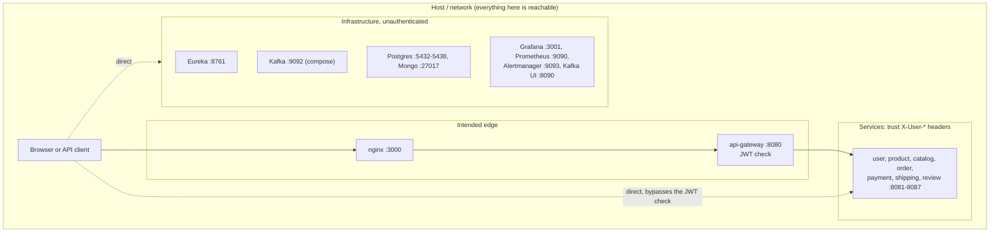

# Security

How the platform authenticates callers, what it does (and mostly doesn't do)
to authorize them, what is exposed, and how data and secrets are handled.

The short version: **authentication works, authorization is almost absent.**
The gateway reliably rejects requests without a valid token. Behind it, five
of the seven API services never look at who is calling, so any registered user
can act on any order, payment, shipment, product or account. The platform is a
local learning environment and was built that way deliberately in places
(default credentials, published ports), but several gaps would be serious
anywhere. They are collected with fixes in [Findings](findings.md).

Items marked **verified** were reproduced on 2026-10-29 against a local stack
(rebuilt jars, in-memory databases, the real gateway).

## Trust boundaries

The design assumes that the gateway is the only way in ([ADR-004](adr/ADR-004-jwt-at-the-gateway.md)).
Under Docker Compose that assumption doesn't hold, because every service,
database, the broker and Eureka publish a host port. Under Kubernetes the
service ports stay inside the cluster, but Eureka, the databases, Grafana,
Prometheus, Alertmanager and Kafka UI are still published through
`LoadBalancer` Services.

## Authentication

### Accounts

- **Registration is open**: `POST /api/v1/users/register` is public. The username is 3–50 characters of `[a-zA-Z0-9_]` and the email is validated. The only password rule is **at least 8 characters**: no complexity, no breach check, and passwords over 72 bytes cause a 500, because BCrypt rejects them. A duplicate username or email returns 409, which reveals that the account exists.
- **Passwords** are hashed with BCrypt (`$2a$`, cost 10).
- **Login** returns 401 for an unknown user, an inactive account and a wrong password alike. There is no rate limiting, lockout or CAPTCHA.
- **Roles**: `CUSTOMER` (every registration) and `ADMIN`. The only `ADMIN` is `admin`/`admin`, which `DataInitializer` creates on every start of user-service in every environment. It **logs the password** at INFO. *Verified: `admin`/`admin` logs in and receives `role: ADMIN`.*

### Tokens

| Property | Value |
|---|---|
| Issuer | user-service `JwtService`, at login |
| Format | JWS, HMAC. JJWT picks the algorithm from the secret's length, so the default 55-byte secret produces **HS384** *(verified)*, and secrets of 64 bytes or more produce HS512. |
| Claims | `sub` = username, `userId` (number), `role`, `iat`, `exp`. There is no `iss`, `aud` or `jti`. |
| Lifetime | 1 hour. There are no refresh tokens. |
| Validation | the gateway only (`JwtAuthenticationFilter`): signature and expiry |
| Revocation | none. A deactivated or deleted user keeps a working token until it expires. |
| Browser storage | `localStorage` (`auth-storage`, persisted by zustand), so any XSS can steal it. Logout only clears local state. |
| Secret | `JWT_SECRET`, shared by the gateway and user-service. A **committed default** applies when it is unset (`application.yaml`, `docker-compose.yml`, `k8s/01-secrets.yaml`), so anyone with the repository can mint an `ADMIN` token for a deployment that never set it. |

### At the gateway

The gateway lets a fixed list of path prefixes through without a token. Every
other request needs a valid bearer token, and on success the gateway overwrites
`X-Username`, `X-User-Id` and `X-User-Role` from its claims. The full rules are
in [api-gateway](services/api-gateway.md#authentication). Edge-level
weaknesses:

| Weakness | Status |
|---|---|
| Client-supplied `X-User-*` headers pass unchanged on **public** routes | Not exploitable today, because no public endpoint reads them. It is a trap for the next public endpoint that does. |
| Public prefixes are matched on the raw, un-normalised path, so `/api/v1/shipments/tracking/../1/status` is treated as public and forwarded | **Verified not exploitable** with the current stack: Spring MVC 7 doesn't resolve `..`, so the request never reaches a protected handler (shipping answers 500). Rejecting non-normalised paths at the gateway would remove the dependency on that behaviour. |
| `/api/v1/users/register` and `/login` are prefix matches without a trailing slash | Harmless today: no other handler starts with those strings |
| No authorization rules at all (roles, scopes, per-route policies) | See below |

## Authorization

Only two services make any identity-based decision:

| Service | Check |
|---|---|
| user-service | `GET /api/v1/users/me` resolves the user from `X-Username` |
| review-service | the author is `X-Username`. Only the author may edit. The author or `X-User-Role: ADMIN` may delete. |

Everything else is decided by nobody:

| Area | What any authenticated user can do | Severity |
|---|---|---|
| Accounts | read, edit or deactivate **any** account by sequential ID, `admin` included (`/api/v1/users/{id}`) | High |
| Accounts (no token at all) | read any full profile (email, phone, addresses, role) through `GET /api/v1/users/internal/{username}`, which is public at the gateway and has no callers. *Verified.* | High |
| Products and categories | create, edit, soft-delete, and adjust stock. *Verified: a `CUSTOMER` created a product.* | High |
| Orders | create orders for any `customerId`, read any order, add lines to anyone's order, cancel any order, set **any** status with `PATCH /status`. *Verified: an order created for another customer.* | High |
| Order integrity | add lines with zero or negative quantity through the legacy `/products` endpoint, which raises product stock and lowers the order total. *Verified: stock 98 → 148, total −480.00.* | High |
| Payments | pay any order with any amount (one cent marks the order `PAID` and creates a shipment), process or refund any payment, list anyone's payments | High |
| Shipments | create shipments, move any shipment to `DELIVERED` or `RETURNED`, read any history | High |
| Reviews | approve or reject any review, own reviews included (`PATCH /moderate`). *Verified.* | High |
| Catalog | sync any product, and set `featured`, `imageUrl` and `price` | Medium |

The SPA hides its admin area from non-admins (`AdminRoute`), but that is a UI
convention only. Every admin action is a plain API call that works with any
token.

**Direct service access.** A caller who reaches a service port directly (compose
publishes 8081–8088) skips the gateway entirely. They can then call user-service's
`/me` as anyone, and edit or delete any review as anyone or as `ADMIN`, by
setting the headers themselves.

## Management and infrastructure endpoints

| Endpoint | Exposure | Risk |
|---|---|---|
| `/actuator/serviceregistry` (every service and the gateway) | unauthenticated on each published port. The gateway's is also reachable through the frontend (`nginx` proxies `/actuator/` on `:3000`). | anyone can `POST {"status":"OUT_OF_SERVICE"}` and take an instance out of load balancing |
| `/actuator/health` with `show-details: always` | same | reveals DB, disk, Eureka and broker details |
| `/actuator/prometheus`, `/metrics` | same | information disclosure |
| Eureka `:8761` | no authentication | register a fake instance under a real service ID and receive its traffic (e.g. login requests with passwords), or deregister real ones |
| Kafka `:9092` (compose) | PLAINTEXT, no ACLs | read every event (customer IDs, amounts) or publish forged ones: a forged `payment.completed` marks any order `PAID` |
| Databases | password auth with the committed default credentials, published ports | full data access |
| Swagger UI and `/api-docs` (gateway and services) | public | API discovery. Fine for development, disable in production (`springdoc.api-docs.enabled=false`). |
| Grafana | `admin`/`admin` by default | dashboards, and log access through Loki |
| nginx `/stub_status` | public on `:3000` | minor information disclosure |

## Data protection

- **Personal data** (names, email, phone, addresses) lives in `userdb`. The username doubles as the customer key in orders, payments, shipments, reviews and Kafka events, and notification-service logs it.
- **Public tracking** (`GET /api/v1/shipments/tracking/{n}`) returns `customerId`, `orderId` and both addresses to anyone who has the tracking number. Tracking numbers carry 36 random bits.
- **Payment data**: only `cardLastFour`, which isn't checked to be digits. No card numbers are handled, because the gateway is simulated.
- **In transit**: plain HTTP everywhere, with no TLS at nginx or the gateway. Kafka is PLAINTEXT, and the database connections don't use SSL.
- **At rest**: no encryption beyond what the Docker volume provides.
- **In logs**: the admin password, at every user-service start.

## Secrets

| Secret | Where it is set | Default |
|---|---|---|
| `JWT_SECRET` | compose `${JWT_SECRET:-...}`, k8s `platform-secrets`, both services' `application.yaml` | committed default |
| Database credentials | compose `environment`, k8s `<db>-credentials` Secrets | `<name>user` / `<name>pass` |
| Grafana admin | `GRAFANA_ADMIN_USER` / `GRAFANA_ADMIN_PASSWORD` | `admin` / `admin` |
| Docker Hub token | CircleCI context `ecommerce-dockerhub`, GitHub repository secrets | none; publish jobs only |

The k8s Secrets are plain YAML in the repository. For anything beyond local
use, generate secrets outside the repository (Sealed Secrets, External Secrets,
or at least an uncommitted `.env`) and fail startup when `JWT_SECRET` is
missing or short.

## Browser-side

- CORS allows any origin without credentials, which is harmless with bearer tokens. In the normal deployment nginx serves the SPA and the API from one origin anyway.
- nginx sets no security headers (`Content-Security-Policy`, `X-Frame-Options`, `X-Content-Type-Options`, `Referrer-Policy`). A CSP matters more than usual here, because the token sits in `localStorage`.

## What to fix first

The prioritized list with concrete fixes is in [Findings](findings.md). The
first five, in order:

1. Make the gateway or each service enforce **roles** on admin operations, and **ownership** (`X-Username` or `X-User-Id` against the resource's owner) on customer data. Start with payments, orders and user accounts.
2. Make payment-service read the amount and the order state from order-service, and make order-service accept `payment.completed` only for a `CONFIRMED` order with a matching amount.
3. Remove or protect `/api/v1/users/internal/**`, and stop seeding `admin`/`admin`, or seed it only under a dev profile with a generated password that is never logged.
4. Stop publishing service, Eureka, Kafka and database ports outside a dev profile. Have the gateway strip incoming `X-User-*` headers on every route.
5. Restrict actuator exposure (`health,info,prometheus`) and require authentication for `serviceregistry`. The k8s `preStop` hook calls it on `localhost`, so a management port bound to localhost would work.
