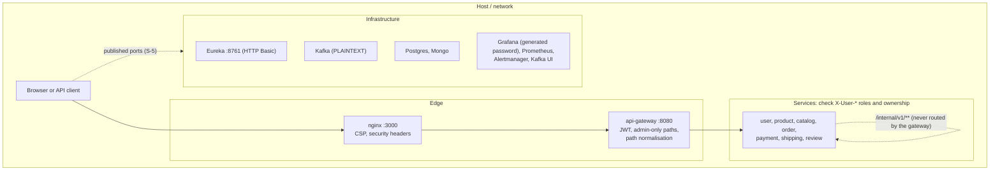

# Security

How the platform authenticates callers, how it authorizes them, what is exposed,
and how data and secrets are handled.

The short version: **the gateway authenticates and enforces admin-only
operations, and every service checks roles and ownership itself.** The secrets
are generated per installation and never committed. Most holes found on
2026-10-29 were fixed on 2026-10-30 ([Findings](findings.md#security-test-findings-2026-10-29)).
What is still open is listed under [Open](#open). The rules every service follows
are in the [security fix spec](security-fix-spec.md), and how each control is
tested is in [Testing: security tests](testing.md#security-tests).

## Trust boundaries

The gateway is the only way in for API traffic. It strips client-supplied
`X-Username`, `X-User-Id` and `X-User-Role` and sets them from the verified
token. Services treat those headers as authoritative, so anything that can reach
a service port directly can impersonate anyone. Under Kubernetes the service
ports stay inside the cluster. Under Docker Compose they are published (S-5,
open).

## Authentication

### Accounts

- **Registration is open**: `POST /api/v1/users/register`. Usernames are 3–50 characters of `[a-zA-Z0-9_]`. Passwords must be **10 to 72 UTF-8 bytes**, must not contain the username, and must not be on a list of about 1,100 common passwords. Violations are a 400 with a `password` field error. A duplicate username or email still answers 409 naming it (S-15, open).
- **Passwords** are hashed with BCrypt (cost 10). Login for an unknown user still runs one BCrypt comparison, so timing doesn't reveal which usernames exist.
- **Login** returns the same 401 and message for an unknown user, a wrong password, and an inactive or suspended account. **Five failed logins within 15 minutes lock the username**: 429 with `Retry-After` until the window passes. This applies to unknown usernames too. The counter is in memory, per instance.
- **Roles**: `CUSTOMER` (every registration) and `ADMIN`. user-service seeds the admin (`ADMIN_USERNAME`, default `admin`) only when `ADMIN_PASSWORD` is set, which must be at least 12 characters. It never logs the password. An existing admin account that still has the former built-in password `admin` is rotated to `ADMIN_PASSWORD` once, at startup.

### Tokens

| Property | Value |
|---|---|
| Issuer | user-service `JwtService`, at login |
| Format | JWS, HMAC. The secret must be **at least 64 bytes** (HS512). The gateway and user-service refuse to start otherwise. |
| Claims | `sub` = username, `userId` (number), `role`, `iat`, `exp`. The gateway rejects tokens without `sub` or `exp`. |
| Lifetime | 1 hour. There are no refresh tokens. |
| Validation | the gateway only: signature, `alg`, expiry, required claims |
| Revocation | none. A deactivated user keeps a working token until it expires (S-16, open). |
| Browser storage | `localStorage` (S-7, open; mitigated by the CSP below) |
| Secret | `JWT_SECRET`, shared by the gateway and user-service. There is no default anywhere: `init-secrets.sh` generates it into the git-ignored `.env`. |

### At the gateway

`JwtAuthenticationFilter` applies, in order:

1. It strips client `X-User-*` headers.
2. It rejects paths that aren't in normal form (`..`, `%2e`, `%2f`, `%5c`, `%25`, `;`, `//`) with 400, so a public prefix can't be walked out of.
3. It answers 404 for any path with an `/internal/` segment. Those endpoints are service-to-service only.
4. It lets the public list through anonymously. That list is `POST` register and login, `GET` products, categories, catalog, `/reviews/product/**`, `/shipments/tracking/{n}`, and the docs. Matching uses path patterns with segment boundaries.
5. It requires a valid bearer token and sets the identity headers from its claims.
6. It answers 403 to admin-only operations unless the role is exactly `ADMIN`. Those operations are: product, category and catalog writes, order status, shipment creation and status, refunds, and review moderation.

Every response gets `X-Content-Type-Options: nosniff`, and authenticated ones
get `Cache-Control: no-store`. Logged paths and token errors are stripped of
control characters, so an attacker can't forge log lines through them.

## Authorization

Every service applies the same rules ([spec](security-fix-spec.md)). Identity
comes from the gateway's headers. `ADMIN` is compared exactly (`admin` and
`ROLE_ADMIN` are not admins). Without identity a service answers 401, and with
the wrong identity 403.

| Service | Rules |
|---|---|
| user-service | `GET`/`PUT`/`DELETE /users/{id}` require the owner (`X-User-Id`) or an admin. `/me` resolves from `X-Username`. |
| product-service | Writes, stock adjustments and category creation are admin-only. A soft-deleted product is 404 to non-admins. Reads are public. |
| catalog-service | Sync and metadata updates are admin-only. Reads are public. |
| order-service | Every order operation is owner-or-admin. A customer can only open orders under their own username. Status changes are admin-only and follow a transition table (illegal moves are 409). |
| payment-service | A payment needs an authenticated payer who owns the order. The order must be `CONFIRMED` and the amount must equal its total: payment-service asks order-service, and answers 503 if it can't. Reads and process are owner-or-admin; refunds are admin-only. Retries are limited to the same customer and a PENDING or FAILED payment. |
| shipping-service | Creating a shipment and changing its status are admin-only, and status changes follow a transition table. Reads and history are owner-or-admin. Public tracking returns only status, carrier, ETA and history. |
| review-service | Writes and votes need identity. Only the author edits; the author or an admin deletes; only admins moderate. Unapproved reviews are visible to their author and admins only. Nobody votes on their own review. |

**Service to service.** order-service adjusts stock through
`PATCH /internal/v1/products/{id}/stock`, and payment-service reads orders
through `GET /internal/v1/orders/{id}`. The gateway never routes `/internal/`.

**Events.** order-service moves an order to `PAID` only for a
`payment.completed` that matches a `CONFIRMED` order's total. shipping-service
ignores `payment.completed` events with a non-positive amount. Kafka itself is
unauthenticated (S-5, open), so these checks limit what a forged event can do,
but they do not authenticate it.

**The SPA** hides its admin area from non-admins. The guards also require a
token and an unexpired session. This is convenience only: the API decides on
every request.

## Management and infrastructure endpoints

| Endpoint | Exposure |
|---|---|
| `/actuator/health` | open, status only (`show-details: never`) |
| `/actuator/serviceregistry` | 403 unless called from localhost (the k8s `preStop` drain) |
| `/actuator/prometheus`, `/metrics` | open on the service ports, which only Kubernetes and the compose network reach (plus published compose ports, S-5) |
| `/actuator` on the SPA origin | not proxied by nginx |
| Eureka `:8761` | HTTP Basic (`eureka` / `EUREKA_PASSWORD`). Health, info and Prometheus stay open. |
| Kafka | PLAINTEXT, no ACLs (S-5, open) |
| Databases | password auth with committed credentials, published ports (S-5, open) |
| Grafana | admin password from `GRAFANA_ADMIN_PASSWORD`; `k8s/deploy.sh` resets an existing install to it |
| Kafka UI, Prometheus, Alertmanager | published without authentication (S-5, open) |
| Swagger UI and `/api-docs` | public. Fine for development; disable in production (`springdoc.api-docs.enabled=false`). |

## Data protection

- **Personal data** (names, email, phone, addresses) lives in `userdb` and is only returned to its owner or an admin.
- **Public tracking** returns status, carrier, ETA and history only. Tracking numbers carry 64 random bits.
- **Payment data**: only `cardLastFour`, which must be exactly four digits. A full card number is rejected.
- **In transit**: plain HTTP, with no TLS at nginx or the gateway. Kafka and the database connections are unencrypted.
- **In logs**: no passwords or tokens. User-supplied values are stripped of control characters and capped at 256 characters.

## Secrets

| Secret | Source |
|---|---|
| `JWT_SECRET` (86 characters), `ADMIN_PASSWORD`, `EUREKA_PASSWORD`, `GRAFANA_ADMIN_PASSWORD` | generated by `init-secrets.sh` / `.ps1` into the git-ignored `ecommerce-platform/.env`. Compose refuses to start without them; `k8s/deploy.sh` creates the `platform-secrets` and `eureka-credentials` Secrets from it. |
| Database credentials | committed in compose and `k8s/01-secrets.yaml`. The volumes were initialised with them (S-5, open). |
| Docker Hub token | CircleCI context `ecommerce-dockerhub`, GitHub repository secrets |

`init-secrets.sh` never overwrites a value. To rotate one, delete its line in
`.env`, run the script again, redeploy, and restart the pods. Pact files sign
their tokens with a constant that is never a deployment secret.

## Browser-side

- **CSP**: scripts from this origin only. `object-src 'none'`, `frame-ancestors 'none'`. Inline styles are allowed for MUI.
- **Other headers**: `X-Frame-Options: DENY`, `nosniff`, `Referrer-Policy`, `Permissions-Policy` and `server_tokens off`.
- **CORS** allows any origin without credentials, which is harmless with bearer tokens.
- **Token handling**: the axios client only attaches the token to the API's own origin. After login the SPA only returns to a plain same-origin path. Tracking numbers are URL-encoded before they go into a request path.

## Open

| Id | What | Why it is still open |
|---|---|---|
| S-5 | Databases, Eureka's port, Kafka (compose), Kafka UI, Prometheus and Alertmanager are published, and the services' ports are published under compose | Needs a dev/prod split of the compose and LoadBalancer definitions. |
| S-7 | The token is in `localStorage` | Moving it to an httpOnly cookie needs a gateway session design and CSRF protection. The CSP reduces the risk. |
| S-15 | Registration confirms which usernames and emails exist | A fix needs email verification, so registration can answer the same way either way. |
| S-16 | No token revocation | Needs the gateway to check a revocation list or the user's status on each request. |
| — | Dev-only tooling (vitest 2.x and its esbuild/tinypool) has advisories | Needs a vitest major upgrade. Nothing from it ships. |
