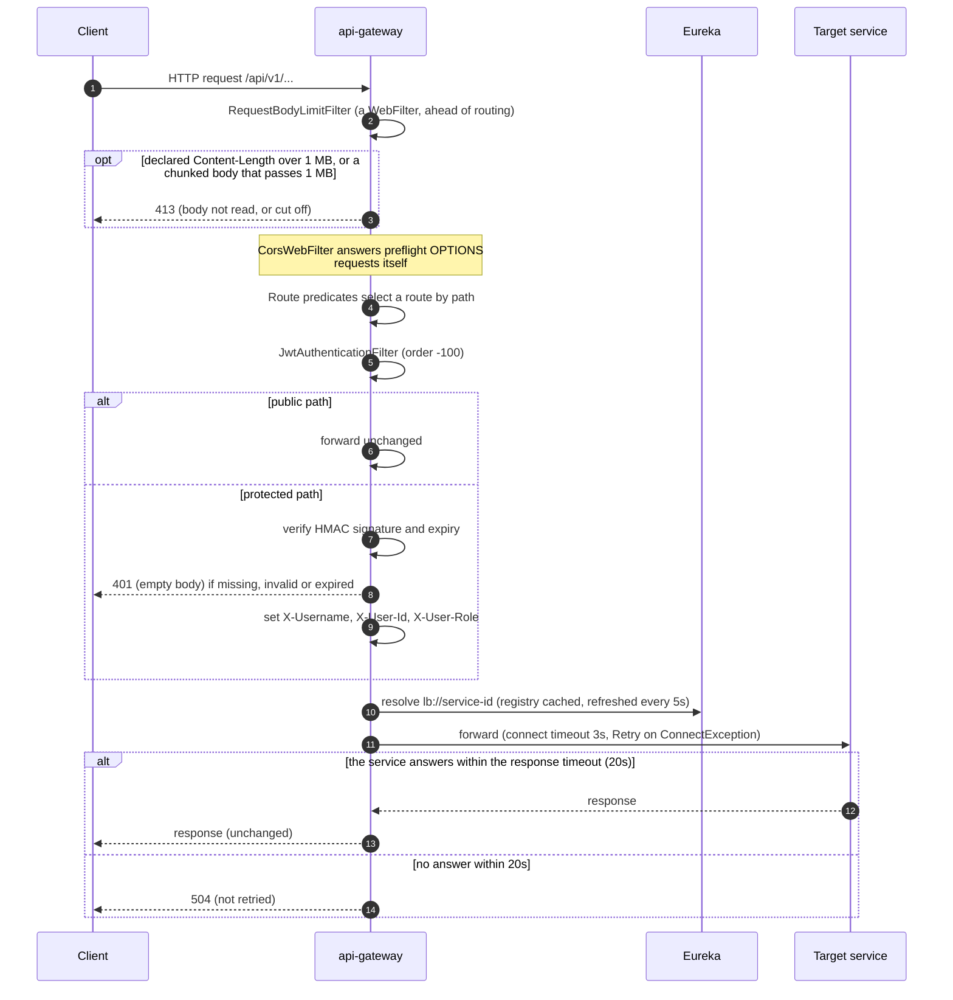

# API gateway

The single entry point for every client request. It is a Spring Cloud Gateway
(reactive, Netty) that matches `/api/v1/**` paths to services, resolves the
service through Eureka, authenticates the caller's JWT, and passes the caller's
identity downstream as plain headers. It owns no data and contains no business
logic. It also hosts the platform-wide Swagger UI.

| | |
|---|---|
| Repository | `ecommerce-api-gateway` |
| Stack | Java 25 · Spring Boot 4.0.9 · Spring Cloud Gateway Server WebFlux (Spring Cloud 2025.1.4) · Eureka client · JJWT 0.12.6 · springdoc 3.0.3 (WebFlux UI; the 2.8.x line crashes on Spring Framework 7) |
| Port | 8080 |
| Eureka service ID | `api-gateway` |
| Gateway routes | all of them (see [Routing](#routing)) |
| Data store | — |
| Publishes / consumes | — |
| Calls | every routed service, through `lb://<service-id>` |
| Called by | the frontend's nginx (`/api` proxy), API clients, the smoke test |

## Responsibilities

- **Routing.** Map path prefixes to services and load-balance across the instances Eureka knows about.
- **Authentication.** Validate the bearer JWT on every non-public route. Reject anything unsigned, forged, expired, or without `sub` and `exp`, with `401`. Paths that are not normalised get `400`, and any `/internal/` segment gets `404`.
- **Identity propagation.** Turn the token's claims into `X-Username`, `X-User-Id` and `X-User-Role` request headers. Downstream services read these headers and never see or parse the token.
- **CORS** for browser clients that call the gateway cross-origin.
- **Connection-failure retry**, so a rolling restart is invisible to callers.
- **API documentation portal.** One Swagger UI that lists every service's OpenAPI spec.

The gateway applies a coarse edge policy (see [Authorization at the edge](#authorization-at-the-edge)): admin-only operations are refused unless the role is exactly `ADMIN`. Ownership is decided by each service from the identity headers. See [Security](../security.md).

## Request pipeline

Global filters such as `JwtAuthenticationFilter` run only for requests that
match a route. The gateway's own endpoints (`/actuator/**`, `/swagger-ui.html`,
`/webjars/**`, its own `/api-docs`) are served by WebFlux handlers, outside the
route pipeline, so the JWT filter never sees them. `RequestBodyLimitFilter` is a
`WebFilter`, not a global filter: it runs before the route pipeline for every
request, including requests that match no route and those endpoints.

## Routing

Routes are declared in `src/main/resources/application.yaml`. Paths are
forwarded unchanged, so each service sees the same `/api/v1/...` path the
client sent.

| Route id | Path predicate | Target | Notes |
|---|---|---|---|
| `user-service` | `/api/v1/users/**` | `lb://user-service` | register, login, profile |
| `product-service` | `/api/v1/products/**`, `/api/v1/categories/**` | `lb://product-service` | one service, two prefixes |
| `catalog-service` | `/api/v1/catalog/**` | `lb://catalog-service` | MongoDB read model |
| `order-service` | `/api/v1/orders/**` | `lb://order-service` | |
| `payment-service` | `/api/v1/payments/**` | `lb://payment-service` | |
| `shipping-service` | `/api/v1/shipments/**` | `lb://shipping-service` | |
| `review-service` | `/api/v1/reviews/**` | `lb://review-service` | |
| `<service>-api-docs` (×7) | `/api-docs/<service-id>` | `lb://<service-id>`, `SetPath=/api-docs` | OpenAPI specs for the unified Swagger UI |

`notification-service` has no route because it exposes no API. `lb://` URIs
resolve through Eureka, not DNS or Kubernetes Services. Under Kubernetes,
`EUREKA_INSTANCE_PREFER_IP_ADDRESS=true` makes instances register pod IPs, so
the gateway dials pods directly (see [k8s/README.md](../../k8s/README.md)).

A path that matches no route returns `404`. A route whose service has no
registered instance returns `503` (logged as
`503 SERVICE_UNAVAILABLE "Unable to find instance for <service>"`, with no
message in the response body), which is the normal symptom of Eureka warm-up
right after a restart.

## Authentication

`filter/JwtAuthenticationFilter.java` is a `GlobalFilter` with order `-100`.

### Public paths

These pass without a token. Matching uses `PathPattern`s (segment boundaries, method-specific), after the checks below.

| Pattern | Methods | Why |
|---|---|---|
| `/api/v1/users/register`, `/api/v1/users/login` | `POST` | obtaining a token |
| `/api/v1/products/**`, `/api/v1/categories/**`, `/api/v1/catalog/**` | `GET` | storefront browsing |
| `/api/v1/reviews/product/**` | `GET` | reviews on a product page |
| `/api/v1/shipments/tracking/*` | `GET` | anonymous parcel tracking |
| `/api-docs/**`, `/swagger-ui*`, `/webjars/**` | `GET` | OpenAPI specs and Swagger UI |
| `/actuator/**` | `GET` | no effect today: the gateway's own endpoints bypass the filter |

Everything else needs `Authorization: Bearer <token>`. Before any matching:

- A raw path containing `..` or `.` segments, `%2e`, `%2f`, `%5c`, `%25`, `%00`, a backslash, `;` or `//` is rejected with `400`.
- Any `/internal/` segment is rejected with `404`: internal endpoints are service-to-service only.

### Authorization at the edge

After a valid token, these operations need `role` exactly `ADMIN`, otherwise `403` (services check again):

| Methods | Paths |
|---|---|
| `POST`, `PUT`, `PATCH`, `DELETE` | `/api/v1/products/**`, `/api/v1/categories/**`, `/api/v1/catalog/**` |
| `PATCH` | `/api/v1/orders/*/status`, `/api/v1/shipments/*/status`, `/api/v1/reviews/*/moderate` |
| `POST` | `/api/v1/shipments`, `/api/v1/payments/*/refund` |

### Token validation

- The HMAC key is built from `jwt.secret` (`JWT_SECRET`) with `Keys.hmacShaKeyFor(secret.getBytes(UTF_8))`. It must be byte-for-byte the secret [user-service](user-service.md) signs with.
- JJWT `parseSignedClaims` checks the signature and the `exp` claim. A token without `sub` or `exp` is `401`. HS256, HS384 and HS512 tokens are accepted as long as the key is long enough for the algorithm. The Pact between the gateway and user-service pins this.
- Any failure (missing header, no `Bearer ` prefix, bad signature, expired, malformed) returns `401` with an empty body. A rejected token is logged at `WARN`, throttled to one line per 10 s for each of two kinds: `JWT validation failed for path ...: <reason>` (key `jwt-invalid`) and `JWT without subject or expiry rejected for path ...` (key `jwt-incomplete`). When lines were dropped, the next one ends with `(N similar suppressed)`. A missing header, or one without `Bearer `, is not logged. The path and the reason pass through `logging/LogSanitizer` (control characters replaced, 200 characters at most), so a client cannot forge log lines.

### Identity headers

On a valid token the request is mutated before forwarding:

| Header | Source claim | Notes |
|---|---|---|
| `X-Username` | `sub` | the username |
| `X-User-Id` | `userId` | Read untyped and passed through `String.valueOf`. The claim is numeric, and asking JJWT for `String.class` threw `RequiredTypeException`, which used to turn every authenticated request into a 401. |
| `X-User-Role` | `role` | e.g. `CUSTOMER` or `ADMIN` (see [user-service](user-service.md)) |

The filter first removes any client-supplied `X-Username`, `X-User-Id` and
`X-User-Role` on every request, public routes included, then sets them from the
token. Anyone calling a service port (8081–8088) directly still bypasses this;
see [Security](../security.md).

Every response gets `X-Content-Type-Options: nosniff`; authenticated responses also get `Cache-Control: no-store` unless the service set its own.

## CORS

`config/CorsConfig.java` registers a `CorsWebFilter` for `/**`:

| Setting | Value |
|---|---|
| Allowed origin patterns | `*` |
| Allowed methods | `GET, POST, PUT, PATCH, DELETE, OPTIONS` |
| Allowed headers | `*` |
| Exposed headers | `X-Correlation-Id`, `Authorization` |
| Credentials | `false` (tokens travel in a header, never in cookies) |
| Max age | 3600 s |

In the default deployments the browser never calls the gateway cross-origin.
The frontend's nginx proxies `/api` to it on the same origin. CORS matters only
for a dev server or tool calling `:8080` directly.

## Resilience

| Mechanism | Setting | Purpose |
|---|---|---|
| Netty connect timeout | `httpclient.connect-timeout: 3000` | A target pod that vanished mid-rollout fails in 3 s instead of the 30 s Netty default, which used to turn each such request into a 30 s hang followed by a 500. |
| Netty response timeout | `httpclient.response-timeout: 20s` | A service that accepts a request and does not answer is cut off after 20 s with `504`, instead of holding the gateway's connection and the client's until one of them gives up. Not retried, because the request may have been processed. The timeouts nest: the services' Feign read timeouts (10 s; payment-service 5 s), gateway 20 s, SPA 30 s (`axios.ts`), nginx 35 s (`proxy_read_timeout`), so a slow but live answer still gets through and a hung service surfaces as the gateway's own `504`. |
| Connection pool | `httpclient.pool.max-idle-time: 20s`, `max-life-time: 5m`, `eviction-interval: 30s` | Idle pooled connections are dropped after 20 s, any connection after 5 minutes, and a sweep runs every 30 s. A service closes a keep-alive connection that has been idle for long; without this, a pooled connection that the service has already closed fails the next request with `Connection prematurely closed BEFORE response`, a 5xx that is not retried. The sweep also frees the sockets of pods that are gone, and the 5-minute limit keeps replaced pods from being held. |
| `Retry` default filter | 3 retries, all methods, only on `java.net.ConnectException`, backoff 100 ms doubling to 1 s; `series` and `statuses` emptied | The request never reached an instance, so replaying it is safe, even for `POST`. Each attempt goes back through the LoadBalancer and picks another instance. Read timeouts and 5xx are **not** retried, because the request may have been processed. |
| LoadBalancer cache | `spring.cloud.loadbalancer.cache.ttl: 5s` | matches the 5 s registry fetch |
| Eureka client | fetch every 5 s; lease renewal 5 s, expiry 15 s; `prefer-ip-address: true` | a crashed instance leaves the registry in about 20 s instead of up to 2 minutes |
| Request size limit | `RequestSize` default filter and `filter/RequestBodyLimitFilter`; `gateway.request.max-size: 1MB` | A request body over 1 MB is refused with `413`. `RequestSize` alone is too late: the `Retry` default filter makes `AdaptCachedBodyGlobalFilter` buffer the whole body in memory before the JWT check and before `RequestSize` runs, even for an anonymous caller (measured: an anonymous `POST` declaring 300 MB got no answer at all). `RequestBodyLimitFilter`, a `WebFilter` ahead of the gateway, answers `413` at once for a declared `Content-Length` over the limit, and counts a chunked body as it arrives and cuts it off at 1 MB. |
| Client idle timeout | `server.netty.idle-timeout: 2m` | A client connection that sends nothing for 2 minutes is closed, whether it never sent a request or sits idle after a response. Netty's default keeps it open forever, so an abandoned connection (a dead client) would cost a socket and its buffers until the gateway restarts. |

Together with the services' `preStop` drain, these make a Kubernetes rolling
restart hitless (0 failed requests measured under load). See
[k8s/README.md, "Rollouts are hitless"](../../k8s/README.md#notes). There is no
circuit breaker and no rate limiting at the gateway.

## API documentation portal

`http://localhost:8080/swagger-ui.html` shows one Swagger UI with a dropdown of
all seven service APIs (`springdoc.swagger-ui.urls`).

- Each entry loads `/api-docs/<service-id>`, a gateway route to that service's own springdoc endpoint (`/api-docs`).
- Every service declares a relative server URL (`/`) in its `OpenApiConfig`, so **Try it out** calls the gateway on the page's own origin. The request is routed and JWT-checked exactly like real client traffic, and the identity headers are injected.
- To use it, call `POST /api/v1/users/login` in the `user-service` spec, click **Authorize**, and paste the `token`. `persist-authorization: true` keeps the token while you switch between specs, because all specs share the `bearerAuth` scheme name, and across page reloads.
- Static snapshots of the same specs are committed under [api/openapi/](../api/openapi/).

## Configuration

| Property | Env var | Default | Purpose |
|---|---|---|---|
| `server.port` | — | `8080` | |
| `jwt.secret` | `JWT_SECRET` | none | HMAC key. **Must equal user-service's.** At least 64 bytes or startup fails. `init-secrets.sh` generates it into `.env`. |
| `eureka.client.service-url.defaultZone` | `EUREKA_CLIENT_SERVICEURL_DEFAULTZONE` | `http://localhost:8761/eureka/` | compose and k8s set `http://service-discovery:8761/eureka/` |
| `eureka.client.registry-fetch-interval-seconds` | — | `5` | |
| `eureka.instance.lease-renewal-interval-in-seconds` / `lease-expiration-duration-in-seconds` | — | `5` / `15` | |
| `eureka.instance.prefer-ip-address` | `EUREKA_INSTANCE_PREFER_IP_ADDRESS` | `true` | |
| `spring.cloud.loadbalancer.cache.ttl` | — | `5s` | |
| `spring.cloud.gateway.server.webflux.httpclient.connect-timeout` | — | `3000` ms | |
| `spring.cloud.gateway.server.webflux.httpclient.response-timeout` | — | `20s` | `504` when a service does not answer in time; not retried |
| `spring.cloud.gateway.server.webflux.httpclient.pool.max-idle-time` / `max-life-time` / `eviction-interval` | — | `20s` / `5m` / `30s` | see [Resilience](#resilience) |
| `gateway.request.max-size` | — | `1MB` | largest request body forwarded, `413` above it; read by the `RequestSize` default filter and by `RequestBodyLimitFilter` |
| `server.netty.idle-timeout` | — | `2m` | closes a client connection that has been silent that long |
| `spring.reactor.context-propagation` | — | `auto` | carries the MDC across event-loop threads, so log lines written while a request is handled carry its `traceId`; without it the MDC is empty there |
| `management.endpoints.web.exposure.include` | — | `health,info,metrics,prometheus,circuitbreakers,serviceregistry` | `serviceregistry` is used by the Kubernetes `preStop` drain |
| `management.tracing.sampling.probability` | `TRACING_SAMPLING_PROBABILITY` | `1.0` | every request is traced |
| `management.opentelemetry.tracing.export.otlp.endpoint` | `OTEL_EXPORTER_OTLP_ENDPOINT` (+ `/v1/traces`) | `http://tempo:4318` | Tempo, OTLP over HTTP |
| `management.metrics.tags.environment` | `ENVIRONMENT` | `development` | common metric tag |
| `springdoc.api-docs.path` / `springdoc.swagger-ui.path` | — | `/api-docs` / `/swagger-ui.html` | |
| `logging.pattern.console` | — | `%d{yyyy-MM-dd HH:mm:ss} [%thread] [%X{correlationId:-}] [%X{traceId:-}] %-5level %logger{36} - %msg%n` | the format every Java service shares |
| `logging.level.com.ecommerce` | — | `INFO` | |
| `logging.level.org.springframework.cloud.loadbalancer.core.RoundRobinLoadBalancer` / `logging.level.reactor.netty.http.client.HttpClientConnect` | — | `ERROR` | muted: each wrote a `WARN` per failed request (reactor-netty with a stack trace); `ThrottledErrorWebExceptionHandler` reports the failure once per window instead |
| `JAVA_OPTS` | `JAVA_OPTS` | `-XX:MaxRAMPercentage=55 -XX:ActiveProcessorCount=2 -XX:+ExitOnOutOfMemoryError -XX:-HeapDumpOnOutOfMemoryError` (compose) | the container runs with `mem_limit: 768m` |
| `JAVA_TOOL_OPTIONS` | `JAVA_TOOL_OPTIONS` | `-XX:MaxDirectMemorySize=128m` (`docker-compose.yml` and `k8s/40-services.yaml`, api-gateway only) | caps Netty's direct memory, where request bodies are buffered. The JVM default is the maximum heap (424 MiB at `MaxRAMPercentage=55` of 768 MiB), so heap plus direct memory could pass the container limit |

## Observability

- **Actuator**: `health` (`show-details: never`), `info`, `metrics`, `prometheus`, `circuitbreakers`, `serviceregistry` (loopback only: `ManagementAccessFilter` answers 403 to anything else). Prometheus scrapes `/actuator/prometheus`.
- **Metrics**: common tags `application=api-gateway` and `environment`. `http.server.requests` has a percentile histogram and SLO buckets at 50 ms, 100 ms, 200 ms, 500 ms, 1 s and 2 s. Proxied requests are recorded with `uri="UNKNOWN"`, though, so the per-route panels of dashboard `03-api-gateway.json` collapse into one series. Per-route latency is in `http_client_requests_seconds`, by `spring_cloud_gateway_route_id`. See [Observability](../observability.md).
- **Tracing**: OpenTelemetry with 100 % sampling, exported to Tempo. Spring Cloud Gateway's observation propagates the trace context on the forwarded request, so the gateway → service hop is one trace. A service's own Feign call is not instrumented, so product-service records it as a new, unrelated trace. Kafka listeners record no spans at all.
- **Logs**: pattern `%d{yyyy-MM-dd HH:mm:ss} [%thread] [%X{correlationId:-}] [%X{traceId:-}] %-5level %logger{36} - %msg%n`. `spring.reactor.context-propagation: auto` carries the MDC across event-loop threads, so a line written while a request is handled has that request's `traceId` and can be joined to the services' lines; start-up lines have empty brackets. The gateway never puts a `correlationId` into the MDC, so that bracket is always empty. `com.ecommerce` logs at `INFO`. See [Observability](../observability.md).
- **Failure logging**: `error/ThrottledErrorWebExceptionHandler` is Boot's error handler with only `logError` overridden, so the responses are unchanged. In each 10 s window, a service that did not answer is one `WARN` without a stack trace for each route and kind, `Upstream <kind> on GET /api/v1/... (route <id>): <exception>: <message>`, where the kind is `no instance registered`, `connection failed`, `timed out`, `connection lost` or `unavailable`. Any other `500` is one `ERROR` with its stack trace for each failure site (exception class and first frame in `com.ecommerce`), `Unhandled error on GET ... (route <id>)`. When lines were dropped, the next one ends with `(N similar suppressed)`. Client errors stay at `DEBUG`. Status codes do not change: no instance is `503`, a timeout `504`, a refused or reset connection `500`. `RoundRobinLoadBalancer` and `reactor.netty.http.client.HttpClientConnect` are set to `ERROR` because each wrote its own `WARN` per failed request, so this handler is the one place that reports these failures.

## Testing

240 unit, slice and pact tests (`mvn test`) and 112 integration tests (`mvn verify`; no Docker needed).

| Class | Kind | Covers |
|---|---|---|
| `filter/JwtAuthenticationFilterTest` | unit | the public-path rules; token validation (missing, malformed, expired, signed with another secret, tampered claims or signature, unsigned `alg: none`, every HMAC strength user-service may use); the identity headers set from the claims (`sub`, numeric `userId`, `role`) |
| `config/CorsConfigTest` | unit | any origin; preflight for allowed methods answered at the gateway and for others rejected; exposed headers; same-origin requests untouched |
| `integration/GatewayRoutingIT` | full gateway on a random port, one WireMock per route | every route reaches its service with the path unchanged, and `/api-docs` is rewritten to the service's spec; query string, body, status and body pass back; a downstream 5xx is not retried; protected routes answer 401 without a token, with an invalid, expired or foreign-issuer token, and never reach the service; public routes need no token, but a write on a public read route still does; a valid token delivers the identity headers, and spoofed headers are overwritten on authenticated routes; CORS preflight is answered at the gateway; actuator health |
| `error/ThrottledErrorWebExceptionHandlerTest`, `error/UpstreamFailureTest` | unit | the failure log: an unexpected 500 is one `ERROR` with its stack trace per window and failure site; a service that does not answer (no instance, refused, timed out, reset or closed connection) is one `WARN` without a stack trace per route and kind; client errors log nothing above `DEBUG`; hostile exception text cannot forge log lines; a failure while logging never breaks the response; how an exception chain is classified into those kinds |
| `filter/RequestBodyLimitFilterTest` | unit | a declared `Content-Length` over the limit is `413` without reading the body; a chunked body is counted per subscription (a `Retry` replay is not counted twice) and cut off with `413` at the limit, even when no single chunk is large, and the buffer that crosses the limit is released; bodies within the limit pass untouched; the filter is ordered ahead of the gateway |
| `filter/JwtRejectionLoggingTest`, `filter/JwtParserCacheTest`, `logging/LogThrottleTest` | unit | a flood of bad tokens writes one `WARN` per kind (invalid, incomplete) and window while every request still gets `401`, and valid tokens log nothing; the cached JWT parser serves every request and follows a change of secret; the throttle (window, suppressed count, key bound, concurrent callers, failure-site keys) |
| `config/LoggingConfigTest` | unit | the committed `application.yaml`: log pattern, `com.ecommerce` at `INFO`, the two muted loggers, `spring.reactor.context-propagation: auto`, `RequestSize` as the second default filter after `Retry`, `gateway.request.max-size: 1MB` |
| `integration/GatewayFailureLoggingIT` | the gateway on a random port, WireMock, a closed port | a burst of requests to a service with no instance (`503`), a refused connection (`500`), a reset connection (`500`), a connection closed without an answer (`500`) or a hanging service (`504` after the response timeout, never replayed) writes one log line, not one per request; a bug in a gateway filter is one `ERROR` with its stack trace; a flood of bad tokens is one line and still `401`; `404`, `401` and path-trick requests and healthy traffic log nothing |
| `integration/GatewayRequestLimitsIT` | the gateway as shipped, WireMock, raw sockets | the `httpclient` and `server.netty` settings of `application.yaml` are bound; a service that takes 2.5 s still answers; a body under 1 MB is forwarded, one over it is `413` and never reaches the service; an anonymous request that declares 300 MB and sends 100 KB is answered `413` at once; a chunked body over the limit is cut off with `413`; a small chunked body works |
| `integration/GatewayConnectionPoolIT` | the gateway, a counting socket server | a connection in use is reused; one idle past `max-idle-time` is not reused; one older than `max-life-time` is replaced even while busy (limits shortened for the test) |
| `integration/GatewayIdleTimeoutIT` | the gateway, raw sockets | a connection that sends nothing, and a keep-alive connection left idle after a response, are closed by `server.netty.idle-timeout` (shortened for the test) |
| `integration/GatewayLogCorrelationIT` | the gateway, a log appender | a rejected token and an upstream failure are logged with the request's `traceId` and `spanId` in the MDC |
| `integration/GatewaySecurityIT` | the real gateway attacked over raw sockets, WireMock downstreams (`@Tag("security")`) | traversal out of a public or an unrouted prefix never reaches a service or carries identity headers; an oversized header or bearer token, a garbage request line and a smuggled second request are rejected; `TRACE` is not echoed and the `Host` header does not steer routing; sensitive actuator endpoints and those that change runtime state are unreachable and health hides component details; error bodies leak no class names, traces or internal addresses and responses do not advertise the server stack; authenticated responses are not cacheable or sniffable; cross-origin requests never get credentials |
| `security/JwtAuthenticationFilterSecurityTest` | unit (`@Tag("security")`) | attacks on the JWT filter: `alg: none` in any spelling, asymmetric `alg` values signed with the HMAC secret, an `alg` that disagrees with the signature, unknown critical headers, JWE-shaped tokens, a compression bomb, `nbf` in the future, tokens without `exp` or `sub`, non-string `role` claims never forwarded as admin, padded or concatenated `Authorization` values, tokens in the query string; spoofed identity headers in any case; non-normalised paths, public-prefix look-alikes, case-changed paths, writes on public read paths and method-override headers; admin-only operations are `403` for non-admins and forwarded for admins; `/internal/` is `404`; a short or missing secret fails startup; a rejection has no body and no diagnostic headers, and neither a rejected token nor token content that forges lines reaches the log |
| `security/GatewayConfigSecurityTest` | unit (reads `application.yaml`, `@Tag("security")`) | no management endpoint that leaks secrets or changes state is exposed, health details are hidden, `JWT_SECRET` comes from the environment with no committed fallback, the discovery locator is off, and `Retry` never replays a request that reached a service |
| `security/ManagementAccessFilterTest` | unit (`@Tag("security")`) | `/actuator/serviceregistry` is `403` from any address but loopback and without a known remote address, passes from `127.0.0.1` and `::1`, and other paths pass from anywhere |
| `contract/*ConsumerPactTest` | Pact consumer | below |

No tests are disabled for bugs any more; the security tests (`mvn verify -Dgroups=security`) cover path tricks, JWT attacks and edge policy.

Three Pact **consumer** tests in `src/test/java/.../contract/`
boot the real gateway (routes, JWT filter, Retry filter, LoadBalancer) on a
random port. `lb://` routes point at Pact mock servers through Spring Cloud's
simple discovery client, on fixed ports 18187 (review) and 18181 (user).

| Test | Pact | Pins |
|---|---|---|
| `ReviewServiceConsumerPactTest` | `api-gateway-review-service.json` | `X-Username`, `X-User-Id`, `X-User-Role` reach review-service on `POST /api/v1/reviews` and `DELETE /api/v1/reviews/{id}` |
| `UserServiceConsumerPactTest` | `api-gateway-user-service.json` | the same headers on `GET /api/v1/users/me` |
| `UserServiceJwtConsumerPactTest` | `api-gateway-user-service.json` | the claims the filter relies on (`sub`, numeric `userId`, `role`) and the HMAC algorithm family, run through the production filter |

The providers replay these pacts in their own builds. See
[Testing](../architecture.md#testing-strategy) and `ecommerce-platform/sync-pacts.sh`.

## Code map

| File | Role |
|---|---|
| `ApiGatewayApplication.java` | Boot entry point, `@EnableDiscoveryClient` |
| `config/CorsConfig.java` | the `CorsWebFilter` |
| `filter/JwtAuthenticationFilter.java` | path checks, public and admin-only rules, JWT validation, identity headers, response headers |
| `filter/ManagementAccessFilter.java` | `/actuator/serviceregistry` from loopback only |
| `filter/RequestBodyLimitFilter.java` | `WebFilter` ahead of the gateway: `413` for a declared `Content-Length` over `gateway.request.max-size`, chunked bodies counted and cut off at the limit |
| `error/ErrorHandlingConfig.java`, `error/ThrottledErrorWebExceptionHandler.java`, `error/UpstreamFailure.java` | replaces Boot's error handler with one that logs failures throttled and without a stack trace for a service that did not answer; classifies a failure as no instance, connect failure, timeout, lost connection or unavailable |
| `logging/LogThrottle.java`, `logging/LogSanitizer.java` | at most one log line per key and 10 s window, with a count of the dropped ones; control characters and length of logged text |
| `src/main/resources/application.yaml` | routes, Retry filter, timeouts, Eureka tuning, actuator, tracing, springdoc |
| `docker/Dockerfile` | `eclipse-temurin:25-jre-alpine`, non-root, copies the prebuilt jar |

## Known issues and limitations

| Issue | Where | Impact | Severity |
|---|---|---|---|
| ~~Client `X-User-*` headers forwarded on public routes~~ | fixed | The filter now strips them on every request. | — |
| ~~`/api/v1/users/internal/**` public; tracking public for every method; no edge authorization~~ | fixed | Public list is method- and pattern-specific, `/internal/` is 404, admin-only operations are 403 at the edge. | — |
| `correlationId` is in the log pattern but never set, and no correlation ID is generated for downstream calls. | `application.yaml` logging pattern | Gateway log lines can't be joined to service log lines by ID; use the trace ID instead. | Low |
| ~~Actuator exposes `serviceregistry` and health details~~ | fixed | Health details are hidden and `serviceregistry` answers only loopback callers. | — |
| ~~Committed default JWT secret~~ | fixed | No default; startup fails below 64 bytes. | — |
| ~~The signing key is rebuilt from the secret on every request.~~ | fixed | `validateToken()` reuses one cached `JwtParser`, rebuilt only if the secret changes; `logging/LogSanitizer` uses a precompiled pattern. | — |
| The `/actuator`, `/swagger-ui` and `/webjars` public rules are dead code. | the `PUBLIC` list in `JwtAuthenticationFilter` | Misleading: they suggest the filter guards the gateway's own endpoints, which it never sees. | Low |
| The outbound connection pool is elastic. | `httpclient.pool` (no `type` set, so Spring Cloud Gateway's default `ELASTIC`) | There is no global cap on connections to the services, so concurrent upstream connections follow the incoming load. | Low |
| Upload rate is not limited. | `RequestBodyLimitFilter`, `server.netty.idle-timeout` | Only the body size (1 MB) and the silence of a connection (2 minutes) are limited, not how slowly a permitted body is sent. | Low |
| A refused or reset upstream connection answers `500`. | error handling (`ThrottledErrorWebExceptionHandler` changes only the logging) | A service that refuses or resets the connection gives the client a `500`, while no instance is `503` and a timeout `504`. `502` or `503` would describe it better. | Low |
| A blackholed instance IP costs a request about 12.7 s. | `httpclient.connect-timeout`, `Retry` | If the address of an instance still in the registry drops packets instead of refusing, each of the 4 attempts (the request and 3 retries) waits the 3 s connect timeout, plus 0.7 s of backoff: up to about 12.7 s before the failure, when every attempt reaches a dead address (a service with a single instance, say). | Low |
| Netty direct memory holds request bodies in flight. | `JAVA_TOOL_OPTIONS` in `docker-compose.yml` and `k8s/40-services.yaml` | Bodies of up to 1 MB each are buffered in Netty direct memory, whose JVM default cap is the maximum heap (424 MiB at `MaxRAMPercentage=55` of the 768 MiB limit), so heap plus direct memory could pass the container limit and get the container OOM-killed. `-XX:MaxDirectMemorySize=128m` caps it: an overflow fails the one request with a catchable `OutOfMemoryError` for direct buffer memory, which `ExitOnOutOfMemoryError` does not act on. Measured in the platform's footprint test with `MaxDirectMemorySize=128m`: 300 `POST`s of 900 KB, in rounds of 20 concurrent, took the container to a peak of 251 MiB of its 768 MiB. | Low |
