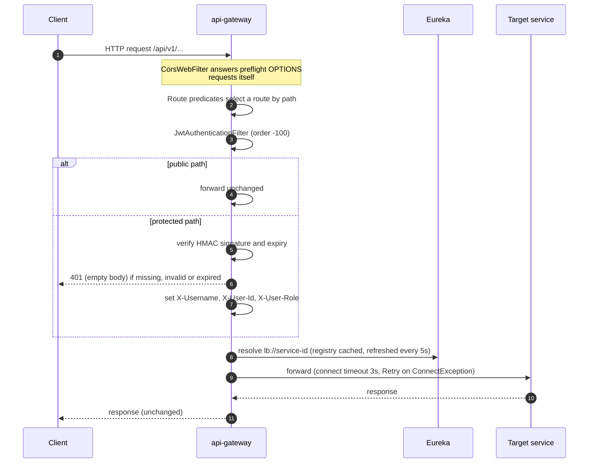

# API gateway

The single entry point for every client request. It is a Spring Cloud Gateway
(reactive, Netty) that matches `/api/v1/**` paths to services, resolves the
service through Eureka, authenticates the caller's JWT, and passes the caller's
identity downstream as plain headers. It owns no data and contains no business
logic. It also hosts the platform-wide Swagger UI.

| | |
|---|---|
| Repository | `ecommerce-api-gateway` |
| Stack | Java 25 · Spring Boot 4.0.1 · Spring Cloud Gateway Server WebFlux (Spring Cloud 2025.1.1) · Eureka client · JJWT 0.12.6 · springdoc 3.0.3 (WebFlux UI; the 2.8.x line crashes on Spring Framework 7) |
| Port | 8080 |
| Eureka service ID | `api-gateway` |
| Gateway routes | all of them (see [Routing](#routing)) |
| Data store | — |
| Publishes / consumes | — |
| Calls | every routed service, through `lb://<service-id>` |
| Called by | the frontend's nginx (`/api` proxy), API clients, the smoke test |

## Responsibilities

- **Routing.** Map path prefixes to services and load-balance across the instances Eureka knows about.
- **Authentication.** Validate the bearer JWT on every non-public route. Reject anything unsigned, forged or expired with `401`.
- **Identity propagation.** Turn the token's claims into `X-Username`, `X-User-Id` and `X-User-Role` request headers. Downstream services read these headers and never see or parse the token.
- **CORS** for browser clients that call the gateway cross-origin.
- **Connection-failure retry**, so a rolling restart is invisible to callers.
- **API documentation portal.** One Swagger UI that lists every service's OpenAPI spec.

The gateway does **not** authorize. It never checks a role or decides who may call which route. Each service is responsible for that, and most do not do it yet. See [Security](../security.md).

## Request pipeline

Global filters such as `JwtAuthenticationFilter` run only for requests that
match a route. The gateway's own endpoints (`/actuator/**`, `/swagger-ui.html`,
`/webjars/**`, its own `/api-docs`) are served by WebFlux handlers, outside the
route pipeline, so the JWT filter never sees them.

## Routing

Routes are declared in `src/main/resources/application.yaml`. Paths are
forwarded unchanged, so each service sees the same `/api/v1/...` path the
client sent.

| Route id | Path predicate | Target | Notes |
|---|---|---|---|
| `user-service` | `/api/v1/users/**` | `lb://user-service` | register, login, profile |
| `product-service` | `/api/v1/products/**`, `/api/v1/categories/**` | `lb://product-service` | one service, two prefixes |
| `catalog-service` | `/api/v1/catalog/**` | `lb://catalog-service` | MongoDB read model |
| `order-service` | `/api/v1/orders/**` | `lb://order-service` | |
| `payment-service` | `/api/v1/payments/**` | `lb://payment-service` | |
| `shipping-service` | `/api/v1/shipments/**` | `lb://shipping-service` | |
| `review-service` | `/api/v1/reviews/**` | `lb://review-service` | |
| `<service>-api-docs` (×7) | `/api-docs/<service-id>` | `lb://<service-id>`, `SetPath=/api-docs` | OpenAPI specs for the unified Swagger UI |

`notification-service` has no route because it exposes no API. `lb://` URIs
resolve through Eureka, not DNS or Kubernetes Services. Under Kubernetes,
`EUREKA_INSTANCE_PREFER_IP_ADDRESS=true` makes instances register pod IPs, so
the gateway dials pods directly (see [k8s/README.md](../../k8s/README.md)).

A path that matches no route returns `404`. A route whose service has no
registered instance returns `503` (`Load balancer does not contain an instance
for the service`), which is the normal symptom of Eureka warm-up right after a
restart.

## Authentication

`filter/JwtAuthenticationFilter.java` is a `GlobalFilter` with order `-100`.

### Public paths

These pass without a token. Matching is by path prefix (`startsWith`).

| Prefix | Methods | Why |
|---|---|---|
| `/api/v1/users/register`, `/api/v1/users/login` | any | obtaining a token |
| `/api/v1/users/internal/` | any | intended for service-to-service lookups. Public at the edge: see [Security](../security.md) |
| `/api/v1/products`, `/api/v1/categories` | `GET` | storefront browsing |
| `/api/v1/catalog` | `GET` | storefront browsing |
| `/api/v1/reviews/product/` | `GET` | reviews on a product page |
| `/api/v1/shipments/tracking/` | any | anonymous parcel tracking |
| `/api-docs` | any | OpenAPI specs (now also the `/api-docs/<service>` routes) |
| `/actuator`, `/swagger-ui`, `/webjars` | any | no effect today: no route serves these paths, and the gateway's own endpoints bypass the filter (see above) |

Everything else needs `Authorization: Bearer <token>`.

### Token validation

- The HMAC key is built from `jwt.secret` (`JWT_SECRET`) with `Keys.hmacShaKeyFor(secret.getBytes(UTF_8))`. It must be byte-for-byte the secret [user-service](user-service.md) signs with.
- JJWT `parseSignedClaims` checks the signature and the `exp` claim. HS256, HS384 and HS512 tokens are accepted as long as the key is long enough for the algorithm. The Pact between the gateway and user-service pins this.
- Any failure (missing header, no `Bearer ` prefix, bad signature, expired, malformed) returns `401` with an empty body. The reason is logged at `WARN` (`JWT validation failed for path ...`).

### Identity headers

On a valid token the request is mutated before forwarding:

| Header | Source claim | Notes |
|---|---|---|
| `X-Username` | `sub` | the username |
| `X-User-Id` | `userId` | Read untyped and passed through `String.valueOf`. The claim is numeric, and asking JJWT for `String.class` threw `RequiredTypeException`, which used to turn every authenticated request into a 401. |
| `X-User-Role` | `role` | e.g. `CUSTOMER` or `ADMIN` (see [user-service](user-service.md)) |

`headers.set(...)` overwrites any client-supplied value on authenticated
routes. On **public** routes the filter returns early and forwards the request
untouched, so a client-supplied `X-User-*` header reaches the service as-is.
The same is true for anyone calling a service port (8081–8088) directly. Both
are covered in [Security](../security.md).

## CORS

`config/CorsConfig.java` registers a `CorsWebFilter` for `/**`:

| Setting | Value |
|---|---|
| Allowed origin patterns | `*` |
| Allowed methods | `GET, POST, PUT, PATCH, DELETE, OPTIONS` |
| Allowed headers | `*` |
| Exposed headers | `X-Correlation-Id`, `Authorization` |
| Credentials | `false` (tokens travel in a header, never in cookies) |
| Max age | 3600 s |

In the default deployments the browser never calls the gateway cross-origin.
The frontend's nginx proxies `/api` to it on the same origin. CORS matters only
for a dev server or tool calling `:8080` directly.

## Resilience

| Mechanism | Setting | Purpose |
|---|---|---|
| Netty connect timeout | `httpclient.connect-timeout: 3000` | A target pod that vanished mid-rollout fails in 3 s instead of the 30 s Netty default, which used to turn each such request into a 30 s hang followed by a 500. |
| `Retry` default filter | 3 retries, all methods, only on `java.net.ConnectException`, backoff 100 ms doubling to 1 s; `series` and `statuses` emptied | The request never reached an instance, so replaying it is safe, even for `POST`. Each attempt goes back through the LoadBalancer and picks another instance. Read timeouts and 5xx are **not** retried, because the request may have been processed. |
| LoadBalancer cache | `spring.cloud.loadbalancer.cache.ttl: 5s` | matches the 5 s registry fetch |
| Eureka client | fetch every 5 s; lease renewal 5 s, expiry 15 s; `prefer-ip-address: true` | a crashed instance leaves the registry in about 20 s instead of up to 2 minutes |

Together with the services' `preStop` drain, these make a Kubernetes rolling
restart hitless (0 failed requests measured under load). See
[k8s/README.md, "Rollouts are hitless"](../../k8s/README.md#notes). There is no
circuit breaker and no rate limiting at the gateway.

## API documentation portal

`http://localhost:8080/swagger-ui.html` shows one Swagger UI with a dropdown of
all seven service APIs (`springdoc.swagger-ui.urls`).

- Each entry loads `/api-docs/<service-id>`, a gateway route to that service's own springdoc endpoint (`/api-docs`).
- Every service declares a relative server URL (`/`) in its `OpenApiConfig`, so **Try it out** calls the gateway on the page's own origin. The request is routed and JWT-checked exactly like real client traffic, and the identity headers are injected.
- To use it, call `POST /api/v1/users/login` in the `user-service` spec, click **Authorize**, and paste the `token`. `persist-authorization: true` keeps the token while you switch between specs, because all specs share the `bearerAuth` scheme name, and across page reloads.
- Static snapshots of the same specs are committed under [api/openapi/](../api/openapi/).

## Configuration

| Property | Env var | Default | Purpose |
|---|---|---|---|
| `server.port` | — | `8080` | |
| `jwt.secret` | `JWT_SECRET` | `myVerySecretJwtKeyThatIsAtLeast32CharactersLongForHS256` | HMAC key. **Must equal user-service's.** The default is for local use only. |
| `eureka.client.service-url.defaultZone` | `EUREKA_CLIENT_SERVICEURL_DEFAULTZONE` | `http://localhost:8761/eureka/` | compose and k8s set `http://service-discovery:8761/eureka/` |
| `eureka.client.registry-fetch-interval-seconds` | — | `5` | |
| `eureka.instance.lease-renewal-interval-in-seconds` / `lease-expiration-duration-in-seconds` | — | `5` / `15` | |
| `eureka.instance.prefer-ip-address` | `EUREKA_INSTANCE_PREFER_IP_ADDRESS` | `true` | |
| `spring.cloud.loadbalancer.cache.ttl` | — | `5s` | |
| `spring.cloud.gateway.server.webflux.httpclient.connect-timeout` | — | `3000` ms | |
| `management.endpoints.web.exposure.include` | — | `health,info,metrics,prometheus,circuitbreakers,serviceregistry` | `serviceregistry` is used by the Kubernetes `preStop` drain |
| `management.tracing.sampling.probability` | `TRACING_SAMPLING_PROBABILITY` | `1.0` | every request is traced |
| `management.opentelemetry.tracing.export.otlp.endpoint` | `OTEL_EXPORTER_OTLP_ENDPOINT` (+ `/v1/traces`) | `http://tempo:4318` | Tempo, OTLP over HTTP |
| `management.metrics.tags.environment` | `ENVIRONMENT` | `development` | common metric tag |
| `springdoc.api-docs.path` / `springdoc.swagger-ui.path` | — | `/api-docs` / `/swagger-ui.html` | |
| `JAVA_OPTS` | `JAVA_OPTS` | `-XX:MaxRAMPercentage=55 -XX:ActiveProcessorCount=2 -XX:+ExitOnOutOfMemoryError` (compose) | the container runs with `mem_limit: 768m` |

## Observability

- **Actuator**: `health` (with `show-details: always`), `info`, `metrics`, `prometheus`, `circuitbreakers`, `serviceregistry`. Prometheus scrapes `/actuator/prometheus`.
- **Metrics**: common tags `application=api-gateway` and `environment`. `http.server.requests` has a percentile histogram and SLO buckets at 50 ms, 100 ms, 200 ms, 500 ms, 1 s and 2 s. Proxied requests are recorded with `uri="UNKNOWN"`, though, so the per-route panels of dashboard `03-api-gateway.json` collapse into one series. Per-route latency is in `http_client_requests_seconds`, by `spring_cloud_gateway_route_id`. See [Observability](../observability.md).
- **Tracing**: OpenTelemetry with 100 % sampling, exported to Tempo. Spring Cloud Gateway's observation propagates the trace context on the forwarded request, so the gateway → service hop is one trace. A service's own Feign call is not instrumented, so product-service records it as a new, unrelated trace. Kafka listeners record no spans at all.
- **Logs**: pattern `%d [%X{correlationId}] [%thread] %-5level %logger{36} - %msg%n`. The gateway never puts a `correlationId` into the MDC, so the brackets are always empty here. See [Observability](../observability.md).

## Testing

There are no unit tests. Three Pact **consumer** tests in `src/test/java/.../contract/`
boot the real gateway (routes, JWT filter, Retry filter, LoadBalancer) on a
random port. `lb://` routes point at Pact mock servers through Spring Cloud's
simple discovery client, on fixed ports 18187 (review) and 18181 (user).

| Test | Pact | Pins |
|---|---|---|
| `ReviewServiceConsumerPactTest` | `api-gateway-review-service.json` | `X-Username`, `X-User-Id`, `X-User-Role` reach review-service on `POST /api/v1/reviews` and `DELETE /api/v1/reviews/{id}` |
| `UserServiceConsumerPactTest` | `api-gateway-user-service.json` | the same headers on `GET /api/v1/users/me` |
| `UserServiceJwtConsumerPactTest` | `api-gateway-user-service.json` | the claims the filter relies on (`sub`, numeric `userId`, `role`) and the HMAC algorithm family, run through the production filter |

The providers replay these pacts in their own builds. See
[Testing](../architecture.md#testing-strategy) and `ecommerce-platform/sync-pacts.sh`.

## Code map

| File | Role |
|---|---|
| `ApiGatewayApplication.java` | Boot entry point, `@EnableDiscoveryClient` |
| `config/CorsConfig.java` | the `CorsWebFilter` |
| `filter/JwtAuthenticationFilter.java` | public-path rules, JWT validation, identity headers |
| `src/main/resources/application.yaml` | routes, Retry filter, timeouts, Eureka tuning, actuator, tracing, springdoc |
| `docker/Dockerfile` | `eclipse-temurin:25-jre-alpine`, non-root, copies the prebuilt jar |

## Known issues and limitations

| Issue | Where | Impact | Severity |
|---|---|---|---|
| Client-supplied `X-User-*` headers are forwarded unchanged on public routes, and the gateway never strips them. | `JwtAuthenticationFilter.filter()` (early return for public paths) | Not exploitable today: only user-service (`/me`) and review-service (writes and votes) read the headers, and all of those routes need a token, which overwrites them. It becomes a spoofing hole the moment a public endpoint starts trusting the headers. See [Security](../security.md). | Low |
| `/api/v1/users/internal/**` is public, for every method. | `isPublicEndpoint()` | An endpoint meant for service-to-service use is reachable anonymously from outside. See [user-service](user-service.md). | High |
| `/api/v1/shipments/tracking/**` is public for every method, not just `GET`. | `isPublicEndpoint()` | Harmless today because only a `GET` exists there, but any future write endpoint under that prefix would be anonymous. | Low |
| No authorization at the edge, and no role-restricted routes. | design | Admin-only operations depend entirely on service-side checks. | High (platform-wide; see [Findings](../findings.md)) |
| `correlationId` is in the log pattern but never set, and no correlation ID is generated for downstream calls. | `application.yaml` logging pattern | Gateway log lines can't be joined to service log lines by ID; use the trace ID instead. | Low |
| The actuator exposes `serviceregistry` and full health details without authentication. | `management.*` | Anyone who can reach `:8080` can mark the gateway `OUT_OF_SERVICE` in Eureka or read component health. The same applies to every service port. | Medium |
| The default JWT secret is committed in `application.yaml` and `docker-compose.yml`. | `jwt.secret` | Anyone who knows the default can mint tokens on any deployment that doesn't override `JWT_SECRET`. | Medium |
| The signing key is rebuilt from the secret on every request. | `validateToken()` | Small, avoidable CPU cost per request. | Low |
| The `/actuator`, `/swagger-ui` and `/webjars` public rules are dead code. | `isPublicEndpoint()` | Misleading: they suggest the filter guards the gateway's own endpoints, which it never sees. | Low |
