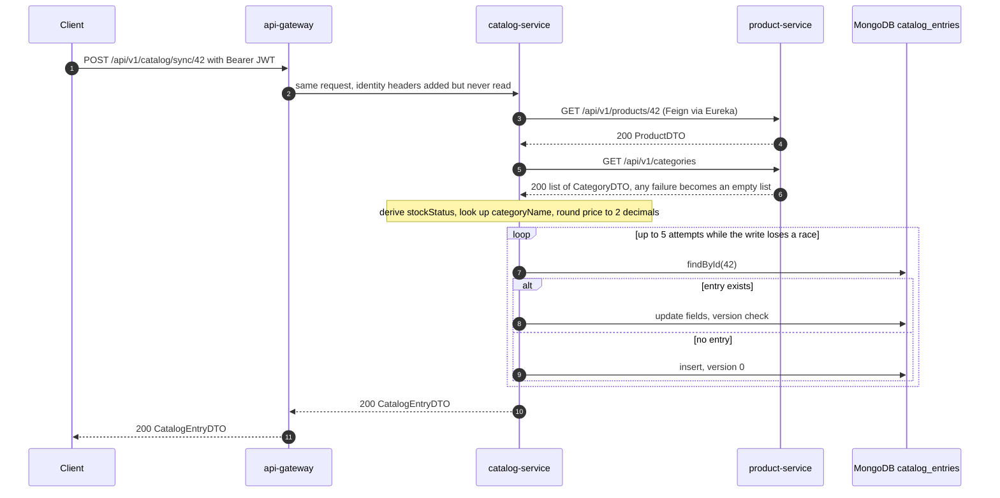
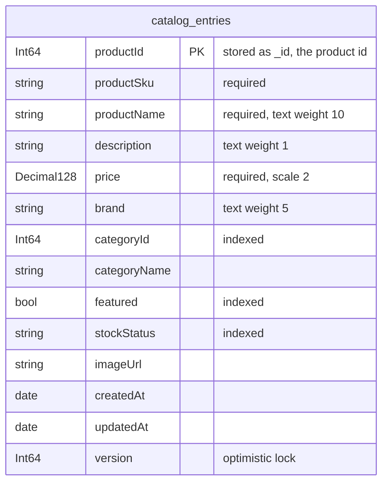

# Catalog Service

catalog-service is a read model of product-service for catalog browsing. It keeps one MongoDB document per product holding a denormalised copy of the product (SKU, name, description, price, brand, category id and name), a stock band derived from the quantity, and the merchandising fields only the catalog owns (`featured`, `imageUrl`). Browse, relevance-ranked search, featured and per-category reads are answered from MongoDB alone, so they keep working while product-service is down. Entries are created and refreshed only by an explicit `POST /api/v1/catalog/sync/{productId}`; nothing keeps them up to date automatically. The service is written in Kotlin and owns the MongoDB database `catalogdb` (collection `catalog_entries`).

| | |
|---|---|
| Repository | `ecommerce-catalog-service` |
| Stack | Kotlin 2.3.0 on Java 25 · Spring Boot 4.0.9 · Spring MVC · Spring Data MongoDB 5.0.1 · Spring Cloud OpenFeign 5.0.1 (Apache HttpClient 5) · Spring Cloud LoadBalancer + Eureka client · Jackson 3 · springdoc-openapi 2.8.5 · Micrometer + OpenTelemetry |
| Port | 8083 |
| Eureka service ID | `catalog-service` |
| Gateway routes | `/api/v1/catalog/**` (GET is public, POST and PATCH need an `ADMIN` JWT) |
| Data store | MongoDB 8.0 `catalogdb`, collection `catalog_entries`; no migration tool, indexes and backfills run at startup (`CatalogCollectionInitializer`) |
| Publishes | — |
| Consumes | — |
| Calls | product-service (Feign): `GET /api/v1/products/{id}`, `GET /api/v1/categories` |
| Called by | No service. External clients through the gateway; the frontend does not use it; `ecommerce-platform/smoke-test.sh` syncs one product and reads it back |

## Responsibilities

- Pull one product, and the full category list, from product-service on request and create or refresh that product's catalog entry.
- Serve reads: entry by product id, browse (paged), search (paged; MongoDB `$text` with a substring fallback), entries of one category, featured entries.
- Let callers set the catalog-owned fields `featured` and `imageUrl`, and the catalog price.
- Bring the collection to the expected shape at startup: create the indexes and backfill documents written by earlier builds.

Not present in the code: automatic refresh (no Kafka, no scheduler), bulk sync, deletion of entries, any use of the product's `status`, authorization.

## Domain model

### CatalogEntry

`model/CatalogEntry.kt` (a regular Kotlin class mapped through its primary constructor), collection `catalog_entries`, exposed as `dto/CatalogEntryDTO.kt`.

| Field | Kotlin type | Stored as | Source | Written by sync | Written by PATCH |
|---|---|---|---|---|---|
| `productId` | `Long` | `_id` (Int64) | product id | on insert | — |
| `productSku` | `String` | string | product `sku` | yes | — |
| `productName` | `String` | string | product `name` | yes | — |
| `description` | `String?` | string | product `description` | yes | — |
| `price` | `BigDecimal` | Decimal128, scale 2 | product `price`, rounded to 2 decimals | yes (overwrites) | yes |
| `brand` | `String?` | string | product `brand` | yes | — |
| `categoryId` | `Long?` | Int64 | product `categoryId` | yes | — |
| `categoryName` | `String?` | string | name of the category with that id, from `GET /api/v1/categories` | yes (`null` when the lookup fails) | — |
| `featured` | `Boolean` | bool | catalog-owned | `false` on insert, then kept | yes |
| `stockStatus` | `StockStatus` | string (enum name) | derived from product `stockQuantity` | yes | — |
| `imageUrl` | `String?` | string | catalog-owned | `null` on insert, then kept | yes |
| `createdAt` | `LocalDateTime` | date | set on insert | kept | — |
| `updatedAt` | `LocalDateTime` | date | set on every write | yes | yes |
| `version` | `Long?` | Int64 | optimistic lock (`@Version`) | +1 per update, 0 on insert | +1 |

Not projected from product-service: the product `status` (`ACTIVE`, `INACTIVE`, `OUT_OF_STOCK`), the exact `stockQuantity`, and the product's timestamps.

### StockStatus

`model/StockStatus.kt`. Derived in `CatalogService.syncFromProductService()` from the product's `stockQuantity` at sync time and never changed in between.

| Value | Condition |
|---|---|
| `OUT_OF_STOCK` | `stockQuantity <= 0` |
| `LOW_STOCK` | `stockQuantity` from 1 to 9 |
| `AVAILABLE` | `stockQuantity >= 10` |

### What survives a re-sync

A sync overwrites every field that comes from product-service, including `price`, and keeps `featured`, `imageUrl` and `createdAt`. The repository README describes the price as "overridable"; it is, but only until the next sync of that product, which silently replaces a price set through `PATCH` with product-service's price.

## Business rules

1. **One entry per product.** The product id is the document `_id` (`CatalogEntry.productId` is the `@Id`), so a product can never have two entries. `CatalogEntryDTO.id` is kept for wire compatibility with the former relational model and always equals `productId`.
2. **Sync is pull, project, then load-modify-save.** `CatalogService.syncFromProductService(productId)`:
   1. calls `getProductById(productId)`; any failure (404, connection error, timeout) propagates;
   2. calls `getAllCategories()` inside `try`/`catch`; any exception becomes an empty list;
   3. picks the category whose `id` equals the product's `categoryId` (none when `categoryId` is `null` or the list is empty);
   4. derives `stockStatus` (table above);
   5. inside `retryingOnConcurrentWrite()`: loads the entry; if it exists, overwrites `productSku`, `productName`, `description`, `price`, `brand`, `categoryId`, `categoryName`, `stockStatus` and `updatedAt` on the loaded document; otherwise builds a new `CatalogEntry` (`featured = false`, `imageUrl = null`, `version = null`); then `save()`.

   Spring Data treats `version == null` as new and inserts, otherwise it updates with a version check. The product data is fetched once, so a retry only re-reads the document and re-applies the same projection; the operation is idempotent. The response is `200` with the saved entry, for a first sync as well as a refresh.
3. **Stock band, not stock.** `stockStatus` follows the thresholds above. The product's `status` is decoded but ignored, so a soft-deleted (`INACTIVE`) product syncs like any other and is served with a band computed from its quantity.
4. **The category name may be lost.** When the categories call fails, the sync still succeeds and writes `categoryName = null`, replacing a name an earlier sync had stored.
5. **Prices are cents.** `toCatalogPrice()` rounds with `setScale(2, RoundingMode.HALF_UP)` on sync and on `PATCH` (product-service sends `NUMERIC(19,4)` values such as `19.9900`; `10.005` becomes `10.01`). The comment explains why: the former relational column was `DECIMAL(19,2)` and rounded on write, while Decimal128 keeps whatever scale it is given, so the rounding keeps the stored and served contract unchanged.
6. **Concurrent writes.** Every write touches one document, so there is no transaction; concurrency is handled by `@Version`.
   - A sync that loses a race (`OptimisticLockingFailureException` when the version moved, `DuplicateKeyException` when two first-time syncs both inserted the same `_id`) is retried by `retryingOnConcurrentWrite()`: up to 5 attempts, sleeping a random 5 to 24 ms multiplied by the attempt number between attempts, because immediate retries under a burst of identical syncs tend to collide again. After the fifth loss the exception propagates and the API answers 409.
   - A `PATCH` that loses a race is not retried: `updateCatalogEntry()` lets the `OptimisticLockingFailureException` through and the API answers 409 so that the client re-reads and decides. The version check covers only the moment between the service's own read and its write; the version is not exposed in the DTO and the `PATCH` does not accept an expected version, so a client that read the entry earlier cannot be told that it changed since.
7. **PATCH is a partial update of catalog-owned fields.** `updateCatalogEntry()` applies `featured`, `imageUrl` and `price` when they are non-null, sets `updatedAt`, and saves. `null` or absent means unchanged, so `imageUrl` cannot be cleared. There is no validation: a zero or negative price and any `imageUrl` string are stored. An unknown product id answers 404.
8. **Search.** `CatalogService.searchCatalog(q, pageable)`:
   1. if `q` is not blank, run `CatalogEntryRepositoryImpl.searchByText()`: `{ $text: { $search: q } }` against the text index, sorted by text score (best first), with skip and limit from the page request; the total comes from a separate count with the same criterion (skipped by `PageableExecutionUtils` when the first page is not full);
   2. if that result has `totalElements > 0`, return it;
   3. otherwise (no text hit, or a blank `q`) run `findByProductNameContainingIgnoreCase(q, pageable)`: `{ productName: { $regex: ".*\Q<q>\E.*", $options: "i" } }`, a collection scan in natural order with `q` quoted so regex metacharacters match literally.

   The choice depends on the total for the query string, so every page of one query uses the same mode. `$text` behaviour (`CatalogCollectionInitializer`, `TextCriteria.forDefaultLanguage()`): the index covers `productName` (weight 10), `brand` (5) and `description` (1) with English stemming and stop words; terms are ORed; matching is case-insensitive and stemmed (`keyboards` finds `keyboard`) but whole-word only (`wirel` does not find `wireless`, which is what the fallback is for). `q` is passed to `$search` unchanged, so MongoDB's `$text` syntax applies: a `"quoted phrase"` must match as a phrase and a `-term` excludes documents. A query made only of stop words has no text hit and falls back to the substring match. An empty `q` matches every entry; a whitespace-only `q` matches names that contain that exact whitespace, not every entry.
9. **Entries are never removed.** There is no delete endpoint and no reaction to product deletion; a soft-deleted or renamed product stays as last synced.

### Sync sequence



## API

| Method | Path | Gateway auth | Purpose |
|---|---|---|---|
| GET | `/api/v1/catalog/search?q=` | Public | Search, paged |
| GET | `/api/v1/catalog` | Public | Browse all entries, paged |
| GET | `/api/v1/catalog/category/{categoryId}` | Public | Entries of one category (list) |
| GET | `/api/v1/catalog/featured` | Public | Featured entries (list) |
| GET | `/api/v1/catalog/product/{productId}` | Public | Entry by product id |
| POST | `/api/v1/catalog/sync/{productId}` | `ADMIN` | Pull the product from product-service and create or refresh its entry |
| PATCH | `/api/v1/catalog/product/{productId}` | `ADMIN` | Set `featured`, `imageUrl`, `price` |

No endpoint performs a service-side role or ownership check. Full reference: [API reference](../api/catalog-service.md).

## Events

This service does not use Kafka (no `spring-kafka` dependency).

Nothing keeps the catalog in sync automatically: there is no Kafka consumer (product-service publishes no product events in any case), no `@Scheduled` job, no sync at startup, and no endpoint that syncs more than one product. The only caller of the sync endpoint in the repositories is `ecommerce-platform/smoke-test.sh`. An entry therefore reflects product-service as of its last sync; prices, the stock band, names, categories and soft deletions drift until someone calls the sync endpoint for that product again.

## Outbound calls

### product-service (Feign)

Client `client/ProductServiceClient.kt`: `@FeignClient(name = "product-service", fallback = ProductServiceClientFallback::class)`, resolved through Eureka by Spring Cloud LoadBalancer, called only from `CatalogService.syncFromProductService()`.

| Client method | Request | Decoded into | Fields used |
|---|---|---|---|
| `getProductById(id: Long)` | `GET /api/v1/products/{id}` | `dto/ProductDTO.kt` | `sku`, `name`, `description`, `price`, `stockQuantity`, `brand`, `categoryId` |
| `getAllCategories()` | `GET /api/v1/categories` | `List<dto/CategoryDTO.kt>` | `id`, `name` |

`ProductDTO(id: Long, sku: String, name: String, description: String?, price: BigDecimal, stockQuantity: Int, brand: String?, categoryId: Long?, status: String)` and `CategoryDTO(id: Long, name: String, description: String?, parentCategoryId: Long?)`. The non-null properties must be present in the response or decoding fails, which is why the consumer pact pins `status` although the sync ignores it. Properties product-service sends but the DTOs do not declare (`createdAt`, `updatedAt`) are ignored. There is no `jackson-module-kotlin`; Jackson 3 binds these classes through their primary constructors using the Java parameter names that the Boot parent POM compiles in (`javaParameters`).

| Setting | Value | Source and reason |
|---|---|---|
| HTTP client | Apache HttpClient 5 | `feign-hc5` dependency. |
| Connect timeout | 2000 ms | `spring.cloud.openfeign.client.config.default.connect-timeout`. Fails fast on a peer that vanished mid-rollout (the default is 10 s) so the retryer can move on to another instance. |
| Read timeout | 10000 ms | `...default.read-timeout`. Reads stay generous. |
| Retries | `ConnectionFailureRetryer`: at most 3 attempts per call, sleeping 100 ms then 200 ms | `config/FeignConfig.kt`. Retries only when the cause is a `java.net.ConnectException` (which includes HttpClient's `HttpHostConnectException`) or HttpClient's `ConnectTimeoutException`: the peer was never reached, so repeating is safe for any method, and the load balancer picks an instance afresh on every attempt. A read timeout (`SocketTimeoutException`) and HTTP errors are not retried because the request may have been processed. Feign clones the retryer per call, so every call starts with a fresh counter. This bridges the seconds between a product-service pod disappearing and every registry cache dropping it. |
| Load balancing | eager-load for `product-service`; instance cache TTL 5 s; Eureka registry fetch every 5 s | `spring.cloud.loadbalancer.*`, `eureka.client.registry-fetch-interval-seconds`. Without eager-load the first call fails with "Load balancer does not contain an instance". The short caches let a replaced peer be seen quickly. |
| Message converters | `ThreadSafeFeignHttpMessageConverters` | `config/FeignConfig.kt`. Spring Cloud OpenFeign 5.0.1's `FeignHttpMessageConverters` builds its converter list lazily without synchronisation: it publishes an empty `ArrayList` and fills it afterwards, so when the first Feign calls of a fresh JVM arrive concurrently a second thread can see the empty list and `SpringDecoder` fails with `DecodeException: 'messageConverters' must not be empty` (a 500 for that caller). The subclass makes the first initialisation mutually exclusive (double-checked on a `@Volatile` flag) and reads stay lock-free afterwards. The bean replaces the library's `@ConditionalOnMissingBean` bean; the per-client child contexts see the parent bean and skip their own. |
| Circuit breaker | none active | See below. |
| Fallback | `ProductServiceClientFallback`, never invoked | See below. |
| Error mapping | `FeignException.NotFound` only | A product-service 404 becomes 404 `Product not found in product-service`; every other `FeignException` and exhausted retry reaches the catch-all handler: 500. |
| Correlation id | not forwarded | There is no Feign `RequestInterceptor`; product-service logs the call under its own id. |
| Tracing | Feign calls are not observed | `feign-micrometer` is not on the classpath, so Spring Cloud OpenFeign's Micrometer capability is inactive. |

**The circuit breaker and the fallback are not wired.** Spring Cloud OpenFeign wraps a client in a circuit breaker, and honours `fallback`, only when `spring.cloud.openfeign.circuitbreaker.enabled=true` (`FeignAutoConfiguration.CircuitBreakerPresentFeignTargeterConfiguration`). The property is not set in `application.yaml`, docker-compose or the Kubernetes manifests. Consequently `ProductServiceClientFallback` (whose `getProductById()` throws `RuntimeException("Product service unavailable - circuit breaker open")` and whose `getAllCategories()` returns an empty list) is never called, and `resilience4j.circuitbreaker.instances.product-service` (sliding window 10, minimum 5 calls, 50 % failure rate, 10 s open) governs no call. Enabling the property alone would not apply those settings either: the breaker names are derived from the client interface and method (`Feign.configKey`, made alphanumeric by default), not `product-service`.

**When product-service misbehaves**

| Situation | What happens | Caller of the sync sees |
|---|---|---|
| No registered instance | The load balancer answers 503 itself; Feign throws `FeignException.ServiceUnavailable` | 500 |
| Instance registered but refusing connections, or connect timeout | Up to 3 attempts, each choosing an instance again | 200 if a later attempt connects, otherwise 500 |
| Slow response (over 10 s) | `SocketTimeoutException`, not retried | 500 after about 10 s |
| `404` for the product | `FeignException.NotFound`, mapped by `GlobalExceptionHandler` | 404 |
| Any other 4xx or 5xx | the matching `FeignException` | 500 |
| Categories call fails | caught, treated as an empty list | 200, `categoryName` is `null` |
| Any read endpoint | never calls product-service | unaffected |

## Persistence

### Collection `catalog_entries`

Database `catalogdb` (`spring.mongodb.database`). One document per product:

| Field | BSON type | Notes |
|---|---|---|
| `_id` | Int64 | The product id (`CatalogEntry.productId`); there is no separate `productId` field. |
| `productSku` | string | |
| `productName` | string | Text-indexed, weight 10. |
| `description` | string | Text-indexed, weight 1. Omitted when `null`. |
| `price` | Decimal128 | `spring.data.mongodb.representation.big-decimal: decimal128`. Spring Data's historical default stores `BigDecimal` as a string, which sorts lexically and defeats range queries; Decimal128 is exact. Scale 2 because the service rounds before writing. |
| `brand` | string | Text-indexed, weight 5. Omitted when `null`. |
| `categoryId` | Int64 | Indexed. Omitted when `null`. |
| `categoryName` | string | Omitted when `null`. |
| `featured` | bool | Indexed. |
| `stockStatus` | string | `AVAILABLE`, `LOW_STOCK` or `OUT_OF_STOCK`. Indexed. |
| `imageUrl` | string | Omitted when `null`. |
| `createdAt` | date | Millisecond precision. |
| `updatedAt` | date | Millisecond precision. |
| `version` | Int64 | Optimistic lock: 0 on insert, +1 on every update. |

Spring Data does not write `null` properties, so absent fields read back as `null`. No `_class` field is written (see `MongoConfig` below). `LocalDateTime` values are converted to BSON dates through the JVM's default time zone, and `CatalogEntry.now()` truncates them to milliseconds so that the value returned right after a save is identical to the one a later read returns. MongoDB applies no schema validation; the Kotlin types enforce shape on read (a document without `productSku` would fail to map).

Example document:

```json
{
  "_id": 1,
  "productSku": "SKU-001",
  "productName": "Wireless Mouse",
  "description": "Ergonomic wireless mouse",
  "price": { "$numberDecimal": "49.99" },
  "brand": "Logi",
  "categoryId": 10,
  "categoryName": "Electronics",
  "featured": false,
  "stockStatus": "AVAILABLE",
  "createdAt": { "$date": "2026-10-29T18:07:12.345Z" },
  "updatedAt": { "$date": "2026-10-29T18:07:12.345Z" },
  "version": 0
}
```



### Indexes

| Name | Keys | Used by |
|---|---|---|
| `_id_` | `_id` | `findById` (entry by product id, sync, PATCH). Unique by construction. |
| `idx_catalog_entries_category_id` | `categoryId: 1` | `findByCategoryId` |
| `idx_catalog_entries_featured` | `featured: 1` | `findByFeaturedTrue` |
| `idx_catalog_entries_stock_status` | `stockStatus: 1` | `findByStockStatus`, which no endpoint calls |
| `idx_catalog_entries_text` | text on `productName` (10), `brand` (5), `description` (1); `default_language: english` | `searchByText` (MongoDB allows one text index per collection) |

The substring fallback (`$regex` with a leading `.*`) and browse cannot use an index.

### CatalogCollectionInitializer

`config/CatalogCollectionInitializer.kt` does the job Flyway did for the relational schema. It is an `ApplicationRunner`, so it runs after the context starts and before `ApplicationReadyEvent`: the Kubernetes readiness probe passes only once it has finished, and if MongoDB is unreachable the exception fails startup (compose and Kubernetes restart the container once the database is healthy).

1. `backfillLegacyDocuments()`: sets `version: 0` on documents that have no `version` (Spring Data reads a missing version as "new", so a later save would try to insert and fail on the duplicate `_id`), and unsets `_class`, which earlier builds wrote. Both updates address the collection by name rather than by entity class, because the entity-typed overloads add `$inc: {version: 1}` to any update that does not set the version and would bump every legacy document. Logs `Backfilled catalog_entries: ...` when anything changed.
2. `ensureIndexes()`: `createIndex` for each definition in `INDEXES` and logs `Ensured index <name> on catalog_entries`. Creating an identical existing index is a no-op.

Index creation is explicit instead of `spring.data.mongodb.auto-index-creation` (set to `false`) so the index set is visible in one place, named, and created once the application is up rather than as a side effect of mapping-context bootstrap.

### MongoConfig

`config/MongoConfig.kt` registers a static `BeanPostProcessor` that gives Boot's `MappingMongoConverter` a `DefaultMongoTypeMapper(null)`, which stops Spring Data from writing the `_class` type hint. The hint only matters when one collection holds several entity types; `catalog_entries` holds one, so it was noise and leaked a Java class name into the data. A post-processor is used instead of a replacement converter bean so that Boot's converter, with its Decimal128 representation and codec registry, stays untouched; it is `@JvmStatic` because bean post-processors must exist before the beans they process.

## Security and identity

- **Gateway.** `GET` under `/api/v1/catalog` is public. `POST /api/v1/catalog/sync/{productId}` and `PATCH /api/v1/catalog/product/{productId}` need a JWT whose role is exactly `ADMIN` (403 at the edge otherwise).
- **Service.** No Spring Security. `security/Authorization.requireAdmin` runs before the service layer on both writes: 401 `Authentication required` without `X-Username`, 403 `Access denied` unless `X-User-Role` is exactly `ADMIN`. The `PATCH` body is validated: `price` > 0 with at most 15 integer digits and 2 decimals; `imageUrl` an absolute `http(s)` URL of at most 2048 characters, or empty to clear. Page size is 1 to 100. `SecurityHeadersFilter` adds `nosniff` and `no-store`; `ActuatorRegistryFilter` limits `/actuator/serviceregistry` to loopback.
- **Bypassing the gateway.** docker-compose publishes port 8083 on the host, so both write endpoints can be called at `http://localhost:8083` with forged identity headers.
- **Database account.** The service authenticates as the MongoDB root user created by the container (`MONGO_INITDB_ROOT_USERNAME=cataloguser`, `authentication-database: admin`), which has full rights on the whole server; compose also publishes MongoDB on host port 27017.

## Configuration

From `src/main/resources/application.yaml`, plus what docker-compose and Kubernetes set.

| Property | Env var | Default | Purpose |
|---|---|---|---|
| `server.port` | — | `8083` | HTTP port. |
| `spring.application.name` | — | `catalog-service` | Eureka service ID, metric tag. |
| `spring.mongodb.host` | `SPRING_MONGODB_HOST` | `localhost` | compose and k8s: `catalogdb`. |
| `spring.mongodb.port` | `SPRING_MONGODB_PORT` | `27017` | |
| `spring.mongodb.database` | `SPRING_MONGODB_DATABASE` | `catalogdb` | |
| `spring.mongodb.username` | `DB_USERNAME` | `cataloguser` | k8s: secret `catalogdb-credentials`, key `MONGO_INITDB_ROOT_USERNAME`. |
| `spring.mongodb.password` | `DB_PASSWORD` | `catalogpass` | k8s: secret `catalogdb-credentials`, key `MONGO_INITDB_ROOT_PASSWORD`. |
| `spring.mongodb.authentication-database` | — | `admin` | The container's root user lives in `admin`. |
| `spring.mongodb.uri` | `SPRING_MONGODB_URI` | unset | When set, Boot ignores host, port and credentials. |
| `spring.data.mongodb.representation.big-decimal` | — | `decimal128` | Exact numeric storage for `price`. |
| `spring.data.mongodb.auto-index-creation` | — | `false` | Indexes come from `CatalogCollectionInitializer`. |
| `spring.cloud.openfeign.client.config.default.connect-timeout` / `read-timeout` | — | `2000` / `10000` ms | Feign timeouts. |
| `spring.cloud.loadbalancer.cache.ttl` | — | `5s` | Matches the Eureka fetch interval. |
| `spring.cloud.loadbalancer.eager-load.clients` | — | `product-service` | Build the instance list at startup. |
| `eureka.client.service-url.defaultZone` | `EUREKA_CLIENT_SERVICEURL_DEFAULTZONE` | `http://localhost:8761/eureka/` | compose and k8s: `http://service-discovery:8761/eureka/`. |
| `eureka.client.registry-fetch-interval-seconds` | — | `5` | |
| `eureka.instance.prefer-ip-address` | `EUREKA_INSTANCE_PREFER_IP_ADDRESS` (k8s) | `true` | |
| `eureka.instance.lease-renewal-interval-in-seconds` / `lease-expiration-duration-in-seconds` | — | `5` / `15` | |
| `resilience4j.circuitbreaker.instances.product-service.*` | — | window 10, minimum 5 calls, 50 %, 10 s open | Applies to no call (see Outbound calls). |
| `management.endpoints.web.exposure.include` | — | `health,info,metrics,prometheus,circuitbreakers,serviceregistry` | |
| `management.endpoint.health.show-details` | — | `never` | |
| `management.endpoint.health.probes.enabled` | `MANAGEMENT_ENDPOINT_HEALTH_PROBES_ENABLED` (k8s) | unset | k8s sets `true`. |
| `management.metrics.tags.environment` | `ENVIRONMENT` | `development` | |
| `management.tracing.sampling.probability` | `TRACING_SAMPLING_PROBABILITY` | `1.0` | |
| `management.opentelemetry.tracing.export.otlp.endpoint` | `OTEL_EXPORTER_OTLP_ENDPOINT` (base) | `http://tempo:4318` + `/v1/traces` | |
| `management.otlp.metrics.export.enabled` | — | `false` | |
| `springdoc.api-docs.path` / `swagger-ui.path` | — | `/api-docs` / `/swagger-ui.html` | |
| `logging.pattern.console` | — | `%d{yyyy-MM-dd HH:mm:ss} [%X{correlationId}] [%thread] %-5level %logger{36} - %msg%n` | |
| `spring.data.web.pageable.serialization-mode` | — | not set (`direct`) | Page JSON shape, see the API reference. |
| `spring.jackson.*` | — | not set | Jackson 3 defaults. |
| `JAVA_OPTS` | `JAVA_OPTS` | `-XX:MaxRAMPercentage=55 -XX:ActiveProcessorCount=2 -XX:+ExitOnOutOfMemoryError` (compose and k8s) | |

Profile `test` (`src/test/resources/application-test.yaml`): database `catalogdb-test`, Eureka client off. The repository slice test does not use it; its MongoDB comes from a Testcontainers `@ServiceConnection`.

Runtime: compose `mem_limit: 768m`, waits for a healthy `catalogdb` (an authenticated `mongosh` ping, so the image's temporary auth-less first-boot `mongod` cannot report healthy too early) and `service-discovery`. MongoDB runs `mongo:8.0` with `--wiredTigerCacheSizeGB 0.25` under a 512m limit. Kubernetes: one replica, requests 100m / 320Mi, limit 768Mi, readiness-based startup and readiness probes, liveness probe, init containers waiting for `service-discovery:8761` and `catalogdb:27017`, and the same `preStop` drain as the other services (post `OUT_OF_SERVICE` to `/actuator/serviceregistry`, sleep 15 s).

## Observability

- **Actuator.** `/actuator/health` (details always; includes MongoDB), liveness and readiness groups in Kubernetes, `/actuator/info`, `/actuator/metrics`, `/actuator/prometheus` (unrestricted), `/actuator/serviceregistry` (used by the `preStop` hook). `circuitbreakers` is in the exposure list, but no call goes through a breaker.
- **Metrics.** Boot's auto-configured meters only; no custom meters. `http.server.requests` has a percentile histogram and SLO buckets at 50 ms to 2 s; meters carry `application=catalog-service` and `environment`. Prometheus job `catalog-service` scrapes `catalog-service:8083/actuator/prometheus`; MongoDB is scraped by `mongodb-exporter-catalogdb` (`:9216`) with the alerts `MongoDown` and `MongoTooManyConnections`.
- **Logs.** `Synced catalog entry for product <id>` (INFO); `Concurrent write on sync of product <id> (attempt <n>/5), retrying` (INFO); `Not found: <message>` (WARN, every 404); `Concurrent modification on <uri>: <message>` (WARN, every 409); `Unhandled exception` (ERROR, every 500, including Feign failures and malformed requests); `Ensured index <name> on catalog_entries` at startup.
- **Correlation id.** `filter/CorrelationIdFilter.kt` uses `X-Correlation-Id` when the header is present (an empty value is used as is; only a missing header gets a new UUID), puts it in the MDC and echoes it. It is not forwarded on the Feign calls.
- **Tracing.** Micrometer tracing with OTLP export to Tempo, sampling 1.0. Inbound requests are traced; the Feign calls to product-service are not instrumented.

## Testing

Paths are relative to `src/test/kotlin/com/ecommerce/`.

| Class | Kind | What it covers |
|---|---|---|
| `catalogservice/service/CatalogServiceTest` | Mockito unit test | Featured, by id (found, not found, `id == productId`), by category, search (text hit, substring fallback, blank query skips the text index), PATCH (featured and price, not found, a lost race is not retried), sync (insert keyed by product id with `LOW_STOCK`, cents rounding, update in place keeps `featured` and `imageUrl`, retry after a lost first insert fetches the product only once, gives up after five lost races). |
| `catalogservice/repository/CatalogEntryRepositoryTest` | `@DataMongoTest` against `mongo:8.0` via Testcontainers; skipped, not failed, without Docker | Field round trip with Decimal128 price, no `productId` field, no `_class`, version 0; insert collision on an existing id; derived queries; regex metacharacters in the substring search; paging; startup indexes by name; timestamps across load-modify-save; text ranking and OR semantics and whole-word matching; stable text-search totals; the service's text-then-substring choice; a stale save rejected by the version check; two racing first syncs converge; backfill of legacy documents. |
| `catalogservice/repository/MongoSliceTestConfiguration` | test configuration | Stands in for the application class in the slice, because the real one's `@EnableFeignClients` needs Feign auto-configuration the slice leaves out. |
| `catalogservice/config/ConnectionFailureRetryerTest` | unit test | Connection refused and connect timeouts are retried then propagated; read timeouts are not retried; `clone()` resets the counter. |
| `catalogservice/config/FeignHttpMessageConvertersRaceTest` | concurrency test | 200 rounds of 48 threads hitting a cold converter instance never observe an empty list. |
| `catalogservice/contract/ProductServiceConsumerPactTest` | Pact consumer | Runs the real Feign client, the production `FeignConfig` and Boot's Jackson against a Pact mock server on fixed port 18083, driven through `CatalogService.syncFromProductService()`; writes `target/pacts/catalog-service-product-service.json`. |
| `catalogservice/exception/GlobalExceptionHandlerTest`, `catalogservice/filter/CorrelationIdFilterTest` | unit | exception mappings, including the client-error mappings and the catch-all; the correlation ID |
| `catalogservice/client/ProductServiceClientFallbackTest`, `catalogservice/config/CatalogCollectionInitializerTest` | unit | the inactive fallback; the startup backfill and index creation logic |
| `catalogservice/integration/CatalogApiIT` | full app, `mongo:8.0`, WireMock for product-service | sync stores the projection and a second sync updates in place, keeping the catalog-owned fields; get by id and the 404 envelope with the caller's correlation ID; browse paging; by category; featured; PATCH; search ranking and the substring fallback |
| `catalogservice/integration/ProductServiceFailureIT` | full app, `mongo:8.0`, WireMock | product-service answering 500, being down (after the connection retries) or returning an undecodable body fails the sync and writes nothing; the sync works again on recovery; a failing categories call only costs the category name |
| `catalogservice/integration/CatalogCollectionInitializerIT` | full app, `mongo:8.0` | startup creates every index; on a fresh database it creates the collection and a second run changes nothing; a legacy document is backfilled and then updatable |
| `catalog/controller/CatalogControllerTest.kt`, `catalog/service/CatalogServiceTest.kt` | placeholders | Only a package line and the comment "Replaced"; no tests. The web layer is covered by `CatalogApiIT` |

69 unit, slice and pact tests and 20 integration tests. The repository test skips without Docker; the ITs fail.

No tests are disabled for bugs any more.

Pinned by the consumer pact (verified by `ProductServiceProviderPactTest` in product-service after `ecommerce-platform/sync-pacts.sh` copies it there):

| Interaction | Provider state | Request | Response pinned |
|---|---|---|---|
| a request for product 1 | `product 1 exists` | `GET /api/v1/products/1` | 200; `id` integer, `sku`, `name`, `description` strings, `price` number, `stockQuantity` integer, `brand` string, `categoryId` integer, `status` string |
| a request for all categories | `categories exist` | `GET /api/v1/categories` | 200; array of at least one `{id integer, name string, description string}` |
| a request for product 999 | `product 999 does not exist` | `GET /api/v1/products/999` | 404; `status` integer, `error`, `message` strings |

The repository test's "blank -> everything" assertion passes because both test product names contain a space; it does not show that a blank query returns every entry.

CI (`.circleci/config.yml`) runs `mvn -B -ntp verify` in `cimg/openjdk:25.0` with the Docker socket mounted, so the Testcontainers test runs there.

## Code map

Paths are relative to `src/main/kotlin/com/ecommerce/catalogservice/` unless stated.

| Path | Role |
|---|---|
| `CatalogServiceApplication.kt` | Boot entry point, `@EnableFeignClients`. |
| `client/ProductServiceClient.kt` | Feign client for product-service. |
| `client/ProductServiceClientFallback.kt` | Fallback implementation; not wired (no Feign circuit breaker). |
| `config/FeignConfig.kt` | `ThreadSafeFeignHttpMessageConverters`, `ConnectionFailureRetryer`. |
| `config/MongoConfig.kt` | Removes the `_class` type hint. |
| `config/CatalogCollectionInitializer.kt` | Startup backfill and index creation. |
| `config/OpenApiConfig.kt` | OpenAPI title and a global `bearerAuth` scheme (documentation only). |
| `controller/CatalogController.kt` | `/api/v1/catalog` endpoints. |
| `service/CatalogService.kt` | Search, reads, sync, PATCH, retry on concurrent writes, price rounding, DTO mapping. |
| `repository/CatalogEntryRepository.kt` | Spring Data MongoDB repository (derived queries). |
| `repository/CatalogEntryRepositoryCustom.kt` | `searchByText` and its `Impl` (MongoTemplate `$text` query). |
| `model/CatalogEntry.kt`, `model/StockStatus.kt` | Document class and stock band enum. |
| `dto/` | `CatalogEntryDTO`, `UpdateCatalogEntryRequest`, and the inbound `ProductDTO` and `CategoryDTO`. |
| `exception/` | `CatalogEntryNotFoundException`, `ErrorResponse` and `FieldError`, `GlobalExceptionHandler`. |
| `filter/CorrelationIdFilter.kt` | `X-Correlation-Id` to MDC and response header. |
| `docker/Dockerfile` | Runtime image: `eclipse-temurin:25-jre-alpine`, copies the jar built on the host, runs as a non-root user. |

## Known issues and limitations

| Issue | Where | Impact | Severity |
|---|---|---|---|
| Nothing keeps entries in sync: no event consumer, no schedule, no bulk sync; product-service publishes no events. | whole service; `CatalogService.syncFromProductService()` is the only writer of product fields | Prices, stock bands, names, categories and soft deletions are stale until someone re-syncs each product by hand. | Medium |
| A price set through `PATCH` is overwritten by the next sync, although the README calls the price overridable. | `CatalogService.syncFromProductService()` (existing-entry branch) | Merchandising price changes are silently lost. | Medium |
| The product `status` is ignored and entries are never removed. | `CatalogService.syncFromProductService()`; no delete endpoint | Soft-deleted products stay in the catalog and are shown with a stock band computed from their quantity. | Medium |
| ~~Write endpoints need only any JWT~~ (fixed: admin-only, validated); port 8083 still skips the gateway in compose. | `controller/CatalogController.kt` | Any user can sync any product and change `featured`, `imageUrl` and the catalog price. The storefront does not read the catalog today, which limits the effect. | Medium |
| ~~Feign failures are not mapped~~ | fixed for an unknown product (404); other upstream failures are still 500. | | — |
| The configured circuit breaker and the fallback are dead: `spring.cloud.openfeign.circuitbreaker.enabled` is never set. | `client/ProductServiceClient.kt`, `client/ProductServiceClientFallback.kt`, `application.yaml` (`resilience4j`) | No protection when product-service is slow: each sync can hold a request thread for up to 10 s per call. The configuration suggests otherwise. | Low |
| A failed categories call writes `categoryName = null` over a previously stored name. | `CatalogService.syncFromProductService()` | A transient failure blanks category names. | Low |
| ~~No client-error handlers~~ | fixed | Malformed requests are 400/404/405/406/415. | — |
| ~~The PATCH body is not validated~~ | fixed | `price` and `imageUrl` are validated (see Security and identity). | — |
| The 409 only covers the service's own read-to-write window; the version is not exposed and the PATCH takes no expected version. | `CatalogService.updateCatalogEntry()`, `dto/CatalogEntryDTO.kt` | A client editing from an older read overwrites newer changes without a conflict. | Low |
| Browse and the substring fallback are unsorted; `size` is capped at 100. | `CatalogService.getAllEntries()`, `findByProductNameContainingIgnoreCase()`, `CatalogController` | Page boundaries are not guaranteed stable; a client can request any page size. | Low |
| Every sync downloads the full category list instead of `GET /api/v1/categories/{id}`. | `CatalogService.syncFromProductService()` | Cost grows with the number of categories. | Low |
| Changing an index definition under an existing name, or the text index fields, makes `createIndex` fail and stops startup until the old index is dropped by hand. | `config/CatalogCollectionInitializer.kt` | Operational step on index changes. | Low |
| Dead code and configuration: `findByStockStatus` and its index (no endpoint), `ProductServiceClientFallback`, the `resilience4j` instance, the unused `spring-boot-starter-validation`, and two placeholder test files under `com/ecommerce/catalog`. | `repository/CatalogEntryRepository.kt`, `pom.xml`, `src/test/kotlin/com/ecommerce/catalog/` | Noise; one index maintained for nothing. | Low |
