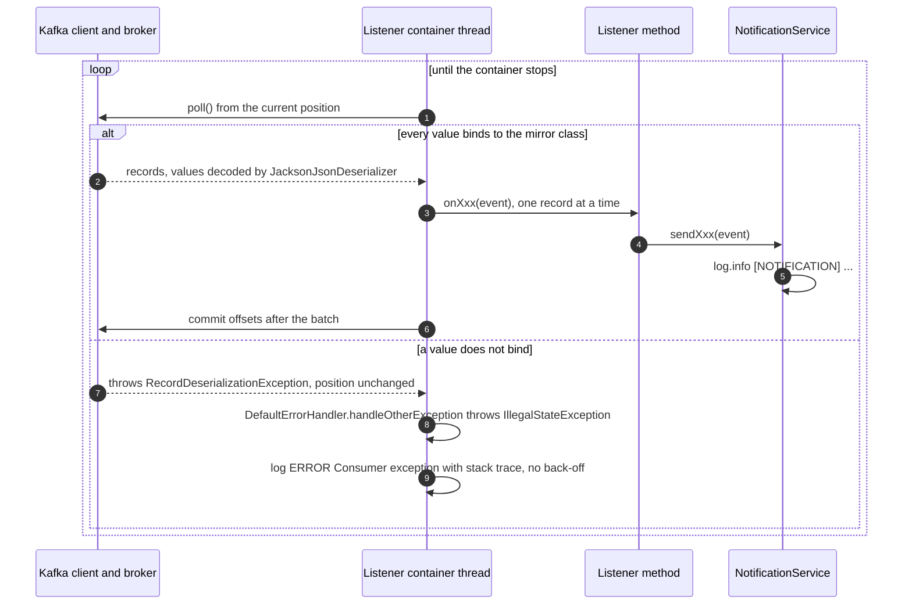

# Notification service

notification-service is the terminal consumer of the platform's business
events. It listens to all seven topics (`order.placed`, `order.cancelled`,
`payment.completed`, `payment.failed`, `payment.refunded`, `shipment.created`,
`shipment.updated`), decodes each record into its own copy of the producer's
event class, and writes one `[NOTIFICATION]` line to the log. It is the place
where customer notifications (email, SMS) would go, but none is sent today. It
owns no data, has no database and exposes no application API, so it has no
gateway route.

| | |
|---|---|
| Repository | `ecommerce-notification-service` |
| Stack | Java 25 · Spring Boot 4.0.9 · spring-kafka 4.0.1 (kafka-clients 4.1.1, Jackson 3 `JacksonJsonDeserializer`) · Spring MVC (serves only actuator) · Eureka client · Micrometer and OpenTelemetry · Lombok |
| Port | 8088 (actuator only) |
| Eureka service ID | `notification-service`. It registers, but nothing looks it up. |
| Gateway routes | — |
| Data store | — (the only state is the consumer group's offsets, kept by Kafka) |
| Publishes | — |
| Consumes | `order.placed`, `order.cancelled` (order-service); `payment.completed`, `payment.failed`, `payment.refunded` (payment-service); `shipment.created`, `shipment.updated` (shipping-service). Consumer group `notification-service`. |
| Calls | — |
| Called by | Nobody. Prometheus scrapes `/actuator/prometheus`; the compose healthcheck, the Kubernetes probes and the blackbox exporter call `/actuator/health`. |

## Responsibilities

- Subscribe to the seven business-event topics, one listener per topic.
- Deserialize each record into the matching mirror class in `event/`.
- Hand the event to `service/NotificationService`, which logs it at INFO.

That is all it does. `NotificationService.sendOrderConfirmation()` carries the
note `// TODO: swap for JavaMailSender when SMTP configured`. Nothing resolves a
`customerId` to an address, nothing is stored, and nothing is published.

## Domain model

There are no entities and no database. The service's types are the seven event
mirror classes in `event/`: Lombok `@Data` classes with no-args and all-args
constructors whose field names and types must match the JSON the producers
write. They are compared with the producers' classes field by field under
[Consumed](#consumed).

## Business rules

1. **One listener container per topic, one consumer thread each.** Each `@KafkaListener` in `consumer/OrderEventConsumer`, `consumer/PaymentEventConsumer` and `consumer/ShipmentEventConsumer` names its own container factory and `groupId = "notification-service"`. No concurrency is configured anywhere, so each container runs one consumer: seven consumers in one group, each subscribed to one topic.
2. **The payload type comes only from the container factory.** `KafkaConsumerConfig.consumerFactory(Class<T>)` builds a `JacksonJsonDeserializer<T>` for the target class and calls `setUseTypeHeaders(false)`, so a `__TypeId__` header would be ignored. The producers send none anyway (their `JacksonJsonSerializer` is built with `.noTypeInfo()` in all three `KafkaProducerConfig`s). `addTrustedPackages("*")` has no effect while type headers are ignored.
3. **Unknown JSON properties are dropped; missing ones become `null`.** spring-kafka's `JacksonJsonDeserializer` uses `JacksonMapperUtils.enhancedJsonMapper()` (Jackson 3, where java.time support is built in), which turns `FAIL_ON_UNKNOWN_PROPERTIES` off. This is how the `items` array of `order.placed` is ignored. Jackson 3 reads a `LocalDateTime` from the producers' integer arrays as well as from ISO strings.
4. **A value that does not bind is never skipped.** A JSON type that does not fit a mirror field (or malformed JSON) fails inside `poll()`, and the container retries it forever. See [Failure handling](#failure-handling).
5. **Each event produces exactly one INFO log line and no other effect.** See the [log lines](#log-lines).
6. **Delivery is at least once and nothing deduplicates.** A redelivered record is logged again.
7. **Offsets.** The listener container commits offsets itself after the records of each `poll()` have been handled (spring-kafka's default `AckMode.BATCH`). `enable.auto.commit` is not configured, so the container forces it to `false`. A partition without a committed offset starts from the **earliest** retained record.

## API

None. The service has no controllers. Its Tomcat on port 8088 serves only the
actuator endpoints (and Boot's default `/error`), the gateway has no route to it,
and no other service calls it. For that reason there is no
`docs/api/notification-service.md`.

## Events

### Published

None.

### Consumed

All seven topics are auto-created by the broker (`KAFKA_AUTO_CREATE_TOPICS_ENABLE=true`
in compose and Kubernetes; no `NewTopic` beans), so each has the broker default
of one partition. Every record's key is the order ID as a decimal string
(`event.getOrderId().toString()` in each producer), including the shipment
topics.

| Topic | Producer, and what triggers it | Listener | Container factory bean | Handler |
|---|---|---|---|---|
| `order.placed` | order-service `OrderService.confirmOrder()`, on `POST /api/v1/orders/{orderId}/confirm` once the order is `CONFIRMED` | `OrderEventConsumer.onOrderPlaced()` | `orderPlacedKafkaListenerContainerFactory` | `sendOrderConfirmation()` |
| `order.cancelled` | order-service `OrderService.cancelOrder()`, on `DELETE /api/v1/orders/{orderId}`. **Not** published when order-service cancels an order because of `payment.failed` (`PaymentEventConsumer.handlePaymentFailed()` only sets the status). | `OrderEventConsumer.onOrderCancelled()` | `orderCancelledKafkaListenerContainerFactory` | `sendOrderCancellation()` |
| `payment.completed` | payment-service `PaymentService.processPayment()`, on `POST /api/v1/payments/{id}/process` when the simulated gateway succeeds (8 times in 10) | `PaymentEventConsumer.onPaymentCompleted()` | `paymentCompletedKafkaListenerContainerFactory` | `sendPaymentConfirmation()` |
| `payment.failed` | the same call when the simulated gateway declines (2 times in 10) | `PaymentEventConsumer.onPaymentFailed()` | `paymentFailedKafkaListenerContainerFactory` | `sendPaymentFailed()` |
| `payment.refunded` | payment-service `PaymentService.refundPayment()`, on `POST /api/v1/payments/{id}/refund` of a `COMPLETED` payment | `PaymentEventConsumer.onPaymentRefunded()` | `paymentRefundedKafkaListenerContainerFactory` | `sendPaymentRefunded()` |
| `shipment.created` | shipping-service `PaymentEventConsumer.handlePaymentCompleted()`, when it consumes `payment.completed` and the order has no shipment yet | `ShipmentEventConsumer.onShipmentCreated()` | `shipmentCreatedKafkaListenerContainerFactory` | `sendShipmentCreated()` |
| `shipment.updated` | shipping-service `ShipmentService.updateShipmentStatus()`, on `PATCH /api/v1/shipments/{id}/status` | `ShipmentEventConsumer.onShipmentUpdated()` | `shipmentUpdatedKafkaListenerContainerFactory` | `sendShipmentUpdated()` |

Listeners are in `consumer/`, handlers in `service/NotificationService.java`, and
the factories in `config/KafkaConsumerConfig.java`. An eighth factory,
`kafkaListenerContainerFactory` (target type `Object`), is the default name
spring-kafka would use for a listener that names none. No listener uses it.

#### Consumer settings

These hold for all seven containers. They are hard-coded in `KafkaConsumerConfig`
or are spring-kafka defaults; none comes from `application.yaml` except the
bootstrap servers.

| Setting | Value | Source |
|---|---|---|
| `bootstrap.servers` | `${KAFKA_BOOTSTRAP_SERVERS:localhost:9092}`; compose and k8s: `kafka:29092` | `@Value("${spring.kafka.bootstrap-servers}")` in `KafkaConsumerConfig` |
| `group.id` | `notification-service` | `KafkaConsumerConfig.consumerFactory()` and every `@KafkaListener(groupId = ...)` |
| `auto.offset.reset` | `earliest` | `KafkaConsumerConfig.consumerFactory()` |
| Key deserializer | `StringDeserializer` instance | `KafkaConsumerConfig.consumerFactory()` |
| Value deserializer | `JacksonJsonDeserializer<T>` instance, target type fixed per factory, `setUseTypeHeaders(false)`, `addTrustedPackages("*")` | `KafkaConsumerConfig.consumerFactory()`. No `ErrorHandlingDeserializer` around it. |
| `enable.auto.commit` | `false` | forced by the listener container because it is not set |
| Ack mode | `BATCH` (commit after each poll's records) | spring-kafka default |
| Concurrency | 1 per container | spring-kafka default; not set on the factories or the annotations |
| Error handler | `DefaultErrorHandler` with `FixedBackOff(0, 9)`, no recoverer beyond logging, no dead-letter topic | spring-kafka default; `factory()` sets none |

`application.yaml` sets only `spring.kafka.bootstrap-servers`, read through the
`@Value` above. In Spring Boot 4 the Kafka auto-configuration lives in the
`spring-boot-kafka` module (`spring-boot-starter-kafka`), and this service
depends on plain `org.springframework.kafka:spring-kafka`, so nothing would bind
any other `spring.kafka.*` key. Until 2026-10-29 the YAML also carried a
`spring.kafka.consumer.*` block (naming the deprecated `JsonDeserializer` and a
narrower trusted-package list than the code's `*`). None of it was ever read, and
it was removed.

#### Payloads

All producers serialize with spring-kafka's `JacksonJsonSerializer` (Jackson 3, with
`DateTimeFeature.WRITE_DATES_AS_TIMESTAMPS` switched on to keep the format the
Jackson 2 `JsonSerializer` used to produce) and no type headers. On the wire:

- `LocalDateTime` is an **integer array** `[year, month, day, hour, minute, second, nanos]`. Seconds and nanos are left out when zero, so the array has 5 to 7 elements. It is not an ISO string.
- `BigDecimal` is a JSON number. `Long` is a JSON integer.

**Every mirror matches its producer class in field names and Java types.** The
only difference is that the `order.placed` mirror leaves out `items`, which is
ignored on arrival (rule 3). There are no type mismatches today.

**`order.placed`**: `event/OrderPlacedEvent` vs order-service `com.ecommerce.order.event.OrderPlacedEvent`

| Field | Mirror type | Producer type | JSON | In the log line |
|---|---|---|---|---|
| `orderId` | `Long` | `Long` | integer | yes |
| `customerId` | `String` | `String` | string | yes |
| `totalAmount` | `BigDecimal` | `BigDecimal` | number | yes |
| `orderDate` | `LocalDateTime` | `LocalDateTime` | integer array | no |
| `items` | not mirrored | `List<OrderItemEvent>` (`productId` Long, `productName` String, `productPrice` BigDecimal, `quantity` Integer) | array of objects | ignored |

**`order.cancelled`**: `event/OrderCancelledEvent` vs `com.ecommerce.order.event.OrderCancelledEvent`

| Field | Mirror type | Producer type | JSON | In the log line |
|---|---|---|---|---|
| `orderId` | `Long` | `Long` | integer | yes |
| `customerId` | `String` | `String` | string | yes |
| `cancelledAt` | `LocalDateTime` | `LocalDateTime` | integer array | yes |

**`payment.completed`**: `event/PaymentCompletedEvent` vs payment-service `com.ecommerce.payment.event.PaymentCompletedEvent`

| Field | Mirror type | Producer type | JSON | In the log line |
|---|---|---|---|---|
| `paymentId` | `Long` | `Long` | integer | no |
| `orderId` | `Long` | `Long` | integer | yes |
| `customerId` | `String` | `String` | string | yes |
| `amount` | `BigDecimal` | `BigDecimal` | number | yes |
| `transactionId` | `String` | `String` | string (`TXN-` and 8 hex characters) | yes, as `txId` |
| `completedAt` | `LocalDateTime` | `LocalDateTime` | integer array | no |

**`payment.failed`**: `event/PaymentFailedEvent` vs `com.ecommerce.payment.event.PaymentFailedEvent`

| Field | Mirror type | Producer type | JSON | In the log line |
|---|---|---|---|---|
| `paymentId` | `Long` | `Long` | integer | no |
| `orderId` | `Long` | `Long` | integer | yes |
| `customerId` | `String` | `String` | string | yes |
| `failureReason` | `String` | `String` | string (always `Payment declined by gateway`) | yes, as `reason` |
| `failedAt` | `LocalDateTime` | `LocalDateTime` | integer array | no |

**`payment.refunded`**: `event/PaymentRefundedEvent` vs `com.ecommerce.payment.event.PaymentRefundedEvent`

| Field | Mirror type | Producer type | JSON | In the log line |
|---|---|---|---|---|
| `paymentId` | `Long` | `Long` | integer | no |
| `orderId` | `Long` | `Long` | integer | yes |
| `customerId` | `String` | `String` | string | yes |
| `amount` | `BigDecimal` | `BigDecimal` | number | yes |
| `refundedAt` | `LocalDateTime` | `LocalDateTime` | integer array | no |

**`shipment.created`**: `event/ShipmentCreatedEvent` vs shipping-service `com.ecommerce.shipping.event.ShipmentCreatedEvent`

| Field | Mirror type | Producer type | JSON | In the log line |
|---|---|---|---|---|
| `shipmentId` | `Long` | `Long` | integer | no |
| `orderId` | `Long` | `Long` | integer | yes |
| `customerId` | `String` | `String` | string | yes |
| `trackingNumber` | `String` | `String` | string: `TRACK-` plus the first 10 characters of an upper-cased UUID, hyphen included (e.g. `TRACK-3F2504E0-4`) | yes, as `tracking` |
| `carrier` | `String` | `String` | string (always `DHL` today) | yes |
| `estimatedDelivery` | `LocalDateTime` | `LocalDateTime` | integer array (creation time plus 5 days) | yes, as `eta` |

**`shipment.updated`**: `event/ShipmentUpdatedEvent` vs `com.ecommerce.shipping.event.ShipmentUpdatedEvent`

| Field | Mirror type | Producer type | JSON | In the log line |
|---|---|---|---|---|
| `shipmentId` | `Long` | `Long` | integer | no |
| `orderId` | `Long` | `Long` | integer | yes |
| `trackingNumber` | `String` | `String` | string | yes, as `tracking` |
| `newStatus` | `String` | `String` | string: a `ShipmentStatus` name (`PENDING`, `PROCESSING`, `SHIPPED`, `OUT_FOR_DELIVERY`, `DELIVERED`, `RETURNED`) | yes |
| `location` | `String` | `String` | string, or `null` when the update request had none | yes |
| `updatedAt` | `LocalDateTime` | `LocalDateTime` | integer array | no |

Example record values, as pinned by the pacts (each with key `"7"`):

```text
order.placed       {"orderId":7,"customerId":"customer-42","totalAmount":99.98,"orderDate":[2026,8,23,14,30,15,123456789],"items":[...]}
order.cancelled    {"orderId":7,"customerId":"customer-42","cancelledAt":[2026,8,23,14,30,15,123456789]}
payment.completed  {"paymentId":501,"orderId":7,"customerId":"customer-42","amount":99.98,"transactionId":"TXN-1A2B3C4D","completedAt":[2026,8,23,14,30,15,123456789]}
payment.failed     {"paymentId":502,"orderId":7,"customerId":"customer-42","failureReason":"Payment declined by gateway","failedAt":[2026,8,23,14,30,15,123456789]}
payment.refunded   {"paymentId":503,"orderId":7,"customerId":"customer-42","amount":99.98,"refundedAt":[2026,8,23,14,30,15,123456789]}
shipment.created   {"shipmentId":31,"orderId":7,"customerId":"customer-42","trackingNumber":"TRACK-1A2B3C4D5E","carrier":"DHL","estimatedDelivery":[2026,8,28,14,30,15,123456789]}
shipment.updated   {"shipmentId":31,"orderId":7,"trackingNumber":"TRACK-1A2B3C4D5E","newStatus":"SHIPPED","location":"Istanbul hub","updatedAt":[2026,8,23,14,30,15,123456789]}
```

The `order.placed` pact leaves `items` out because this service ignores it;
order-service always sends it.

#### Log lines

What `NotificationService` writes at INFO, one line per record. Every event field goes through `logging/LogSanitizer` first: control characters (CR, LF, U+2028/2029) are stripped and each value is capped at 256 characters, so a forged event cannot write fake log lines or flood the log.

| Topic | Method | Message |
|---|---|---|
| `order.placed` | `sendOrderConfirmation()` | `[NOTIFICATION] Order Confirmation — customerId={}, orderId={}, totalAmount={}` |
| `order.cancelled` | `sendOrderCancellation()` | `[NOTIFICATION] Order Cancelled — customerId={}, orderId={}, cancelledAt={}` |
| `payment.completed` | `sendPaymentConfirmation()` | `[NOTIFICATION] Payment Confirmed — customerId={}, orderId={}, amount={}, txId={}` |
| `payment.failed` | `sendPaymentFailed()` | `[NOTIFICATION] Payment Failed — customerId={}, orderId={}, reason={}` |
| `payment.refunded` | `sendPaymentRefunded()` | `[NOTIFICATION] Payment Refunded — customerId={}, orderId={}, amount={}` |
| `shipment.created` | `sendShipmentCreated()` | `[NOTIFICATION] Shipment Created — customerId={}, orderId={}, tracking={}, carrier={}, eta={}` |
| `shipment.updated` | `sendShipmentUpdated()` | `[NOTIFICATION] Shipment Updated — orderId={}, tracking={}, newStatus={}, location={}` |

With the console pattern, a confirmed order 7 looks like this (the container
number varies):

```text
2026-10-29 14:30:15 [] [org.springframework.kafka.KafkaListenerEndpointContainer#0-0-C-1] INFO  c.e.n.service.NotificationService - [NOTIFICATION] Order Confirmation — customerId=customer-42, orderId=7, totalAmount=99.98
```

The end-to-end `smoke-test.sh` relies on this line: after confirming an order it
greps `docker compose logs notification-service --since 2m` for `orderId=<id>`.
The listeners also log `Received <topic> for orderId={}` (`shipmentId={}`
instead for `shipment.updated`), but at DEBUG, which the default INFO level
hides.

#### Idempotency

None. Every delivery of a record produces a log line, so a redelivery after a
crash, or a replay, logs the notification again. That is harmless while the
service only logs. A real email channel would need deduplication, for example
on topic, partition and offset, or on the order ID and event type.

### Failure handling

| What fails | What happens |
|---|---|
| The listener method throws | spring-kafka's `DefaultErrorHandler` re-delivers the record up to 9 more times with no pause (`FixedBackOff(0, 9)`), then logs the failure at ERROR, commits past it and moves on. There is no dead-letter topic, so the record is lost. The handlers only log, so this is unlikely. |
| The value cannot be deserialized (**poison pill**) | See below. The partition is blocked until someone intervenes. |
| The broker is down | The Kafka clients keep reconnecting and the containers keep polling. The service stays up and `/actuator/health` stays `UP`, because no Kafka health indicator exists. Consumption resumes from the committed offsets when the broker returns. |

**Why a poison pill is retried forever.** The Kafka client runs the
`JacksonJsonDeserializer` inside `KafkaConsumer.poll()`. When a value doesn't bind, the
client throws `RecordDeserializationException` ("Error deserializing value for
partition shipment.created-0 at offset N. If needed, please seek past the record
to continue consumption.") and leaves its position on that record. Without an
`ErrorHandlingDeserializer` there is no record for the error handler to work
with. `DefaultErrorHandler.handleOtherException()` only throws
`IllegalStateException` ("This error handler cannot process
'SerializationException's directly; please consider configuring an
'ErrorHandlingDeserializer' in the value and/or key deserializer"). The container
logs that at ERROR as `Consumer exception`, with the full stack trace, and polls
again straight away. The next poll fetches the same record. Nothing commits, so
a restart resumes at the same offset and the loop starts again.



The damage is limited to one topic: each topic has its own container and
consumer, so the other six keep working. Records behind the bad one on the same
partition are not processed until it is fixed or skipped. To skip one by hand,
follow [Skip a poison pill](../runbook.md#skip-a-poison-pill).

### Restart behaviour

- **Normal restart or rollout.** On `SIGTERM` Spring stops the containers, which commit the offsets of records already handled and leave the group. On start, the seven consumers join group `notification-service`, each gets the single partition of its topic, and they resume from the committed offsets. Records published while the service was down are handled then, as long as the broker still retains them. Kubernetes first runs the `preStop` hook (Eureka `OUT_OF_SERVICE`, then 15 s of sleep), which does nothing for a service that gets no HTTP traffic but delays the shutdown by 15 s.
- **Crash.** Records handled since the last commit are delivered again, at most one poll's worth per topic. They are logged twice.
- **No committed offsets.** This happens on the first start against a broker, after the group ID changes, or after the group has had no members for longer than the broker's offset retention (Kafka's default is 7 days). `auto.offset.reset=earliest` then replays every record still retained on all seven topics, and each is logged again. The compose broker sets no retention, so Kafka's 7-day default applies.
- **Stuck on a poison pill.** A restart does not help (see above).

### The `shipment.created` poison pill: incident and current state

**What happened.** A record on `shipment.created` that this service could not
deserialize made it log a stack trace in a tight retry loop. It wrote **992 GB**
of logs in 17 hours, filled the Docker Desktop VM disk, got the Kubernetes node
tainted with `DiskPressure` and made the cluster unschedulable. Because a WSL2
virtual disk never shrinks, deleting the log did not give the space back to
Windows; the disk had to be recreated. Sources: `k8s/README.md` ("Log rotation
depends on the container runtime") and the `x-default-logging` comment in
`docker-compose.yml`.

**Root cause.** shipping-service sets `estimatedDelivery` to
`LocalDateTime.now().plusDays(5)` and publishes it as a `LocalDateTime`, which the
producer's serializer (then the Jackson 2 `JsonSerializer`) wrote as a 7-integer array. The mirror class declared the field
as `LocalDate`. Jackson's `LocalDate` deserializer only accepts a
`[year, month, day]` array, so **every** `shipment.created` record failed, and
the mechanism above retried the first one forever.

**The fix**, commit `b07b24e` on `develop` (2026-08-23, also on `origin/develop`;
the working tree matches it):

- `ShipmentCreatedEvent.estimatedDelivery` is now `LocalDateTime`.
- The other mirrors were aligned with what the producers actually send. Before, at `5a6deaa`: `OrderPlacedEvent` had `placedAt` instead of `orderDate` (always `null`); `OrderCancelledEvent.reason`, `PaymentFailedEvent.amount`, `ShipmentCreatedEvent.createdAt` and `ShipmentUpdatedEvent.customerId` existed only in the mirrors (always `null`, and the old log lines printed `reason=null` for cancellations and a `null` customer for shipment updates). Those fields are gone, and `NotificationService` now logs `cancelledAt` and `orderId` instead.
- The three Pact consumer tests pin every mirror field with a type matcher, including the integer-array form of `LocalDateTime`, and each producer verifies them in its build (see [Testing](#testing)).
- Compose caps every container's log at 50 MB × 3 (`x-default-logging`). On Kubernetes, kubelet rotates logs at 10 MB × 5 under the kind provisioner but not under kubeadm (cri-dockerd), where `daemon.json` needs log options (`k8s/README.md`).

A running container only gets the fix after a Maven build and an image rebuild,
because the Dockerfile copies the prebuilt `target/notification-service-*.jar`.
Records stuck behind the bad one are processed as soon as a fixed build reads
them, because the offset was never committed past them.

**Still open.** There is still no `ErrorHandlingDeserializer` and no dead-letter
topic. Any other record that doesn't bind (a producer changing a field's type, a
hand-published test message, a producer switching serializers) stops its topic
in the same way, and the loop again logs a full stack trace on every poll with
no back-off. The contract tests make that less likely; they do not make it
harmless.

## Outbound calls

None. No Feign clients, no HTTP clients, no mail sender.

## Persistence

None. The service is stateless. The only state is the committed offsets of group
`notification-service`, which Kafka keeps in `__consumer_offsets`.

## Security and identity

- There is no application API, so the service reads no `X-User-*` headers and makes no authorization decisions.
- It trusts whatever is on its topics. The broker's listeners are `PLAINTEXT` with no authentication, and compose publishes port 9092 on the host (advertised as `localhost:9092`). Any local process can publish fake events, or a record that blocks a topic (see [Failure handling](#failure-handling)).
- The actuator on port 8088, also published by compose, is unauthenticated: status-only health, metrics, and `serviceregistry`, which answers 403 to non-loopback callers (`filter/ActuatorServiceRegistryFilter`; the `preStop` hook calls it on localhost).
- The log lines contain customer IDs, order IDs, amounts and tracking numbers.

## Configuration

`src/main/resources/application.yaml`. Compose sets `KAFKA_BOOTSTRAP_SERVERS`
and the shared `x-java-env` variables; Kubernetes gets the same from the
`java-env` ConfigMap.

| Property | Env var | Default | Purpose |
|---|---|---|---|
| `server.port` | — | `8088` | actuator only |
| `spring.application.name` | — | `notification-service` | Eureka service ID, metric tag |
| `spring.kafka.bootstrap-servers` | `KAFKA_BOOTSTRAP_SERVERS` | `localhost:9092` | read by `KafkaConsumerConfig` through `@Value`; compose and k8s: `kafka:29092` |
| other `spring.kafka.*` keys | — | none | Not set, and they would not be read: there is no `spring-boot-kafka` on the classpath. The consumer settings are hard-coded in `KafkaConsumerConfig`; see [Consumer settings](#consumer-settings). |
| `eureka.client.service-url.defaultZone` | `EUREKA_CLIENT_SERVICEURL_DEFAULTZONE` | `http://localhost:8761/eureka/` | compose and k8s: `http://service-discovery:8761/eureka/` |
| `eureka.client.registry-fetch-interval-seconds` | — | `5` | |
| `eureka.instance.prefer-ip-address` | `EUREKA_INSTANCE_PREFER_IP_ADDRESS` (k8s) | `true` | |
| `eureka.instance.lease-renewal-interval-in-seconds` / `lease-expiration-duration-in-seconds` | — | `5` / `15` | |
| `management.endpoints.web.exposure.include` | — | `health,info,metrics,prometheus,circuitbreakers,serviceregistry` | `circuitbreakers` does nothing here (no resilience4j); `serviceregistry` is used by the Kubernetes `preStop` hook |
| `management.endpoint.health.show-details` | — | `never` | |
| `management.endpoint.health.probes.enabled` | `MANAGEMENT_ENDPOINT_HEALTH_PROBES_ENABLED` | Boot default; k8s sets `true` | liveness and readiness groups for the probes |
| `management.metrics.tags.application` / `environment` | `ENVIRONMENT` | `notification-service` / `development` | |
| `management.metrics.distribution.*` (`http.server.requests`) | — | percentile histogram; SLO 50 ms to 2 s | only actuator traffic reaches this server |
| `management.tracing.sampling.probability` | `TRACING_SAMPLING_PROBABILITY` | `1.0` | |
| `management.opentelemetry.tracing.export.otlp.endpoint` | `OTEL_EXPORTER_OTLP_ENDPOINT` (+ `/v1/traces`) | `http://tempo:4318` | |
| `management.otlp.metrics.export.enabled` | — | `false` | |
| `logging.pattern.console` | — | `%d{yyyy-MM-dd HH:mm:ss} [%X{correlationId}] [%thread] %-5level %logger{36} - %msg%n` | |
| `JAVA_OPTS` | `JAVA_OPTS` | empty in the image; compose and k8s: `-XX:MaxRAMPercentage=55 -XX:ActiveProcessorCount=2 -XX:+ExitOnOutOfMemoryError` | memory limit 640 MB in both (k8s request 100m CPU / 320 Mi) |

Startup ordering: compose waits for `kafka` and `service-discovery` to be healthy;
Kubernetes init containers wait until `service-discovery:8761` and `kafka:29092`
accept connections.

## Observability

- **Actuator**: `health` (status only), `info`, `metrics`, `prometheus`, `serviceregistry` (403 for non-loopback callers). There is no Kafka health indicator, so health stays `UP` while a consumer is stuck in a poison-pill loop or the broker is down. Liveness and readiness probes would not restart it, and a restart would not help anyway.
- **Metrics**: Prometheus scrapes `notification-service:8088/actuator/prometheus`. Besides JVM and HTTP metrics, spring-kafka times each listener invocation as `spring.kafka.listener` (tagged with the container name and `result`). A record that fails deserialization never reaches the listener, so it does not show up there. The Kafka client's own metrics are not bound to Micrometer.
- **Consumer lag**: `kafka-exporter` exports `kafka_consumergroup_lag{consumergroup="notification-service", topic=...}`. Grafana's Kafka dashboard (`05-kafka.json`) shows it, and `kafka-alerts.yml` alerts at a lag above 1000 (warning) or 10000 (critical) for 5 minutes. At development traffic a blocked partition stays far below those thresholds, so a poison pill does not alert. Its symptom is the log volume.
- **Logs**: one `[NOTIFICATION]` line per event (see [Log lines](#log-lines)). `%X{correlationId}` is always empty: nothing sets it, and Kafka listener threads have no request context.
- **Tracing**: exported to Tempo, but Kafka consumption is not traced. spring-kafka observation is off by default on both sides (`ContainerProperties.observationEnabled`, `KafkaTemplate.observationEnabled`), and no code turns it on, so no trace context travels with the records. The only link between a notification line and the request that caused it is the order ID.

## Testing

46 unit, slice and pact tests (`mvn test`) and 11 integration tests (`mvn verify`, needs Docker). The service went from seven tests, all Pact, to full coverage of its consumers.

| Class | Kind | Covers |
|---|---|---|
| `consumer/OrderEventConsumerTest`, `PaymentEventConsumerTest`, `ShipmentEventConsumerTest` | Mockito unit | each `@KafkaListener` method hands its event to the right `NotificationService` method |
| `service/NotificationServiceTest` | unit | each handler logs one `[NOTIFICATION]` line with the expected fields |
| `config/KafkaConsumerConfigTest` | unit | one container factory per event type, each with its own `JacksonJsonDeserializer<T>` |
| `contract/*ConsumerPactTest` | Pact consumer, 7 interactions | the payloads, below |
| `integration/NotificationEventsIT` | full app, `cp-kafka:7.6.0` | all seven topics: a raw record reaches the matching `NotificationService` method, including a `LocalDateTime` ETA and timestamps without seconds or nanos; a tombstone is not notified and the next record still is |
| `integration/PoisonPillIT` | full app, `cp-kafka:7.6.0` | an undeserializable record is skipped and the next one still processed (2 tests, **disabled**) |

**Disabled tests that pin a bug** (see [Findings](../findings.md#bugs-pinned-by-tests)): both `PoisonPillIT` tests, a record that is not JSON and a wrong-typed field (the `shipment.created` incident). The factories use a bare `JacksonJsonDeserializer`, with no `ErrorHandlingDeserializer` and no dead-letter recoverer. `DefaultErrorHandler` refuses `SerializationException`s, so the container re-polls the same offset in a tight loop (about 185,000 error lines in 30 seconds, around 3.9 GB of logs a minute) and the partition stays blocked (R-1). Each test truncates the partition it poisons and the class closes its context, so it cannot poison the other ITs once enabled.

Three Pact **consumer** test classes in
`src/test/java/com/ecommerce/notificationservice/contract/` pin the payloads this
service relies on, one per producer:

- `AbstractEventsConsumerPactTest` boots the application (Eureka off) against an `@EmbeddedKafka` broker with all seven topics, one partition each, and mocks `NotificationService` with `@MockitoBean`.
- Each test publishes the pact's example message as **raw bytes with no type headers**, exactly like the producers, on the topic and key from the message metadata. It then waits up to 30 s for the matching `NotificationService` method and asserts every decoded field, including `LocalDateTime` values from the integer arrays.
- The production consumer path runs unchanged: `KafkaConsumerConfig`'s factories and `JacksonJsonDeserializer<T>`, the `@KafkaListener` method, the call into `NotificationService`.
- `KafkaPactDsl` encodes `LocalDateTime` as the integer array and relaxes its length to "at least 5 integers" (`MinTypeMatcher(5)`).
- Metadata pins `kafka_topic` and `kafka_key` (regex `\d+`, the order ID). Every field of every mirror class is in the contract with a type matcher.

| Test class | Pact written | Interaction | Provider state | Verified by |
|---|---|---|---|---|
| `OrderEventsConsumerPactTest` | `notification-service-order-service.json` | an order.placed event | `order 7 is pending with items` | order-service `OrderEventsProviderPactTest` |
| | | an order.cancelled event | `order 7 is confirmed` | |
| `PaymentEventsConsumerPactTest` | `notification-service-payment-service.json` | a payment.completed event | `payment 501 for order 7 has completed` | payment-service `PaymentEventsProviderPactTest` |
| | | a payment.failed event | `payment 502 for order 7 has failed` | |
| | | a payment.refunded event | `payment 503 for order 7 has been refunded` | |
| `ShipmentEventsConsumerPactTest` | `notification-service-shipping-service.json` | a shipment.created event | `payment 501 for order 7 has completed` | shipping-service `ShipmentEventsProviderPactTest` |
| | | a shipment.updated event | `shipment 31 for order 7 is being shipped` | |

The pacts are written to `target/pacts/`. `ecommerce-platform/sync-pacts.sh`
copies them into each producer's `src/test/resources/pacts/`. The provider tests
drive the real producing code (for example shipping-service's
`PaymentEventConsumer` for `shipment.created`) with a mocked `KafkaTemplate`, and
serialize the captured event with the value serializer from the production
`ProducerFactory`. The committed provider copies matched the freshly generated
pacts at the time of writing. CI (`.circleci/config.yml`) runs `mvn -B -ntp verify`,
so all seven tests run on every build.

Not covered: the unused default factory.

End to end, `smoke-test.sh` confirms an order and checks that `orderId=<id>`
appears in the last two minutes of `docker compose logs notification-service`. It
covers only `order.placed`, only under compose, and the match is a substring
(`orderId=7` also matches `orderId=71`).

## Code map

Paths are relative to `src/main/java/com/ecommerce/notificationservice/` unless they start with `src/` or another top-level folder.

| File | Role |
|---|---|
| `NotificationServiceApplication.java` | Boot entry point |
| `config/KafkaConsumerConfig.java` | `@EnableKafka`; one `ConcurrentKafkaListenerContainerFactory` per event type, each with its own `JacksonJsonDeserializer<T>`; the unused default `kafkaListenerContainerFactory` |
| `consumer/OrderEventConsumer.java` | listeners for `order.placed` and `order.cancelled` |
| `consumer/PaymentEventConsumer.java` | listeners for `payment.completed`, `payment.failed`, `payment.refunded` |
| `consumer/ShipmentEventConsumer.java` | listeners for `shipment.created` and `shipment.updated` |
| `event/*.java` | the seven mirror classes of the producers' events |
| `service/NotificationService.java` | the handlers; each logs one `[NOTIFICATION]` line |
| `src/main/resources/application.yaml` | configuration (most of `spring.kafka.*` is unused) |
| `src/test/java/.../contract/*` | Pact consumer tests and the shared Kafka harness |
| `docker/Dockerfile` | `eclipse-temurin:25-jre-alpine`, non-root, copies the prebuilt `target/notification-service-*.jar` |
| `.circleci/config.yml` | verify, build the image, publish to Docker Hub on `develop`, `main`/`master` and `v*` tags |

## Known issues and limitations

| Issue | Where | Impact | Severity |
|---|---|---|---|
| No `ErrorHandlingDeserializer` and no dead-letter topic. | `KafkaConsumerConfig.consumerFactory()` / `factory()` | A record that doesn't deserialize blocks its topic forever and logs a full stack trace on every poll with no back-off. This is exactly the `shipment.created` incident (992 GB of logs in 17 hours). Health stays `UP`, and the lag alerts don't fire at dev volumes. | High |
| Kafka is unauthenticated and port 9092 is published on the host. | `docker-compose.yml` (`kafka` service) | Any local process can inject fake notifications or a poison pill. | Medium |
| `circuitbreakers` in the actuator exposure is dead configuration (the service has no circuit breakers). The dead `spring.kafka.consumer.*` block that disagreed with the code was removed on 2026-10-29. | `application.yaml` | Misleading to readers. | Low |
| Not idempotent; replays on a fresh group. | `NotificationService`, `auto.offset.reset=earliest` | Duplicate log lines after a crash, and a full replay of retained history when the group has no offsets. Harmless for logging, but it would mean duplicate emails once a real channel exists. | Low |
| Nothing is actually sent, and there is no way to find a recipient. | `NotificationService` (`TODO: swap for JavaMailSender`) | The service only logs. Events carry a `customerId` string but no contact details, and the service calls no other service. | Low |
| Order cancellations caused by a failed payment produce no `order.cancelled` event. | order-service `PaymentEventConsumer.handlePaymentFailed()` | The customer gets "Payment Failed" but never "Order Cancelled" for that order. | Low |
| Kafka hops are not traced and consumer logs carry no correlation ID. | spring-kafka observation off on both sides | A notification can only be tied to its request through the order ID. | Low |
