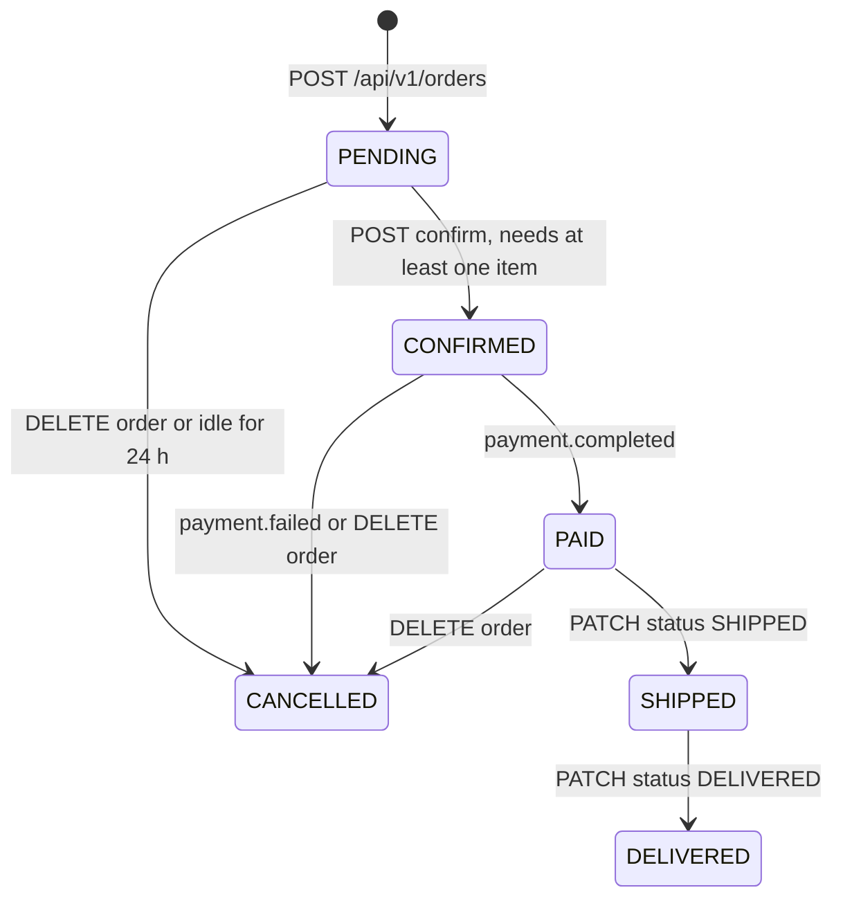
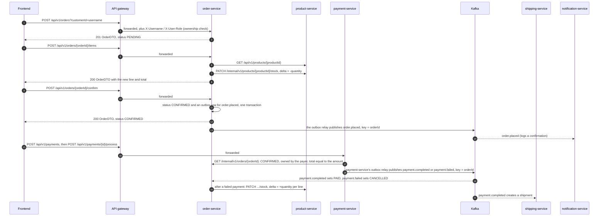
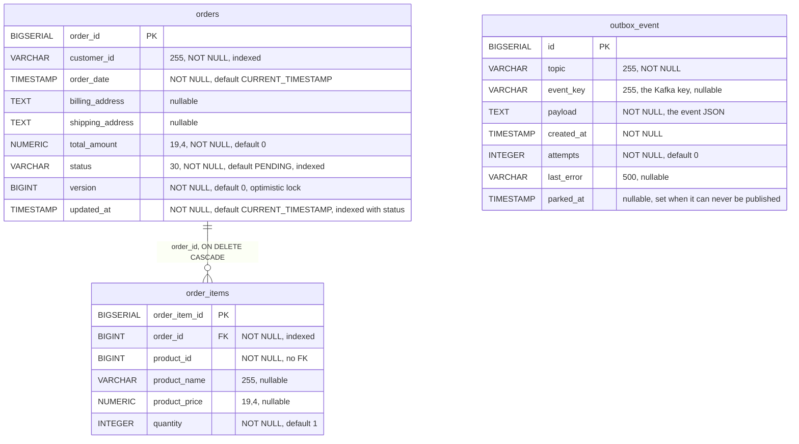

# Order Service

order-service owns customer orders and their order lines, and it sits at the centre of the purchase flow. In the
frontend a PENDING order doubles as the shopping cart. Adding an item checks the product and reserves its stock in
product-service over Feign. Confirming the order publishes `order.placed`. Cancelling releases the stock and
publishes `order.cancelled`. The payment result comes back from payment-service as `payment.completed` /
`payment.failed` and moves the order to PAID, or to CANCELLED with its stock returned. A scheduled job cancels PENDING
carts that nobody has touched for 24 hours. Events leave through a transactional outbox, and no database transaction
is open while product-service is called. The service owns the `orders`, `order_items` and `outbox_event` tables in
PostgreSQL `orderdb`.

| | |
|---|---|
| Repository | `ecommerce-order-service` |
| Stack | Java 25 · Spring Boot 4.0.9 · Spring MVC · Spring Data JPA (Hibernate) · Flyway · Spring Cloud 2025.1.4 (OpenFeign 5.0.4 on Apache HttpClient 5, LoadBalancer, Eureka client, CircuitBreaker) · resilience4j 2.3.0 · spring-kafka 4.0.8 (kafka-clients 4.1.2) · springdoc 2.8.5 · Micrometer/Prometheus · OpenTelemetry tracing · Lombok |
| Port | 8084 |
| Eureka service ID | `order-service` |
| Gateway routes | `/api/v1/orders/**` (Bearer JWT required for every method) |
| Data store | PostgreSQL 16 `orderdb` (Flyway `V1` to `V5`); compose publishes it on host port 5434 |
| Publishes | `order.placed`, `order.cancelled` (through the outbox); `payment.completed.DLT`, `payment.failed.DLT` (dead letters) |
| Consumes | `payment.completed`, `payment.failed` (group `order-service`) |
| Calls | `product-service` (Feign): `GET /api/v1/products/{id}`, `PATCH /internal/v1/products/{id}/stock` |
| Called by | The frontend through the gateway (cart, checkout, order pages, admin order page) and `ecommerce-platform/smoke-test.sh`. payment-service calls `GET /internal/v1/orders/{id}` before it accepts a payment; notification-service consumes the events. |

Java paths below are relative to `src/main/java/com/ecommerce/order/`.

## Responsibilities

- Create orders for the caller (`customerId` defaults to `X-Username`) and keep them open (PENDING) while the customer fills them. The
  frontend stores the PENDING order's id as `cartOrderId` and uses it as the cart (`ecommerce-frontend/src/hooks/useCart.ts`).
- Add order lines: verify the product and its stock with product-service, reserve the stock immediately, and snapshot
  the product name and price into the line.
- Confirm orders (PENDING to CONFIRMED) and announce them on `order.placed`.
- Cancel orders: announce the cancellation on `order.cancelled`, then give the stock back to product-service.
- Apply payment results: `payment.completed` marks a CONFIRMED order with a matching amount PAID, `payment.failed` cancels a PENDING or CONFIRMED order and returns its stock.
- Cancel abandoned carts: a PENDING order that has not changed for 24 hours is cancelled and its stock returned (see [Reservation expiry](#reservation-expiry)).
- Let an admin move the status along the transition table (`PATCH /status`). This is the only way to reach SHIPPED and DELIVERED.

Out of scope here:
- **Payment:** taking payment is not done here. After confirming, the frontend calls payment-service itself
  (`POST /api/v1/payments`, then `/process`).
- **Shipping:** shipping-service creates a shipment from `payment.completed` and never reports back to this service.
- **Notifications:** notification-service handles them.
- **Addresses:** the columns exist, but no endpoint writes them (see [Known issues](#known-issues-and-limitations)).

## Domain model

### `Order` (`model/Order.java`, table `orders`)

| Field | Java type | Column | Notes |
|---|---|---|---|
| `orderId` | `Long` | `order_id` BIGSERIAL PK | `GenerationType.IDENTITY` |
| `customerId` | `String` | `customer_id` VARCHAR(255) NOT NULL | Taken verbatim from the caller. The frontend sends the username; the smoke test sends `1`. |
| `orderItems` | `List<OrderItem>` | `order_items.order_id` | `@OneToMany(mappedBy = "order", cascade = ALL, orphanRemoval = true, fetch = EAGER)` |
| `orderDate` | `LocalDateTime` | `order_date` TIMESTAMP NOT NULL | Set at creation (`LocalDateTime.now()`, JVM zone, UTC in the containers) |
| `billingAddress` | `String` | `billing_address` TEXT | Never written by any code path |
| `shippingAddress` | `String` | `shipping_address` TEXT | Never written by any code path |
| `totalAmount` | `BigDecimal` | `total_amount` NUMERIC(19,4) NOT NULL | Running sum maintained by `Order.addItem()` |
| `status` | `OrderStatus` | `status` VARCHAR(30) NOT NULL | `@Enumerated(EnumType.STRING)` |
| `version` | `Long` | `version` BIGINT NOT NULL DEFAULT 0 | `@Version`, the optimistic lock (`V4`). Not in `OrderDTO` |
| `updatedAt` | `LocalDateTime` | `updated_at` TIMESTAMP NOT NULL DEFAULT CURRENT_TIMESTAMP | Set on insert and on every update that writes the row (`@PrePersist`, `@PreUpdate`); `lastChange()` falls back to `orderDate` when it is null (`V5`). `ReservationExpiryJob` reads it. Not in `OrderDTO` |

`Order.addItem(OrderItem)` links the line to the order and adds `productPrice × quantity` to `totalAmount`. It skips
the addition if either value is null. Nothing ever recomputes or decreases the total.

### `OrderItem` (`model/OrderItem.java`, table `order_items`)

| Field | Java type | Column | Notes |
|---|---|---|---|
| `orderItemId` | `Long` | `order_item_id` BIGSERIAL PK | |
| `order` | `Order` | `order_id` BIGINT NOT NULL FK | `@ManyToOne(fetch = LAZY)` |
| `productId` | `Long` | `product_id` BIGINT NOT NULL | product-service id; no FK (different database) |
| `productName` | `String` | `product_name` VARCHAR(255) | Snapshot of product-service `name` at add time |
| `productPrice` | `BigDecimal` | `product_price` NUMERIC(19,4) | Snapshot of product-service `price` at add time |
| `quantity` | `Integer` | `quantity` INTEGER NOT NULL | Builder default 1 |

### `OrderStatus` (`model/OrderStatus.java`)

| Value | Meaning | Entered through |
|---|---|---|
| `PENDING` | Created and open for items; the frontend's cart | `POST /api/v1/orders` (or `PATCH /status`) |
| `CONFIRMED` | Customer committed; `order.placed` published; payment expected | `POST /api/v1/orders/{orderId}/confirm` (or `PATCH /status`) |
| `PAID` | Payment succeeded | `payment.completed` (or `PATCH /status`) |
| `SHIPPED` | Handed to the carrier | `PATCH /status` only; shipping-service does not update orders |
| `DELIVERED` | Delivered | `PATCH /status` only |
| `CANCELLED` | Cancelled by the customer, by a failed payment or by the expiry job | `DELETE /api/v1/orders/{orderId}`, `payment.failed`, `ReservationExpiryJob` (or `PATCH /status`) |

### Lifecycle

The diagram shows the allowed transitions (`OrderStatus.allowedNext()`); anything else via `PATCH /status` is 409.



Guards: `PATCH /status` follows the transition table (admin only); `payment.completed` moves only a CONFIRMED order whose amount matches the total to PAID; `payment.failed` cancels only PENDING or CONFIRMED orders; `DELETE` is refused on CANCELLED, SHIPPED and DELIVERED; the expiry job touches only PENDING orders. The order carries a version, so a write that raced another write on the same order fails instead of overwriting it (409 over REST; the payment listener retries). An event that no longer applies changes nothing and is never retried: a replay for an order that has already moved on is one throttled INFO line, anything else one throttled WARN.

The complete behaviour, by current status:

| Trigger | PENDING | CONFIRMED | PAID | SHIPPED | DELIVERED | CANCELLED |
|---|---|---|---|---|---|---|
| `POST /{orderId}/items`, `POST /{orderId}/products` | accepted (up to 200 lines), stays PENDING | 400 | 400 | 400 | 400 | 400 |
| `POST /{orderId}/confirm` | to CONFIRMED (400 if the order has no items) | 400 | 400 | 400 | 400 | 400 |
| `DELETE /{orderId}` | to CANCELLED | to CANCELLED | to CANCELLED | 400 | 400 | 400 |
| `PATCH /{orderId}/status?status=X` (admin) | CONFIRMED, CANCELLED | PAID, CANCELLED | SHIPPED, CANCELLED | DELIVERED | 409 | 409 |
| `payment.completed` | not applied, WARN (the payment may need a refund) | to PAID (amount must match) | already applied, INFO | already applied, INFO | already applied, INFO | not applied, WARN (the payment may need a refund) |
| `payment.failed` | to CANCELLED, stock returned | to CANCELLED, stock returned | ignored, WARN | ignored, WARN | ignored, WARN | already applied, INFO |
| abandoned-cart job | to CANCELLED once idle for 24 h, stock returned | never | never | never | never | never |

Every state rejection is an `InvalidOrderStateException`, which `GlobalExceptionHandler.handleInvalidState()` turns into **400
Bad Request**; an illegal `PATCH /status` move is `IllegalStatusTransitionException`, **409**, and a lost race on the version is **409** too:

| Operation | Rejected when | `message` |
|---|---|---|
| add item | status is not PENDING | `Cannot add items to order in status: <STATUS>` |
| add item | the order already has 200 lines | `An order can have at most 200 lines` |
| add item | the new line would take `totalAmount` above 999999999999999.9999 | `The order total is too large` |
| add item | product-service reports `stockQuantity` below the requested quantity | `Insufficient stock for product <sku>. Available: <n>` |
| confirm | status is not PENDING | `Can only confirm PENDING orders. Current status: <STATUS>` |
| confirm | order has no items | `Cannot confirm an order with no items` |
| cancel | status is CANCELLED, SHIPPED or DELIVERED | `Cannot cancel order in status: <STATUS>` |
| `PATCH /status` | move not in the table (409) | `Cannot change order status from <A> to <B>` |
| add item, confirm, cancel, `PATCH /status` | another request changed the same order first (409) | `The order was modified by another request` |

An unknown `orderId` on any REST operation is **404** (`Order not found: <id>`). A Kafka event is never rejected for a business rule. An event
for an unknown order is logged at WARN and skipped.

### Checkout flow



The amount on the payment is whatever the frontend sends (`confirmedOrder.totalAmount` in
`ecommerce-frontend/src/pages/checkout/CheckoutPage.tsx`), but payment-service does not take it on trust. Before it
accepts a payment it asks this service (`GET /internal/v1/orders/{orderId}`) and requires status CONFIRMED, the payer as the
order's owner and an amount exactly equal to `totalAmount`. On `payment.completed` this service compares the event's amount
with the total once more before it sets PAID.

## Business rules

1. A new order starts as PENDING. It gets `totalAmount = 0`, `orderDate = now` and a `customerId` that defaults to `X-Username`; a non-admin may only use their own. It must be non-blank, at most 255 characters, without control characters. Enforced in `OrderAccess` and `OrderService.createOrder()`.
2. Items can be added only while the order is PENDING, with an integer `quantity` from 1 to 1000 (both add endpoints).
   An order holds at most 200 lines, because every line travels in the `order.placed` event and that record has to stay
   far below Kafka's 1 MB limit. Enforced in `OrderService.addItemToOrder()` and `OrderController`.
3. The product must exist in product-service. Its 404 surfaces as 404 here (`ProductServiceClient.getProductById()`,
   `GlobalExceptionHandler.handleFeign()`). The product's `status` is not checked, so INACTIVE (soft-deleted) products
   can be ordered. A missing or non-positive product price is 502 before any stock moves.
4. If product-service reports a non-null `stockQuantity` lower than the requested quantity, the add is rejected with
   400 before any stock is touched. Enforced in `OrderService.addItemToOrder()`. The check is advisory, because the
   real guard is product-service refusing a stock change that would go below zero (400, passed through).
5. Stock is reserved when the item is added, not at confirmation or payment. `addItemToOrder()` calls
   `PATCH /internal/v1/products/{id}/stock` with `{"delta": -quantity}` before the line is saved, and it saves the line
   afterwards in its own short transaction. If that save fails (the order was cancelled meanwhile, a version conflict, a
   database that does not answer), the reservation is released once with `{"delta": +quantity}`. If the reservation call
   itself fails or times out, nothing is released, because product-service may or may not have applied it.
6. Name and price are copied from the product-service response into the line (price snapshot). Later price or name
   changes in product-service do not affect existing lines. The SKU is not stored. Enforced in `addItemToOrder()`.
7. Every add creates a new line, even for a product already in the order; quantities are never merged. There is no
   way to remove a line or change its quantity. The frontend's "remove item" cancels the whole order and re-creates it
   (`ecommerce-frontend/src/pages/cart/CartPage.tsx`).
8. `totalAmount` is the running sum of `productPrice × quantity`, updated by `Order.addItem()` and never recalculated. A
   line that would take it above 999999999999999.9999, the limit of `NUMERIC(19,4)`, is refused with 400 before any stock
   is reserved.
9. Confirmation requires status PENDING and at least one item. It sets CONFIRMED and writes `order.placed` to the outbox
   in the same transaction. Enforced in `OrderService.confirmOrder()`.
10. Cancellation is refused for CANCELLED, SHIPPED and DELIVERED. It sets CANCELLED and writes `order.cancelled` to the
    outbox in one transaction. Only after that transaction has committed does it send `{"delta": +quantity}` to
    product-service for every line, outside any transaction. The first "peer unavailable" answer (no connection, a
    timeout, 503 or an open breaker) stops the loop, and one WARN, throttled to one per 10 s, names the lines that were not
    returned. The order stays cancelled either way, and a stock call that timed out has an unknown outcome, so it is not
    repeated. Enforced in `OrderService.cancelOrder()`. The row is not deleted.
11. `payment.completed` sets PAID only on a CONFIRMED order whose total equals the event amount. `payment.failed` goes
    through `OrderService.cancelAfterFailedPayment()`: for a PENDING or CONFIRMED order it commits CANCELLED first, then
    returns the order's stock outside the transaction, the way a customer's cancel does (including the stop at the first
    unavailable peer and the WARN). It publishes no `order.cancelled`, because that event answers a cancellation somebody
    asked for. A replayed `payment.failed` finds the order CANCELLED and does nothing, so the stock goes back once.
    Anything else is logged and ignored; a `payment.completed` for a CANCELLED or PENDING order WARNs that the payment may
    need a refund, and nothing refunds it automatically. Enforced in `PaymentEventConsumer` and `OrderService`.
12. `PATCH /status` is admin-only and checks the transition table (409 otherwise); CANCELLED and CONFIRMED run the same code as the customer endpoints, including stock restore and events. Enforced in `OrderService.updateOrderStatus()`.
13. Orders are never deleted; `DELETE` is a status change.
14. The order carries a version (`orders.version`, `@Version`). Add-item calls product-service between reading and
    writing the order, outside any transaction, so two writers can start from the same state. The later write fails on
    the version and is answered 409 `The order was modified by another request`; an add-item that loses releases its
    reservation. The same check keeps a replayed or racing payment event from overwriting a newer state.
15. No database transaction is open while product-service is called, and a request sends no Kafka record. Methods that
    call out run as steps (read, remote call, then a short programmatic transaction with `TransactionTemplate`), so a slow
    product-service cannot pin pooled connections. Only the outbox relay keeps a transaction open while it waits for
    Kafka's acknowledgement.
16. A PENDING order that has not changed for `orders.reservation.pending-ttl` (24 h) is cancelled by
    `ReservationExpiryJob`; see [Reservation expiry](#reservation-expiry).

## API

| Method | Path | Gateway auth | Purpose |
|---|---|---|---|
| GET | `/api/v1/orders/hello` | Bearer JWT | Liveness greeting (text) |
| POST | `/api/v1/orders?customerId=` | Bearer JWT | Create a PENDING order |
| GET | `/api/v1/orders/{orderId}` | Bearer JWT | Get one order (owner or `ADMIN`) |
| GET | `/api/v1/orders/customer/{customerId}?page=&size=` | Bearer JWT | List a customer's orders, newest first; optional `page` (default 0) and `size` (default and maximum 100), still a JSON array |
| POST | `/api/v1/orders/{orderId}/items` | Bearer JWT | Add a line (JSON body) |
| POST | `/api/v1/orders/{orderId}/products?productId=&quantity=` | Bearer JWT | Legacy add-line (query params, same quantity rule) |
| POST | `/api/v1/orders/{orderId}/confirm` | Bearer JWT | PENDING to CONFIRMED, publishes `order.placed` through the outbox |
| PATCH | `/api/v1/orders/{orderId}/status?status=` | `ADMIN` | Move the status along the transition table |
| DELETE | `/api/v1/orders/{orderId}` | Bearer JWT | Cancel, publish `order.cancelled` through the outbox, then return the stock |
| GET | `/internal/v1/orders/{orderId}` | not routed | The `OrderDTO`, for payment-service |

Customer endpoints are owner-or-admin (`customerId` against `X-Username`, role exactly `ADMIN`). Details, schemas and error bodies:
[API reference](../api/order-service.md).

## Events

All producing and consuming goes through the hand-built beans in `config/KafkaProducerConfig.java`. There is no Boot
Kafka auto-configuration in this service: the pom depends on `spring-kafka` directly, and Boot 4 keeps Kafka
auto-configuration in the separate `spring-boot-kafka` module, which is not on the classpath. So `application.yaml`
sets only `spring.kafka.bootstrap-servers`, read through `@Value`. The never-read `spring.kafka.producer.*` and
`spring.kafka.consumer.*` blocks, which named the deprecated Jackson 2 classes, were removed on 2026-10-29. Topics are not declared (`NewTopic`); the broker
auto-creates them (`KAFKA_AUTO_CREATE_TOPICS_ENABLE=true`, broker default partition count).

### Published

`messaging/OrderEventProducer` serializes each event and stores it in the `outbox_event` table in the caller's
transaction; `outbox/OutboxRelay` publishes the stored rows. The relay and the dead-letter recoverer share one
`KafkaTemplate<String, String>` over a `DefaultKafkaProducerFactory` with `StringSerializer` keys and values. The JSON
text is produced when the row is written, with `KafkaProducerConfig.eventJsonMapper()`: spring-kafka's
`JacksonMapperUtils.enhancedJsonMapper()` with `DateTimeFeature.WRITE_DATES_AS_TIMESTAMPS` switched on. The relay sends
that text unchanged, so records carry no `__TypeId__` header, and the bytes are the ones the `JacksonJsonSerializer`
wrote before the outbox existed.

Producer settings (`KafkaProducerConfig.producerFactory()`): `acks=all` with idempotence on; `max.block.ms` 5000,
`request.timeout.ms` 10000, `delivery.timeout.ms` 30000; `reconnect.backoff.ms` 1000 and `reconnect.backoff.max.ms`
10000 (the consumer factory has the same two). A send to an unreachable broker fails within 5 s (30 s once the topic
metadata is cached), and the client warns about once every 10 s instead of once a second. The template's
`ProducerListener` is a no-op, because the default one logs an ERROR with a stack trace
for every failed send; the relay and the dead-letter recoverer report failures themselves, throttled and without a
stack trace.

On the wire, `LocalDateTime` is an integer array `[year, month, day, hour, minute, second, nanos]`; seconds and nanos
are dropped when zero, so the array has 5 to 7 elements. Jackson 3 would write ISO strings by default, and the
timestamps flag keeps the form the deprecated Jackson 2 `JsonSerializer` produced before 2026-10-29. `BigDecimal` is a
JSON number. Both forms are pinned by the provider pact.

#### `order.placed`

- **Trigger:** `POST /api/v1/orders/{orderId}/confirm` (and an admin `PATCH /status` to CONFIRMED, which runs the same
  method). `OrderService.confirmOrder()` calls `OrderEventProducer.publishOrderPlaced()` inside the transaction that sets
  CONFIRMED, which writes the outbox row. Nothing else publishes it.
- **Key:** `orderId.toString()`, for example `"42"`.
- **Consumers:** notification-service (group `notification-service`, logs an order confirmation and ignores `items`).
  payment-service does not consume it.

| Field | Java type | JSON | Notes |
|---|---|---|---|
| `orderId` | `Long` | number | |
| `customerId` | `String` | string | As supplied at creation |
| `totalAmount` | `BigDecimal` | number | Read back from the database, so 4 decimals (`99.9800`) |
| `orderDate` | `LocalDateTime` | integer array | The **creation** time of the order, not the confirmation time |
| `items` | `List<OrderPlacedEvent.OrderItemEvent>` | array | Not pinned by any pact |
| `items[].productId` | `Long` | number | |
| `items[].productName` | `String` | string | Snapshot |
| `items[].productPrice` | `BigDecimal` | number | Snapshot |
| `items[].quantity` | `Integer` | number | |

```json
{
  "orderId": 42,
  "customerId": "alice",
  "totalAmount": 99.9800,
  "orderDate": [2026, 10, 29, 18, 7, 12, 345678000],
  "items": [
    { "productId": 7, "productName": "Wireless Mouse", "productPrice": 49.9900, "quantity": 2 }
  ]
}
```

#### `order.cancelled`

- **Trigger:** `OrderService.cancelOrder()` and `OrderEventProducer.publishOrderCancelled()`, in the transaction that sets
  CANCELLED. That covers `DELETE /api/v1/orders/{orderId}`, an admin `PATCH /status` to CANCELLED and
  `ReservationExpiryJob` (a PENDING cart idle for 24 hours). It is **not** published when `payment.failed` cancels an
  order, because `payment.failed` already said it. Cancelling an already cancelled order is a 400 and publishes nothing.
- **Key:** `orderId.toString()`.
- **Consumers:** notification-service (logs a cancellation notice).

| Field | Java type | JSON | Notes |
|---|---|---|---|
| `orderId` | `Long` | number | |
| `customerId` | `String` | string | |
| `cancelledAt` | `LocalDateTime` | integer array | `LocalDateTime.now()` at cancellation |

```json
{ "orderId": 42, "customerId": "alice", "cancelledAt": [2026, 10, 29, 18, 9, 3, 120000000] }
```

#### Delivery semantics (transactional outbox)

Neither event is sent from the request. The service writes the serialized event into `outbox_event` in the same
transaction as the status change ([ADR-013](../adr/ADR-013-transactional-outbox.md)): a rollback removes the row with
the change, and a commit keeps it until Kafka has acknowledged it.

- **Relay.** `outbox/OutboxRelay` runs every 500 ms (`outbox.relay.interval-ms`). In one transaction it locks up to 100
  unparked rows (`outbox.relay.batch-size`), oldest first, with `FOR UPDATE SKIP LOCKED`, sends each row, waits for
  Kafka's acknowledgement (at most `outbox.relay.send-timeout-ms`, 35 s) and deletes the row. An event leaves up to about
  half a second after the commit. The batch transaction holds one pooled connection while it waits.
- **At least once.** A crash between the acknowledgement and the commit publishes the row again. The only consumer,
  notification-service, logs the event, so a duplicate is harmless there.
- **Transient failure** (broker down, send timeout, database trouble): the batch stops, so events keep their order. The
  relay records `attempts` and `last_error` on the row and pauses with a back-off of 1 s doubling to 30 s, which the
  first success resets. It logs one WARN a minute at most, without a stack trace, and one INFO when publishing resumes.
  Requests are not affected: they only write to the database.
- **Permanent failure** (record too large, invalid topic, serialization): the row is parked (`parked_at` is set), one ERROR
  names the row and the statement that releases it (`UPDATE outbox_event SET parked_at = NULL WHERE id = ?`), and the
  relay carries on with the next row. A parked row is not retried until someone releases it.
- **Several replicas.** `SKIP LOCKED` lets a second relay take later rows while the first still holds earlier ones, so
  two events of one order could reach Kafka out of order. One replica runs today.
- **Metrics and tracing.** `outbox_events_pending`, `outbox_events_parked`, `outbox_events_published_total` and
  `outbox_publish_failures_total` (see [Observability](#observability)). Scheduled-task observations are excluded in
  `outbox/OutboxConfig`, so the relay creates no traces. The [runbook](../runbook.md#check-the-outbox) shows how to
  inspect the table.

### Consumed

| Topic | Group id | Listener | Effect |
|---|---|---|---|
| `payment.completed` | `order-service` | `PaymentEventConsumer.handlePaymentCompleted(PaymentCompletedEvent)` | `status = PAID` if CONFIRMED and the amount matches |
| `payment.failed` | `order-service` | `PaymentEventConsumer.handlePaymentFailed(PaymentFailedEvent)` | `status = CANCELLED` if PENDING or CONFIRMED, then the stock goes back |

Producer: payment-service `PaymentService.processPayment()`, key `orderId.toString()`. It publishes these after
`POST /api/v1/payments/{id}/process`, through its own outbox; the simulated gateway succeeds 80% of the time.

**Deserialization:** the consumer factory uses `StringDeserializer` for keys and values. The listener container
factory (`kafkaListenerContainerFactory`) converts the String payload into the listener's parameter type with
`JacksonJsonMessageConverter` (Jackson 3 `enhancedJsonMapper`: unknown properties ignored, `LocalDateTime` accepted as an
array or an ISO string). No type headers are needed. Group id `order-service`, `auto.offset.reset=earliest`, one
consumer thread per listener. `ConsumerConfig.GROUP_ID_CONFIG` is set in the factory and again in `@KafkaListener`. The
factory installs the `DefaultErrorHandler` described under Failure behaviour below.

**Payload classes** (`event/PaymentCompletedEvent.java`, `event/PaymentFailedEvent.java`) mirror payment-service's
classes field for field. Every field is pinned by type in this service's consumer pact.

| `PaymentCompletedEvent` | Java type | | `PaymentFailedEvent` | Java type |
|---|---|---|---|---|
| `paymentId` | `Long` | | `paymentId` | `Long` |
| `orderId` | `Long` | | `orderId` | `Long` |
| `customerId` | `String` | | `customerId` | `String` |
| `amount` | `BigDecimal` | | `failureReason` | `String` |
| `transactionId` | `String` | | `failedAt` | `LocalDateTime` |
| `completedAt` | `LocalDateTime` | | | |

**Behaviour:** `handlePaymentCompleted` is `@Transactional`. It loads the order by `orderId`, checks the status guard and `amount` against `totalAmount`, sets PAID and saves. `handlePaymentFailed` is not transactional: it calls `OrderService.cancelAfterFailedPayment()`, whose steps run in short transactions of their own, because the stock goes back to product-service after the cancellation has committed. An unknown `orderId`, a missing `orderId` (or, for `payment.completed`, `amount`) or a guard failure is logged at WARN and the record is acknowledged; an event that was already applied is logged at INFO. These lines are throttled to one per kind per 10 s, because Kafka has no authentication and a flood of forged or replayed events must not become a flood of log lines.

**Idempotency:** both handlers are guarded by the order's status, and the order's version closes the race between a replay and a concurrent change. A `payment.completed` for an order that is already PAID, SHIPPED or DELIVERED is a throttled INFO ("already applied"). One for a CANCELLED or PENDING order is not applied and WARNs that the payment may need a refund. A replayed `payment.failed` finds the order CANCELLED and does nothing, so its stock goes back once; for a PAID, SHIPPED or DELIVERED order it is ignored with a WARN. There is no record of processed `paymentId`s and no ordering across the two topics, but the state guard means a late `payment.completed` cannot revive a CANCELLED order and a `payment.failed` cannot cancel a PAID, SHIPPED or DELIVERED one.

With `auto.offset.reset=earliest`, a consumer group that has lost its offsets replays every retained payment event.

**Failure behaviour:** the listener container factory installs a `DefaultErrorHandler` (`config/KafkaErrorHandling`) whose recoverer publishes to `<topic>.DLT`, here `payment.completed.DLT` and `payment.failed.DLT`:
- **Infrastructure trouble** (the database is unreachable or the pool is exhausted, a lock timeout, a version conflict, a
  commit or rollback that failed because the connection was gone, a broker error): the record is retried with a growing
  pause, 1 s doubling up to 30 s, with no deadline. The partition waits for the database instead of dead-lettering good
  events. `kafka/ListenerFailureLogger` writes one WARN per exception class per 10 s, without a stack trace.
- **Any other exception thrown by the listener** (a bug, for example): three deliveries in all, a second apart
  (`FixedBackOff(1000, 2)`), then the record goes to the dead-letter topic. `ListenerFailureLogger` writes one ERROR with
  the stack trace per kind of failure per 10 s.
- **Malformed JSON:** this fails in the converter with a `ConversionException`, which the handler does not retry, so
  the record goes to the dead-letter topic on the first attempt. Because the deserializer is `StringDeserializer`, a bad
  record cannot loop at the deserializer level.
- **The dead-letter copy** (`kafka/DeadLetterRecoverer`, a copy of shipping-service's) keeps the original value and carries
  `kafka_dlt-original-topic`, `-partition` and `-offset` plus the exception class and message, never the stack trace.
  A copy that is still too large is retried bare, with the record's own headers and its original topic, partition and
  offset. A transient failure to write it is retried four times (1, 2, 4 and 8 s) before the container redelivers. A
  record the broker can never accept is skipped with one throttled ERROR and counted in `kafka_dlt_dropped_total{topic}`.
  Every dead letter is counted in `kafka_dlt_published_total{topic}` and logged as one WARN per topic per 10 s. Values
  taken from a record pass through `logging/LogSanitizer` first (control characters removed, 256 characters at most).
  Reading and replaying dead letters: [runbook](../runbook.md#dead-letter-topics) and
  [Event catalog](../events.md#failure-handling).
- **Offsets:** the DB commit and the offset commit are separate (at-least-once).

## Outbound calls

### `ProductServiceClient` → product-service

`client/ProductServiceClient.java`, `@FeignClient(name = "product-service", fallbackFactory = ProductServiceClientFallbackFactory.class)`.
The client resolves the target through Eureka and Spring Cloud LoadBalancer. Transport is Apache HttpClient 5
(`feign-hc5`). No `Authorization`, `X-User-*` or `X-Correlation-Id` header is forwarded, because there is no
`RequestInterceptor`. The call goes straight to product-service, bypassing the gateway: stock changes use the internal `/internal/v1/products/{id}/stock` endpoint, which needs no identity.

| Method | Request | Response fields read | Called from |
|---|---|---|---|
| `getProductById(Long)` | `GET /api/v1/products/{id}` | `name`, `price`, `stockQuantity`, `sku` (only in the error message). `id`, `brand`, `status` are mapped but unused. | `OrderService.addItemToOrder()`; `expireAbandonedCart()` asks for the first line's product to find out whether product-service answers |
| `updateStock(Long, StockUpdateRequest)` | `PATCH /internal/v1/products/{id}/stock`, body `{"delta": <int>}` | none (the returned `ProductDTO` is discarded) | `addItemToOrder()` with `-quantity` (and `+quantity` when the line cannot be saved); `cancelOrder()`, `cancelAfterFailedPayment()` and `expireAbandonedCart()` with `+quantity` per line |

**Timeouts:** `spring.cloud.openfeign.client.config.default`: connect 2000 ms, read 10000 ms. The short connect
timeout exists so a peer that vanished mid-rollout fails fast and the retry below can move on.

**Retries:** `FeignConfig.ConnectionFailureRetryer(3, 100)` is registered as the global Feign `Retryer`:
- It retries only when the cause is a `java.net.ConnectException` (including hc5's `HttpHostConnectException`) or
  hc5's `ConnectTimeoutException`. In those cases the request never reached the peer, so repeating any method is safe.
- At most 3 attempts in total, with 100 ms and then 200 ms of sleep. The LoadBalancer picks an instance afresh on
  every attempt.
- Read timeouts (`SocketTimeoutException`) and HTTP errors are never retried, because the request may have been
  processed.
- Apache HttpClient 5's own automatic retries are switched off (`FeignConfig.noHttpClientAutomaticRetries()`, an
  `HttpClientBuilderCustomizer` that calls `disableAutomaticRetries()`). Left on, it would re-send an idempotent GET once
  on a 503 or a reset connection underneath Feign, which doubles the load on a peer that is already struggling and
  contradicts this policy. `ConnectionFailureRetryer` is the only retry.
- The retries cover the few seconds between a peer pod vanishing and every registry cache dropping it. Worst case
  against an unreachable host is about 6.3 s (3 × 2 s plus back-off).
- The LoadBalancer eagerly builds the `product-service` instance list
  (`spring.cloud.loadbalancer.eager-load.clients`); otherwise the first call fails with "Load balancer does not
  contain an instance". The instance cache TTL is 5 s, matching the 5 s Eureka fetch.

**Message converters:** `FeignConfig.feignHttpMessageConverters()` replaces Spring Cloud OpenFeign's
`FeignHttpMessageConverters` with `ThreadSafeFeignHttpMessageConverters`. The library fills its converter list lazily
and without synchronisation. Concurrent first calls on a fresh JVM could see the empty list and fail with
`DecodeException: 'messageConverters' must not be empty`, which surfaced as a 500. The subclass makes the first
initialisation mutually exclusive.

**Circuit breaker:** Spring Cloud CircuitBreaker (`spring.cloud.openfeign.circuitbreaker.enabled: true`) over
resilience4j wraps the Feign client. `FeignConfig.circuitBreakerNameResolver()` names the breaker after the client, so
both methods share one breaker, `product-service`. Settings from
`resilience4j.circuitbreaker.instances.product-service`:

| Setting | Value |
|---|---|
| sliding window | count-based (default), `slidingWindowSize: 10`, `minimumNumberOfCalls: 5` |
| `failureRateThreshold` | 50 % |
| `slowCallDurationThreshold` / `slowCallRateThreshold` | 5 s / 80 %. A product-service that answers slowly still holds a request thread per call for up to the 10 s read timeout; when 80 % of the window is slow, the breaker opens and the rest fail fast |
| `waitDurationInOpenState` | 10 s, with `automaticTransitionFromOpenToHalfOpenEnabled: true` (an idle service would otherwise stay OPEN until the next call) |
| `permittedNumberOfCallsInHalfOpenState` | 3 |
| `ignoreExceptions` | `FeignException$NotFound`, `$BadRequest`, `$Conflict`, `$UnprocessableEntity`. A 4xx means the caller asked for something invalid; counting them let a few unknown product ids trip the breaker for valid traffic too. |
| `registerHealthIndicator` | `true`, but has no effect: resilience4j-spring-boot3's health auto-configuration requires `org.springframework.boot.actuate.health.HealthIndicator`, which Boot 4 moved to `org.springframework.boot.health.contributor` |

A call that needed Feign retries counts as one breaker call. There is no resilience4j retry configuration.

Spring Cloud CircuitBreaker's defaults would hand every call to a worker thread behind a 1 s time limiter, and to a
bulkhead thread pool of one thread per CPU (two concurrent calls in a 2-CPU container, the rest rejected). All three are
switched off (`spring.cloud.circuitbreaker.resilience4j.disable-thread-pool: true`, `disable-time-limiter: true`,
`spring.cloud.circuitbreaker.bulkhead.resilience4j.enabled: false`). The call runs on the calling thread, Feign's connect
and read timeouts are the only time limit, and the breaker only counts. `ProductServiceResilienceIT` checks that a 2.5 s
answer is not cut off and that 24 concurrent calls overlap.

**Fallback:** `ProductServiceClientFallbackFactory` is wired through `fallbackFactory`. The breaker hands every failure to
the fallback, a 404 or 400 from product-service included, and without one it would wrap them all in
`NoFallbackAvailableException`. The factory gives the original exception back untouched, so `GlobalExceptionHandler`
maps it exactly as it would without a breaker (404 stays 404, 400 stays 400), and an open breaker's
`CallNotPermittedException` becomes a 503 there. The fallback logs nothing, because during an outage it would run once per
request. `config/CircuitBreakerTransitionLogger` logs one WARN when the breaker opens and one INFO when it closes, and
the calls are counted in the `resilience4j_circuitbreaker_*` metrics.

**Error mapping** (`GlobalExceptionHandler.handleFeign()` unless stated):

| product-service outcome | Exception in order-service | Counts for breaker | order-service response |
|---|---|---|---|
| 404 (unknown product) | `FeignException.NotFound` | ignored | **404** (the smoke test asserts this) |
| 400 (stock would go below 0) | `FeignException.BadRequest` | ignored | **400** |
| 409 | `FeignException.Conflict` | ignored | 409 (product-service does not return it on these endpoints) |
| 503, or no instance registered (LoadBalancer synthesises a 503) | `FeignException.ServiceUnavailable` | yes | **503** |
| Connection refused / connect timeout after 3 attempts, or read timeout | `RetryableException`, `status() == -1` | yes | **503** |
| 500 or any other status (401, 403, 422, ...) | `FeignException` | yes (422 ignored) | **502** |
| Breaker OPEN | `CallNotPermittedException` | n/a | **503**, through `handleBreakerOpen()` |

The response `message` is fixed per status and never carries Feign's text: `Downstream service call failed: resource not
found` (404), `Downstream service call failed: request rejected` (400, 409), `Downstream service call failed: service
unavailable` (503, including an open breaker) and `Downstream service call failed` (502). The internal URL and the
downstream body stay out of the response.

**Other dependencies.** `exception/Unavailability` tells a dependency that does not answer from a bug. A database that
does not answer (the pool times out after 5 s, a lock timeout, a connection lost during commit or rollback) and a Kafka
timeout are answered **503** `Service temporarily unavailable`. They log one WARN per exception class per 10 s with the
root cause and no stack trace. Anything else unexpected is a **500** `An unexpected error occurred`, logged as one ERROR
with its stack trace per failure site per 10 s (`logging/LogThrottle`). A lost race on an order's version is **409**, not
an outage. Hibernate's JDBC error logger and Spring's rollback-failure loggers are switched off, because they repeat each
failure with a full trace.

**Stock consistency.** Stock deltas are not idempotent, so they are never repeated blindly:
- **Add item:** the reservation (PATCH) comes before the line is saved. If the save fails, the reservation is released
  once; a failed release is one throttled WARN. If the PATCH itself times out, product-service may or may not have applied
  it: nothing is released, the client gets 503, and a client retry can reserve a second time.
- **Cancel:** the cancellation commits first and the stock goes back afterwards, once, with no transaction open. The
  first "peer unavailable" answer stops the loop, and one throttled WARN names the lines that were not returned. A
  crash between the commit and the restore leaves the stock reserved, because nothing records that a restore is still
  owed.
- **Payment failure:** `payment.failed` returns the stock the same way, after the cancellation has committed.
- **Expiry:** an abandoned PENDING cart is cancelled after 24 hours and its stock returned (see
  [Reservation expiry](#reservation-expiry)). A CONFIRMED order that is never paid or cancelled keeps its reservation.
- **product-service side:** a stock change locks the product row for at most 5 s (`ProductRepository.findByIdForUpdate()`),
  so concurrent reservations of one product serialize and cannot oversell. A caller that cannot get the lock receives 503
  from product-service, which this service reports as 503. See [product-service](product-service.md).

## Reservation expiry

A PENDING order reserves stock the moment an item is added and holds it until somebody confirms or cancels. A cart nobody
comes back to would take that stock out of the shop for good, so `service/ReservationExpiryJob` cancels abandoned carts.

- **Schedule.** A `@Scheduled` fixed delay of `orders.reservation.expiry.interval-ms` (10 minutes), the first run
  `orders.reservation.expiry.initial-delay-ms` (60 s) after the start. The job is on unless
  `orders.reservation.expiry.enabled` is `false`. It shares the scheduler with the outbox relay, which has two threads
  (`spring.task.scheduling.pool.size`), so a pass that waits on product-service does not hold back the relay.
- **Candidates.** The ids of PENDING orders whose `updated_at` is older than `orders.reservation.pending-ttl` (`PT24H`),
  idle longest first, at most `orders.reservation.expiry.batch-size` (100) per run (`OrderRepository.findIdsIdleSince()`,
  served by `idx_orders_status_updated`). Adding an item writes the row and moves `updated_at`, so a cart that is still
  being filled does not expire. A TTL that is zero or negative falls back to 24 hours with a WARN, instead of cancelling
  every cart.
- **Cancellation.** `OrderService.expireAbandonedCart()` takes the path of a customer's cancel: the status CANCELLED and
  the `order.cancelled` outbox row commit together, then the stock goes back outside the transaction (the first "peer
  unavailable" answer stops the loop, with one throttled WARN). The status and the age are checked again inside the
  transaction, because the customer may have added an item since the candidate was read.
- **Several replicas.** Every replica selects the same candidates, but whoever commits first wins. The others see a
  cancelled order or fail on the version, skip it without a log line and never reach the stock, so the stock goes back
  once.
- **Only PENDING.** CONFIRMED and PAID orders are never expired. A CONFIRMED order's payment may still be on its way:
  payment-service keeps `payment.completed` in its outbox while Kafka is down, so age alone could cancel an order that
  has already been paid.
- **product-service must answer.** A cart with lines is cancelled only while product-service answers, because stock that
  cannot be returned is lost for good. The job asks for the first line's product (a 4xx is an answer; no answer, a 5xx or
  an open breaker is not). If it does not answer, the run stops with one WARN (at most one a minute) and the cart waits
  for the next run. An empty cart holds nothing and always expires.
- **Failures.** A database that does not answer skips the run with one WARN (no stack trace). Any other failure is one
  ERROR with its stack trace. Neither kills the scheduler, and both are throttled to one line a minute.
- **Output.** One INFO line per run, and only when the run expired something; the counter
  `orders_reservations_expired_total` counts every expired cart.
- **After a deploy.** `V5` gives existing orders `updated_at` = the migration time, so no cart expires sooner than 24
  hours after the deploy.

## Persistence

PostgreSQL 16, database `orderdb`, schema owned by Flyway (`classpath:db/migration`, `baseline-on-migrate: true`).
Hibernate runs with `ddl-auto: validate`. `V1`, `V2`, `V4` and `V5` use `IF NOT EXISTS`; `V3` creates a new table.

- `V1__create_orders.sql`: table `orders`; indexes `idx_orders_customer (customer_id)` and `idx_orders_status (status)`.
- `V2__create_order_items.sql`: table `order_items` with FK `order_id → orders(order_id) ON DELETE CASCADE`; index
  `idx_order_items_order (order_id)`.
- `V3__create_outbox_event.sql`: table `outbox_event`; index `idx_outbox_event_pending (parked_at, id)`.
- `V4__order_version.sql`: `orders.version BIGINT NOT NULL DEFAULT 0`, the optimistic lock. Existing rows start at 0.
- `V5__order_updated_at.sql`: `orders.updated_at TIMESTAMP NOT NULL DEFAULT CURRENT_TIMESTAMP`, which the expiry job
  reads (existing rows start at the migration time), and the index `idx_orders_status_updated (status, updated_at)` for
  the job's query.



`outbox_event` (entity `outbox/OutboxEvent`) has no foreign key to the other tables. A row lives until Kafka acknowledges
it and is then deleted, so the table normally holds only the events waiting for the next relay run, plus any parked rows.

Entities versus migrations:
- **Columns:** they match (names, nullability, lengths, `NUMERIC(19,4)`), so validation passes.
- **Defaults:** the column defaults (`CURRENT_TIMESTAMP`, `0`, `'PENDING'`, `1`) duplicate the entity builder
  defaults. Hibernate always inserts explicit values, so the DB defaults only matter for manual inserts.
- **Indexes:** the entities declare no indexes. `idx_orders_customer` serves `OrderRepository.findByCustomerId()`;
  `idx_orders_status_updated` serves the expiry job's query, which leaves `idx_orders_status (status)` redundant;
  `idx_outbox_event_pending` serves the relay's query.
- **Cascades:** `ON DELETE CASCADE` and `orphanRemoval = true` are never used by the application, because nothing deletes orders or
  removes lines. `OrderRepositoryIT` exercises both against Postgres.
- **Missing constraints:** no CHECK constraints (quantity can be zero or negative, status is free text at DB level; the
  API accepts a quantity of 1 to 1000 only). Concurrent writers are caught by the `version` column, not by a lock.
- **Fetching:** `orderItems` is `EAGER`; `findByCustomerId()` loads each order's lines with a separate query.
- **Tests:** the `test` profile (unit and pact tests) replaces Postgres with H2 and `ddl-auto: create-drop` with Flyway disabled. The
  `*IT` classes run the migrations on Postgres with `ddl-auto: validate`.

## Security and identity

- **Gateway:** every `/api/v1/orders/**` request needs a valid Bearer JWT; otherwise the gateway returns 401 with an
  empty body. `PATCH /orders/*/status` also needs role `ADMIN` there (403). The gateway sets `X-Username`, `X-User-Id`
  and `X-User-Role`; `/internal/**` is never routed.
- **This service** checks ownership in `security/OrderAccess` before any work: no `X-Username` is 401 `Authentication required`;
  an order or customer id that is not the caller's is 403 `Access denied`; role is compared exactly with `ADMIN`.

| Endpoint | Identity used | Ownership / role check |
|---|---|---|
| `POST /api/v1/orders` | `X-Username`, optional `customerId` | `customerId` defaults to the caller; others 403 unless `ADMIN` |
| `GET /api/v1/orders/{orderId}` | `X-Username` | owner or `ADMIN` |
| `GET /api/v1/orders/customer/{customerId}` | `X-Username` | that customer or `ADMIN` |
| `POST /{orderId}/items`, `POST /{orderId}/products` | `X-Username` | owner or `ADMIN` |
| `POST /{orderId}/confirm` | `X-Username` | owner or `ADMIN` |
| `PATCH /{orderId}/status` | `X-User-Role` | `ADMIN` only |
| `DELETE /{orderId}` | `X-Username` | owner or `ADMIN` |
| `GET /hello` | `X-Username` | authenticated |
| `GET /internal/v1/orders/{orderId}` | none | not routed by the gateway |

Notes:
- **Direct port access.** compose publishes port 8084 on the host, and there identity headers can be forged. `serviceregistry` answers 403 to non-loopback callers (`ActuatorLoopbackFilter`).
- **Responses and logs.** Fixed error messages (no type names, no Feign details), `nosniff` and `no-store` headers, correlation ids validated against `^[A-Za-z0-9._-]{1,64}$`.
- **Unauthenticated events.** Kafka has no authentication, but a forged `payment.completed` only moves a CONFIRMED order with a matching amount.
- **`customerId` values.** The frontend sends the username, which now equals `X-Username`; the value flows unchanged into payment-service, shipping-service and notification-service.

## Configuration

| Property | Env var | Default | Purpose |
|---|---|---|---|
| `server.port` | — | `8084` | HTTP port |
| `spring.application.name` | — | `order-service` | Eureka service ID, `application` metrics tag |
| `spring.datasource.url` | `SPRING_DATASOURCE_URL` | `jdbc:postgresql://localhost:5434/orderdb` | compose and k8s set `jdbc:postgresql://orderdb:5432/orderdb` |
| `spring.datasource.username` / `password` | `DB_USERNAME` / `DB_PASSWORD` | `orderuser` / `orderpass` | k8s reads them from secret `orderdb-credentials` |
| `spring.datasource.hikari.connection-timeout` | — | `5000` | A request waits at most 5 s for a pooled connection, then gets 503 (Hikari's default is 30 s) |
| `spring.datasource.hikari.data-source-properties` | — | `connectTimeout` 5, `socketTimeout` 30 (seconds), `tcpKeepAlive` true | pgjdbc has no socket timeout by default, so a database that stops answering would hold a request, relay or consumer thread until the OS gives up. Flyway runs through the same pool, so a DDL statement longer than 30 s would hit `socketTimeout` |
| `spring.jpa.hibernate.ddl-auto` | — | `validate` | Schema comes from Flyway; Hibernate only validates |
| `spring.jpa.open-in-view` | — | `false` | No Hibernate session, and no pooled connection, outlives the service call |
| `spring.flyway.enabled` / `locations` / `baseline-on-migrate` | — | `true` / `classpath:db/migration` / `true` | Migrations |
| `spring.kafka.bootstrap-servers` | `KAFKA_BOOTSTRAP_SERVERS` | `localhost:9092` | Read by `KafkaProducerConfig`; compose and k8s use `kafka:29092` |
| `KafkaProducerConfig` client settings | — | `acks=all`, idempotence on, `max.block.ms` 5000, `request.timeout.ms` 10000, `delivery.timeout.ms` 30000, `reconnect.backoff.ms` 1000, `reconnect.backoff.max.ms` 10000 | Set in code, not in `application.yaml` (the reconnect back-off applies to the consumer too). The template's `ProducerListener` is a no-op, so a failed send is reported by the relay and the recoverer only |
| `spring.task.scheduling.pool.size` | — | `2` | One scheduler thread for the outbox relay (every 500 ms) and one for `ReservationExpiryJob`, which calls product-service and can wait on it. On Boot's default single thread a slow expiry pass would hold back every event |
| `spring.task.scheduling.shutdown.await-termination` / `await-termination-period` | — | `true` / `20s` | SIGTERM lets a running relay batch or expiry run finish instead of interrupting it |
| `outbox.relay.enabled` / `interval-ms` / `batch-size` | — | `true` / `500` / `100` | `OutboxRelay`; `false` switches it off (the H2 `test` profile does) |
| `outbox.relay.send-timeout-ms` | — | `35000` | How long the relay waits for one acknowledgement. The default lives in `OutboxRelay`, not in `application.yaml`; it is above the producer's `delivery.timeout.ms` (30 s), so the producer gives up first |
| `orders.reservation.pending-ttl` | — | `PT24H` | Idle time after which a PENDING order is cancelled |
| `orders.reservation.expiry.enabled` / `interval-ms` / `initial-delay-ms` / `batch-size` | — | `true` / `600000` / `60000` / `100` | `ReservationExpiryJob`; see [Reservation expiry](#reservation-expiry) |
| `eureka.client.service-url.defaultZone` | `EUREKA_CLIENT_SERVICEURL_DEFAULTZONE` | `http://localhost:8761/eureka/` | Registry |
| `eureka.client.registry-fetch-interval-seconds` | — | `5` | See replaced peers quickly (default 30) |
| `eureka.instance.prefer-ip-address` | `EUREKA_INSTANCE_PREFER_IP_ADDRESS` (k8s) | `true` | Register the IP; pod hostnames are not resolvable |
| `eureka.instance.lease-renewal-interval-in-seconds` / `lease-expiration-duration-in-seconds` | — | `5` / `15` | A crashed instance leaves the registry within about 20 s |
| `spring.cloud.loadbalancer.cache.ttl` | — | `5s` | Instance cache matched to the Eureka fetch |
| `spring.cloud.loadbalancer.eager-load.clients` | — | `product-service` | Avoid an empty instance list on the first call |
| `spring.cloud.openfeign.client.config.default.connect-timeout` / `read-timeout` | — | `2000` / `10000` (ms) | Feign timeouts |
| `spring.cloud.openfeign.circuitbreaker.enabled` | — | `true` | Wraps the Feign client in a circuit breaker |
| `spring.cloud.circuitbreaker.resilience4j.disable-thread-pool` / `disable-time-limiter` | — | `true` / `true` | No worker thread and no 1 s time limiter: Feign's timeouts govern |
| `spring.cloud.circuitbreaker.bulkhead.resilience4j.enabled` | — | `false` | No bulkhead thread pool |
| `resilience4j.circuitbreaker.instances.product-service.*` | — | see [Outbound calls](#outbound-calls) | Breaker |
| `management.endpoints.web.exposure.include` | — | `health,info,metrics,prometheus,circuitbreakers,serviceregistry` | Actuator over HTTP |
| `management.endpoint.health.show-details` | — | `never` | |
| `management.endpoint.health.probes.enabled` | `MANAGEMENT_ENDPOINT_HEALTH_PROBES_ENABLED` | not set (k8s sets `true`) | `/actuator/health/liveness` and `/readiness` for the k8s probes |
| `management.endpoint.prometheus.access` | — | `unrestricted` | |
| `management.metrics.tags.application` / `environment` | `ENVIRONMENT` | `order-service` / `development` | Common metric tags |
| `management.metrics.distribution.percentiles-histogram.http.server.requests` / `slo.http.server.requests` | — | `true` / `50ms,100ms,200ms,500ms,1s,2s` | Latency histogram buckets |
| `management.tracing.sampling.probability` | `TRACING_SAMPLING_PROBABILITY` | `1.0` | |
| `management.opentelemetry.tracing.export.otlp.endpoint` | `OTEL_EXPORTER_OTLP_ENDPOINT` | `http://tempo:4318` + `/v1/traces` | OTLP/HTTP span export |
| `management.otlp.metrics.export.enabled` | — | `false` | Metrics only through the Prometheus scrape |
| `springdoc.api-docs.path` / `springdoc.swagger-ui.path` | — | `/api-docs` / `/swagger-ui.html` | |
| `logging.pattern.console` / `logging.level.com.ecommerce` | — | see [Observability](#observability) / `INFO` | DEBUG is a switch: `LOGGING_LEVEL_COM_ECOMMERCE=DEBUG` |
| `logging.level.org.hibernate.orm.jdbc.error`, `...springframework.transaction.interceptor.TransactionInterceptor`, `...springframework.transaction.support.TransactionTemplate` | — | `OFF` | They repeat each failed JDBC call or failed rollback with a full stack trace; `GlobalExceptionHandler` reports the outage once instead |
| `JAVA_OPTS` | `JAVA_OPTS` | empty in the image | compose and k8s: `-XX:MaxRAMPercentage=55 -XX:ActiveProcessorCount=2 -XX:+ExitOnOutOfMemoryError` |

The service has no JWT or security configuration.

`src/main/resources/application-test.yaml` is the `test` profile. It sits under `src/main`, so it is packaged into
the production jar (it is present in `BOOT-INF/classes/` of the built jar). Only the full-context tests activate it
with `@ActiveProfiles("test")` (`PaymentEventsConsumerPactTest`, `OrderEventsProviderPactTest`,
`FrontendHttpProviderPactTest`). It sets:
- an H2 in-memory datasource, `ddl-auto: create-drop`, Flyway disabled;
- Eureka disabled;
- `spring.kafka.bootstrap-servers: localhost:9092`;
- `outbox.relay.enabled: false`, because the relay's `SELECT ... FOR UPDATE SKIP LOCKED` is PostgreSQL-only (the `*IT`
  classes run the relay for real);
- `orders.reservation.expiry.enabled: false`, because the H2 contexts need no expiry scheduler (the `*IT` classes run it);
- an exclusion of `org.springframework.cloud.autoconfigure.LifecycleMvcEndpointAutoConfiguration`. The code does not
  record why; review-service has the same exclusion.

In production it is inert unless someone activates the `test` profile. If they did, startup would fail, because H2 is
a test-scoped dependency and not in the jar. catalog-service and review-service keep the same file under
`src/test/resources`.

**Runtime:**
- **Image:** `eclipse-temurin:25-jre-alpine` runs the prebuilt `target/order-service-*.jar` as the non-root user
  `app`. The jar is built on the host, so rebuild with Maven before rebuilding the image.
- **compose:** `mem_limit: 768m`, port `8084:8084`, starts after `orderdb`, `kafka` and `service-discovery` report
  healthy, healthcheck on `/actuator/health`. `stop_grace_period: 60s`: Boot's graceful shutdown takes up to 30 s and
  the scheduler then lets a running relay batch finish (up to 20 s), so Docker's default 10 s would kill both midway.
- **k8s** (`ecommerce-platform/k8s/40-services.yaml`):
  - one replica;
  - init containers wait for Eureka, `orderdb` and Kafka;
  - startup and readiness probes on `/actuator/health/readiness`, liveness probe on `/actuator/health/liveness`;
  - a preStop hook POSTs `OUT_OF_SERVICE` to `/actuator/serviceregistry` and sleeps 15 s, so callers stop routing
    to the pod before SIGTERM; `terminationGracePeriodSeconds: 90`, so the 15 s drain, Boot's 30 s graceful shutdown
    and up to 20 s for a scheduled job that is mid-run all fit;
  - memory request 320Mi, limit 768Mi.

## Observability

- **Actuator** (`/actuator/*`, no authentication on port 8084): `health` (status only), `info`, `metrics`,
  `prometheus`, `circuitbreakers` (resilience4j's endpoint; its only condition is the actuator `Endpoint` class, which
  Boot 4 still has), `serviceregistry`. Health has no circuit-breaker component (see `registerHealthIndicator` above).
- **Metrics:**
  - Prometheus job `order-service` scrapes `order-service:8084/actuator/prometheus` with labels
    `service=order-service`, `group=application`, plus common tags `application`, `environment`.
  - `http.server.requests` has a percentile histogram and SLO buckets.
  - `resilience4j_circuitbreaker_*` with `name="product-service"` is exported (`ProductServiceResilienceIT` reads it from
    the scrape). The `CircuitBreakerOpen` alert and the Grafana error/latency panel depend on it.
  - The outbox relay adds `outbox_events_pending` and `outbox_events_parked` (gauges that the relay refreshes itself,
    at most every 5 s, so a scrape never waits for the database), `outbox_events_published_total` and
    `outbox_publish_failures_total` (relay runs that ended in a transient failure). The alerts are `OutboxBacklog`,
    `OutboxBacklogGrowing`, `OutboxBacklogCritical`, `OutboxEventsParked`, `OutboxPublishFailing` and
    `OutboxRelayStalled`.
  - The dead-letter recoverer adds `kafka_dlt_published_total{topic}` and `kafka_dlt_dropped_total{topic}`, with `topic`
    the source topic (`payment.completed` or `payment.failed`). A series exists only after its first increment. The
    alerts are `KafkaDeadLetterRecords`, `KafkaDeadLetterFlood` and `KafkaDeadLetterDropped`.
  - `ReservationExpiryJob` adds `orders_reservations_expired_total`.
  - Scheduled-task observations are excluded (`outbox/OutboxConfig`), so the relay and the expiry job create no
    `tasks.scheduled.execution` timers or traces.
  - No Kafka client metrics (`kafka_consumer_*`, `kafka_producer_*`), because the hand-built Kafka factories get no
    Micrometer listeners.
  - The blackbox exporter probes `/actuator/health`, and `postgres-exporter-orderdb` covers the database.
- **Logs:** pattern `%d{yyyy-MM-dd HH:mm:ss} [%thread] [%X{correlationId:-}] [%X{traceId:-}] %-5level %logger{36} - %msg%n`,
  with `com.ecommerce` at INFO (DEBUG is a switch: `LOGGING_LEVEL_COM_ECOMMERCE=DEBUG`). Promtail parses this format:
  `level` becomes a label, `thread`, `correlationId` and `traceId` become structured metadata (the last two only when
  not empty), and DEBUG lines are dropped. Logs and traces join on the trace id. Kafka listener threads and the
  scheduled jobs run outside a request and outside a trace, so their lines print `[] []`.
- **What an outage writes:** anything that can repeat at request, poll or relay rate goes through `logging/LogThrottle`:
  the first occurrence per key in a 10 s window is logged and the next line ends with `(N similar suppressed)`. A
  dependency that does not answer is one WARN without a stack trace (`Dependency unavailable on <method> <uri>: ...`); a
  bug is one ERROR with its stack trace per failure site. The relay logs `Outbox relay cannot publish to <topic>: ...` at
  most once a minute and `Outbox relay resumed after N failed attempts` once. The breaker logs its transitions only. The
  consumer side is described under [Failure behaviour](#consumed). Payment-listener duplicates are one throttled INFO or
  WARN per kind.
- **Correlation id:** `CorrelationIdFilter` takes `X-Correlation-Id` from the request or generates a UUID, puts it
  into the MDC as `correlationId`, echoes it in the response header and includes it in every `ErrorResponse`. The
  gateway does not generate one, only exposes the header through CORS. It is not forwarded on Feign calls or Kafka
  records, and Kafka listener threads log an empty `[]`.
- **Tracing:** Micrometer Tracing with the OpenTelemetry bridge exports spans over OTLP/HTTP to Tempo, sampling 1.0.
  Incoming HTTP requests are traced. Feign calls are **not** instrumented: `feign-micrometer` is not on the
  classpath, so Spring Cloud OpenFeign's Micrometer configuration is skipped, there is no client span and no
  `traceparent` reaches product-service. `KafkaTemplate` and the listener containers are built without observation
  enabled, so traces stop at the Kafka hop.

## Testing

384 unit, slice and pact tests (`mvn test`) and 117 integration tests (`mvn verify`, needs Docker). CI (`.circleci/config.yml`) runs
`mvn -B -ntp verify` in `cimg/openjdk:25.0`. It then builds the image, and on `develop`, `main`, `master` and `v*`
tags publishes it to Docker Hub.

| Class | Kind | Covers |
|---|---|---|
| `service/OrderServiceTest` | Mockito unit | create; add item (stock reserved with `delta = -2`, unknown order, CANCELLED order, unknown product, insufficient stock); confirm; cancel (restores stock, rejects SHIPPED); status updates; reads; the product-service failure paths |
| `service/OrderServiceResilienceTest` | Mockito unit with a transaction manager that tracks open transactions | no product-service call inside a transaction; add item saves in a short one; the event is written inside the cancel and confirm transactions; a reservation is released once when the line cannot be saved, and not after a failed reservation; cancel commits before the stock goes back and stops at the first unavailable peer with one WARN; an order with 200 lines is refused before any remote call, and a line that would overflow the total before the stock is reserved |
| `service/OrderServiceCancellationTest` | Mockito unit | `payment.failed` (CANCELLED first, then the stock, no event, a replay returns nothing again, a lost race fails on the version, a dead product-service still cancels) and the abandoned-cart expiry (TTL cut-off to the nanosecond, only PENDING, an empty cart needs no product-service, a cart with lines waits while product-service is silent, another replica winning) |
| `service/ReservationExpiryJobTest` | unit | the query (idle since before now minus the TTL, oldest first, bounded batch); TTL and batch size, and a TTL that is not positive; one INFO line per run that expired something and none otherwise; a silent product-service or a dead database is one WARN; a bug is one ERROR and does not kill the scheduler; the schedule (every 10 minutes after the first) |
| `controller/OrderControllerTest` | `@WebMvcTest` | every endpoint's status codes, validation and error bodies, including `page` and `size` of the customer list |
| `messaging/OrderEventProducerTest`, `messaging/PaymentEventConsumerTest` | unit | the `order.placed` and `order.cancelled` outbox rows (topic, key, payload); `payment.completed` and `payment.failed` handling, including replays, an unknown order and throttled log lines |
| `outbox/OutboxRelayTest` | Mockito unit | rows sent oldest first and deleted once acknowledged; an empty outbox costs one query; a transient failure stops the batch and records why on the row; the back-off grows from 1 s to 30 s and keeps the relay away from the broker and the database; one WARN a minute and one INFO on recovery; a database failure backs off without an exception; a row that can never be published is parked once and the next row still goes out; a long error message is capped |
| `config/KafkaErrorHandlingTest`, `kafka/DeadLetterRecovererTest`, `kafka/ListenerFailureLoggerTest` | unit | which failures are infrastructure (retried with the growing pause, without a deadline) and which go to the DLT after two retries; the recoverer (no stack-trace header, a bare retry for an oversize copy, a skipped and counted record, four transient retries, counters, throttled logs); the listener's WARN or ERROR lines; the shared template has no logging `ProducerListener` |
| `logging/LogSanitizerTest`, `logging/LogThrottleTest` | unit | control characters stripped and 256 characters at most; one line per key and window, with the suppressed count |
| `client/ProductServiceClientFallbackFactoryTest` | unit | the fallback gives back the original exception: a 4xx stays itself, an open breaker stays `CallNotPermittedException`, a checked exception is wrapped |
| `config/ConnectionFailureRetryerTest`, `config/FeignHttpMessageConvertersRaceTest` | unit, concurrency | connection failures retried up to the limit, a read timeout never; 48 threads × 200 rounds never see an empty converter list |
| `config/LoggingConfigurationTest` | unit | the logging and connection settings of `application.yaml`: INFO, the one log pattern, the three loggers that are `OFF`, Hikari's 5 s wait, pgjdbc's timeouts, the scheduler's shutdown wait |
| `exception/GlobalExceptionHandlerTest`, `exception/UnavailabilityTest`, `filter/CorrelationIdFilterTest` | unit | exception mappings, including 503 for an open breaker, a dead database and a broken transaction, and 409 for a version conflict; which failures count as an outage; the correlation ID |
| `resilience/DatabaseOutageTest` | full context, unreachable database | 60 requests against a dead database are 503 with a fixed message and cost a handful of log lines |
| `contract/ProductServiceConsumerPactTest` (4), `PaymentEventsConsumerPactTest` (2), `OrderEventsProviderPactTest` (2) | Pact | see below |
| `contract/FrontendHttpProviderPactTest` | Pact provider, HTTP | the frontend's 7 interactions, see below |
| `integration/OrderRepositoryIT` | Testcontainers `postgres:16-alpine` | the real Flyway migrations; cascade and orphan removal; `numeric` rounding to four places; status stored as its name; `findByCustomerId`; `updated_at` is set on insert, moves when a row is written and stays when nothing changed; `findIdsIdleSince` returns only PENDING orders idle strictly before the cutoff, oldest first, in bounded pages |
| `integration/OrderFlowIT` | full app, Postgres, Kafka, WireMock for product-service | create, add item, place: the rows persist and `order.placed` is published; cancel restores stock and publishes `order.cancelled`; unknown product 404 and insufficient stock 400 leave the order untouched |
| `integration/PaymentEventsIT` | full app, Postgres, Kafka | `payment.completed` marks the order `PAID`; `payment.failed` cancels it and returns its stock, once even when the event is replayed, and returns nothing for an order the customer had already cancelled; an event for an unknown order is skipped and the listener keeps consuming |
| `integration/OutboxIT` | full app, Postgres, Kafka | confirm publishes `order.placed` and the row is gone once Kafka acknowledged it; the event is invisible until the change commits and then delivered once; a rolled-back transaction publishes nothing; a row that can never be published is parked once and the row behind it is still delivered; the `outbox_*` metrics are exported |
| `integration/OutboxKafkaOutageIT` | full app, its own Postgres and Kafka | with the broker frozen (`docker pause`), confirm still returns promptly, the event waits in the table with one WARN from the relay and no stack trace, and it is published once when Kafka is back |
| `integration/KafkaErrorHandlingIT` (7) | full app, Postgres, Kafka | a record that cannot be converted goes to the DLT unchanged and never blocks the topic; a record near the size limit is dead-lettered once; a dead database is retried with growing pauses and never dead-lettered; a listener bug gets three attempts, then the DLT; a record that can never be dead-lettered is skipped with one ERROR and the one behind it is still processed; an unreachable broker makes dead-lettering retry with pauses, not in a tight loop; a copy that no longer fits with its exception details is sent bare, once and quietly |
| `integration/ProductServiceResilienceIT` (9) | full app, Postgres, Kafka, WireMock | a slow but healthy product-service is not cut off; many calls overlap (no bulkhead); a GET answered 503 or a reset connection reaches product-service exactly once; client errors never trip the breaker; a failing or too slow product-service opens it, later calls fail fast with 503, it logs twice and recovers; the breaker metrics are exported; a slow product-service pins no database connections |
| `integration/OrderConcurrencyIT` | full app, Postgres, Kafka | a writer that started from an older version fails instead of overwriting the newer one; an added line moves the version, so two concurrent adds cannot both win |
| `integration/ReservationExpiryIT` | full app, Postgres, Kafka, WireMock | an abandoned cart is cancelled, its stock returned once and nothing else touched; the count is on the metrics endpoint; two replicas racing for the same carts cancel each once, return the stock once and announce it once |
| `integration/ConnectionSettingsIT` (3) | full app, Postgres, Kafka | the Hikari and pgjdbc settings are applied to a live connection; a shutdown waits for the scheduled jobs that are running; the scheduler has two threads, so the relay and the expiry job do not share one |

No tests are disabled for bugs any more; the `@Tag("security")` suite covers ownership, transitions, quantity bounds and forged payment events. The integration tests share one Postgres and one Kafka through `ContainersBase`, which also holds the raw Kafka producer and consumer helpers.

**Pacts** (pact-jvm 4.7.5, spec V4, no broker). Pact files are handed over by `ecommerce-platform/sync-pacts.sh`.
The copies in the provider repositories match the files last generated here.

- **Consumer of product-service** (`ProductServiceConsumerPactTest`, writes `target/pacts/order-service-product-service.json`).
  - **Setup:** runs the real Feign client with the production `FeignConfig` and `AppConfig` and hc5, driven through
    the real `OrderService`, against a Pact mock on fixed port 18082. The repository and producer are mocked.
  - **Pins:**
    - state `product 1 exists`: `GET /api/v1/products/1` returns 200 with `id` (integer), `sku`, `name` (strings),
      `price` (number), `stockQuantity` (integer);
    - `PATCH /internal/v1/products/1/stock` with exact body `{"delta":-2}` and `Content-Type: application/json` returns
      200;
    - the restore `PATCH` with `{"delta":2}`;
    - state `product 999 does not exist`: `GET /api/v1/products/999` returns 404 with `status`, `error`, `message`;
    - `{"delta":-1000}` returns 400 with the insufficient-stock error.
  - **Also asserts:** the 404 and 400 surface as `FeignException.NotFound` and `FeignException.BadRequest`.
  - **Verified by:** product-service's `ProductServiceProviderPactTest`.
- **Consumer of payment-service events** (`PaymentEventsConsumerPactTest`, writes `target/pacts/order-service-payment-service.json`).
  - **Setup:** publishes each pact message as raw bytes, with no type headers, to an embedded Kafka broker. The
    production listener container (`StringDeserializer` plus `JacksonJsonMessageConverter`) must turn it into PAID or
    CANCELLED.
  - **Pins:** every field of `PaymentCompletedEvent` and `PaymentFailedEvent` by type, timestamps as integer arrays
    of at least 5 elements, metadata `kafka_topic`, and `kafka_key` matching `\d+`.
  - **Provider states:** `payment 501 for order 7 has completed`, `payment 502 for order 7 has failed`.
  - **Verified by:** payment-service's `PaymentEventsProviderPactTest`.
- **Provider of order events** (`OrderEventsProviderPactTest`, replays `src/test/resources/pacts/notification-service-order-service.json`).
  - **Setup:** for each interaction the real `OrderService` and `OrderEventProducer` run against a mocked
    `OutboxEventRepository`. The test captures the `outbox_event` row the producer writes and verifies its payload, topic
    and key, which are exactly what `OutboxRelay` puts on the wire.
  - **States:**
    - `order 7 is pending with items`, then `confirmOrder(7)`, giving "an order.placed event";
    - `order 7 is confirmed`, then `cancelOrder(7)`, giving "an order.cancelled event".
  - **Pins:**
    - `order.placed`: `orderId` (integer), `customerId` (string), `totalAmount` (number), `orderDate` (integer array,
      at least 5);
    - `order.cancelled`: `orderId`, `customerId`, `cancelledAt`;
    - for both: `kafka_topic`, and `kafka_key` matching `\d+`.
  - **Not pinned:** `items`, which notification-service does not read.

**Provider for the frontend** (`FrontendHttpProviderPactTest`, 7 interactions in `src/test/resources/pacts-frontend/ecommerce-frontend-order-service.json`, kept apart from `pacts/`, which holds message pacts only): create an order for a customer, get order 7, a customer's orders, add 2 of product 1, confirm, cancel, and an admin status change to `SHIPPED`. The test boots the whole application and emulates the gateway by decoding the bearer token into `X-Username`, `X-User-Id` and `X-User-Role`.

Run only the pacts with `mvn test -Dtest='*PactTest'`.

## Code map

| Path | Role |
|---|---|
| `OrderServiceApplication.java` | Boot entry point, `@EnableFeignClients` |
| `controller/OrderController.java` | REST endpoints under `/api/v1/orders` |
| `service/OrderService.java` | Business logic as steps with short programmatic transactions (`TransactionTemplate`): create, add item, confirm, cancel, `cancelAfterFailedPayment()`, `expireAbandonedCart()`, set status; Feign calls outside any transaction; stock release and restore; manual entity-to-DTO mapping (`toDTO()`) |
| `service/ReservationExpiryJob.java` | `@Scheduled` job that cancels abandoned PENDING carts |
| `model/Order.java`, `model/OrderItem.java`, `model/OrderStatus.java` | JPA entities and the status enum; `Order.addItem()` maintains the total; `Order` carries `version` and `updatedAt` |
| `repository/OrderRepository.java` | Spring Data JPA; `findByCustomerId(customerId, pageable)`, `findIdsIdleSince()` (the expiry candidates) |
| `dto/AddItemRequest.java`, `dto/OrderDTO.java`, `dto/OrderItemDTO.java` | REST request/response bodies |
| `dto/ProductDTO.java`, `dto/StockUpdateRequest.java` | Feign request/response bodies for product-service |
| `client/ProductServiceClient.java` | Feign client; its circuit breaker is named `product-service` |
| `client/ProductServiceClientFallbackFactory.java` | Fallback factory: gives the original exception back, logs nothing |
| `config/FeignConfig.java` | `ThreadSafeFeignHttpMessageConverters`, `ConnectionFailureRetryer`, HttpClient 5 automatic retries off, the breaker name resolver |
| `config/CircuitBreakerTransitionLogger.java` | One WARN when a breaker opens, one INFO when it closes |
| `config/KafkaProducerConfig.java` | Producer factory and `KafkaTemplate<String, String>` (shared by the relay and the recoverer), `eventJsonMapper()`, consumer factory, dead-letter recoverer and error handler beans, listener container factory, `@EnableKafka` |
| `config/KafkaErrorHandling.java` | The retry and dead-letter policy of the listeners |
| `kafka/DeadLetterRecoverer.java`, `kafka/ListenerFailureLogger.java` | Dead-letter publishing that cannot turn into a retry loop; throttled lines for failing listeners |
| `logging/LogThrottle.java`, `logging/LogSanitizer.java` | One log line per key and window; control characters and length stripped from event fields |
| `outbox/OutboxEvent.java`, `OutboxEventRepository.java`, `OutboxRelay.java`, `OutboxConfig.java` | The `outbox_event` entity and repository (`lockBatch()`), the scheduled publisher, `@EnableScheduling` and the observation predicate |
| `config/AppConfig.java` | a Jackson 3 `ObjectMapper` bean (unused; Spring MVC uses Boot's `@Primary` `JsonMapper`). The unused `ModelMapper` bean and dependency were removed on 2026-10-29. |
| `config/OpenApiConfig.java` | springdoc metadata and the `bearerAuth` scheme |
| `messaging/OrderEventProducer.java` | Serializes `order.placed`, `order.cancelled` into the outbox |
| `messaging/PaymentEventConsumer.java` | Listens to `payment.completed`, `payment.failed` |
| `event/*.java` | Kafka payload classes |
| `exception/GlobalExceptionHandler.java`, `exception/ErrorResponse.java` | Error mapping and body |
| `exception/Unavailability.java` | Tells a dependency that does not answer from a bug (503 versus 500) |
| `exception/OrderNotFoundException.java`, `exception/InvalidOrderStateException.java` | 404 / 400 domain exceptions |
| `filter/CorrelationIdFilter.java` | `X-Correlation-Id` handling and MDC |
| `src/main/resources/application.yaml` | Runtime configuration |
| `src/main/resources/application-test.yaml` | `test` profile for the full-context tests (shipped in the jar) |
| `src/main/resources/db/migration/V1__create_orders.sql` to `V5__order_updated_at.sql` | Schema: `orders`, `order_items`, `outbox_event`, `orders.version`, `orders.updated_at` and its index |
| `docker/Dockerfile`, `.circleci/config.yml` | Image and CI |

## Known issues and limitations

| Issue | Where | Impact | Severity |
|---|---|---|---|
| ~~No authentication, ownership or role checks~~ | fixed | see the security fix spec | — |
| ~~Legacy add-item endpoint does not validate `quantity`~~ | fixed | see the security fix spec | — |
| ~~Cancelling an already-CANCELLED order is accepted~~ | fixed | see the security fix spec | — |
| ~~`payment.failed` cancels without returning stock~~ | fixed | the stock goes back after the cancellation commits ([rule 11](#business-rules)); `order.cancelled` stays reserved for cancellations somebody asked for | — |
| ~~Payment events applied unconditionally~~ | fixed | see the security fix spec | — |
| ~~Items can be added to CONFIRMED, SHIPPED and DELIVERED orders~~ | fixed | see the security fix spec | — |
| ~~`PATCH /status` accepts any transition~~ | fixed | see the security fix spec | — |
| ~~Dual write: Kafka send inside the DB transaction, no outbox~~ | fixed | events go through the transactional outbox ([Delivery semantics](#delivery-semantics-transactional-outbox)) | — |
| Stock deltas are not idempotent. | `OrderService.addItemToOrder()`, `cancelOrder()`, `ProductServiceClient.updateStock()` | A reservation is released when the line cannot be saved, but a delta that times out has an unknown outcome and is not repeated, so a timeout can leak a reservation. A crash between the cancel commit and the restore leaks the stock too, and the first unavailable peer stops the restore loop (one WARN names the lines it did not reach). The fix is an `Idempotency-Key` on product-service's stock endpoint. | Medium |
| Reserved stock of a CONFIRMED order never expires. | `ReservationExpiryJob` (expires PENDING carts only) | An order that is confirmed and then neither paid nor cancelled holds its stock until somebody cancels it. Expiring it by age is unsafe, because a `payment.completed` can sit in payment-service's outbox during a Kafka outage. | Medium |
| If `payment.failed` never reaches this service, the order stays CONFIRMED and cannot be paid. | `PaymentEventConsumer`; payment-service `PaymentService.initiatePayment()` | A decline is final in payment-service (a new payment for the order is 409), so a CONFIRMED order whose `payment.failed` was lost, for example one that ended on the DLT, can neither be paid nor expire. It holds its stock until somebody cancels it. | Low |
| A payment for a cancelled order is only WARNed about. | `PaymentEventConsumer.handlePaymentCompleted()` | A `payment.completed` for a CANCELLED or PENDING order is not applied. One WARN says the payment may need a refund, and nothing refunds it. | Medium |
| ~~Consumer errors: default `DefaultErrorHandler`, 10 immediate attempts, then skip; no back-off, no DLT~~ | fixed | back-off for infrastructure trouble, two retries and a DLT for the rest ([Failure behaviour](#consumed)) | — |
| ~~No optimistic locking (no `@Version`)~~ | fixed | `orders.version`; a lost race is 409 ([rule 14](#business-rules)) | — |
| One breaker covers both product-service calls. | `FeignConfig.circuitBreakerNameResolver()` | The GET of a product and the PATCH of its stock share the `product-service` breaker, so failures of one open it for the other. | Low |
| The relay can reorder the events of one order across replicas. | `outbox/OutboxEventRepository.lockBatch()` | `FOR UPDATE SKIP LOCKED` lets a second relay take later rows while the first still holds earlier ones. One replica runs today. | Low |
| Flyway runs through the same pool as the requests. | `application.yaml` (`socketTimeout`) | The 30 s socket timeout applies to migrations too, so a single DDL statement that runs longer than 30 s would fail. | Low |
| Addresses are never stored; there is no endpoint or field for them. | `OrderService`, `OrderController`; frontend `CheckoutPage.tsx` collects and drops them | `billing_address` and `shipping_address` are always null; shipping-service ships to the literal `"Customer Address"`. | Medium |
| No line removal or quantity change. | `OrderController` | The frontend cancels and re-creates the order to remove an item. Each removal publishes `order.cancelled`, leaves a CANCELLED order behind, re-reserves stock (which can fail) and re-snapshots prices. | Medium |
| ~~Open circuit breaker returns 500; the Feign fallback is not wired~~ | fixed | an open breaker is 503 ([Outbound calls](#outbound-calls)) | — |
| Product `status` is not checked. | `OrderService.addItemToOrder()` | INACTIVE (soft-deleted) products can still be ordered. | Low |
| ~~Error messages expose internals~~ | fixed | see the security fix spec | — |
| ~~Some client errors become 500~~ | fixed | see the security fix spec | — |
| ~~`customerId` is unvalidated~~ | fixed | see the security fix spec | — |
| ~~`GET /customer/{customerId}` is unpaginated and unordered~~ | fixed | newest first, at most 100 per page ([API](#api)). The lines are still loaded eagerly, with one extra query per order of the page | — |
| Dead code and config. | the `ObjectMapper` bean in `AppConfig`, `registerHealthIndicator`, `idx_orders_status`, `GET /hello` | Misleading: these look active but do nothing. | Low |
| `application-test.yaml` lives in `src/main/resources`. | `src/main/resources/application-test.yaml` | The test profile ships in the production jar. | Low |
| Tracing and correlation gaps. | `pom.xml` (no `feign-micrometer`), `KafkaProducerConfig`, `CorrelationIdFilter` | No client span or trace propagation to product-service; traces stop at Kafka; the correlation id is not propagated to Feign calls or Kafka records. | Low |
| ~~Actuator open on the published port (serviceregistry is loopback-only now)~~ | fixed | see the security fix spec | — |
