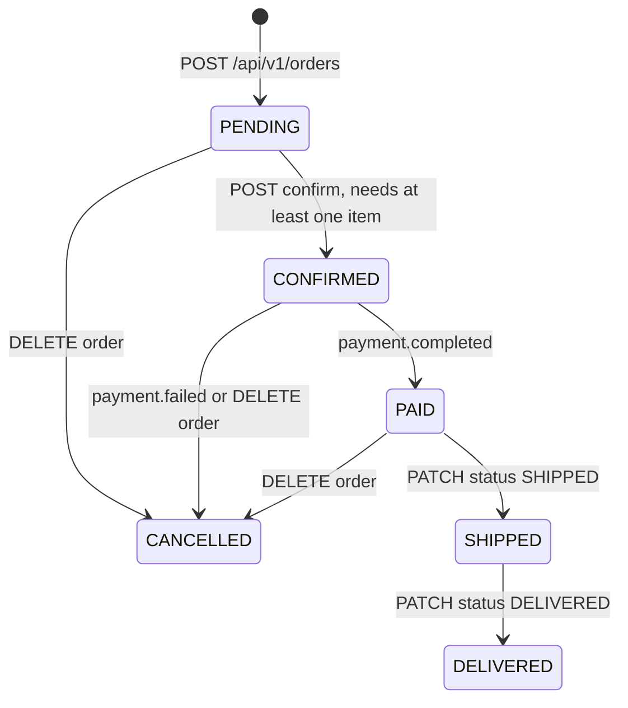
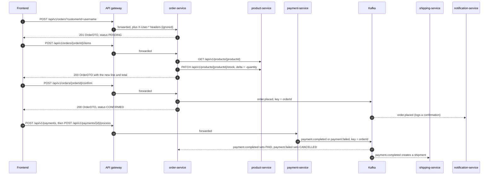
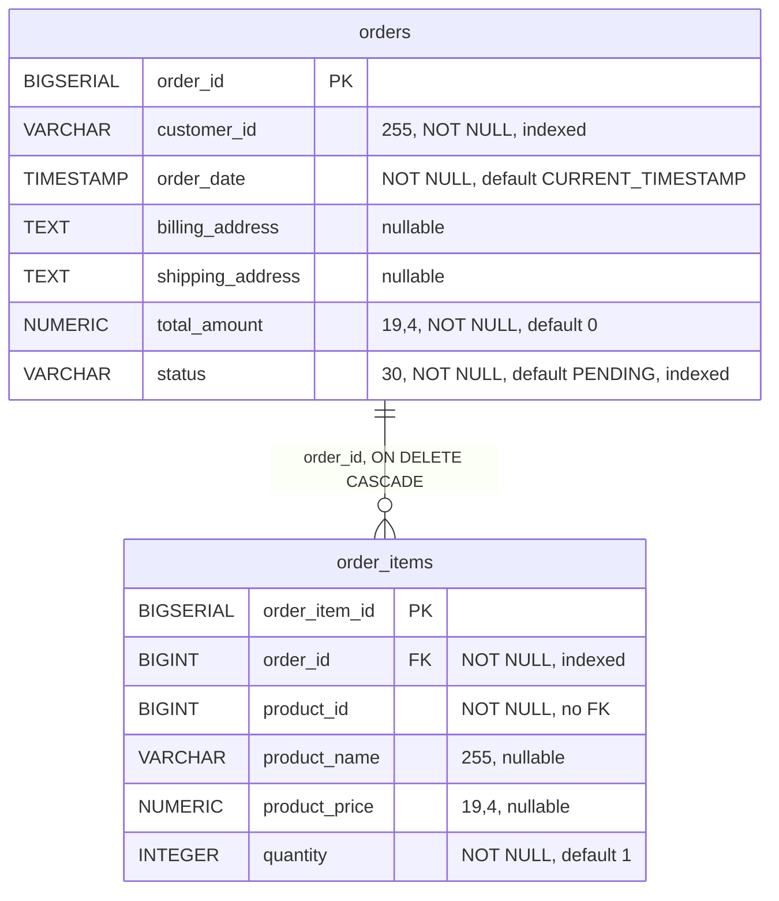

# Order Service

order-service owns customer orders and their order lines, and it sits at the centre of the purchase flow. In the
frontend a PENDING order doubles as the shopping cart. Adding an item checks the product and reserves its stock in
product-service over Feign. Confirming the order publishes `order.placed`. Cancelling releases the stock and
publishes `order.cancelled`. The payment result comes back from payment-service as `payment.completed` /
`payment.failed` and moves the order to PAID or CANCELLED. The service owns the `orders` and `order_items` tables
in PostgreSQL `orderdb`.

| | |
|---|---|
| Repository | `ecommerce-order-service` |
| Stack | Java 25 · Spring Boot 4.0.1 · Spring MVC · Spring Data JPA (Hibernate) · Flyway · Spring Cloud 2025.1.1 (OpenFeign 5.0.1 on Apache HttpClient 5, LoadBalancer, Eureka client, CircuitBreaker) · resilience4j 2.3.0 · spring-kafka 4.0.1 · springdoc 2.8.5 · Micrometer/Prometheus · OpenTelemetry tracing · Lombok |
| Port | 8084 |
| Eureka service ID | `order-service` |
| Gateway routes | `/api/v1/orders/**` (Bearer JWT required for every method) |
| Data store | PostgreSQL 16 `orderdb` (Flyway `V1`, `V2`); compose publishes it on host port 5434 |
| Publishes | `order.placed`, `order.cancelled` |
| Consumes | `payment.completed`, `payment.failed` (group `order-service`) |
| Calls | `product-service` (Feign): `GET /api/v1/products/{id}`, `PATCH /api/v1/products/{id}/stock` |
| Called by | The frontend through the gateway (cart, checkout, order pages, admin order page) and `ecommerce-platform/smoke-test.sh`. No backend service calls its REST API; notification-service consumes its events. |

Java paths below are relative to `src/main/java/com/ecommerce/order/`.

## Responsibilities

- Create orders for a caller-supplied `customerId` and keep them open (PENDING) while the customer fills them. The
  frontend stores the PENDING order's id as `cartOrderId` and uses it as the cart (`ecommerce-frontend/src/hooks/useCart.ts`).
- Add order lines: verify the product and its stock with product-service, reserve the stock immediately, and snapshot
  the product name and price into the line.
- Confirm orders (PENDING to CONFIRMED) and announce them on `order.placed`.
- Cancel orders: give the stock back to product-service and announce the cancellation on `order.cancelled`.
- Apply payment results: `payment.completed` marks the order PAID, `payment.failed` marks it CANCELLED.
- Let a caller set any status directly (`PATCH /status`). This is the only way to reach SHIPPED and DELIVERED.

Out of scope here:
- **Payment:** taking payment is not done here. After confirming, the frontend calls payment-service itself
  (`POST /api/v1/payments`, then `/process`).
- **Shipping:** shipping-service creates a shipment from `payment.completed` and never reports back to this service.
- **Notifications:** notification-service handles them.
- **Addresses:** the columns exist, but no endpoint writes them (see [Known issues](#known-issues-and-limitations)).

## Domain model

### `Order` (`model/Order.java`, table `orders`)

| Field | Java type | Column | Notes |
|---|---|---|---|
| `orderId` | `Long` | `order_id` BIGSERIAL PK | `GenerationType.IDENTITY` |
| `customerId` | `String` | `customer_id` VARCHAR(255) NOT NULL | Taken verbatim from the caller. The frontend sends the username; the smoke test sends `1`. |
| `orderItems` | `List<OrderItem>` | `order_items.order_id` | `@OneToMany(mappedBy = "order", cascade = ALL, orphanRemoval = true, fetch = EAGER)` |
| `orderDate` | `LocalDateTime` | `order_date` TIMESTAMP NOT NULL | Set at creation (`LocalDateTime.now()`, JVM zone, UTC in the containers) |
| `billingAddress` | `String` | `billing_address` TEXT | Never written by any code path |
| `shippingAddress` | `String` | `shipping_address` TEXT | Never written by any code path |
| `totalAmount` | `BigDecimal` | `total_amount` NUMERIC(19,4) NOT NULL | Running sum maintained by `Order.addItem()` |
| `status` | `OrderStatus` | `status` VARCHAR(30) NOT NULL | `@Enumerated(EnumType.STRING)` |

`Order.addItem(OrderItem)` links the line to the order and adds `productPrice × quantity` to `totalAmount`. It skips
the addition if either value is null. Nothing ever recomputes or decreases the total.

### `OrderItem` (`model/OrderItem.java`, table `order_items`)

| Field | Java type | Column | Notes |
|---|---|---|---|
| `orderItemId` | `Long` | `order_item_id` BIGSERIAL PK | |
| `order` | `Order` | `order_id` BIGINT NOT NULL FK | `@ManyToOne(fetch = LAZY)` |
| `productId` | `Long` | `product_id` BIGINT NOT NULL | product-service id; no FK (different database) |
| `productName` | `String` | `product_name` VARCHAR(255) | Snapshot of product-service `name` at add time |
| `productPrice` | `BigDecimal` | `product_price` NUMERIC(19,4) | Snapshot of product-service `price` at add time |
| `quantity` | `Integer` | `quantity` INTEGER NOT NULL | Builder default 1 |

### `OrderStatus` (`model/OrderStatus.java`)

| Value | Meaning | Entered through |
|---|---|---|
| `PENDING` | Created and open for items; the frontend's cart | `POST /api/v1/orders` (or `PATCH /status`) |
| `CONFIRMED` | Customer committed; `order.placed` published; payment expected | `POST /api/v1/orders/{orderId}/confirm` (or `PATCH /status`) |
| `PAID` | Payment succeeded | `payment.completed` (or `PATCH /status`) |
| `SHIPPED` | Handed to the carrier | `PATCH /status` only; shipping-service does not update orders |
| `DELIVERED` | Delivered | `PATCH /status` only |
| `CANCELLED` | Cancelled by the customer or by a failed payment | `DELETE /api/v1/orders/{orderId}`, `payment.failed` (or `PATCH /status`) |

### Lifecycle

The diagram shows the intended path, which the guards in `OrderService` support. Every edge is allowed by the code.



The code also allows much more than the diagram, because three triggers have no guard:
- `PATCH /status` sets any status from any status.
- `payment.completed` sets PAID from any status.
- `payment.failed` sets CANCELLED from any status.
- `DELETE` is also accepted on an order that is already CANCELLED.

The complete behaviour, by current status:

| Trigger | PENDING | CONFIRMED | PAID | SHIPPED | DELIVERED | CANCELLED |
|---|---|---|---|---|---|---|
| `POST /{orderId}/items`, `POST /{orderId}/products` | accepted, stays PENDING | accepted, stays CONFIRMED | 400 | accepted | accepted | 400 |
| `POST /{orderId}/confirm` | to CONFIRMED (400 if the order has no items) | 400 | 400 | 400 | 400 | 400 |
| `DELETE /{orderId}` | to CANCELLED | to CANCELLED | to CANCELLED | 400 | 400 | accepted again: stock restored again, event published again |
| `PATCH /{orderId}/status?status=X` | to X | to X | to X | to X | to X | to X |
| `payment.completed` | to PAID | to PAID | to PAID | to PAID | to PAID | to PAID |
| `payment.failed` | to CANCELLED | to CANCELLED | to CANCELLED | to CANCELLED | to CANCELLED | to CANCELLED |

Every rejection is an `InvalidOrderStateException`, which `GlobalExceptionHandler.handleInvalidState()` turns into **400
Bad Request** (never 409):

| Operation | Rejected when | `message` |
|---|---|---|
| add item | status is CANCELLED or PAID | `Cannot add items to order in status: <STATUS>` |
| add item | product-service reports `stockQuantity` below the requested quantity | `Insufficient stock for product <sku>. Available: <n>` |
| confirm | status is not PENDING | `Can only confirm PENDING orders. Current status: <STATUS>` |
| confirm | order has no items | `Cannot confirm an order with no items` |
| cancel | status is SHIPPED or DELIVERED | `Cannot cancel order in status: <STATUS>` |

An unknown `orderId` on any REST operation is **404** (`Order not found: <id>`). Kafka events never reject. An event
for an unknown order is logged at WARN and skipped.

### Checkout flow



The amount on the payment is whatever the frontend sends (`confirmedOrder.totalAmount` in
`ecommerce-frontend/src/pages/checkout/CheckoutPage.tsx`). Neither payment-service nor order-service compares it with
the order total.

## Business rules

1. A new order starts as PENDING. It gets `totalAmount = 0`, `orderDate = now` and the `customerId` query parameter
   exactly as sent: no validation, no link to the authenticated user. Enforced in `OrderService.createOrder()`.
2. Items can be added unless the order is CANCELLED or PAID. CONFIRMED, SHIPPED and DELIVERED orders accept items.
   Enforced in `OrderService.addItemToOrder()`.
3. The product must exist in product-service. Its 404 surfaces as 404 here (`ProductServiceClient.getProductById()`,
   `GlobalExceptionHandler.handleFeign()`). The product's `status` is not checked, so INACTIVE (soft-deleted) products
   can be ordered.
4. If product-service reports a non-null `stockQuantity` lower than the requested quantity, the add is rejected with
   400 before any stock is touched. Enforced in `OrderService.addItemToOrder()`. The check is advisory, because the
   real guard is product-service refusing a stock change that would go below zero (400, passed through).
5. Stock is reserved when the item is added, not at confirmation or payment. `addItemToOrder()` calls
   `PATCH /api/v1/products/{id}/stock` with `{"delta": -quantity}` before the line is saved.
6. Name and price are copied from the product-service response into the line (price snapshot). Later price or name
   changes in product-service do not affect existing lines. The SKU is not stored. Enforced in `addItemToOrder()`.
7. Every add creates a new line, even for a product already in the order; quantities are never merged. There is no
   way to remove a line or change its quantity. The frontend's "remove item" cancels the whole order and re-creates it
   (`ecommerce-frontend/src/pages/cart/CartPage.tsx`).
8. `totalAmount` is the running sum of `productPrice × quantity`, updated by `Order.addItem()` and never recalculated.
9. Confirmation requires status PENDING and at least one item. It sets CONFIRMED and publishes `order.placed`.
   Enforced in `OrderService.confirmOrder()`.
10. Cancellation is refused only for SHIPPED and DELIVERED. It sets CANCELLED, then sends `{"delta": +quantity}` to
    product-service for every line, then publishes `order.cancelled`. Each failed stock restore is logged at ERROR and
    otherwise ignored. Enforced in `OrderService.cancelOrder()`. The row is not deleted.
11. `payment.completed` sets PAID and `payment.failed` sets CANCELLED, whatever the current status. Neither checks the
    amount or customer, restores stock, or publishes an event. Enforced in `PaymentEventConsumer`.
12. `PATCH /status` writes the requested status with no transition check and no side effects. Enforced in
    `OrderService.updateOrderStatus()`.
13. Orders are never deleted; `DELETE` is a status change.

## API

| Method | Path | Gateway auth | Purpose |
|---|---|---|---|
| GET | `/api/v1/orders/hello` | Bearer JWT | Liveness greeting (text) |
| POST | `/api/v1/orders?customerId=` | Bearer JWT | Create a PENDING order |
| GET | `/api/v1/orders/{orderId}` | Bearer JWT | Get one order |
| GET | `/api/v1/orders/customer/{customerId}` | Bearer JWT | List a customer's orders (unpaginated) |
| POST | `/api/v1/orders/{orderId}/items` | Bearer JWT | Add a line (JSON body) |
| POST | `/api/v1/orders/{orderId}/products?productId=&quantity=` | Bearer JWT | Legacy add-line (query params, no validation) |
| POST | `/api/v1/orders/{orderId}/confirm` | Bearer JWT | PENDING to CONFIRMED, publishes `order.placed` |
| PATCH | `/api/v1/orders/{orderId}/status?status=` | Bearer JWT | Set any status ("admin/internal", unchecked) |
| DELETE | `/api/v1/orders/{orderId}` | Bearer JWT | Cancel, restore stock, publish `order.cancelled` |

No endpoint performs a service-side authorization check. Details, schemas and error bodies:
[API reference](../api/order-service.md).

## Events

All producing and consuming goes through the hand-built beans in `config/KafkaProducerConfig.java`. There is no Boot
Kafka auto-configuration in this service: the pom depends on `spring-kafka` directly, and Boot 4 keeps Kafka
auto-configuration in the separate `spring-boot-kafka` module, which is not on the classpath. So `application.yaml`
sets only `spring.kafka.bootstrap-servers`, read through `@Value`. The never-read `spring.kafka.producer.*` and
`spring.kafka.consumer.*` blocks, which named the deprecated Jackson 2 classes, were removed on 2026-10-29. Topics are not declared (`NewTopic`); the broker
auto-creates them (`KAFKA_AUTO_CREATE_TOPICS_ENABLE=true`, broker default partition count).

### Published

Producer: `DefaultKafkaProducerFactory` built with serializer instances: `StringSerializer` keys and spring-kafka's
`JacksonJsonSerializer` values (Jackson 3, `.noTypeInfo()`), so records carry no `__TypeId__` header. Its mapper is
`KafkaProducerConfig.eventJsonMapper()`: spring-kafka's `JacksonMapperUtils.enhancedJsonMapper()` with
`DateTimeFeature.WRITE_DATES_AS_TIMESTAMPS` switched on. All other producer settings are kafka-clients 4.1.1 defaults.
On the wire, `LocalDateTime` is an integer array `[year, month, day, hour, minute, second, nanos]`; seconds and nanos
are dropped when zero, so the array has 5 to 7 elements. Jackson 3 would write ISO strings by default, and the
timestamps flag keeps the form the deprecated Jackson 2 `JsonSerializer` produced before 2026-10-29. `BigDecimal` is a
JSON number. Both forms are pinned by the provider pact.

#### `order.placed`

- **Trigger:** `POST /api/v1/orders/{orderId}/confirm`, which calls `OrderService.confirmOrder()` and then
  `OrderEventProducer.publishOrderPlaced()`. Nothing else publishes it.
- **Key:** `orderId.toString()`, for example `"42"`.
- **Consumers:** notification-service (group `notification-service`, logs an order confirmation and ignores `items`).
  payment-service does not consume it.

| Field | Java type | JSON | Notes |
|---|---|---|---|
| `orderId` | `Long` | number | |
| `customerId` | `String` | string | As supplied at creation |
| `totalAmount` | `BigDecimal` | number | Read back from the database, so 4 decimals (`99.9800`) |
| `orderDate` | `LocalDateTime` | integer array | The **creation** time of the order, not the confirmation time |
| `items` | `List<OrderPlacedEvent.OrderItemEvent>` | array | Not pinned by any pact |
| `items[].productId` | `Long` | number | |
| `items[].productName` | `String` | string | Snapshot |
| `items[].productPrice` | `BigDecimal` | number | Snapshot |
| `items[].quantity` | `Integer` | number | |

```json
{
  "orderId": 42,
  "customerId": "alice",
  "totalAmount": 99.9800,
  "orderDate": [2026, 10, 29, 18, 7, 12, 345678000],
  "items": [
    { "productId": 7, "productName": "Wireless Mouse", "productPrice": 49.9900, "quantity": 2 }
  ]
}
```

#### `order.cancelled`

- **Trigger:** `DELETE /api/v1/orders/{orderId}` only, through `OrderService.cancelOrder()` and
  `OrderEventProducer.publishOrderCancelled()`. It is **not** published when `payment.failed` cancels an order, nor
  when `PATCH /status` sets CANCELLED. It **is** published again each time an already-cancelled order is cancelled.
- **Key:** `orderId.toString()`.
- **Consumers:** notification-service (logs a cancellation notice).

| Field | Java type | JSON | Notes |
|---|---|---|---|
| `orderId` | `Long` | number | |
| `customerId` | `String` | string | |
| `cancelledAt` | `LocalDateTime` | integer array | `LocalDateTime.now()` at cancellation |

```json
{ "orderId": 42, "customerId": "alice", "cancelledAt": [2026, 10, 29, 18, 9, 3, 120000000] }
```

#### Delivery semantics (dual write)

Both publishes run **inside** the `@Transactional` service method, before the JPA commit. They use a plain
`KafkaTemplate.send()`: no Kafka transactions, no outbox, no after-commit hook, and the returned future is ignored.
Consequences:

- A consumer can receive the event before the database change is committed.
- If the commit fails after the send, the event describes a change that never happened.
- An asynchronous delivery failure after the record was buffered is logged at ERROR by spring-kafka's
  `LoggingProducerListener`. The database change stays committed and the event is lost.
- An immediate failure makes `KafkaTemplate` throw `KafkaException("Send failed")`, which rolls the transaction back
  and returns 500. For example, the producer cannot fetch metadata within `max.block.ms`, 60 s by default, and blocks
  the request that long. On confirm this is consistent: the order stays PENDING. On cancel, the stock restores have
  already been sent to product-service, so stock is returned while the order keeps its previous status.

### Consumed

| Topic | Group id | Listener | Effect |
|---|---|---|---|
| `payment.completed` | `order-service` | `PaymentEventConsumer.handlePaymentCompleted(PaymentCompletedEvent)` | `status = PAID` |
| `payment.failed` | `order-service` | `PaymentEventConsumer.handlePaymentFailed(PaymentFailedEvent)` | `status = CANCELLED` |

Producer: payment-service `PaymentService.processPayment()`, key `orderId.toString()`. It publishes these after
`POST /api/v1/payments/{id}/process`; the simulated gateway succeeds 80% of the time.

**Deserialization:** the consumer factory uses `StringDeserializer` for keys and values. The listener container
factory (`kafkaListenerContainerFactory`) converts the String payload into the listener's parameter type with
`JacksonJsonMessageConverter` (Jackson 3 `enhancedJsonMapper`: unknown properties ignored, `LocalDateTime` accepted as an
array or an ISO string). No type headers are needed. Group id `order-service`, `auto.offset.reset=earliest`, one
consumer thread per listener. `ConsumerConfig.GROUP_ID_CONFIG` is set in the factory and again in `@KafkaListener`.

**Payload classes** (`event/PaymentCompletedEvent.java`, `event/PaymentFailedEvent.java`) mirror payment-service's
classes field for field. Every field is pinned by type in this service's consumer pact.

| `PaymentCompletedEvent` | Java type | | `PaymentFailedEvent` | Java type |
|---|---|---|---|---|
| `paymentId` | `Long` | | `paymentId` | `Long` |
| `orderId` | `Long` | | `orderId` | `Long` |
| `customerId` | `String` | | `customerId` | `String` |
| `amount` | `BigDecimal` | | `failureReason` | `String` |
| `transactionId` | `String` | | `failedAt` | `LocalDateTime` |
| `completedAt` | `LocalDateTime` | | | |

**Behaviour:** each listener method is `@Transactional`. It loads the order by `orderId`, sets the status and saves;
nothing else on the event is read. An unknown `orderId` is logged at WARN and the record is acknowledged.

**Idempotency:** a redelivered event writes the same status again, which is harmless. But there is no state guard,
no record of processed `paymentId`s and no ordering across the two topics. So:
- a late or duplicate `payment.completed` turns a CANCELLED order back into PAID;
- a `payment.failed` cancels a PAID, SHIPPED or DELIVERED order.

With `auto.offset.reset=earliest`, a consumer group that has lost its offsets replays every retained payment event.

**Failure behaviour:** no error handler is configured, so spring-kafka's default `DefaultErrorHandler` applies:
- **Exceptions thrown by the listener**, for example the database is down or `findById(null)` for an event without
  `orderId`: 10 delivery attempts (`FixedBackOff(0, 9)`, no delay), then the record is logged at ERROR and skipped.
  The status change is lost. There is no dead-letter topic.
- **Malformed JSON:** this fails in the converter with a `ConversionException`, which the handler classifies as
  fatal, so the record is logged and skipped on the first attempt. Because the deserializer is `StringDeserializer`,
  a bad record cannot loop at the deserializer level.
- **Offsets:** the DB commit and the offset commit are separate (at-least-once).

## Outbound calls

### `ProductServiceClient` → product-service

`client/ProductServiceClient.java`, `@FeignClient(name = "product-service", fallback = ProductServiceClientFallback.class)`.
The client resolves the target through Eureka and Spring Cloud LoadBalancer. Transport is Apache HttpClient 5
(`feign-hc5`). No `Authorization`, `X-User-*` or `X-Correlation-Id` header is forwarded, because there is no
`RequestInterceptor`. The call goes straight to product-service, bypassing the gateway, and product-service performs
no authorization on either endpoint.

| Method | Request | Response fields read | Called from |
|---|---|---|---|
| `getProductById(Long)` | `GET /api/v1/products/{id}` | `name`, `price`, `stockQuantity`, `sku` (only in the error message). `id`, `brand`, `status` are mapped but unused. | `OrderService.addItemToOrder()` |
| `updateStock(Long, StockUpdateRequest)` | `PATCH /api/v1/products/{id}/stock`, body `{"delta": <int>}` | none (the returned `ProductDTO` is discarded) | `addItemToOrder()` with `-quantity`; `cancelOrder()` with `+quantity` per line |

**Timeouts:** `spring.cloud.openfeign.client.config.default`: connect 2000 ms, read 10000 ms. The short connect
timeout exists so a peer that vanished mid-rollout fails fast and the retry below can move on.

**Retries:** `FeignConfig.ConnectionFailureRetryer(3, 100)` is registered as the global Feign `Retryer`:
- It retries only when the cause is a `java.net.ConnectException` (including hc5's `HttpHostConnectException`) or
  hc5's `ConnectTimeoutException`. In those cases the request never reached the peer, so repeating any method is safe.
- At most 3 attempts in total, with 100 ms and then 200 ms of sleep. The LoadBalancer picks an instance afresh on
  every attempt.
- Read timeouts (`SocketTimeoutException`) and HTTP errors are never retried, because the request may have been
  processed.
- The retries cover the few seconds between a peer pod vanishing and every registry cache dropping it. Worst case
  against an unreachable host is about 6.3 s (3 × 2 s plus back-off).
- The LoadBalancer eagerly builds the `product-service` instance list
  (`spring.cloud.loadbalancer.eager-load.clients`); otherwise the first call fails with "Load balancer does not
  contain an instance". The instance cache TTL is 5 s, matching the 5 s Eureka fetch.

**Message converters:** `FeignConfig.feignHttpMessageConverters()` replaces Spring Cloud OpenFeign 5.0.1's
`FeignHttpMessageConverters` with `ThreadSafeFeignHttpMessageConverters`. The library fills its converter list lazily
and without synchronisation. Concurrent first calls on a fresh JVM could see the empty list and fail with
`DecodeException: 'messageConverters' must not be empty`, which surfaced as a 500. The subclass makes the first
initialisation mutually exclusive.

**Circuit breaker:** both client methods carry resilience4j `@CircuitBreaker(name = "product-service")`, so the two
endpoints share one breaker. The annotation is applied by resilience4j's Spring AOP aspect (resilience4j-spring-boot3
2.3.0 plus aspectjweaver; the aspect resolves annotations on JDK-proxy interfaces such as Feign clients). Settings
from `resilience4j.circuitbreaker.instances.product-service`:

| Setting | Value |
|---|---|
| sliding window | count-based (default), `slidingWindowSize: 10`, `minimumNumberOfCalls: 5` |
| `failureRateThreshold` | 50 % |
| `waitDurationInOpenState` | 10 s, with `automaticTransitionFromOpenToHalfOpenEnabled: true` (an idle service would otherwise stay OPEN until the next call) |
| `permittedNumberOfCallsInHalfOpenState` | 3 |
| `ignoreExceptions` | `FeignException$NotFound`, `$BadRequest`, `$Conflict`, `$UnprocessableEntity`. A 4xx means the caller asked for something invalid; counting them let a few unknown product ids trip the breaker for valid traffic too. |
| `registerHealthIndicator` | `true`, but has no effect: resilience4j-spring-boot3's health auto-configuration requires `org.springframework.boot.actuate.health.HealthIndicator`, which Boot 4 moved to `org.springframework.boot.health.contributor` |

A call that needed Feign retries counts as one breaker call. There is no resilience4j retry configuration.

**Fallback:** `ProductServiceClientFallback` is **not active**. Spring Cloud OpenFeign honours `fallback` only when
`spring.cloud.openfeign.circuitbreaker.enabled=true`, which is set nowhere. Without it the `DefaultTargeter` ignores
the attribute, and the `@CircuitBreaker` annotations declare no `fallbackMethod`. The fallback's "Product service
unavailable" exception is what `GlobalExceptionHandler.handleRuntime()` maps to 503, so that branch is unreachable.

**Error mapping** (`GlobalExceptionHandler.handleFeign()` unless stated):

| product-service outcome | Exception in order-service | Counts for breaker | order-service response |
|---|---|---|---|
| 404 (unknown product) | `FeignException.NotFound` | ignored | **404** (the smoke test asserts this) |
| 400 (stock would go below 0) | `FeignException.BadRequest` | ignored | **400** |
| 409 | `FeignException.Conflict` | ignored | 409 (product-service does not return it on these endpoints) |
| 503, or no instance registered (LoadBalancer synthesises a 503) | `FeignException.ServiceUnavailable` | yes | **503** |
| Connection refused / connect timeout after 3 attempts, or read timeout | `RetryableException`, `status() == -1` | yes | **503** |
| 500 or any other status (401, 403, 422, ...) | `FeignException` | yes (422 ignored) | **502** |
| Breaker OPEN | `CallNotPermittedException` (message has no "unavailable") | n/a | **500** "An unexpected error occurred", via `handleRuntime()` |

The response `message` is `"Downstream service call failed: "` plus Feign's message, which includes the method, the
internal URL and the downstream response body.

In `cancelOrder()` every `updateStock` exception is caught and logged, so an outage never fails a cancellation; it
just leaves the stock unreturned.

**Consistency gaps around stock:**
- **Add item:** the reservation (PATCH) happens before the line is saved and committed, with no compensation. A
  database or commit failure after the PATCH, or a read timeout on a PATCH that product-service did apply, leaves the
  stock reserved for nothing. In the read-timeout case the client gets 503, and a client retry reserves again.
- **Cancel:** the restores are sent before the commit and the Kafka send. If either fails, the stock is back but the
  order is not cancelled, and cancelling again restores it a second time.
- **Payment failure:** `payment.failed` never restores stock.
- **No expiry:** abandoned PENDING orders keep their reservation forever.
- **product-service side:** `ProductService.updateStock()` is a read-modify-write with no `@Version` or row lock, so
  concurrent reservations of the same product can lose an update.

## Persistence

PostgreSQL 16, database `orderdb`, schema owned by Flyway (`classpath:db/migration`, `baseline-on-migrate: true`).
Hibernate runs with `ddl-auto: validate`. Both scripts use `CREATE ... IF NOT EXISTS`.

- `V1__create_orders.sql`: table `orders`; indexes `idx_orders_customer (customer_id)` and `idx_orders_status (status)`.
- `V2__create_order_items.sql`: table `order_items` with FK `order_id → orders(order_id) ON DELETE CASCADE`; index
  `idx_order_items_order (order_id)`.



Entities versus migrations:
- **Columns:** they match (names, nullability, lengths, `NUMERIC(19,4)`), so validation passes.
- **Defaults:** the column defaults (`CURRENT_TIMESTAMP`, `0`, `'PENDING'`, `1`) duplicate the entity builder
  defaults. Hibernate always inserts explicit values, so the DB defaults only matter for manual inserts.
- **Indexes:** the entities declare no indexes. `idx_orders_customer` serves `OrderRepository.findByCustomerId()`; no
  query filters on `status`, so `idx_orders_status` is unused.
- **Cascades:** `ON DELETE CASCADE` and `orphanRemoval = true` are never used by the application, because nothing deletes orders or
  removes lines. `OrderRepositoryIT` exercises both against Postgres.
- **Missing constraints:** no CHECK constraints (quantity can be zero or negative, status is free text at DB level)
  and no version column, so there is no optimistic locking.
- **Fetching:** `orderItems` is `EAGER`; `findByCustomerId()` loads each order's lines with a separate query.
- **Tests:** the `test` profile (unit and pact tests) replaces Postgres with H2 and `ddl-auto: create-drop` with Flyway disabled. The
  `*IT` classes run the migrations on Postgres with `ddl-auto: validate`.

## Security and identity

- **Gateway:** every `/api/v1/orders/**` request needs a valid Bearer JWT; otherwise the gateway returns 401 with an
  empty body. On authenticated requests the gateway sets `X-Username`, `X-User-Id` and `X-User-Role`.
- **This service reads none of them.** The only request header it reads is `X-Correlation-Id`
  (`filter/CorrelationIdFilter.java`). There is no Spring Security dependency, no role check and no ownership check on
  any endpoint.

| Endpoint | Identity used | Ownership / role check |
|---|---|---|
| `POST /api/v1/orders` | `customerId` query parameter, any string | none |
| `GET /api/v1/orders/{orderId}` | none | none: any order by id |
| `GET /api/v1/orders/customer/{customerId}` | `customerId` path variable | none: any customer's orders |
| `POST /{orderId}/items`, `POST /{orderId}/products` | none | none |
| `POST /{orderId}/confirm` | none | none |
| `PATCH /{orderId}/status` | none | none, although the OpenAPI summary says "admin/internal" |
| `DELETE /{orderId}` | none | none |
| `GET /hello` | none | none |

Consequences:
- **Any caller can act on any order.** Any authenticated user can create orders under any customer id, read or list
  anyone's orders, and add to, confirm, cancel or re-status any order, for example mark their own order PAID or
  SHIPPED.
- **Inconsistent identity values.** `customerId` is not tied to the token, and clients disagree on its content: the
  frontend sends the username (`useOrders.ts`), the smoke test sends `1`. The value then flows unchanged into
  payment-service, shipping-service and notification-service through the events.
- **Direct port access.** compose publishes port 8084 on the host, and there it needs no token at all. The actuator,
  including the writable `serviceregistry` endpoint, is also unauthenticated on that port; a POST of
  `{"status":"OUT_OF_SERVICE"}` takes the instance out of Eureka.
- **Unauthenticated events.** Kafka has no authentication. Any `payment.completed` record for an order id marks that
  order PAID.
- **Documentation only.** `OpenApiConfig` declares a global `bearerAuth` scheme for Swagger UI; nothing in the service
  enforces it.

## Configuration

| Property | Env var | Default | Purpose |
|---|---|---|---|
| `server.port` | — | `8084` | HTTP port |
| `spring.application.name` | — | `order-service` | Eureka service ID, `application` metrics tag |
| `spring.datasource.url` | `SPRING_DATASOURCE_URL` | `jdbc:postgresql://localhost:5434/orderdb` | compose and k8s set `jdbc:postgresql://orderdb:5432/orderdb` |
| `spring.datasource.username` / `password` | `DB_USERNAME` / `DB_PASSWORD` | `orderuser` / `orderpass` | k8s reads them from secret `orderdb-credentials` |
| `spring.jpa.hibernate.ddl-auto` | — | `validate` | Schema comes from Flyway; Hibernate only validates |
| `spring.flyway.enabled` / `locations` / `baseline-on-migrate` | — | `true` / `classpath:db/migration` / `true` | Migrations |
| `spring.kafka.bootstrap-servers` | `KAFKA_BOOTSTRAP_SERVERS` | `localhost:9092` | Read by `KafkaProducerConfig`; compose and k8s use `kafka:29092` |
| `eureka.client.service-url.defaultZone` | `EUREKA_CLIENT_SERVICEURL_DEFAULTZONE` | `http://localhost:8761/eureka/` | Registry |
| `eureka.client.registry-fetch-interval-seconds` | — | `5` | See replaced peers quickly (default 30) |
| `eureka.instance.prefer-ip-address` | `EUREKA_INSTANCE_PREFER_IP_ADDRESS` (k8s) | `true` | Register the IP; pod hostnames are not resolvable |
| `eureka.instance.lease-renewal-interval-in-seconds` / `lease-expiration-duration-in-seconds` | — | `5` / `15` | A crashed instance leaves the registry within about 20 s |
| `spring.cloud.loadbalancer.cache.ttl` | — | `5s` | Instance cache matched to the Eureka fetch |
| `spring.cloud.loadbalancer.eager-load.clients` | — | `product-service` | Avoid an empty instance list on the first call |
| `spring.cloud.openfeign.client.config.default.connect-timeout` / `read-timeout` | — | `2000` / `10000` (ms) | Feign timeouts |
| `resilience4j.circuitbreaker.instances.product-service.*` | — | see [Outbound calls](#outbound-calls) | Breaker |
| `management.endpoints.web.exposure.include` | — | `health,info,metrics,prometheus,circuitbreakers,serviceregistry` | Actuator over HTTP |
| `management.endpoint.health.show-details` | — | `always` | |
| `management.endpoint.health.probes.enabled` | `MANAGEMENT_ENDPOINT_HEALTH_PROBES_ENABLED` | not set (k8s sets `true`) | `/actuator/health/liveness` and `/readiness` for the k8s probes |
| `management.endpoint.prometheus.access` | — | `unrestricted` | |
| `management.metrics.tags.application` / `environment` | `ENVIRONMENT` | `order-service` / `development` | Common metric tags |
| `management.metrics.distribution.percentiles-histogram.http.server.requests` / `slo.http.server.requests` | — | `true` / `50ms,100ms,200ms,500ms,1s,2s` | Latency histogram buckets |
| `management.tracing.sampling.probability` | `TRACING_SAMPLING_PROBABILITY` | `1.0` | |
| `management.opentelemetry.tracing.export.otlp.endpoint` | `OTEL_EXPORTER_OTLP_ENDPOINT` | `http://tempo:4318` + `/v1/traces` | OTLP/HTTP span export |
| `management.otlp.metrics.export.enabled` | — | `false` | Metrics only through the Prometheus scrape |
| `springdoc.api-docs.path` / `springdoc.swagger-ui.path` | — | `/api-docs` / `/swagger-ui.html` | |
| `logging.pattern.console` / `logging.level.com.ecommerce` | — | see [Observability](#observability) / `DEBUG` | |
| `JAVA_OPTS` | `JAVA_OPTS` | empty in the image | compose and k8s: `-XX:MaxRAMPercentage=55 -XX:ActiveProcessorCount=2 -XX:+ExitOnOutOfMemoryError` |

The service has no JWT or security configuration.

`src/main/resources/application-test.yaml` is the `test` profile. It sits under `src/main`, so it is packaged into
the production jar (it is present in `BOOT-INF/classes/` of the built jar). Only the full-context tests activate it
with `@ActiveProfiles("test")` (`PaymentEventsConsumerPactTest`, `OrderEventsProviderPactTest`). It sets:
- an H2 in-memory datasource, `ddl-auto: create-drop`, Flyway disabled;
- Eureka disabled;
- `spring.kafka.bootstrap-servers: localhost:9092`;
- an exclusion of `org.springframework.cloud.autoconfigure.LifecycleMvcEndpointAutoConfiguration`. The code does not
  record why; review-service has the same exclusion.

In production it is inert unless someone activates the `test` profile. If they did, startup would fail, because H2 is
a test-scoped dependency and not in the jar. catalog-service and review-service keep the same file under
`src/test/resources`.

**Runtime:**
- **Image:** `eclipse-temurin:25-jre-alpine` runs the prebuilt `target/order-service-*.jar` as the non-root user
  `app`. The jar is built on the host, so rebuild with Maven before rebuilding the image.
- **compose:** `mem_limit: 768m`, port `8084:8084`, starts after `orderdb`, `kafka` and `service-discovery` report
  healthy, healthcheck on `/actuator/health`.
- **k8s** (`ecommerce-platform/k8s/40-services.yaml`):
  - one replica;
  - init containers wait for Eureka, `orderdb` and Kafka;
  - startup and readiness probes on `/actuator/health/readiness`, liveness probe on `/actuator/health/liveness`;
  - a preStop hook POSTs `OUT_OF_SERVICE` to `/actuator/serviceregistry` and sleeps 15 s, so callers stop routing
    to the pod before SIGTERM; `terminationGracePeriodSeconds: 60`;
  - memory request 320Mi, limit 768Mi.

## Observability

- **Actuator** (`/actuator/*`, no authentication on port 8084): `health` (details always), `info`, `metrics`,
  `prometheus`, `circuitbreakers` (resilience4j's endpoint; its only condition is the actuator `Endpoint` class, which
  Boot 4 still has), `serviceregistry`. Health has no circuit-breaker component (see `registerHealthIndicator` above).
- **Metrics:**
  - Prometheus job `order-service` scrapes `order-service:8084/actuator/prometheus` with labels
    `service=order-service`, `group=application`, plus common tags `application`, `environment`.
  - `http.server.requests` has a percentile histogram and SLO buckets.
  - There are no custom business metrics, and no Kafka client metrics, because the hand-built Kafka factories get no
    Micrometer listeners.
  - The blackbox exporter probes `/actuator/health`, and `postgres-exporter-orderdb` covers the database.
  - **Not verified:** whether `resilience4j_circuitbreaker_*` metrics are exported. The `CircuitBreakerOpen` alert and
    the Grafana error/latency panel depend on them. Both binders guard on `@ConditionalOnBean(MeterRegistry)`, and
    both order themselves after auto-configuration class names that do not exist in Boot 4.0.1 (resilience4j names
    Boot 3's `org.springframework.boot.actuate.autoconfigure.metrics.*`, Spring Cloud names
    `org.springframework.boot.metrics.autoconfigure.*`). Check `/actuator/prometheus` on a running instance.
- **Logs:** pattern `%d{yyyy-MM-dd HH:mm:ss} [%thread] [%X{correlationId}] %-5level %logger{36} - %msg%n`, with
  `com.ecommerce` at DEBUG. Promtail parses this format: `level` becomes a label, `correlationId` and `thread` become
  structured metadata, and DEBUG lines are dropped. The pattern has no trace id, so logs and traces cannot be joined
  by trace id.
- **Correlation id:** `CorrelationIdFilter` takes `X-Correlation-Id` from the request or generates a UUID, puts it
  into the MDC as `correlationId`, echoes it in the response header and includes it in every `ErrorResponse`. The
  gateway does not generate one, only exposes the header through CORS. It is not forwarded on Feign calls or Kafka
  records, and Kafka listener threads log an empty `[]`.
- **Tracing:** Micrometer Tracing with the OpenTelemetry bridge exports spans over OTLP/HTTP to Tempo, sampling 1.0.
  Incoming HTTP requests are traced. Feign calls are **not** instrumented: `feign-micrometer` is not on the
  classpath, so Spring Cloud OpenFeign's Micrometer configuration is skipped, there is no client span and no
  `traceparent` reaches product-service. `KafkaTemplate` and the listener containers are built without observation
  enabled, so traces stop at the Kafka hop.

## Testing

97 unit, slice and pact tests (`mvn test`) and 16 integration tests (`mvn verify`, needs Docker). CI (`.circleci/config.yml`) runs
`mvn -B -ntp verify` in `cimg/openjdk:25.0`. It then builds the image, and on `develop`, `main`, `master` and `v*`
tags publishes it to Docker Hub.

| Class | Kind | Covers |
|---|---|---|
| `service/OrderServiceTest` | Mockito unit | create; add item (stock reserved with `delta = -2`, unknown order, CANCELLED order, unknown product, insufficient stock); confirm; cancel (restores stock, rejects SHIPPED); status updates; reads; the product-service failure paths |
| `controller/OrderControllerTest` | `@WebMvcTest` | every endpoint's status codes, validation and error bodies |
| `messaging/OrderEventProducerTest`, `messaging/PaymentEventConsumerTest` | unit | the `order.placed` and `order.cancelled` records (topic, key, payload); `payment.completed` and `payment.failed` handling, including an unknown order |
| `client/ProductServiceClientFallbackTest` | unit | the fallback class (inactive in production, see Outbound calls) |
| `config/ConnectionFailureRetryerTest`, `config/FeignHttpMessageConvertersRaceTest` | unit, concurrency | connection failures retried up to the limit, a read timeout never; 48 threads × 200 rounds never see an empty converter list |
| `exception/GlobalExceptionHandlerTest`, `filter/CorrelationIdFilterTest` | unit | exception mappings; the correlation ID |
| `contract/ProductServiceConsumerPactTest` (4), `PaymentEventsConsumerPactTest` (2), `OrderEventsProviderPactTest` (2) | Pact | see below |
| `contract/FrontendHttpProviderPactTest` | Pact provider, HTTP | the frontend's 7 interactions, see below |
| `integration/OrderRepositoryIT` | Testcontainers `postgres:16-alpine` | the real Flyway migrations; cascade and orphan removal; `numeric` rounding to four places; status stored as its name; `findByCustomerId` |
| `integration/OrderFlowIT` | full app, Postgres, Kafka, WireMock for product-service | create, add item, place: the rows persist and `order.placed` is published; cancel restores stock and publishes `order.cancelled`; unknown product 404 and insufficient stock 400 leave the order untouched |
| `integration/PaymentEventsIT` | full app, Postgres, Kafka | `payment.completed` marks the order `PAID`; `payment.failed` cancels it; an event for an unknown order is skipped and the listener keeps consuming |

**Disabled test that pins a bug** (see [Findings](../findings.md#bugs-pinned-by-tests)): `OrderServiceTest.cancelOrder_alreadyCancelled_isRejectedWithoutRestoringStockAgain`. Cancelling a `CANCELLED` order restores stock a second time and publishes a duplicate `order.cancelled` (I-3).

Open design questions with no test yet, because the intended rules are undecided: items can be added after `CONFIRMED` (I-8), `PaymentEventConsumer` overwrites the status whatever it is, so a late `payment.completed` flips `CANCELLED` to `PAID` (R-3), and `PATCH /status` accepts any transition (I-9). Not covered: the legacy `/products` endpoint and the circuit breaker.

**Pacts** (pact-jvm 4.7.5, spec V4, no broker). Pact files are handed over by `ecommerce-platform/sync-pacts.sh`.
The copies in the provider repositories match the files last generated here.

- **Consumer of product-service** (`ProductServiceConsumerPactTest`, writes `target/pacts/order-service-product-service.json`).
  - **Setup:** runs the real Feign client with the production `FeignConfig` and `AppConfig` and hc5, driven through
    the real `OrderService`, against a Pact mock on fixed port 18082. The repository and producer are mocked.
  - **Pins:**
    - state `product 1 exists`: `GET /api/v1/products/1` returns 200 with `id` (integer), `sku`, `name` (strings),
      `price` (number), `stockQuantity` (integer);
    - `PATCH /api/v1/products/1/stock` with exact body `{"delta":-2}` and `Content-Type: application/json` returns
      200;
    - the restore `PATCH` with `{"delta":2}`;
    - state `product 999 does not exist`: `GET /api/v1/products/999` returns 404 with `status`, `error`, `message`;
    - `{"delta":-1000}` returns 400 with the insufficient-stock error.
  - **Also asserts:** the 404 and 400 surface as `FeignException.NotFound` and `FeignException.BadRequest`.
  - **Verified by:** product-service's `ProductServiceProviderPactTest`.
- **Consumer of payment-service events** (`PaymentEventsConsumerPactTest`, writes `target/pacts/order-service-payment-service.json`).
  - **Setup:** publishes each pact message as raw bytes, with no type headers, to an embedded Kafka broker. The
    production listener container (`StringDeserializer` plus `JacksonJsonMessageConverter`) must turn it into PAID or
    CANCELLED.
  - **Pins:** every field of `PaymentCompletedEvent` and `PaymentFailedEvent` by type, timestamps as integer arrays
    of at least 5 elements, metadata `kafka_topic`, and `kafka_key` matching `\d+`.
  - **Provider states:** `payment 501 for order 7 has completed`, `payment 502 for order 7 has failed`.
  - **Verified by:** payment-service's `PaymentEventsProviderPactTest`.
- **Provider of order events** (`OrderEventsProviderPactTest`, replays `src/test/resources/pacts/notification-service-order-service.json`).
  - **Setup:** for each interaction the real `OrderService` and `OrderEventProducer` run against a mocked
    `KafkaTemplate`. The captured value is serialized with the value serializer configured on the production
    `ProducerFactory`.
  - **States:**
    - `order 7 is pending with items`, then `confirmOrder(7)`, giving "an order.placed event";
    - `order 7 is confirmed`, then `cancelOrder(7)`, giving "an order.cancelled event".
  - **Pins:**
    - `order.placed`: `orderId` (integer), `customerId` (string), `totalAmount` (number), `orderDate` (integer array,
      at least 5);
    - `order.cancelled`: `orderId`, `customerId`, `cancelledAt`;
    - for both: `kafka_topic`, and `kafka_key` matching `\d+`.
  - **Not pinned:** `items`, which notification-service does not read.

**Provider for the frontend** (`FrontendHttpProviderPactTest`, 7 interactions in `src/test/resources/pacts-frontend/ecommerce-frontend-order-service.json`, kept apart from `pacts/`, which holds message pacts only): create an order for a customer, get order 7, a customer's orders, add 2 of product 1, confirm, cancel, and an admin status change to `SHIPPED`. The test boots the whole application and emulates the gateway by decoding the bearer token into `X-Username`, `X-User-Id` and `X-User-Role`.

Run only the pacts with `mvn test -Dtest='*PactTest'`.

## Code map

| Path | Role |
|---|---|
| `OrderServiceApplication.java` | Boot entry point, `@EnableFeignClients` |
| `controller/OrderController.java` | REST endpoints under `/api/v1/orders` |
| `service/OrderService.java` | Business logic and transactions: create, add item, confirm, cancel, set status; Feign calls; event publishing; manual entity-to-DTO mapping (`toDTO()`) |
| `model/Order.java`, `model/OrderItem.java`, `model/OrderStatus.java` | JPA entities and the status enum; `Order.addItem()` maintains the total |
| `repository/OrderRepository.java` | Spring Data JPA; `findByCustomerId()` |
| `dto/AddItemRequest.java`, `dto/OrderDTO.java`, `dto/OrderItemDTO.java` | REST request/response bodies |
| `dto/ProductDTO.java`, `dto/StockUpdateRequest.java` | Feign request/response bodies for product-service |
| `client/ProductServiceClient.java` | Feign client with `@CircuitBreaker(name = "product-service")` |
| `client/ProductServiceClientFallback.java` | Fallback class; not wired (see Outbound calls) |
| `config/FeignConfig.java` | `ThreadSafeFeignHttpMessageConverters`, `ConnectionFailureRetryer` |
| `config/KafkaProducerConfig.java` | Producer factory and template, consumer factory, listener container factory, `@EnableKafka` |
| `config/AppConfig.java` | a Jackson 3 `ObjectMapper` bean (unused; Spring MVC uses Boot's `@Primary` `JsonMapper`). The unused `ModelMapper` bean and dependency were removed on 2026-10-29. |
| `config/OpenApiConfig.java` | springdoc metadata and the `bearerAuth` scheme |
| `messaging/OrderEventProducer.java` | Publishes `order.placed`, `order.cancelled` |
| `messaging/PaymentEventConsumer.java` | Listens to `payment.completed`, `payment.failed` |
| `event/*.java` | Kafka payload classes |
| `exception/GlobalExceptionHandler.java`, `exception/ErrorResponse.java` | Error mapping and body |
| `exception/OrderNotFoundException.java`, `exception/InvalidOrderStateException.java` | 404 / 400 domain exceptions |
| `filter/CorrelationIdFilter.java` | `X-Correlation-Id` handling and MDC |
| `src/main/resources/application.yaml` | Runtime configuration |
| `src/main/resources/application-test.yaml` | `test` profile for the full-context tests (shipped in the jar) |
| `src/main/resources/db/migration/V1__create_orders.sql`, `V2__create_order_items.sql` | Schema |
| `docker/Dockerfile`, `.circleci/config.yml` | Image and CI |

## Known issues and limitations

| Issue | Where | Impact | Severity |
|---|---|---|---|
| No authentication, ownership or role checks. `customerId` comes from the caller and `X-User-*` is ignored. | `OrderController` (all endpoints), `OrderService` | Any authenticated user can create orders for anyone, read or list anyone's orders, and modify, cancel or re-status any order (for example mark it PAID). Port 8084 needs no token at all. The frontend (username) and smoke test (`1`) disagree on what `customerId` is. | High |
| Legacy add-item endpoint does not validate `quantity`; zero and negative values are accepted. | `OrderController.addProductToOrder()`, `OrderService.addItemToOrder()` | A negative quantity sends a positive `delta`, raising product stock, and adds a negative line that lowers the order total. This allows price manipulation and stock inflation. | High |
| Cancelling an already-CANCELLED order is accepted. | `OrderService.cancelOrder()` | Each repeat returns every line's stock to product-service again and publishes another `order.cancelled`; stock can be inflated without limit. | High |
| `payment.failed` cancels without returning stock and without `order.cancelled`. | `PaymentEventConsumer.handlePaymentFailed()` | Every failed payment permanently removes the order's quantities from stock; payment-service simulates a 20 % failure rate. | High |
| Payment events are applied unconditionally: no status guard, no check of `amount` against `totalAmount` or of `customerId`. | `PaymentEventConsumer` | CANCELLED becomes PAID (stock already returned, so overselling); PAID, SHIPPED and DELIVERED orders can be cancelled; an order is PAID for any amount. Cross-topic ordering is not guaranteed. | High |
| Items can be added to CONFIRMED, SHIPPED and DELIVERED orders. | `OrderService.addItemToOrder()` | The total and lines change after `order.placed` and after the payment amount was fixed. | Medium |
| `PATCH /status` accepts any transition and has no side effects. | `OrderService.updateOrderStatus()` | CANCELLED via PATCH returns no stock and publishes nothing; a CANCELLED order whose stock was returned can be revived. | Medium |
| Dual write: Kafka send inside the DB transaction, no outbox. | `OrderService.confirmOrder()`, `cancelOrder()`, `OrderEventProducer` | Events can precede the commit or describe rolled-back changes. Asynchronous send failures lose the event. An immediate failure blocks up to `max.block.ms` (60 s) then returns 500; for cancel this happens after the stock was already returned. | Medium |
| Stock reservations and releases are not compensated or retried. | `OrderService.addItemToOrder()`, `cancelOrder()` | A DB failure or read timeout after the PATCH leaks reserved stock; failed restores on cancel are only logged. | Medium |
| Reserved stock never expires. | `OrderService.addItemToOrder()` (no scheduler anywhere) | Abandoned carts (PENDING orders) hold stock indefinitely. | Medium |
| Consumer errors: default `DefaultErrorHandler`, 10 immediate attempts, then skip; no back-off, no DLT. | `KafkaProducerConfig.kafkaListenerContainerFactory()` | A database outage while a payment event is processed loses the PAID or CANCELLED transition permanently. | Medium |
| No optimistic locking (no `@Version`); Hibernate writes full-row UPDATEs. | `model/Order.java` | Concurrent add-item calls on one order can lose part of the total; a concurrent write can overwrite a status change made by the payment consumer. | Medium |
| Addresses are never stored; there is no endpoint or field for them. | `OrderService`, `OrderController`; frontend `CheckoutPage.tsx` collects and drops them | `billing_address` and `shipping_address` are always null; shipping-service ships to the literal `"Customer Address"`. | Medium |
| No line removal or quantity change. | `OrderController` | The frontend cancels and re-creates the order to remove an item. Each removal publishes `order.cancelled`, leaves a CANCELLED order behind, re-reserves stock (which can fail) and re-snapshots prices. | Medium |
| Open circuit breaker returns 500; the Feign fallback is not wired. | `ProductServiceClient`, `ProductServiceClientFallback`, `GlobalExceptionHandler.handleRuntime()` | A product-service outage shows as 500 "An unexpected error occurred" instead of 503 once the breaker opens; the 503 "unavailable" branch is dead code. | Low |
| Product `status` is not checked. | `OrderService.addItemToOrder()` | INACTIVE (soft-deleted) products can still be ordered. | Low |
| Error messages expose internals. | `GlobalExceptionHandler.handleFeign()` | Clients see internal URLs (`http://product-service/...`), Feign method keys and product-service error bodies. | Low |
| Some client errors become 500. | `GlobalExceptionHandler.handleGeneral()` | For example a non-JSON `Content-Type` on `POST /items` (`HttpMediaTypeNotSupportedException`) is 500 instead of 415. | Low |
| `customerId` is unvalidated. | `OrderController.createOrder()` | Blank ids are accepted; more than 255 characters fails at the database with 500. | Low |
| `GET /customer/{customerId}` is unpaginated, unordered and loads lines eagerly. | `OrderService.getOrdersByCustomer()`, `Order.orderItems` | Unbounded response and one extra query per order. | Low |
| Dead code and config. | `ProductServiceClientFallback`, the `ObjectMapper` bean in `AppConfig`, `registerHealthIndicator`, `idx_orders_status`, `GET /hello` | Misleading: these look active but do nothing. | Low |
| `application-test.yaml` lives in `src/main/resources`. | `src/main/resources/application-test.yaml` | The test profile ships in the production jar. | Low |
| Tracing and correlation gaps. | `pom.xml` (no `feign-micrometer`), `KafkaProducerConfig`, `CorrelationIdFilter`, log pattern | No client span or trace propagation to product-service; traces stop at Kafka; the correlation id is not propagated; logs carry no trace id. | Low |
| Actuator is open on the published port. | `application.yaml` `management.endpoints.web.exposure.include`; compose `8084:8084` | Anyone who can reach port 8084 can POST to `/actuator/serviceregistry` and take the instance out of Eureka. | Low |
