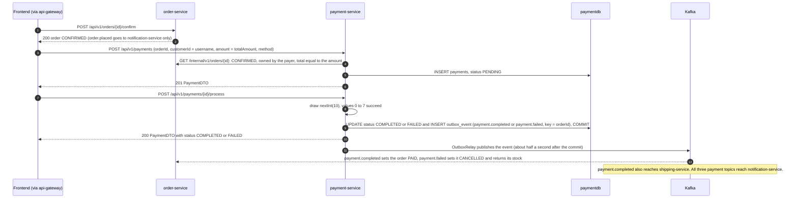
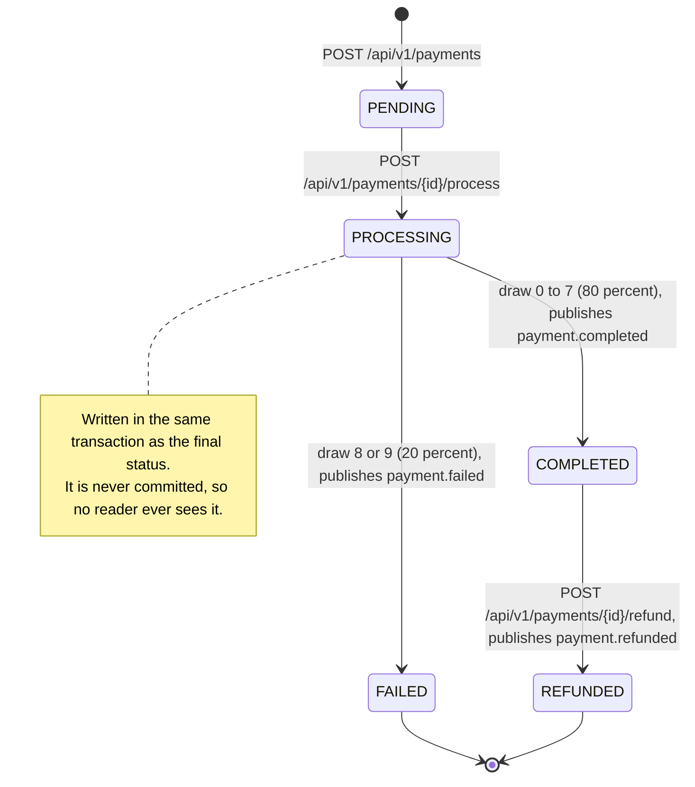
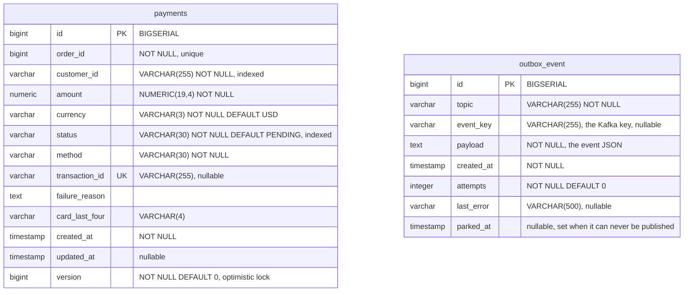

# Payment service

payment-service records payments for orders and settles them against a simulated payment gateway. The client creates a payment with an explicit REST call, sending the order id, a customer id, the amount and the method. A second REST call processes the payment by drawing a random number, which succeeds 80 % of the time. A third call refunds it. Each outcome is published to Kafka (`payment.completed`, `payment.failed`, `payment.refunded`) through a transactional outbox, and that is how order-service, shipping-service and notification-service learn about it. The service owns the `payments` and `outbox_event` tables in `paymentdb`. Its one outbound call is the order lookup before every new payment.

| | |
|---|---|
| Repository | `ecommerce-payment-service` |
| Stack | Java 25 · Spring Boot 4.0.9 · Spring MVC · Spring Data JPA (Hibernate 7.2) · Flyway · spring-kafka 4.0.8 (kafka-clients 4.1.2, producer only) · Spring Cloud 2025.1.4 (Eureka client, OpenFeign 5.0.4, CircuitBreaker) · resilience4j 2.3.0 · springdoc-openapi 2.8.5 · Micrometer (Prometheus) + OpenTelemetry tracing · Lombok |
| Port | 8085 |
| Eureka service ID | `payment-service` |
| Gateway routes | `/api/v1/payments/**` (JWT required on every path) |
| Data store | PostgreSQL 16 `paymentdb` (Flyway `V1` to `V4`). docker-compose publishes it on host port 5436 |
| Publishes | `payment.completed`, `payment.failed`, `payment.refunded` (through the outbox) |
| Consumes | None |
| Calls | `order-service` (Feign, `GET /internal/v1/orders/{id}`) before accepting a payment |
| Called by | The frontend through the gateway: `CheckoutPage` creates and processes payments, `OrderDetailPage` reads by order. No service calls it synchronously |

## Responsibilities

- Create a `PENDING` payment for an order from the request body (`POST /api/v1/payments`).
- Settle a `PENDING` payment with the simulated gateway and record the outcome (`POST /api/v1/payments/{id}/process`).
- Refund a `COMPLETED` payment in full (`POST /api/v1/payments/{id}/refund`).
- Look payments up by id, by order and by customer.
- Publish every settlement and refund to Kafka, keyed by order id, through the outbox.

The service does not do the following:

- It does not own order data: it asks order-service whether the order exists, is `CONFIRMED`, belongs to the payer and costs exactly the amount sent.
- It does not consume `order.placed`. Only notification-service consumes that topic.
- It never starts a refund itself.
- It stores no card data apart from the four digits the client sends in `cardLastFour`.

## How a payment happens

The client drives the whole flow. In `ecommerce-frontend`, `pages/checkout/CheckoutPage.tsx` (`handlePlaceOrder`) does three things in order:

1. It confirms the order.
2. It creates the payment, with `customerId` set to the logged-in **username** and `amount` set to the confirmed order's `totalAmount`.
3. It immediately processes the payment.



A decline ends the order. order-service cancels it and returns its stock, and payment-service refuses another payment for it with 409 (rule 2). The SPA shows "Payment declined" and offers to put the items into a new cart. Flows: [End-to-end flows](../flows.md#5-checkout-and-payment).

## Domain model

### `Payment` (`model/Payment.java`, table `payments`)

| Field | Column | Java type | REST JSON | Notes |
|---|---|---|---|---|
| `id` | `id` | `Long` | number | `BIGSERIAL` identity |
| `orderId` | `order_id` | `Long` | number | Client-supplied, verified against order-service |
| `customerId` | `customer_id` | `String` | string | Client-supplied. The frontend sends the username |
| `amount` | `amount` | `BigDecimal` | number | Client-supplied, at least 0.01. Stored as `NUMERIC(19,4)`, so values read back carry 4 decimals (`99.9800`) |
| `currency` | `currency` | `String` | string | Defaults to `USD`. Accepts any string of at most 3 characters |
| `status` | `status` | `PaymentStatus` | string | Enum name |
| `method` | `method` | `PaymentMethod` | string | Enum name |
| `transactionId` | `transaction_id` | `String` | string or null | Set only on `COMPLETED`: `TXN-` plus 16 upper-case hex digits. `UNIQUE` |
| `failureReason` | `failure_reason` | `String` | string or null | Set only on `FAILED` |
| `cardLastFour` | `card_last_four` | `String` | string or null | At most 4 characters. Not checked to be digits |
| `createdAt` | `created_at` | `LocalDateTime` | ISO-8601 string | Builder default `LocalDateTime.now()`. The DB default is never used |
| `updatedAt` | `updated_at` | `LocalDateTime` | ISO-8601 string or null | Null until the first update. Set explicitly by the service and again by `@PreUpdate` |
| `version` | `version` | `Long` | not in the JSON | `@Version`, the optimistic lock (`V3`), `BIGINT NOT NULL DEFAULT 0` |

### `PaymentStatus` (`model/PaymentStatus.java`)

| Value | Meaning | Set by |
|---|---|---|
| `PENDING` | Created, not settled yet | `PaymentService.initiatePayment()` |
| `PROCESSING` | Settlement in progress | `PaymentService.processPayment()`. Written inside the settling transaction and never committed (rule 6) |
| `COMPLETED` | The simulated gateway accepted the payment | `processPayment()`, success branch |
| `FAILED` | The simulated gateway declined the payment | `processPayment()`, decline branch |
| `REFUNDED` | Refunded in full (terminal) | `PaymentService.refundPayment()` |

### `PaymentMethod` (`model/PaymentMethod.java`)

The values are `CREDIT_CARD`, `DEBIT_CARD`, `BANK_TRANSFER` and `DIGITAL_WALLET`. The method is informational only, because the simulated gateway treats every method the same way.

### Lifecycle



## Business rules

1. **The order decides what is paid.** `OrderVerifier`, called by `PaymentController.initiatePayment()` before `PaymentService.initiatePayment()`, asks order-service for the order: unknown is 404, not `CONFIRMED` is 409 (`Order {orderId} is not awaiting payment`), owned by someone other than `customerId` is 403, `amount` different from `totalAmount` is 400, and any failure to get an answer (connect error, timeout, no instance, a 5xx, an undecodable body, an open breaker) is 503 `Order service unavailable. Please try again later.` (a payment is never accepted blind). `OrderVerifier` logs that failure as one WARN per exception class per 10 s, without a stack trace. `customerId` must be the caller's `X-Username` unless `ADMIN`. `currency` defaults to `USD`; it must match `^[A-Z]{3}$`, `cardLastFour` is exactly 4 digits, `amount` has at most 15 integer digits and 2 decimals.
2. **One payment per order, and a decline is final.** `payments.order_id` is unique (`V2`). Once `OrderVerifier` has passed, `initiatePayment()` looks the payment up with `PaymentRepository.findByOrderId()`:
   - `COMPLETED` is 409 (`Payment already completed for order: {orderId}`);
   - a payment of another customer is 409 (`A payment already exists for order: {orderId}`). This check comes before the ones below, so only the owner learns anything more;
   - `FAILED` is 409 with `PaymentService.DECLINED_ORDER_MESSAGE`: `The payment for this order was declined and the order is cancelled. Place a new order to try again.`;
   - `REFUNDED` or `PROCESSING` is 409 (`Payment for order {orderId} is in status {status} and cannot be initiated again`);
   - the same customer may retry only a `PENDING` payment (a `/process` call that never happened or timed out), which is reset and reused;
   - a concurrent create is 409 (unique violation or version conflict), not 500.

   Why `FAILED` is terminal: `payment.failed` makes order-service cancel the order and return its stock, but only when it consumes the event (a second normally, unbounded while Kafka is slow or down). Until then the order still reads `CONFIRMED`, so a retry would pass the order check and be charged. The earlier `payment.failed` would then cancel the order, and the later `payment.completed` would find it cancelled, with the money taken and the stock possibly sold. The two events travel on different topics, so nothing orders them. Once order-service has cancelled the order, `OrderVerifier` answers first, with 409 `Order {orderId} is not awaiting payment`.
3. **The method must match an enum name exactly.** `PaymentMethod.valueOf(request.getMethod())` is case-sensitive. Any other value is 400 `Unsupported payment method`; the controller checks it before it asks order-service.
4. **Only `PENDING` payments can be processed.** For any other status, `processPayment()` throws `PaymentAlreadyProcessedException`, which returns 409 with `Payment already in status: {status}`. Each payment is processed once at most. The `@Version` column (`V3`) makes a concurrent second call fail with 409, so only one event is published.
5. **The gateway is a random draw.** `processPayment()` evaluates `ThreadLocalRandom.current().nextInt(10) < 8`. Eight of the ten equally likely values succeed, so 80 % of payments succeed and 20 % are declined. The amount, method and card make no difference. There is no external call, delay or retry.
   - **Success:** the status becomes `COMPLETED`. `transactionId` is set to `TXN-` followed by the first 16 hex digits of a random UUID in upper case (for example `TXN-1A2B3C4D5E6F7A8B`, 64 random bits, so a collision on the unique column is practically impossible). `updatedAt` is set to now. The service writes `payment.completed` to the outbox.
   - **Decline:** the status becomes `FAILED` and `failureReason` is set to the constant `Payment declined by gateway`. `transactionId` stays null and `updatedAt` is set to now. The service writes `payment.failed` to the outbox.
   - Both branches return HTTP 200. A decline is not an error status, so the caller has to read `status`.
6. **No reader ever sees `PROCESSING`.** `processPayment()` sets `PROCESSING`, saves it and flushes it at once (`claim()`), then sets the final status in the same transaction. The first flush is what lets the `@Version` check reject a concurrent second call before it can run the gateway or write an event. Both UPDATEs belong to one transaction, so a reader outside it sees `PENDING` and then `COMPLETED` or `FAILED`.
7. **Refunds.** Admin only. `refundPayment()` accepts only `COMPLETED` payments. Any other status returns 400 with `Can only refund COMPLETED payments. Current: {status}`.
   - A refund is always for the full amount, because there is no amount parameter.
   - The status becomes `REFUNDED`, which is terminal. `transactionId` is kept.
   - `payment.refunded` carries the full `amount`.
   - Only an admin calling the endpoint starts a refund. No service calls it, and no frontend page uses the `useRefundPayment()` hook that is defined in `hooks/usePayments.ts`. Cancelling an order in order-service (`OrderService.cancelOrder()`) does not refund either.
8. **Events go through the outbox.** `PaymentEventProducer` does not call Kafka. In the settling transaction it inserts an `outbox_event` row holding the serialized event, and `OutboxRelay` publishes the row after the commit (see [Events](#events)). A change that rolls back announces nothing, and a change that commits keeps its event in the table until Kafka has acknowledged it.
9. **Authorization.** Owner-or-admin reads and process, admin-only refund. See [Security and identity](#security-and-identity).

## API

| Method | Path | Gateway auth | Purpose |
|---|---|---|---|
| POST | `/api/v1/payments` | Bearer JWT | Create a `PENDING` payment (caller's own `customerId`, order verified) |
| GET | `/api/v1/payments/{id}` | Bearer JWT | Get a payment by id |
| GET | `/api/v1/payments/order/{orderId}` | Bearer JWT | Get the payment of an order |
| GET | `/api/v1/payments/customer/{customerId}?page=&size=` | Bearer JWT | List a customer's payments, newest first; optional `page` (default 0) and `size` (default and maximum 100), still a JSON array |
| POST | `/api/v1/payments/{id}/process` | Bearer JWT | Run the simulated gateway |
| POST | `/api/v1/payments/{id}/refund` | `ADMIN` | Refund a `COMPLETED` payment in full |

Full reference: [API reference](../api/payment-service.md).

## Events

### Published

`messaging/PaymentEventProducer.java` serializes all three events and stores them in the `outbox_event` table in the caller's transaction (`@Transactional`); `outbox/OutboxRelay` publishes the stored rows through the `KafkaTemplate<String, String>` that `config/KafkaProducerConfig.java` builds.

- **Key:** the order id as a decimal string (`e.getOrderId().toString()`), stored in `outbox_event.event_key`. All events for one order therefore go to the same partition of a topic.
- **Value:** the event as JSON text. `PaymentEventProducer` writes it with `KafkaProducerConfig.eventJsonMapper()` (Jackson 3) into `outbox_event.payload`, and the relay sends that text unchanged through a `StringSerializer`. The value is plain JSON with no `__TypeId__` header, and each consumer binds it to its own copy of the class. The mapper switches on `DateTimeFeature.WRITE_DATES_AS_TIMESTAMPS`, so `LocalDateTime` stays the integer array the consumers and pacts expect (Jackson 3 would otherwise write an ISO string). The bytes on the wire are the same as before the outbox existed.
- **Wire types:**
  - `Long` becomes a JSON integer and `String` a JSON string.
  - `BigDecimal` becomes a JSON number. The payment is reloaded from the database before every publish, so the number has 4 decimals, for example `99.9800`.
  - `LocalDateTime` becomes an array of integers `[year, month, day, hour, minute, second, nanos]`. The array has 5 to 7 elements because zero seconds and zero nanos are left out. The Pact tests pin this form.
- **Topics:** the service declares none (there are no `NewTopic` beans). The broker creates them automatically with its default settings (`KAFKA_AUTO_CREATE_TOPICS_ENABLE: "true"` in docker-compose).
- **Producer settings** (`KafkaProducerConfig.producerFactory()`): `acks=all` with idempotence on; `max.block.ms` 5000, `request.timeout.ms` 10000, `delivery.timeout.ms` 30000; `reconnect.backoff.ms` 1000 and `reconnect.backoff.max.ms` 10000. A send to an unreachable broker fails within 5 s (30 s once the topic metadata is cached) instead of blocking for the 60 s default, and the client warns about once every 10 s instead of once a second. The template's `ProducerListener` is a no-op, because the default one logs an ERROR with a stack trace for every failed send; the relay reports a failure itself, throttled and without a stack trace, so during a Kafka outage its one WARN a minute is the only line.
- **Delivery (transactional outbox, table `outbox_event`, [ADR-013](../adr/ADR-013-transactional-outbox.md)):**
  - The event row commits with the change that caused it. Nothing is sent before the commit, and a rollback removes the row with the change.
  - `OutboxRelay` runs every 500 ms (`outbox.relay.interval-ms`). In one transaction it locks up to 100 unparked rows (`outbox.relay.batch-size`), oldest first (`OutboxEventRepository.lockBatch()`, `FOR UPDATE SKIP LOCKED`), sends each row, waits for Kafka's acknowledgement (at most `outbox.relay.send-timeout-ms`, 35 s) and deletes the row. An event leaves up to about half a second after the commit. The batch transaction holds one pooled connection while it waits.
  - Delivery is at least once: a crash between the acknowledgement and the commit publishes the row again. The consumers are guarded by state (order-service, shipping-service) or only log (notification-service).
  - A transient failure (broker down, send timeout, database trouble) stops the batch, so events keep their order. The relay records `attempts` and `last_error` on the row and pauses with a back-off of 1 s doubling to 30 s, which the first success resets. It logs one WARN a minute at most, without a stack trace, and one INFO when publishing resumes.
  - A permanent failure (record too large, invalid topic, serialization) parks the row: `parked_at` is set, one ERROR names the row and the statement that releases it (`UPDATE outbox_event SET parked_at = NULL WHERE id = ?`), and the relay carries on with the next row. A parked row is not retried until someone releases it.
  - A Kafka outage does not reach the request path: requests only write to the database. The rows wait, and the relay publishes them in order once Kafka is back. One replica runs, so the order of events per key holds; with several, `SKIP LOCKED` could let two relays publish rows of one key out of order.
  - The outbox classes (`outbox/OutboxRelay`, `OutboxEvent`, `OutboxEventRepository`, `OutboxConfig`) are the same as in order-service; shipping-service's copy differs only in deleting the acknowledged rows of a batch with one statement. Metrics and alerts are listed under [Observability](#observability); the [runbook](../runbook.md#check-the-outbox) shows how to inspect the table.

#### `payment.completed`

| | |
|---|---|
| Class | `event/PaymentCompletedEvent.java` |
| Trigger | `PaymentService.processPayment()`, success branch |
| Key | `orderId` |
| Consumers | **order-service** (group `order-service`, `messaging/PaymentEventConsumer.handlePaymentCompleted()`): sets a `CONFIRMED` order with a matching amount to `PAID`; otherwise it ignores the event. **shipping-service** (group `shipping-service`): creates the shipment and publishes `shipment.created`. **notification-service** (group `notification-service`): sends a payment confirmation, which today is only a log line |

| Field | Java type | JSON | Value |
|---|---|---|---|
| `paymentId` | `Long` | integer | Payment id |
| `orderId` | `Long` | integer | `payment.orderId` |
| `customerId` | `String` | string | `payment.customerId`, as supplied by the client |
| `amount` | `BigDecimal` | number | `payment.amount` |
| `transactionId` | `String` | string | `TXN-` followed by 16 upper-case hex digits |
| `completedAt` | `LocalDateTime` | integer array | `LocalDateTime.now()` when the event is created, inside the settling transaction |

```json
{"paymentId":501,"orderId":7,"customerId":"alice","amount":99.9800,"transactionId":"TXN-1A2B3C4D5E6F7A8B","completedAt":[2026,10,29,14,30,15,123456789]}
```

#### `payment.failed`

| | |
|---|---|
| Class | `event/PaymentFailedEvent.java` |
| Trigger | `PaymentService.processPayment()`, decline branch |
| Key | `orderId` |
| Consumers | **order-service** (group `order-service`, `handlePaymentFailed()`): cancels a `PENDING` or `CONFIRMED` order and returns its stock. **notification-service** (group `notification-service`) |

| Field | Java type | JSON | Value |
|---|---|---|---|
| `paymentId` | `Long` | integer | Payment id |
| `orderId` | `Long` | integer | `payment.orderId` |
| `customerId` | `String` | string | `payment.customerId` |
| `failureReason` | `String` | string | Always `Payment declined by gateway` |
| `failedAt` | `LocalDateTime` | integer array | `LocalDateTime.now()` when the event is created, inside the settling transaction |

```json
{"paymentId":502,"orderId":7,"customerId":"alice","failureReason":"Payment declined by gateway","failedAt":[2026,10,29,14,30,15,123456789]}
```

#### `payment.refunded`

| | |
|---|---|
| Class | `event/PaymentRefundedEvent.java` |
| Trigger | `PaymentService.refundPayment()` |
| Key | `orderId` |
| Consumers | **notification-service** only (group `notification-service`). order-service and shipping-service do not subscribe, so a refund changes neither the order status nor the shipment |

| Field | Java type | JSON | Value |
|---|---|---|---|
| `paymentId` | `Long` | integer | Payment id |
| `orderId` | `Long` | integer | `payment.orderId` |
| `customerId` | `String` | string | `payment.customerId` |
| `amount` | `BigDecimal` | number | The full payment amount |
| `refundedAt` | `LocalDateTime` | integer array | `LocalDateTime.now()` when the event is created, inside the refund transaction |

```json
{"paymentId":503,"orderId":7,"customerId":"alice","amount":99.9800,"refundedAt":[2026,10,29,14,30,15,123456789]}
```

### Consumed

This service does not consume any topic. It has no `@KafkaListener` and no `@EnableKafka`, and `config/KafkaProducerConfig.java` builds only a producer factory and a template.

In particular, this service does not consume `order.placed`.

## Outbound calls

`OrderServiceClient` (Feign, `spring-cloud-starter-openfeign`) calls order-service's `GET /internal/v1/orders/{id}` through Eureka and Spring Cloud LoadBalancer. The gateway does not route `/internal/`; the call goes directly. The LoadBalancer builds the `order-service` instance list eagerly (`spring.cloud.loadbalancer.eager-load.clients`), and its instance cache lives 5 s, matching the 5 s Eureka fetch.

- **Timeouts:** `spring.cloud.openfeign.client.config.default`: connect 2000 ms, read 5000 ms.
- **Transport and retries:** the JDK `HttpURLConnection` (there is no `feign-hc5`), and Feign's default `Retryer`, which never retries. A failed lookup is not repeated; the payer can try again.
- **Errors:** `OrderVerifier` maps a 404 to `Order not found: {id}` and any other failure (connect, timeout, no instance, 5xx, undecodable body, an open breaker) to 503 `Order service unavailable. Please try again later.` It logs one WARN per exception class per 10 s, with the class name only and no stack trace.

**Circuit breaker.** Spring Cloud CircuitBreaker over resilience4j (`spring-cloud-starter-circuitbreaker-resilience4j`, `spring.cloud.openfeign.circuitbreaker.enabled: true`) wraps the client. `FeignConfig.circuitBreakerNameResolver()` names the breaker after the client, `order-service`. Settings from `resilience4j.circuitbreaker.instances.order-service`:

| Setting | Value |
|---|---|
| sliding window | count-based (default), `slidingWindowSize: 10`, `minimumNumberOfCalls: 5` |
| `failureRateThreshold` | 50 % |
| `slowCallDurationThreshold` / `slowCallRateThreshold` | 4 s / 80 %. An order-service that answers slowly still holds a request thread per payment for up to the 5 s read timeout; when 80 % of the window is slow, the breaker opens and the rest are refused at once |
| `waitDurationInOpenState` | 10 s, with `automaticTransitionFromOpenToHalfOpenEnabled: true` |
| `permittedNumberOfCallsInHalfOpenState` | 3 |
| `ignoreExceptions` | `FeignException$NotFound` and `$BadRequest` (404 and 400): the caller asked about something invalid, and order-service is healthy |

Spring Cloud CircuitBreaker's thread pool, time limiter (1 s by default) and bulkhead are switched off in `application.yaml`, as in order-service: the call runs on the calling thread and Feign's timeouts are the only time limit. `OrderServiceClientFallbackFactory` gives the original exception back untouched, so an unknown order stays a 404 and an open breaker (`CallNotPermittedException`) is refused with 503 like any other order-service outage. It logs nothing. `config/CircuitBreakerTransitionLogger` logs one WARN when the breaker opens and one INFO when it closes. `/actuator/circuitbreakers` and the `resilience4j_circuitbreaker_*` metrics (`name="order-service"`) are live.

**Message converters.** `config/FeignConfig` also replaces Spring Cloud OpenFeign's `FeignHttpMessageConverters` with `ThreadSafeFeignHttpMessageConverters`, the workaround that catalog-, order- and review-service carry. The library publishes its converter list empty and fills it afterwards without synchronisation, so the first concurrent payments after a start could fail with `DecodeException: 'messageConverters' must not be empty`, which `OrderVerifier` would turn into a 503 for that payer. The subclass makes the first initialisation mutually exclusive. `FeignHttpMessageConvertersRaceTest` releases 48 threads together against a cold instance and expects none to see an empty list.

## Persistence

Two tables, `payments` and `outbox_event`, come from the Flyway migrations in `src/main/resources/db/migration/`: `V1__create_payments.sql`, `V2__unique_payment_order_id.sql`, `V3__payment_version.sql` and `V4__create_outbox_event.sql`. Hibernate validates the entities against them at startup (`spring.jpa.hibernate.ddl-auto=validate`), and `spring.flyway.baseline-on-migrate` is `true`.

`payments`:

| Column | Type | Constraints and default |
|---|---|---|
| `id` | `BIGSERIAL` | Primary key |
| `order_id` | `BIGINT` | `NOT NULL`, unique (`uq_payments_order_id`, `V2`, which replaced the plain index `idx_payments_order_id`) |
| `customer_id` | `VARCHAR(255)` | `NOT NULL`, indexed (`idx_payments_customer_id`) |
| `amount` | `NUMERIC(19,4)` | `NOT NULL` |
| `currency` | `VARCHAR(3)` | `NOT NULL DEFAULT 'USD'` |
| `status` | `VARCHAR(30)` | `NOT NULL DEFAULT 'PENDING'`, indexed (`idx_payments_status`) |
| `method` | `VARCHAR(30)` | `NOT NULL` |
| `transaction_id` | `VARCHAR(255)` | `UNIQUE`, nullable |
| `failure_reason` | `TEXT` | |
| `card_last_four` | `VARCHAR(4)` | |
| `created_at` | `TIMESTAMP` | `NOT NULL DEFAULT CURRENT_TIMESTAMP` |
| `updated_at` | `TIMESTAMP` | `DEFAULT CURRENT_TIMESTAMP` |
| `version` | `BIGINT` | `NOT NULL DEFAULT 0`, the optimistic lock (`V3`) |

`outbox_event` (`V4`, entity `outbox/OutboxEvent`):

| Column | Type | Constraints and default |
|---|---|---|
| `id` | `BIGSERIAL` | Primary key |
| `topic` | `VARCHAR(255)` | `NOT NULL` |
| `event_key` | `VARCHAR(255)` | The Kafka key, the order id as text. Nullable |
| `payload` | `TEXT` | `NOT NULL`. The event JSON exactly as it goes on the wire |
| `created_at` | `TIMESTAMP` | `NOT NULL` |
| `attempts` | `INTEGER` | `NOT NULL DEFAULT 0`. Failed publish attempts of this row |
| `last_error` | `VARCHAR(500)` | The last publish failure, cut at 500 characters |
| `parked_at` | `TIMESTAMP` | Set when the row can never be published, `NULL` otherwise |

The index `idx_outbox_event_pending` covers `(parked_at, id)`. A row lives until Kafka acknowledges it and is then deleted, so the table normally holds only the events waiting for the next relay run, plus any parked rows. It has no foreign key to `payments`.



The entity and the migration differ in these places:

- `order_id` is unique (`V2__unique_payment_order_id.sql`); `V3__payment_version.sql` adds the optimistic-locking `version` column (default 0).
- `currency` is `NOT NULL DEFAULT 'USD'` in SQL but nullable in the entity. This does no harm because the service always sets it.
- The SQL defaults for `status`, `created_at` and `updated_at` never apply, because Hibernate inserts every mapped column. `status` and `created_at` come from the entity's builder defaults, and `updated_at` is inserted as NULL.
- `transaction_id` is `UNIQUE` but nullable. PostgreSQL allows any number of NULLs, so only completed payments compete for uniqueness. The 64 random bits of `TXN-` plus 16 hex digits make a collision practically impossible.

## Security and identity

The gateway requires a valid JWT on every `/api/v1/payments/**` path (and role `ADMIN` for `POST /{id}/refund`) and then sets `X-Username`, `X-User-Id` and `X-User-Role`. `security/PaymentAccess` checks them before any work: no `X-Username` is 401 `Authentication required`, someone else's payment is 403 `Access denied`; the role is compared exactly with `ADMIN`.

| Endpoint | Rule |
|---|---|
| `POST /api/v1/payments` | `customerId` must equal `X-Username` (or `ADMIN`); the order must be the payer's |
| `GET /api/v1/payments/{id}` | owner or `ADMIN` |
| `GET /api/v1/payments/order/{orderId}` | owner of the order's payment, or `ADMIN` |
| `GET /api/v1/payments/customer/{customerId}` | that customer or `ADMIN` |
| `POST /api/v1/payments/{id}/process` | owner or `ADMIN` |
| `POST /api/v1/payments/{id}/refund` | `ADMIN` only |

Other points:

- The frontend sends the username as `customerId`, both when creating a payment (`CheckoutPage.tsx`) and when listing them (`useCustomerPayments()` in `hooks/usePayments.ts`).
- docker-compose publishes port 8085 on the host, so a direct call can forge the identity headers.
- Errors use fixed messages; responses carry `nosniff` and `no-store`; `X-Correlation-Id` is kept only if it matches `^[A-Za-z0-9._-]{1,64}$`; `/actuator/serviceregistry` answers 403 to non-loopback callers.
- The OpenAPI document declares a global `bearerAuth` scheme (`config/OpenApiConfig.java`) for Swagger UI.

## Configuration

`src/main/resources/application.yaml`:

| Property | Env var | Default | Purpose |
|---|---|---|---|
| `server.port` | | `8085` | HTTP port |
| `spring.application.name` | | `payment-service` | Eureka service ID and the `application` metrics tag |
| `spring.datasource.url` | `SPRING_DATASOURCE_URL` | `jdbc:postgresql://localhost:5436/paymentdb` | compose and k8s use `jdbc:postgresql://paymentdb:5432/paymentdb` |
| `spring.datasource.username` | `DB_USERNAME` | `paymentuser` | k8s reads it from secret `paymentdb-credentials` |
| `spring.datasource.password` | `DB_PASSWORD` | `paymentpass` | k8s reads it from secret `paymentdb-credentials` |
| `spring.datasource.hikari.connection-timeout` | | `5000` | A request waits at most 5 s for a pooled connection, then gets 503 (Hikari's default is 30 s) |
| `spring.datasource.hikari.data-source-properties` | | `connectTimeout` 5, `socketTimeout` 30 (seconds), `tcpKeepAlive` true | pgjdbc has no socket timeout by default, so a database that stops answering would hold a request or relay thread until the OS gives up. Flyway runs through the same pool, so a DDL statement longer than 30 s would hit `socketTimeout` |
| `spring.jpa.hibernate.ddl-auto` | | `validate` | Checks the schema against the entity at startup |
| `spring.jpa.open-in-view` | | `false` | No Hibernate session, and no pooled connection, outlives the service call |
| `spring.flyway.enabled` / `locations` / `baseline-on-migrate` | | `true` / `classpath:db/migration` / `true` | Migrations |
| `spring.kafka.bootstrap-servers` | `KAFKA_BOOTSTRAP_SERVERS` | `localhost:9092` | compose and k8s use `kafka:29092`. `KafkaProducerConfig` reads it with `@Value` |
| `KafkaProducerConfig` client settings | | `acks=all`, idempotence on, `max.block.ms` 5000, `request.timeout.ms` 10000, `delivery.timeout.ms` 30000, `reconnect.backoff.ms` 1000, `reconnect.backoff.max.ms` 10000 | Set in code, not in `application.yaml`. The template's `ProducerListener` is a no-op, so a failed send is reported by the relay only (one throttled WARN) and not by an ERROR with a stack trace per send |
| `spring.task.scheduling.shutdown.await-termination` / `await-termination-period` | | `true` / `20s` | SIGTERM lets a running relay batch finish instead of interrupting it |
| `outbox.relay.enabled` / `interval-ms` / `batch-size` | | `true` / `500` / `100` | `OutboxRelay`; `false` switches it off (the H2 `test` profile does) |
| `outbox.relay.send-timeout-ms` | | `35000` | How long the relay waits for one acknowledgement. The default lives in `OutboxRelay`, not in `application.yaml`; it is above the producer's `delivery.timeout.ms` (30 s), so the producer gives up first |
| `spring.cloud.openfeign.client.config.default.connect-timeout` / `read-timeout` | | `2000` / `5000` (ms) | Feign timeouts for the order-service lookup |
| `spring.cloud.openfeign.circuitbreaker.enabled` | | `true` | Wraps the Feign client in a circuit breaker |
| `spring.cloud.circuitbreaker.resilience4j.disable-thread-pool` / `disable-time-limiter` | | `true` / `true` | No worker thread and no 1 s time limiter: Feign's timeouts govern |
| `spring.cloud.circuitbreaker.bulkhead.resilience4j.enabled` | | `false` | No bulkhead thread pool |
| `spring.cloud.loadbalancer.cache.ttl` / `eager-load.clients` | | `5s` / `order-service` | Instance cache matched to the Eureka fetch; the instance list is built at start, so the first call does not find it empty |
| `resilience4j.circuitbreaker.instances.order-service.*` | | see [Outbound calls](#outbound-calls) | Breaker |
| `eureka.client.service-url.defaultZone` | `EUREKA_CLIENT_SERVICEURL_DEFAULTZONE` | `http://localhost:8761/eureka/` | compose and k8s use `http://service-discovery:8761/eureka/` |
| `eureka.client.registry-fetch-interval-seconds` | | `5` | Default is 30 |
| `eureka.instance.prefer-ip-address` | | `true` | |
| `eureka.instance.lease-renewal-interval-in-seconds` / `lease-expiration-duration-in-seconds` | | `5` / `15` | A crashed instance leaves the registry in about 20 s |
| `management.endpoints.web.exposure.include` | | `health,info,metrics,prometheus,circuitbreakers,serviceregistry` | `circuitbreakers` shows the `order-service` breaker |
| `management.endpoint.health.show-details` | | `never` | |
| `management.endpoint.prometheus.access` | | `unrestricted` | |
| `management.metrics.tags.application` / `environment` | `ENVIRONMENT` (environment only) | `payment-service` / `development` | Common metric tags |
| `management.metrics.distribution.percentiles-histogram.http.server.requests` | | `true` | |
| `management.metrics.distribution.slo.http.server.requests` | | `50ms,100ms,200ms,500ms,1s,2s` | SLO buckets |
| `management.tracing.sampling.probability` | `TRACING_SAMPLING_PROBABILITY` | `1.0` | |
| `management.opentelemetry.tracing.export.otlp.endpoint` | `OTEL_EXPORTER_OTLP_ENDPOINT` (base URL) | `http://tempo:4318/v1/traces` | OTLP over HTTP to Tempo |
| `management.otlp.metrics.export.enabled` | | `false` | Prometheus scrapes the metrics instead |
| `springdoc.api-docs.path` / `springdoc.swagger-ui.path` | | `/api-docs` / `/swagger-ui.html` | Same paths as every service. The gateway's unified Swagger UI loads `/api-docs/payment-service` from here. `OpenApiConfig` declares a relative `/` server, so Try it out goes through the gateway |
| `logging.pattern.console` | | `%d{yyyy-MM-dd HH:mm:ss} [%thread] [%X{correlationId:-}] [%X{traceId:-}] %-5level %logger{36} - %msg%n` | |
| `logging.level.com.ecommerce` | | `INFO` | DEBUG is a switch: `LOGGING_LEVEL_COM_ECOMMERCE=DEBUG` |
| `logging.level.org.hibernate.orm.jdbc.error`, `...springframework.transaction.interceptor.TransactionInterceptor`, `...springframework.transaction.support.TransactionTemplate` | | `OFF` | They repeat each failed JDBC call or failed rollback with a full stack trace; `GlobalExceptionHandler` reports the outage once instead |

The service has no JWT configuration.

**Deployment:**

- **Image:** `docker/Dockerfile` copies the prebuilt `target/payment-service-*.jar` onto `eclipse-temurin:25-jre-alpine` and runs it as an unprivileged user with `exec java $JAVA_OPTS -jar app.jar`.
- **docker-compose:**
  - `JAVA_OPTS` is set to `-XX:MaxRAMPercentage=55 -XX:ActiveProcessorCount=2 -XX:+ExitOnOutOfMemoryError`, with `mem_limit: 768m`.
  - The container waits for healthy `paymentdb`, `kafka` and `service-discovery`.
  - The healthcheck runs `wget` against `/actuator/health`.
  - `stop_grace_period: 60s`: Boot's graceful shutdown takes up to 30 s and the scheduler then lets a running relay batch finish (up to 20 s), so Docker's default 10 s would kill both midway.
- **Kubernetes** (`ecommerce-platform/k8s/40-services.yaml`):
  - One replica, requests of 100m CPU and 320Mi memory, a 768Mi memory limit.
  - Init containers wait for service-discovery, paymentdb and kafka.
  - The startup and readiness probes use `/actuator/health/readiness`, and the liveness probe uses `/actuator/health/liveness`.
  - A `preStop` hook marks the instance `OUT_OF_SERVICE` through `/actuator/serviceregistry` and then sleeps 15 s.
  - `terminationGracePeriodSeconds` is 90, so the 15 s drain, Boot's 30 s graceful shutdown and up to 20 s for a relay batch that is mid-run all fit.

## Observability

- **Actuator** endpoints are `health` (status only), `info`, `metrics`, `prometheus`, `circuitbreakers` and `serviceregistry`, which the k8s `preStop` hook uses.
- **Metrics:** Prometheus scrapes `payment-service:8085/actuator/prometheus` (job `payment-service`, labels `service` and `group=application`), and blackbox-exporter probes `/actuator/health`. The generic rules in `ecommerce-monitoring/prometheus/rules/service-alerts.yml` cover this service: `ServiceDown`, `HighErrorRate`, `HighP99Latency` and the JVM heap and GC alerts. Nothing counts payments by outcome. The service adds these metrics, all with the `application` tag:
  - `resilience4j_circuitbreaker_*` with `name="order-service"`, which the `CircuitBreakerOpen` alert reads (`OrderServiceResilienceIT` checks the scrape).
  - `outbox_events_pending` and `outbox_events_parked`: gauges for the unparked and the parked rows in `outbox_event`. The relay refreshes them itself, at most every 5 s, so a scrape never waits for the database.
  - `outbox_events_published_total` (rows acknowledged by Kafka) and `outbox_publish_failures_total` (relay runs that ended in a transient failure).

  The outbox alerts are `OutboxBacklog`, `OutboxBacklogGrowing`, `OutboxBacklogCritical`, `OutboxEventsParked`, `OutboxPublishFailing` and `OutboxRelayStalled`. There are no dead-letter metrics, because the service consumes nothing.
- **Logs** go to the console with the correlation id and the trace id in every line of a request (`%X{correlationId:-}` and `%X{traceId:-}`; the relay runs outside a request, so its lines show `[] []`). Promtail ships the container logs to Loki. `com.ecommerce` logs at INFO (DEBUG is a switch: `LOGGING_LEVEL_COM_ECOMMERCE=DEBUG`). The service logs:
  - `Payment {id} completed for order {orderId}` or `Payment {id} failed for order {orderId}` at INFO for each outcome;
  - `Queued payment.{completed|failed|refunded} for orderId=…` at DEBUG for each outbox row;
  - at most one WARN per exception class per 10 s while order-service does not answer (`order-service lookup failed for orderId=…`), and `Dependency unavailable on <method> <uri>: …` when the database or Kafka does not answer, both without a stack trace; any other 500 is one ERROR with its stack trace per failure site per 10 s (`logging/LogThrottle`; a throttled line ends with `(N similar suppressed)`);
  - from the relay, `Outbox relay cannot publish to <topic>: …; N event(s) pending, retrying in X ms` as a WARN at most once a minute (the template's `ProducerListener` is a no-op, so nothing else logs a failed send), `Outbox relay resumed after N failed attempts` as an INFO, and one ERROR per parked row;
  - from the circuit breaker, one WARN when it opens and one INFO when it closes.
- **Correlation id:** `filter/CorrelationIdFilter.java` reuses the incoming `X-Correlation-Id` header or generates a UUID. It puts the id in the MDC (`correlationId`) and echoes it in the response header, and every error body includes it. The id is not added to Kafka records or to the Feign call.
- **Tracing:** Micrometer Tracing with the OpenTelemetry bridge exports HTTP server spans to Tempo (OTLP/HTTP, 100 % sampling by default). The hand-built `KafkaTemplate` does not enable observation, so no trace context is written to the records and traces stop at the Kafka boundary; the Feign call to order-service is not traced either (`feign-micrometer` is not a dependency). Scheduled-task observations are excluded in `outbox/OutboxConfig`, because the relay runs twice a second whether or not it has anything to send; it creates no traces.

## Testing

Run everything with `mvn verify` (257 unit, slice and pact tests, plus 92 integration tests that need Docker). CircleCI (`.circleci/config.yml`) runs `mvn -B -ntp verify`, validates the image and publishes it for `develop`, `main`, `master` and `v*` tags.

| Class | Kind | What it covers |
|---|---|---|
| `service/PaymentServiceTest` | Mockito unit | initiate (success returns `PENDING`, a `COMPLETED` payment blocks it, a `PENDING` one is reused, a `FAILED` one is refused with the fixed message and charges and publishes nothing, a lost unique-key race is 409), process (a non-`PENDING` payment throws `PaymentAlreadyProcessedException`, success and decline branches, a lost version race is refused before any event), refund (only from `COMPLETED`), queries (the customer list asks for the newest page and never more than 100) and mapping; transaction ids carry 64 random bits and do not repeat |
| `service/OrderVerifierTest` | Mockito unit | a `CONFIRMED` order owned by the payer with the exact total passes, whatever the scale; any other status is 409, someone else's order 403, a different amount 400, an unknown order 404; an unreachable order-service, a server error, no instance and an empty answer are all 503 |
| `controller/PaymentControllerTest` | `@WebMvcTest` | the endpoints' status codes, validation and error bodies |
| `messaging/PaymentEventProducerTest` | unit | the three outbox rows: topic, key, payload; `LocalDateTime` as an integer array; the payload byte for byte what the Kafka JSON serializer always wrote |
| `outbox/OutboxRelayTest` | Mockito unit | rows sent oldest first and deleted once acknowledged; an empty outbox costs one query; a transient failure stops the batch and records why on the row; the back-off grows from 1 s to 30 s and keeps the relay away from the broker and the database; one WARN a minute and one INFO on recovery; a database failure backs off without an exception; a row that can never be published is parked once and the next row still goes out; a long error message is capped |
| `config/KafkaProducerConfigTest` | unit | the shared template's `ProducerListener` is not the logging one, so a failed send is reported by the relay only |
| `config/FeignHttpMessageConvertersRaceTest` | unit, concurrency | 48 threads released together against a cold `ThreadSafeFeignHttpMessageConverters` never see an empty converter list |
| `config/LoggingConfigurationTest` | unit | the logging and connection settings of `application.yaml`: INFO, the one log pattern, the three loggers that are `OFF`, Hikari's 5 s wait, pgjdbc's timeouts, the scheduler's shutdown wait |
| `exception/GlobalExceptionHandlerTest`, `exception/UnavailabilityTest`, `filter/CorrelationIdFilterTest` | unit | exception mappings, including 409 for an already processed payment and for a version conflict, 503 for a dead database, a broken transaction or an order-service that cannot be asked, and the page and size limits of the customer list; which failures count as an outage; the correlation ID |
| `resilience/DatabaseOutageTest` | full context, unreachable database | 60 requests against a dead database are 503 with a fixed message and cost a handful of log lines |
| `contract/PaymentEventsProviderPactTest` | Pact provider (`@SpringBootTest`, profile `test`) | replays the three consumer pacts in `src/test/resources/pacts/` against the real `PaymentService` and `PaymentEventProducer`; the test captures the `outbox_event` row each one writes (the repository is mocked) and verifies its payload, which is what the relay puts on the wire |
| `contract/FrontendHttpProviderPactTest` | Pact provider, HTTP | the frontend's 4 interactions in `src/test/resources/pacts-frontend/` (initiate a payment for order 7, process payment 501, payment of order 7, and one for an order with none), with a gateway emulation that sets `X-Username`, `X-User-Id`, `X-User-Role` from the bearer token. Kept apart from `pacts/`, which holds message pacts only |
| `integration/PaymentRepositoryIT` | Testcontainers `postgres:16-alpine` | the real migration; `numeric(19,4)` amounts (and rejection beyond it); `updated_at`; unique `transaction_id` with many nulls; not-null columns and defaults; `order_id` is unique (a duplicate insert is rejected) |
| `integration/PaymentFlowIT` | full app, Postgres, Kafka, a fake order-service | initiate, complete, refund: rows persist and the three events are published; a decline stores the reason and publishes `payment.failed`; state guards and errors over HTTP; a second initiate for an order reuses the `PENDING` row; `retryAfterADecline_isRefused_409_chargesNothing_andPublishesNothing`: a retry for a declined order is 409 with the fixed message, the row stays `FAILED` with no transaction id, `/process` is 409 and `payment.failed` is the only record published for the order |
| `integration/PaymentOutboxIT` | full app, Postgres, Kafka | a refund publishes `payment.refunded` and the row is gone once Kafka acknowledged it; the event is invisible until the change commits and then delivered once; a rolled-back transaction publishes nothing; a row that can never be published is parked once and the row behind it is still delivered; the `outbox_*` metrics are exported |
| `integration/PaymentOutboxKafkaOutageIT` | full app, its own Postgres and Kafka | with the broker frozen (`docker pause`), a refund still returns promptly, the event waits in the table with one WARN from the relay and no stack trace, and it is published exactly once when Kafka is back |
| `integration/OrderServiceResilienceIT` (8) | full app, Postgres, Kafka, a fake order-service with a delay knob | the breaker adds no bulkhead and no worker thread; a slow but healthy order-service is not cut off by a 1 s time limit; a slow order-service pins no database connections; an order-service that answers 503 is asked once per payment; unknown orders are 404 and never trip the breaker; a dead or too slow order-service opens the breaker, later payments are refused at once with 503, it logs a handful of lines and recovers; the breaker metrics are exported |
| `integration/ConnectionSettingsIT` | full app, Postgres, Kafka | the Hikari and pgjdbc settings are applied to a live connection; a shutdown waits for the scheduled relay that is running |

**Pact role:** this service is the provider for three consumer pacts, which `ecommerce-platform/sync-pacts.sh` copies here.

| Pact file | Consumer test | Interactions (provider state) |
|---|---|---|
| `order-service-payment-service.json` | order-service `PaymentEventsConsumerPactTest` | `a payment.completed event` (`payment 501 for order 7 has completed`) and `a payment.failed event` (`payment 502 for order 7 has failed`) |
| `shipping-service-payment-service.json` | shipping-service `PaymentEventsConsumerPactTest` | `a payment.completed event` |
| `notification-service-payment-service.json` | notification-service `PaymentEventsConsumerPactTest` | Completed, failed, and `a payment.refunded event` (`payment 503 for order 7 has been refunded`) |

Each interaction pins the following:

- the topic (`kafka_topic`);
- the record key, which must match the regex `\d+` (example `7`);
- `contentType: application/json`;
- every payload field, by type: `paymentId` and `orderId` integers, `amount` a number, `customerId`, `transactionId` and `failureReason` strings, and the timestamp an array of at least 5 integers.

The pacts check types only, so the provider may add fields. Run only the contract tests with `mvn test -Dtest='*PactTest'`.

**`application-test.yaml`** lives in `src/main/resources` and defines the `test` profile that `PaymentEventsProviderPactTest` and `FrontendHttpProviderPactTest` activate. That profile does the following:

- uses in-memory H2 (`jdbc:h2:mem:testdb;DB_CLOSE_DELAY=-1`, user `sa`) with `ddl-auto: create-drop` (Hibernate detects the H2 dialect; before 2026-10-29 the main YAML's explicit PostgreSQL dialect overrode it even here);
- disables Flyway;
- points Kafka at `localhost:9092`, although no broker is needed because the relay is off and nothing sends;
- sets `outbox.relay.enabled: false`, because the relay's `SELECT ... FOR UPDATE SKIP LOCKED` is PostgreSQL-only (the `*IT` classes run the relay for real);
- disables the Eureka client.

Because the file sits under `src/main`, it is packaged into the production jar. H2 is a test-scoped dependency and is not, so starting a deployed container with the `test` profile would fail.

No tests are disabled for bugs any more; the `@Tag("security")` suite covers ownership, order verification, validation, takeover and races.

**Gaps:** the unit and pact tests run on H2 with Flyway disabled, but the `*IT` classes run the migration on Postgres. Two real parallel requests for one payment or order are not tested; the lost-race paths (unique key, version) are covered with mocks.

## Code map

Paths are relative to `src/main/java/com/ecommerce/payment/`.

| Package or class | Role |
|---|---|
| `PaymentServiceApplication` | Spring Boot entry point |
| `controller/PaymentController` | REST endpoints under `/api/v1/payments` |
| `service/PaymentService` | Business logic: initiate, process (simulated gateway), refund, queries, mapping to `PaymentDTO`; `DECLINED_ORDER_MESSAGE` |
| `messaging/PaymentEventProducer` | Serializes `payment.completed`, `payment.failed` and `payment.refunded` into the outbox |
| `outbox/OutboxEvent`, `OutboxEventRepository`, `OutboxRelay`, `OutboxConfig` | The `outbox_event` entity and repository (`lockBatch()`), the scheduled publisher, `@EnableScheduling` and the observation predicate |
| `event/Payment*Event` | Kafka payload classes |
| `dto/InitiatePaymentRequest`, `dto/PaymentDTO` | REST request and response |
| `model/Payment`, `PaymentStatus`, `PaymentMethod` | JPA entity and enums |
| `repository/PaymentRepository` | Spring Data JPA: `findByOrderId`, `findByCustomerId(customerId, pageable)`, `findByTransactionId` (unused) |
| `exception/*` | Domain exceptions, `ErrorResponse`, `GlobalExceptionHandler`; `Unavailability` tells a dependency that does not answer from a bug (503 versus 500) |
| `filter/CorrelationIdFilter` | `X-Correlation-Id` handling and MDC |
| `logging/LogThrottle` | One log line per key and window |
| `security/PaymentAccess`, `service/OrderVerifier`, `client/OrderServiceClient` | ownership checks; order verification over Feign |
| `client/OrderServiceClientFallbackFactory`, `config/CircuitBreakerTransitionLogger` | Gives the original exception back, logs nothing; one WARN when the `order-service` breaker opens, one INFO when it closes |
| `config/FeignConfig` | The breaker name resolver and `ThreadSafeFeignHttpMessageConverters` |
| `config/KafkaProducerConfig` | Producer factory and `KafkaTemplate<String, String>` (used by the relay) with a no-op `ProducerListener`, `eventJsonMapper()`. No consumer or listener factory |
| `config/OpenApiConfig` | OpenAPI title and the `bearerAuth` scheme |
| `src/main/resources/db/migration/V1__create_payments.sql` to `V4__create_outbox_event.sql` | Schema: `payments`, the unique `order_id`, `version`, `outbox_event` |

## Known issues and limitations

| Issue | Where | Impact | Severity |
|---|---|---|---|
| ~~Amount, currency and customer never checked against the order~~ | fixed | see the security fix spec | — |
| ~~No authorization or ownership checks~~ | fixed | see the security fix spec | — |
| ~~Duplicate protection only rejects when a `COMPLETED` payment exists~~ | fixed | see the security fix spec | — |
| ~~A second payment row for an order breaks `findByOrderId()`~~ | fixed | see the security fix spec | — |
| ~~`processPayment()` has no lock and no `@Version`~~ | fixed | see the security fix spec | — |
| ~~Events are sent inside the DB transaction, fire-and-forget, with no outbox~~ | fixed | events go through the transactional outbox ([Events](#events)) | — |
| A declined payment returns 200, so a client has to read `status` | `PaymentController.processPayment()` | A client that ignores `status` takes a decline for a success while order-service cancels the order. The SPA reads `status`, shows a "Payment declined" panel and offers to put the items into a new cart (see [Frontend](../frontend.md)) | Low |
| Nothing acts on refunds. Only notification-service consumes `payment.refunded`, and cancelling an order does not refund | `PaymentEventProducer.publishRefunded()`. order-service `OrderService.cancelOrder()` | A refunded order stays `PAID` and its shipment continues. A cancelled `PAID` order keeps its money | Medium |
| ~~Invalid `method` and unmapped client errors return 500~~ | fixed | see the security fix spec | — |
| ~~Weak input validation~~ | fixed | see the security fix spec | — |
| ~~`transactionId` has only 32 random bits, and its `UNIQUE` violation would surface at commit, after `payment.completed` has been sent~~ | fixed | 64 random bits; the event is written to the outbox in the same transaction, so a rolled-back payment announces nothing (rule 5) | — |
| `PROCESSING` is never committed | `PaymentService.processPayment()` | This enum value can never be observed | Low |
| Dead code: `PaymentRepository.findByTransactionId()` | `repository/PaymentRepository.java` | No application code calls it (only `PaymentRepositoryIT` does). Misleading to readers | Low |
| `application-test.yaml` lives in `src/main/resources` | `src/main/resources/application-test.yaml` | It ships in the production jar. It belongs in `src/test/resources` | Low |
