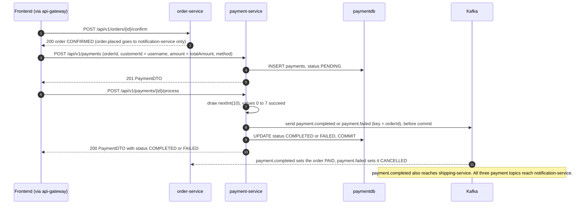
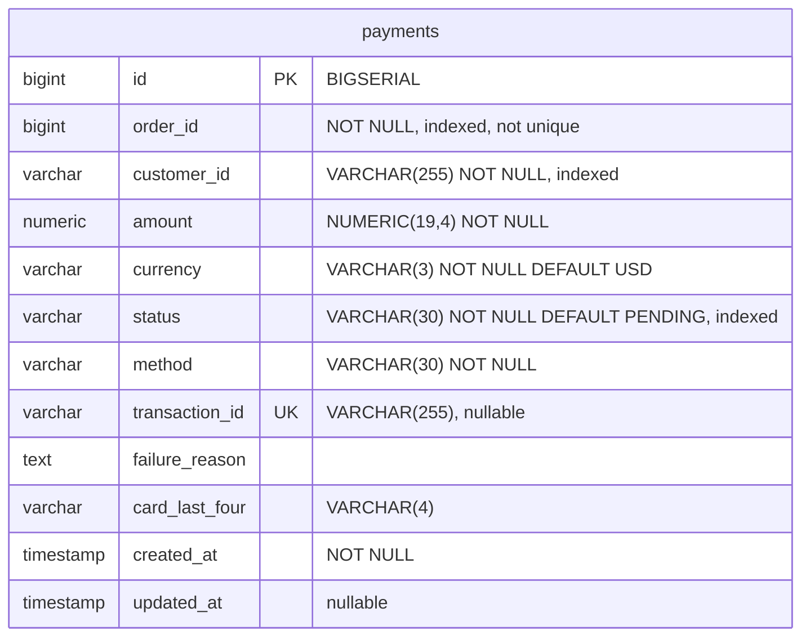

# Payment service

payment-service records payments for orders and settles them against a simulated payment gateway. The client creates a payment with an explicit REST call, sending the order id, a customer id, the amount and the method. A second REST call processes the payment by drawing a random number, which succeeds 80 % of the time. A third call refunds it. Each outcome is published to Kafka (`payment.completed`, `payment.failed`, `payment.refunded`), and that is how order-service, shipping-service and notification-service learn about it. The service owns the `payments` table in `paymentdb` and calls no other service.

| | |
|---|---|
| Repository | `ecommerce-payment-service` |
| Stack | Java 25 · Spring Boot 4.0.1 · Spring MVC · Spring Data JPA (Hibernate 7.2) · Flyway · spring-kafka 4.0 (producer only) · Spring Cloud 2025.1.1 Eureka client · springdoc-openapi 2.8.5 · Micrometer (Prometheus) + OpenTelemetry tracing · Lombok |
| Port | 8085 |
| Eureka service ID | `payment-service` |
| Gateway routes | `/api/v1/payments/**` (JWT required on every path) |
| Data store | PostgreSQL 16 `paymentdb` (Flyway). docker-compose publishes it on host port 5436 |
| Publishes | `payment.completed`, `payment.failed`, `payment.refunded` |
| Consumes | None. A listener container factory is configured, but no `@KafkaListener` exists |
| Calls | None. The service has no Feign or HTTP client |
| Called by | The frontend through the gateway: `CheckoutPage` creates and processes payments, `OrderDetailPage` reads by order. No service calls it synchronously |

## Responsibilities

- Create a `PENDING` payment for an order from the request body (`POST /api/v1/payments`).
- Settle a `PENDING` payment with the simulated gateway and record the outcome (`POST /api/v1/payments/{id}/process`).
- Refund a `COMPLETED` payment in full (`POST /api/v1/payments/{id}/refund`).
- Look payments up by id, by order and by customer.
- Publish every settlement and refund to Kafka, keyed by order id.

The service does not do the following:

- It does not check that the order exists, belongs to the caller, can still be paid, or costs what the client says.
- It does not consume `order.placed`. Only notification-service consumes that topic.
- It never starts a refund itself.
- It stores no card data apart from the four digits the client sends in `cardLastFour`.

## How a payment happens

The client drives the whole flow. In `ecommerce-frontend`, `pages/checkout/CheckoutPage.tsx` (`handlePlaceOrder`) does three things in order:

1. It confirms the order.
2. It creates the payment, with `customerId` set to the logged-in **username** and `amount` set to the confirmed order's `totalAmount`.
3. It immediately processes the payment.



## Domain model

### `Payment` (`model/Payment.java`, table `payments`)

| Field | Column | Java type | REST JSON | Notes |
|---|---|---|---|---|
| `id` | `id` | `Long` | number | `BIGSERIAL` identity |
| `orderId` | `order_id` | `Long` | number | Client-supplied, never verified |
| `customerId` | `customer_id` | `String` | string | Client-supplied. The frontend sends the username |
| `amount` | `amount` | `BigDecimal` | number | Client-supplied, at least 0.01. Stored as `NUMERIC(19,4)`, so values read back carry 4 decimals (`99.9800`) |
| `currency` | `currency` | `String` | string | Defaults to `USD`. Accepts any string of at most 3 characters |
| `status` | `status` | `PaymentStatus` | string | Enum name |
| `method` | `method` | `PaymentMethod` | string | Enum name |
| `transactionId` | `transaction_id` | `String` | string or null | Set only on `COMPLETED`. `UNIQUE` |
| `failureReason` | `failure_reason` | `String` | string or null | Set only on `FAILED` |
| `cardLastFour` | `card_last_four` | `String` | string or null | At most 4 characters. Not checked to be digits |
| `createdAt` | `created_at` | `LocalDateTime` | ISO-8601 string | Builder default `LocalDateTime.now()`. The DB default is never used |
| `updatedAt` | `updated_at` | `LocalDateTime` | ISO-8601 string or null | Null until the first update. Set explicitly by the service and again by `@PreUpdate` |

### `PaymentStatus` (`model/PaymentStatus.java`)

| Value | Meaning | Set by |
|---|---|---|
| `PENDING` | Created, not settled yet | `PaymentService.initiatePayment()` |
| `PROCESSING` | Settlement in progress | `PaymentService.processPayment()`. Exists only in memory and is never committed (rule 6) |
| `COMPLETED` | The simulated gateway accepted the payment | `processPayment()`, success branch |
| `FAILED` | The simulated gateway declined the payment | `processPayment()`, decline branch |
| `REFUNDED` | Refunded in full (terminal) | `PaymentService.refundPayment()` |

### `PaymentMethod` (`model/PaymentMethod.java`)

The values are `CREDIT_CARD`, `DEBIT_CARD`, `BANK_TRANSFER` and `DIGITAL_WALLET`. The method is informational only, because the simulated gateway treats every method the same way.

### Lifecycle


## Business rules

1. **The client decides what is paid.** `PaymentService.initiatePayment()` copies `orderId`, `customerId`, `amount`, `currency`, `method` and `cardLastFour` from the request. The service never calls order-service. As a result:
   - the amount is never compared with the order total;
   - the order's existence, owner and status are never checked;
   - `currency` defaults to `USD` when the request omits it.
2. **Duplicate protection is partial.** `initiatePayment()` looks up the order's payment with `PaymentRepository.findByOrderId()`.
   - It returns 409 (`Payment already completed for order: {orderId}`) only when that payment is `COMPLETED`.
   - An existing `PENDING`, `FAILED` or `REFUNDED` payment does not block a new one, and `payments.order_id` has no unique constraint.
   - `findByOrderId()` returns an `Optional`. Once an order has two rows, it throws `IncorrectResultSizeDataAccessException`. From then on, every `POST /api/v1/payments` and every `GET /api/v1/payments/order/{orderId}` for that order returns 500.
3. **The method must match an enum name exactly.** `PaymentMethod.valueOf(request.getMethod())` is case-sensitive. Any other value raises `IllegalArgumentException`, which the exception handler turns into a 500.
4. **Only `PENDING` payments can be processed.** For any other status, `processPayment()` throws `PaymentAlreadyProcessedException`, which returns 409 with `Payment already in status: {status}`. Each payment is processed once at most. The check is not safe against concurrent calls, because there is no row lock and no `@Version`.
5. **The gateway is a random draw.** `processPayment()` evaluates `ThreadLocalRandom.current().nextInt(10) < 8`. Eight of the ten equally likely values succeed, so 80 % of payments succeed and 20 % are declined. The amount, method and card make no difference. There is no external call, delay or retry.
   - **Success:** the status becomes `COMPLETED`. `transactionId` is set to `TXN-` followed by the first 8 hex digits of a random UUID in upper case (for example `TXN-1A2B3C4D`, 32 random bits). `updatedAt` is set to now. The service publishes `payment.completed`.
   - **Decline:** the status becomes `FAILED` and `failureReason` is set to the constant `Payment declined by gateway`. `transactionId` stays null and `updatedAt` is set to now. The service publishes `payment.failed`.
   - Both branches return HTTP 200. A decline is not an error status, so the caller has to read `status`.
6. **No reader ever sees `PROCESSING`.** `processPayment()` sets `PROCESSING` and calls `save()`, then sets the final status in the same transaction. The entity is managed and nothing flushes in between. The only UPDATE written at commit therefore carries `COMPLETED` or `FAILED`.
7. **Refunds.** `refundPayment()` accepts only `COMPLETED` payments. Any other status returns 400 with `Can only refund COMPLETED payments. Current: {status}`.
   - A refund is always for the full amount, because there is no amount parameter.
   - The status becomes `REFUNDED`, which is terminal. `transactionId` is kept.
   - `payment.refunded` carries the full `amount`.
   - Only a client calling the endpoint starts a refund. No service calls it, and no frontend page uses the `useRefundPayment()` hook that is defined in `hooks/usePayments.ts`. Cancelling an order in order-service (`OrderService.cancelOrder()`) does not refund either.
8. **Events are sent from inside the transaction.** The service publishes after it changes the entity but before the transaction commits. The send is fire-and-forget (see [Events](#events)).
9. **No endpoint checks the caller's identity.** See [Security and identity](#security-and-identity).

## API

| Method | Path | Gateway auth | Purpose |
|---|---|---|---|
| POST | `/api/v1/payments` | Bearer JWT | Create a `PENDING` payment |
| GET | `/api/v1/payments/{id}` | Bearer JWT | Get a payment by id |
| GET | `/api/v1/payments/order/{orderId}` | Bearer JWT | Get the payment of an order |
| GET | `/api/v1/payments/customer/{customerId}` | Bearer JWT | List a customer's payments |
| POST | `/api/v1/payments/{id}/process` | Bearer JWT | Run the simulated gateway |
| POST | `/api/v1/payments/{id}/refund` | Bearer JWT | Refund a `COMPLETED` payment in full |

Full reference: [API reference](../api/payment-service.md).

## Events

### Published

`messaging/PaymentEventProducer.java` produces all three topics through the `KafkaTemplate<String, Object>` that `config/KafkaProducerConfig.java` builds.

- **Key:** the order id as a decimal string (`e.getOrderId().toString()`). All events for one order therefore go to the same partition of a topic.
- **Value:** spring-kafka's `JacksonJsonSerializer` (Jackson 3), built with `.noTypeInfo()` and passed to the producer factory as an instance. The value is plain JSON with no `__TypeId__` header, and each consumer binds it to its own copy of the class. The serializer's mapper (`KafkaProducerConfig.eventJsonMapper()`) switches on `DateTimeFeature.WRITE_DATES_AS_TIMESTAMPS`, so `LocalDateTime` stays the integer array the consumers and pacts expect (Jackson 3 would otherwise write an ISO string).
- **Wire types:**
  - `Long` becomes a JSON integer and `String` a JSON string.
  - `BigDecimal` becomes a JSON number. The payment is reloaded from the database before every publish, so the number has 4 decimals, for example `99.9800`.
  - `LocalDateTime` becomes an array of integers `[year, month, day, hour, minute, second, nanos]`. The array has 5 to 7 elements because zero seconds and zero nanos are left out. The Pact tests pin this form.
- **Topics:** the service declares none (there are no `NewTopic` beans). The broker creates them automatically with its default settings (`KAFKA_AUTO_CREATE_TOPICS_ENABLE: "true"` in docker-compose).
- **Delivery:**
  - `send()` is asynchronous and the service ignores the future it returns.
  - The send runs inside the `@Transactional` service method, before commit. There are no Kafka transactions and no outbox.
  - A failed send is only logged, by spring-kafka's default `LoggingProducerListener`.
  - If the database commit fails after the send, the event has already gone out.

#### `payment.completed`

| | |
|---|---|
| Class | `event/PaymentCompletedEvent.java` |
| Trigger | `PaymentService.processPayment()`, success branch |
| Key | `orderId` |
| Consumers | **order-service** (group `order-service`, `messaging/PaymentEventConsumer.handlePaymentCompleted()`): sets the order to `PAID` whatever its current status, without checking the amount. **shipping-service** (group `shipping-service`): creates the shipment and publishes `shipment.created`. **notification-service** (group `notification-service`): sends a payment confirmation, which today is only a log line |

| Field | Java type | JSON | Value |
|---|---|---|---|
| `paymentId` | `Long` | integer | Payment id |
| `orderId` | `Long` | integer | `payment.orderId` |
| `customerId` | `String` | string | `payment.customerId`, as supplied by the client |
| `amount` | `BigDecimal` | number | `payment.amount` |
| `transactionId` | `String` | string | `TXN-` followed by 8 hex digits |
| `completedAt` | `LocalDateTime` | integer array | `LocalDateTime.now()` at publish time |

```json
{"paymentId":501,"orderId":7,"customerId":"alice","amount":99.9800,"transactionId":"TXN-1A2B3C4D","completedAt":[2026,10,29,14,30,15,123456789]}
```

#### `payment.failed`

| | |
|---|---|
| Class | `event/PaymentFailedEvent.java` |
| Trigger | `PaymentService.processPayment()`, decline branch |
| Key | `orderId` |
| Consumers | **order-service** (group `order-service`, `handlePaymentFailed()`): sets the order to `CANCELLED`. **notification-service** (group `notification-service`) |

| Field | Java type | JSON | Value |
|---|---|---|---|
| `paymentId` | `Long` | integer | Payment id |
| `orderId` | `Long` | integer | `payment.orderId` |
| `customerId` | `String` | string | `payment.customerId` |
| `failureReason` | `String` | string | Always `Payment declined by gateway` |
| `failedAt` | `LocalDateTime` | integer array | `LocalDateTime.now()` at publish time |

```json
{"paymentId":502,"orderId":7,"customerId":"alice","failureReason":"Payment declined by gateway","failedAt":[2026,10,29,14,30,15,123456789]}
```

#### `payment.refunded`

| | |
|---|---|
| Class | `event/PaymentRefundedEvent.java` |
| Trigger | `PaymentService.refundPayment()` |
| Key | `orderId` |
| Consumers | **notification-service** only (group `notification-service`). order-service and shipping-service do not subscribe, so a refund changes neither the order status nor the shipment |

| Field | Java type | JSON | Value |
|---|---|---|---|
| `paymentId` | `Long` | integer | Payment id |
| `orderId` | `Long` | integer | `payment.orderId` |
| `customerId` | `String` | string | `payment.customerId` |
| `amount` | `BigDecimal` | number | The full payment amount |
| `refundedAt` | `LocalDateTime` | integer array | `LocalDateTime.now()` at publish time |

```json
{"paymentId":503,"orderId":7,"customerId":"alice","amount":99.9800,"refundedAt":[2026,10,29,14,30,15,123456789]}
```

### Consumed

This service does not consume any topic. Some consumer configuration still exists, but no consumer is ever started because there is no `@KafkaListener`:

- `config/KafkaProducerConfig.java` defines `consumerFactory()` (group `payment-service`, `StringDeserializer` for values) and `kafkaListenerContainerFactory()` (with a `JacksonJsonMessageConverter`).

In particular, this service does not consume `order.placed`.

## Outbound calls

None. The service has no Feign or HTTP client and no `spring-cloud-starter-openfeign` dependency. Because it never talks to order-service, it cannot verify the amount or the order.

## Persistence

The only table comes from the Flyway migration `src/main/resources/db/migration/V1__create_payments.sql`. Hibernate validates the entity against it at startup (`spring.jpa.hibernate.ddl-auto=validate`), and `spring.flyway.baseline-on-migrate` is `true`.

| Column | Type | Constraints and default |
|---|---|---|
| `id` | `BIGSERIAL` | Primary key |
| `order_id` | `BIGINT` | `NOT NULL`, indexed (`idx_payments_order_id`), **not unique** |
| `customer_id` | `VARCHAR(255)` | `NOT NULL`, indexed (`idx_payments_customer_id`) |
| `amount` | `NUMERIC(19,4)` | `NOT NULL` |
| `currency` | `VARCHAR(3)` | `NOT NULL DEFAULT 'USD'` |
| `status` | `VARCHAR(30)` | `NOT NULL DEFAULT 'PENDING'`, indexed (`idx_payments_status`) |
| `method` | `VARCHAR(30)` | `NOT NULL` |
| `transaction_id` | `VARCHAR(255)` | `UNIQUE`, nullable |
| `failure_reason` | `TEXT` | |
| `card_last_four` | `VARCHAR(4)` | |
| `created_at` | `TIMESTAMP` | `NOT NULL DEFAULT CURRENT_TIMESTAMP` |
| `updated_at` | `TIMESTAMP` | `DEFAULT CURRENT_TIMESTAMP` |



The entity and the migration differ in these places:

- `order_id` has an index but no unique constraint. Nothing in the schema limits an order to one payment.
- `currency` is `NOT NULL DEFAULT 'USD'` in SQL but nullable in the entity. This does no harm because the service always sets it.
- The SQL defaults for `status`, `created_at` and `updated_at` never apply, because Hibernate inserts every mapped column. `status` and `created_at` come from the entity's builder defaults, and `updated_at` is inserted as NULL.
- `transaction_id` is `UNIQUE` but nullable. PostgreSQL allows any number of NULLs, so only completed payments compete for uniqueness.

## Security and identity

The gateway requires a valid JWT on every `/api/v1/payments/**` path and then sets `X-Username`, `X-User-Id` and `X-User-Role`. This service reads none of those headers and has no Spring Security. No endpoint checks the caller's role or ownership:

| Endpoint | What any authenticated user can do |
|---|---|
| `POST /api/v1/payments` | Create a payment for any order id, under any `customerId`, for any amount of at least 0.01 |
| `GET /api/v1/payments/{id}` | Read any payment. Ids are sequential |
| `GET /api/v1/payments/order/{orderId}` | Read the payment of any order |
| `GET /api/v1/payments/customer/{customerId}` | List any customer's payments, including amounts and card last-four digits |
| `POST /api/v1/payments/{id}/process` | Settle someone else's pending payment |
| `POST /api/v1/payments/{id}/refund` | Refund someone else's completed payment |

Other points:

- `customerId` is whatever the client sends. The frontend sends the username, both when creating a payment (`CheckoutPage.tsx`) and when listing them (`useCustomerPayments()` in `hooks/usePayments.ts`).
- docker-compose publishes port 8085 on the host, so the whole API is also reachable without a token at `http://localhost:8085`.
- The OpenAPI document declares a global `bearerAuth` scheme (`config/OpenApiConfig.java`). It is documentation only and the service does not enforce it.

## Configuration

`src/main/resources/application.yaml`:

| Property | Env var | Default | Purpose |
|---|---|---|---|
| `server.port` | | `8085` | HTTP port |
| `spring.application.name` | | `payment-service` | Eureka service ID and the `application` metrics tag |
| `spring.datasource.url` | `SPRING_DATASOURCE_URL` | `jdbc:postgresql://localhost:5436/paymentdb` | compose and k8s use `jdbc:postgresql://paymentdb:5432/paymentdb` |
| `spring.datasource.username` | `DB_USERNAME` | `paymentuser` | k8s reads it from secret `paymentdb-credentials` |
| `spring.datasource.password` | `DB_PASSWORD` | `paymentpass` | k8s reads it from secret `paymentdb-credentials` |
| `spring.jpa.hibernate.ddl-auto` | | `validate` | Checks the schema against the entity at startup |
| `spring.flyway.enabled` / `locations` / `baseline-on-migrate` | | `true` / `classpath:db/migration` / `true` | Migrations |
| `spring.kafka.bootstrap-servers` | `KAFKA_BOOTSTRAP_SERVERS` | `localhost:9092` | compose and k8s use `kafka:29092`. `KafkaProducerConfig` reads it with `@Value` |
| `eureka.client.service-url.defaultZone` | `EUREKA_CLIENT_SERVICEURL_DEFAULTZONE` | `http://localhost:8761/eureka/` | compose and k8s use `http://service-discovery:8761/eureka/` |
| `eureka.client.registry-fetch-interval-seconds` | | `5` | Default is 30 |
| `eureka.instance.prefer-ip-address` | | `true` | |
| `eureka.instance.lease-renewal-interval-in-seconds` / `lease-expiration-duration-in-seconds` | | `5` / `15` | A crashed instance leaves the registry in about 20 s |
| `management.endpoints.web.exposure.include` | | `health,info,metrics,prometheus,circuitbreakers,serviceregistry` | `circuitbreakers` has no effect because resilience4j is not on the classpath |
| `management.endpoint.health.show-details` | | `always` | |
| `management.endpoint.prometheus.access` | | `unrestricted` | |
| `management.metrics.tags.application` / `environment` | `ENVIRONMENT` (environment only) | `payment-service` / `development` | Common metric tags |
| `management.metrics.distribution.percentiles-histogram.http.server.requests` | | `true` | |
| `management.metrics.distribution.slo.http.server.requests` | | `50ms,100ms,200ms,500ms,1s,2s` | SLO buckets |
| `management.tracing.sampling.probability` | `TRACING_SAMPLING_PROBABILITY` | `1.0` | |
| `management.opentelemetry.tracing.export.otlp.endpoint` | `OTEL_EXPORTER_OTLP_ENDPOINT` (base URL) | `http://tempo:4318/v1/traces` | OTLP over HTTP to Tempo |
| `management.otlp.metrics.export.enabled` | | `false` | Prometheus scrapes the metrics instead |
| `springdoc.api-docs.path` / `springdoc.swagger-ui.path` | | `/api-docs` / `/swagger-ui.html` | Same paths as every service. The gateway's unified Swagger UI loads `/api-docs/payment-service` from here. `OpenApiConfig` declares a relative `/` server, so Try it out goes through the gateway |
| `logging.pattern.console` | | `%d{yyyy-MM-dd HH:mm:ss} [%thread] [%X{correlationId}] %-5level %logger{36} - %msg%n` | |
| `logging.level.com.ecommerce` | | `DEBUG` | |

The service has no Feign, resilience4j or JWT configuration.

**Deployment:**

- **Image:** `docker/Dockerfile` copies the prebuilt `target/payment-service-*.jar` onto `eclipse-temurin:25-jre-alpine` and runs it as an unprivileged user with `exec java $JAVA_OPTS -jar app.jar`.
- **docker-compose:**
  - `JAVA_OPTS` is set to `-XX:MaxRAMPercentage=55 -XX:ActiveProcessorCount=2 -XX:+ExitOnOutOfMemoryError`, with `mem_limit: 768m`.
  - The container waits for healthy `paymentdb`, `kafka` and `service-discovery`.
  - The healthcheck runs `wget` against `/actuator/health`.
- **Kubernetes** (`ecommerce-platform/k8s/40-services.yaml`):
  - One replica, requests of 100m CPU and 320Mi memory, a 768Mi memory limit.
  - Init containers wait for service-discovery, paymentdb and kafka.
  - The startup and readiness probes use `/actuator/health/readiness`, and the liveness probe uses `/actuator/health/liveness`.
  - A `preStop` hook marks the instance `OUT_OF_SERVICE` through `/actuator/serviceregistry` and then sleeps 15 s.
  - `terminationGracePeriodSeconds` is 60.

## Observability

- **Actuator** endpoints are `health` (with details), `info`, `metrics`, `prometheus` and `serviceregistry`, which the k8s `preStop` hook uses.
- **Metrics:** Prometheus scrapes `payment-service:8085/actuator/prometheus` (job `payment-service`, labels `service` and `group=application`), and blackbox-exporter probes `/actuator/health`. The generic rules in `ecommerce-monitoring/prometheus/rules/service-alerts.yml` cover this service: `ServiceDown`, `HighErrorRate`, `HighP99Latency` and the JVM heap and GC alerts. There are no custom metrics and nothing counts payments by outcome.
- **Logs** go to the console with the correlation id in every line. Promtail ships the container logs to Loki. The service logs at INFO:
  - `Publishing payment.{completed|failed|refunded} for orderId=…` for each publish;
  - `Payment {id} completed for order {orderId}` or `Payment {id} failed for order {orderId}` for each outcome.
- **Correlation id:** `filter/CorrelationIdFilter.java` reuses the incoming `X-Correlation-Id` header or generates a UUID. It puts the id in the MDC (`correlationId`) and echoes it in the response header, and every error body includes it. The id is not added to Kafka records.
- **Tracing:** Micrometer Tracing with the OpenTelemetry bridge exports HTTP server spans to Tempo (OTLP/HTTP, 100 % sampling by default). The hand-built `KafkaTemplate` does not enable observation, so no trace context is written to the records and traces stop at the Kafka boundary.

## Testing

Run everything with `mvn verify` (61 unit, slice and pact tests, plus 18 integration tests that need Docker). CircleCI (`.circleci/config.yml`) runs `mvn -B -ntp verify`, validates the image and publishes it for `develop`, `main`, `master` and `v*` tags.

| Class | Kind | What it covers |
|---|---|---|
| `service/PaymentServiceTest` | Mockito unit | initiate (success returns `PENDING`, a `COMPLETED` payment blocks it), process (a non-`PENDING` payment throws `PaymentAlreadyProcessedException`, success and decline branches), refund (only from `COMPLETED`), queries and mapping |
| `controller/PaymentControllerTest` | `@WebMvcTest` | the endpoints' status codes, validation and error bodies |
| `messaging/PaymentEventProducerTest` | unit | the three event records: topic, key, payload |
| `exception/GlobalExceptionHandlerTest`, `filter/CorrelationIdFilterTest` | unit | exception mappings; the correlation ID |
| `contract/PaymentEventsProviderPactTest` | Pact provider (`@SpringBootTest`, profile `test`) | replays the three consumer pacts in `src/test/resources/pacts/` against the real `PaymentService` and `PaymentEventProducer` |
| `contract/FrontendHttpProviderPactTest` | Pact provider, HTTP | the frontend's 4 interactions in `src/test/resources/pacts-frontend/` (initiate a payment for order 7, process payment 501, payment of order 7, and one for an order with none), with a gateway emulation that sets `X-Username`, `X-User-Id`, `X-User-Role` from the bearer token. Kept apart from `pacts/`, which holds message pacts only |
| `integration/PaymentRepositoryIT` | Testcontainers `postgres:16-alpine` | the real migration; `numeric(19,4)` amounts (and rejection beyond it); `updated_at`; unique `transaction_id` with many nulls; not-null columns and defaults; `order_id` is **not** unique |
| `integration/PaymentFlowIT` | full app, Postgres, Kafka | initiate, complete, refund: rows persist and the three events are published; a decline stores the reason and publishes `payment.failed`; state guards and errors over HTTP |

**Pact role:** this service is the provider for three consumer pacts, which `ecommerce-platform/sync-pacts.sh` copies here.

| Pact file | Consumer test | Interactions (provider state) |
|---|---|---|
| `order-service-payment-service.json` | order-service `PaymentEventsConsumerPactTest` | `a payment.completed event` (`payment 501 for order 7 has completed`) and `a payment.failed event` (`payment 502 for order 7 has failed`) |
| `shipping-service-payment-service.json` | shipping-service `PaymentEventsConsumerPactTest` | `a payment.completed event` |
| `notification-service-payment-service.json` | notification-service `PaymentEventsConsumerPactTest` | Completed, failed, and `a payment.refunded event` (`payment 503 for order 7 has been refunded`) |

Each interaction pins the following:

- the topic (`kafka_topic`);
- the record key, which must match the regex `\d+` (example `7`);
- `contentType: application/json`;
- every payload field, by type: `paymentId` and `orderId` integers, `amount` a number, `customerId`, `transactionId` and `failureReason` strings, and the timestamp an array of at least 5 integers.

The pacts check types only, so the provider may add fields. Run only the contract tests with `mvn test -Dtest='*PactTest'`.

**`application-test.yaml`** lives in `src/main/resources` and defines the `test` profile that `PaymentEventsProviderPactTest` activates. That profile does the following:

- uses in-memory H2 (`jdbc:h2:mem:testdb;DB_CLOSE_DELAY=-1`, user `sa`) with `ddl-auto: create-drop` (Hibernate detects the H2 dialect; before 2026-10-29 the main YAML's explicit PostgreSQL dialect overrode it even here);
- disables Flyway;
- points Kafka at `localhost:9092`, although no broker is needed because the test mocks `KafkaTemplate`;
- disables the Eureka client.

Because the file sits under `src/main`, it is packaged into the production jar. H2 is a test-scoped dependency and is not, so starting a deployed container with the `test` profile would fail.

**Disabled tests that pin bugs** (see [Findings](../findings.md#bugs-pinned-by-tests)):

- `PaymentFlowIT.initiateTwiceForSameOrder_keepsOrderLookupWorking`: `payments.order_id` is not unique, so a retry after a failed payment adds a second row, and then `GET /payments/order/{id}` and further initiates return 500 (I-6).
- `GlobalExceptionHandlerTest`: a non-JSON body returns 500 instead of 415, and an unknown URL 500 instead of 404 (A-4).
- `PaymentFlowIT.initiate_unknownMethod_returns400`: an unknown `method` makes `PaymentMethod.valueOf` throw, returned as 500 (A-4).

**Gaps:** the unit and pact tests run on H2 with Flyway disabled, but the `*IT` classes run the migration on Postgres. Concurrent payments for one order are not tested.

## Code map

Paths are relative to `src/main/java/com/ecommerce/payment/`.

| Package or class | Role |
|---|---|
| `PaymentServiceApplication` | Spring Boot entry point |
| `controller/PaymentController` | REST endpoints under `/api/v1/payments` |
| `service/PaymentService` | Business logic: initiate, process (simulated gateway), refund, queries, mapping to `PaymentDTO` |
| `messaging/PaymentEventProducer` | Publishes `payment.completed`, `payment.failed` and `payment.refunded` |
| `event/Payment*Event` | Kafka payload classes |
| `dto/InitiatePaymentRequest`, `dto/PaymentDTO` | REST request and response |
| `model/Payment`, `PaymentStatus`, `PaymentMethod` | JPA entity and enums |
| `repository/PaymentRepository` | Spring Data JPA: `findByOrderId`, `findByCustomerId`, `findByTransactionId` (unused) |
| `exception/*` | Domain exceptions, `ErrorResponse`, `GlobalExceptionHandler` |
| `filter/CorrelationIdFilter` | `X-Correlation-Id` handling and MDC |
| `config/KafkaProducerConfig` | Producer factory and template. The consumer factory and listener factory here are unused |
| `config/OpenApiConfig` | OpenAPI title and the `bearerAuth` scheme |
| `src/main/resources/db/migration/V1__create_payments.sql` | Schema |

## Known issues and limitations

| Issue | Where | Impact | Severity |
|---|---|---|---|
| The amount, currency and customer come from the client and are never checked against the order. order-service then marks the order `PAID` on any `payment.completed` without comparing the amount or looking at its current status | `PaymentService.initiatePayment()`. order-service `messaging/PaymentEventConsumer.handlePaymentCompleted()` | A user can pay 0.01 for any order, and the order becomes `PAID` and is shipped. A payment on an order that is already `CANCELLED` (for example after a declined payment) turns it back into `PAID` | High |
| No authorization or ownership checks, and no `X-User-*` headers are read | `controller/PaymentController.java` (all endpoints) | Any logged-in user can refund or process any payment and read every payment, including other customers' card last-four digits. Port 8085 is also open on the host without any auth | High |
| Duplicate protection only rejects when a `COMPLETED` payment exists, and `order_id` is not unique | `PaymentService.initiatePayment()`, `V1__create_payments.sql` | Two `PENDING` payments for one order (or two concurrent creates) can both complete. That is a double charge, and order-service and notification-service each process `payment.completed` twice. shipping-service drops the duplicate | Medium |
| A second payment row for an order breaks `findByOrderId()`, which returns an `Optional` | `PaymentRepository.findByOrderId()` | `GET /api/v1/payments/order/{orderId}`, which `OrderDetailPage` uses, and any further `POST /api/v1/payments` for that order return 500 | Medium |
| `processPayment()` has no lock and no `@Version` | `PaymentService.processPayment()` | Concurrent calls on the same `PENDING` payment both run the draw and both publish. One payment can emit both `payment.completed` and `payment.failed`, and the last commit decides the stored status | Medium |
| Events are sent inside the DB transaction, fire-and-forget, with no outbox | `PaymentService` (all three publishes), `PaymentEventProducer` | If the commit fails after the send, consumers receive an event for a change that never happened. If the send fails after the commit, the event is lost and only logged | Medium |
| A declined payment returns 200, and the checkout never reads `status` | `PaymentController.processPayment()`. Frontend `pages/checkout/CheckoutPage.tsx` `handlePlaceOrder` | The user sees "Order placed successfully!" while order-service cancels the order | Medium |
| Nothing acts on refunds. Only notification-service consumes `payment.refunded`, and cancelling an order does not refund | `PaymentEventProducer.publishRefunded()`. order-service `OrderService.cancelOrder()` | A refunded order stays `PAID` and its shipment continues. A cancelled `PAID` order keeps its money | Medium |
| An invalid `method` returns 500 instead of 400. Unmapped framework exceptions (unknown path, `NoResourceFoundException`; wrong `Content-Type`, `HttpMediaTypeNotSupportedException`) also end in the catch-all as 500 | `PaymentService.initiatePayment()` (`PaymentMethod.valueOf`), `GlobalExceptionHandler.general()` | Client errors look like server faults and are logged at ERROR with a stack trace | Low |
| Weak input validation: `currency` accepts any string of 3 characters or fewer, including an empty one. `cardLastFour` is not checked to be digits. `customerId` longer than 255 characters or `amount` beyond `NUMERIC(19,4)` fail in the database | `dto/InitiatePaymentRequest.java` | Bad data is stored, and some inputs return 500 | Low |
| `transactionId` has only 32 random bits, and its `UNIQUE` violation would surface at commit, after `payment.completed` has been sent | `PaymentService.processPayment()` | A rare 500 together with an event for a payment that the database rolled back | Low |
| `PROCESSING` is never persisted | `PaymentService.processPayment()` | This enum value can never be observed | Low |
| Dead code and configuration: the consumer factory and the listener container factory (no listener exists); `PaymentRepository.findByTransactionId()`; `circuitbreakers` exposure without resilience4j | `config/KafkaProducerConfig.java`, `application.yaml` | Misleading to readers | Low |
| `application-test.yaml` lives in `src/main/resources` | `src/main/resources/application-test.yaml` | It ships in the production jar. It belongs in `src/test/resources` | Low |
