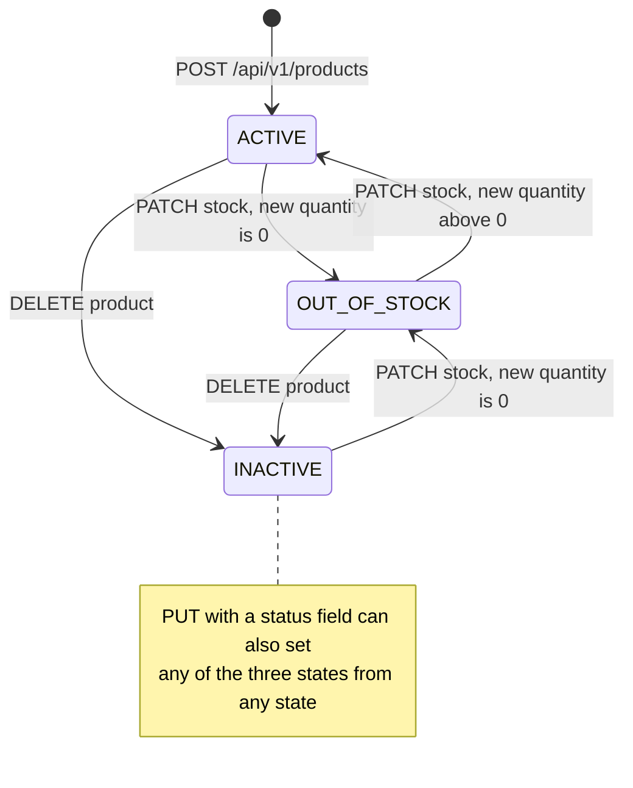
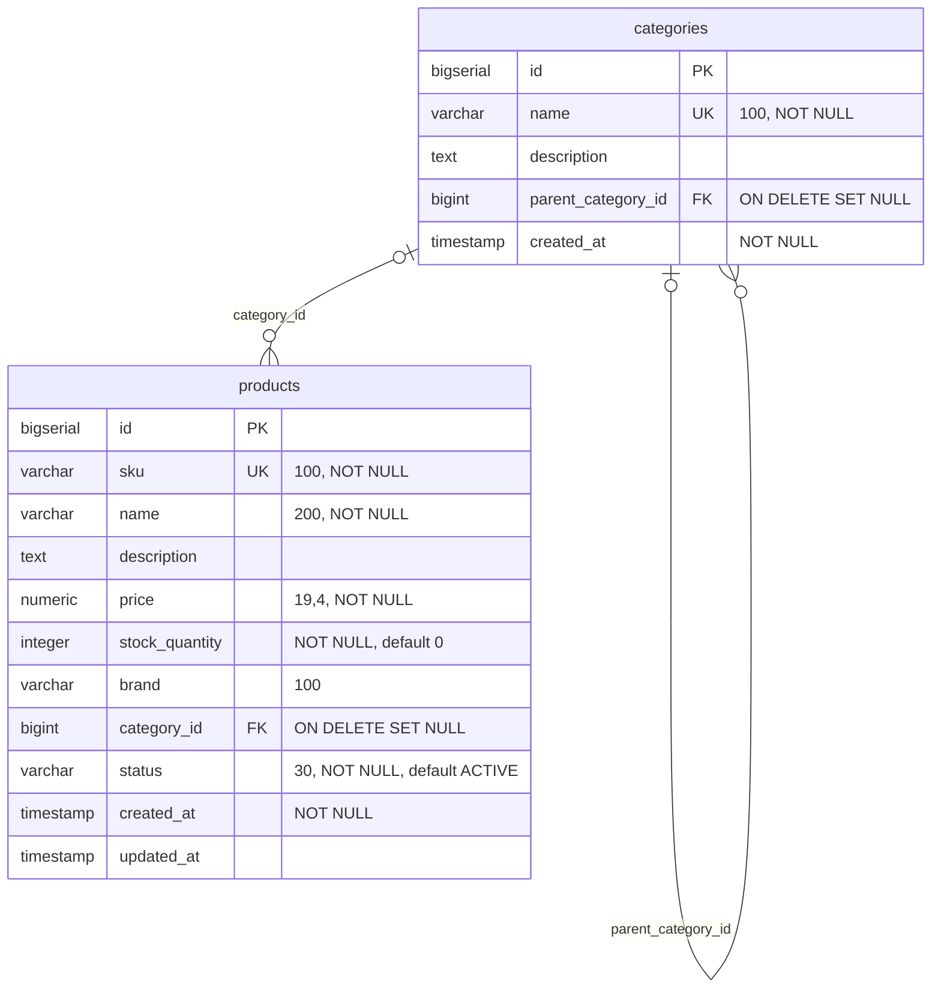

# Product Service

product-service is the system of record for products and categories. It owns each product's SKU, name, description, price, stock quantity, brand, category and status, and it is the stock ledger the rest of the platform adjusts: order-service reserves and restores stock through `PATCH /api/v1/products/{id}/stock`. The storefront reads products from this service directly (the frontend does not use catalog-service), and order-, catalog- and review-service look products up here over Feign. It is a leaf service: it calls no other service and does not use Kafka. Its data lives in the PostgreSQL database `productdb`.

| | |
|---|---|
| Repository | `ecommerce-product-service` |
| Stack | Java 25 · Spring Boot 4.0.1 · Spring MVC · Spring Data JPA (Hibernate) · Bean Validation · Flyway · Lombok · Jackson 3 · springdoc-openapi 2.8.5 · Eureka client · Micrometer + OpenTelemetry |
| Port | 8082 |
| Eureka service ID | `product-service` |
| Gateway routes | `/api/v1/products/**`, `/api/v1/categories/**` (GET is public, every other method needs a JWT) |
| Data store | PostgreSQL 16 `productdb` (Flyway `V1`, `V2`; Hibernate `ddl-auto: validate`) |
| Publishes | — |
| Consumes | — |
| Calls | — |
| Called by | order-service, catalog-service, review-service (Feign through Eureka); the frontend through the gateway |

## Responsibilities

- Create, update and soft-delete products; look them up by id or by SKU.
- List, search (by name) and filter by category the products whose status is `ACTIVE`, with paging and sorting on the list and search endpoints.
- Keep stock: apply relative adjustments (`delta`), refuse to go below zero, and switch the status between `ACTIVE` and `OUT_OF_STOCK` as stock reaches or leaves zero.
- Create and list categories (a flat list in which each category may point at a parent).
- Provide the HTTP contract that order-, catalog- and review-service pin with Pact.

Not present in the code: authorization of any kind, stock holds (a reservation is an immediate decrement), price history, change events, category update or delete, images.

## Domain model

### Product

Entity `model/Product.java`, table `products`, exposed as `dto/ProductDTO.java`.

| Field | Java type | JSON type | Column | Notes |
|---|---|---|---|---|
| `id` | `Long` | number | `id BIGSERIAL` PK | Generated by the database (`IDENTITY`). |
| `sku` | `String` | string | `sku VARCHAR(100) UNIQUE NOT NULL` | Set on create only; `UpdateProductRequest` has no `sku`. Compared case-sensitively. |
| `name` | `String` | string | `name VARCHAR(200) NOT NULL` | |
| `description` | `String` | string or null | `description TEXT` | |
| `price` | `BigDecimal` | number | `price NUMERIC(19,4) NOT NULL` | Read back with four decimals, e.g. `49.9900`. |
| `stockQuantity` | `Integer` | integer | `stock_quantity INTEGER NOT NULL DEFAULT 0` | Changed only by the stock endpoint after creation. |
| `brand` | `String` | string or null | `brand VARCHAR(100)` | |
| `categoryId` | `Long` | number or null | `category_id BIGINT` FK to `categories(id)` `ON DELETE SET NULL` | A plain id in the entity, not a JPA relation. |
| `status` | `ProductStatus` | string | `status VARCHAR(30) NOT NULL DEFAULT 'ACTIVE'` | Stored by name (`EnumType.STRING`); `ProductDTO.status` is a `String`. |
| `createdAt` | `LocalDateTime` | string | `created_at TIMESTAMP NOT NULL` | Set by the JVM when the entity is built. |
| `updatedAt` | `LocalDateTime` | string or null | `updated_at TIMESTAMP` | `null` until the first update, then set on every update (explicitly and by `@PreUpdate`). |

### Category

Entity `model/Category.java`, table `categories`, exposed as `dto/CategoryDTO.java`.

| Field | Java type | JSON type | Column | Notes |
|---|---|---|---|---|
| `id` | `Long` | number | `id BIGSERIAL` PK | |
| `name` | `String` | string | `name VARCHAR(100) UNIQUE NOT NULL` | Unique, case-sensitive. |
| `description` | `String` | string or null | `description TEXT` | |
| `parentCategoryId` | `Long` | number or null | `parent_category_id BIGINT` FK to `categories(id)` `ON DELETE SET NULL` | Parent pointer. The API never returns a tree. |
| `createdAt` | `LocalDateTime` | string | `created_at TIMESTAMP NOT NULL` | Set by the JVM. |

Categories cannot be updated or deleted through the API.

### ProductStatus

`model/ProductStatus.java`.

| Value | Meaning | Set by |
|---|---|---|
| `ACTIVE` | Sellable. The only status that the list, search and by-category endpoints return. | `createProduct()` (always, even with `stockQuantity` 0); `updateStock()` when stock leaves 0 on an `OUT_OF_STOCK` product; `PUT` with `"status": "ACTIVE"`. |
| `OUT_OF_STOCK` | Stock is 0. Hidden from list, search and by-category; still returned by id and SKU. | `updateStock()` whenever the new quantity is 0; `PUT`. |
| `INACTIVE` | Soft-deleted. Hidden from list, search and by-category; still returned by id and SKU. | `deleteProduct()`; `PUT`. |

### Product lifecycle

The `INACTIVE` to `OUT_OF_STOCK` edge is a side effect of rule 4 below: draining a soft-deleted product to zero moves it out of `INACTIVE`, and a later restock then makes it `ACTIVE` again.

## Business rules

1. **SKU is unique.** `ProductService.createProduct()` checks `existsBySku` and answers 409 `Product with SKU already exists: <sku>`. The `UNIQUE` constraint on `products.sku` is the backstop: two concurrent creates with the same SKU both pass the check, and the loser fails on the constraint with a `DataIntegrityViolationException`, which the catch-all handler returns as 500. The comparison is exact (case-sensitive). The SKU cannot be changed after creation.
2. **A referenced category must exist on create.** `createProduct()` loads `categoryId` when it is given and answers 404 `Category not found: <id>`. `updateProduct()` does not check: an unknown `categoryId` fails on the foreign key when the transaction commits and returns 500.
3. **New products start `ACTIVE`** whatever their initial stock (`createProduct()`), so a product created with `stockQuantity: 0` is listed as `ACTIVE` until its stock is first adjusted.
4. **Stock moves only by delta.** `ProductService.updateStock(id, delta)` computes `current + delta`:
   - a negative result throws `InsufficientStockException`, returned as 400 `Insufficient stock for product <sku>. Available: <current>, Requested: <-delta>`; nothing is written;
   - a result of 0 sets the status to `OUT_OF_STOCK`, whatever it was (including `INACTIVE`);
   - a result above 0 on an `OUT_OF_STOCK` product sets it back to `ACTIVE`; `ACTIVE` and `INACTIVE` are left as they are;
   - `updatedAt` is set, the change is logged (`Stock updated for product <sku>: <old> -> <new>`), and the whole product is returned.

   A positive delta adds stock (restock, order cancellation), a negative delta removes it (order reservation). `delta: 0` is accepted and only re-evaluates the status. The delta has no bounds; `current + delta` is plain `int` arithmetic, so a delta that overflows produces a negative sum and a misleading 400.
5. **There is no concurrency control on stock.** `updateStock()` is a read-modify-write inside one `@Transactional` method: `findById` (a plain `SELECT`; no `FOR UPDATE`, no `@Lock`), the arithmetic in Java, then Hibernate's `UPDATE products SET ... stock_quantity = ? ... WHERE id = ?` at commit. There is no `@Version` column, no conditional or atomic `UPDATE ... SET stock_quantity = stock_quantity + ?`, and no `CHECK` constraint. Under PostgreSQL's default READ COMMITTED isolation two concurrent decrements read the same quantity, both pass the non-negative check, and the later commit overwrites the earlier one. Example: stock 5, two orders reserve 3 and 4 at the same time; both receive 200, the final stock is 2 or 1, and 7 units have been promised from 5. The stored value cannot go negative (every writer writes a value it checked), but decrements and restorations can be lost. Because Hibernate's `UPDATE` writes every column, a concurrent `PUT` (name, price and so on) can also write back a stale `stock_quantity`.
6. **Delete is a soft delete.** `deleteProduct()` sets `INACTIVE` and returns 204. Rows are never removed, and deleting an `INACTIVE` product again also returns 204. There is no hard-delete endpoint.
7. **Visibility depends on the endpoint.** `getAllProducts()`, `searchProducts()` and `getProductsByCategory()` return only `ACTIVE` products, so sold-out and soft-deleted products disappear from them. `getProductById()` and `getProductBySku()` return any status; callers that fetch by id (order-, review- and catalog-service) see soft-deleted and sold-out products and would have to check `status` themselves. None of them reads `status` (order-service does reject sold-out products, but only through its own `stockQuantity` comparison).
8. **PUT is a partial update.** `updateProduct()` applies each non-null field of `UpdateProductRequest` (`name`, `description`, `price`, `brand`, `categoryId`, `status`); a `null` or absent field means "leave unchanged", so no field can be cleared. `status` goes through `ProductStatus.valueOf()`: an unknown or lower-case value throws `IllegalArgumentException`, returned as 500. The new status is not checked against the stock (an `INACTIVE` product can be reactivated, a product with stock 0 can be set `ACTIVE`). `sku` and `stockQuantity` are not part of the request; if a client sends them they are silently ignored.
9. **Category names are unique.** `createCategory()` checks `existsByName` and answers 409 `Category already exists: <name>` (it reuses `ProductAlreadyExistsException`). `parentCategoryId` is not checked; an unknown parent fails on the foreign key and returns 500.
10. **The category filter is one level deep.** `getProductsByCategory()` answers 404 `Category not found: <id>` for an unknown category; otherwise it returns the `ACTIVE` products whose `category_id` equals the id. Products of child categories are not included and the result is not paged.

## API

| Method | Path | Gateway auth | Purpose |
|---|---|---|---|
| POST | `/api/v1/products` | Bearer JWT | Create a product |
| GET | `/api/v1/products` | Public | Page of `ACTIVE` products |
| GET | `/api/v1/products/{id}` | Public | Product by id (any status) |
| GET | `/api/v1/products/sku/{sku}` | Public | Product by SKU (any status) |
| GET | `/api/v1/products/search?q=` | Public | Page of `ACTIVE` products whose name contains `q` |
| GET | `/api/v1/products/category/{categoryId}` | Public | `ACTIVE` products of one category (list) |
| PUT | `/api/v1/products/{id}` | Bearer JWT | Partial update |
| PATCH | `/api/v1/products/{id}/stock` | Bearer JWT | Adjust stock by `delta` |
| DELETE | `/api/v1/products/{id}` | Bearer JWT | Soft delete (`INACTIVE`) |
| POST | `/api/v1/categories` | Bearer JWT | Create a category |
| GET | `/api/v1/categories` | Public | All categories (list) |
| GET | `/api/v1/categories/{id}` | Public | Category by id |

No endpoint performs a service-side role or ownership check. Full reference: [API reference](../api/product-service.md).

## Events

This service does not use Kafka. There is no `spring-kafka` dependency, and nothing is published when a product, a price or a stock level changes. Services that keep a copy of product data have to pull it; catalog-service in particular is refreshed only when someone calls its sync endpoint (see [catalog-service](catalog-service.md)).

## Outbound calls

None. product-service declares no Feign client and makes no HTTP calls.

### Inbound calls from other services

The three callers resolve `product-service` through Eureka and call it directly, not through the gateway, so their requests carry no JWT and no `X-User-*` headers.

| Caller | Client method | Request | When | Response fields the caller uses | Caller-side handling |
|---|---|---|---|---|---|
| order-service | `client/ProductServiceClient.getProductById()` | `GET /api/v1/products/{id}` | `OrderService.addItemToOrder()`, before the item is added | `sku`, `name`, `price`, `stockQuantity` (the pact also pins `id`) | Rejects the item if `stockQuantity < quantity`; copies `name` and `price` into the order item. Does not check `status`. |
| order-service | `ProductServiceClient.updateStock()` | `PATCH /api/v1/products/{id}/stock` with `{"delta": -quantity}` | `addItemToOrder()`, after its own stock pre-check | none (the pact pins `id`, `stockQuantity`) | A 400 from this service surfaces as `FeignException.BadRequest`. |
| order-service | `ProductServiceClient.updateStock()` | `PATCH /api/v1/products/{id}/stock` with `{"delta": quantity}`, once per item | `OrderService.cancelOrder()` | none | Failures are logged and skipped; the cancellation still completes, and that item's stock is not restored. |
| catalog-service | `client/ProductServiceClient.getProductById()` | `GET /api/v1/products/{id}` | `CatalogService.syncFromProductService()` | `sku`, `name`, `description`, `price`, `stockQuantity`, `brand`, `categoryId` (`id` and `status` must be present for the Kotlin DTO to decode) | No error mapping: a 404 here becomes a 500 from catalog-service. |
| catalog-service | `ProductServiceClient.getAllCategories()` | `GET /api/v1/categories` | the same sync, right after the product | `id`, `name` | Any failure is swallowed and the category name is left `null`. |
| review-service | `client/ProductServiceClient.getProductById()` | `GET /api/v1/products/{id}` | `ReviewService.createReview()`, as an existence check | none (the pact pins `id`) | Any exception becomes `RuntimeException("Product <id> not found or product service unavailable")`. |

All three callers set Feign `connect-timeout: 2000` and `read-timeout: 10000` ms and register a retryer that repeats only connection failures (`config/FeignConfig` in each repository), so a request that reached this service is never re-sent by Feign. That matters because a stock adjustment is not idempotent: a client that retries a `PATCH` after a read timeout applies the delta twice. Circuit breakers and fallbacks on the caller side are described in each caller's document.

The contract each caller relies on is pinned by Pact; see [Testing](#testing).

## Persistence

Flyway applies `src/main/resources/db/migration` at startup (`baseline-on-migrate: true`); Hibernate only validates the schema (`ddl-auto: validate`).

### `categories` (`V1__create_categories.sql`)

| Column | Type | Constraints |
|---|---|---|
| `id` | `BIGSERIAL` | PK |
| `name` | `VARCHAR(100)` | `UNIQUE`, `NOT NULL` |
| `description` | `TEXT` | |
| `parent_category_id` | `BIGINT` | FK to `categories(id)` `ON DELETE SET NULL` |
| `created_at` | `TIMESTAMP` | `NOT NULL`, `DEFAULT CURRENT_TIMESTAMP` |

Index: `idx_categories_parent (parent_category_id)`.

### `products` (`V2__create_products.sql`)

| Column | Type | Constraints |
|---|---|---|
| `id` | `BIGSERIAL` | PK |
| `sku` | `VARCHAR(100)` | `UNIQUE`, `NOT NULL` |
| `name` | `VARCHAR(200)` | `NOT NULL` |
| `description` | `TEXT` | |
| `price` | `NUMERIC(19,4)` | `NOT NULL` |
| `stock_quantity` | `INTEGER` | `NOT NULL`, `DEFAULT 0` |
| `brand` | `VARCHAR(100)` | |
| `category_id` | `BIGINT` | FK to `categories(id)` `ON DELETE SET NULL` |
| `status` | `VARCHAR(30)` | `NOT NULL`, `DEFAULT 'ACTIVE'` |
| `created_at` | `TIMESTAMP` | `NOT NULL`, `DEFAULT CURRENT_TIMESTAMP` |
| `updated_at` | `TIMESTAMP` | `DEFAULT CURRENT_TIMESTAMP` |

Indexes: `idx_products_sku (sku)`, `idx_products_category (category_id)`, `idx_products_status (status)`, `idx_products_name (name)`.

Where the entities and the migrations differ:

- The foreign keys exist only in the migrations. The entities hold `categoryId` and `parentCategoryId` as plain `Long`s, so under the `test` profile (H2, `ddl-auto: create-drop`, Flyway off) the schema is generated from the entities and has no foreign keys and none of the migration defaults. The H2-based tests therefore cannot see the foreign-key failures described in rules 2 and 9; `ProductRepositoryIT` and `ProductApiIT` run the migrations on Postgres and do.
- `updated_at DEFAULT CURRENT_TIMESTAMP` never applies: Hibernate always lists the column in its `INSERT` and writes `null` until the first update. `created_at` likewise always comes from the JVM (`LocalDateTime.now()` when the entity is built), not from the column default.
- There are no `CHECK` constraints. `stock_quantity >= 0` and `price > 0` are enforced only by the application (`@Min` and `@DecimalMin` on create, the check in `updateStock()`).
- There is no version column for optimistic locking (see rule 5).
- `idx_products_sku` duplicates the index PostgreSQL already creates for the `UNIQUE` constraint. `idx_products_name` is a plain B-tree on `name`; the search query (`upper(name) like upper('%q%')`) cannot use it.
- `ON DELETE SET NULL` is reachable only through SQL, because no endpoint deletes a category.

## Security and identity

- **Gateway.** `GET` on `/api/v1/products...` and `/api/v1/categories...` is public. `POST`, `PUT`, `PATCH` and `DELETE` need a valid JWT of any role; the gateway then sets `X-Username`, `X-User-Id` and `X-User-Role`.
- **Service.** There is no Spring Security, no `X-User-*` header is read anywhere, and no endpoint checks a role or ownership. The "(ADMIN)" and "(ADMIN/internal)" in the springdoc `@Operation` summaries are labels only. Any registered user can create, edit, re-price, restock and soft-delete products and create categories. `ecommerce-platform/smoke-test.sh` relies on this: it creates a product with the token of a user it has just registered, whose role is `CUSTOMER` (`UserService` in user-service assigns `UserRole.CUSTOMER` on registration). The frontend hides its admin pages behind a client-side role check (`src/routes/AdminRoute.tsx`), which does not protect the API.
- **Why it matters.** order-service copies `price` into the order item when an item is added, so a re-priced product changes what customers are charged; stock and status changes change what can be ordered.
- **Bypassing the gateway.** docker-compose publishes port 8082 on the host, so every endpoint, including the stock endpoint, can be called at `http://localhost:8082` without any token. Internal callers reach the service the same way (through Eureka, without credentials), and the service cannot tell them apart from anyone else.

## Configuration

From `src/main/resources/application.yaml`, plus what docker-compose and Kubernetes set.

| Property | Env var | Default | Purpose |
|---|---|---|---|
| `server.port` | — | `8082` | HTTP port. |
| `spring.application.name` | — | `product-service` | Eureka service ID, metric tag. |
| `spring.datasource.url` | `SPRING_DATASOURCE_URL` | `jdbc:postgresql://localhost:5433/productdb` | compose and k8s set `jdbc:postgresql://productdb:5432/productdb`. |
| `spring.datasource.username` | `DB_USERNAME` | `productuser` | k8s takes it from secret `productdb-credentials`. |
| `spring.datasource.password` | `DB_PASSWORD` | `productpass` | k8s takes it from secret `productdb-credentials`. |
| `spring.jpa.hibernate.ddl-auto` | — | `validate` | Flyway owns the schema. |
| `spring.flyway.enabled` / `locations` / `baseline-on-migrate` | — | `true` / `classpath:db/migration` / `true` | Migrations at startup. |
| `eureka.client.service-url.defaultZone` | `EUREKA_CLIENT_SERVICEURL_DEFAULTZONE` | `http://localhost:8761/eureka/` | compose and k8s: `http://service-discovery:8761/eureka/`. |
| `eureka.client.registry-fetch-interval-seconds` | — | `5` | Faster view of replaced peers (default 30). |
| `eureka.instance.prefer-ip-address` | `EUREKA_INSTANCE_PREFER_IP_ADDRESS` (k8s) | `true` | Register the pod IP, which other pods can dial. |
| `eureka.instance.lease-renewal-interval-in-seconds` / `lease-expiration-duration-in-seconds` | — | `5` / `15` | A crashed instance leaves the registry in about 20 s. |
| `management.endpoints.web.exposure.include` | — | `health,info,metrics,prometheus,circuitbreakers,serviceregistry` | `circuitbreakers` has no effect here (no resilience4j on the classpath). |
| `management.endpoint.health.show-details` | — | `always` | |
| `management.endpoint.health.probes.enabled` | `MANAGEMENT_ENDPOINT_HEALTH_PROBES_ENABLED` (k8s) | unset | k8s sets `true` for `/actuator/health/liveness` and `/readiness`. |
| `management.metrics.tags.environment` | `ENVIRONMENT` | `development` | Common tag (with `application`). |
| `management.tracing.sampling.probability` | `TRACING_SAMPLING_PROBABILITY` | `1.0` | Trace every request. |
| `management.opentelemetry.tracing.export.otlp.endpoint` | `OTEL_EXPORTER_OTLP_ENDPOINT` (base) | `http://tempo:4318` + `/v1/traces` | Trace export to Tempo. |
| `management.otlp.metrics.export.enabled` | — | `false` | Metrics are scraped, not pushed. |
| `springdoc.api-docs.path` / `swagger-ui.path` | — | `/api-docs` / `/swagger-ui.html` | OpenAPI. |
| `logging.pattern.console` | — | `%d{yyyy-MM-dd HH:mm:ss} [%thread] [%X{correlationId}] %-5level %logger{36} - %msg%n` | |
| `logging.level.com.ecommerce` | — | `DEBUG` | |
| `spring.data.web.pageable.*` | — | not set: `page`, `size` (default 20 via `@PageableDefault`), max size 2000, 0-based, `serialization-mode: direct` | Boot defaults, see the API reference. |
| `spring.jackson.*` | — | not set | Jackson 3 defaults: ISO-8601 dates, unknown properties ignored. |
| `JAVA_OPTS` | `JAVA_OPTS` | `-XX:MaxRAMPercentage=55 -XX:ActiveProcessorCount=2 -XX:+ExitOnOutOfMemoryError` (compose and k8s) | Read by the Dockerfile entrypoint. |

Profile `test` (`src/main/resources/application-test.yaml`, packaged into the jar): H2 in memory, `ddl-auto: create-drop`, Flyway off, Eureka client off.

Runtime: compose `mem_limit: 768m`, healthcheck `wget http://localhost:8082/actuator/health` (start period 90 s). Kubernetes: one replica, requests 100m CPU / 320Mi, limit 768Mi, startup and readiness probes on `/actuator/health/readiness`, liveness on `/actuator/health/liveness`, init containers that wait for `service-discovery:8761` and `productdb:5432`, and a `preStop` hook that posts `OUT_OF_SERVICE` to `/actuator/serviceregistry` and sleeps 15 s so peers stop routing to the pod before Boot's graceful shutdown (`terminationGracePeriodSeconds: 60`).

## Observability

- **Actuator.** `/actuator/health` (details always shown; liveness and readiness groups in Kubernetes), `/actuator/info`, `/actuator/metrics`, `/actuator/prometheus` (unrestricted), `/actuator/serviceregistry` (used by the Kubernetes `preStop` hook).
- **Metrics.** Only Boot's auto-configured meters; the code registers none of its own. `http.server.requests` has a percentile histogram and SLO buckets at 50 ms, 100 ms, 200 ms, 500 ms, 1 s and 2 s. Every meter carries `application=product-service` and `environment`. Prometheus scrapes job `product-service` at `product-service:8082/actuator/prometheus`; productdb is covered by `postgres-exporter-productdb`.
- **Logs.** The console pattern includes the correlation id. Informational lines: `Product created: SKU=<sku>`, `Stock updated for product <sku>: <old> -> <new>`, `Product soft-deleted: <sku>`. Every request that ends in the catch-all handler logs `Unhandled exception on <method> <uri> (correlationId=<id>)` at ERROR with the stack trace.
- **Correlation id.** `filter/CorrelationIdFilter` takes `X-Correlation-Id` from the request (or a random UUID when it is missing or blank), puts it in the MDC as `correlationId`, echoes it on the response, and `ErrorResponse.correlationId` carries it. Neither the gateway nor the Feign callers set the header, so a request normally gets a fresh id in every service it passes through.
- **Tracing.** Micrometer tracing with OTLP export to Tempo, sampling probability 1.0 unless overridden.

## Testing

| Class | Kind | What it covers |
|---|---|---|
| `service/ProductServiceTest` | Mockito unit | products and categories: create (success, duplicate SKU), get, update, search, paging, stock changes (decrement, insufficient stock, to zero sets `OUT_OF_STOCK`), soft delete sets `INACTIVE` |
| `controller/ProductControllerTest`, `controller/CategoryControllerTest` | `@WebMvcTest` with a mocked service | status codes, validation and error bodies of both controllers |
| `exception/GlobalExceptionHandlerTest`, `filter/CorrelationIdFilterTest` | unit | exception mappings; the correlation ID |
| `contract/ProductServiceProviderPactTest` | Pact provider | starts the whole application on a random port with the `test` profile (H2) and replays every pact in `src/test/resources/pacts/`: order, catalog and review (Feign) and the frontend (11 interactions) |
| `integration/ProductRepositoryIT` | Testcontainers `postgres:16-alpine` | the real Flyway migrations; case-insensitive search that treats `LIKE` wildcards literally; paging; unique SKU and category name; **foreign keys** (unknown category, unknown parent, `ON DELETE SET NULL`); `numeric(19,4)` prices; defaults |
| `integration/ProductApiIT` | full app on a random port, Postgres | category, product, search, page and stock flow; error responses; 40 concurrent stock decrements; sequential decrements stop exactly at zero |

99 unit, slice and pact tests and 20 integration tests.

**Disabled tests that pin bugs** (see [Findings](../findings.md#bugs-pinned-by-tests)):

- `ProductApiIT.concurrentDecrements_neverOversell`: 40 concurrent `-1` updates on stock 10 all succeed (I-5).
- `ProductServiceTest.updateStock_drainingInactiveProduct_staysInactive`: a soft-deleted product becomes `OUT_OF_STOCK` at 0, then `ACTIVE` on restock (I-13).
- `ProductApiIT.updateProduct_unknownStatus_is400`, `updateProduct_unknownCategory_is404`, `createCategory_unknownParent_is404`: an unknown status, `categoryId` or `parentCategoryId` returns 500 (A-4). The H2 profile has no foreign keys, so only Postgres shows the last two.

### Pact provider states and pinned interactions

The pact files are copied from the consumer repositories by `ecommerce-platform/sync-pacts.sh` (there is no broker). State names are part of the contract; the states are set up with SQL because consumers address products by id.

| State | Setup |
|---|---|
| `product 1 exists` | Deletes all products and categories, inserts category 10 `Electronics` ("Devices and accessories", no parent) and product 1: SKU `SKU-001`, `Wireless Mouse`, "Ergonomic wireless mouse", price 49.99, stock 50, brand `Logi`, category 10, `ACTIVE`. |
| `product 999 does not exist` | Deletes product 999. |
| `categories exist` | Replaces categories 10 `Electronics` and 11 `Accessories` (parent 10). |

| Consumer | Interaction | Request | Response the consumer relies on |
|---|---|---|---|
| order-service | a request for product 1 | `GET /api/v1/products/1` | 200; `id` integer, `name` string, `price` number, `sku` string, `stockQuantity` integer |
| order-service | a request to reserve 2 units of product 1 | `PATCH /api/v1/products/1/stock` `{"delta": -2}` | 200; `id`, `stockQuantity` integers |
| order-service | a request to restore 2 units of product 1 | `PATCH /api/v1/products/1/stock` `{"delta": 2}` | 200; `id`, `stockQuantity` integers |
| order-service | a request to reserve 1000 units of product 1 | `PATCH /api/v1/products/1/stock` `{"delta": -1000}` | 400; `status` integer, `error`, `message` strings |
| order-service | a request for product 999 | `GET /api/v1/products/999` | 404; `status`, `error`, `message` |
| catalog-service | a request for product 1 | `GET /api/v1/products/1` | 200; `id`, `sku`, `name`, `description`, `price` (number), `stockQuantity`, `brand`, `categoryId`, `status` |
| catalog-service | a request for all categories | `GET /api/v1/categories` | 200; array of at least one object with `id` (integer), `name`, `description` |
| catalog-service | a request for product 999 | `GET /api/v1/products/999` | 404; `status`, `error`, `message` |
| review-service | a request for product 1 | `GET /api/v1/products/1` | 200; `id` integer |
| review-service | a request for product 999 | `GET /api/v1/products/999` | 404; `status`, `error`, `message` |

The frontend's pact (`ecommerce-frontend-product-service.json`, 11 interactions) adds the paged list, product by id and 404, search, the category filter, the category list, and the admin create, update, stock, delete and create-category calls. The test emulates the gateway: it decodes the bearer token and sets `X-Username`, `X-User-Id` and `X-User-Role`.

Every matcher checks a JSON type (`type`, `integer` or `number`), so the values in the pact are examples; a response passes as long as the listed fields exist with the right types. Extra fields are allowed, which also means the pacts do not prove that the consumers tolerate the extra fields product-service sends (they do, because Jackson 3 ignores unknown properties).

CI (`.circleci/config.yml`) runs `mvn -B -ntp verify` in `cimg/openjdk:25.0`, which includes the Pact verification.

## Code map

Paths are relative to `src/main/java/com/ecommerce/product/` unless stated.

| Path | Role |
|---|---|
| `ProductServiceApplication.java` | Boot entry point. |
| `config/OpenApiConfig.java` | OpenAPI title and a global `bearerAuth` scheme (documentation only). |
| `controller/ProductController.java` | `/api/v1/products` endpoints. |
| `controller/CategoryController.java` | `/api/v1/categories` endpoints; delegates to `ProductService`. |
| `service/ProductService.java` | All business logic for products and categories, and the entity-to-DTO mapping. |
| `repository/ProductRepository.java`, `repository/CategoryRepository.java` | Spring Data JPA repositories (derived queries). |
| `model/Product.java`, `model/Category.java`, `model/ProductStatus.java` | Entities and the status enum. |
| `dto/` | `ProductDTO`, `CategoryDTO`, `CreateProductRequest`, `UpdateProductRequest`, `StockUpdateRequest`, `CreateCategoryRequest`. |
| `exception/` | Domain exceptions, `ErrorResponse`, `GlobalExceptionHandler`. |
| `filter/CorrelationIdFilter.java` | `X-Correlation-Id` to MDC and response header. |
| `src/main/resources/db/migration/` | Flyway `V1__create_categories.sql`, `V2__create_products.sql`. |
| `docker/Dockerfile` | Runtime image: `eclipse-temurin:25-jre-alpine`, copies the jar built on the host, runs as a non-root user. |

## Known issues and limitations

| Issue | Where | Impact | Severity |
|---|---|---|---|
| No authorization on any write endpoint; the "(ADMIN)" summaries are not enforced and no `X-User-Role` is read. | `controller/ProductController.java`, `controller/CategoryController.java` | Any registered customer can change prices (which order-service copies into orders), stock and status, soft-delete products and create categories. Port 8082 is also reachable without a token. | High |
| Stock adjustment is an unlocked read-modify-write (no row lock, no `@Version`, no atomic update, no `CHECK`). | `ProductService.updateStock()`, `model/Product.java`, `V2__create_products.sql` | Concurrent reservations for one product can all succeed and overwrite each other: overselling and lost restorations. | High |
| Full-row `UPDATE` without a version column. | `ProductService.updateProduct()` vs `updateStock()` | A `PUT` that overlaps a stock change can write back the old `stock_quantity`. | Medium |
| A soft-deleted product is not protected: its stock can still be adjusted, draining it to 0 moves it to `OUT_OF_STOCK` and a restock makes it `ACTIVE` again; `GET /{id}` returns it and order-service does not check `status`. | `ProductService.updateStock()`, `getProductById()` | Deleted products can still be ordered and can silently come back into listings. | Medium |
| Sold-out and soft-deleted products vanish from `GET /api/v1/products`, and no endpoint lists them. The admin product table uses that endpoint. | `ProductService.getAllProducts()`; frontend `pages/admin/AdminProductsPage.tsx` | Once a product sells out an admin cannot find it in the UI to restock it. | Medium |
| The admin edit form sends `sku` and `stockQuantity` in the `PUT` body; `UpdateProductRequest` has neither, and Jackson 3 ignores unknown properties. | frontend `AdminProductsPage.handleEdit()`; `dto/UpdateProductRequest.java` | SKU and stock edits report success but are dropped. | Medium |
| Invalid input that reaches the database or `valueOf` returns 500: unknown `status` on `PUT`, unknown `categoryId` on `PUT`, unknown `parentCategoryId`, duplicate SKU or category name under concurrency, unknown `sort` property. | `ProductService.updateProduct()`, `createCategory()`, `createProduct()` | Client errors reported as server errors, logged at ERROR. | Low |
| Unsupported `Content-Type`, unacceptable `Accept` and unmapped paths (`NoResourceFoundException`) are not in the handler's client-error list. | `exception/GlobalExceptionHandler.java` | 500 instead of 415, 406 and 404. | Low |
| Products are created `ACTIVE` even with `stockQuantity` 0. | `ProductService.createProduct()` | A sold-out product can be listed until its stock is first adjusted. | Low |
| `updatedAt` is `null` until the first update; the frontend type declares it as a non-optional string. | `model/Product.java`; frontend `src/types/index.ts` | UI code that formats `updatedAt` gets `null`. | Low |
| Search matches only `name` with `upper(name) like '%q%'`; the `idx_products_name` B-tree cannot serve it, and `idx_products_sku` duplicates the unique index. | `ProductRepository.findByNameContainingIgnoreCaseAndStatus()`; `V2__create_products.sql` | Sequential scans for every search; one redundant index to maintain. | Low |
| Page responses use Spring Data's DIRECT `PageImpl` serialization, which Spring Data itself flags (one-time WARN) as not a stable JSON contract. | `ProductController.getAllProducts()`, `searchProducts()` | A Spring Data upgrade can change the page JSON the frontend reads. | Low |
| Dead code and configuration: `CategoryRepository.findByName()`, `ProductRepository.findByStatus(ProductStatus)` (list overload), the `circuitbreakers` actuator exposure, and the `test` profile shipped inside the production jar. | `pom.xml`, `repository/`, `application.yaml`, `src/main/resources/application-test.yaml` | Noise; no runtime effect. | Low |
