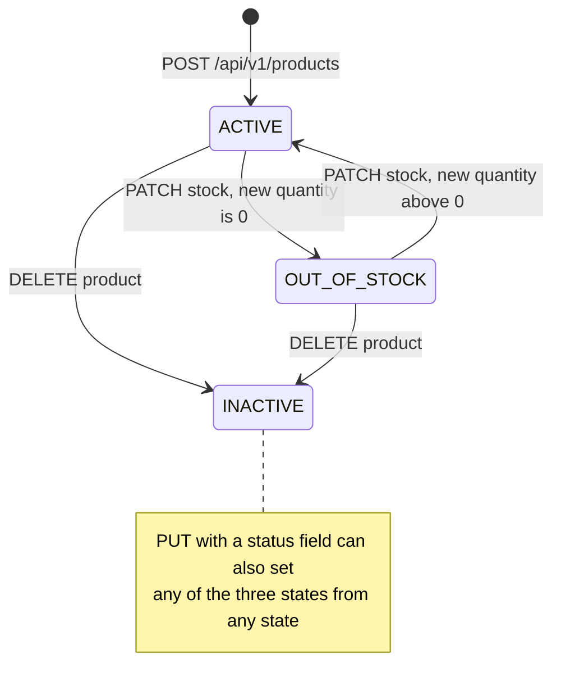
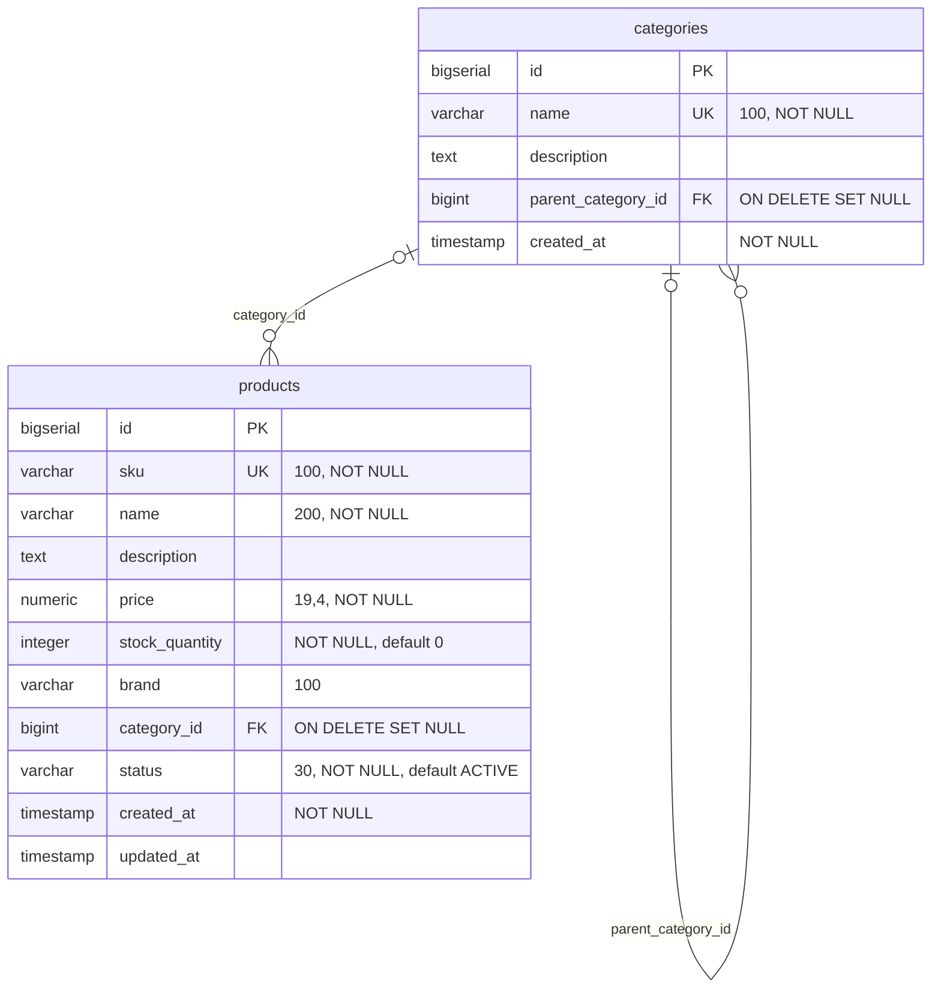

# Product Service

product-service is the system of record for products and categories. It owns each product's SKU, name, description, price, stock quantity, brand, category and status, and it is the stock ledger the rest of the platform adjusts: order-service reserves and restores stock through `PATCH /api/v1/products/{id}/stock`. The storefront reads products from this service directly (the frontend does not use catalog-service), and order-, catalog- and review-service look products up here over Feign. It is a leaf service: it calls no other service and does not use Kafka. Its data lives in the PostgreSQL database `productdb`.

| | |
|---|---|
| Repository | `ecommerce-product-service` |
| Stack | Java 25 · Spring Boot 4.0.9 · Spring MVC · Spring Data JPA (Hibernate) · Bean Validation · Flyway · Lombok · Jackson 3 · springdoc-openapi 2.8.5 · Eureka client · Micrometer + OpenTelemetry |
| Port | 8082 |
| Eureka service ID | `product-service` |
| Gateway routes | `/api/v1/products/**`, `/api/v1/categories/**` (GET is public, every other method needs an `ADMIN` JWT). `/internal/v1/products/**` is not routed |
| Data store | PostgreSQL 16 `productdb` (Flyway `V1`, `V2`; Hibernate `ddl-auto: validate`) |
| Publishes | — |
| Consumes | — |
| Calls | — |
| Called by | order-service, catalog-service, review-service (Feign through Eureka); the frontend through the gateway |

## Responsibilities

- Create, update and soft-delete products; look them up by id or by SKU.
- List, search (by name) and filter by category the products whose status is `ACTIVE`, with paging and sorting on all three endpoints.
- Keep stock: apply relative adjustments (`delta`), refuse to go below zero, and switch the status between `ACTIVE` and `OUT_OF_STOCK` as stock reaches or leaves zero.
- Create and list categories (a flat list in which each category may point at a parent).
- Provide the HTTP contract that order-, catalog- and review-service pin with Pact.

Not present in the code: stock holds (a reservation is an immediate decrement), price history, change events, category update or delete, images.

## Domain model

### Product

Entity `model/Product.java`, table `products`, exposed as `dto/ProductDTO.java`.

| Field | Java type | JSON type | Column | Notes |
|---|---|---|---|---|
| `id` | `Long` | number | `id BIGSERIAL` PK | Generated by the database (`IDENTITY`). |
| `sku` | `String` | string | `sku VARCHAR(100) UNIQUE NOT NULL` | Set on create only; `UpdateProductRequest` has no `sku`. Compared case-sensitively. |
| `name` | `String` | string | `name VARCHAR(200) NOT NULL` | |
| `description` | `String` | string or null | `description TEXT` | At most 5000 characters on create and update (`@Size(max = 5000)`), because every list response carries it. |
| `price` | `BigDecimal` | number | `price NUMERIC(19,4) NOT NULL` | Read back with four decimals, e.g. `49.9900`. |
| `stockQuantity` | `Integer` | integer | `stock_quantity INTEGER NOT NULL DEFAULT 0` | Changed only by the stock endpoint after creation. |
| `brand` | `String` | string or null | `brand VARCHAR(100)` | |
| `categoryId` | `Long` | number or null | `category_id BIGINT` FK to `categories(id)` `ON DELETE SET NULL` | A plain id in the entity, not a JPA relation. |
| `status` | `ProductStatus` | string | `status VARCHAR(30) NOT NULL DEFAULT 'ACTIVE'` | Stored by name (`EnumType.STRING`); `ProductDTO.status` is a `String`. |
| `createdAt` | `LocalDateTime` | string | `created_at TIMESTAMP NOT NULL` | Set by the JVM when the entity is built. |
| `updatedAt` | `LocalDateTime` | string or null | `updated_at TIMESTAMP` | `null` until the first update, then set on every update (explicitly and by `@PreUpdate`). |

### Category

Entity `model/Category.java`, table `categories`, exposed as `dto/CategoryDTO.java`.

| Field | Java type | JSON type | Column | Notes |
|---|---|---|---|---|
| `id` | `Long` | number | `id BIGSERIAL` PK | |
| `name` | `String` | string | `name VARCHAR(100) UNIQUE NOT NULL` | Unique, case-sensitive. |
| `description` | `String` | string or null | `description TEXT` | At most 5000 characters on create (`@Size(max = 5000)`). |
| `parentCategoryId` | `Long` | number or null | `parent_category_id BIGINT` FK to `categories(id)` `ON DELETE SET NULL` | Parent pointer. The API never returns a tree. |
| `createdAt` | `LocalDateTime` | string | `created_at TIMESTAMP NOT NULL` | Set by the JVM. |

Categories cannot be updated or deleted through the API.

### ProductStatus

`model/ProductStatus.java`.

| Value | Meaning | Set by |
|---|---|---|
| `ACTIVE` | Sellable. The only status that the list, search and by-category endpoints return. | `createProduct()` (always, even with `stockQuantity` 0); `updateStock()` when stock leaves 0 on an `OUT_OF_STOCK` product; `PUT` with `"status": "ACTIVE"`. |
| `OUT_OF_STOCK` | Stock is 0. Hidden from list, search and by-category; still returned by id and SKU. | `updateStock()` when the new quantity is 0 on an `ACTIVE` product; `PUT`. |
| `INACTIVE` | Soft-deleted. Hidden from list, search and by-category; returned by id and SKU to an `ADMIN` only, a 404 for everyone else. | `deleteProduct()`; `PUT`. |

### Product lifecycle

`updateStock()` never changes the status of an `INACTIVE` product (rule 4): draining or restocking a soft-deleted product leaves it `INACTIVE`.

## Business rules

1. **SKU is unique.** `ProductService.createProduct()` checks `existsBySku` and answers 409 `Product with SKU already exists: <sku>`. The `UNIQUE` constraint on `products.sku` is the backstop: two concurrent creates with the same SKU both pass the check, and the loser fails on the constraint with a `DataIntegrityViolationException`, which `GlobalExceptionHandler` answers 409 `Resource already exists`. The comparison is exact (case-sensitive). The SKU cannot be changed after creation.
2. **A referenced category must exist.** `createProduct()` and `updateProduct()` load `categoryId` when it is given and answer 404 `Category not found: <id>`.
3. **New products start `ACTIVE`** whatever their initial stock (`createProduct()`), so a product created with `stockQuantity: 0` is listed as `ACTIVE` until its stock is first adjusted.
4. **Stock moves only by delta.** `ProductService.updateStock(id, delta)` computes `current + delta` in `long`:
   - a negative result throws `InsufficientStockException`, returned as 400 `Insufficient stock for product <sku>. Available: <current>, Requested: <-delta>`; nothing is written;
   - a result above `Integer.MAX_VALUE` is 400 `Stock quantity out of range`; nothing is written;
   - a result of 0 sets an `ACTIVE` product to `OUT_OF_STOCK`;
   - a result above 0 on an `OUT_OF_STOCK` product sets it back to `ACTIVE`; an `INACTIVE` product keeps its status whatever the stock;
   - `updatedAt` is set, the change is logged (`Stock updated for product <sku>: <old> -> <new>`), and the whole product is returned.

   A positive delta adds stock (restock, order cancellation), a negative delta removes it (order reservation). `delta: 0` is accepted and only re-evaluates the status. The delta itself is any `int`; the `long` sum cannot wrap around, so an extreme delta is reported as insufficient stock or as out of range, never as a wrong quantity.
5. **A stock change locks the product row, for a bounded time.** `updateStock()` is a read-modify-write inside one `@Transactional` method, and it reads the product through `ProductRepository.findByIdForUpdate()`: `@Lock(PESSIMISTIC_WRITE)`, which Hibernate renders on PostgreSQL as `SELECT ... FOR NO KEY UPDATE`, with the query hint `jakarta.persistence.lock.timeout` set to 5000. Hibernate 7.2 turns the hint into `set local lock_timeout = 5000` for the transaction. Concurrent adjustments of one product therefore run one after the other, each reading the quantity the previous one committed, so reservations cannot oversell and restorations are not lost (the same path serves `PATCH /api/v1/products/{id}/stock` and `PATCH /internal/v1/products/{id}/stock`). A caller that cannot get the lock within 5 s, for example because an admin's session holds the row, gets 503 `Service temporarily unavailable` and the stock is untouched; without the timeout every waiting buyer would pin a pooled connection until the pool was gone. There is still no `@Version` column, no atomic `UPDATE ... SET stock_quantity = stock_quantity + ?` and no `CHECK` constraint, and `updateProduct()` takes no lock: because Hibernate's `UPDATE` writes every column, a concurrent `PUT` (name, price and so on) can write back a stale `stock_quantity`. A stock adjustment is also not idempotent (see Known issues).
6. **Delete is a soft delete.** `deleteProduct()` sets `INACTIVE` and returns 204. Rows are never removed, and deleting an `INACTIVE` product again also returns 204. There is no hard-delete endpoint.
7. **Visibility depends on the endpoint.** `getAllProducts()`, `searchProducts()` and `getProductsByCategory()` return only `ACTIVE` products, so sold-out and soft-deleted products disappear from them. `getProductById()` and `getProductBySku()` return any status, but the controller turns an `INACTIVE` product into a 404 for every caller except an `ADMIN` (`ProductController.visibleTo()`). order-, review- and catalog-service send no identity, so they see sold-out products and get a 404 for a soft-deleted one. None of them reads `status` (order-service does reject sold-out products, but only through its own `stockQuantity` comparison).
8. **PUT is a partial update.** `updateProduct()` applies each non-null field of `UpdateProductRequest` (`name`, `description`, `price`, `brand`, `categoryId`, `status`); a `null` or absent field means "leave unchanged", so no field can be cleared. `status` goes through `ProductStatus.valueOf()`: an unknown or lower-case value is 400 `Unknown product status: <value>`. The new status is not checked against the stock (an `INACTIVE` product can be reactivated, a product with stock 0 can be set `ACTIVE`). `sku` and `stockQuantity` are not part of the request; if a client sends them they are silently ignored.
9. **Category names are unique.** `createCategory()` checks `existsByName` and answers 409 `Category already exists: <name>` (it reuses `ProductAlreadyExistsException`). `parentCategoryId` is checked too: an unknown parent is 404 `Category not found: <id>`.
10. **The category filter is one level deep and paged.** `getProductsByCategory()` answers 404 `Category not found: <id>` for an unknown category; otherwise it returns one page of the `ACTIVE` products whose `category_id` equals the id (`findByCategoryIdAndStatus`: the status filter runs in SQL, so a big category is never loaded whole). `page`, `size` and `sort` work as on the list endpoint, but the default `size` is 100, which is also the maximum, and without `sort` the order is `id`. The response is still a JSON array, not a `Page`. Products of child categories are not included.
11. **Inputs and results are bounded.** `description` is at most 5000 characters on product create and update and on category create. The search text `q` is at most 200 characters (product names are at most 200, so a longer text can never match and would only cost a scan) and must not contain a NUL byte; otherwise 400 `Invalid value for parameter 'q'`. The list and search endpoints take `page`, `size` (at most 100) and `sort`, and are ordered by `id` when `sort` is absent, so page boundaries are stable. `GET /api/v1/categories` returns the first 1000 categories ordered by `id` (`ProductService.MAX_CATEGORIES`): it is the one list that callers read whole (catalog-service's sync), so it is bounded by design instead of paged.
12. **A database that does not answer is a 503, not a bug.** `exception/DependencyFailures` walks the cause chain of an exception and recognises the failures that mean the database did not answer: Hikari timing out after 5 s without a connection, a lock timeout (rule 5), a query timeout or a deadlock, a dead or frozen connection (connect and socket timeouts, a killed backend, a server shutting down), and a rollback or commit that fails because its connection died (a `TransactionException` or `TransactionSystemException` whose SQL cause has a SQLSTATE outside classes 22, 23 and 42, so a commit that fails because of the data stays what it was). `GlobalExceptionHandler.handleGeneral()` answers these with 503 `Service temporarily unavailable` and writes one WARN line per cause class per 10 s, with no stack trace and the root cause in the line. A unique-constraint violation stays 409. Any other unexpected exception is a 500 `An unexpected error occurred`, logged at ERROR with its stack trace (see [Observability](#observability)).

## API

| Method | Path | Gateway auth | Purpose |
|---|---|---|---|
| POST | `/api/v1/products` | `ADMIN` | Create a product |
| GET | `/api/v1/products` | Public | Page of `ACTIVE` products |
| GET | `/api/v1/products/{id}` | Public | Product by id (any status; `INACTIVE` only for an `ADMIN`) |
| GET | `/api/v1/products/sku/{sku}` | Public | Product by SKU (any status; `INACTIVE` only for an `ADMIN`) |
| GET | `/api/v1/products/search?q=` | Public | Page of `ACTIVE` products whose name contains `q` |
| GET | `/api/v1/products/category/{categoryId}` | Public | One page of the `ACTIVE` products of one category (list) |
| PUT | `/api/v1/products/{id}` | `ADMIN` | Partial update |
| PATCH | `/api/v1/products/{id}/stock` | `ADMIN` | Adjust stock by `delta` |
| PATCH | `/internal/v1/products/{id}/stock` | not routed | Same, for order-service (`InternalProductController`) |
| DELETE | `/api/v1/products/{id}` | `ADMIN` | Soft delete (`INACTIVE`) |
| POST | `/api/v1/categories` | `ADMIN` | Create a category |
| GET | `/api/v1/categories` | Public | Categories, at most 1000 (list) |
| GET | `/api/v1/categories/{id}` | Public | Category by id |

Writes check `X-User-Role` exactly `ADMIN` in the service as well (`@AdminOnly`). Full reference: [API reference](../api/product-service.md).

## Events

This service does not use Kafka. There is no `spring-kafka` dependency, and nothing is published when a product, a price or a stock level changes. Services that keep a copy of product data have to pull it; catalog-service in particular is refreshed only when someone calls its sync endpoint (see [catalog-service](catalog-service.md)).

## Outbound calls

None. product-service declares no Feign client and makes no HTTP calls.

### Inbound calls from other services

The three callers resolve `product-service` through Eureka and call it directly, not through the gateway, so their requests carry no JWT and no `X-User-*` headers.

| Caller | Client method | Request | When | Response fields the caller uses | Caller-side handling |
|---|---|---|---|---|---|
| order-service | `client/ProductServiceClient.getProductById()` | `GET /api/v1/products/{id}` | `OrderService.addItemToOrder()`, before the item is added | `sku`, `name`, `price`, `stockQuantity` (the pact also pins `id`) | Rejects the item if `stockQuantity < quantity`; copies `name` and `price` into the order item. Does not check `status`; a soft-deleted product is a 404 for it. |
| order-service | `ProductServiceClient.updateStock()` | `PATCH /api/v1/products/{id}/stock` with `{"delta": -quantity}` | `addItemToOrder()`, after its own stock pre-check | none (the pact pins `id`, `stockQuantity`) | A 400 from this service surfaces as `FeignException.BadRequest`. |
| order-service | `ProductServiceClient.updateStock()` | `PATCH /api/v1/products/{id}/stock` with `{"delta": quantity}`, once per item | `OrderService.cancelOrder()` | none | Failures are logged and skipped; the cancellation still completes, and that item's stock is not restored. |
| catalog-service | `client/ProductServiceClient.getProductById()` | `GET /api/v1/products/{id}` | `CatalogService.syncFromProductService()` | `sku`, `name`, `description`, `price`, `stockQuantity`, `brand`, `categoryId` (`id` and `status` must be present for the Kotlin DTO to decode) | A 404 here is a 404 from catalog-service, no answer from this service is a 503, any other failure a 502. |
| catalog-service | `ProductServiceClient.getAllCategories()` | `GET /api/v1/categories` | the same sync, right after the product | `id`, `name` | Skipped when the product has no category. Any failure is swallowed, and the entry keeps the category name it already has if its category is unchanged. |
| review-service | `client/ProductServiceClient.getProductById()` | `GET /api/v1/products/{id}` | `ReviewService.createReview()`, as an existence check | none (the pact pins `id`) | A 404 here is a 404 from review-service, no answer from this service is a 503, any other failure a 502. |

All three callers set Feign `connect-timeout: 2000` and `read-timeout: 10000` ms, register a retryer that repeats only connection failures (`config/FeignConfig` in each repository) and switch off Apache HttpClient 5's own automatic retries (it re-sent requests on a reset connection and on a 503), so a request that reached this service is never re-sent. That matters because a stock adjustment is not idempotent: a client that retries a `PATCH` after a read timeout applies the delta twice. Circuit breakers and fallbacks on the caller side are described in each caller's document.

The contract each caller relies on is pinned by Pact; see [Testing](#testing).

## Persistence

Flyway applies `src/main/resources/db/migration` at startup (`baseline-on-migrate: true`); Hibernate only validates the schema (`ddl-auto: validate`).

### `categories` (`V1__create_categories.sql`)

| Column | Type | Constraints |
|---|---|---|
| `id` | `BIGSERIAL` | PK |
| `name` | `VARCHAR(100)` | `UNIQUE`, `NOT NULL` |
| `description` | `TEXT` | |
| `parent_category_id` | `BIGINT` | FK to `categories(id)` `ON DELETE SET NULL` |
| `created_at` | `TIMESTAMP` | `NOT NULL`, `DEFAULT CURRENT_TIMESTAMP` |

Index: `idx_categories_parent (parent_category_id)`.

### `products` (`V2__create_products.sql`)

| Column | Type | Constraints |
|---|---|---|
| `id` | `BIGSERIAL` | PK |
| `sku` | `VARCHAR(100)` | `UNIQUE`, `NOT NULL` |
| `name` | `VARCHAR(200)` | `NOT NULL` |
| `description` | `TEXT` | |
| `price` | `NUMERIC(19,4)` | `NOT NULL` |
| `stock_quantity` | `INTEGER` | `NOT NULL`, `DEFAULT 0` |
| `brand` | `VARCHAR(100)` | |
| `category_id` | `BIGINT` | FK to `categories(id)` `ON DELETE SET NULL` |
| `status` | `VARCHAR(30)` | `NOT NULL`, `DEFAULT 'ACTIVE'` |
| `created_at` | `TIMESTAMP` | `NOT NULL`, `DEFAULT CURRENT_TIMESTAMP` |
| `updated_at` | `TIMESTAMP` | `DEFAULT CURRENT_TIMESTAMP` |

Indexes: `idx_products_sku (sku)`, `idx_products_category (category_id)`, `idx_products_status (status)`, `idx_products_name (name)`.

Where the entities and the migrations differ:

- The foreign keys exist only in the migrations. The entities hold `categoryId` and `parentCategoryId` as plain `Long`s, so under the `test` profile (H2, `ddl-auto: create-drop`, Flyway off) the schema is generated from the entities and has no foreign keys and none of the migration defaults. The H2-based tests therefore cannot see foreign-key failures or `ON DELETE SET NULL`; `ProductRepositoryIT` and `ProductApiIT` run the migrations on Postgres and do.
- `updated_at DEFAULT CURRENT_TIMESTAMP` never applies: Hibernate always lists the column in its `INSERT` and writes `null` until the first update. `created_at` likewise always comes from the JVM (`LocalDateTime.now()` when the entity is built), not from the column default.
- There are no `CHECK` constraints. `stock_quantity >= 0` and `price > 0` are enforced only by the application (`@Min` and `@DecimalMin` on create, the check in `updateStock()`).
- There is no version column for optimistic locking (see rule 5).
- `idx_products_sku` duplicates the index PostgreSQL already creates for the `UNIQUE` constraint. `idx_products_name` is a plain B-tree on `name`; the search query (`upper(name) like upper('%q%')`) cannot use it.
- `ON DELETE SET NULL` is reachable only through SQL, because no endpoint deletes a category.

## Security and identity

- **Gateway.** `GET` on `/api/v1/products...` and `/api/v1/categories...` is public. `POST`, `PUT`, `PATCH` and `DELETE` need a JWT whose role is exactly `ADMIN` (otherwise 403 at the edge); the gateway sets `X-Username`, `X-User-Id` and `X-User-Role`.
- **Service.** There is no Spring Security. `@AdminOnly` on the write endpoints is enforced by `security/AuthorizationInterceptor`: 401 `Authentication required` when both `X-Username` and `X-User-Role` are missing or blank, otherwise 403 `Access denied` unless `X-User-Role` is exactly `ADMIN`. A soft-deleted (`INACTIVE`) product is 404 by id or SKU for non-admins. `PATCH /internal/v1/products/{id}/stock` needs no identity and is never routed by the gateway. `smoke-test.sh` logs in as the admin from `.env` for its writes. The frontend's client-side role check (`src/routes/AdminRoute.tsx`) is only a convenience.
- **Why it matters.** order-service copies `price` into the order item when an item is added, so only admins can re-price or restock.
- **Bypassing the gateway.** docker-compose publishes port 8082 on the host, so any endpoint, including `/internal/**`, can be called at `http://localhost:8082` with forged identity headers or none.
- **Request size.** `filter/RequestSizeLimitFilter` caps a request body at 1 MB (`http.max-request-body-bytes`, default 1048576), because a body is read into memory before any validation runs and a service reachable without the gateway's own size limit (a published port, another pod) would otherwise be exposed to a few large requests. A request that declares a `Content-Length` above the limit is answered 413 `{"status":413,"error":"Payload Too Large","message":"Request body too large"}` without reading anything. A body that declares no length (chunked) is cut off with an I/O error once it passes the limit, which the malformed-body handler answers as 400 `Malformed request body`.

## Configuration

From `src/main/resources/application.yaml`, plus what docker-compose and Kubernetes set.

| Property | Env var | Default | Purpose |
|---|---|---|---|
| `server.port` | — | `8082` | HTTP port. |
| `spring.application.name` | — | `product-service` | Eureka service ID, metric tag. |
| `spring.datasource.url` | `SPRING_DATASOURCE_URL` | `jdbc:postgresql://localhost:5433/productdb` | compose and k8s set `jdbc:postgresql://productdb:5432/productdb`. |
| `spring.datasource.username` | `DB_USERNAME` | `productuser` | k8s takes it from secret `productdb-credentials`. |
| `spring.datasource.password` | `DB_PASSWORD` | `productpass` | k8s takes it from secret `productdb-credentials`. |
| `spring.jpa.hibernate.ddl-auto` | — | `validate` | Flyway owns the schema. |
| `spring.jpa.open-in-view` | — | `false` | Controllers only touch DTOs built inside the services' transactions, so a connection is held only while a transaction runs, not until the response is written. |
| `spring.datasource.hikari.connection-timeout` | — | `5000` | A request waits at most 5 s for a pooled connection (Hikari's default is 30 s), then fails with a 503. |
| `spring.datasource.hikari.data-source-properties.*` | — | `connectTimeout` 5, `socketTimeout` 30 (seconds), `tcpKeepAlive` true | pgjdbc has no socket timeout by default, so a database that stops answering (dropped packets, a frozen host, a failover without a reset) would hold a request thread for minutes. |
| `spring.flyway.enabled` / `locations` / `baseline-on-migrate` | — | `true` / `classpath:db/migration` / `true` | Migrations at startup. |
| `eureka.client.service-url.defaultZone` | `EUREKA_CLIENT_SERVICEURL_DEFAULTZONE` | `http://localhost:8761/eureka/` | compose and k8s: `http://service-discovery:8761/eureka/`. |
| `eureka.client.registry-fetch-interval-seconds` | — | `5` | Faster view of replaced peers (default 30). |
| `eureka.instance.prefer-ip-address` | `EUREKA_INSTANCE_PREFER_IP_ADDRESS` (k8s) | `true` | Register the pod IP, which other pods can dial. |
| `eureka.instance.lease-renewal-interval-in-seconds` / `lease-expiration-duration-in-seconds` | — | `5` / `15` | A crashed instance leaves the registry in about 20 s. |
| `management.endpoints.web.exposure.include` | — | `health,info,metrics,prometheus,circuitbreakers,serviceregistry` | `circuitbreakers` has no effect here (no resilience4j on the classpath). |
| `management.endpoint.health.show-details` | — | `never` | |
| `management.endpoint.health.probes.enabled` | `MANAGEMENT_ENDPOINT_HEALTH_PROBES_ENABLED` (k8s) | unset | k8s sets `true` for `/actuator/health/liveness` and `/readiness`. |
| `management.metrics.tags.environment` | `ENVIRONMENT` | `development` | Common tag (with `application`). |
| `management.tracing.sampling.probability` | `TRACING_SAMPLING_PROBABILITY` | `1.0` | Trace every request. |
| `management.opentelemetry.tracing.export.otlp.endpoint` | `OTEL_EXPORTER_OTLP_ENDPOINT` (base) | `http://tempo:4318` + `/v1/traces` | Trace export to Tempo. |
| `management.otlp.metrics.export.enabled` | — | `false` | Metrics are scraped, not pushed. |
| `springdoc.api-docs.path` / `swagger-ui.path` | — | `/api-docs` / `/swagger-ui.html` | OpenAPI. |
| `logging.pattern.console` | — | `%d{yyyy-MM-dd HH:mm:ss} [%thread] [%X{correlationId:-}] [%X{traceId:-}] %-5level %logger{36} - %msg%n` | The same pattern in every Java service. |
| `logging.level.com.ecommerce` | `LOGGING_LEVEL_COM_ECOMMERCE` | `INFO` | Set to `DEBUG` for a diagnosis. |
| `logging.level.org.hibernate.orm.jdbc.error` | — | `OFF` | Hibernate wrote two unthrottled lines (WARN and ERROR) for every failed JDBC call; `GlobalExceptionHandler`'s throttled line carries the cause. |
| `logging.level.org.springframework.transaction.interceptor.TransactionInterceptor` | — | `OFF` | It logged "Application exception overridden by rollback exception" with a stack trace of several hundred lines for every transaction in flight when its connection died. |
| `spring.data.web.pageable.max-page-size` | — | `2147483647` | Spring's own clamp is lifted so that `PageLimits` can answer 400 for a size over 100. The defaults come from `@PageableDefault`: size 20 sorted by `id` on the list and search endpoints, size 100 sorted by `id` on the category endpoint. `serialization-mode` is not set (`direct`). |
| `spring.jackson.deserialization.accept-float-as-int` | — | `false` | A fractional number for an integer field is a 400, not a silent truncation. Otherwise Jackson 3 defaults: ISO-8601 dates, unknown properties ignored. |
| `http.max-request-body-bytes` | — | `1048576` | Largest request body; the default is in `RequestSizeLimitFilter`, not in `application.yaml`. |
| `JAVA_OPTS` | `JAVA_OPTS` | `-XX:MaxRAMPercentage=55 -XX:ActiveProcessorCount=2 -XX:+ExitOnOutOfMemoryError` (compose and k8s) | Read by the Dockerfile entrypoint. |

Profile `test` (`src/main/resources/application-test.yaml`, packaged into the jar): H2 in memory, `ddl-auto: create-drop`, Flyway off, Eureka client off.

Runtime: compose `mem_limit: 768m`, healthcheck `wget http://localhost:8082/actuator/health` (start period 90 s). Kubernetes: one replica, requests 100m CPU / 320Mi, limit 768Mi, startup and readiness probes on `/actuator/health/readiness`, liveness on `/actuator/health/liveness`, init containers that wait for `service-discovery:8761` and `productdb:5432`, and a `preStop` hook that posts `OUT_OF_SERVICE` to `/actuator/serviceregistry` and sleeps 15 s so peers stop routing to the pod before Boot's graceful shutdown (`terminationGracePeriodSeconds: 60`).

## Observability

- **Actuator.** `/actuator/health` (status only, `show-details: never`; liveness and readiness groups in Kubernetes), `/actuator/info`, `/actuator/metrics`, `/actuator/prometheus` (unrestricted), `/actuator/serviceregistry` (used by the Kubernetes `preStop` hook).
- **Metrics.** Only Boot's auto-configured meters; the code registers none of its own. `http.server.requests` has a percentile histogram and SLO buckets at 50 ms, 100 ms, 200 ms, 500 ms, 1 s and 2 s. Every meter carries `application=product-service` and `environment`. Prometheus scrapes job `product-service` at `product-service:8082/actuator/prometheus`; productdb is covered by `postgres-exporter-productdb`.
- **Logs.** The console pattern carries the thread, the correlation id and the trace id, and `com.ecommerce` logs at INFO. Informational lines: `Product created: SKU=<sku>`, `Stock updated for product <sku>: <old> -> <new>`, `Product soft-deleted: <sku>`; the SKU goes through `util/LogSanitizer` (control characters become `_`, at most 256 characters), so a client cannot forge a log line. A request that ends in the catch-all handler as a bug logs `Unhandled exception on <method> <uri> (correlationId=<id>)` at ERROR with the stack trace, at most once per failure site (exception class plus the first stack frame in application code) per 10 s (`logging/LogThrottle`); the next line written for that failure ends in `(N similar suppressed)`. A database that does not answer (rule 12) logs one WARN, `Dependency unavailable on <method> <uri> (correlationId=<id>): <cause>; root cause: <root cause>`, per cause class per 10 s, with no stack trace. A flood of failing requests therefore costs a handful of lines, not one or more per request.
- **Correlation id.** `filter/CorrelationIdFilter` takes `X-Correlation-Id` from the request (or a random UUID when it is missing or does not match `^[A-Za-z0-9._-]{1,64}$`), puts it in the MDC as `correlationId`, echoes it on the response, and `ErrorResponse.correlationId` carries it. Neither the gateway nor the Feign callers set the header, so a request normally gets a fresh id in every service it passes through.
- **Tracing.** Micrometer tracing with OTLP export to Tempo, sampling probability 1.0 unless overridden.

## Testing

| Class | Kind | What it covers |
|---|---|---|
| `service/ProductServiceTest` | Mockito unit | products and categories: create (success, duplicate SKU), get, update, search, paging, stock changes (decrement, insufficient stock, to zero sets `OUT_OF_STOCK`, a sum beyond the `int` range is refused, an `INACTIVE` product keeps its status), one SQL-filtered page per category, the 1000-category cap, soft delete sets `INACTIVE` |
| `controller/ProductControllerTest`, `controller/CategoryControllerTest` | `@WebMvcTest` with a mocked service | status codes, validation and error bodies of both controllers; default sort by `id`, the page limits of the list, search and category endpoints, the 200-character search text limit, the 1 MB body limit |
| `exception/GlobalExceptionHandlerTest`, `filter/CorrelationIdFilterTest` | unit | exception mappings, including 503 for a dependency failure and the throttled log lines (a dead database under load, a bug on a hot path, a unique-constraint race); the correlation ID |
| `exception/DependencyFailuresTest` | unit | which failures count as "the database did not answer" (pool, lock and query timeouts, SQLSTATEs, a dead connection, a rollback or commit that fails because the connection died) and which do not (unique violations, data errors, ordinary bugs) |
| `filter/RequestSizeLimitFilterTest` | unit | 413 for a declared length above the limit, a body without a declared length cut off at the limit, the limit is configurable |
| `logging/LogThrottleTest`, `util/LogSanitizerTest` | unit | one logged occurrence per key and window with the suppressed count, bounded key set, concurrent callers; control characters and length in logged values |
| `config/ProductionConfigTest` | unit | the packaged `application.yaml` as production reads it: Hikari wait 5 s, driver connect and socket timeouts, open-in-view off, INFO logging in one pattern with the two noisy loggers off |
| `contract/ProductServiceProviderPactTest` | Pact provider | starts the whole application on a random port with the `test` profile (H2) and replays every pact in `src/test/resources/pacts/`: order, catalog and review (Feign) and the frontend (11 interactions) |
| `integration/ProductRepositoryIT` | Testcontainers `postgres:16-alpine` | the real Flyway migrations; case-insensitive search that treats `LIKE` wildcards literally; paging; unique SKU and category name; **foreign keys** (unknown category, unknown parent, `ON DELETE SET NULL`); `numeric(19,4)` prices; defaults |
| `integration/ProductApiIT` | full app on a random port, Postgres | category, product, search, page and stock flow; error responses; 40 concurrent stock decrements; sequential decrements stop exactly at zero |
| `integration/ProductResilienceIT` | full app on a random port, Postgres | the Hikari wait and the driver timeouts are the configured ones; buyers queued behind a stuck row lock get 503 after about 5 s with one WARN line and the stock untouched, and the next buyer is served at once; a saturated pool answers 503 after the 5 s connection wait with one log line and recovers; a database backend killed in the middle of a transaction is a 503 without a rollback-override trace and the pool replaces the connection; no open-in-view; the category list is capped at 1000; a category's products come in pages of at most 100, `ACTIVE` only, in `id` order |

270 unit, slice and pact tests and 94 integration tests.

No tests are disabled for bugs any more; the `@Tag("security")` suite covers admin-only writes, injection, bounds and error bodies.

### Pact provider states and pinned interactions

The pact files are copied from the consumer repositories by `ecommerce-platform/sync-pacts.sh` (there is no broker). State names are part of the contract; the states are set up with SQL because consumers address products by id.

| State | Setup |
|---|---|
| `product 1 exists` | Deletes all products and categories, inserts category 10 `Electronics` ("Devices and accessories", no parent) and product 1: SKU `SKU-001`, `Wireless Mouse`, "Ergonomic wireless mouse", price 49.99, stock 50, brand `Logi`, category 10, `ACTIVE`. |
| `product 999 does not exist` | Deletes product 999. |
| `categories exist` | Replaces categories 10 `Electronics` and 11 `Accessories` (parent 10). |

| Consumer | Interaction | Request | Response the consumer relies on |
|---|---|---|---|
| order-service | a request for product 1 | `GET /api/v1/products/1` | 200; `id` integer, `name` string, `price` number, `sku` string, `stockQuantity` integer |
| order-service | a request to reserve 2 units of product 1 | `PATCH /api/v1/products/1/stock` `{"delta": -2}` | 200; `id`, `stockQuantity` integers |
| order-service | a request to restore 2 units of product 1 | `PATCH /api/v1/products/1/stock` `{"delta": 2}` | 200; `id`, `stockQuantity` integers |
| order-service | a request to reserve 1000 units of product 1 | `PATCH /api/v1/products/1/stock` `{"delta": -1000}` | 400; `status` integer, `error`, `message` strings |
| order-service | a request for product 999 | `GET /api/v1/products/999` | 404; `status`, `error`, `message` |
| catalog-service | a request for product 1 | `GET /api/v1/products/1` | 200; `id`, `sku`, `name`, `description`, `price` (number), `stockQuantity`, `brand`, `categoryId`, `status` |
| catalog-service | a request for all categories | `GET /api/v1/categories` | 200; array of at least one object with `id` (integer), `name`, `description` |
| catalog-service | a request for product 999 | `GET /api/v1/products/999` | 404; `status`, `error`, `message` |
| review-service | a request for product 1 | `GET /api/v1/products/1` | 200; `id` integer |
| review-service | a request for product 999 | `GET /api/v1/products/999` | 404; `status`, `error`, `message` |

The frontend's pact (`ecommerce-frontend-product-service.json`, 11 interactions) adds the paged list, product by id and 404, search, the category filter, the category list, and the admin create, update, stock, delete and create-category calls. The test emulates the gateway: it decodes the bearer token and sets `X-Username`, `X-User-Id` and `X-User-Role`.

Every matcher checks a JSON type (`type`, `integer` or `number`), so the values in the pact are examples; a response passes as long as the listed fields exist with the right types. Extra fields are allowed, which also means the pacts do not prove that the consumers tolerate the extra fields product-service sends (they do, because Jackson 3 ignores unknown properties).

CI (`.circleci/config.yml`) runs `mvn -B -ntp verify` in `cimg/openjdk:25.0`, which includes the Pact verification.

## Code map

Paths are relative to `src/main/java/com/ecommerce/product/` unless stated.

| Path | Role |
|---|---|
| `ProductServiceApplication.java` | Boot entry point. |
| `config/OpenApiConfig.java` | OpenAPI title and a global `bearerAuth` scheme (documentation only). |
| `controller/ProductController.java` | `/api/v1/products` endpoints. |
| `controller/CategoryController.java` | `/api/v1/categories` endpoints; delegates to `ProductService`. |
| `service/ProductService.java` | All business logic for products and categories, and the entity-to-DTO mapping. |
| `repository/ProductRepository.java`, `repository/CategoryRepository.java` | Spring Data JPA repositories (derived queries, and `findByIdForUpdate` with the row lock and its 5 s timeout). |
| `model/Product.java`, `model/Category.java`, `model/ProductStatus.java` | Entities and the status enum. |
| `dto/` | `ProductDTO`, `CategoryDTO`, `CreateProductRequest`, `UpdateProductRequest`, `StockUpdateRequest`, `CreateCategoryRequest`. |
| `exception/` | Domain exceptions, `ErrorResponse`, `GlobalExceptionHandler`, and `DependencyFailures` (which failures mean the database did not answer, rule 12). |
| `filter/CorrelationIdFilter.java` | `X-Correlation-Id` to MDC and response header. |
| `filter/RequestSizeLimitFilter.java` | 413 for a request body above 1 MB. |
| `logging/LogThrottle.java` | Bounds how often one kind of log line is written. |
| `util/LogSanitizer.java` | Makes client-supplied text safe for a log line. |
| `src/main/resources/db/migration/` | Flyway `V1__create_categories.sql`, `V2__create_products.sql`. |
| `docker/Dockerfile` | Runtime image: `eclipse-temurin:25-jre-alpine`, copies the jar built on the host, runs as a non-root user. |

## Known issues and limitations

| Issue | Where | Impact | Severity |
|---|---|---|---|
| ~~No authorization on any write endpoint~~ | fixed | Writes are `@AdminOnly` (401/403); the gateway refuses non-admins too. Port 8082 still skips the gateway in compose. | — |
| ~~Stock adjustment is an unlocked read-modify-write~~ | fixed | `updateStock()` takes a row lock (`findByIdForUpdate`) with a 5 s lock timeout, so concurrent adjustments serialize; a lock timeout is a 503 and the stock is untouched (rule 5). | — |
| A stock delta is not idempotent. | `ProductService.updateStock()`; `PATCH /api/v1/products/{id}/stock` and `/internal/v1/products/{id}/stock` | A 503 after a failed commit or a lost response does not say whether the delta was applied, and a client that repeats it applies it twice. A fix needs an `Idempotency-Key` and a table of keys already applied, which changes the contract with order-service. | Medium |
| Full-row `UPDATE` without a version column. | `ProductService.updateProduct()` vs `updateStock()` | A `PUT` that overlaps a stock change can write back the old `stock_quantity`. | Medium |
| ~~A soft-deleted product is not protected~~ | fixed | `updateStock()` leaves `INACTIVE` as it is, and by id or SKU a soft-deleted product is a 404 for everyone but an `ADMIN`, so order-service cannot add it to an order. Its stock can still be adjusted by a direct `PATCH`. | — |
| Sold-out and soft-deleted products vanish from `GET /api/v1/products`, and no endpoint lists them. The admin product table uses that endpoint. | `ProductService.getAllProducts()`; frontend `pages/admin/AdminProductsPage.tsx` | Once a product sells out an admin cannot find it in the UI to restock it. | Medium |
| The admin edit form sends `sku` and `stockQuantity` in the `PUT` body; `UpdateProductRequest` has neither, and Jackson 3 ignores unknown properties. | frontend `AdminProductsPage.handleEdit()`; `dto/UpdateProductRequest.java` | SKU and stock edits report success but are dropped. | Medium |
| ~~Client errors reported as 500~~ | fixed | Bad status, category, sort property, content type, `Accept` and unmapped paths are 400/404/406/415; unique races are 409; messages are fixed strings. | — |
| Products are created `ACTIVE` even with `stockQuantity` 0. | `ProductService.createProduct()` | A sold-out product can be listed until its stock is first adjusted. | Low |
| `updatedAt` is `null` until the first update; the frontend type declares it as a non-optional string. | `model/Product.java`; frontend `src/types/index.ts` | UI code that formats `updatedAt` gets `null`. | Low |
| Search matches only `name` with `upper(name) like '%q%'`; the `idx_products_name` B-tree cannot serve it, and `idx_products_sku` duplicates the unique index. | `ProductRepository.findByNameContainingIgnoreCaseAndStatus()`; `V2__create_products.sql` | Sequential scans for every search; one redundant index to maintain. | Low |
| Page responses use Spring Data's DIRECT `PageImpl` serialization, which Spring Data itself flags (one-time WARN) as not a stable JSON contract. | `ProductController.getAllProducts()`, `searchProducts()` | A Spring Data upgrade can change the page JSON the frontend reads. | Low |
| Plain `UPDATE` and `DELETE` statements carry no `lock_timeout`; only the stock lock query sets one. | `ProductService.updateProduct()`, `deleteProduct()` | A `PUT` or a soft delete that waits for a row another transaction holds is bounded only by the 30 s socket timeout. | Low |
| A Flyway migration that runs longer than 30 s would hit the driver's socket timeout. | `application.yaml` (`socketTimeout: 30`), `db/migration/` | A future large migration (an index build, a backfill on a big table) would be cut off at startup unless the timeout is raised for that run. | Low |
| Dead code and configuration: `CategoryRepository.findByName()`, the list overloads `ProductRepository.findByStatus(ProductStatus)` and `findByCategoryId(Long)` (only tests call them), the `circuitbreakers` actuator exposure, and the `test` profile shipped inside the production jar. | `pom.xml`, `repository/`, `application.yaml`, `src/main/resources/application-test.yaml` | Noise; no runtime effect. | Low |
