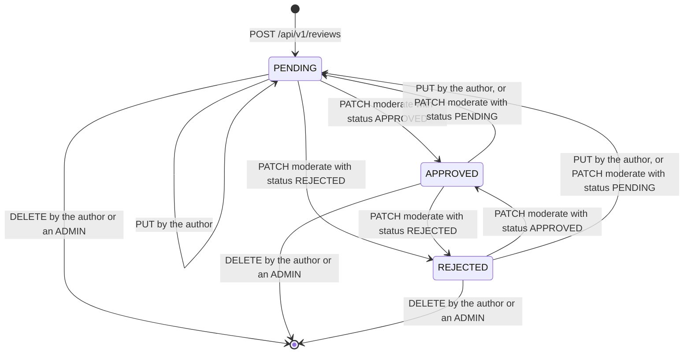
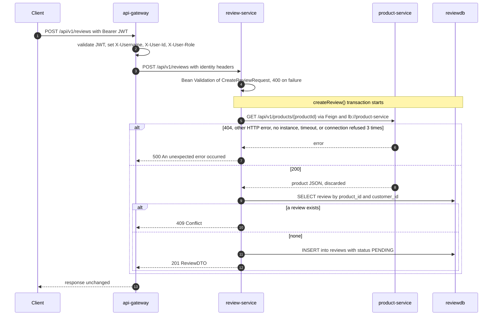
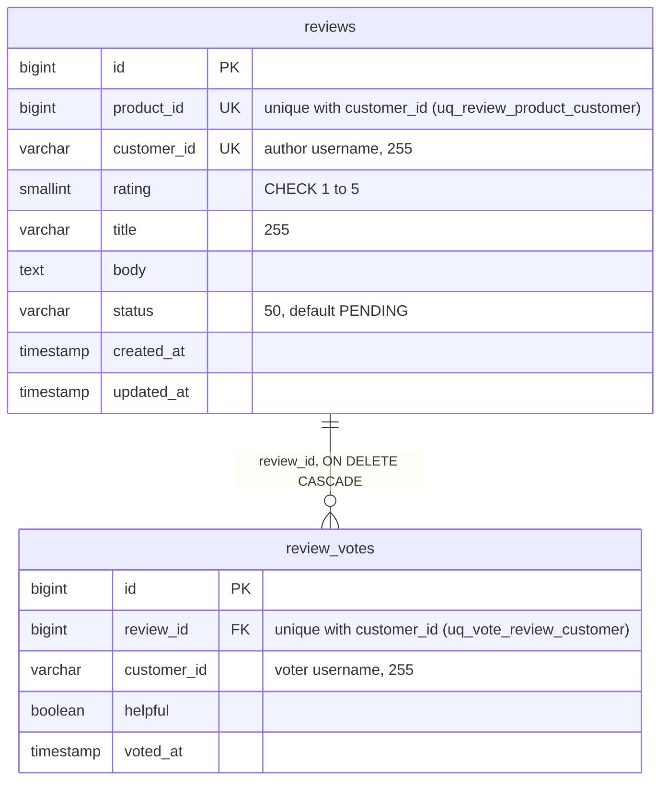

# Review service

review-service stores product reviews and the helpful/unhelpful votes on them.
It runs every review through a moderation status (`PENDING`, `APPROVED`,
`REJECTED`) and computes the per-product rating summary the storefront shows.
It owns the `reviewdb` PostgreSQL database (`reviews`, `review_votes`). Its one
dependency is product-service, which it asks over Feign whether a product exists
before it stores a review. It neither publishes nor consumes events.

| | |
|---|---|
| Repository | `ecommerce-review-service` |
| Stack | Java 25 · Spring Boot 4.0.1 · Spring MVC · Spring Data JPA (Hibernate 7.2) · Flyway 11 · Spring Cloud 2025.1.1 (OpenFeign 5.0.1 on Apache HttpClient 5, LoadBalancer, Eureka client) · springdoc 2.8.5 · Lombok. The resilience4j circuit-breaker starter is on the classpath but not wired to anything (see [Outbound calls](#outbound-calls)). |
| Port | 8087 |
| Eureka service ID | `review-service` |
| Gateway routes | `/api/v1/reviews/**`; `/api-docs/review-service` (rewritten to `/api-docs`) for the gateway's Swagger UI |
| Data store | PostgreSQL 16 `reviewdb` (Flyway). Compose publishes it on host port 5438. |
| Publishes | — |
| Consumes | — |
| Calls | `product-service` (Feign): `GET /api/v1/products/{id}` |
| Called by | api-gateway only. The frontend reaches it through the gateway (product detail page, review cards, admin review moderation page). No other service calls it. |

## Responsibilities

- Create a review for an existing product: one per user per product, a rating from 1 to 5, a title and a body. New reviews start as `PENDING`.
- Serve reviews by ID, by product (approved only by default) and by author.
- Let the author edit their review. Any edit sends it back to `PENDING`.
- Let the author or an admin delete a review.
- Change a review's moderation status. This is meant to be an admin operation, but nothing enforces that (see [Security and identity](#security-and-identity)).
- Record one helpful/unhelpful vote per user per review, and return the vote counts with every review.
- Compute a product's average rating and its 1–5 distribution over approved reviews.

Things it does **not** do: verify that the reviewer bought the product (there is
no call to order-service and no "verified purchase" flag), check the product's
status, react to a product being deleted (it consumes no events, so the reviews
stay), or tell anyone that a review was created or approved (it publishes no
events).

## Domain model

### Review

`model/Review.java`, table `reviews`. Returned to clients as `ReviewDTO`.

| Field | Java type | JSON in `ReviewDTO` | Notes |
|---|---|---|---|
| `id` | `Long` | number | identity column |
| `productId` | `Long` | number | product-service's product ID. Checked for existence only when the review is created. Not a foreign key, because the product lives in another database. |
| `customerId` | `String` | string | The author's **username**, taken from `X-Username`. It is not the numeric user ID; `X-User-Id` is never read. |
| `rating` | `Short` | integer | 1 to 5 |
| `title` | `String` | string | 3 to 255 characters |
| `body` | `String` | string | 10 to 2000 characters (`TEXT` column) |
| `status` | `ReviewStatus` | string | `PENDING` on creation |
| `votes` | `List<ReviewVote>` | not exposed; see `helpfulVotes` / `unhelpfulVotes` | `@OneToMany(mappedBy = "review", cascade = ALL, orphanRemoval = true)`, lazy |
| `createdAt` | `LocalDateTime` | ISO-8601 string, no offset | Set in Java when the object is built (`@Builder.Default LocalDateTime.now()`). `updatable = false`. |
| `updatedAt` | `LocalDateTime` | ISO-8601 string, no offset | Set by `updateReview()` and `moderateReview()`. Voting does not touch it. |

`ReviewDTO` adds two computed fields, `helpfulVotes` and `unhelpfulVotes`
(`long`). `ReviewService.toDTO()` counts the review's votes with `helpful = true`
and `helpful = false` every time a review is returned.

### ReviewVote

`model/ReviewVote.java`, table `review_votes`. Votes are never returned one by
one. Clients only see the counts on `ReviewDTO`.

| Field | Java type | Notes |
|---|---|---|
| `id` | `Long` | identity column |
| `review` | `Review` | `@ManyToOne(fetch = LAZY)`, column `review_id` |
| `customerId` | `String` | the voter's username (`X-Username`) |
| `helpful` | `Boolean` | `true` = helpful, `false` = not helpful |
| `votedAt` | `LocalDateTime` | set when the vote is first created; not updated when the vote is changed |

### ReviewStatus

| Value | Meaning |
|---|---|
| `PENDING` | New or edited. Hidden from the default product listing and left out of the summary's average and distribution. |
| `APPROVED` | Shown in the default product listing and counted in the summary. |
| `REJECTED` | Hidden from the default product listing and the summary. Still returned by ID, by author, and with `approvedOnly=false`. |

Every transition the code allows. Moderation accepts any target status from any
status, and an author's edit always lands in `PENDING`:

## Business rules

1. **The product must exist.** `ReviewService.createReview()` calls `ProductServiceClient.getProductById()` before anything else. Any exception from that call (404, any other HTTP error, no registered instance, timeout, refused connection) is replaced by `RuntimeException("Product <id> not found or product service unavailable")`. `GlobalExceptionHandler.handleGeneric()` turns that into a **500** with the message `An unexpected error occurred`. Only existence matters. The response body, including the product's `status`, is discarded.
2. **One review per user per product.** `createReview()` looks up `ReviewRepository.findByProductIdAndCustomerId()` and throws `DuplicateReviewException` (409) on a hit. The unique constraint `uq_review_product_customer` backs this up. Two concurrent requests can both pass the check; the second then fails on the constraint and returns 500, not 409.
3. **Rating is 1 to 5.** Enforced by `@Min(1) @Max(5)` on `CreateReviewRequest.rating` and `UpdateReviewRequest.rating`, and by the column's `CHECK (rating >= 1 AND rating <= 5)`.
4. **Title and body lengths.** On create, `@NotBlank` plus `@Size(min = 3, max = 255)` for the title and `@Size(min = 10, max = 2000)` for the body. On update there is only `@Size`, so a title of three spaces is accepted on update but not on create.
5. **New reviews start as `PENDING`.** Set in `createReview()`.
6. **Only the author can edit.** `ReviewService.updateReview()` compares the stored `customerId` with `X-Username` and throws `UnauthorizedReviewAccessException` (403) on a mismatch. Admins get no exemption. A `null` field leaves the stored value unchanged. Every update, even `{}`, which changes no field, sets `status = PENDING` (re-moderation) and `updatedAt = now`.
7. **The author or an admin can delete.** `ReviewService.deleteReview()` allows the call when `"ADMIN".equalsIgnoreCase(X-User-Role)` or when `X-Username` equals the author, and throws 403 otherwise. The review's votes go with it (JPA `cascade = ALL` and `ON DELETE CASCADE` in the schema).
8. **Moderation sets any status.** `ReviewService.moderateReview()` writes the requested status and `updatedAt`. There is no role check and no transition rule; `APPROVED → PENDING` and `REJECTED → APPROVED` are as valid as `PENDING → APPROVED`.
9. **One vote per user per review.** `ReviewService.voteOnReview()` finds the caller's existing vote (`ReviewVoteRepository.findByReviewIdAndCustomerId()`) and overwrites its `helpful` flag, or inserts a new vote. The unique constraint `uq_vote_review_customer` backs this up; concurrent first votes by the same user can end in a 500. There is no rule against voting on your own review, no rule against voting on `PENDING` or `REJECTED` reviews, and no way to withdraw a vote.
10. **The default product listing shows approved reviews only.** `ReviewController.getByProduct()` defaults `approvedOnly` to `true`. With `false`, `ReviewService.getReviewsByProduct()` returns every status.
11. **Summary.** `ReviewService.getProductReviewSummary()`:
    - `averageRating` is the mean rating of `APPROVED` reviews, rounded half-up to one decimal (`Math.round(average * 10.0) / 10.0`), or `0.0` when there are none.
    - `ratingDistribution` counts `APPROVED` reviews per rating. Keys 1 to 5 are always present, with 0 for missing ratings.
    - `approvedReviews` is the number of `APPROVED` reviews.
    - `totalReviews` is the number of reviews of the product in **any** status, including `REJECTED`.
    - An unknown product ID returns all zeros. The product is not checked.

Creating a review, end to end:

## API

| Method | Path | Gateway auth | Purpose |
|---|---|---|---|
| `POST` | `/api/v1/reviews` | Bearer JWT | create a review (`PENDING`) |
| `GET` | `/api/v1/reviews/{id}` | Bearer JWT | one review, any status |
| `GET` | `/api/v1/reviews/product/{productId}` | public | a product's reviews; `approvedOnly` defaults to `true` |
| `GET` | `/api/v1/reviews/product/{productId}/summary` | public | average rating and distribution |
| `GET` | `/api/v1/reviews/customer/{customerId}` | Bearer JWT | all reviews by one username, any status |
| `PUT` | `/api/v1/reviews/{id}` | Bearer JWT | author edits; back to `PENDING` |
| `DELETE` | `/api/v1/reviews/{id}` | Bearer JWT | author or `ADMIN` deletes |
| `PATCH` | `/api/v1/reviews/{id}/moderate?status=` | Bearer JWT | set the status (no role check) |
| `POST` | `/api/v1/reviews/{id}/vote` | Bearer JWT | cast or change a helpful/unhelpful vote |

Full request and response details: [API reference](../api/review-service.md).

## Events

This service does not use Kafka. Creating, approving or deleting a review emits
nothing, and the service does not listen for product changes.

## Outbound calls

### product-service: `client/ProductServiceClient.java`

| | |
|---|---|
| Declaration | `@FeignClient(name = "product-service", fallback = ProductServiceClientFallback.class)` |
| Target | `lb://product-service`, resolved through Eureka by Spring Cloud LoadBalancer |
| Endpoint | `GET /api/v1/products/{id}`, decoded into `dto/ProductDTO` |
| When | at the start of every `ReviewService.createReview()`, before the duplicate check, inside the `@Transactional` method |
| Sent | the product ID in the path. No identity headers and no `X-Correlation-Id` are forwarded; there is no Feign `RequestInterceptor`. |
| Read | Nothing. A successful decode is the proof of existence. `ProductDTO` mirrors `id`, `sku`, `name`, `description`, `price`, `stockQuantity`, `brand`, `categoryId`, `status`. product-service also sends `createdAt` and `updatedAt`, which Jackson 3 ignores (`FAIL_ON_UNKNOWN_PROPERTIES` is off by default). |
| HTTP client | Apache HttpClient 5 (`feign-hc5`) |
| Timeouts | connect 2000 ms, read 10000 ms (`spring.cloud.openfeign.client.config.default`). The short connect timeout lets the retry move to the next instance quickly when a pod vanished mid-rollout. |
| Retries | `FeignConfig.ConnectionFailureRetryer(3, 100)`: at most 3 attempts in total, only when the cause is a `ConnectException` (this includes HttpClient 5's `HttpHostConnectException`) or a `ConnectTimeoutException`. Back-off is 100 ms, then 200 ms. The LoadBalancer picks an instance on every attempt. Read timeouts (`SocketTimeoutException`) and HTTP errors are not retried, because the request may have been processed. Spring Retry is not on the classpath, so there is no LoadBalancer-level retry on top. |
| Load balancer | `eager-load.clients: product-service`, so the instance list exists from startup (without it, the first call failed with "Load balancer does not contain an instance"). Instance cache TTL 5 s, Eureka registry fetch every 5 s. |
| Circuit breaker | **None in effect.** See below. |
| Fallback | **None in effect.** See below. |
| Error mapping | Every failure becomes HTTP 500 with the message `An unexpected error occurred` (rule 1). |

**Why the circuit breaker and fallback do nothing.** Spring Cloud OpenFeign wraps
a client in a circuit breaker, and only then uses its `fallback`, when
`spring.cloud.openfeign.circuitbreaker.enabled=true`. Its auto-configuration
(`FeignAutoConfiguration.CircuitBreakerPresentFeignTargeterConfiguration`) is
conditional on that property, which defaults to `false` and is set nowhere: not
in `application.yaml`, compose or the Kubernetes manifests. So:

- `ProductServiceClientFallback` is never invoked. It is still registered as a plain `@Component` implementing `ProductServiceClient`; injection picks the Feign proxy because `@FeignClient` beans are `primary` by default. Had it been active, it would only have thrown `RuntimeException("Product service unavailable - circuit breaker open")`, which ends in the same 500.
- The `resilience4j.circuitbreaker.instances.product-service` block in `application.yaml` (sliding window 10, minimum 5 calls, 50 % failure threshold, 10 s open) configures a breaker no code path uses. Even with the property switched on, OpenFeign would name the breaker `ProductServiceClientgetProductByIdLong` (alphanumeric IDs are on by default), not `product-service`.

**What a caller sees when product-service misbehaves:**

| product-service | What review-service does | Response to the client |
|---|---|---|
| answers 200 | continues with the duplicate check | 201, or 409 |
| answers 404 | `FeignException.NotFound`, wrapped | 500, immediately |
| answers another 4xx or 5xx | `FeignException`, wrapped | 500, immediately |
| has no registered instance | the LoadBalancer client returns a synthetic 503 ("Load balancer does not contain an instance for the service product-service"), wrapped | 500, immediately |
| refuses connections | 3 attempts (100 ms and 200 ms back-off), then wrapped | 500 after about 0.3 s |
| connect times out | 3 attempts of up to 2 s each, then wrapped | 500 after up to about 6.3 s |
| accepts but never answers | read timeout after 10 s, not retried, wrapped | 500 after about 10 s |

The Feign call runs inside `createReview()`'s transaction, so the database
transaction, and the pooled JDBC connection behind it, stays open for the whole
call: up to the times in the last column.

`config/FeignConfig.java` also replaces OpenFeign 5.0.1's `FeignHttpMessageConverters`
with `ThreadSafeFeignHttpMessageConverters`. The library publishes an empty
converter list before filling it. When the first Feign calls of a fresh JVM arrive
concurrently, a second thread can see the empty list and fail with
`DecodeException: 'messageConverters' must not be empty`. The subclass makes the
first initialisation mutually exclusive and keeps later reads lock-free. The
child Feign contexts see this parent bean (and the `Retryer`) and skip their own.

## Persistence

Two Flyway migrations in `src/main/resources/db/migration`. Hibernate runs with
`ddl-auto: validate`, so the schema comes only from Flyway and startup fails if
an entity and its table disagree on a column.

**`V1__create_reviews.sql`: `reviews`**

| Column | Type | Constraints |
|---|---|---|
| `id` | `BIGSERIAL` | primary key |
| `product_id` | `BIGINT` | not null |
| `customer_id` | `VARCHAR(255)` | not null. Holds the author's username. |
| `rating` | `SMALLINT` | not null, `CHECK (rating >= 1 AND rating <= 5)` |
| `title` | `VARCHAR(255)` | not null |
| `body` | `TEXT` | not null |
| `status` | `VARCHAR(50)` | not null, default `'PENDING'` |
| `created_at` | `TIMESTAMP` | not null, default `CURRENT_TIMESTAMP` |
| `updated_at` | `TIMESTAMP` | not null, default `CURRENT_TIMESTAMP` |

Constraint `uq_review_product_customer UNIQUE (product_id, customer_id)`.
Indexes `idx_reviews_product_id`, `idx_reviews_customer_id`, `idx_reviews_status`.

**`V2__create_review_votes.sql`: `review_votes`**

| Column | Type | Constraints |
|---|---|---|
| `id` | `BIGSERIAL` | primary key |
| `review_id` | `BIGINT` | not null, `REFERENCES reviews(id) ON DELETE CASCADE` |
| `customer_id` | `VARCHAR(255)` | not null. Holds the voter's username. |
| `helpful` | `BOOLEAN` | not null |
| `voted_at` | `TIMESTAMP` | not null, default `CURRENT_TIMESTAMP` |

Constraint `uq_vote_review_customer UNIQUE (review_id, customer_id)`. Index
`idx_review_votes_review_id`.

Where the entities and the migrations differ:

- The entities' `@UniqueConstraint`s are unnamed. The migrations name them. `validate` does not check constraints, so this is harmless.
- The database defaults for `status`, `created_at` and `updated_at` are never used, because the entities always supply values from Java.
- There is no trigger on `updated_at`. Only `updateReview()` and `moderateReview()` change it.
- `idx_reviews_product_id` and `idx_review_votes_review_id` duplicate the leading column of the two unique constraints' own indexes.
- The tests run on H2 with `ddl-auto: create-drop` and Flyway disabled (`src/test/resources/application-test.yaml`), so neither the migrations nor the `CHECK` constraint are exercised by any test.

## Security and identity

The service has no Spring Security and does not see the JWT. It trusts the
identity headers the gateway sets on authenticated routes:

| Header | Read by | Default when absent | Used for |
|---|---|---|---|
| `X-Username` | `createReview`, `updateReview`, `deleteReview`, `vote` in `ReviewController` | `anonymous` | the author (`customerId`) on create; the ownership check on update and delete; the voter |
| `X-User-Role` | `deleteReview` only | `CUSTOMER` | the admin override on delete |
| `X-User-Id` | nothing | — | sent by the gateway (and pinned by the gateway's pact) but ignored |

| Endpoint | Gateway | Service-side check |
|---|---|---|
| `POST /api/v1/reviews` | JWT | none; the author is `X-Username` |
| `GET /api/v1/reviews/{id}` | JWT | none; returns any status |
| `GET /api/v1/reviews/product/{productId}` | public | none; `approvedOnly=false` returns `PENDING` and `REJECTED` reviews to anyone |
| `GET /api/v1/reviews/product/{productId}/summary` | public | none |
| `GET /api/v1/reviews/customer/{customerId}` | JWT | none; any user can list anyone's reviews in any status |
| `PUT /api/v1/reviews/{id}` | JWT | `X-Username` must equal the author |
| `DELETE /api/v1/reviews/{id}` | JWT | author, or `X-User-Role` equal to `ADMIN` (case-insensitive) |
| `PATCH /api/v1/reviews/{id}/moderate` | JWT | **none**: any logged-in user can approve, reject or reset any review, including their own |
| `POST /api/v1/reviews/{id}/vote` | JWT | none |

Gaps:

- **Moderation is unprotected.** The `@Operation` summary says "(Admin)", but `ReviewController.moderate()` reads no header and `ReviewService.moderateReview()` checks nothing. The frontend hides the admin page from customers, but the API does not.
- **Header trust without the gateway.** Compose publishes port 8087 on the host. A direct call can send `X-User-Role: ADMIN` to delete any review, or another user's `X-Username` to edit their review. A call without headers acts as `anonymous` / `CUSTOMER`. In Kubernetes the Service is cluster-internal (ClusterIP), so only pods can do this.
- **Unmoderated content is publicly readable** through `approvedOnly=false`, which the frontend's admin page relies on.
- The actuator exposes `serviceregistry` and full health details without authentication, as on every service.

On the public `GET /api/v1/reviews/product/**` routes the gateway forwards any
client-supplied `X-User-*` headers untouched, but those two endpoints read none.

## Configuration

`src/main/resources/application.yaml`. Compose sets `SPRING_DATASOURCE_URL`,
`DB_USERNAME`, `DB_PASSWORD` and the shared `x-java-env` variables; Kubernetes
sets the same through `k8s/40-services.yaml`, the `reviewdb-credentials` Secret
and the `java-env` ConfigMap.

| Property | Env var | Default | Purpose |
|---|---|---|---|
| `server.port` | — | `8087` | |
| `spring.application.name` | — | `review-service` | Eureka service ID, metric tag |
| `spring.datasource.url` | `SPRING_DATASOURCE_URL` | `jdbc:postgresql://localhost:5438/reviewdb` | compose and k8s: `jdbc:postgresql://reviewdb:5432/reviewdb` |
| `spring.datasource.username` / `password` | `DB_USERNAME` / `DB_PASSWORD` | `reviewuser` / `reviewpass` | k8s takes them from the `reviewdb-credentials` Secret |
| `spring.jpa.hibernate.ddl-auto` | — | `validate` | Flyway owns the schema |
| `spring.jpa.open-in-view` | — | Boot default `true` | keeps the `EntityManager` open for the whole request, which is what lets `toDTO()` lazy-load votes outside a transaction on the read endpoints |
| `spring.flyway.enabled` / `locations` | — | `true` / `classpath:db/migration` | |
| `spring.cloud.openfeign.client.config.default.connect-timeout` | — | `2000` ms | |
| `spring.cloud.openfeign.client.config.default.read-timeout` | — | `10000` ms | |
| `spring.cloud.openfeign.circuitbreaker.enabled` | — | not set (`false`) | why the circuit breaker and fallback are inert |
| `spring.cloud.loadbalancer.cache.ttl` | — | `5s` | |
| `spring.cloud.loadbalancer.eager-load.clients` | — | `product-service` | |
| `eureka.client.service-url.defaultZone` | `EUREKA_CLIENT_SERVICEURL_DEFAULTZONE` | `http://localhost:8761/eureka/` | compose and k8s: `http://service-discovery:8761/eureka/` |
| `eureka.client.registry-fetch-interval-seconds` | — | `5` | |
| `eureka.instance.prefer-ip-address` | `EUREKA_INSTANCE_PREFER_IP_ADDRESS` (k8s) | `true` | |
| `eureka.instance.lease-renewal-interval-in-seconds` / `lease-expiration-duration-in-seconds` | — | `5` / `15` | a crashed instance leaves the registry in about 20 s |
| `resilience4j.circuitbreaker.instances.product-service.*` | — | window 10, min calls 5, failure rate 50, open 10 s | not applied to anything |
| `management.endpoints.web.exposure.include` | — | `health,info,metrics,prometheus,circuitbreakers,serviceregistry` | `serviceregistry` is used by the Kubernetes `preStop` drain |
| `management.endpoint.health.show-details` | — | `always` | |
| `management.endpoint.health.probes.enabled` | `MANAGEMENT_ENDPOINT_HEALTH_PROBES_ENABLED` | Boot default; k8s sets `true` | `/actuator/health/liveness` and `/readiness` for the probes |
| `management.metrics.tags.application` / `environment` | `ENVIRONMENT` | `review-service` / `development` | common metric tags |
| `management.metrics.distribution.*` (`http.server.requests`) | — | percentile histogram; SLO 50 ms, 100 ms, 200 ms, 500 ms, 1 s, 2 s | |
| `management.tracing.sampling.probability` | `TRACING_SAMPLING_PROBABILITY` | `1.0` | |
| `management.opentelemetry.tracing.export.otlp.endpoint` | `OTEL_EXPORTER_OTLP_ENDPOINT` (+ `/v1/traces`) | `http://tempo:4318` | Tempo, OTLP over HTTP |
| `management.otlp.metrics.export.enabled` | — | `false` | metrics go to Prometheus only |
| `springdoc.api-docs.path` / `springdoc.swagger-ui.path` | — | `/api-docs` / `/swagger-ui.html` | |
| `logging.pattern.console` | — | `%d{yyyy-MM-dd HH:mm:ss} [%X{correlationId}] [%thread] %-5level %logger{36} - %msg%n` | |
| `JAVA_OPTS` | `JAVA_OPTS` | empty in the image; compose and k8s: `-XX:MaxRAMPercentage=55 -XX:ActiveProcessorCount=2 -XX:+ExitOnOutOfMemoryError` | memory limit 768 MB in both (k8s request 100m CPU / 320 Mi) |

## Observability

- **Actuator**: `health` (with details), `info`, `metrics`, `prometheus`, `circuitbreakers`, `serviceregistry`. `circuitbreakers` has no Feign breaker to show (see [Outbound calls](#outbound-calls)). The compose healthcheck calls `/actuator/health`; Kubernetes probes use `/actuator/health/liveness` and `/actuator/health/readiness`; the `preStop` hook posts `OUT_OF_SERVICE` to `/actuator/serviceregistry` and waits 15 s.
- **Metrics**: Prometheus scrapes `review-service:8087/actuator/prometheus`. Common tags `application=review-service` and `environment`. `http.server.requests` has a percentile histogram and the SLO buckets above. There are no custom metrics.
- **Correlation ID**: `filter/CorrelationIdFilter.java` takes `X-Correlation-Id` from the request or generates a UUID, puts it in the MDC as `correlationId` (printed in every log line), returns it in the `X-Correlation-Id` response header, adds it to every error body, and clears the MDC after the request. The gateway does not generate one, so it is usually a fresh UUID per request. It is not forwarded to product-service.
- **Tracing**: OpenTelemetry, 100 % sampling, exported to Tempo. Incoming requests continue the gateway's trace. The Feign call to product-service is **not** traced: Spring Cloud OpenFeign's Micrometer instrumentation needs `feign-micrometer`, which is not a dependency, so nothing propagates the trace context and product-service starts a new trace.
- **Logs** (INFO): `Creating review for product {} by customer {}`, `Deleted review {} by customer {} (role: {})`, `Moderated review {} to status {}`. Every 500 is logged at ERROR as `Unhandled exception` with the stack trace, including the product-not-found case.

## Testing

| Test | Kind | Covers |
|---|---|---|
| `service/ReviewServiceTest` | Mockito unit, 6 tests | create succeeds; duplicate throws `DuplicateReviewException`; delete by a non-owner non-admin throws `UnauthorizedReviewAccessException`; delete by `ADMIN` succeeds; unknown ID throws `ReviewNotFoundException`; summary of a product without reviews is all zeros |
| `config/ConnectionFailureRetryerTest` | unit, 3 tests | connection failures are retried, then propagated after the last attempt; a read timeout is never retried; `clone()` starts a fresh attempt counter |
| `config/FeignHttpMessageConvertersRaceTest` | concurrency, 1 test | 200 rounds of 48 threads hitting a cold converters instance never see an empty list |
| `contract/ProductServiceConsumerPactTest` | Pact **consumer** of product-service, 2 interactions | see below |
| `contract/ReviewServiceProviderPactTest` | Pact **provider** for api-gateway, 2 interactions | see below |

**Consumer pact with product-service** (`ProductServiceConsumerPactTest`). The
test builds the real Feign client (the production `FeignConfig`, Boot's Jackson
and converters, no JPA or Eureka) and drives it through `ReviewService`, against
a Pact mock server on the fixed port 18087. It writes
`target/pacts/review-service-product-service.json`, which `sync-pacts.sh` copies to
product-service, where `ProductServiceProviderPactTest` replays it.

| Interaction | Provider state | Pinned |
|---|---|---|
| a request for product 1 | `product 1 exists` | `GET /api/v1/products/1` answers 200 with JSON containing an integer `id` |
| a request for product 999 | `product 999 does not exist` | answers 404 with `status` (integer), `error`, `message` (strings). The test also asserts today's behaviour: `RuntimeException` "Product 999 not found or product service unavailable" and nothing saved. |

**Provider pact for api-gateway** (`ReviewServiceProviderPactTest`). The test runs
the whole application on a random port with the `test` profile (H2), mocks only
`ProductServiceClient`, and replays `src/test/resources/pacts/api-gateway-review-service.json`,
which the gateway's `ReviewServiceConsumerPactTest` generates.

| Interaction | Provider state | Pinned |
|---|---|---|
| a create-review request forwarded for the authenticated user alice | `product 1 exists and alice has not reviewed it` | `POST /api/v1/reviews` with `X-Username: alice`, `X-User-Id: 42`, `X-User-Role: CUSTOMER` answers 201 with `customerId` exactly `"alice"` (proving the author comes from `X-Username`), integer `id`, `productId` and `rating`, and string `title` and `status` |
| a delete-review request forwarded for the authenticated admin alice | `review 11 by bob exists` | `DELETE /api/v1/reviews/11` with `X-Username: alice`, `X-User-Role: ADMIN` answers 204, which proves the admin override |

State names are part of the contract and must stay verbatim. The committed pact
copies matched the freshly generated ones at the time of writing.

Not covered by any test: update ownership, votes, moderation, the summary with
real data, validation error bodies, the exception handler, and the Flyway
migrations. CI (`.circleci/config.yml`) runs `mvn -B -ntp verify`, so the Pact
tests run on every build. The end-to-end `smoke-test.sh` does not touch reviews.

## Code map

Paths are relative to `src/main/java/com/ecommerce/reviewservice/` unless they start with `src/` or another top-level folder.

| File | Role |
|---|---|
| `ReviewServiceApplication.java` | Boot entry point, `@EnableFeignClients` |
| `controller/ReviewController.java` | the nine endpoints; reads `X-Username` and `X-User-Role` |
| `service/ReviewService.java` | all business rules and the entity-to-DTO mapping (`toDTO()`) |
| `client/ProductServiceClient.java` | Feign client for product-service |
| `client/ProductServiceClientFallback.java` | intended fallback; inactive (see [Outbound calls](#outbound-calls)) |
| `config/FeignConfig.java` | thread-safe Feign converters and `ConnectionFailureRetryer` |
| `config/OpenApiConfig.java` | OpenAPI title and the `bearerAuth` scheme |
| `dto/CreateReviewRequest.java`, `UpdateReviewRequest.java`, `VoteRequest.java` | request bodies and their validation |
| `dto/ReviewDTO.java`, `ReviewSummaryDTO.java` | response bodies |
| `dto/ProductDTO.java` | product-service's response shape |
| `exception/GlobalExceptionHandler.java`, `ErrorResponse.java` | exception-to-status mapping and the error body |
| `exception/ReviewNotFoundException.java`, `DuplicateReviewException.java`, `UnauthorizedReviewAccessException.java` | 404, 409, 403 |
| `filter/CorrelationIdFilter.java` | `X-Correlation-Id` into the MDC and the response |
| `model/Review.java`, `ReviewVote.java`, `ReviewStatus.java` | JPA entities and the status enum |
| `repository/ReviewRepository.java`, `ReviewVoteRepository.java` | Spring Data JPA repositories |
| `src/main/resources/application.yaml` | configuration |
| `src/main/resources/db/migration/V1__create_reviews.sql`, `V2__create_review_votes.sql` | schema |
| `src/test/resources/application-test.yaml` | H2 profile for the provider pact test |
| `docker/Dockerfile` | `eclipse-temurin:25-jre-alpine`, non-root, copies the prebuilt `target/review-service-*.jar` |
| `.circleci/config.yml` | verify, build the image, publish to Docker Hub on `develop`, `main`/`master` and `v*` tags |

## Known issues and limitations

| Issue | Where | Impact | Severity |
|---|---|---|---|
| Moderation has no authorization. | `ReviewController.moderate()`, `ReviewService.moderateReview()` | Any logged-in user can approve their own review, reject other people's, or reset any review to `PENDING`. | High |
| A missing product and an unreachable product-service both end in a 500 with a generic message. | `ReviewService.createReview()` (catch-all `try`), `GlobalExceptionHandler.handleGeneric()` | Clients can't tell "no such product" (should be 404 or 422) from an outage (should be 503), and every attempt is logged at ERROR. The consumer pact test records this as today's behaviour. | Medium |
| The circuit breaker and the fallback are inert. | `ProductServiceClient` (`fallback`), `application.yaml` (`resilience4j.*`, no `spring.cloud.openfeign.circuitbreaker.enabled`) | No fast failure while product-service is down: each create waits for the retries or the 10 s read timeout. The `CircuitBreakerOpen` alert and the Grafana circuit-breaker panel can never fire for this service. | Medium |
| `approvedOnly=false` is available to anonymous callers. | `ReviewController.getByProduct()`; gateway public prefix `/api/v1/reviews/product/` | Anyone can read `PENDING` and `REJECTED` reviews, which defeats moderation for reads. | Medium |
| Identity headers are trusted without verification, with permissive defaults. | `ReviewController` (`@RequestHeader` defaults `anonymous` / `CUSTOMER`) | With direct access to port 8087 (published by compose), a caller can delete any review with `X-User-Role: ADMIN` or edit anyone's review by setting their `X-Username`. | Medium |
| `GET /{id}` and `GET /customer/{customerId}` return reviews in every status to any authenticated user. | `ReviewService.getReviewById()`, `getReviewsByCustomer()` | Rejected or not-yet-moderated text is readable by other users. | Low |
| Duplicate checks race with concurrent requests. | `createReview()`, `voteOnReview()` | The unique constraints hold, but the losing request gets a 500 (`DataIntegrityViolationException` through the catch-all) instead of 409 or an update. | Low |
| The catch-all `@ExceptionHandler(Exception.class)` also swallows framework exceptions that have their own status. | `GlobalExceptionHandler.handleGeneric()` | An unknown path (`NoResourceFoundException`), an unsupported `Content-Type` (`HttpMediaTypeNotSupportedException`) or an unacceptable `Accept` answers 500 instead of 404, 415 or 406, and is logged as an error. | Low |
| The remote call runs inside the database transaction. | `createReview()` is `@Transactional` around the Feign call | A pooled connection is held for up to about 10 s per create while product-service is slow. | Low |
| Lists are unpaginated and unordered, and votes load one review at a time. | `getReviewsByProduct()`, `getReviewsByCustomer()`, `toDTO()` | One extra query per review (N+1) and unbounded responses. The summary loads every review of the product just to count them, although the unused `countByProductIdAndStatus()` exists. | Low |
| Update validation is weaker than create validation. | `UpdateReviewRequest` (only `@Size`) | A whitespace-only title or body can be saved through `PUT`. | Low |
| `totalReviews` counts every status, while the average and distribution use approved reviews only. | `getProductReviewSummary()` | "4.3 from 10 reviews" can be based on 3 approved reviews. | Low |
| The product page does not find the user's own review while it is `PENDING`. | frontend `ProductDetailPage.tsx` (`userReview` is searched among approved reviews only) together with rule 5 | After submitting, or after any edit, the page offers "Write a Review" again, and a second submission returns 409. | Low |
| No verified-purchase check, self-voting allowed, votes on unmoderated reviews allowed, no vote withdrawal, product status ignored, reviews outlive deleted products. | `ReviewService` | Product decisions rather than defects, but none of it is enforced anywhere else either. | Low |
| `OpenApiConfig` declares no server URL. | `config/OpenApiConfig.java` | The gateway's Swagger UI comment states that every service declares the relative server `/`. Without it springdoc derives the server URL from the request it receives, which through the gateway is the instance's own address unless forwarded headers are honoured, so "Try it out" in the gateway UI may not go through the gateway. | Low |
| Dead code. | `ReviewRepository.countByProductIdAndStatus()`, `ProductServiceClientFallback` | Misleading to readers. | Low |
