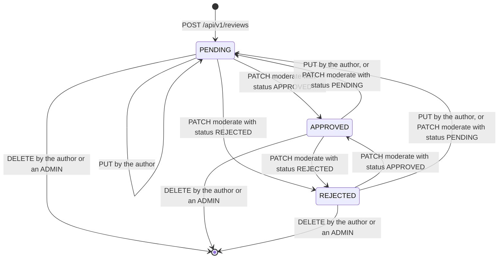
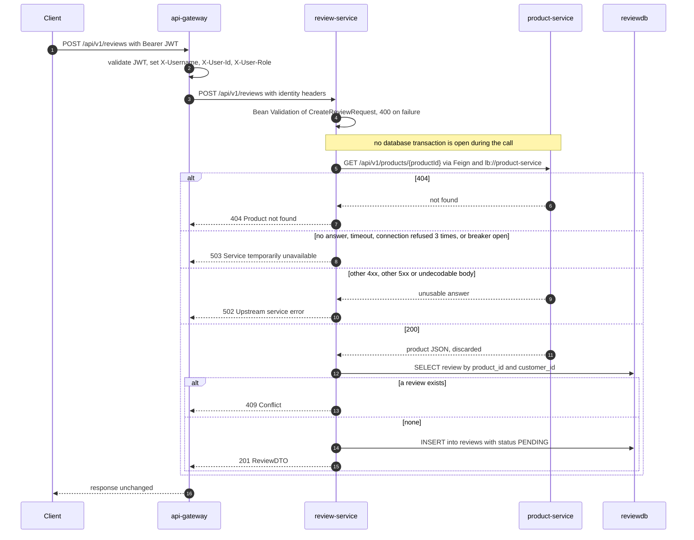
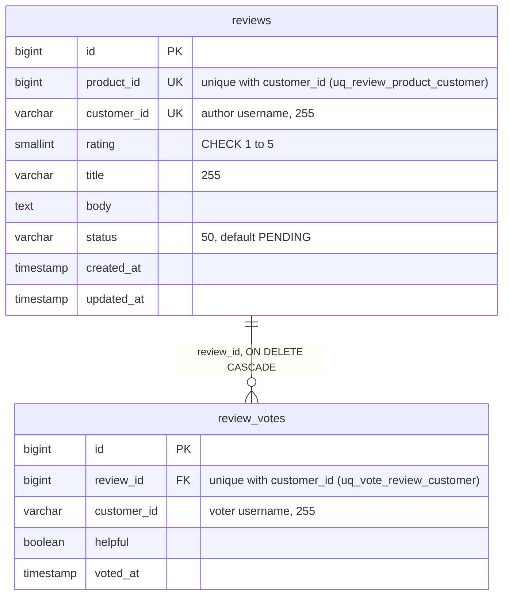

# Review service

review-service stores product reviews and the helpful/unhelpful votes on them.
It runs every review through a moderation status (`PENDING`, `APPROVED`,
`REJECTED`) and computes the per-product rating summary the storefront shows.
It owns the `reviewdb` PostgreSQL database (`reviews`, `review_votes`). Its one
dependency is product-service, which it asks over Feign whether a product exists
before it stores a review. It neither publishes nor consumes events.

| | |
|---|---|
| Repository | `ecommerce-review-service` |
| Stack | Java 25 · Spring Boot 4.0.9 · Spring MVC · Spring Data JPA (Hibernate 7.2) · Flyway 11 · Spring Cloud 2025.1.4 (OpenFeign 5.0.4 on Apache HttpClient 5, LoadBalancer, Eureka client, Resilience4j circuit breaker around the product-service client, see [Outbound calls](#outbound-calls)) · springdoc 2.8.5 · Lombok. |
| Port | 8087 |
| Eureka service ID | `review-service` |
| Gateway routes | `/api/v1/reviews/**`; `/api-docs/review-service` (rewritten to `/api-docs`) for the gateway's Swagger UI |
| Data store | PostgreSQL 16 `reviewdb` (Flyway). Compose publishes it on host port 5438. |
| Publishes | — |
| Consumes | — |
| Calls | `product-service` (Feign): `GET /api/v1/products/{id}` |
| Called by | api-gateway only. The frontend reaches it through the gateway (product detail page, review cards, admin review moderation page). No other service calls it. |

## Responsibilities

- Create a review for an existing product: one per user per product, a rating from 1 to 5, a title and a body. New reviews start as `PENDING`.
- Serve reviews by ID, by product (approved only by default) and by author; the two lists are paged.
- Let the author edit their review. Any edit sends it back to `PENDING`.
- Let the author or an admin delete a review.
- Change a review's moderation status. This is an admin operation (see [Security and identity](#security-and-identity)).
- Record one helpful/unhelpful vote per user per review, and return the vote counts with every review.
- Compute a product's average rating and its 1–5 distribution over approved reviews.

Things it does **not** do: verify that the reviewer bought the product (there is
no call to order-service and no "verified purchase" flag), check the product's
status, react to a product being deleted (it consumes no events, so the reviews
stay), or tell anyone that a review was created or approved (it publishes no
events).

## Domain model

### Review

`model/Review.java`, table `reviews`. Returned to clients as `ReviewDTO`.

| Field | Java type | JSON in `ReviewDTO` | Notes |
|---|---|---|---|
| `id` | `Long` | number | identity column |
| `productId` | `Long` | number | product-service's product ID. Checked for existence only when the review is created. Not a foreign key, because the product lives in another database. |
| `customerId` | `String` | string | The author's **username**, taken from `X-Username`. It is not the numeric user ID; `X-User-Id` is never read. |
| `rating` | `Short` | integer | 1 to 5 |
| `title` | `String` | string | 3 to 255 characters |
| `body` | `String` | string | 10 to 2000 characters (`TEXT` column) |
| `status` | `ReviewStatus` | string | `PENDING` on creation |
| `votes` | `List<ReviewVote>` | not exposed; see `helpfulVotes` / `unhelpfulVotes` | `@OneToMany(mappedBy = "review", cascade = ALL, orphanRemoval = true)`, lazy |
| `createdAt` | `LocalDateTime` | ISO-8601 string, no offset | Set in Java when the object is built (`@Builder.Default LocalDateTime.now()`). `updatable = false`. |
| `updatedAt` | `LocalDateTime` | ISO-8601 string, no offset | Set by `updateReview()` and `moderateReview()`. Voting does not touch it. |

`ReviewDTO` adds two computed fields, `helpfulVotes` and `unhelpfulVotes`
(`long`). `ReviewService.toDTOs()` fills them for a whole page of reviews with
one grouped query, `ReviewVoteRepository.countByReview()` (votes per review and
`helpful` flag), instead of loading each review's lazy `votes` collection; a
review without votes gets 0 and 0.

### ReviewVote

`model/ReviewVote.java`, table `review_votes`. Votes are never returned one by
one. Clients only see the counts on `ReviewDTO`.

| Field | Java type | Notes |
|---|---|---|
| `id` | `Long` | identity column |
| `review` | `Review` | `@ManyToOne(fetch = LAZY)`, column `review_id` |
| `customerId` | `String` | the voter's username (`X-Username`) |
| `helpful` | `Boolean` | `true` = helpful, `false` = not helpful |
| `votedAt` | `LocalDateTime` | set when the vote is first created; not updated when the vote is changed |

### ReviewStatus

| Value | Meaning |
|---|---|
| `PENDING` | New or edited. Hidden from the default product listing and left out of the summary's average and distribution. |
| `APPROVED` | Shown in the default product listing and counted in the summary. |
| `REJECTED` | Hidden from the default product listing and the summary. Still returned by ID, by author, and with `approvedOnly=false`. |

Every transition the code allows. Moderation accepts any target status from any
status, and an author's edit always lands in `PENDING`:

## Business rules

1. **The product must exist.** `ReviewService.createReview()` calls `ProductServiceClient.getProductById()` before anything else. Only existence matters; the response body, including the product's `status`, is discarded. The failures are typed (see [Outbound calls](#outbound-calls)): a 404 from product-service is a 404 `Product not found with id: <id>`; no answer (no registered instance, a refused or timed-out connection, a read timeout, a 503 or 504, an open circuit breaker) is a 503 `Service temporarily unavailable`; an unusable answer (another 4xx, another 5xx, a body that cannot be decoded) is a 502 `Upstream service error`. `createReview()` is deliberately not `@Transactional`: the call can take seconds, and inside a transaction it would pin a pooled database connection for all of it. The duplicate lookup and the insert are each a short repository transaction.
2. **One review per user per product.** `createReview()` looks up `ReviewRepository.findByProductIdAndCustomerId()` and throws `DuplicateReviewException` (409) on a hit. The unique constraint `uq_review_product_customer` backs this up. Two concurrent requests can both pass the check; the second then fails on the constraint, which `GlobalExceptionHandler` answers 409 `Resource already exists or violates a constraint`.
3. **Rating is 1 to 5.** Enforced by `@Min(1) @Max(5)` on `CreateReviewRequest.rating` and `UpdateReviewRequest.rating`, and by the column's `CHECK (rating >= 1 AND rating <= 5)`.
4. **Title and body lengths.** On create, `@NotBlank` plus `@Size(min = 3, max = 255)` for the title and `@Size(min = 10, max = 2000)` for the body. On update there is only `@Size`, so a title of three spaces is accepted on update but not on create.
5. **New reviews start as `PENDING`.** Set in `createReview()`.
6. **Only the author can edit.** `ReviewService.updateReview()` compares the stored `customerId` with `X-Username` and throws `UnauthorizedReviewAccessException` (403) on a mismatch. Admins get no exemption. A `null` field leaves the stored value unchanged. Every update, even `{}`, which changes no field, sets `status = PENDING` (re-moderation) and `updatedAt = now`.
7. **The author or an admin can delete.** `ReviewService.deleteReview()` allows the call when `"ADMIN".equals(X-User-Role)` (exact case) or when `X-Username` equals the author, and throws 403 otherwise. The review's votes go with it (JPA `cascade = ALL` and `ON DELETE CASCADE` in the schema).
8. **Moderation is admin-only and sets any status.** `ReviewController.moderate()` requires `X-User-Role` exactly `ADMIN` (401 without identity, else 403); `ReviewService.moderateReview()` writes the requested status and `updatedAt`. There is no transition rule; `APPROVED → PENDING` and `REJECTED → APPROVED` are as valid as `PENDING → APPROVED`.
9. **One vote per user per review.** `ReviewService.voteOnReview()` finds the caller's existing vote (`ReviewVoteRepository.findByReviewIdAndCustomerId()`) and overwrites its `helpful` flag, or inserts a new vote. The unique constraint `uq_vote_review_customer` backs this up; a concurrent first vote by the same user is 409. An author cannot vote on their own review (403), only `APPROVED` reviews take votes (others are 404), and there is no way to withdraw a vote.
10. **The default product listing shows approved reviews only.** `ReviewController.getByProduct()` defaults `approvedOnly` to `true`. With `false`, `ReviewService.getReviewsByProduct()` returns every status, but the controller honours `false` for `ADMIN` only. `PENDING` and `REJECTED` reviews are otherwise visible only to their author and admins (by id, by customer).
11. **Summary.** `ReviewService.getProductReviewSummary()` is `@Transactional(readOnly = true)` and never loads the reviews. It runs three queries: the `APPROVED` reviews counted per rating (`ReviewRepository.countRatings()`, grouped in the database), the number of `APPROVED` reviews, and the number of reviews in any status.
    - `ratingDistribution` counts `APPROVED` reviews per rating. Keys 1 to 5 are always present, with 0 for missing ratings.
    - `averageRating` is computed from those five counts in exact decimal arithmetic (`BigDecimal`, `RoundingMode.HALF_UP`, one decimal), or `0.0` when there are none. There is no floating-point mean to drift, and no count can overflow an `int`.
    - `approvedReviews` is the number of `APPROVED` reviews.
    - `totalReviews` is the number of reviews of the product in **any** status, including `REJECTED`.
    - An unknown product ID returns all zeros. The product is not checked.
12. **Lists are paged and ordered.** `GET /api/v1/reviews/product/{id}` and `GET /api/v1/reviews/customer/{id}` take `page` (default 0) and `size` (default 100, at most 100) and answer with one page as a JSON array, oldest first (`ORDER BY id`). A `page` below 0, a `size` outside 1 to 100 or an offset beyond the `int` range is 400. The status filter runs in the database, so a page is always a full page: the product list filters on `APPROVED` unless an `ADMIN` asked for `approvedOnly=false`, and the customer list returns every status to that customer and to an `ADMIN` and `APPROVED` reviews only to everyone else. The reads are `@Transactional(readOnly = true)`.
13. **A dependency that does not answer is a 503, not a bug.** `exception/DependencyFailures` walks the cause chain of an exception and recognises the failures that mean the database did not answer: Hikari timing out after 5 s without a connection, a lock or query timeout, a deadlock, a dead or frozen connection (connect and socket timeouts, a killed backend, a server shutting down), and a rollback or commit that fails because its connection died (a `TransactionException` or `TransactionSystemException` whose SQL cause has a SQLSTATE outside classes 22, 23 and 42, so a commit that fails because of the data stays what it was). The exception handler answers these, and a product-service that gives no answer (rule 1), with 503 `Service temporarily unavailable`, and writes one WARN per cause class per 10 s with no stack trace and the root cause in the line. A unique-constraint violation stays 409. Any other unexpected exception is a 500 `An unexpected error occurred`, logged at ERROR with its stack trace at most once per failure site per 10 s.

Creating a review, end to end:

## API

| Method | Path | Gateway auth | Purpose |
|---|---|---|---|
| `POST` | `/api/v1/reviews` | Bearer JWT | create a review (`PENDING`) |
| `GET` | `/api/v1/reviews/{id}` | Bearer JWT | one review, any status |
| `GET` | `/api/v1/reviews/product/{productId}` | public | one page of a product's reviews; `approvedOnly` defaults to `true` |
| `GET` | `/api/v1/reviews/product/{productId}/summary` | public | average rating and distribution |
| `GET` | `/api/v1/reviews/customer/{customerId}` | Bearer JWT | one page of the reviews by one username (any status for that user and `ADMIN`, `APPROVED` only for others) |
| `PUT` | `/api/v1/reviews/{id}` | Bearer JWT | author edits; back to `PENDING` |
| `DELETE` | `/api/v1/reviews/{id}` | Bearer JWT | author or `ADMIN` deletes |
| `PATCH` | `/api/v1/reviews/{id}/moderate?status=` | Bearer JWT with role `ADMIN` | set the status (`ADMIN` only) |
| `POST` | `/api/v1/reviews/{id}/vote` | Bearer JWT | cast or change a helpful/unhelpful vote |

Full request and response details: [API reference](../api/review-service.md).

## Events

This service does not use Kafka. Creating, approving or deleting a review emits
nothing, and the service does not listen for product changes.

## Outbound calls

### product-service: `client/ProductServiceClient.java`

| | |
|---|---|
| Declaration | `@FeignClient(name = "product-service", fallbackFactory = ProductServiceClientFallbackFactory.class)` |
| Target | `lb://product-service`, resolved through Eureka by Spring Cloud LoadBalancer |
| Endpoint | `GET /api/v1/products/{id}`, decoded into `dto/ProductDTO` |
| When | at the start of every `ReviewService.createReview()`, before the duplicate check and outside any database transaction |
| Sent | the product ID in the path. No identity headers and no `X-Correlation-Id` are forwarded; there is no Feign `RequestInterceptor`. |
| Read | Nothing. A successful decode is the proof of existence. `ProductDTO` mirrors `id`, `sku`, `name`, `description`, `price`, `stockQuantity`, `brand`, `categoryId`, `status`. product-service also sends `createdAt` and `updatedAt`, which Jackson 3 ignores (`FAIL_ON_UNKNOWN_PROPERTIES` is off by default). |
| HTTP client | Apache HttpClient 5 (`feign-hc5`), with its automatic retries switched off: `FeignConfig.noAutomaticHttpClientRetries()` is an `HttpClientBuilderCustomizer` that calls `disableAutomaticRetries()`. The client's own strategy re-sent an idempotent request once on a reset connection and again, after a pause, on a 503 (R-6), a second retry layer under `ConnectionFailureRetryer`. |
| Timeouts | connect 2000 ms, read 10000 ms (`spring.cloud.openfeign.client.config.default`). The short connect timeout lets the retry move to the next instance quickly when a pod vanished mid-rollout. These two govern the call: Spring Cloud CircuitBreaker's worker thread pool, its 1 s time limiter and its thread-pool bulkhead are disabled (`spring.cloud.circuitbreaker.resilience4j.disable-thread-pool` and `disable-time-limiter` true, `spring.cloud.circuitbreaker.bulkhead.resilience4j.enabled` false), so the call runs on the request thread. |
| Retries | `FeignConfig.ConnectionFailureRetryer(3, 100)`: at most 3 attempts in total, only when the cause is a `ConnectException` (this includes HttpClient 5's `HttpHostConnectException`) or a `ConnectTimeoutException`. Back-off is 100 ms, then 200 ms. The LoadBalancer picks an instance on every attempt. Read timeouts (`SocketTimeoutException`) and HTTP errors are not retried, because the request may have been processed. Spring Retry is not on the classpath and HttpClient 5's retries are off, so nothing else repeats a call. |
| Load balancer | `eager-load.clients: product-service`, so the instance list exists from startup (without it, the first call failed with "Load balancer does not contain an instance"). Instance cache TTL 5 s, Eureka registry fetch every 5 s. |
| Circuit breaker | Resilience4j breaker `product-service` (`spring.cloud.openfeign.circuitbreaker.enabled=true`), one for the whole client. `FeignConfig.circuitBreakerNameResolver()` names it after the client, so `resilience4j.circuitbreaker.instances.product-service` configures it (the default name is derived from the interface and method, e.g. `ProductServiceClientgetProductByIdLong`). Sliding window of 10 calls, at least 5 before it can open; it opens at a 50 % failure rate, or when 80 % of the window is slower than 5 s; it stays open 10 s, moves to half-open by itself and lets 3 trial calls through. 4xx answers (400, 401, 403, 404, 405, 406, 409, 410, 415, 422) are ignored: the peer answered. `config/CircuitBreakerTransitionLogger` logs WARN when the breaker opens and INFO when it closes, never one line per call. Metrics: `resilience4j_circuitbreaker_*{name="product-service"}`. |
| Fallback | `ProductServiceClientFallbackFactory`, typed and silent (it runs once per call during an outage). It first unwraps `ExecutionException`, `CompletionException`, `UndeclaredThrowableException` and `InvocationTargetException`, then: a `FeignException.NotFound` becomes `ProductNotFoundException`; no answer (connection refused or timed out, no instance, 503 or 504, breaker open, any `IOException` or `TimeoutException`) becomes `ProductServiceUnavailableException` through `ProductServiceClientFallback`; any other `FeignException` (another 4xx, another 5xx, a body that cannot be decoded) becomes `ProductServiceErrorException`; anything else is rethrown. The fallback never returns a product. |
| Error mapping | 404 `Product not found with id: <id>`, 503 `Service temporarily unavailable`, 502 `Upstream service error` (rule 1). The 502 and the 503 are each logged as one throttled WARN line without a stack trace. |

**What a caller sees when product-service misbehaves:**

| product-service | What review-service does | Response to the client |
|---|---|---|
| answers 200 | continues with the duplicate check | 201, or 409 |
| answers 404 | `FeignException.NotFound` becomes `ProductNotFoundException`; the breaker ignores it | 404, immediately |
| answers another 4xx, a 5xx other than 503 and 504, or a body that cannot be decoded | `ProductServiceErrorException` (5xx and decode errors count against the breaker, 4xx do not) | 502, immediately |
| answers 503 or 504 | "no answer"; sent once, not retried; counts against the breaker | 503, immediately |
| has no registered instance | the LoadBalancer client returns a synthetic 503 ("Load balancer does not contain an instance for the service product-service"), which is "no answer" | 503, immediately |
| refuses connections | 3 attempts (100 ms and 200 ms back-off), then "no answer" | 503 after about 0.3 s |
| connect times out | 3 attempts of up to 2 s each, then "no answer" | 503 after up to about 6.3 s |
| accepts but never answers | read timeout after 10 s, not retried, "no answer" | 503 after about 10 s |
| resets the connection after the request was sent | not a connect failure, so not retried (HttpClient 5 no longer re-sends it either): one request reaches product-service | 503 |
| the breaker is open | the call is rejected (`CallNotPermittedException`) without a request | 503, immediately |

The Feign call runs before any database work and outside a transaction, so no
pooled JDBC connection is held while product-service is slow.

`config/FeignConfig.java` also replaces OpenFeign 5.0.1's `FeignHttpMessageConverters`
with `ThreadSafeFeignHttpMessageConverters`. The library publishes an empty
converter list before filling it. When the first Feign calls of a fresh JVM arrive
concurrently, a second thread can see the empty list and fail with
`DecodeException: 'messageConverters' must not be empty`. The subclass makes the
first initialisation mutually exclusive and keeps later reads lock-free. The
child Feign contexts see this parent bean (and the `Retryer`) and skip their own.

## Persistence

Two Flyway migrations in `src/main/resources/db/migration`. Hibernate runs with
`ddl-auto: validate`, so the schema comes only from Flyway and startup fails if
an entity and its table disagree on a column.

**`V1__create_reviews.sql`: `reviews`**

| Column | Type | Constraints |
|---|---|---|
| `id` | `BIGSERIAL` | primary key |
| `product_id` | `BIGINT` | not null |
| `customer_id` | `VARCHAR(255)` | not null. Holds the author's username. |
| `rating` | `SMALLINT` | not null, `CHECK (rating >= 1 AND rating <= 5)` |
| `title` | `VARCHAR(255)` | not null |
| `body` | `TEXT` | not null |
| `status` | `VARCHAR(50)` | not null, default `'PENDING'` |
| `created_at` | `TIMESTAMP` | not null, default `CURRENT_TIMESTAMP` |
| `updated_at` | `TIMESTAMP` | not null, default `CURRENT_TIMESTAMP` |

Constraint `uq_review_product_customer UNIQUE (product_id, customer_id)`.
Indexes `idx_reviews_product_id`, `idx_reviews_customer_id`, `idx_reviews_status`.

**`V2__create_review_votes.sql`: `review_votes`**

| Column | Type | Constraints |
|---|---|---|
| `id` | `BIGSERIAL` | primary key |
| `review_id` | `BIGINT` | not null, `REFERENCES reviews(id) ON DELETE CASCADE` |
| `customer_id` | `VARCHAR(255)` | not null. Holds the voter's username. |
| `helpful` | `BOOLEAN` | not null |
| `voted_at` | `TIMESTAMP` | not null, default `CURRENT_TIMESTAMP` |

Constraint `uq_vote_review_customer UNIQUE (review_id, customer_id)`. Index
`idx_review_votes_review_id`.

Where the entities and the migrations differ:

- The entities' `@UniqueConstraint`s are unnamed. The migrations name them. `validate` does not check constraints, so this is harmless.
- The database defaults for `status`, `created_at` and `updated_at` are never used, because the entities always supply values from Java.
- There is no trigger on `updated_at`. Only `updateReview()` and `moderateReview()` change it.
- `idx_reviews_product_id` and `idx_review_votes_review_id` duplicate the leading column of the two unique constraints' own indexes.
- The unit and pact tests run on H2 with `ddl-auto: create-drop` and Flyway disabled (`src/test/resources/application-test.yaml`), which has neither the migrations nor the `CHECK` constraint. `ReviewRepositoryIT` runs both on Postgres.

## Security and identity

The service has no Spring Security and does not see the JWT. It trusts the
identity headers the gateway sets on authenticated routes, and enforces identity,
ownership and role itself:

| Header | Read by | Default when absent | Used for |
|---|---|---|---|
| `X-Username` | create, update, delete, vote, and reads of unapproved reviews in `ReviewController` | none: writes answer 401 `Authentication required`; over 255 characters or a NUL byte is 400 | the author (`customerId`) on create; the ownership check on update and delete; the voter |
| `X-User-Role` | delete, moderate, unapproved reads, `approvedOnly=false` | not admin | exactly `ADMIN` (no trimming, no case folding) |
| `X-User-Id` | nothing | — | sent by the gateway (and pinned by the gateway's pact) but ignored |

| Endpoint | Gateway | Service-side check |
|---|---|---|
| `POST /api/v1/reviews` | JWT | `X-Username` required; the author is `X-Username` |
| `GET /api/v1/reviews/{id}` | JWT | unapproved: author or `ADMIN` (403) |
| `GET /api/v1/reviews/product/{productId}` | public | `approvedOnly=false` honoured for `ADMIN` only |
| `GET /api/v1/reviews/product/{productId}/summary` | public | none |
| `GET /api/v1/reviews/customer/{customerId}` | JWT | unapproved reviews only for that user or `ADMIN` (filtered out otherwise) |
| `PUT /api/v1/reviews/{id}` | JWT | `X-Username` must equal the author |
| `DELETE /api/v1/reviews/{id}` | JWT | author, or `X-User-Role` exactly `ADMIN` |
| `PATCH /api/v1/reviews/{id}/moderate` | JWT, and role `ADMIN` at the gateway | `ADMIN` only |
| `POST /api/v1/reviews/{id}/vote` | JWT | `X-Username` required; not the author; review `APPROVED` |

Gaps:

- **Moderation is admin-only** at the gateway and in `ReviewController.moderate()`.
- **Header trust without the gateway.** Compose publishes port 8087 on the host. A direct call can send `X-User-Role: ADMIN` to delete any review, or another user's `X-Username` to edit their review. A call without headers is 401. In Kubernetes the Service is cluster-internal (ClusterIP), so only pods can do this.
- **Unmoderated content** is readable only by its author and admins; the frontend's admin page uses `approvedOnly=false` as an admin.
- **Request size.** `filter/RequestSizeLimitFilter` caps a request body at 1 MB (`http.max-request-body-bytes`, default 1048576), because a body is read into memory before any validation runs and a service reachable without the gateway's own size limit (a published port, another pod) would otherwise be exposed to a few large requests. A request that declares a `Content-Length` above the limit is answered 413 `{"status":413,"error":"Payload Too Large","message":"Request body too large"}` without reading anything. A body that declares no length (chunked) is cut off with an I/O error once it passes the limit, which the malformed-body handler answers as 400 `Malformed request body`.
- `serviceregistry` answers 403 to non-loopback callers and health details are hidden, as on every service. Error messages are fixed strings, responses carry `nosniff` and `no-store`, and logged user input is sanitised (`LogSanitizer`).

The gateway strips client-supplied `X-User-*` headers on every request, public routes included.

## Configuration

`src/main/resources/application.yaml`. Compose sets `SPRING_DATASOURCE_URL`,
`DB_USERNAME`, `DB_PASSWORD` and the shared `x-java-env` variables; Kubernetes
sets the same through `k8s/40-services.yaml`, the `reviewdb-credentials` Secret
and the `java-env` ConfigMap.

| Property | Env var | Default | Purpose |
|---|---|---|---|
| `server.port` | — | `8087` | |
| `spring.application.name` | — | `review-service` | Eureka service ID, metric tag |
| `spring.datasource.url` | `SPRING_DATASOURCE_URL` | `jdbc:postgresql://localhost:5438/reviewdb` | compose and k8s: `jdbc:postgresql://reviewdb:5432/reviewdb` |
| `spring.datasource.username` / `password` | `DB_USERNAME` / `DB_PASSWORD` | `reviewuser` / `reviewpass` | k8s takes them from the `reviewdb-credentials` Secret |
| `spring.jpa.hibernate.ddl-auto` | — | `validate` | Flyway owns the schema |
| `spring.jpa.open-in-view` | — | `false` | no connection is held outside a transaction: the read endpoints are `@Transactional(readOnly = true)` and return DTOs, and the vote counts come from a query, so nothing lazy-loads after the service returns |
| `spring.datasource.hikari.connection-timeout` | — | `5000` | a request waits at most 5 s for a pooled connection (Hikari's default is 30 s), then fails with a 503 |
| `spring.datasource.hikari.data-source-properties.*` | — | `connectTimeout` 5, `socketTimeout` 30 (seconds), `tcpKeepAlive` true | pgjdbc has no socket timeout by default, so a database that stops answering (dropped packets, a frozen host, a failover without a reset) would hold a request thread for minutes |
| `spring.flyway.enabled` / `locations` | — | `true` / `classpath:db/migration` | |
| `spring.cloud.openfeign.client.config.default.connect-timeout` | — | `2000` ms | |
| `spring.cloud.openfeign.client.config.default.read-timeout` | — | `10000` ms | |
| `spring.cloud.openfeign.circuitbreaker.enabled` | — | `true` | wraps the Feign client in the circuit breaker and enables the fallback factory |
| `spring.cloud.circuitbreaker.resilience4j.disable-thread-pool` / `disable-time-limiter` | — | `true` / `true` | the call runs on the request thread, with no 1 s time limiter; Feign's timeouts govern |
| `spring.cloud.circuitbreaker.bulkhead.resilience4j.enabled` | — | `false` | no bulkhead (the default would allow one concurrent call per CPU and queue the rest) |
| `spring.cloud.loadbalancer.cache.ttl` | — | `5s` | |
| `spring.cloud.loadbalancer.eager-load.clients` | — | `product-service` | |
| `eureka.client.service-url.defaultZone` | `EUREKA_CLIENT_SERVICEURL_DEFAULTZONE` | `http://localhost:8761/eureka/` | compose and k8s: `http://service-discovery:8761/eureka/` |
| `eureka.client.registry-fetch-interval-seconds` | — | `5` | |
| `eureka.instance.prefer-ip-address` | `EUREKA_INSTANCE_PREFER_IP_ADDRESS` (k8s) | `true` | |
| `eureka.instance.lease-renewal-interval-in-seconds` / `lease-expiration-duration-in-seconds` | — | `5` / `15` | a crashed instance leaves the registry in about 20 s |
| `resilience4j.circuitbreaker.instances.product-service.*` | — | `slidingWindowSize` 10, `minimumNumberOfCalls` 5, `failureRateThreshold` 50, `waitDurationInOpenState` 10s, `permittedNumberOfCallsInHalfOpenState` 3, `slowCallDurationThreshold` 5s, `slowCallRateThreshold` 80, `automaticTransitionFromOpenToHalfOpenEnabled` true, 4xx in `ignoreExceptions` | the breaker named `product-service` (see [Outbound calls](#outbound-calls)) |
| `management.endpoints.web.exposure.include` | — | `health,info,metrics,prometheus,circuitbreakers,serviceregistry` | `serviceregistry` is used by the Kubernetes `preStop` drain |
| `management.endpoint.health.show-details` | — | `never` | |
| `management.endpoint.health.probes.enabled` | `MANAGEMENT_ENDPOINT_HEALTH_PROBES_ENABLED` | Boot default; k8s sets `true` | `/actuator/health/liveness` and `/readiness` for the probes |
| `management.metrics.tags.application` / `environment` | `ENVIRONMENT` | `review-service` / `development` | common metric tags |
| `management.metrics.distribution.*` (`http.server.requests`) | — | percentile histogram; SLO 50 ms, 100 ms, 200 ms, 500 ms, 1 s, 2 s | |
| `management.tracing.sampling.probability` | `TRACING_SAMPLING_PROBABILITY` | `1.0` | |
| `management.opentelemetry.tracing.export.otlp.endpoint` | `OTEL_EXPORTER_OTLP_ENDPOINT` (+ `/v1/traces`) | `http://tempo:4318` | Tempo, OTLP over HTTP |
| `management.otlp.metrics.export.enabled` | — | `false` | metrics go to Prometheus only |
| `springdoc.api-docs.path` / `springdoc.swagger-ui.path` | — | `/api-docs` / `/swagger-ui.html` | |
| `logging.pattern.console` | — | `%d{yyyy-MM-dd HH:mm:ss} [%thread] [%X{correlationId:-}] [%X{traceId:-}] %-5level %logger{36} - %msg%n` | the same pattern in every Java service |
| `logging.level.com.ecommerce` | `LOGGING_LEVEL_COM_ECOMMERCE` | `INFO` | set to `DEBUG` for a diagnosis |
| `logging.level.org.hibernate.orm.jdbc.error` | — | `OFF` | Hibernate wrote two unthrottled lines (WARN and ERROR) for every failed JDBC call; `GlobalExceptionHandler`'s throttled line carries the cause |
| `logging.level.org.springframework.transaction.interceptor.TransactionInterceptor` | — | `OFF` | it logged "Application exception overridden by rollback exception" with a stack trace of several hundred lines for every transaction in flight when its connection died |
| `http.max-request-body-bytes` | — | `1048576` | largest request body; the default is in `RequestSizeLimitFilter`, not in `application.yaml` |
| `JAVA_OPTS` | `JAVA_OPTS` | empty in the image; compose and k8s: `-XX:MaxRAMPercentage=55 -XX:ActiveProcessorCount=2 -XX:+ExitOnOutOfMemoryError` | memory limit 768 MB in both (k8s request 100m CPU / 320 Mi) |

## Observability

- **Actuator**: `health` (status only, `show-details: never`), `info`, `metrics`, `prometheus`, `circuitbreakers`, `serviceregistry`. The product-service call goes through the breaker `product-service` (see [Outbound calls](#outbound-calls)). The compose healthcheck calls `/actuator/health`; Kubernetes probes use `/actuator/health/liveness` and `/actuator/health/readiness`; the `preStop` hook posts `OUT_OF_SERVICE` to `/actuator/serviceregistry` and waits 15 s.
- **Metrics**: Prometheus scrapes `review-service:8087/actuator/prometheus`. Common tags `application=review-service` and `environment`. `http.server.requests` has a percentile histogram and the SLO buckets above. The circuit breaker adds `resilience4j_circuitbreaker_*` meters (`name="product-service"`), which the `CircuitBreakerOpen` alert watches. There are no custom metrics.
- **Correlation ID**: `filter/CorrelationIdFilter.java` takes `X-Correlation-Id` from the request when it matches `^[A-Za-z0-9._-]{1,64}$`, otherwise generates a UUID, puts it in the MDC as `correlationId` (printed in every log line), returns it in the `X-Correlation-Id` response header, adds it to every error body, and clears the MDC after the request. The gateway does not generate one, so it is usually a fresh UUID per request. It is not forwarded to product-service.
- **Tracing**: OpenTelemetry, 100 % sampling, exported to Tempo. Incoming requests continue the gateway's trace. The Feign call to product-service is **not** traced: Spring Cloud OpenFeign's Micrometer instrumentation needs `feign-micrometer`, which is not a dependency, so nothing propagates the trace context and product-service starts a new trace.
- **Logs**: the console pattern carries the thread, the correlation id and the trace id, and `com.ecommerce` logs at INFO. State changes are INFO lines: `Creating review for product {} by customer {}`, `Deleted review {} by customer {} (admin: {})`, `Moderated review {} to status {}`; the user-supplied name goes through `util/LogSanitizer`. A bug that ends in the catch-all handler is logged at ERROR as `Unhandled exception on <method> <uri> (correlationId=<id>)` with the stack trace, at most once per failure site (exception class plus the first stack frame in application code) per 10 s (`logging/LogThrottle`); the next line written for that failure ends in `(N similar suppressed)`. A dependency that does not answer (rule 13) is one WARN, `Dependency unavailable on <method> <uri> (correlationId=<id>): <cause>; root cause: <root cause>`, per cause class per 10 s, with no stack trace. A product-service answer that cannot be used is one WARN, `product-service answered with status <n> on <method> <uri> (correlationId=<id>)`, per status per 10 s. The breaker logs transitions only: WARN `Circuit breaker 'product-service' is now OPEN (...)` and INFO `... is closed again (...)`. A flood of failing requests costs a handful of lines, not one or more per request.

## Testing

| Test | Kind | Covers |
|---|---|---|
| `service/ReviewServiceTest` | Mockito unit | create (an unknown product is a `ProductNotFoundException`, a product-service outage is passed on as an outage, an unexpected failure is not disguised, nothing is stored on failure, no transaction around the remote call), duplicate, update ownership, delete (owner, non-owner, `ADMIN`), unknown ID, votes (one query per page, right tallies), moderation, one page per list (never an unbounded one), the summary from counts (five buckets, exact half-up rounding, large counts, a rating outside 1 to 5 cannot skew the mean) with and without reviews |
| `controller/ReviewControllerTest` | `@WebMvcTest` | the nine endpoints: identity headers, status codes, validation; `page` and `size` are forwarded and bad pages are 400 without touching the service; unpublished reviews of a customer only for that customer and `ADMIN`; the 1 MB body limit |
| `client/ProductServiceClientFallbackTest`, `client/ProductServiceClientFallbackFactoryTest` | unit | the fallback never returns a product; the factory turns a 404 into `ProductNotFoundException`, "no answer" into the 503 exception and an unusable answer into the 502 exception (carrying only the status), unwraps wrappers from another thread, rethrows anything else and carries the cause for the one log line |
| `config/ConnectionFailureRetryerTest`, `config/FeignHttpMessageConvertersRaceTest` | unit, concurrency | connection failures are retried, then propagated; a read timeout is never retried; 200 rounds of 48 threads never see an empty converter list |
| `config/CircuitBreakerTransitionLoggerTest` | unit | opening is one WARN and closing one INFO, calls rejected while open log nothing, a forced-open breaker is a WARN, breakers that already exist are covered |
| `config/ProductionConfigTest` | unit | the packaged `application.yaml` as production reads it: breaker without worker thread, time limiter or bulkhead, Feign timeouts, breaker thresholds, Hikari wait 5 s, driver timeouts, open-in-view off, INFO logging in one pattern with the two noisy loggers off |
| `exception/GlobalExceptionHandlerTest`, `filter/CorrelationIdFilterTest` | unit | exception mappings, including 404, 503 and 502 for the product-service failures and the throttled log lines; the correlation ID |
| `exception/DependencyFailuresTest` | unit | which failures count as "the database did not answer" (pool, lock and query timeouts, SQLSTATEs, a dead connection, a rollback or commit that fails because the connection died) and which do not (unique violations, data errors, ordinary bugs) |
| `filter/RequestSizeLimitFilterTest`, `logging/LogThrottleTest` | unit | 413 for a declared length above the limit, a body without a declared length cut off at the limit; one logged occurrence per key and window with the suppressed count |
| `contract/ProductServiceConsumerPactTest` | Pact **consumer** of product-service, 2 interactions | see below |
| `contract/ReviewServiceProviderPactTest` | Pact **provider** for api-gateway (2 interactions) and the frontend (8) | see below |
| `integration/ReviewRepositoryIT` | Testcontainers `postgres:16-alpine` | the real migrations; one review per customer and product; the rating `CHECK` (1 to 5); one vote per customer and review; cascade delete of votes; finder and aggregate queries |
| `integration/ReviewApiIT` | full app, Postgres, WireMock for product-service | create, duplicate, moderate, vote, summary; ownership from the gateway headers; deleting a review removes its votes; an unknown product is a 404 with `Product not found with id: <id>`; product-service erroring is a 503 and dropping the connection is a 503 with exactly one request at the wire; either stores nothing; the client goes through the fallback |
| `integration/ProductServiceDownIT` | full app, Postgres | with product-service unreachable, create is a 503 after the connect retries and nothing is stored, while reads and votes keep working |
| `integration/ProductServiceResilienceIT` | full app, Postgres, WireMock for product-service (13 tests) | the breaker adds no worker thread, time limiter or bulkhead and is the one named `product-service` with the configured window; 24 concurrent calls overlap; a 2.5 s answer is waited for, not cut at 1 s; slow answers open the breaker and later calls fail fast; a read timeout is a 503 after the timeout and the peer is asked once; no database connection is held while product-service is slow; a connection reset and a 503 are each a 503 sent once, not repeated; a 500 is a 502 with a fixed message; an unknown product is a 404; repeated outages open the breaker, which rejects without calling the peer, logs one WARN and closes again with one INFO on recovery; 4xx answers never open it |
| `integration/ReviewBoundsIT` | full app, Postgres | the product list defaults to the first 100 and pages cover the rest; oversized and nonsense pages are 400; an admin sees every status page by page; a customer's listing is filtered by the database, so a page is a full page; a page of 100 reviews costs a constant number of queries; vote counts are right for every review of a page; the summary of 160 reviews is three queries; an unknown product has an empty summary; no open-in-view; the Hikari wait and the driver timeouts are the configured ones; a saturated pool answers 503 after the 5 s connection wait with one log line and recovers |

259 unit, slice and pact tests and 116 integration tests.

No tests are disabled for bugs any more; the `@Tag("security")` suite covers identity, ownership, moderation, voting and unpublished-review exposure.

**Consumer pact with product-service** (`ProductServiceConsumerPactTest`). The
test builds the real Feign client (the production `FeignConfig`, Boot's Jackson
and converters, no JPA or Eureka) and drives it through `ReviewService`, against
a Pact mock server on the fixed port 18087. It writes
`target/pacts/review-service-product-service.json`, which `sync-pacts.sh` copies to
product-service, where `ProductServiceProviderPactTest` replays it.

| Interaction | Provider state | Pinned |
|---|---|---|
| a request for product 1 | `product 1 exists` | `GET /api/v1/products/1` answers 200 with JSON containing an integer `id` |
| a request for product 999 | `product 999 does not exist` | answers 404 with `status` (integer), `error`, `message` (strings). The test wires the bare Feign client, without the circuit breaker, so it also asserts that the 404 arrives as a `FeignException.NotFound` and that nothing is saved; the mapping to `ProductNotFoundException` and a 404 for the caller is covered by `ReviewApiIT` and `ProductServiceResilienceIT`. |

**Provider pact for api-gateway** (`ReviewServiceProviderPactTest`). The test runs
the whole application on a random port with the `test` profile (H2), mocks only
`ProductServiceClient`, and replays `src/test/resources/pacts/api-gateway-review-service.json`,
which the gateway's `ReviewServiceConsumerPactTest` generates.

| Interaction | Provider state | Pinned |
|---|---|---|
| a create-review request forwarded for the authenticated user alice | `product 1 exists and alice has not reviewed it` | `POST /api/v1/reviews` with `X-Username: alice`, `X-User-Id: 42`, `X-User-Role: CUSTOMER` answers 201 with `customerId` exactly `"alice"` (proving the author comes from `X-Username`), integer `id`, `productId` and `rating`, and string `title` and `status` |
| a delete-review request forwarded for the authenticated admin alice | `review 11 by bob exists` | `DELETE /api/v1/reviews/11` with `X-Username: alice`, `X-User-Role: ADMIN` answers 204, which proves the admin override |

State names are part of the contract and must stay verbatim. The committed pact
copies matched the freshly generated ones at the time of writing.

The provider test also replays the frontend's pact (`ecommerce-frontend-review-service.json`, 8 interactions: approved reviews and the rating summary for product 1, create, edit and delete a review, a helpful vote, and the admin list and approve calls), with a gateway emulation that sets the identity headers from the bearer token. Apache HttpClient 5's automatic retries are off (R-6): after a reset connection `ReviewApiIT` observes exactly one request at the wire. CI (`.circleci/config.yml`) runs `mvn -B -ntp verify`, so the Pact
and integration tests run on every build. The end-to-end `smoke-test.sh` does not touch reviews.

## Code map

Paths are relative to `src/main/java/com/ecommerce/reviewservice/` unless they start with `src/` or another top-level folder.

| File | Role |
|---|---|
| `ReviewServiceApplication.java` | Boot entry point, `@EnableFeignClients` |
| `controller/ReviewController.java` | the nine endpoints; reads `X-Username` and `X-User-Role` |
| `service/ReviewService.java` | all business rules and the entity-to-DTO mapping (`toDTOs()`, one vote query per page) |
| `client/ProductServiceClient.java` | Feign client for product-service (`fallbackFactory`) |
| `client/ProductServiceClientFallbackFactory.java` | typed fallback factory: 404 becomes `ProductNotFoundException`, no answer 503, an unusable answer 502 (see [Outbound calls](#outbound-calls)) |
| `client/ProductServiceClientFallback.java` | the fallback for "no answer": throws `ProductServiceUnavailableException` |
| `config/FeignConfig.java` | thread-safe Feign converters, `ConnectionFailureRetryer`, the HttpClient 5 customizer that switches its automatic retries off, and the `CircuitBreakerNameResolver` that names the breaker `product-service` |
| `config/CircuitBreakerTransitionLogger.java` | one log line per breaker state change (WARN on open, INFO on close) |
| `config/OpenApiConfig.java` | OpenAPI title and the `bearerAuth` scheme |
| `dto/CreateReviewRequest.java`, `UpdateReviewRequest.java`, `VoteRequest.java` | request bodies and their validation |
| `dto/ReviewDTO.java`, `ReviewSummaryDTO.java` | response bodies |
| `dto/ProductDTO.java` | product-service's response shape |
| `exception/GlobalExceptionHandler.java`, `ErrorResponse.java` | exception-to-status mapping and the error body |
| `exception/DependencyFailures.java` | which failures mean the database did not answer (rule 13) |
| `exception/ReviewNotFoundException.java`, `DuplicateReviewException.java`, `UnauthorizedReviewAccessException.java` | 404, 409, 403 |
| `exception/ProductNotFoundException.java`, `ProductServiceUnavailableException.java`, `ProductServiceErrorException.java` | the typed product-service failures: 404, 503, 502 |
| `filter/CorrelationIdFilter.java` | `X-Correlation-Id` into the MDC and the response |
| `filter/RequestSizeLimitFilter.java` | 413 for a request body above 1 MB |
| `logging/LogThrottle.java` | bounds how often one kind of log line is written |
| `model/Review.java`, `ReviewVote.java`, `ReviewStatus.java` | JPA entities and the status enum |
| `repository/ReviewRepository.java`, `ReviewVoteRepository.java` | Spring Data JPA repositories (paged finders, grouped rating and vote counts) |
| `src/main/resources/application.yaml` | configuration |
| `src/main/resources/db/migration/V1__create_reviews.sql`, `V2__create_review_votes.sql` | schema |
| `src/test/resources/application-test.yaml` | H2 profile for the provider pact test |
| `docker/Dockerfile` | `eclipse-temurin:25-jre-alpine`, non-root, copies the prebuilt `target/review-service-*.jar` |
| `.circleci/config.yml` | verify, build the image, publish to Docker Hub on `develop`, `main`/`master` and `v*` tags |

## Known issues and limitations

| Issue | Where | Impact | Severity |
|---|---|---|---|
| ~~Moderation has no authorization~~ | fixed | see the security fix spec | — |
| ~~A missing product and an unreachable product-service both end in a 500~~ | fixed | A missing product is 404, a product-service that gives no answer is 503 and an unusable answer is 502, each with a fixed message and one throttled WARN line (rule 1). | — |
| ~~The circuit breaker and the fallback are inert~~ | fixed | `spring.cloud.openfeign.circuitbreaker.enabled` is `true` and the breaker is named `product-service`, so the settings apply: once it opens, a create fails at once with a 503 instead of waiting for the retries or the 10 s read timeout, and the `CircuitBreakerOpen` alert can fire for this service. | — |
| ~~`approvedOnly=false` available to anonymous callers~~ | fixed | see the security fix spec | — |
| ~~Permissive identity header defaults (`anonymous` / `CUSTOMER`)~~ | fixed | see the security fix spec | — |
| ~~Unapproved reviews readable by any authenticated user~~ | fixed | see the security fix spec | — |
| ~~Duplicate-check races returned 500~~ | fixed | see the security fix spec | — |
| ~~Catch-all swallowed framework exceptions~~ | fixed | see the security fix spec | — |
| ~~The remote call runs inside the database transaction~~ | fixed | `createReview()` is not `@Transactional`: the product-service call comes first and holds no connection (rule 1). | — |
| ~~Lists are unpaginated and unordered, and votes load one review at a time~~ | fixed | The two lists are paged (at most 100) and ordered by `id`, vote tallies come from one grouped query per page, and the summary is three count queries (rules 11 and 12). | — |
| `deleteReview()` loads the review's votes to cascade the delete. | `ReviewService.deleteReview()`, `model/Review.java` (`cascade = ALL`) | Hibernate loads the votes and deletes them row by row, although the foreign key is already `ON DELETE CASCADE`. | Low |
| Update validation is weaker than create validation. | `UpdateReviewRequest` (only `@Size`) | A whitespace-only title or body can be saved through `PUT`. | Low |
| `totalReviews` counts every status, while the average and distribution use approved reviews only. | `getProductReviewSummary()` | "4.3 from 10 reviews" can be based on 3 approved reviews. | Low |
| The product page does not find the user's own review while it is `PENDING`. | frontend `ProductDetailPage.tsx` (`userReview` is searched among approved reviews only) together with rule 5 | After submitting, or after any edit, the page offers "Write a Review" again, and a second submission returns 409. | Low |
| No verified-purchase check, no vote withdrawal, product status ignored, reviews outlive deleted products. | `ReviewService` | Product decisions rather than defects, but none of it is enforced anywhere else either. | Low |
| `OpenApiConfig` declares no server URL. | `config/OpenApiConfig.java` | The gateway's Swagger UI comment states that every service declares the relative server `/`. Without it springdoc derives the server URL from the request it receives, which through the gateway is the instance's own address unless forwarded headers are honoured, so "Try it out" in the gateway UI may not go through the gateway. | Low |
| Dead code. | `ReviewRepository.findByProductId(Long)`, `findByCustomerId(String)` and `findByProductIdAndStatus(Long, ReviewStatus)` (the unpaged finders, called only by tests) | Misleading to readers. | Low |
