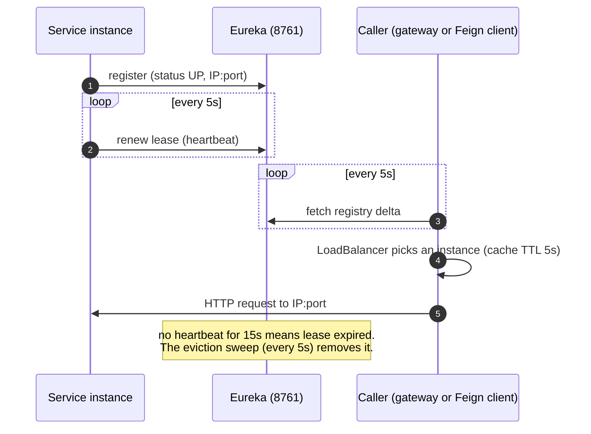

# Service discovery (Eureka)

A standalone Netflix Eureka server. It is the registry every Spring service
registers with and the source the gateway and the Feign clients use to turn a
service ID (`lb://product-service`) into a live instance address. It holds no
persistent data: the registry lives in memory and is rebuilt from client
heartbeats after every restart.

| | |
|---|---|
| Repository | `ecommerce-service-discovery` |
| Stack | Java 25 · Spring Boot 4.0.9 · Spring Cloud Netflix Eureka Server (Spring Cloud 2025.1.4) |
| Port | 8761 (dashboard at `http://localhost:8761`, REST API under `/eureka/`; HTTP Basic, user `eureka`, password `EUREKA_PASSWORD`) |
| Eureka service ID | `service-discovery` (does not register itself) |
| Gateway routes | — |
| Data store | in-memory registry |
| Publishes / consumes | — |
| Calls | — |
| Called by | every Spring service (registration, heartbeats, registry fetches) |

## Responsibilities

- Accept registrations, heartbeats (lease renewals) and status changes from the nine Spring services: the gateway plus eight backend services.
- Serve the registry to clients. The gateway's `lb://` routes and the Feign clients in catalog-, order- and review-service resolve through it.
- Evict instances whose leases expire, which bounds how long a crashed instance keeps receiving traffic.

There is a single instance. It has no peers and fetches nothing from anyone
(`register-with-eureka: false`, `fetch-registry: false`).

## How discovery works on this platform



Every client uses the same tuning, all well below the Eureka defaults:

| Client setting | Value | Default | Effect |
|---|---|---|---|
| `eureka.client.registry-fetch-interval-seconds` | 5 | 30 | callers see registry changes within ~5 s |
| `eureka.instance.lease-renewal-interval-in-seconds` | 5 | 30 | heartbeat interval |
| `eureka.instance.lease-expiration-duration-in-seconds` | 15 | 90 | a silent instance is considered dead after 15 s |
| `eureka.instance.prefer-ip-address` | true | false | registers the IP, not the hostname. Required under Kubernetes, where pod hostnames don't resolve. |
| `spring.cloud.loadbalancer.cache.ttl` | 5s | 35s | set only in callers: gateway, catalog-, order- and review-service |

With the server settings below, a crashed instance disappears from callers'
view within about 20 s. Eureka evicts at most 15 % of the registry per sweep,
rounded up (`eureka.server.renewal-percent-threshold` is left at its default of
0.85; 2 of 9 instances, for example), so when several instances fail together
the later ones are evicted in later sweeps and stay in the registry longer than
that. A **graceful** stop doesn't wait for expiry. Under
Kubernetes the pod's `preStop` hook POSTs `{"status":"OUT_OF_SERVICE"}` to its
own `/actuator/serviceregistry` and keeps serving for 15 s, so every caller
drops it before shutdown starts. Then Boot's graceful shutdown deregisters it.
See [k8s/README.md, "Rollouts are hitless"](../../k8s/README.md#notes).

## Server configuration

`src/main/resources/application.yaml`:

| Property | Value | Why |
|---|---|---|
| `server.port` | 8761 | |
| `eureka.client.register-with-eureka` / `fetch-registry` | `false` / `false` | standalone server, no replication peers |
| `eureka.server.enable-self-preservation` | `false` | Instances come and go on every rebuild. Self-preservation would freeze eviction as soon as renewals dip, leaving dead instances routable. |
| `eureka.server.eviction-interval-timer-in-ms` | 5000 (default 60000) | sweep expired leases every 5 s. With the 15 s lease this bounds a crashed instance's lifetime to about 20 s. |
| `eureka.server.use-read-only-response-cache` | `false` | The read-only cache refreshes only every 30 s. New registrations, deregistrations and `OUT_OF_SERVICE` changes stayed invisible to clients for up to half a minute, and this was the biggest single cause of failed requests during rollouts. Reads now come from the read-write cache, which is invalidated on every change. |
| `spring.security.user.name` / `password` | `EUREKA_USERNAME` (default `eureka`) / `EUREKA_PASSWORD` | No default password; at least 16 characters or startup fails. `init-secrets.sh` generates it into `.env`. |
| `SecurityConfig` | HTTP Basic on everything except `/actuator/health/**`, `/actuator/info`, `/actuator/prometheus` | Clients send the credentials from the user info of their service URL: `http://eureka:<password>@service-discovery:8761/eureka/`. CSRF is disabled for the registry API. |
| `management.endpoints.web.exposure.include` | `health,info,metrics,prometheus,circuitbreakers` | `circuitbreakers` has nothing to report here. `health` shows no details (`show-details: never`). |
| `management.tracing.sampling.probability` | `TRACING_SAMPLING_PROBABILITY`, default 1.0 | |
| OTLP endpoint | `OTEL_EXPORTER_OTLP_ENDPOINT` + `/v1/traces`, default `http://tempo:4318` | |
| `logging.pattern.console` | `%d{yyyy-MM-dd HH:mm:ss} [%thread] [%X{correlationId:-}] [%X{traceId:-}] %-5level %logger{36} - %msg%n` | The format every Java service shares. The registry sets no correlation ID, so that bracket is empty; the trace ID is filled in on lines written while a request is handled, not on the eviction timer's. |
| `logging.level.com.ecommerce` | `INFO` | The shared default. Eureka's own lines come from its `com.netflix` loggers at their default levels; see [Observability](#observability). |

## Deployment

| | Docker Compose | Kubernetes (`k8s/30-service-discovery.yaml`) |
|---|---|---|
| Workload | container `service-discovery`, `mem_limit: 640m` | Deployment, 1 replica, request 320Mi / limit 640Mi |
| Exposure | host port 8761 | ClusterIP `service-discovery:8761` plus LoadBalancer `service-discovery-lb` on `localhost:8761` |
| Health | `wget /actuator/health`, start period 60 s | startup and readiness on `/actuator/health/readiness`, liveness on `/actuator/health/liveness` |
| Ordering | every Spring service has `depends_on: service-discovery: condition: service_healthy` | every Spring pod has a busybox init container waiting for `nc -z service-discovery 8761` |

Restarting Eureka empties the registry. Clients re-register on their next
heartbeat (≤ 5 s), and callers see them after their next fetch (≤ 5 s). Until
then, gateway calls fail with `503` (logged as
`503 SERVICE_UNAVAILABLE "Unable to find instance for <service>"`). This is the
"Eureka warm-up" every runbook entry mentions.

## Useful REST calls

```bash
EU="eureka:$EUREKA_PASSWORD"   # EUREKA_PASSWORD from ecommerce-platform/.env
curl -s -u "$EU" -H 'Accept: application/json' localhost:8761/eureka/apps                  # whole registry
curl -s -u "$EU" -H 'Accept: application/json' localhost:8761/eureka/apps/PRODUCT-SERVICE  # one application
# take an instance out of rotation by hand (what the preStop hook does through actuator):
curl -u "$EU" -X PUT "localhost:8761/eureka/apps/PRODUCT-SERVICE/<instanceId>/status?value=OUT_OF_SERVICE"
curl -u "$EU" -X DELETE "localhost:8761/eureka/apps/PRODUCT-SERVICE/<instanceId>/status?value=UP"   # undo the override
```

Application names are upper-cased in the registry. Instance IDs look like
`<ip>:<service-id>:<port>` when `prefer-ip-address` is on.

## Observability

Prometheus scrapes `/actuator/prometheus`. The common tags are
`application=service-discovery` and `environment`. Eureka's own registry
metrics are not specifically dashboarded. The quickest health view is the
dashboard at `:8761`, which lists every registered instance and its status.

Logs go to the console in the shared format (see the table above). What the
registry writes follows instances coming and going, never request rate or
anonymous traffic (`EurekaServerLogVolumeIT`):

| Event | Lines written |
|---|---|
| Registration, cancellation, status change | 1 `INFO` each: `Registered instance ...`, `Cancelled instance ...`, `Status updated: ...` |
| Heartbeat, registry fetch (full or delta) | none |
| Request without credentials or with a wrong password (`401`), health probe, Prometheus scrape | none |
| Heartbeat for an instance the registry does not know | 2 `WARN`: `lease doesn't exist, registering resource ...` and `Not Found (Renew) ...` |
| Eviction of an expired lease | per evicted instance 1 `WARN` (`expired lease for ...`) and 1 `INFO` (`Cancelled instance ...`), plus one `INFO` `Evicting N items` for a sweep that evicts |
| Eviction sweep, every 5 s | 1 `INFO` (`Running the evict task ...`): about 17,000 lines a day, however quiet the registry is |

When the registry is down, the clients are the noisy side: each one's Eureka
library (`com.netflix.discovery` loggers) logs its failed heartbeat and failed
registry fetch, with stack traces, on every 5 s tick. That volume is bounded by
the tick, not by request rate, and nothing throttles it.

## Testing and CI

29 unit and slice tests (`mvn test`) and 40 integration tests (`mvn verify`; no Docker needed). `integration/EurekaServerIT` (7 tests) boots the registry on a random port and drives it over HTTP: actuator health is `UP`, `/eureka/apps` answers in JSON and in XML for legacy clients, a registered instance shows up immediately, heartbeat, status override and cancel work, a heartbeat for an unknown instance is a 404 (so a client re-registers), and the dashboard is served. `integration/EurekaServerLogVolumeIT` (4 tests) counts what the registry writes to its log: hundreds of heartbeats and registry fetches, of requests without credentials or with a wrong password, and of health probes and metric scrapes write nothing, and a registration and its cancellation cost one `INFO` line each. The other tests are the `@Tag("security")` classes (`integration/EurekaServerSecurityIT`, `security/ActuatorExposureSecurityTest`, `security/SecurityConfigTest`) and `security/LoggingConfigTest`, which checks the log pattern and level in the committed `application.yaml`. CI is the GitHub Actions workflow
`.github/workflows/ci-cd.yml` (verify, then validate-image, then
publish-image to Docker Hub). It replaced the repository's CircleCI pipeline;
see [Architecture: CI/CD](../architecture.md#build-and-delivery).

## Code map

| File | Role |
|---|---|
| `ServiceDiscoveryApplication.java` | Boot entry point, `@EnableEurekaServer` |
| `src/main/resources/application.yaml` | server tuning, actuator, tracing |
| `docker/Dockerfile` | `eclipse-temurin:25-jre-alpine`, non-root, copies the prebuilt jar |

## Known issues and limitations

| Issue | Where | Impact | Severity |
|---|---|---|---|
| ~~The registry API is unauthenticated~~ | fixed | HTTP Basic is required (S-10); port 8761 is still published on the host. | — |
| Single instance. | compose, `30-service-discovery.yaml` | When Eureka is down, clients keep routing with their last cached registry, but new or moved instances are not discovered until it returns. | Low (dev) |
| Self-preservation is disabled. | `enable-self-preservation: false` | Right for a single-node dev registry. Across a real network partition it would evict healthy instances. | Low |
