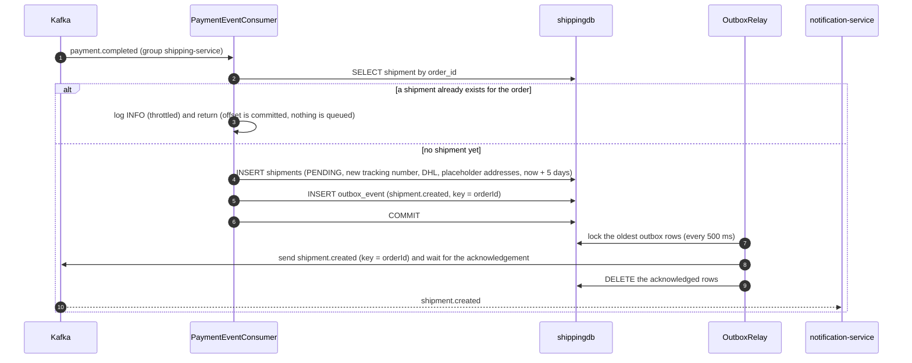
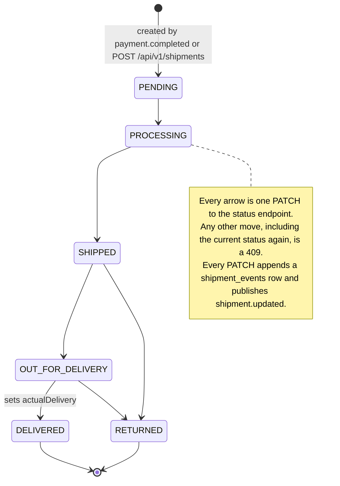
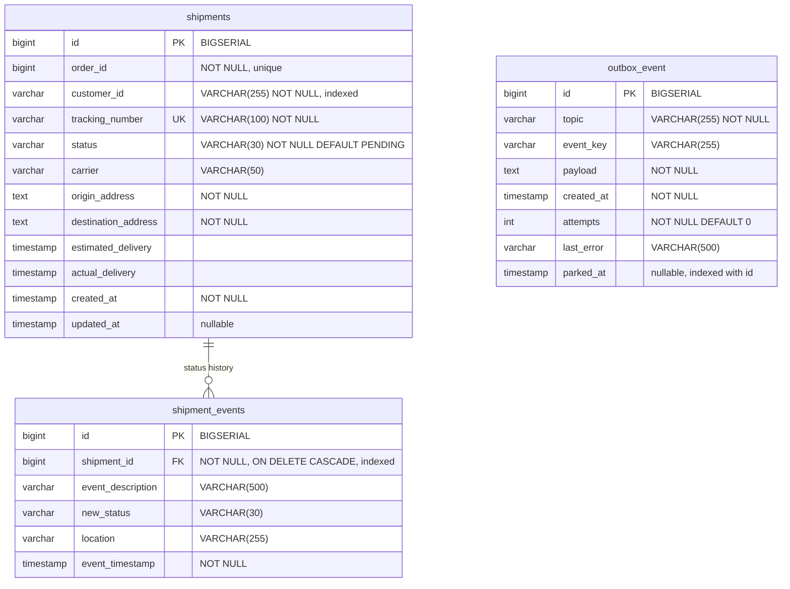

# Shipping service

shipping-service creates and tracks shipments. It normally creates a shipment by itself when payment-service publishes `payment.completed`; a client can also create one through REST. Status changes come only from a REST call, `PATCH /api/v1/shipments/{id}/status`. Nothing in the platform makes that call automatically. Each change appends a row to the shipment's history and publishes `shipment.updated`. A public endpoint returns a shipment by tracking number. The service owns the `shipments`, `shipment_events` and `outbox_event` tables in `shippingdb`.

| | |
|---|---|
| Repository | `ecommerce-shipping-service` |
| Stack | Java 25 · Spring Boot 4.0.9 · Spring MVC · Spring Data JPA (Hibernate 7.2) · Flyway · spring-kafka 4.0 · Spring Cloud 2025.1.4 Eureka client · springdoc-openapi 2.8.5 · Micrometer (Prometheus) + OpenTelemetry tracing · Lombok |
| Port | 8086 |
| Eureka service ID | `shipping-service` |
| Gateway routes | `/api/v1/shipments/**`. `GET /api/v1/shipments/tracking/{trackingNumber}` is public; `POST /api/v1/shipments` and `PATCH /{id}/status` need an `ADMIN` JWT; all other paths need a JWT |
| Data store | PostgreSQL 16 `shippingdb` (Flyway). docker-compose publishes it on host port 5437 |
| Publishes | `shipment.created`, `shipment.updated` (through the outbox); `payment.completed.DLT` (dead letters) |
| Consumes | `payment.completed` (group `shipping-service`) |
| Calls | None. The service has no Feign or HTTP client |
| Called by | The frontend through the gateway: `OrderDetailPage` reads the shipment by order and its history, and `TrackingPage` looks a shipment up by tracking number and reads its history. payment-service reaches it only through Kafka |

## Responsibilities

- Create one shipment per paid order when `payment.completed` arrives, and announce it with `shipment.created`.
- Let a client create a shipment manually (`POST /api/v1/shipments`).
- Change a shipment's status on request, keep a history of the changes, and announce each change with `shipment.updated`.
- Serve lookups by order, by tracking number (public) and the status history.

The service does not do the following:

- It does not schedule or simulate progress. The only `@Scheduled` method is the outbox relay, and there is no carrier integration.
- It does not learn the real delivery address. `payment.completed` does not carry it.
- It does not react to `payment.refunded` or `order.cancelled`.
- It does not update order-service, which does not consume `shipment.*`.

## How a shipment is created



The select, both inserts and the commit run in one transaction (`TransactionTemplate`). Nothing is sent to Kafka before the commit, so the shipment and its `shipment.created` event are stored together or not at all, and a Kafka outage does not slow or fail the handling of `payment.completed`.

The REST path, `POST /api/v1/shipments` (`ShipmentService.createShipment()`), inserts a row too, but it publishes no event and writes no history row.

## Domain model

### `Shipment` (`model/Shipment.java`, table `shipments`)

| Field | Column | Java type | REST JSON | Notes |
|---|---|---|---|---|
| `id` | `id` | `Long` | number | `BIGSERIAL` identity. Sequential |
| `orderId` | `order_id` | `Long` | number | One shipment per order (unique constraint, `V3`) |
| `customerId` | `customer_id` | `String` | string | Copied from `payment.completed`, which in practice holds the username; or taken from the REST body |
| `trackingNumber` | `tracking_number` | `String` | string | `TRACK-` + 8 hex digits + `-` + 8 hex digits (rule 2). `UNIQUE` |
| `status` | `status` | `ShipmentStatus` | string | Starts as `PENDING` (entity default) |
| `carrier` | `carrier` | `String` | string | Free text, at most 50 characters in the database. `DHL` unless the REST request says otherwise |
| `originAddress` | `origin_address` | `String` | string | The Kafka path writes the placeholder `Warehouse, 123 Storage St` |
| `destinationAddress` | `destination_address` | `String` | string | The Kafka path writes the placeholder `Customer Address` |
| `estimatedDelivery` | `estimated_delivery` | `LocalDateTime` | ISO-8601 string | `LocalDateTime.now().plusDays(5)` at creation. Never recalculated |
| `actualDelivery` | `actual_delivery` | `LocalDateTime` | ISO-8601 string or null | Set to now when the status becomes `DELIVERED` |
| `createdAt` | `created_at` | `LocalDateTime` | ISO-8601 string | Builder default `LocalDateTime.now()` |
| `updatedAt` | `updated_at` | `LocalDateTime` | not exposed | Null until the first status change. Set explicitly and by `@PreUpdate` |
| `events` | (shipment_events) | `List<ShipmentEvent>` | not exposed | `@OneToMany(mappedBy = "shipment", cascade = ALL, orphanRemoval = true)`, lazy |

### `ShipmentEvent` (`model/ShipmentEvent.java`, table `shipment_events`)

Each row records one status change. `ShipmentService.updateShipmentStatus()` is the only code that writes these rows. Creating a shipment writes none, so a new shipment has an empty history.

| Field | Column | Java type | Notes |
|---|---|---|---|
| `id` | `id` | `Long` | Identity |
| `shipment` | `shipment_id` | `Shipment` | `@ManyToOne`, lazy, not null |
| `eventDescription` | `event_description` | `String` | The request's `description`, or `Status updated to {STATUS}` when it is omitted. At most 500 characters in the database |
| `newStatus` | `new_status` | `ShipmentStatus` | The status that was set |
| `location` | `location` | `String` | The request's `location`, which may be null. At most 255 characters in the database |
| `eventTimestamp` | `event_timestamp` | `LocalDateTime` | Now. History is returned in ascending order of this field |

### `ShipmentStatus` (`model/ShipmentStatus.java`)

| Value | Meaning in practice |
|---|---|
| `PENDING` | Initial status of every shipment |
| `PROCESSING`, `SHIPPED`, `OUT_FOR_DELIVERY` | Intermediate statuses. The code gives them no behaviour of their own; they only take part in the move order of `ShipmentStatus.next()` (see [Lifecycle](#lifecycle)) |
| `DELIVERED` | Terminal. Setting it fills `actualDelivery` |
| `RETURNED` | Terminal |

### Lifecycle

Only `PATCH /api/v1/shipments/{id}/status` (admin) changes the status, and only along `ShipmentStatus.next()`: `PENDING` to `PROCESSING`, `PROCESSING` to `SHIPPED`, `SHIPPED` to `OUT_FOR_DELIVERY` or `RETURNED`, `OUT_FOR_DELIVERY` to `DELIVERED` or `RETURNED`. `DELIVERED` and `RETURNED` are final. An illegal move is 409 and publishes nothing.



## Business rules

1. **One shipment per order.** Both creation paths call `ShipmentRepository.findByOrderId()` first.
   - In `PaymentEventConsumer.handlePaymentCompleted()`, an existing shipment means the service logs an INFO line (at most one every 10 s) and returns.
   - In `ShipmentService.createShipment()`, it means a 409 with `Shipment already exists for order: {orderId}`.
   - `shipments.order_id` is unique (`V3` first keeps the earliest row per order), so a concurrent creation fails on the constraint (409 on REST, handled idempotently by the consumer).
2. **Tracking number.** `model/TrackingNumbers` builds it from a `SecureRandom`: the format is `TRACK-XXXXXXXX-XXXXXXXX` (for example `TRACK-3F2A9C1B-4D5E6F70`), with 64 random bits.
   - The column is `UNIQUE`.
   - On the Kafka path, a collision fails the insert. The listener then retries with a fresh number.
   - On the REST path, a collision returns 409.
3. **Carrier.** The Kafka path always uses `DHL`. The REST path uses the request's `carrier`, or `DHL` when it is null. Carrier is free text: there is no carrier enum or list.
4. **Addresses.** The Kafka path hard-codes the origin `Warehouse, 123 Storage St` and the destination `Customer Address`, because `payment.completed` has no address. The address the user enters at checkout never reaches this service. The REST path stores the addresses from the request.
5. **Estimated delivery.** Both paths set `LocalDateTime.now().plusDays(5)` (date and time). `createShipment()` ignores the request's `estimatedDelivery` string, and nothing ever recalculates the value.
6. **Status changes.** `ShipmentService.updateShipmentStatus()` does the following, in this order:
   1. It loads the shipment with `SELECT ... FOR UPDATE` (`ShipmentRepository.findByIdForUpdate()`, `PESSIMISTIC_WRITE`, `jakarta.persistence.lock.timeout` 5000 ms), or returns 404.
      - A second PATCH for the same shipment waits for the lock, then sees the status the first one committed. If its move is no longer legal, it gets 409.
      - Two PATCHes racing for the same move give one 200 and one 409, with one history row and one `shipment.updated`.
      - A lock held for more than 5 s fails the request with 503 `Service temporarily unavailable`.
   2. It converts the status with `ShipmentStatus.valueOf()`. The conversion is case-sensitive, and an unknown value gives 400 `Unknown shipment status`.
   3. It refuses a move that `ShipmentStatus.canMoveTo()` does not allow with 409: `Cannot update status of a {status} shipment` for a `DELIVERED` or `RETURNED` shipment, `Cannot change status from {from} to {to}` otherwise.
   4. It sets the new status and `updatedAt`, plus `actualDelivery` when the new status is `DELIVERED`.
   5. It appends a `ShipmentEvent`.
   6. It stores `shipment.updated` in the outbox, in the same transaction.
7. **Events go through a transactional outbox.** `ShipmentEventProducer` does not call Kafka. In the caller's transaction it inserts an `outbox_event` row holding the serialized event, and `OutboxRelay` publishes the row after the commit (see [Events](#events)). A change that rolls back announces nothing, and a change that commits keeps its event in the table until Kafka has acknowledged it.
8. **Authorization.** Create and status change are admin-only; reads are owner-or-admin; tracking is public with a limited response. See [Security and identity](#security-and-identity).

## API

| Method | Path | Gateway auth | Purpose |
|---|---|---|---|
| POST | `/api/v1/shipments` | `ADMIN` | Create a shipment manually. No event is published |
| GET | `/api/v1/shipments/order/{orderId}` | Bearer JWT | Get the shipment of an order (owner or `ADMIN`) |
| GET | `/api/v1/shipments/tracking/{trackingNumber}` | **Public**, `GET` only | Track by tracking number (limited fields) |
| PATCH | `/api/v1/shipments/{id}/status` | `ADMIN` | Change the status, append history, publish `shipment.updated` |
| GET | `/api/v1/shipments/{id}/history` | Bearer JWT | Status history, oldest first (owner or `ADMIN`) |
| GET | `/hello` | Not routed by the gateway | Leftover scaffold greeting (`ShippingController`) |

Full reference: [API reference](../api/shipping-service.md).

## Events

### Published

`messaging/ShipmentEventProducer.java` serializes both events and stores them in the `outbox_event` table in the caller's transaction (`@Transactional`); `outbox/OutboxRelay` publishes the stored rows. The relay and the dead-letter recoverer share the one `KafkaTemplate<String, String>` that `config/KafkaProducerConfig.java` builds:

- **Key:** the order id as a decimal string (`e.getOrderId().toString()`), stored in `outbox_event.event_key`.
- **Value:** the event as JSON text. `ShipmentEventProducer` writes it with `KafkaProducerConfig.eventJsonMapper()` (Jackson 3) into `outbox_event.payload`, and the relay sends that text unchanged through a `StringSerializer`, so there is no `__TypeId__` header. The mapper switches on `DateTimeFeature.WRITE_DATES_AS_TIMESTAMPS`, which keeps `LocalDateTime` as the integer array the consumers and pacts expect. The bytes on the wire are the same as before the outbox existed.
- **Wire types:**
  - `Long` becomes a JSON integer and `String` a string, which can be `null`.
  - `LocalDateTime` becomes an array of integers `[year, month, day, hour, minute, second, nanos]`. The array has 5 to 7 elements because zero seconds and zero nanos are left out.
- **Topics:** the broker auto-creates them; the service declares none.
- **Producer settings** (`KafkaProducerConfig.producerProps()`): `acks=all` with idempotence on; `max.block.ms` 5000, `request.timeout.ms` 10000, `delivery.timeout.ms` 30000; `reconnect.backoff.ms` 1000 and `reconnect.backoff.max.ms` 10000. A send to an unreachable broker fails within 5 s (30 s once the topic metadata is cached), and the client warns about once every 10 s instead of once a second. The template's `ProducerListener` is a no-op, because the default one logs an ERROR with a stack trace for every failed send; the relay and the dead-letter recoverer report failures themselves, throttled and without a stack trace.
- **Delivery (transactional outbox, table `outbox_event`):**
  - The event row commits with the change that caused it. Nothing is sent before the commit, and a rollback removes the row with the change.
  - `OutboxRelay` runs every 500 ms. In one transaction it locks up to 100 unparked rows, oldest first (`OutboxEventRepository.lockBatch()`, `FOR UPDATE SKIP LOCKED`), sends each row, waits for Kafka's acknowledgement (up to 35 s) and deletes the acknowledged rows with one statement.
  - Delivery is at least once: a crash between the acknowledgement and the commit publishes the row again.
  - A transient failure (broker down, send timeout, database trouble) stops the batch, so events keep their order. The relay records `attempts` and `last_error` on the row and pauses with a back-off of 1 s doubling to 30 s, which the first success resets. It logs one WARN a minute at most, without a stack trace, and one INFO when publishing resumes.
  - A permanent failure (record too large, invalid topic, serialization) parks the row: `parked_at` is set, one ERROR names the row and the statement that releases it (`UPDATE outbox_event SET parked_at = NULL WHERE id = ?`), and the relay carries on with the next row. A parked row is not retried until someone releases it.
  - A Kafka outage does not reach the request path or the listener: they only write to the database. The rows wait, and the relay publishes them in order once Kafka is back.

#### `shipment.created`

| | |
|---|---|
| Class | `event/ShipmentCreatedEvent.java` |
| Trigger | `PaymentEventConsumer.handlePaymentCompleted()`, in the same transaction that inserts a new shipment. **REST creation does not publish it** |
| Key | `orderId` |
| Consumers | notification-service only (group `notification-service`, `consumer/ShipmentEventConsumer.onShipmentCreated()`, container factory `shipmentCreatedKafkaListenerContainerFactory` with an `ErrorHandlingDeserializer` around a `JacksonJsonDeserializer<ShipmentCreatedEvent>`) |

| Field | Java type | JSON | Value |
|---|---|---|---|
| `shipmentId` | `Long` | integer | The new row's id |
| `orderId` | `Long` | integer | From `payment.completed` |
| `customerId` | `String` | string | From `payment.completed` |
| `trackingNumber` | `String` | string | `TRACK-XXXXXXXX-XXXXXXXX` |
| `carrier` | `String` | string | Always `DHL` on this path |
| `estimatedDelivery` | `java.time.LocalDateTime` | integer array | `LocalDateTime.now().plusDays(5)` |

```json
{"shipmentId":31,"orderId":7,"customerId":"alice","trackingNumber":"TRACK-3F2A9C1B-4D5E6F70","carrier":"DHL","estimatedDelivery":[2026,11,3,14,30,15,123456789]}
```

`estimatedDelivery` is a **`LocalDateTime`** on the producer side. The value has date and time, and the database column is `TIMESTAMP`. It therefore travels as a date-time array of up to 7 integers, never as a 3-element date. The notification-service poison-pill incident came from that service's mirror class declaring the field as `LocalDate`. With no `ErrorHandlingDeserializer`, every `shipment.created` record failed in the deserializer and was re-polled forever. The mirror (`ecommerce-notification-service` `event/ShipmentCreatedEvent.java`) now declares `LocalDateTime`, and the Pact contract pins the array form.

#### `shipment.updated`

| | |
|---|---|
| Class | `event/ShipmentUpdatedEvent.java` |
| Trigger | `ShipmentService.updateShipmentStatus()`, which serves `PATCH /api/v1/shipments/{id}/status`. Every successful PATCH publishes one. A PATCH that is refused, including one that repeats the current status, is a 409 and publishes nothing |
| Key | `orderId` |
| Consumers | notification-service only (group `notification-service`, `ShipmentEventConsumer.onShipmentUpdated()`) |

| Field | Java type | JSON | Value |
|---|---|---|---|
| `shipmentId` | `Long` | integer | Shipment id |
| `orderId` | `Long` | integer | Shipment's order id |
| `trackingNumber` | `String` | string | |
| `newStatus` | `String` | string | `ShipmentStatus` name |
| `location` | `String` | string or null | The request's `location`. `null` when the request omits it |
| `updatedAt` | `LocalDateTime` | integer array | `LocalDateTime.now()` at publish time |

There is no `customerId` in this event.

```json
{"shipmentId":31,"orderId":7,"trackingNumber":"TRACK-3F2A9C1B-4D5E6F70","newStatus":"SHIPPED","location":"Istanbul hub","updatedAt":[2026,10,30,9,12,44,512000000]}
```

### Consumed

#### `payment.completed`

| | |
|---|---|
| Group id | `shipping-service`, set both in `@KafkaListener(groupId = ...)` and in `consumerFactory()` |
| Listener | `messaging/PaymentEventConsumer.handlePaymentCompleted(PaymentCompletedEvent)`. It is not `@Transactional`: the lookup, the shipment insert and the outbox insert run in one `TransactionTemplate` transaction, so that a unique-key race on `order_id` is caught outside the transaction that failed |
| Container factory | `kafkaListenerContainerFactory` from `config/KafkaProducerConfig.java`. It replaces Spring Boot's factory and carries the `DefaultErrorHandler` described under Failure handling |
| Deserialization | Keys and values use `StringDeserializer`. The factory's `JacksonJsonMessageConverter` (Jackson 3) then binds the JSON string to `event/PaymentCompletedEvent` (the mirror class) using the listener's parameter type. Type headers are not needed. Unknown fields are ignored, and `completedAt` accepts the integer-array form. Only `KafkaProducerConfig` configures this: there is no Boot Kafka auto-configuration, so `application.yaml` sets nothing but `spring.kafka.bootstrap-servers` |
| Other settings | `auto.offset.reset=earliest`. `reconnect.backoff.ms` 1000 and `reconnect.backoff.max.ms` 10000, so that a dead broker logs one "could not be established" warning about every 10 s instead of one a second. Concurrency 1 and batch acknowledgement, both spring-kafka defaults |
| Fields used | `orderId` and `customerId`. `paymentId`, `amount`, `transactionId` and `completedAt` are deserialized but ignored |

**Behaviour:** see the sequence diagram above.

1. If a shipment already exists for `orderId`, the listener logs an INFO line (at most one every 10 s) and returns.
2. Otherwise it inserts a `PENDING` shipment with a new tracking number, carrier `DHL`, placeholder addresses and an estimated delivery five days ahead.
3. It stores `shipment.created` in the outbox. If that insert fails, the shipment rolls back with it and the record fails.
4. The transaction commits, and `OutboxRelay` publishes the event afterwards.

**Idempotency:** a redelivered event, or a second `payment.completed` for the same order, finds the existing shipment (or loses the unique-constraint race and is treated the same way). It creates nothing and queues nothing. A `payment.completed` with a missing or non-positive amount, or a bad `orderId` or `customerId`, is logged (a WARN, at most one every 10 s) and dropped. It parsed, so the error handler never sees it: it is neither retried nor dead-lettered. If a shipment was created through REST first, the event is skipped and that order never gets a `shipment.created`.

**Failure handling:** the factory sets a `DefaultErrorHandler` (`KafkaProducerConfig.errorHandlerFor()`). Its recoverer, `kafka/DeadLetterRecoverer`, publishes to `payment.completed.DLT`, with the partition left to the producer and the original key and String value. What happens depends on the failure:

- **A database or Kafka that does not answer** (`exception/DependencyFailures.isUnavailable()`) is retried with a back-off of 1 s doubling to 30 s and **no deadline**. Matched are: a database connection that cannot be obtained, pool, lock and query timeouts, transient or recoverable data-access errors (`SQLRecoverableException` and `SQLTimeoutException` among them), retriable Kafka errors, and a commit or rollback that failed because the connection died, which surfaces as a `TransactionSystemException` or Hibernate `TransactionException` with a `SQLException` behind it. A good record is therefore not dead-lettered because the database was away: the same record is processed when the database is back, and the shipment is created then.
- **Any other exception thrown by the listener**, such as a constraint violation that is not the duplicate race, gets two more attempts a second apart (three deliveries in total), then goes to the dead-letter topic.
- **Payloads that cannot be converted** (malformed JSON or a type mismatch) are not retried: spring-kafka's default classification sends them straight to the dead-letter topic. Because deserialization itself is only `StringDeserializer`, a bad record cannot jam the poll loop the way it did in notification-service.

`DeadLetterRecoverer` also makes sure that dead-lettering cannot become a retry loop of its own:

- It never adds the stack-trace header, which is what pushes a record near the size limit over `max.request.size`. If the broker still answers `RecordTooLarge`, it retries once with a bare copy: the record's own headers plus its original topic, partition and offset, and no exception details.
- A transient publish failure (broker unreachable, timeout) is retried four times, pausing 1, 2, 4 and 8 s, and then rethrown so that the container redelivers the record. The pauses keep the redelivery rate low.
- A permanent publish failure (the broker can never accept the record) skips it: one ERROR names its topic, partition, offset and key, `kafka.dlt.dropped` counts it, and the partition moves on. The record stays on `payment.completed` until retention, so it can be read again by resetting the group offset. The ERROR is throttled to one per topic per minute.
- `publish()` is overridden to wait for the acknowledgement and log nothing, so neither `DeadLetterPublishingRecoverer` nor the producer listener writes a stack trace for a failed send.
- Each dead letter logs one WARN without a stack trace, at most one per topic per 10 s window (later ones appear as a `(N similar suppressed)` suffix), and `kafka.dlt.published{topic}` counts every one.

`kafka/ListenerFailureLogger`, the handler's retry listener, reports the retries that `DefaultErrorHandler` does not log. While a dependency is down it writes one WARN without a stack trace per exception class per 10 s. For any other listener failure it writes one ERROR with the stack trace per failure kind (exception class and first frame in this service) per 10 s. Records that cannot be read are left to the recoverer, which reports them once.

A dead letter keeps the original key and value. Its headers name the original topic, partition and offset and the exception, but carry no stack trace. Read and replay dead letters as described in the [runbook](../runbook.md#dead-letter-topics).

## Outbound calls

None. The service has no Feign or HTTP client and does not verify orders or payments with other services.

## Persistence

Flyway migrations live in `src/main/resources/db/migration/`. Hibernate validates the entities against them at startup (`ddl-auto=validate`), and `spring.flyway.baseline-on-migrate` is `true`.

`V1__create_shipments.sql`:

| Column | Type | Constraints and default |
|---|---|---|
| `id` | `BIGSERIAL` | Primary key |
| `order_id` | `BIGINT` | `NOT NULL`, indexed (`idx_shipments_order_id`), unique (`V3`) |
| `customer_id` | `VARCHAR(255)` | `NOT NULL`, indexed (`idx_shipments_customer`) |
| `tracking_number` | `VARCHAR(100)` | `UNIQUE NOT NULL`, plus a second index `idx_shipments_tracking` |
| `status` | `VARCHAR(30)` | `NOT NULL DEFAULT 'PENDING'` |
| `carrier` | `VARCHAR(50)` | |
| `origin_address` | `TEXT` | `NOT NULL` |
| `destination_address` | `TEXT` | `NOT NULL` |
| `estimated_delivery` | `TIMESTAMP` | |
| `actual_delivery` | `TIMESTAMP` | |
| `created_at` | `TIMESTAMP` | `NOT NULL DEFAULT CURRENT_TIMESTAMP` |
| `updated_at` | `TIMESTAMP` | `DEFAULT CURRENT_TIMESTAMP` |

`V2__create_shipment_events.sql`:

| Column | Type | Constraints and default |
|---|---|---|
| `id` | `BIGSERIAL` | Primary key |
| `shipment_id` | `BIGINT` | `NOT NULL REFERENCES shipments(id) ON DELETE CASCADE`, indexed (`idx_shipment_events_shipment`) |
| `event_description` | `VARCHAR(500)` | |
| `new_status` | `VARCHAR(30)` | |
| `location` | `VARCHAR(255)` | |
| `event_timestamp` | `TIMESTAMP` | `NOT NULL DEFAULT CURRENT_TIMESTAMP` |

`V4__create_outbox_event.sql` (entity `outbox/OutboxEvent`):

| Column | Type | Constraints and default |
|---|---|---|
| `id` | `BIGSERIAL` | Primary key |
| `topic` | `VARCHAR(255)` | `NOT NULL` |
| `event_key` | `VARCHAR(255)` | The Kafka key, the order id as text. Nullable |
| `payload` | `TEXT` | `NOT NULL`. The event JSON exactly as it goes on the wire |
| `created_at` | `TIMESTAMP` | `NOT NULL` |
| `attempts` | `INTEGER` | `NOT NULL DEFAULT 0`. Failed publish attempts of this row |
| `last_error` | `VARCHAR(500)` | The last publish failure, cut at 500 characters |
| `parked_at` | `TIMESTAMP` | Set when the row can never be published, `NULL` otherwise |

The index `idx_outbox_event_pending` covers `(parked_at, id)`. A row lives until Kafka acknowledges it and is then deleted, so the table normally holds only the events waiting for the next relay run, plus any parked rows. It has no foreign key to the other tables.



The entities and the migrations differ in these places:

- `order_id` is unique (`V3__unique_shipment_per_order.sql`, which deletes later duplicates first).
- `tracking_number` has the index implied by `UNIQUE` and also an explicit `idx_shipments_tracking`. The second index is redundant.
- The SQL defaults for `status`, `created_at` and `updated_at` never apply, because Hibernate inserts every column. `updated_at` is inserted as NULL, and `ShipmentDTO` does not expose it.
- The length limits on `carrier` (50), `event_description` (500) and `location` (255) are also declared as `@Size` on the request DTOs (`CreateShipmentRequest.carrier`, `UpdateShipmentStatusRequest.location` and `description`), so an over-long value is a 400 with field errors before the service runs. The column limits stay as the backstop.
- `ON DELETE CASCADE` and `orphanRemoval` exist, but nothing deletes shipments.

## Security and identity

- **Gateway:**
  - `GET /api/v1/shipments/tracking/*` needs no token; any other method there needs one.
  - `POST /api/v1/shipments` and `PATCH /api/v1/shipments/*/status` need role `ADMIN` (403 otherwise).
  - Every other `/api/v1/shipments/**` path needs a valid JWT. The gateway strips client `X-User-*` headers on every request.
- **Service:** `RequestIdentity` checks `X-Username` and `X-User-Role` (exactly `ADMIN`) before any work: 401 `Authentication required` without identity, 403 `Access denied` otherwise.

| Endpoint | Rule |
|---|---|
| `POST /api/v1/shipments` | `ADMIN` |
| `GET /api/v1/shipments/order/{orderId}` | the shipment's `customerId` equals `X-Username`, or `ADMIN` |
| `GET /api/v1/shipments/tracking/{trackingNumber}` | **public**, `GET` only |
| `PATCH /api/v1/shipments/{id}/status` | `ADMIN`; transition table (409) |
| `GET /api/v1/shipments/{id}/history` | owner or `ADMIN` |

- **What the public tracking endpoint reveals:** only `PublicTrackingDTO`: `trackingNumber`, `status`, `carrier`, `estimatedDelivery` and the `events` (`eventDescription`, `newStatus`, `location`, `eventTimestamp`). No customer, order id, internal id or addresses. A tracking number has 64 random bits, and a hostile or malformed number is a plain 404.
- Responses carry `nosniff` and `no-store`; `X-Correlation-Id` is kept only if it matches `^[A-Za-z0-9._-]{1,64}$`; `/actuator/serviceregistry` answers 403 to non-loopback callers.
- docker-compose publishes port 8086 on the host, so a direct call can forge the identity headers.
- The OpenAPI document declares a global `bearerAuth` scheme (`config/OpenApiConfig.java`). It is documentation only.

## Configuration

`src/main/resources/application.yaml`:

| Property | Env var | Default | Purpose |
|---|---|---|---|
| `server.port` | | `8086` | HTTP port |
| `spring.application.name` | | `shipping-service` | Eureka service ID and the `application` metrics tag |
| `spring.datasource.url` | `SPRING_DATASOURCE_URL` | `jdbc:postgresql://localhost:5437/shippingdb` | compose and k8s use `jdbc:postgresql://shippingdb:5432/shippingdb` |
| `spring.datasource.username` | `DB_USERNAME` | `shippinguser` | k8s reads it from secret `shippingdb-credentials` |
| `spring.datasource.password` | `DB_PASSWORD` | `shippingpass` | k8s reads it from secret `shippingdb-credentials` |
| `spring.datasource.hikari.connection-timeout` | | `5000` | A request waits at most 5 s for a pooled connection (Hikari's default is 30 s), then fails as a 503 `Service temporarily unavailable` |
| `spring.datasource.hikari.data-source-properties.connectTimeout` / `socketTimeout` / `tcpKeepAlive` | `SPRING_DATASOURCE_HIKARI_DATA_SOURCE_PROPERTIES_SOCKETTIMEOUT` (for `socketTimeout`) | `5` / `30` / `true` | pgjdbc settings, in seconds: a TCP connect to PostgreSQL gives up after 5 s and a read blocks for at most 30 s. pgjdbc has no socket timeout by default, so a database that stops answering (dropped packets, frozen host) would hold a request thread or the Kafka consumer thread for minutes. The statements here take milliseconds; one that runs longer than 30 s needs the environment variable |
| `spring.jpa.hibernate.ddl-auto` | | `validate` | |
| `spring.jpa.open-in-view` | | `false` | No database connection or session is held for the whole request; the service layer maps to DTOs inside its transactions |
| `spring.flyway.enabled` / `locations` / `baseline-on-migrate` | | `true` / `classpath:db/migration` / `true` | |
| `spring.kafka.bootstrap-servers` | `KAFKA_BOOTSTRAP_SERVERS` | `localhost:9092` | compose and k8s use `kafka:29092`. `KafkaProducerConfig` reads it with `@Value`; every other Kafka client setting is hard-coded there (see [Events](#events)) |
| `spring.task.scheduling.shutdown.await-termination` / `await-termination-period` | | `true` / `20s` | On shutdown a relay run that is mid-batch finishes instead of being interrupted |
| `eureka.client.service-url.defaultZone` | `EUREKA_CLIENT_SERVICEURL_DEFAULTZONE` | `http://localhost:8761/eureka/` | compose and k8s use `http://service-discovery:8761/eureka/` |
| `eureka.client.registry-fetch-interval-seconds` | | `5` | |
| `eureka.instance.prefer-ip-address` | | `true` | |
| `eureka.instance.lease-renewal-interval-in-seconds` / `lease-expiration-duration-in-seconds` | | `5` / `15` | |
| `management.endpoints.web.exposure.include` | | `health,info,metrics,prometheus,circuitbreakers,serviceregistry` | `circuitbreakers` has no effect because resilience4j is absent |
| `management.endpoint.health.show-details` | | `never` | |
| `management.endpoint.prometheus.access` | | `unrestricted` | |
| `management.metrics.tags.application` / `environment` | `ENVIRONMENT` (environment only) | `shipping-service` / `development` | |
| `management.metrics.distribution.percentiles-histogram.http.server.requests` | | `true` | |
| `management.metrics.distribution.slo.http.server.requests` | | `50ms,100ms,200ms,500ms,1s,2s` | |
| `management.tracing.sampling.probability` | `TRACING_SAMPLING_PROBABILITY` | `1.0` | |
| `management.opentelemetry.tracing.export.otlp.endpoint` | `OTEL_EXPORTER_OTLP_ENDPOINT` (base URL) | `http://tempo:4318/v1/traces` | |
| `management.otlp.metrics.export.enabled` | | `false` | |
| `springdoc.api-docs.path` / `springdoc.swagger-ui.path` | | `/api-docs` / `/swagger-ui.html` | Same paths as every service. The gateway's unified Swagger UI loads `/api-docs/shipping-service` from here. `OpenApiConfig` declares a relative `/` server, so Try it out goes through the gateway |
| `logging.pattern.console` | | `%d{yyyy-MM-dd HH:mm:ss} [%thread] [%X{correlationId:-}] [%X{traceId:-}] %-5level %logger{36} - %msg%n` | The ids come from the MDC and are empty on Kafka listener and relay threads |
| `logging.level.com.ecommerce` | | `INFO` | `LOGGING_LEVEL_COM_ECOMMERCE=DEBUG` turns the debug detail back on |
| `logging.level.org.hibernate.orm.jdbc.error` / `org.springframework.transaction.interceptor.TransactionInterceptor` | | `OFF` | Muted: Hibernate wrote two `WARN` lines for every failed JDBC call, and the interceptor a rollback stack trace of several hundred lines for every transaction in flight when its connection died. `GlobalExceptionHandler` and the Kafka listener report the failure once per window, with its cause |
| `outbox.relay.enabled` | | `true` | `false` switches `OutboxRelay` off. The H2 `test` profile does, because the relay's locking query is PostgreSQL-only |
| `outbox.relay.interval-ms` | | `500` | Delay between relay runs |
| `outbox.relay.batch-size` | | `100` | Rows locked and sent per run |
| `outbox.relay.send-timeout-ms` | | `35000` | How long the relay waits for one acknowledgement. The default lives in `OutboxRelay`, not in `application.yaml`. It is above the producer's `delivery.timeout.ms` (30 s), so the producer gives up first |

The service has no Feign, resilience4j or JWT configuration.

**Deployment:**

- **Image:** `docker/Dockerfile` uses `eclipse-temurin:25-jre-alpine` with the prebuilt `target/shipping-service-*.jar`, runs as a non-root user and exposes 8086.
- **docker-compose:** the same `JAVA_OPTS`, `mem_limit: 768m`, dependencies (healthy `shippingdb`, `kafka`, `service-discovery`) and `/actuator/health` healthcheck as payment-service.
- **Kubernetes** (`ecommerce-platform/k8s/40-services.yaml`):
  - One replica.
  - Init containers wait for service-discovery, shippingdb and kafka.
  - Readiness and startup probes use `/actuator/health/readiness`, and the liveness probe uses `/actuator/health/liveness`.
  - A `preStop` hook marks the instance `OUT_OF_SERVICE` and drains for 15 s.

## Observability

- **Actuator** endpoints are `health` (status only), `info`, `metrics`, `prometheus` and `serviceregistry`, which the k8s `preStop` hook uses.
- **Metrics:** Prometheus scrapes `shipping-service:8086/actuator/prometheus` (job `shipping-service`, labels `service` and `group=application`), and blackbox-exporter probes `/actuator/health`. The generic service alerts apply. The `KafkaConsumerGroupLag` alerts (lag above 1000 is a warning, above 10000 is critical, from kafka-exporter) cover the `shipping-service` group. The service adds these metrics, all with the `application` tag:
  - `outbox_events_pending` and `outbox_events_parked`: gauges for the unparked and the parked rows in `outbox_event`. The relay refreshes them every 5 s, so a scrape never waits for the database.
  - `outbox_events_published_total` (rows acknowledged by Kafka) and `outbox_publish_failures_total` (relay runs that ended in a transient failure).
  - `kafka_dlt_published_total{topic}` (records dead-lettered) and `kafka_dlt_dropped_total{topic}` (records that could not be dead-lettered and were skipped). `topic` is the source topic, here `payment.completed`.

  The alerts for them are in `ecommerce-monitoring`: `OutboxBacklog`, `OutboxBacklogGrowing`, `OutboxBacklogCritical`, `OutboxEventsParked`, `OutboxPublishFailing` and `OutboxRelayStalled` in `prometheus/rules/outbox-alerts.yml`, and `KafkaDeadLetterRecords`, `KafkaDeadLetterFlood` and `KafkaDeadLetterDropped` in `kafka-alerts.yml`.
- **Logs:** `com.ecommerce` logs at INFO. The listener logs the following:
  - INFO `Shipment created for orderId=…, tracking=…`;
  - INFO `Shipment already exists for orderId=…, duplicate payment.completed ignored` for skipped duplicates, at most one every 10 s.

  The per-event lines are DEBUG: `Received payment.completed for orderId=…` and `Queued shipment.created|shipment.updated for orderId=…`. REST creation logs INFO `Shipment created: tracking=…, orderId=…`. The public tracking endpoint logs nothing per request. Promtail ships the container logs to Loki.
- **Throttled lines:** what an outage or a bad client can repeat at request, poll or relay rate is written once per window (`logging/LogThrottle`); when lines were dropped, the next one ends with `(N similar suppressed)`.
  - A request that fails because a dependency does not answer gets 503 `Service temporarily unavailable` from `GlobalExceptionHandler` (which asks `exception/DependencyFailures`). It logs one WARN per exception class per 10 s, with the root cause and no stack trace: `Dependency unavailable on <method> <uri> (correlationId=...): <exception>; root cause <exception>`. The root cause matters, because a rollback that failed on a dead connection replaces the original exception.
  - Any other 500 logs one ERROR with its stack trace per failure site (exception class and first frame in this service) per 10 s: `Unhandled exception on <method> <uri> (correlationId=...)`.
  - The listener side is described under [`payment.completed`](#paymentcompleted): the `Dead-lettered ...` WARN, the `Dependency unavailable while handling ...` WARN, the `Listener failed for ...` ERROR and the ERROR for a record that cannot be dead-lettered.
  - The relay logs `Outbox relay cannot publish to <topic>: <reason>; N event(s) pending, retrying in X ms` as a WARN at most once a minute, `Outbox relay resumed after N failed attempts` as an INFO, and one ERROR per parked row.
- **Correlation id:** `filter/CorrelationIdFilter.java` handles `X-Correlation-Id` for HTTP requests, through the MDC, the response header and the error body. The Kafka listener and relay threads have no correlation id and no trace id, so their log lines show `[] []`.
- **Tracing:** HTTP server spans are exported to Tempo over OTLP. The hand-built `KafkaTemplate` and listener container factory do not enable observation. Traces therefore neither continue from payment-service into the listener nor into notification-service. Scheduled-task observations (`tasks.scheduled.execution`) are excluded in `outbox/OutboxConfig`, because the relay runs twice a second whether or not it has anything to send; it creates no traces, and its own metrics are the `outbox_*` ones above.

## Testing

Run everything with `mvn verify` (240 unit, slice and pact tests, plus 72 integration tests that need Docker). GitHub Actions (`.github/workflows/ci-cd.yml`) runs `mvn -B -ntp verify` and validates the image. It publishes the image for `develop`, `main`, `master` and `v*` tags.

| Class | Kind | What it covers |
|---|---|---|
| `service/ShipmentServiceTest` | Mockito unit | REST creation (`PENDING`, duplicate order), lookups, status update with history and event (terminal states reject updates), history query, mapping |
| `controller/ShipmentControllerTest` | `@WebMvcTest` | every endpoint's status codes and errors |
| `messaging/PaymentEventConsumerTest`, `messaging/ShipmentEventProducerTest` | unit | the `payment.completed` listener (creation, the shipment and its event in one transaction that rolls back when the event cannot be queued, duplicates as one INFO line, invalid events as one WARN line, a lost unique-key race, a database outage failing the record so that the container can back off) and the outbox rows the producer stores (topic, key, and a payload byte for byte what the Kafka JSON serializer always sent) |
| `outbox/OutboxRelayTest` | Mockito unit | rows sent oldest first and deleted once acknowledged; an empty outbox costs one query; the gauges follow the table and refresh at most every 5 s; a transient failure stops the batch and backs off from 1 s to 30 s without touching the database in between; a row that can never be published is parked, with the SQL to release it in the log, and the next row still goes out; failures log one line without a stack trace |
| `kafka/DeadLetterRecovererTest`, `kafka/ListenerFailureLoggerTest` | unit | one WARN and no stack trace per dead letter, a flood logging once per window but counting every record; a too-large record retried bare; a record that can never be dead-lettered skipped with one ERROR and a counter; growing pauses for an unreachable broker, then handing the record back; shutdown stopping the retries; the retry listener reporting each failure kind once |
| `config/KafkaProducerConfigTest` | unit | the bounded producer, the reconnect back-off on producer and consumer, one `KafkaTemplate<String, String>`, the error handler on the container factory, the 1 s to 30 s back-off for each kind of unavailable dependency and two retries for anything else, and the event JSON keeping `LocalDateTime` as integer arrays |
| `config/LoggingConfigTest`, `logging/LogThrottleTest`, `logging/LogSanitizerTest` | unit | the log pattern and the INFO default; the throttle (first occurrence, window, key cap, suppressed count) and the sanitizer |
| `exception/GlobalExceptionHandlerTest`, `filter/CorrelationIdFilterTest` | unit | exception mappings, including 503 for a dependency that does not answer and a unique-key race staying 409; the log budget (a dead database under load is one short line, a bug on a hot path one stack trace); the correlation ID |
| `service/ShippingServiceTest`, `controller/ShippingControllerTest` | Unit and `@WebMvcTest` | only the `/hello` scaffold |
| `contract/PaymentEventsConsumerPactTest` | Pact consumer (`@SpringBootTest`, profile `test`, `@EmbeddedKafka`) | publishes the pact's example `payment.completed` as raw bytes with no type headers to an embedded broker and lets the production path process it (`KafkaProducerConfig`'s container factory, `StringDeserializer` and `JacksonJsonMessageConverter`) |
| `contract/ShipmentEventsProviderPactTest` | Pact provider (`@SpringBootTest`, profile `test`) | replays notification-service's pact (`src/test/resources/pacts/notification-service-shipping-service.json`): `shipment.created` from the real `PaymentEventConsumer`, `shipment.updated` from `ShipmentService`. The test captures the `outbox_event` row each one stores (the repository is mocked) and verifies its payload, which is what the relay puts on the wire |
| `contract/FrontendHttpProviderPactTest` | Pact provider, HTTP | the frontend's 4 interactions (anonymous tracking of a known and an unknown number, the shipment of order 7, the history of shipment 31), selected with `@Consumer` filters in `pacts/`, with a gateway emulation for the identity headers |
| `contract/KafkaPactDsl` | Helper | builds `LocalDateTime` matchers in the integer-array form, with a minimum of 5 elements |
| `integration/ShipmentRepositoryIT` | Testcontainers `postgres:16-alpine` | all four Flyway migrations; unique tracking number; not-null columns; column lengths; the event history cascades from its shipment and comes back oldest first; the foreign key |
| `integration/OutboxRepositoryIT` | Testcontainers `postgres:16-alpine` | the columns, nullability and index of `outbox_event`; `lockBatch()` returns unparked rows oldest first, up to the limit |
| `integration/PaymentCompletedFlowIT` | full app, Postgres, Kafka | `payment.completed` creates the shipment and publishes `shipment.created`; a redelivered event is idempotent |
| `integration/ShipmentLifecycleIT` | full app, Postgres, Kafka | the full lifecycle updates the row, writes history and publishes `shipment.updated`; a terminal shipment rejects further updates without side effects; lookups and errors over HTTP; an over-long location is refused with 400 and changes and publishes nothing |
| `integration/OutboxIT` | full app, Postgres, Kafka | a status change and its event arrive together, and the row is gone once Kafka acknowledged it; a transaction that rolls back after queueing its event publishes nothing; with Kafka paused the PATCH still answers within 3 s, the row waits, and both changes arrive in order once Kafka is back, with no stack trace in the log; a row that can never be published is parked with one ERROR and the next row still goes out; scheduled-task observations are off and shutdown waits for a running relay |
| `integration/ShipmentLockingIT` | full app, Postgres | a PATCH waits for a held row lock and then sees the committed status (409); two admins racing give 200 and 409, one history row and one event; a connection killed with `pg_terminate_backend` in the middle of a request is a 503 with one short log line, and the pool recovers; a lock held past 5 s is a 503 after about 5 s |
| `integration/ConsumerResilienceIT` | full app, Postgres, Kafka | `payment.completed` end to end: a record that is not JSON reaches `payment.completed.DLT` with its original value and costs one log line; a record of 1,047,000 bytes is dead-lettered once and the next record still creates its shipment; with the application's database role locked out the payment is waited for, not dead-lettered, and its shipment is created when the database is back |
| `integration/KafkaErrorHandlingIT` | Spring context with `KafkaProducerConfig`, Kafka | on a scratch topic, with the production container factory, converter, error handler and recoverer: an unconvertible record reaches the DLT unchanged for a handful of log lines; a record near the size limit is dead-lettered once; a database outage is retried with growing pauses and never dead-lettered; a listener bug gets three deliveries a second apart, then the DLT; a record that can never be dead-lettered is skipped with one ERROR; an unreachable broker is retried with pauses. A sentinel record behind each bad one is always processed |
| `integration/ConnectionSettingsIT` | full app, Postgres | the pool's 5 s connection timeout, and the pgjdbc `connectTimeout`, `socketTimeout` and `tcpKeepAlive` that the live connection reports |

**Pact roles:**

- **Consumer of `payment.completed`.** The pact pins the topic, the key regex `\d+`, and the field types: `paymentId` and `orderId` integers, `customerId` and `transactionId` strings, `amount` a number, and `completedAt` an integer array. Every field is in the contract, because the whole record is bound to the mirror class and a type change in any field would break it.
- **Provider of `shipment.created` and `shipment.updated`** for notification-service:
  - `shipment.created` pins `shipmentId` and `orderId` (integers), `customerId`, `trackingNumber` and `carrier` (strings), and `estimatedDelivery` (integer array, at least 5).
  - `shipment.updated` pins `shipmentId` and `orderId` (integers), `trackingNumber`, `newStatus` and `location` (strings), and `updatedAt` (integer array).
  - Both pin the key regex `\d+`.

`ecommerce-platform/sync-pacts.sh` regenerates and copies the pacts.

**`application-test.yaml`** lives in `src/test/resources`, so it does not ship in the production jar. It defines the `test` profile that the three `@SpringBootTest` contract tests activate. That profile does the following:

- uses in-memory H2 (`jdbc:h2:mem:testdb;DB_CLOSE_DELAY=-1`) with `ddl-auto: create-drop`;
- disables Flyway;
- sets the Kafka bootstrap to `localhost:9092`, which the consumer test overrides with `@EmbeddedKafka(bootstrapServersProperty = "spring.kafka.bootstrap-servers")`;
- disables the Eureka client;
- sets `outbox.relay.enabled: false`, because the relay's locking query (`FOR UPDATE SKIP LOCKED`) is PostgreSQL-only. The `*IT` classes run the relay for real.

**Failure injection.** The resilience ITs break real infrastructure instead of mocking it: `docker pause` on the Kafka container (a broker that stops answering), `ALTER ROLE ... NOLOGIN` plus a Hikari soft-evict of the pooled connections (a database outage), `pg_terminate_backend` (a connection killed in the middle of a request), and row locks held by a second connection. `integration/LogCapture` counts the WARN and ERROR lines and stack-trace lines the application writes meanwhile, so each scenario asserts a handful of lines instead of a flood.

No tests are disabled for bugs any more; the `@Tag("security")` suite covers authorization, private tracking, transitions and tracking-number entropy.

**Gaps:** the unit and pact tests run on H2 with Flyway disabled, but `*IT` classes run all four migrations on Postgres.

## Code map

Paths are relative to `src/main/java/com/ecommerce/shipping/`.

| Package or class | Role |
|---|---|
| `ShippingServiceApplication` | Spring Boot entry point |
| `controller/ShipmentController` | REST endpoints under `/api/v1/shipments` |
| `controller/ShippingController`, `service/ShippingService` | `GET /hello` scaffold. Dead code |
| `service/ShipmentService` | REST creation, lookups, status update with history and event, history query, mapping to DTOs |
| `messaging/PaymentEventConsumer` | `payment.completed` listener: creates the shipment and stores `shipment.created` in the outbox in one `TransactionTemplate` transaction |
| `messaging/ShipmentEventProducer` | Serializes `shipment.created` and `shipment.updated` and stores them in the outbox (`@Transactional`) |
| `outbox/OutboxEvent`, `outbox/OutboxEventRepository` | The `outbox_event` entity and its repository: `lockBatch()` (`FOR UPDATE SKIP LOCKED`) and the pending and parked counts |
| `outbox/OutboxRelay` | `@Scheduled` publisher of the stored rows: oldest first, deletes on acknowledgement, back-off, parking, the `outbox_*` metrics |
| `outbox/OutboxConfig` | `@EnableScheduling`, and the observation predicate that excludes `tasks.scheduled.execution` |
| `kafka/DeadLetterRecoverer` | Dead-letters a failed record to `<topic>.DLT` and makes sure that cannot become a retry loop; the `kafka.dlt.*` counters |
| `kafka/ListenerFailureLogger` | The error handler's retry listener: one throttled line per failure kind |
| `logging/LogThrottle`, `logging/LogSanitizer` | One log line per key per window with a suppressed count; control characters removed and length capped before a value is logged |
| `event/PaymentCompletedEvent` | Mirror of payment-service's event, used for consuming |
| `event/ShipmentCreatedEvent`, `event/ShipmentUpdatedEvent` | Published payloads |
| `dto/*` | `CreateShipmentRequest`, `UpdateShipmentStatusRequest`, `ShipmentDTO`, `ShipmentEventDTO` |
| `model/Shipment`, `ShipmentEvent`, `ShipmentStatus` | JPA entities and the status enum |
| `repository/ShipmentRepository`, `ShipmentEventRepository` | Spring Data JPA. `findByCustomerId` is unused; `findByIdForUpdate` takes the row lock for status changes |
| `exception/*` | `ShipmentNotFoundException`, `InvalidShipmentStateException`, `ErrorResponse`, `GlobalExceptionHandler` |
| `exception/DependencyFailures` | Tells a database or broker that does not answer from a wrong request or record. `GlobalExceptionHandler` answers it with 503, the listener waits for it with back-off, and `ListenerFailureLogger` logs it as a WARN |
| `filter/CorrelationIdFilter` | `X-Correlation-Id` handling and MDC |
| `config/KafkaProducerConfig` | `eventJsonMapper()`, the bounded `KafkaTemplate<String, String>`, the consumer factory (`StringDeserializer`), the dead-letter recoverer and the `DefaultErrorHandler` with its back-off, and the listener container factory (`JacksonJsonMessageConverter`) |
| `config/OpenApiConfig` | OpenAPI title and the `bearerAuth` scheme |

## Known issues and limitations

| Issue | Where | Impact | Severity |
|---|---|---|---|
| ~~No authorization on status changes~~ | fixed | see the security fix spec | — |
| ~~Public tracking returned the full `ShipmentDTO`~~ | fixed | see the security fix spec | — |
| ~~Validation failures return 500~~ | fixed | see the security fix spec | — |
| Kafka-created shipments use placeholder addresses and a fixed carrier | `PaymentEventConsumer.handlePaymentCompleted()` | Every automatically created shipment ships from `Warehouse, 123 Storage St` to `Customer Address` with DHL. The checkout address is never used | Medium |
| ~~The consumer has no dead-letter topic and no back-off~~ | fixed | see the resilience fix spec | — |
| ~~Events are sent inside the DB transaction, fire-and-forget~~ | fixed | see the resilience fix spec | — |
| The REST creation path is incomplete | `ShipmentService.createShipment()` | It publishes no `shipment.created`, writes no history row, ignores `estimatedDelivery`, and does not check that the order exists or is paid. Because the consumer then skips that order, it never gets `shipment.created` | Medium |
| ~~Public tracking page called an authenticated endpoint~~ | fixed | see the security fix spec | — |
| Shipping ignores the rest of the order lifecycle | No listener for `payment.refunded` or `order.cancelled`. order-service has no `shipment.*` listener | A refunded or cancelled order keeps an active shipment, and the order never becomes `SHIPPED` or `DELIVERED` from shipping data | Medium |
| ~~No transition rules other than "terminal is final"~~ | fixed | see the security fix spec | — |
| ~~Unknown status string returns 500~~ | fixed | see the security fix spec | — |
| ~~One shipment per order not enforced in the database~~ | fixed | see the security fix spec | — |
| ~~Unmapped framework exceptions end in the catch-all as 500~~ | fixed | see the security fix spec | — |
| Dead code and configuration: `/hello` with `ShippingService` and their tests; `ShipmentRepository.findByCustomerId()`; `CreateShipmentRequest.estimatedDelivery`; `circuitbreakers` exposure; the redundant `idx_shipments_tracking` index | Various | Misleading to readers. `/hello` is reachable directly on port 8086 | Low |
| ~~`application-test.yaml` lives in `src/main/resources`~~ | fixed | see the resilience fix spec | — |
| Several relay instances could reorder the events of one key | `outbox/OutboxEventRepository.lockBatch()` | `FOR UPDATE SKIP LOCKED` lets a second relay take later rows while the first still holds earlier ones, so two events of one order could reach Kafka out of order. One replica runs today, so it does not happen | Low |
| The relay holds a database connection while it waits for Kafka | `outbox/OutboxRelay.publishPending()` | A batch is one transaction, so one pooled connection stays checked out while the sends run, up to 35 s for a send that times out | Low |
| No request-body limit in the service itself | `application.yaml` (none configured) | The service relies on the gateway's 1 MB limit. docker-compose publishes port 8086, so a direct call skips it | Low |
| Public tracking is unauthenticated and queries the database | `GET /api/v1/shipments/tracking/{trackingNumber}` | Anyone can call it as often as they like, and each call is a database query. Rate limiting belongs in the gateway, which has none | Low |
| Kafka is unauthenticated and port 9092 is published on the host | `docker-compose.yml` (`kafka` service) | Any local process can publish a forged `payment.completed`, which creates a shipment, or read the events | Medium |
