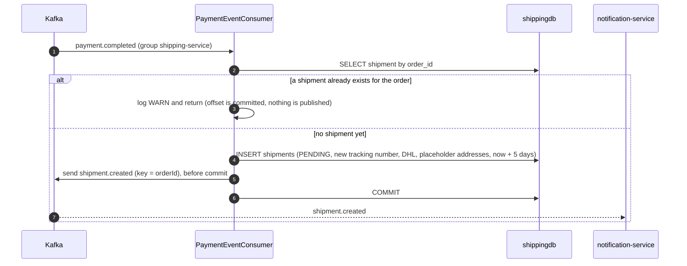
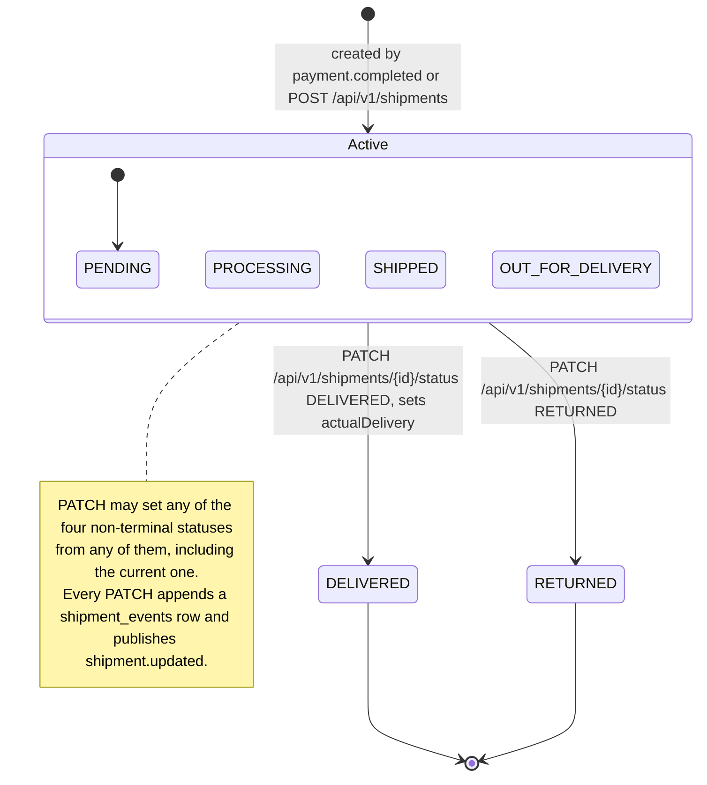
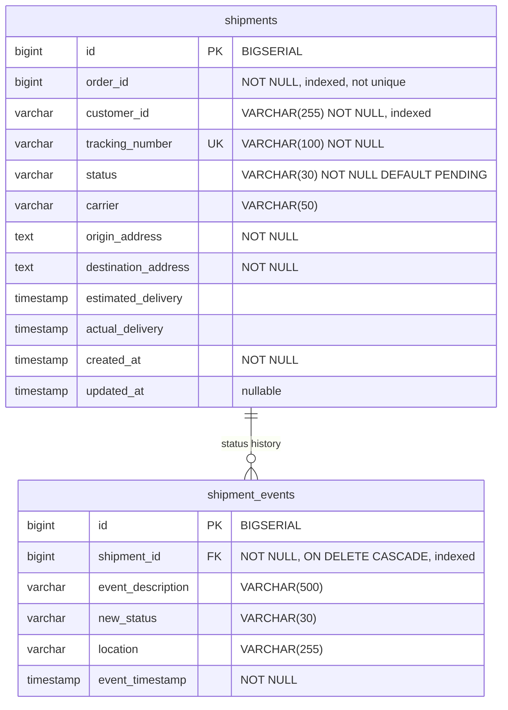

# Shipping service

shipping-service creates and tracks shipments. It normally creates a shipment by itself when payment-service publishes `payment.completed`; a client can also create one through REST. Status changes come only from a REST call, `PATCH /api/v1/shipments/{id}/status`. Nothing in the platform makes that call automatically. Each change appends a row to the shipment's history and publishes `shipment.updated`. A public endpoint returns a shipment by tracking number. The service owns the `shipments` and `shipment_events` tables in `shippingdb`.

| | |
|---|---|
| Repository | `ecommerce-shipping-service` |
| Stack | Java 25 · Spring Boot 4.0.1 · Spring MVC · Spring Data JPA (Hibernate 7.2) · Flyway · spring-kafka 4.0 · Spring Cloud 2025.1.1 Eureka client · springdoc-openapi 2.8.5 · Micrometer (Prometheus) + OpenTelemetry tracing · Lombok |
| Port | 8086 |
| Eureka service ID | `shipping-service` |
| Gateway routes | `/api/v1/shipments/**`. `/api/v1/shipments/tracking/` and everything under it is public for every HTTP method; all other paths need a JWT |
| Data store | PostgreSQL 16 `shippingdb` (Flyway). docker-compose publishes it on host port 5437 |
| Publishes | `shipment.created`, `shipment.updated` |
| Consumes | `payment.completed` (group `shipping-service`) |
| Calls | None. The service has no Feign or HTTP client |
| Called by | The frontend through the gateway: `OrderDetailPage` reads the shipment by order and its history, and `TrackingPage` looks a shipment up by tracking number and reads its history. payment-service reaches it only through Kafka |

## Responsibilities

- Create one shipment per paid order when `payment.completed` arrives, and announce it with `shipment.created`.
- Let a client create a shipment manually (`POST /api/v1/shipments`).
- Change a shipment's status on request, keep a history of the changes, and announce each change with `shipment.updated`.
- Serve lookups by order, by tracking number (public) and the status history.

The service does not do the following:

- It does not schedule or simulate progress. There is no `@Scheduled` job and no carrier integration.
- It does not learn the real delivery address. `payment.completed` does not carry it.
- It does not react to `payment.refunded` or `order.cancelled`.
- It does not update order-service, which does not consume `shipment.*`.

## How a shipment is created



The REST path, `POST /api/v1/shipments` (`ShipmentService.createShipment()`), inserts a row too, but it publishes no event and writes no history row.

## Domain model

### `Shipment` (`model/Shipment.java`, table `shipments`)

| Field | Column | Java type | REST JSON | Notes |
|---|---|---|---|---|
| `id` | `id` | `Long` | number | `BIGSERIAL` identity. Sequential |
| `orderId` | `order_id` | `Long` | number | One shipment per order is checked in code, not in the schema |
| `customerId` | `customer_id` | `String` | string | Copied from `payment.completed`, which in practice holds the username; or taken from the REST body |
| `trackingNumber` | `tracking_number` | `String` | string | `TRACK-` + 8 hex digits + `-` + 1 hex digit (rule 2). `UNIQUE` |
| `status` | `status` | `ShipmentStatus` | string | Starts as `PENDING` (entity default) |
| `carrier` | `carrier` | `String` | string | Free text, at most 50 characters in the database. `DHL` unless the REST request says otherwise |
| `originAddress` | `origin_address` | `String` | string | The Kafka path writes the placeholder `Warehouse, 123 Storage St` |
| `destinationAddress` | `destination_address` | `String` | string | The Kafka path writes the placeholder `Customer Address` |
| `estimatedDelivery` | `estimated_delivery` | `LocalDateTime` | ISO-8601 string | `LocalDateTime.now().plusDays(5)` at creation. Never recalculated |
| `actualDelivery` | `actual_delivery` | `LocalDateTime` | ISO-8601 string or null | Set to now when the status becomes `DELIVERED` |
| `createdAt` | `created_at` | `LocalDateTime` | ISO-8601 string | Builder default `LocalDateTime.now()` |
| `updatedAt` | `updated_at` | `LocalDateTime` | not exposed | Null until the first status change. Set explicitly and by `@PreUpdate` |
| `events` | (shipment_events) | `List<ShipmentEvent>` | not exposed | `@OneToMany(mappedBy = "shipment", cascade = ALL, orphanRemoval = true)`, lazy |

### `ShipmentEvent` (`model/ShipmentEvent.java`, table `shipment_events`)

Each row records one status change. `ShipmentService.updateShipmentStatus()` is the only code that writes these rows. Creating a shipment writes none, so a new shipment has an empty history.

| Field | Column | Java type | Notes |
|---|---|---|---|
| `id` | `id` | `Long` | Identity |
| `shipment` | `shipment_id` | `Shipment` | `@ManyToOne`, lazy, not null |
| `eventDescription` | `event_description` | `String` | The request's `description`, or `Status updated to {STATUS}` when it is omitted. At most 500 characters in the database |
| `newStatus` | `new_status` | `ShipmentStatus` | The status that was set |
| `location` | `location` | `String` | The request's `location`, which may be null. At most 255 characters in the database |
| `eventTimestamp` | `event_timestamp` | `LocalDateTime` | Now. History is returned in ascending order of this field |

### `ShipmentStatus` (`model/ShipmentStatus.java`)

| Value | Meaning in practice |
|---|---|
| `PENDING` | Initial status of every shipment |
| `PROCESSING`, `SHIPPED`, `OUT_FOR_DELIVERY` | Intermediate labels. The code gives them no behaviour and enforces no order between them |
| `DELIVERED` | Terminal. Setting it fills `actualDelivery` |
| `RETURNED` | Terminal |

### Lifecycle

Only `PATCH /api/v1/shipments/{id}/status` changes the status, and its only rule is that `DELIVERED` and `RETURNED` are final. From any other status, any status can be set, including going backwards, jumping straight to `DELIVERED`, or setting the current status again.



## Business rules

1. **One shipment per order.** Both creation paths call `ShipmentRepository.findByOrderId()` first.
   - In `PaymentEventConsumer.handlePaymentCompleted()`, an existing shipment means the service logs a WARN and returns.
   - In `ShipmentService.createShipment()`, it means a 400 with `Shipment already exists for order: {orderId}`.
   - `shipments.order_id` has no unique constraint, so the check is not safe against two concurrent creations.
2. **Tracking number.** Both paths duplicate the expression `"TRACK-" + UUID.randomUUID().toString().substring(0, 10).toUpperCase()`. The first 10 characters of a UUID string are 8 hex digits, a hyphen and 1 more hex digit, so the format is `TRACK-XXXXXXXX-X` (for example `TRACK-3F2A9C1B-4`), with 36 random bits.
   - The column is `UNIQUE`.
   - On the Kafka path, a collision fails the insert. The listener then retries with a fresh number.
   - On the REST path, a collision returns 500.
3. **Carrier.** The Kafka path always uses `DHL`. The REST path uses the request's `carrier`, or `DHL` when it is null. Carrier is free text: there is no carrier enum or list.
4. **Addresses.** The Kafka path hard-codes the origin `Warehouse, 123 Storage St` and the destination `Customer Address`, because `payment.completed` has no address. The address the user enters at checkout never reaches this service. The REST path stores the addresses from the request.
5. **Estimated delivery.** Both paths set `LocalDateTime.now().plusDays(5)` (date and time). `createShipment()` ignores the request's `estimatedDelivery` string, and nothing ever recalculates the value.
6. **Status changes.** `ShipmentService.updateShipmentStatus()` does the following, in this order:
   1. It loads the shipment, or returns 404.
   2. It converts the status with `ShipmentStatus.valueOf()`. The conversion is case-sensitive, and an unknown value gives 500.
   3. It refuses a shipment that is already `DELIVERED` or `RETURNED` with 400, `Cannot update status of a {status} shipment`.
   4. It sets the new status and `updatedAt`, plus `actualDelivery` when the new status is `DELIVERED`.
   5. It appends a `ShipmentEvent`.
   6. It publishes `shipment.updated`.
7. **Events are sent from inside the transaction.** Both publishes happen before the database commit, with a fire-and-forget `KafkaTemplate.send()` (see [Events](#events)).
8. **No endpoint checks the caller's identity.** See [Security and identity](#security-and-identity).

## API

| Method | Path | Gateway auth | Purpose |
|---|---|---|---|
| POST | `/api/v1/shipments` | Bearer JWT | Create a shipment manually. No event is published |
| GET | `/api/v1/shipments/order/{orderId}` | Bearer JWT | Get the shipment of an order |
| GET | `/api/v1/shipments/tracking/{trackingNumber}` | **Public**, any method | Track by tracking number |
| PATCH | `/api/v1/shipments/{id}/status` | Bearer JWT | Change the status, append history, publish `shipment.updated` |
| GET | `/api/v1/shipments/{id}/history` | Bearer JWT | Status history, oldest first |
| GET | `/hello` | Not routed by the gateway | Leftover scaffold greeting (`ShippingController`) |

Full reference: [API reference](../api/shipping-service.md).

## Events

### Published

`messaging/ShipmentEventProducer.java` produces both topics through the `KafkaTemplate<String, Object>` that `config/KafkaProducerConfig.java` builds. It is configured the same way as payment-service's producer:

- **Key:** the order id as a decimal string (`e.getOrderId().toString()`).
- **Value:** spring-kafka's `JacksonJsonSerializer` (Jackson 3), built with `.noTypeInfo()`, so there is no `__TypeId__` header. Its mapper (`KafkaProducerConfig.eventJsonMapper()`) switches on `DateTimeFeature.WRITE_DATES_AS_TIMESTAMPS`, which keeps `LocalDateTime` as the integer array the consumers and pacts expect.
- **Wire types:**
  - `Long` becomes a JSON integer and `String` a string, which can be `null`.
  - `LocalDateTime` becomes an array of integers `[year, month, day, hour, minute, second, nanos]`. The array has 5 to 7 elements because zero seconds and zero nanos are left out.
- **Topics:** the broker auto-creates them; the service declares none.
- **Delivery:**
  - `send()` is asynchronous and the service never checks its result. A failed send is only logged by spring-kafka's `LoggingProducerListener`.
  - Both sends happen inside the JPA transaction, before commit. There are no Kafka transactions and no outbox.

#### `shipment.created`

| | |
|---|---|
| Class | `event/ShipmentCreatedEvent.java` |
| Trigger | `PaymentEventConsumer.handlePaymentCompleted()` after it inserts a new shipment. **REST creation does not publish it** |
| Key | `orderId` |
| Consumers | notification-service only (group `notification-service`, `consumer/ShipmentEventConsumer.onShipmentCreated()`, container factory `shipmentCreatedKafkaListenerContainerFactory` with `JsonDeserializer<ShipmentCreatedEvent>`) |

| Field | Java type | JSON | Value |
|---|---|---|---|
| `shipmentId` | `Long` | integer | The new row's id |
| `orderId` | `Long` | integer | From `payment.completed` |
| `customerId` | `String` | string | From `payment.completed` |
| `trackingNumber` | `String` | string | `TRACK-XXXXXXXX-X` |
| `carrier` | `String` | string | Always `DHL` on this path |
| `estimatedDelivery` | `java.time.LocalDateTime` | integer array | `LocalDateTime.now().plusDays(5)` |

```json
{"shipmentId":31,"orderId":7,"customerId":"alice","trackingNumber":"TRACK-3F2A9C1B-4","carrier":"DHL","estimatedDelivery":[2026,11,3,14,30,15,123456789]}
```

`estimatedDelivery` is a **`LocalDateTime`** on the producer side. The value has date and time, and the database column is `TIMESTAMP`. It therefore travels as a date-time array of up to 7 integers, never as a 3-element date. The notification-service poison-pill incident came from that service's mirror class declaring the field as `LocalDate`. With no `ErrorHandlingDeserializer`, every `shipment.created` record failed in the deserializer and was re-polled forever. The mirror (`ecommerce-notification-service` `event/ShipmentCreatedEvent.java`) now declares `LocalDateTime`, and the Pact contract pins the array form.

#### `shipment.updated`

| | |
|---|---|
| Class | `event/ShipmentUpdatedEvent.java` |
| Trigger | `ShipmentService.updateShipmentStatus()`, which serves `PATCH /api/v1/shipments/{id}/status`. Every successful PATCH publishes one, even when the status does not change |
| Key | `orderId` |
| Consumers | notification-service only (group `notification-service`, `ShipmentEventConsumer.onShipmentUpdated()`) |

| Field | Java type | JSON | Value |
|---|---|---|---|
| `shipmentId` | `Long` | integer | Shipment id |
| `orderId` | `Long` | integer | Shipment's order id |
| `trackingNumber` | `String` | string | |
| `newStatus` | `String` | string | `ShipmentStatus` name |
| `location` | `String` | string or null | The request's `location`. `null` when the request omits it |
| `updatedAt` | `LocalDateTime` | integer array | `LocalDateTime.now()` at publish time |

There is no `customerId` in this event.

```json
{"shipmentId":31,"orderId":7,"trackingNumber":"TRACK-3F2A9C1B-4","newStatus":"SHIPPED","location":"Istanbul hub","updatedAt":[2026,10,30,9,12,44,512000000]}
```

### Consumed

#### `payment.completed`

| | |
|---|---|
| Group id | `shipping-service`, set both in `@KafkaListener(groupId = ...)` and in `consumerFactory()` |
| Listener | `messaging/PaymentEventConsumer.handlePaymentCompleted(PaymentCompletedEvent)`, annotated `@Transactional` (JPA) |
| Container factory | `kafkaListenerContainerFactory` from `config/KafkaProducerConfig.java`. It replaces Spring Boot's factory |
| Deserialization | Keys and values use `StringDeserializer`. The factory's `JacksonJsonMessageConverter` (Jackson 3) then binds the JSON string to `event/PaymentCompletedEvent` (the mirror class) using the listener's parameter type. Type headers are not needed. Unknown fields are ignored, and `completedAt` accepts the integer-array form. Only `KafkaProducerConfig` configures this: there is no Boot Kafka auto-configuration, so `application.yaml` sets nothing but `spring.kafka.bootstrap-servers` |
| Other settings | `auto.offset.reset=earliest`. Concurrency 1 and batch acknowledgement, both spring-kafka defaults |
| Fields used | `orderId` and `customerId`. `paymentId`, `amount`, `transactionId` and `completedAt` are deserialized but ignored |

**Behaviour:** see the sequence diagram above.

1. If a shipment already exists for `orderId`, the listener logs a WARN and returns.
2. Otherwise it inserts a `PENDING` shipment with a new tracking number, carrier `DHL`, placeholder addresses and an estimated delivery five days ahead.
3. It publishes `shipment.created`.
4. The JPA transaction commits.

**Idempotency:** a redelivered event, or a second `payment.completed` for the same order, finds the existing shipment. It creates nothing and publishes nothing. Records are keyed by `orderId` and consumed with concurrency 1, so events for one order are processed one at a time. A REST creation running at the same moment is not covered: there is no unique constraint on `order_id`. If a shipment was created through REST first, the event is skipped and that order never gets a `shipment.created`.

**Failure handling:** the factory sets no error handler, so spring-kafka's default `DefaultErrorHandler` applies.

- **Exceptions thrown by the listener**, such as a database outage or a constraint violation, are retried immediately up to 10 delivery attempts in total, with no back-off. After that the record is logged at ERROR and skipped, and its offset is committed. The paid order is then left without a shipment, and only that log line records it.
- **Payloads that cannot be converted** (malformed JSON or a type mismatch) raise a `ConversionException`. The default handler does not retry these: it logs and skips them on the first failure. Because deserialization itself is only `StringDeserializer`, a bad record cannot jam the poll loop the way it did in notification-service.
- **There is no dead-letter topic.**

## Outbound calls

None. The service has no Feign or HTTP client and does not verify orders or payments with other services.

## Persistence

Flyway migrations live in `src/main/resources/db/migration/`. Hibernate validates the entities against them at startup (`ddl-auto=validate`), and `spring.flyway.baseline-on-migrate` is `true`.

`V1__create_shipments.sql`:

| Column | Type | Constraints and default |
|---|---|---|
| `id` | `BIGSERIAL` | Primary key |
| `order_id` | `BIGINT` | `NOT NULL`, indexed (`idx_shipments_order_id`), **not unique** |
| `customer_id` | `VARCHAR(255)` | `NOT NULL`, indexed (`idx_shipments_customer`) |
| `tracking_number` | `VARCHAR(100)` | `UNIQUE NOT NULL`, plus a second index `idx_shipments_tracking` |
| `status` | `VARCHAR(30)` | `NOT NULL DEFAULT 'PENDING'` |
| `carrier` | `VARCHAR(50)` | |
| `origin_address` | `TEXT` | `NOT NULL` |
| `destination_address` | `TEXT` | `NOT NULL` |
| `estimated_delivery` | `TIMESTAMP` | |
| `actual_delivery` | `TIMESTAMP` | |
| `created_at` | `TIMESTAMP` | `NOT NULL DEFAULT CURRENT_TIMESTAMP` |
| `updated_at` | `TIMESTAMP` | `DEFAULT CURRENT_TIMESTAMP` |

`V2__create_shipment_events.sql`:

| Column | Type | Constraints and default |
|---|---|---|
| `id` | `BIGSERIAL` | Primary key |
| `shipment_id` | `BIGINT` | `NOT NULL REFERENCES shipments(id) ON DELETE CASCADE`, indexed (`idx_shipment_events_shipment`) |
| `event_description` | `VARCHAR(500)` | |
| `new_status` | `VARCHAR(30)` | |
| `location` | `VARCHAR(255)` | |
| `event_timestamp` | `TIMESTAMP` | `NOT NULL DEFAULT CURRENT_TIMESTAMP` |



The entities and the migrations differ in these places:

- `order_id` is indexed but not unique, so one shipment per order is enforced only by the lookup in code.
- `tracking_number` has the index implied by `UNIQUE` and also an explicit `idx_shipments_tracking`. The second index is redundant.
- The SQL defaults for `status`, `created_at` and `updated_at` never apply, because Hibernate inserts every column. `updated_at` is inserted as NULL, and `ShipmentDTO` does not expose it.
- The length limits on `carrier` (50), `event_description` (500) and `location` (255) exist only in the database. The request DTOs do not validate lengths, so an over-long value fails at commit with 500.
- `ON DELETE CASCADE` and `orphanRemoval` exist, but nothing deletes shipments.

## Security and identity

- **Gateway:**
  - `/api/v1/shipments/tracking/` and everything under it needs no token, for any HTTP method. The service maps only `GET` there, so other methods get 405 from the service.
  - Every other `/api/v1/shipments/**` path needs a valid JWT.
  - The gateway does not strip client-supplied `X-User-*` headers on public paths. That does not matter here, because this service reads none of them.
- **Service:** no Spring Security and no `X-User-*` headers. No endpoint checks the caller's role or ownership:

| Endpoint | What a caller can do |
|---|---|
| `POST /api/v1/shipments` | Any logged-in user can create a shipment for any order that has none, with any `customerId` and addresses. That also stops the later `payment.completed` from creating the real one |
| `GET /api/v1/shipments/order/{orderId}` | Any logged-in user can read any order's shipment |
| `GET /api/v1/shipments/tracking/{trackingNumber}` | **Anyone, without a token**, can read the shipment |
| `PATCH /api/v1/shipments/{id}/status` | Any logged-in user can set any shipment's status. Ids are sequential. The user can also set the terminal `DELIVERED` or `RETURNED`, and after that no further change is possible |
| `GET /api/v1/shipments/{id}/history` | Any logged-in user can read any shipment's history |

- **What the public tracking endpoint reveals:** the whole `ShipmentDTO`:
  - `id`, the internal sequential id;
  - `orderId`;
  - `customerId`, which in practice is the customer's username, since the checkout sends the username as the payment's `customerId`;
  - `trackingNumber`, `status` and `carrier`;
  - `originAddress` and `destinationAddress`, which for Kafka-created shipments hold placeholders but for REST-created ones hold whatever addresses were given;
  - `estimatedDelivery`, `actualDelivery` and `createdAt`.

  The frontend `TrackingPage` displays the order number, carrier, dates and both addresses. A tracking number has 36 random bits, and the service does no rate limiting.
- docker-compose publishes port 8086 on the host, so all endpoints, including `PATCH`, are reachable without a token at `http://localhost:8086`.
- The OpenAPI document declares a global `bearerAuth` scheme (`config/OpenApiConfig.java`). It is documentation only.

## Configuration

`src/main/resources/application.yaml`:

| Property | Env var | Default | Purpose |
|---|---|---|---|
| `server.port` | | `8086` | HTTP port |
| `spring.application.name` | | `shipping-service` | Eureka service ID and the `application` metrics tag |
| `spring.datasource.url` | `SPRING_DATASOURCE_URL` | `jdbc:postgresql://localhost:5437/shippingdb` | compose and k8s use `jdbc:postgresql://shippingdb:5432/shippingdb` |
| `spring.datasource.username` | `DB_USERNAME` | `shippinguser` | k8s reads it from secret `shippingdb-credentials` |
| `spring.datasource.password` | `DB_PASSWORD` | `shippingpass` | k8s reads it from secret `shippingdb-credentials` |
| `spring.jpa.hibernate.ddl-auto` | | `validate` | |
| `spring.flyway.enabled` / `locations` / `baseline-on-migrate` | | `true` / `classpath:db/migration` / `true` | |
| `spring.kafka.bootstrap-servers` | `KAFKA_BOOTSTRAP_SERVERS` | `localhost:9092` | compose and k8s use `kafka:29092`. `KafkaProducerConfig` reads it with `@Value` |
| `eureka.client.service-url.defaultZone` | `EUREKA_CLIENT_SERVICEURL_DEFAULTZONE` | `http://localhost:8761/eureka/` | compose and k8s use `http://service-discovery:8761/eureka/` |
| `eureka.client.registry-fetch-interval-seconds` | | `5` | |
| `eureka.instance.prefer-ip-address` | | `true` | |
| `eureka.instance.lease-renewal-interval-in-seconds` / `lease-expiration-duration-in-seconds` | | `5` / `15` | |
| `management.endpoints.web.exposure.include` | | `health,info,metrics,prometheus,circuitbreakers,serviceregistry` | `circuitbreakers` has no effect because resilience4j is absent |
| `management.endpoint.health.show-details` | | `always` | |
| `management.endpoint.prometheus.access` | | `unrestricted` | |
| `management.metrics.tags.application` / `environment` | `ENVIRONMENT` (environment only) | `shipping-service` / `development` | |
| `management.metrics.distribution.percentiles-histogram.http.server.requests` | | `true` | |
| `management.metrics.distribution.slo.http.server.requests` | | `50ms,100ms,200ms,500ms,1s,2s` | |
| `management.tracing.sampling.probability` | `TRACING_SAMPLING_PROBABILITY` | `1.0` | |
| `management.opentelemetry.tracing.export.otlp.endpoint` | `OTEL_EXPORTER_OTLP_ENDPOINT` (base URL) | `http://tempo:4318/v1/traces` | |
| `management.otlp.metrics.export.enabled` | | `false` | |
| `springdoc.api-docs.path` / `springdoc.swagger-ui.path` | | `/api-docs` / `/swagger-ui.html` | Same paths as every service. The gateway's unified Swagger UI loads `/api-docs/shipping-service` from here. `OpenApiConfig` declares a relative `/` server, so Try it out goes through the gateway |
| `logging.pattern.console` | | `%d{yyyy-MM-dd HH:mm:ss} [%thread] [%X{correlationId}] %-5level %logger{36} - %msg%n` | |
| `logging.level.com.ecommerce` | | `DEBUG` | |

The service has no Feign, resilience4j or JWT configuration.

**Deployment:**

- **Image:** `docker/Dockerfile` uses `eclipse-temurin:25-jre-alpine` with the prebuilt `target/shipping-service-*.jar`, runs as a non-root user and exposes 8086.
- **docker-compose:** the same `JAVA_OPTS`, `mem_limit: 768m`, dependencies (healthy `shippingdb`, `kafka`, `service-discovery`) and `/actuator/health` healthcheck as payment-service.
- **Kubernetes** (`ecommerce-platform/k8s/40-services.yaml`):
  - One replica.
  - Init containers wait for service-discovery, shippingdb and kafka.
  - Readiness and startup probes use `/actuator/health/readiness`, and the liveness probe uses `/actuator/health/liveness`.
  - A `preStop` hook marks the instance `OUT_OF_SERVICE` and drains for 15 s.

## Observability

- **Actuator** endpoints are `health` (with details), `info`, `metrics`, `prometheus` and `serviceregistry`, which the k8s `preStop` hook uses.
- **Metrics:** Prometheus scrapes `shipping-service:8086/actuator/prometheus` (job `shipping-service`, labels `service` and `group=application`), and blackbox-exporter probes `/actuator/health`. The generic service alerts apply. The `KafkaConsumerGroupLag` alerts (lag above 1000 is a warning, above 10000 is critical, from kafka-exporter) cover the `shipping-service` group. There are no custom metrics.
- **Logs:** the listener logs the following:
  - INFO `Received payment.completed for orderId=…` and `Shipment created for orderId=…, tracking=…`;
  - WARN `Shipment already exists for orderId=…` for skipped duplicates.

  The producer logs INFO `Publishing shipment.created|updated for orderId=…`, and REST creation logs `Shipment created: tracking=…, orderId=…`. Failed records are logged by spring-kafka's default error handler. Promtail ships the container logs to Loki.
- **Correlation id:** `filter/CorrelationIdFilter.java` handles `X-Correlation-Id` for HTTP requests, through the MDC, the response header and the error body. The Kafka listener thread has no correlation id, so its log lines show `[]`.
- **Tracing:** HTTP server spans are exported to Tempo over OTLP. The hand-built `KafkaTemplate` and listener container factory do not enable observation. Traces therefore neither continue from payment-service into the listener nor into notification-service.

## Testing

Run everything with `mvn verify`. GitHub Actions (`.github/workflows/ci-cd.yml`) runs `mvn -B -ntp verify` and validates the image. It publishes the image for `develop`, `main`, `master` and `v*` tags.

| Class | Kind | What it covers |
|---|---|---|
| `service/ShipmentServiceTest` | Mockito unit | REST creation succeeds with `PENDING`. A duplicate order throws `InvalidShipmentStateException`. An unknown tracking number throws `ShipmentNotFoundException`. Updating a `DELIVERED` shipment throws `InvalidShipmentStateException` |
| `service/ShippingServiceTest`, `controller/ShippingControllerTest` | Unit and `@WebMvcTest` | Only the `/hello` scaffold |
| `contract/PaymentEventsConsumerPactTest` | Pact consumer (`@SpringBootTest`, profile `test`, `@EmbeddedKafka`) | Publishes the pact's example `payment.completed` as raw bytes with no type headers to an embedded broker. It lets the production path process the record: `KafkaProducerConfig`'s container factory, `StringDeserializer` with `JsonMessageConverter`, and the listener. The repository and producer are mocked. It asserts that the saved shipment has `orderId` 7 and `customerId` `customer-42`, and that `shipment.created` is published with `shipmentId` 31. It writes `target/pacts/shipping-service-payment-service.json` |
| `contract/ShipmentEventsProviderPactTest` | Pact provider (`@SpringBootTest`, profile `test`) | Replays notification-service's pact (`src/test/resources/pacts/notification-service-shipping-service.json`). `shipment.created` comes from the real `PaymentEventConsumer` (state `payment 501 for order 7 has completed`). `shipment.updated` comes from the real `updateShipmentStatus()` with `SHIPPED`, `Istanbul hub` and `Left the warehouse` (state `shipment 31 for order 7 is being shipped`). Payloads are serialized with the production `ProducerFactory`'s serializer |
| `contract/KafkaPactDsl` | Helper | Builds `LocalDateTime` matchers in the integer-array form, with a minimum of 5 elements |

**Pact roles:**

- **Consumer of `payment.completed`.** The pact pins the topic, the key regex `\d+`, and the field types: `paymentId` and `orderId` integers, `customerId` and `transactionId` strings, `amount` a number, and `completedAt` an integer array. Every field is in the contract, because the whole record is bound to the mirror class and a type change in any field would break it.
- **Provider of `shipment.created` and `shipment.updated`** for notification-service:
  - `shipment.created` pins `shipmentId` and `orderId` (integers), `customerId`, `trackingNumber` and `carrier` (strings), and `estimatedDelivery` (integer array, at least 5).
  - `shipment.updated` pins `shipmentId` and `orderId` (integers), `trackingNumber`, `newStatus` and `location` (strings), and `updatedAt` (integer array).
  - Both pin the key regex `\d+`.

`ecommerce-platform/sync-pacts.sh` regenerates and copies the pacts.

**`application-test.yaml`** lives in `src/main/resources` and defines the `test` profile that the three `@SpringBootTest` contract tests activate. That profile does the following:

- uses in-memory H2 (`jdbc:h2:mem:testdb;DB_CLOSE_DELAY=-1`) with `ddl-auto: create-drop`;
- disables Flyway;
- sets the Kafka bootstrap to `localhost:9092`, which the consumer test overrides with `@EmbeddedKafka(bootstrapServersProperty = "spring.kafka.bootstrap-servers")`;
- disables the Eureka client.

Because the file sits under `src/main`, it ships inside the production jar, where H2 is absent, so activating the profile in a container would fail at startup. It belongs in `src/test/resources`.

**Gaps:**

- No `ShipmentController` MVC test exists, so the validation-returns-500 defect below is not caught.
- No test covers a successful status update, the history, or the consumer's duplicate-skip branch.
- The Flyway migrations never run in tests.

## Code map

Paths are relative to `src/main/java/com/ecommerce/shipping/`.

| Package or class | Role |
|---|---|
| `ShippingServiceApplication` | Spring Boot entry point |
| `controller/ShipmentController` | REST endpoints under `/api/v1/shipments` |
| `controller/ShippingController`, `service/ShippingService` | `GET /hello` scaffold. Dead code |
| `service/ShipmentService` | REST creation, lookups, status update with history and event, history query, mapping to DTOs |
| `messaging/PaymentEventConsumer` | `payment.completed` listener: creates the shipment and publishes `shipment.created` |
| `messaging/ShipmentEventProducer` | Publishes `shipment.created` and `shipment.updated` |
| `event/PaymentCompletedEvent` | Mirror of payment-service's event, used for consuming |
| `event/ShipmentCreatedEvent`, `event/ShipmentUpdatedEvent` | Published payloads |
| `dto/*` | `CreateShipmentRequest`, `UpdateShipmentStatusRequest`, `ShipmentDTO`, `ShipmentEventDTO` |
| `model/Shipment`, `ShipmentEvent`, `ShipmentStatus` | JPA entities and the status enum |
| `repository/ShipmentRepository`, `ShipmentEventRepository` | Spring Data JPA. `findByCustomerId` is unused |
| `exception/*` | `ShipmentNotFoundException`, `InvalidShipmentStateException`, `ErrorResponse`, `GlobalExceptionHandler` |
| `filter/CorrelationIdFilter` | `X-Correlation-Id` handling and MDC |
| `config/KafkaProducerConfig` | Producer factory (`JacksonJsonSerializer` with `eventJsonMapper()`) and template, consumer factory (`StringDeserializer`), listener container factory (`JacksonJsonMessageConverter`) |
| `config/OpenApiConfig` | OpenAPI title and the `bearerAuth` scheme |

## Known issues and limitations

| Issue | Where | Impact | Severity |
|---|---|---|---|
| No authorization on status changes | `ShipmentController.updateStatus()`, `ShipmentService.updateShipmentStatus()` | Any logged-in user, and self-registration is public, can move any shipment (sequential ids) to any status. That includes the terminal `DELIVERED` or `RETURNED`, after which the API allows no correction. Each change also triggers a `shipment.updated` notification | High |
| The public tracking endpoint returns the full `ShipmentDTO` | `ShipmentController.trackShipment()`, gateway public prefix `/api/v1/shipments/tracking/` | Anyone holding a tracking number sees the customer's username (`customerId`), the order id, the internal id and both addresses. The tracking number has 36 random bits and there is no rate limiting | Medium |
| Validation failures return 500. `GlobalExceptionHandler` has no `MethodArgumentNotValidException` handler, so the catch-all takes it | `exception/GlobalExceptionHandler.java` | A missing or blank required field on `POST /api/v1/shipments` or `PATCH /{id}/status` returns 500 `An unexpected error occurred` instead of 400 with `fieldErrors`, and is logged at ERROR | Medium |
| Kafka-created shipments use placeholder addresses and a fixed carrier | `PaymentEventConsumer.handlePaymentCompleted()` | Every automatically created shipment ships from `Warehouse, 123 Storage St` to `Customer Address` with DHL. The checkout address is never used | Medium |
| The consumer has no dead-letter topic and no back-off | `config/KafkaProducerConfig.kafkaListenerContainerFactory()` | During a database or other transient failure longer than 10 immediate attempts, the `payment.completed` record is logged and skipped. The paid order never gets a shipment and nothing retries it | Medium |
| Events are sent inside the DB transaction, fire-and-forget | `PaymentEventConsumer`, `ShipmentService.updateShipmentStatus()` | If the commit fails, a phantom event has already gone out. For example, a `description` over 500 characters or a `location` over 255 characters gives a 500 after `shipment.updated` was sent. If the send fails after commit, the event is lost and only logged | Medium |
| The REST creation path is incomplete | `ShipmentService.createShipment()` | It publishes no `shipment.created`, writes no history row, ignores `estimatedDelivery`, and does not check that the order exists or is paid. Because the consumer then skips that order, it never gets `shipment.created` | Medium |
| The public tracking page calls an authenticated endpoint | Frontend `pages/tracking/TrackingPage.tsx` calls `GET /api/v1/shipments/{id}/history`, which needs a JWT | An anonymous visitor gets a 401, and the frontend's axios interceptor redirects to `/login` right after the shipment loads | Medium |
| Shipping ignores the rest of the order lifecycle | No listener for `payment.refunded` or `order.cancelled`. order-service has no `shipment.*` listener | A refunded or cancelled order keeps an active shipment, and the order never becomes `SHIPPED` or `DELIVERED` from shipping data | Medium |
| No transition rules other than "terminal is final" | `ShipmentService.updateShipmentStatus()` | Statuses can go backwards (`SHIPPED` to `PENDING`), repeat, or jump from `PENDING` to `DELIVERED`. Each repeat adds history and an event | Low |
| An unknown status string returns 500 | `ShipmentStatus.valueOf()` in `updateShipmentStatus()` | `{"status":"shipped"}` or a typo returns 500 instead of 400 | Low |
| One shipment per order is not enforced in the database | `V1__create_shipments.sql` (`order_id` not unique) | A REST create racing the consumer can produce two rows. After that, `findByOrderId()` throws, so `GET /order/{orderId}` returns 500 and the consumer's check fails for that order | Low |
| Unmapped framework exceptions end in the catch-all as 500 | `GlobalExceptionHandler.general()` | Unknown paths (`NoResourceFoundException`) and a wrong `Content-Type` return 500 instead of 404 or 415 | Low |
| Dead code and configuration: `/hello` with `ShippingService` and their tests; `ShipmentRepository.findByCustomerId()`; `CreateShipmentRequest.estimatedDelivery`; `circuitbreakers` exposure; the redundant `idx_shipments_tracking` index | Various | Misleading to readers. `/hello` is reachable directly on port 8086 | Low |
| `application-test.yaml` lives in `src/main/resources` | `src/main/resources/application-test.yaml` | It ships in the production jar. It belongs in `src/test/resources` | Low |
