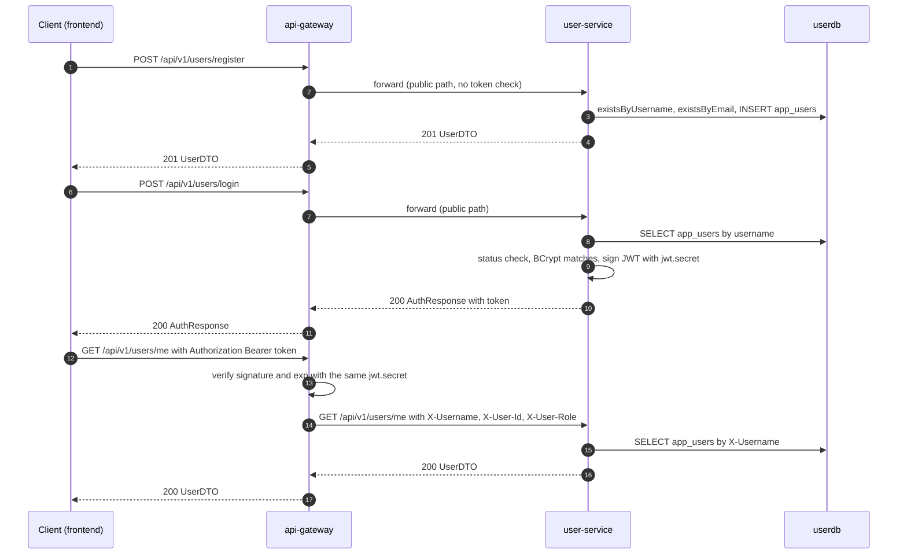
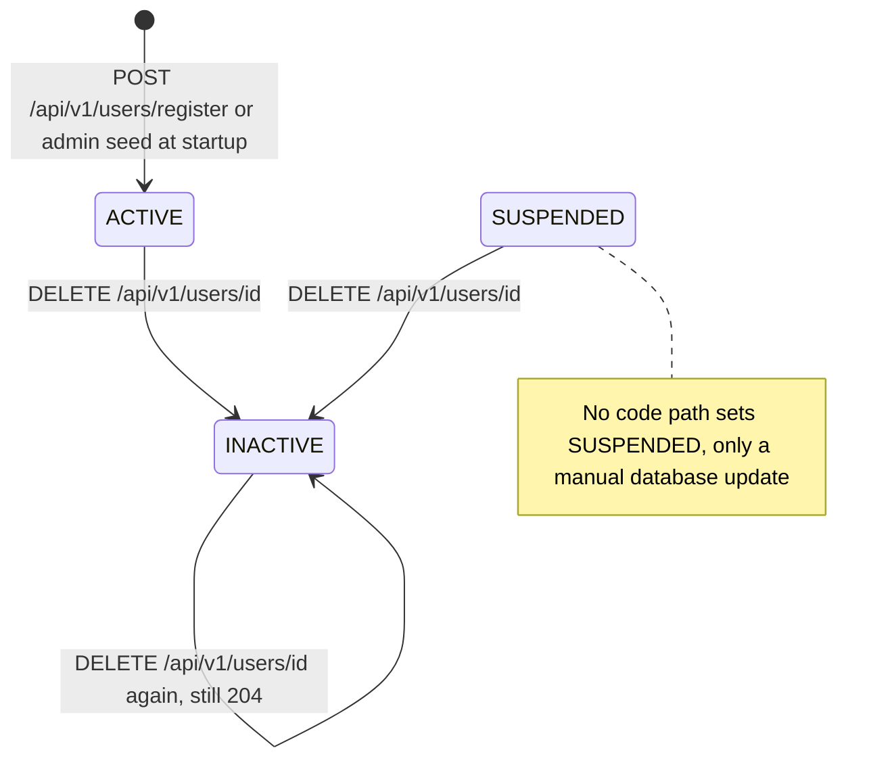
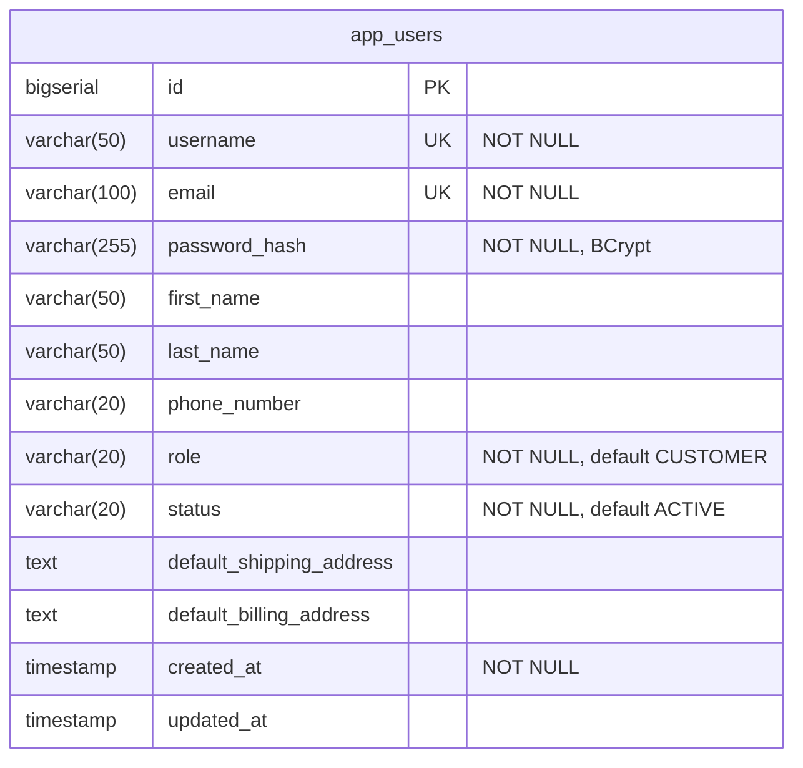

# User service

`user-service` owns user accounts. It registers customers, checks credentials at login and issues the HMAC-signed JWT that the API gateway verifies on every authenticated request; the gateway turns that token's claims into the `X-Username`, `X-User-Id` and `X-User-Role` headers every other service sees. It stores profiles (contact details and default shipping and billing addresses) in its own PostgreSQL database `userdb`, table `app_users`. It does not verify tokens or enforce any authorization itself: it trusts the gateway.

| | |
|---|---|
| Repository | `ecommerce-user-service` |
| Stack | Java 25 · Spring Boot 4.0.9 · Spring MVC (embedded Tomcat) · Spring Data JPA (Hibernate) · Spring Security 7 (BCrypt only; authorization is in the controller) · JJWT 0.12.6 · Flyway · Eureka client (Spring Cloud 2025.1.4) · springdoc 2.8.5 · Micrometer Prometheus · OpenTelemetry · Lombok |
| Port | 8081 |
| Eureka service ID | `user-service` |
| Gateway routes | `/api/v1/users/**` (no path rewriting) |
| Data store | PostgreSQL 16 `userdb` (Flyway), one table: `app_users` |
| Publishes | — |
| Consumes | — |
| Calls | — (no outbound HTTP calls) |
| Called by | `api-gateway` only, carrying client traffic from `ecommerce-frontend` (register, login, `GET /me`, `PUT /{id}`). Prometheus scrapes `/actuator/prometheus` and the blackbox exporter probes `/actuator/health` directly. No backend service calls it. |

Code paths below are relative to `src/main/java/com/ecommerce/user/` unless they start with `src/`.

## Responsibilities

- Register customer accounts (`POST /api/v1/users/register`). Every new account is a `CUSTOMER`.
- Check username and password and issue the platform's JWT (`POST /api/v1/users/login`). user-service is the only token issuer; the gateway is the only verifier.
- Serve and update profiles (`GET /me`, `GET /{id}`, `PUT /{id}`) and soft-delete accounts (`DELETE /{id}`).
- Seed the default `admin` account at startup (`config/DataInitializer.java`).

Not handled anywhere in this service: token verification and authorization (gateway only, see [Security and identity](#security-and-identity)), logout or token revocation, refresh tokens, password change or reset, email verification, changing username, email, role or status, listing or searching users.

### Registration, login and an authenticated call



## Domain model

### `AppUser` (`model/AppUser.java`, table `app_users`)

| Field | Column | Java type | In `UserDTO` | Notes |
|---|---|---|---|---|
| `id` | `id` | `Long` | yes | `BIGSERIAL`, `GenerationType.IDENTITY`, sequential. Signed into the JWT as `userId`. |
| `username` | `username` | `String` | yes | Unique. 3-50 characters of `[a-zA-Z0-9_]` (validated at registration only). Cannot be changed. Signed into the JWT as `sub`. |
| `email` | `email` | `String` | yes | Unique, at most 100 characters. Cannot be changed. |
| `passwordHash` | `password_hash` | `String` | no | BCrypt hash, see rule 4. |
| `firstName` | `first_name` | `String` | yes | Optional, at most 50. |
| `lastName` | `last_name` | `String` | yes | Optional, at most 50. |
| `phoneNumber` | `phone_number` | `String` | yes | Optional, at most 20, no format check. |
| `role` | `role` | `UserRole`, `@Enumerated(STRING)` | yes, as a string | Entity default `CUSTOMER`. |
| `status` | `status` | `UserStatus`, `@Enumerated(STRING)` | yes, as a string | Entity default `ACTIVE`. |
| `defaultShippingAddress` | `default_shipping_address` | `String` | yes | Free text (`TEXT`). The frontend pre-fills checkout with it. |
| `defaultBillingAddress` | `default_billing_address` | `String` | yes | Free text (`TEXT`). Same use. |
| `createdAt` | `created_at` | `LocalDateTime` | yes | Set in Java when the entity is built. |
| `updatedAt` | `updated_at` | `LocalDateTime` | no | Set by `updateUser()` and `deleteUser()`, and again by the `@PreUpdate` callback. `NULL` until the first change. |

### `UserRole` (`model/UserRole.java`)

| Value | Meaning | How a user gets it |
|---|---|---|
| `CUSTOMER` | Ordinary shopper. | Every registration: `UserService.register()` hard-codes it and `RegisterRequest` has no role field. |
| `ADMIN` | Administrator. | Only the startup seed in `DataInitializer.run()` (username `admin`) or a manual SQL update. No migration inserts an admin and no endpoint changes a role. |

user-service never reads a role to decide anything. It copies the role into the JWT `role` claim and the gateway forwards it as `X-User-Role`. Downstream, review-service is the only backend that reads `X-User-Role` (an admin may delete any review, `ReviewService.deleteReview()`), and the frontend uses `AuthResponse.role` to show its admin pages.

### `UserStatus` (`model/UserStatus.java`)

| Value | Meaning | Set by |
|---|---|---|
| `ACTIVE` | Can log in. | Registration and the admin seed. |
| `INACTIVE` | Soft-deleted. Login is refused with the generic 401. | `DELETE /api/v1/users/{id}` (`UserService.deleteUser()`). |
| `SUSPENDED` | Login is refused with the generic 401. | Nothing in the code. Only a manual database update can set it. |

No code path returns an account to `ACTIVE`.



## Business rules

1. New accounts are always `CUSTOMER` and `ACTIVE`, whatever the request body says. Unknown JSON properties such as `role` are silently ignored (Jackson 3 default). Enforced by `UserService.register()`.
2. Usernames are unique. The username is checked first, with `existsByUsername`; a duplicate is 409 `Username already taken: <username>`. Enforced by `UserService.register()` and the `UNIQUE` constraint on `app_users.username`.
3. Emails are unique. A duplicate is 409 `Email already registered: <email>`. Enforced by `UserService.register()` and the `UNIQUE` constraint on `app_users.email`. Both checks are exact, case-sensitive matches. `register()` is not `@Transactional`, so two concurrent registrations of the same username or email can both pass the checks; the loser fails on the `UNIQUE` constraint (`DataIntegrityViolationException`) and gets 409 `Resource already exists or violates a constraint`, which names neither field.
4. Password policy (`validation/PasswordPolicy`, on `RegisterRequest`): 10 to 72 UTF-8 bytes, must not contain the username, must not be on the common-password list (`CommonPasswords`); a violation is a 400 field error on `password`. Passwords are stored as BCrypt hashes: `SecurityConfig.passwordEncoder()` returns a `BoundedPasswordEncoder` (rule 14) around `new BCryptPasswordEncoder()`, version `$2a`, cost factor 10 and a random salt per hash, giving a 60-character string.
5. Login looks the user up by exact username. Unknown username, wrong password, `INACTIVE` and `SUSPENDED` all give the same 401 `Invalid username or password`, and an unknown user still pays one BCrypt comparison, through the same hashing gate (rule 14) as a known user, so the gate adds no timing difference between them. Enforced by `UserService.login()`.
6. Lockout (`service/LoginAttemptService`): 5 failed logins for a username within 15 minutes lock it until the oldest failure leaves the window; the next login is 429 `Too many failed login attempts. Try again later.` with `Retry-After`. Unknown usernames count too. In memory per instance, bounded to 10,000 keys, cleared by a success.
7. `GET`, `PUT` and `DELETE /{id}` are owner-or-admin: the path id must equal `X-User-Id`, or `X-User-Role` must be exactly `ADMIN`; otherwise 403 `Access denied`, and missing identity is 401. `/me` without `X-Username` is 401. Enforced by `UserController`.
8. A successful login issues a JWT (see [JWT issued at login](#jwt-issued-at-login)) and returns `AuthResponse` with `expiresIn` in seconds (`jwt.expiration-ms / 1000`, so 3600). Login writes nothing durable: `login()` is not `@Transactional`, its only database call is the username lookup, and there is no last-login timestamp. Enforced by `UserService.login()` and `JwtService.generateToken()`.
9. Profile updates are partial. Each of `firstName`, `lastName`, `phoneNumber`, `defaultShippingAddress` and `defaultBillingAddress` changes only when it is non-null in the request, so a field cannot be cleared back to null (an empty string is accepted). Username, email, password, role and status cannot be changed through the API. Enforced by `UserService.updateUser()`.
10. Delete is a soft delete: the status becomes `INACTIVE` and the row stays, so the username and email stay taken. Deleting an already inactive user succeeds again with 204. Enforced by `UserService.deleteUser()`.
11. Reads return users in any status: `/me` and `/{id}` do not filter on status. `UserService.getUserById()`, `UserService.getUserByUsername()`.
12. At startup, if `ADMIN_PASSWORD` (`app.admin.password`) is set and no user named `admin` exists, one is created with email `admin@ecommerce.com`, that password (at least 12 characters), name `Admin User`, role `ADMIN`, status `ACTIVE`; the password is never logged. With no `ADMIN_PASSWORD` no admin is seeded. An existing `admin` still on the former built-in password `admin` is rotated to `ADMIN_PASSWORD` once; any other existing password is left alone. `run()` is not `@Transactional`, so when two replicas start together and both find no `admin`, the one that loses the insert on the unique constraint logs `Administrator account 'admin' was created by another instance, left unchanged.` and starts normally. Any other database failure while seeding, and an `ADMIN_PASSWORD` shorter than 12 characters or longer than 72 bytes, still stops startup. Enforced by `DataInitializer.run()`.
13. Error bodies use fixed messages (no type names), and client errors are 404/405/406/415/409 rather than 500. `GlobalExceptionHandler`.
14. Password hashing is bounded. `BoundedPasswordEncoder` lets at most `app.hashing.max-concurrent` BCrypt operations run at once (0, the default, means one per CPU the JVM sees: 2 with the `-XX:ActiveProcessorCount=2` that compose and Kubernetes set) and `app.hashing.max-waiting` more (default 32) wait for a turn. A call beyond that is refused at once with `ServiceBusyException`, which `GlobalExceptionHandler` answers with 503 `Service temporarily unavailable` and `Retry-After: 1`. Registration and every login, known user or not, go through the same gate. `register()` and `login()` are not `@Transactional`: each repository call (the existence checks and the insert; the username lookup) is handled on its own, so no pooled database connection is held while BCrypt runs. Enforced by `service/BoundedPasswordEncoder`, `UserService` and `GlobalExceptionHandler`.

## API

| Method | Path | Gateway auth | Purpose |
|---|---|---|---|
| POST | `/api/v1/users/register` | Public | Create a customer account |
| POST | `/api/v1/users/login` | Public | Check credentials and issue a JWT |
| GET | `/api/v1/users/me` | Bearer JWT | The caller's profile, resolved from `X-Username` |
| GET | `/api/v1/users/{id}` | Bearer JWT | A user's profile by id (owner or `ADMIN`) |
| PUT | `/api/v1/users/{id}` | Bearer JWT | Partial update of a user's profile (owner or `ADMIN`) |
| DELETE | `/api/v1/users/{id}` | Bearer JWT | Soft-delete a user (owner or `ADMIN`) |

Full reference: [User service API reference](../api/user-service.md).

## Events

This service does not use Kafka: there is no `spring-kafka` dependency, producer or listener. Registration, profile changes and deactivation are not announced to other services.

## Outbound calls

None. There is no Feign client, `RestTemplate`, `RestClient` or `WebClient`. The service registers with Eureka so that the gateway can resolve `lb://user-service`. The Eureka client also fetches the registry every 5 seconds (`fetch-registry` is left at its default, `true`), but nothing in this service uses it.

## Persistence

Flyway applies `classpath:db/migration` on startup; there is one migration, `src/main/resources/db/migration/V1__create_app_users.sql`. Hibernate then validates the schema against the entity (`spring.jpa.hibernate.ddl-auto: validate`), so a mismatch stops the service at startup.

| Column | Type | Constraints | DB default |
|---|---|---|---|
| `id` | `BIGSERIAL` | `PRIMARY KEY` | sequence |
| `username` | `VARCHAR(50)` | `UNIQUE NOT NULL` | |
| `email` | `VARCHAR(100)` | `UNIQUE NOT NULL` | |
| `password_hash` | `VARCHAR(255)` | `NOT NULL` | |
| `first_name` | `VARCHAR(50)` | | |
| `last_name` | `VARCHAR(50)` | | |
| `phone_number` | `VARCHAR(20)` | | |
| `role` | `VARCHAR(20)` | `NOT NULL` | `'CUSTOMER'` |
| `status` | `VARCHAR(20)` | `NOT NULL` | `'ACTIVE'` |
| `default_shipping_address` | `TEXT` | | |
| `default_billing_address` | `TEXT` | | |
| `created_at` | `TIMESTAMP` | `NOT NULL` | `CURRENT_TIMESTAMP` |
| `updated_at` | `TIMESTAMP` | | `CURRENT_TIMESTAMP` |

Indexes: the primary key and the two `UNIQUE` constraints create their own indexes. V1 adds `idx_app_users_username` (username) and `idx_app_users_email` (email), which duplicate the unique indexes, and `idx_app_users_status` (status), which no query uses. V1 uses `CREATE TABLE IF NOT EXISTS` and `CREATE INDEX IF NOT EXISTS`.



Queries (`repository/UserRepository.java`): `findByUsername`, `existsByUsername`, `existsByEmail`, plus `findById` and `save` from `JpaRepository`. `findByEmail` is declared but never called.

Where the entity and the migration disagree, or the defaults never apply:

- Column names, lengths and nullability match.
- The `updated_at` default never applies. Hibernate inserts every mapped column, so a new row gets an explicit `NULL` in `updated_at`; it is filled on the first update or delete.
- The `role`, `status` and `created_at` defaults never apply either: the entity always supplies them (`@Builder.Default`, plus an explicit `createdAt(LocalDateTime.now())` in `register()`).
- Timestamps are `TIMESTAMP` without time zone, written from `LocalDateTime.now()` in the JVM's default time zone. Nothing in the Dockerfile, the compose file or the Kubernetes manifests sets one.
- `spring.flyway.baseline-on-migrate: true` with the default baseline version 1: against a non-empty database that has no Flyway history table, Flyway records a baseline at version 1 and does not run V1.
- The unit and pact tests never run the migration: the `test` profile uses H2 with `ddl-auto: create-drop` and `spring.flyway.enabled: false`, so the schema there comes from the entity. `UserRepositoryIT` and `UserApiIT` run it on Postgres.

## Security and identity

### Trust model

- `config/SecurityConfig.java` builds a stateless filter chain with CSRF disabled and `anyRequest().permitAll()`; no authentication mechanism is configured (no JWT resource server, no HTTP Basic, no form login). Authorization is done in `UserController` from the identity headers. Spring Security contributes its request firewall and default response headers. Boot still creates its default in-memory user and logs a generated password at startup, which nothing can use.
- user-service does not validate JWTs. `JwtService.validateAndExtractClaims()`, `extractUsername()` and `isTokenValid()` exist, but nothing calls them.
- Headers read: `X-Username` (`/me`), `X-User-Id` and `X-User-Role` (`/{id}` owner-or-admin; the role must be exactly `ADMIN`). `X-Correlation-Id` is read by `filter/CorrelationIdFilter.java` and kept only if it matches `^[A-Za-z0-9._-]{1,64}$`. `SecurityHeadersFilter` adds `nosniff` and `Cache-Control: no-store`; `ActuatorLoopbackFilter` answers 403 for `/actuator/serviceregistry` from non-loopback addresses.
- Through the gateway the trust holds: the gateway strips client identity headers and sets them from the token. Without the gateway it does not: docker-compose publishes port 8081 on the host, and a direct call can send any identity headers. In Kubernetes the Service is `ClusterIP`, so direct access is limited to callers inside the cluster.
- CORS is configured only at the gateway. user-service has no CORS configuration.

### Endpoint authorization

| Endpoint | Gateway | user-service | Identity used | Role or ownership check |
|---|---|---|---|---|
| `POST /api/v1/users/register` | Public | `permitAll` | none | none |
| `POST /api/v1/users/login` | Public | `permitAll` | none | none |
| `GET /api/v1/users/me` | Bearer JWT | controller | `X-Username` | 401 without it |
| `GET /api/v1/users/{id}` | Bearer JWT | controller | `X-User-Id`, `X-User-Role` | owner or `ADMIN`; 401 without identity, else 403 |
| `PUT /api/v1/users/{id}` | Bearer JWT | controller | `X-User-Id`, `X-User-Role` | owner or `ADMIN` |
| `DELETE /api/v1/users/{id}` | Bearer JWT | controller | `X-User-Id`, `X-User-Role` | owner or `ADMIN` |
| `/api-docs` | Public, as `/api-docs/user-service` (the unified Swagger UI's spec route) | `permitAll` | none | none |
| `/actuator/**`, `/swagger-ui.html` | Not routed to user-service (reachable only on port 8081) | `permitAll` | none | `serviceregistry` loopback only |

`GET /api/v1/users/internal/{username}` was removed; the gateway also answers 404 for any `/internal/` path.

### JWT issued at login

`JwtService.generateToken()` builds the token with JJWT 0.12.6 (`jjwt-api`, `jjwt-impl`, `jjwt-jackson`):

```java
Jwts.builder()
    .subject(username)
    .claim("userId", userId)
    .claim("role", role)
    .issuedAt(new Date())
    .expiration(new Date(System.currentTimeMillis() + expirationMs))
    .signWith(key)
```

| Part | Name | JSON type | Value |
|---|---|---|---|
| header | `alg` | string | Chosen by JJWT from the secret's length (below). `HS512`, since the secret is at least 64 bytes. |
| payload | `sub` | string | `AppUser.username`. The gateway forwards it as `X-Username`. |
| payload | `userId` | number (integer) | `AppUser.id`, a `Long` signed as a JSON number. The gateway reads it untyped and forwards `String.valueOf(it)` as `X-User-Id`. |
| payload | `role` | string | `CUSTOMER` or `ADMIN`. The gateway forwards it as `X-User-Role`. |
| payload | `iat` | number | Issue time, seconds since the epoch. |
| payload | `exp` | number | `iat` plus `jwt.expiration-ms` (3,600,000 ms, so one hour), in seconds. |

There is no `iss`, `aud`, `jti`, `nbf` or `typ`. Decoded example:

```json
{ "header": { "alg": "HS512" },
  "payload": { "sub": "alice", "userId": 42, "role": "CUSTOMER", "iat": 1793296800, "exp": 1793300400 } }
```

- **Key and algorithm.** `JwtService.getSigningKey()` calls `Keys.hmacShaKeyFor(jwt.secret.getBytes(UTF_8))`; the secret must be at least 64 bytes (checked by a `@PostConstruct`, so a short or missing secret stops startup), so tokens are HS512. The `test` profile secret is 71 bytes.
- **Where the secret comes from.** `jwt.secret` reads `${JWT_SECRET}` with no default. `ecommerce-platform/init-secrets.sh` generates it into the git-ignored `.env`; docker-compose requires it for both user-service and api-gateway, and `deploy.sh` creates the Kubernetes Secret `platform-secrets` from it.
- **It must match the gateway.** The gateway verifies with `Keys.hmacShaKeyFor()` over its own `jwt.secret`, so the two strings must be byte-identical. If they differ, login still returns 200 (it is a public path) but every authenticated request gets 401 from the gateway.
- **Lifetime.** One hour (`jwt.expiration-ms: 3600000`, not overridden in compose or Kubernetes). There is no refresh token and no revocation: the gateway checks only the signature and `exp`, so a token stays valid after its account is deleted.
- **Shared HMAC secret.** Whoever holds the secret, the gateway included, can mint a token for any username and role.

### Roles and the admin account

`DataInitializer` (an `ApplicationRunner`) is the only source of `ADMIN`. It seeds `admin` / `admin@ecommerce.com` only from `ADMIN_PASSWORD` (12 to 72 bytes, no default, never logged; `init-secrets.sh` generates it), and does nothing when the variable is unset. An existing admin still on the old `admin` password is rotated to `ADMIN_PASSWORD` once. No endpoint can change the admin password.

### Downstream use of the identity

The gateway turns `sub`, `userId` and `role` into `X-Username`, `X-User-Id` and `X-User-Role`. user-service uses all three; order-, payment-, shipping- and review-service use `X-Username` (owner) and `X-User-Role` (exact `ADMIN`).

## Configuration

`src/main/resources/application.yaml`. Any property can also be overridden through its relaxed-binding environment variable (for example `JWT_EXPIRATIONMS` for `jwt.expiration-ms`); the table lists the placeholders the file declares.

| Property | Env var | Default | Purpose |
|---|---|---|---|
| `server.port` | | `8081` | HTTP port |
| `spring.application.name` | | `user-service` | Eureka service ID and the `application` metrics tag |
| `spring.datasource.url` | `SPRING_DATASOURCE_URL` | `jdbc:postgresql://localhost:5432/userdb` | compose and Kubernetes set `jdbc:postgresql://userdb:5432/userdb` |
| `spring.datasource.username` | `DB_USERNAME` | `useruser` | Kubernetes reads it from Secret `userdb-credentials` |
| `spring.datasource.password` | `DB_PASSWORD` | `userpass` | Kubernetes reads it from Secret `userdb-credentials` |
| `spring.datasource.hikari.connection-timeout` | | `5000` | A request waits at most 5 s for a pooled connection (Hikari's default is 30 s), then fails as a 503 `Service temporarily unavailable` instead of holding a Tomcat thread for half a minute |
| `spring.datasource.hikari.data-source-properties.connectTimeout` / `socketTimeout` / `tcpKeepAlive` | | `5` / `30` / `true` | pgjdbc settings, in seconds: a TCP connect to PostgreSQL gives up after 5 s and a read blocks for at most 30 s. pgjdbc has no socket timeout by default, so a database that stops answering (dropped packets, frozen host) would hold a request thread for minutes |
| `spring.jpa.hibernate.ddl-auto` | | `validate` | Hibernate checks the schema; Flyway owns it |
| `spring.jpa.open-in-view` | | `false` | With it on, the first query of a request keeps its connection checked out until the response is written, which let a flood of logins or registrations use up the pool. Nothing here renders a view or lazy-loads after the service layer returns |
| `spring.jpa.show-sql`, `...hibernate.format_sql` | | `false` | |
| `spring.flyway.enabled`, `locations`, `baseline-on-migrate` | | `true`, `classpath:db/migration`, `true` | See [Persistence](#persistence) |
| `eureka.client.service-url.defaultZone` | `EUREKA_CLIENT_SERVICEURL_DEFAULTZONE` | `http://localhost:8761/eureka/` | compose and Kubernetes: `http://service-discovery:8761/eureka/` |
| `eureka.client.registry-fetch-interval-seconds` | | `5` | Default 30; shared setting so a replaced peer is seen quickly. Unused here (no peer calls) |
| `eureka.instance.prefer-ip-address` | (`EUREKA_INSTANCE_PREFER_IP_ADDRESS` in Kubernetes) | `true` | Pod hostnames are not resolvable by other pods, so the instance registers its IP |
| `eureka.instance.lease-renewal-interval-in-seconds` / `lease-expiration-duration-in-seconds` | | `5` / `15` | Defaults 30 / 90: a crashed instance leaves the registry within about 20 s |
| `jwt.secret` | `JWT_SECRET` | none | HMAC signing key, at least 64 bytes or startup fails. Must equal the gateway's `jwt.secret` |
| `app.admin.password` | `ADMIN_PASSWORD` | empty | Seeds the `admin` account; none is created when empty. 12 characters minimum |
| `jwt.expiration-ms` | | `3600000` | Token lifetime; `AuthResponse.expiresIn` is this divided by 1000 |
| `app.hashing.max-concurrent` | | `0` | BCrypt operations that may run at once; 0 means one per CPU the JVM sees. See rule 14 |
| `app.hashing.max-waiting` | | `32` | Further operations allowed to wait for a turn; beyond that a call is refused with 503 and `Retry-After: 1` |
| `management.endpoints.web.exposure.include` | | `health,info,metrics,prometheus,circuitbreakers,serviceregistry` | `circuitbreakers` does not exist here (no Resilience4j on the classpath) |
| `management.endpoint.health.show-details` | | `never` | Status only |
| `management.endpoint.prometheus.access` | | `unrestricted` | |
| `management.metrics.tags.application` / `environment` | `ENVIRONMENT` (for `environment`) | `user-service` / `development` | Common tags on every metric |
| `management.metrics.distribution.percentiles-histogram.http.server.requests` | | `true` | Histogram buckets for latency percentiles |
| `management.metrics.distribution.slo.http.server.requests` | | `50ms,100ms,200ms,500ms,1s,2s` | SLO buckets |
| `management.tracing.sampling.probability` | `TRACING_SAMPLING_PROBABILITY` | `1.0` | Every request traced |
| `management.opentelemetry.tracing.export.otlp.endpoint` | `OTEL_EXPORTER_OTLP_ENDPOINT` (base URL) | `http://tempo:4318` + `/v1/traces` | OTLP over HTTP to Tempo |
| `management.otlp.metrics.export.enabled` | | `false` | Metrics are scraped by Prometheus instead |
| `springdoc.api-docs.path` / `springdoc.swagger-ui.path` | | `/api-docs` / `/swagger-ui.html` | |
| `logging.pattern.console` | | `%d{yyyy-MM-dd HH:mm:ss} [%thread] [%X{correlationId:-}] [%X{traceId:-}] %-5level %logger{36} - %msg%n` | The format every Java service shares |
| `logging.level.com.ecommerce` / `org.springframework.security` | | `INFO` / `WARN` | `LOGGING_LEVEL_COM_ECOMMERCE=DEBUG` turns the debug detail back on |
| `logging.level.org.hibernate.orm.jdbc.error` / `org.springframework.transaction.interceptor.TransactionInterceptor` | | `OFF` | Muted: Hibernate wrote two `WARN` lines for every failed statement or connection attempt, and the interceptor a rollback stack trace of several hundred lines for every transaction in flight when its connection died. `GlobalExceptionHandler` reports the failure once per window with its root cause |

Not used by this service: Kafka, Feign, Resilience4j, Spring Cloud LoadBalancer.

`src/main/resources/application-test.yaml` (profile `test`, used by the Pact test) switches to in-memory H2 (`jdbc:h2:mem:testdb`, `ddl-auto: create-drop`), disables Flyway and the Eureka client, and sets a 71-byte test JWT secret. The file sits in `src/main/resources`, so it ships inside the jar; H2 is a test-scoped dependency, so the profile cannot start outside tests.

### Deployment

- **Image** (`docker/Dockerfile`): `eclipse-temurin:25-jre-alpine`, copies the jar built on the host (`target/user-service-*.jar`), runs as the unprivileged user `app`, exposes 8081, starts with `sh -c "exec java $JAVA_OPTS -jar app.jar"` so the JVM is PID 1 and receives SIGTERM.
- **docker-compose** (`ecommerce-platform/docker-compose.yml`): `mem_limit: 768m`; `JAVA_OPTS=-XX:MaxRAMPercentage=55 -XX:ActiveProcessorCount=2 -XX:+ExitOnOutOfMemoryError -XX:-HeapDumpOnOutOfMemoryError`; waits for `userdb` and `service-discovery` to be healthy; health check `wget` on `/actuator/health` (interval 10 s, 20 retries, 90 s start period); publishes `8081:8081`. `userdb` is `postgres:16-alpine` with `useruser`/`userpass`, published on host port 5432.
- **Kubernetes** (`ecommerce-platform/k8s/40-services.yaml`): one replica of `ecommerce/user-service:local`, `ClusterIP` Service on 8081; init containers wait for `service-discovery:8761` and `userdb:5432`; requests 100m CPU / 320Mi, limit 768Mi; startup and readiness probes on `/actuator/health/readiness`, liveness on `/actuator/health/liveness` (probe groups enabled by `MANAGEMENT_ENDPOINT_HEALTH_PROBES_ENABLED` in ConfigMap `java-env`). The `preStop` hook POSTs `{"status":"OUT_OF_SERVICE"}` to `/actuator/serviceregistry` and sleeps 15 s, so peers stop routing to the pod before SIGTERM starts Boot's graceful shutdown; `terminationGracePeriodSeconds: 60` covers both. `userdb` is a StatefulSet with an extra `userdb-lb` LoadBalancer Service on 5432.
- **CI** (`.github/workflows/ci-cd.yml`): `mvn -B -ntp verify` on JDK 25 (unit, slice and Pact tests), then a Docker build without credentials, then on `develop`, `main`, `master` or a `v*` tag a push to Docker Hub as `<DOCKERHUB_USERNAME>/ecommerce-user-service:sha-<12 chars>` plus `latest`, `develop` or the tag name.

## Observability

- **Actuator** (port 8081, not routed through the gateway): `health` (status only), `info`, `metrics`, `prometheus`, `serviceregistry` (loopback only). In Kubernetes also `health/liveness` and `health/readiness`.
- **Metrics**: Boot's built-in meters (HTTP server requests with percentile histograms and the SLO buckets above, JVM, Hikari, Tomcat) tagged `application=user-service` and `environment`. No custom metrics. Prometheus job `user-service` scrapes `user-service:8081/actuator/prometheus` (`ecommerce-monitoring/prometheus/prometheus.yml`, `ecommerce-platform/k8s/05-monitoring-config.yaml`); the `blackbox-http` job probes `/actuator/health`; `postgres-exporter-userdb` exports database metrics.
- **Tracing**: `spring-boot-starter-opentelemetry` exports spans over OTLP HTTP to Tempo, sampling 100% by default. The service makes no outbound calls, so it contributes only its own server-side spans.
- **Correlation id**: `CorrelationIdFilter` takes `X-Correlation-Id` from the request, or generates a random UUID, puts it in the MDC as `correlationId`, echoes it in the response header and removes it from the MDC afterwards. Error bodies carry it as `correlationId`. The gateway does not generate one (it only exposes the header to browsers through CORS), so unless the client sends one the id is minted here.
- **Logs**: the console pattern prints the correlation id and the trace id (`%X{traceId:-}`) of the request being handled. Promtail ships container logs to Loki. `com.ecommerce` logs at `INFO`. Notable `INFO` lines, all real events: `User registered successfully: <username>`, `Login successful for user: <username>`, `User soft-deleted: <username>` and the result of the admin seeding. `Registering user: <username>`, `Login attempt for user: <username>` and `Client disconnected on <method> <uri>` (the caller went away mid-response) are `DEBUG`. Logged user input goes through `util/LogSanitizer`.
- **Throttled lines**: what a client or an outage can repeat at request rate is written once per 10 s for each key (`logging/LogThrottle`); when lines were dropped, the next one ends with `(N similar suppressed)`. A failed login is a `WARN`, `Login failed for user: <username>` (key `login-failed`), and a login refused by the lockout is `Login refused for user <username>: too many failed attempts` (key `login-locked`). A lost dependency is answered 503 `Service temporarily unavailable` and logged as one `WARN` without a stack trace for each exception class, `Service unavailable on <method> <uri> (correlationId=...): <exception>: <message>; root cause <exception>: <message>`. Matched are JDBC, connection-pool and Hibernate connection failures (`CannotGetJdbcConnectionException`, `CannotCreateTransactionException`, `DataAccessResourceFailureException`, `TransientDataAccessException`, `JDBCConnectionException`, `SQLTransientConnectionException`, `SQLRecoverableException`, `SQLTimeoutException`), a `TransactionException` or `TransactionSystemException` with an SQL exception behind it (a commit or rollback that failed because the connection died), and `ServiceBusyException` from the hashing gate. Any other 500 is one `ERROR` with its stack trace, `Unhandled exception on <method> <uri> (correlationId=...)`, for each failure site (exception class and first frame in `com.ecommerce`) per window.

## Testing

| Test class | Kind | Covers |
|---|---|---|
| `service/UserServiceTest` | Mockito unit | register (success, duplicate username, duplicate email); login (success, wrong password, unknown user, inactive and suspended accounts); get by id; update; soft delete sets `INACTIVE` |
| `service/JwtServiceTest` | unit | the token user-service issues: claims, expiry and signature |
| `controller/UserControllerTest` | `@WebMvcTest` with a mocked `UserService` | every endpoint's status codes and validation errors |
| `config/DataInitializerTest` | unit | the `admin` seed is created once and skipped when it already exists; losing the insert to another replica (unique constraint) is not a startup failure, while a database outage still is |
| `exception/GlobalExceptionHandlerTest`, `filter/CorrelationIdFilterTest` | unit | each exception-to-status mapping including the client-error and catch-all handlers and the 503 for a lost database and for a full hashing gate (with `Retry-After`); the correlation ID in the MDC and the response header (only a valid incoming id is kept) |
| `service/BoundedPasswordEncoderTest`, `config/PasswordEncoderConfigTest` | unit | the hashing gate: never more than the limit at once, queued callers get their turn, a full queue is refused at once, slots come back after the queue drains or a hash fails, nonsensical limits are rejected; the application's encoder is that gate around BCrypt cost 10 (`$2a$10$`, 60 characters) |
| `service/UserServiceLoggingTest`, `exception/GlobalExceptionHandlerLoggingTest`, `logging/LogThrottleTest` | unit | the log volume: a flood of failed logins for unknown users is one `WARN` per window and a locked-out user gets a line of its own; the attempt and registering lines are `DEBUG` and successes stay `INFO`; a dead database or pool is 503 with one short `WARN` naming the root cause, a bug is one `ERROR` with its trace per failure site, a client disconnect is `DEBUG`, and request and exception text cannot forge log lines; the throttle itself (window, suppressed count, key bound, concurrent callers, failure-site keys) |
| `config/LoggingConfigTest` | unit | the committed `application.yaml`: log pattern, `INFO` level, the muted Hibernate and transaction loggers, no SQL logging, the 5 s pool wait, `open-in-view: false`, the hashing limits |
| `contract/UserServiceProviderPactTest` | Pact provider | the gateway's pact (2 interactions) and the frontend's pact (6), see below |
| `integration/UserRepositoryIT` | Testcontainers `postgres:16-alpine` | the real Flyway migration; defaults; enums stored as names; unique username and email (case-sensitive); column lengths |
| `integration/UserApiIT` | full app on a random port, Postgres | register, login, then `/me` resolved from the issued token; duplicates 409; invalid payload 400 with field errors; seeded admin logs in; a soft-deleted user cannot log in; update; the password never appears in a response; the correlation ID is echoed; actuator health |
| `integration/DatabaseUnavailableIT` | full app on a random port, Postgres | the 5 s pool wait and the driver timeouts (connect 5 s, socket 30 s, read back from the live connection) come from `application.yaml`; with the pool's only connection held, requests wait 5 s, get 503 `Service temporarily unavailable` and write one `WARN` without a stack trace, and the service answers again once a connection is free |
| `integration/DatabaseConnectionLossIT` | full app, Postgres | terminating every database backend, as a restart does, never gives a 500, writes at most two `WARN` lines without stack traces and no `ERROR`, and the service recovers by itself |
| `integration/PasswordHashingResourceIT` | full app, Postgres | registration, login and a login for an unknown user hold no pooled connection while they hash; the seeded admin can log in through the gate |
| `integration/CommandLineArgumentsIT` | `main` with the `test` profile (H2) | a command-line property reaches the application: `main` passes its arguments to `SpringApplication.run` |

266 unit, slice and pact tests (`mvn test`) and 112 integration tests (`mvn verify`, needs Docker).

No tests are disabled for bugs any more; the `@Tag("security")` suite covers ownership, lockout, password policy and error bodies.

The controller test's mock `AuthResponse` uses `expiresIn(3600000L)`, a millisecond value in a field that holds seconds; the assertions do not check it.

### Pact: user-service as provider for api-gateway

The gateway's consumer tests (`UserServiceConsumerPactTest`, `UserServiceJwtConsumerPactTest` in `ecommerce-api-gateway`) write `api-gateway-user-service.json`; `ecommerce-platform/sync-pacts.sh` copies it into `src/test/resources/pacts/`, and `UserServiceProviderPactTest` replays it on every build. There is no Pact broker. The test boots the full application on a random port with the `test` profile (H2) and `@Provider("user-service")`. The provider state `user alice exists` deletes and re-inserts a customer `alice` with id 42, email `alice@example.com`, status `ACTIVE` and the BCrypt hash of `alice-password-1`.

| Interaction | Type | What it pins |
|---|---|---|
| `a profile request forwarded for the authenticated user alice` | HTTP | `GET /api/v1/users/me` with `X-Username: alice`, `X-User-Id: 42`, `X-User-Role: CUSTOMER` returns 200 `application/json` with `id` (integer), `username` equal to `"alice"` (proves the profile was resolved from `X-Username`), and `email`, `role`, `status` (strings). Replayed over HTTP through the real filter chain, controller, service and JPA. |
| `a JWT issued to alice at login` | Message | The token from a real `UserService.login(alice, alice-password-1)`, decoded by the test into `{"header": <JOSE header>, "payload": <claims>}`. Pins `header.alg` matching `HS(256\|384\|512)`, `payload.sub` string, `payload.userId` integer, `payload.role` string, `payload.iat` and `payload.exp` integers. |

The numeric `userId` matters: the gateway once read the claim as a `String`, JJWT threw `RequiredTypeException`, and every authenticated request got 401 (comment in the gateway's `JwtAuthenticationFilter`). The same provider test also replays the frontend's pact, `ecommerce-frontend-user-service.json` (6 interactions: login with the right and a wrong password, register, a duplicate registration, `/me`, update), through a gateway emulation that decodes the bearer token into `X-Username`, `X-User-Id` and `X-User-Role`. Not pinned by any pact: `/{id}`. Run the Pact test alone with `mvn test -Dtest='*PactTest'`.

## Code map

| Path | Role |
|---|---|
| `UserServiceApplication.java` | Spring Boot entry point; passes the command-line arguments to `SpringApplication.run` |
| `config/SecurityConfig.java` | `BoundedPasswordEncoder` bean (BCrypt behind the hashing gate); stateless, CSRF-off, permit-all filter chain (authorization is in the controller) |
| `config/DataInitializer.java` | `ApplicationRunner` that seeds the `admin` account from `ADMIN_PASSWORD` |
| `config/OpenApiConfig.java` | springdoc `OpenAPI` bean: title "User Service API", a global HTTP bearer (`bearerAuth`) requirement |
| `controller/UserController.java` | All six endpoints under `/api/v1/users` |
| `dto/RegisterRequest.java`, `dto/LoginRequest.java`, `dto/UpdateUserRequest.java` | Request bodies with Bean Validation |
| `dto/UserDTO.java`, `dto/AuthResponse.java` | Response bodies |
| `exception/GlobalExceptionHandler.java`, `exception/ErrorResponse.java` | `@RestControllerAdvice` mapping exceptions to status codes and the error body |
| `exception/UserNotFoundException.java`, `UserAlreadyExistsException.java`, `InvalidCredentialsException.java` | Domain exceptions, mapped to 404, 409 and 401 |
| `filter/CorrelationIdFilter.java`, `SecurityHeadersFilter.java`, `ActuatorLoopbackFilter.java` | `X-Correlation-Id` to MDC and response header; `nosniff` and `no-store`; loopback-only `serviceregistry` |
| `service/LoginAttemptService.java`, `validation/*`, `util/LogSanitizer.java` | login lockout; password policy; log sanitising |
| `model/AppUser.java`, `model/UserRole.java`, `model/UserStatus.java` | JPA entity and enums |
| `repository/UserRepository.java` | Spring Data JPA repository |
| `service/BoundedPasswordEncoder.java`, `exception/ServiceBusyException.java` | the hashing gate (`max-concurrent` running, `max-waiting` queued) and the exception it throws when full, answered 503 with `Retry-After: 1` |
| `logging/LogThrottle.java` | at most one log line per key and 10 s window, with a count of the dropped ones and a key per failure site |
| `service/UserService.java` | Registration, login, profile reads and updates, soft delete, DTO mapping |
| `service/JwtService.java` | Token issuing; unused validation helpers |
| `src/main/resources/application.yaml`, `application-test.yaml` | Configuration (default and `test` profile) |
| `src/main/resources/db/migration/V1__create_app_users.sql` | Schema |
| `docker/Dockerfile`, `.github/workflows/ci-cd.yml` | Image and CI/CD |

## Known issues and limitations

| Issue | Where | Impact | Severity |
|---|---|---|---|
| ~~No ownership or role check on `/{id}`~~ | fixed | see the security fix spec | — |
| ~~Public `/internal/{username}` endpoint~~ | fixed | see the security fix spec | — |
| ~~Default admin `admin`/`admin`, logged~~ | fixed | see the security fix spec | — |
| ~~Committed default JWT secret~~ | fixed | see the security fix spec | — |
| Identity headers trusted; service port published | `UserController`; `docker-compose.yml` (`8081:8081`) | In the compose stack, anyone who can reach host port 8081 can forge `X-User-Id` and `X-User-Role`. The JWT validation helpers in `JwtService` are unused. | Medium |
| Deactivation does not revoke tokens | `UserService.deleteUser()`; the gateway checks only signature and `exp` | A deleted (`INACTIVE`) account keeps full API access until its token expires, up to one hour. | Low |
| ~~Account status leak at login~~ | fixed | see the security fix spec | — |
| ~~No login throttling; weak password policy~~ | fixed | see the security fix spec | — |
| ~~Passwords over 72 bytes fail with 500~~ | fixed | see the security fix spec | — |
| ~~Concurrent duplicate registration fails with 500~~ | fixed | see the security fix spec | — |
| ~~Some client errors become 500~~ | fixed | see the security fix spec | — |
| ~~Framework internals in 400 messages~~ | fixed | see the security fix spec | — |
| Uniqueness is case-sensitive | `existsByUsername()`, `existsByEmail()`; `UNIQUE` on `VARCHAR` in V1 | `Alice` and `alice`, or `A@x.com` and `a@x.com`, can be separate accounts. | Low |
| Deleted identities stay reserved; `SUSPENDED` is never set | `UserService.deleteUser()`, `model/UserStatus.java` | A deactivated user cannot re-register with the same username or email, and there is no reactivation endpoint. `SUSPENDED` exists only for manual database edits. | Low |
| ~~Weak or late JWT secret checks~~ | fixed | see the security fix spec | — |
| ~~Unauthenticated `serviceregistry`~~ | fixed | see the security fix spec | — |
| ~~Frontend loses login errors~~ | fixed | `ecommerce-frontend/src/api/axios.ts` does not treat the 401 of `POST /users/login` as an expired session, so the login page keeps its error alert. Any other 401 clears the stored session and goes to `/login`, without reloading the page when it is already there. | — |
| Dead code and configuration | `JwtService.validateAndExtractClaims()`, `extractUsername()`, `isTokenValid()`; `UserRepository.findByEmail()`; the redundant `permitAll()` matchers; `circuitbreakers` in the actuator exposure; `idx_app_users_username` and `idx_app_users_email` (duplicate the unique indexes); `idx_app_users_status` (unused); the `updated_at` default | Maintenance noise, and extra index writes on every insert. | Low |
| No request-body limit of its own | `UserController`; Tomcat and Jackson defaults | The only bound on a JSON string field is Jackson 3's default maximum of 100,000,000 characters. The gateway caps routed traffic at 1 MB, so this matters only for direct access to port 8081, which `docker-compose.yml` publishes. | Low |
| Login lockout counters are bounded and per replica | `service/LoginAttemptService` | The counters live in memory as an LRU map of at most 10,000 usernames, each entry lasting 15 minutes. A flood of distinct usernames can push an entry out early, and every replica keeps its own counts. | Low |
| The hashing gate bounds threads, not CPU share, and nothing limits per client | `service/BoundedPasswordEncoder` | At most `max-concurrent + max-waiting` threads (34 on a pod that sees 2 CPUs) can be inside password hashing, so a flood of logins cannot occupy all of Tomcat's threads, but those hashes still take CPU from the rest of the pod. One client can take every slot; apart from the per-username lockout there is no per-IP or per-user limiting. | Low |
