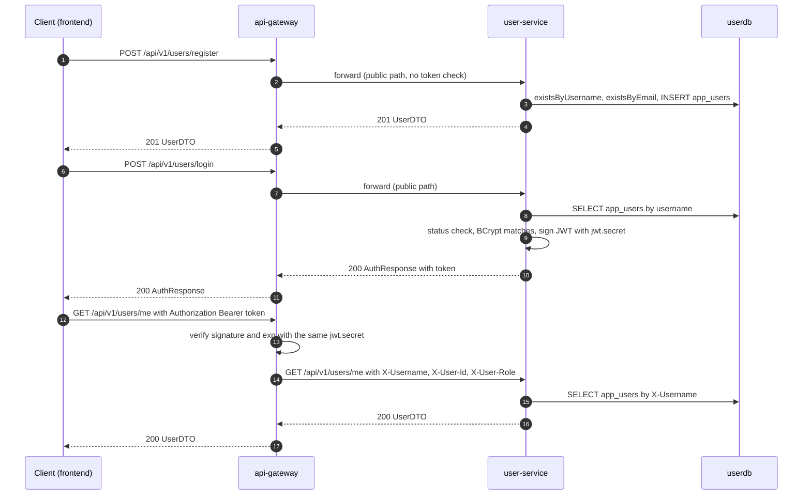
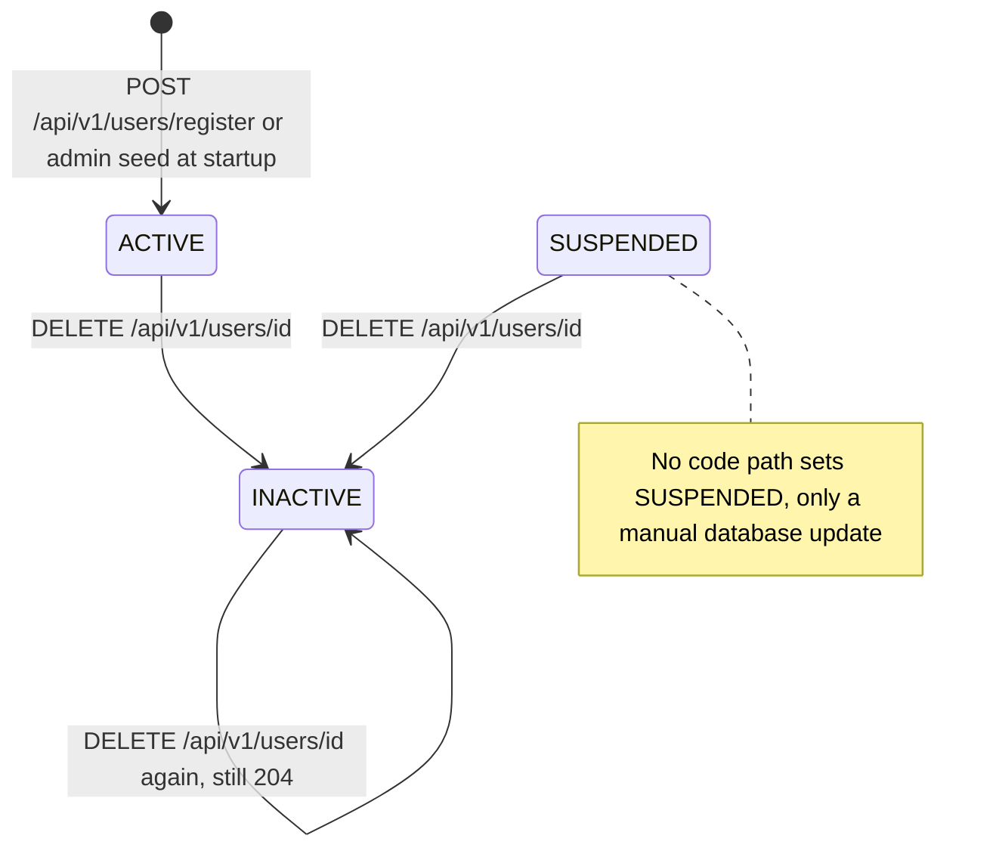
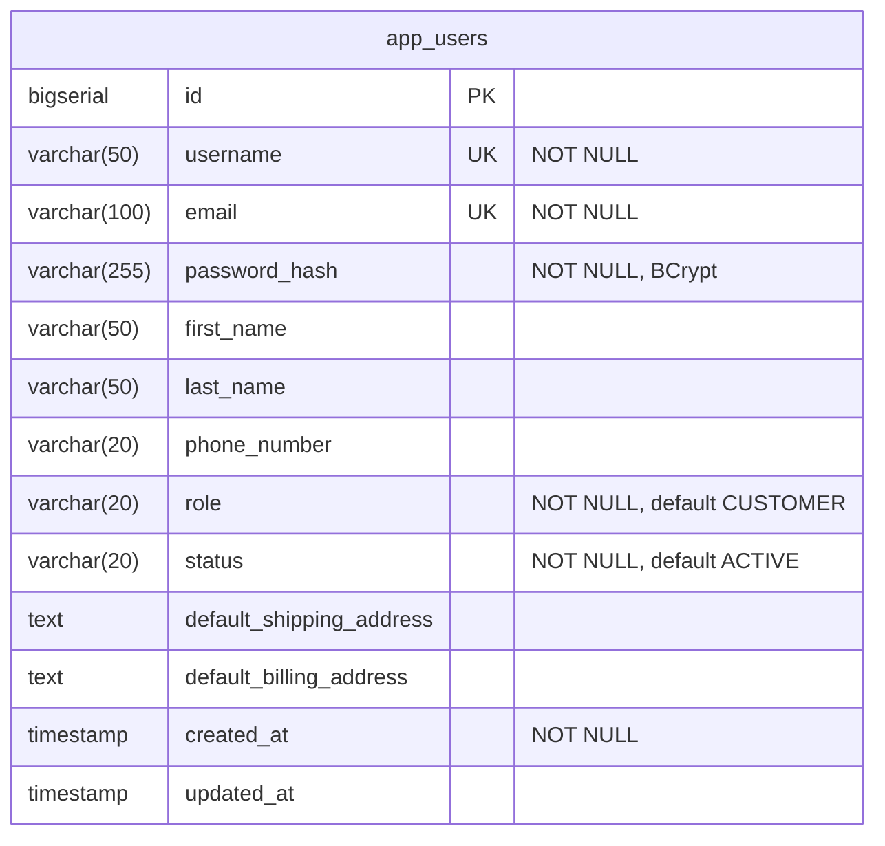

# User service

`user-service` owns user accounts. It registers customers, checks credentials at login and issues the HMAC-signed JWT that the API gateway verifies on every authenticated request; the gateway turns that token's claims into the `X-Username`, `X-User-Id` and `X-User-Role` headers every other service sees. It stores profiles (contact details and default shipping and billing addresses) in its own PostgreSQL database `userdb`, table `app_users`. It does not verify tokens or enforce any authorization itself: it trusts the gateway.

| | |
|---|---|
| Repository | `ecommerce-user-service` |
| Stack | Java 25 · Spring Boot 4.0.1 · Spring MVC (embedded Tomcat) · Spring Data JPA (Hibernate) · Spring Security 7 (BCrypt only; every request is permitted) · JJWT 0.12.6 · Flyway · Eureka client (Spring Cloud 2025.1.1) · springdoc 2.8.5 · Micrometer Prometheus · OpenTelemetry · Lombok |
| Port | 8081 |
| Eureka service ID | `user-service` |
| Gateway routes | `/api/v1/users/**` (no path rewriting) |
| Data store | PostgreSQL 16 `userdb` (Flyway), one table: `app_users` |
| Publishes | — |
| Consumes | — |
| Calls | — (no outbound HTTP calls) |
| Called by | `api-gateway` only, carrying client traffic from `ecommerce-frontend` (register, login, `GET /me`, `PUT /{id}`). Prometheus scrapes `/actuator/prometheus` and the blackbox exporter probes `/actuator/health` directly. No backend service calls it. |

Code paths below are relative to `src/main/java/com/ecommerce/user/` unless they start with `src/`.

## Responsibilities

- Register customer accounts (`POST /api/v1/users/register`). Every new account is a `CUSTOMER`.
- Check username and password and issue the platform's JWT (`POST /api/v1/users/login`). user-service is the only token issuer; the gateway is the only verifier.
- Serve and update profiles (`GET /me`, `GET /{id}`, `PUT /{id}`) and soft-delete accounts (`DELETE /{id}`).
- Seed the default `admin` account at startup (`config/DataInitializer.java`).

Not handled anywhere in this service: token verification and authorization (gateway only, see [Security and identity](#security-and-identity)), logout or token revocation, refresh tokens, password change or reset, email verification, changing username, email, role or status, listing or searching users.

### Registration, login and an authenticated call



## Domain model

### `AppUser` (`model/AppUser.java`, table `app_users`)

| Field | Column | Java type | In `UserDTO` | Notes |
|---|---|---|---|---|
| `id` | `id` | `Long` | yes | `BIGSERIAL`, `GenerationType.IDENTITY`, sequential. Signed into the JWT as `userId`. |
| `username` | `username` | `String` | yes | Unique. 3-50 characters of `[a-zA-Z0-9_]` (validated at registration only). Cannot be changed. Signed into the JWT as `sub`. |
| `email` | `email` | `String` | yes | Unique, at most 100 characters. Cannot be changed. |
| `passwordHash` | `password_hash` | `String` | no | BCrypt hash, see rule 4. |
| `firstName` | `first_name` | `String` | yes | Optional, at most 50. |
| `lastName` | `last_name` | `String` | yes | Optional, at most 50. |
| `phoneNumber` | `phone_number` | `String` | yes | Optional, at most 20, no format check. |
| `role` | `role` | `UserRole`, `@Enumerated(STRING)` | yes, as a string | Entity default `CUSTOMER`. |
| `status` | `status` | `UserStatus`, `@Enumerated(STRING)` | yes, as a string | Entity default `ACTIVE`. |
| `defaultShippingAddress` | `default_shipping_address` | `String` | yes | Free text (`TEXT`). The frontend pre-fills checkout with it. |
| `defaultBillingAddress` | `default_billing_address` | `String` | yes | Free text (`TEXT`). Same use. |
| `createdAt` | `created_at` | `LocalDateTime` | yes | Set in Java when the entity is built. |
| `updatedAt` | `updated_at` | `LocalDateTime` | no | Set by `updateUser()` and `deleteUser()`, and again by the `@PreUpdate` callback. `NULL` until the first change. |

### `UserRole` (`model/UserRole.java`)

| Value | Meaning | How a user gets it |
|---|---|---|
| `CUSTOMER` | Ordinary shopper. | Every registration: `UserService.register()` hard-codes it and `RegisterRequest` has no role field. |
| `ADMIN` | Administrator. | Only the startup seed in `DataInitializer.run()` (username `admin`) or a manual SQL update. No migration inserts an admin and no endpoint changes a role. |

user-service never reads a role to decide anything. It copies the role into the JWT `role` claim and the gateway forwards it as `X-User-Role`. Downstream, review-service is the only backend that reads `X-User-Role` (an admin may delete any review, `ReviewService.deleteReview()`), and the frontend uses `AuthResponse.role` to show its admin pages.

### `UserStatus` (`model/UserStatus.java`)

| Value | Meaning | Set by |
|---|---|---|
| `ACTIVE` | Can log in. | Registration and the admin seed. |
| `INACTIVE` | Soft-deleted. Login is refused with 401 `Account is inactive`. | `DELETE /api/v1/users/{id}` (`UserService.deleteUser()`). |
| `SUSPENDED` | Login is refused with 401 `Account is suspended`. | Nothing in the code. Only a manual database update can set it. |

No code path returns an account to `ACTIVE`.



## Business rules

1. New accounts are always `CUSTOMER` and `ACTIVE`, whatever the request body says. Unknown JSON properties such as `role` are silently ignored (Jackson 3 default). Enforced by `UserService.register()`.
2. Usernames are unique. The username is checked first, with `existsByUsername`; a duplicate is 409 `Username already taken: <username>`. Enforced by `UserService.register()` and the `UNIQUE` constraint on `app_users.username`.
3. Emails are unique. A duplicate is 409 `Email already registered: <email>`. Enforced by `UserService.register()` and the `UNIQUE` constraint on `app_users.email`. Both checks are exact, case-sensitive matches, and check-then-insert is not atomic: a concurrent duplicate passes the check and fails on the constraint with 500.
4. Password policy: not blank and at least 8 characters (`RegisterRequest.password`). There is no complexity rule and no validated maximum. Passwords are stored as BCrypt hashes: `new BCryptPasswordEncoder()` in `SecurityConfig.passwordEncoder()`, which in Spring Security 7.0.2 means version `$2a`, cost factor 10 (2^10 rounds) and a random salt per hash, giving a 60-character string. Spring Security 7's BCrypt refuses to hash a password longer than 72 bytes, so such a registration fails with 500.
5. Login looks the user up by exact username. An unknown username is 401 `Invalid username or password`. Enforced by `UserService.login()`.
6. `INACTIVE` and `SUSPENDED` accounts are refused with 401 `Account is inactive` or `Account is suspended`. This check runs before the password check, so it answers whatever password is supplied. Enforced by `UserService.login()`.
7. A wrong password is 401 `Invalid username or password` (BCrypt `matches`). Enforced by `UserService.login()`.
8. A successful login issues a JWT (see [JWT issued at login](#jwt-issued-at-login)) and returns `AuthResponse` with `expiresIn` in seconds (`jwt.expiration-ms / 1000`, so 3600). Login writes nothing: it runs in a read-only transaction, with no last-login timestamp and no failed-attempt counter. Enforced by `UserService.login()` and `JwtService.generateToken()`.
9. Profile updates are partial. Each of `firstName`, `lastName`, `phoneNumber`, `defaultShippingAddress` and `defaultBillingAddress` changes only when it is non-null in the request, so a field cannot be cleared back to null (an empty string is accepted). Username, email, password, role and status cannot be changed through the API. Enforced by `UserService.updateUser()`.
10. Delete is a soft delete: the status becomes `INACTIVE` and the row stays, so the username and email stay taken. Deleting an already inactive user succeeds again with 204. Enforced by `UserService.deleteUser()`.
11. Reads return users in any status: `/me`, `/{id}` and `/internal/{username}` do not filter on status. `UserService.getUserById()`, `UserService.getUserByUsername()`.
12. At startup, if no user named `admin` exists, one is created with email `admin@ecommerce.com`, password `admin`, name `Admin User`, role `ADMIN`, status `ACTIVE`, and the password is written to the log. An existing `admin` row is left as it is (not reactivated, not re-roled). Enforced by `DataInitializer.run()`.
13. No endpoint checks ownership or role. Any request that reaches the service is served. `SecurityConfig.securityFilterChain()`; see [Security and identity](#security-and-identity).

## API

| Method | Path | Gateway auth | Purpose |
|---|---|---|---|
| POST | `/api/v1/users/register` | Public | Create a customer account |
| POST | `/api/v1/users/login` | Public | Check credentials and issue a JWT |
| GET | `/api/v1/users/me` | Bearer JWT | The caller's profile, resolved from `X-Username` |
| GET | `/api/v1/users/{id}` | Bearer JWT | Any user's profile by id (no ownership check) |
| PUT | `/api/v1/users/{id}` | Bearer JWT | Partial update of any user's profile (no ownership check) |
| DELETE | `/api/v1/users/{id}` | Bearer JWT | Soft-delete any user (no ownership check) |
| GET | `/api/v1/users/internal/{username}` | Public | Any user's profile by username. Labelled service-to-service; nothing calls it |

Full reference: [User service API reference](../api/user-service.md).

## Events

This service does not use Kafka: there is no `spring-kafka` dependency, producer or listener. Registration, profile changes and deactivation are not announced to other services.

## Outbound calls

None. There is no Feign client, `RestTemplate`, `RestClient` or `WebClient`. The service registers with Eureka so that the gateway can resolve `lb://user-service`. The Eureka client also fetches the registry every 5 seconds (`fetch-registry` is left at its default, `true`), but nothing in this service uses it.

## Persistence

Flyway applies `classpath:db/migration` on startup; there is one migration, `src/main/resources/db/migration/V1__create_app_users.sql`. Hibernate then validates the schema against the entity (`spring.jpa.hibernate.ddl-auto: validate`), so a mismatch stops the service at startup.

| Column | Type | Constraints | DB default |
|---|---|---|---|
| `id` | `BIGSERIAL` | `PRIMARY KEY` | sequence |
| `username` | `VARCHAR(50)` | `UNIQUE NOT NULL` | |
| `email` | `VARCHAR(100)` | `UNIQUE NOT NULL` | |
| `password_hash` | `VARCHAR(255)` | `NOT NULL` | |
| `first_name` | `VARCHAR(50)` | | |
| `last_name` | `VARCHAR(50)` | | |
| `phone_number` | `VARCHAR(20)` | | |
| `role` | `VARCHAR(20)` | `NOT NULL` | `'CUSTOMER'` |
| `status` | `VARCHAR(20)` | `NOT NULL` | `'ACTIVE'` |
| `default_shipping_address` | `TEXT` | | |
| `default_billing_address` | `TEXT` | | |
| `created_at` | `TIMESTAMP` | `NOT NULL` | `CURRENT_TIMESTAMP` |
| `updated_at` | `TIMESTAMP` | | `CURRENT_TIMESTAMP` |

Indexes: the primary key and the two `UNIQUE` constraints create their own indexes. V1 adds `idx_app_users_username` (username) and `idx_app_users_email` (email), which duplicate the unique indexes, and `idx_app_users_status` (status), which no query uses. V1 uses `CREATE TABLE IF NOT EXISTS` and `CREATE INDEX IF NOT EXISTS`.



Queries (`repository/UserRepository.java`): `findByUsername`, `existsByUsername`, `existsByEmail`, plus `findById` and `save` from `JpaRepository`. `findByEmail` is declared but never called.

Where the entity and the migration disagree, or the defaults never apply:

- Column names, lengths and nullability match.
- The `updated_at` default never applies. Hibernate inserts every mapped column, so a new row gets an explicit `NULL` in `updated_at`; it is filled on the first update or delete.
- The `role`, `status` and `created_at` defaults never apply either: the entity always supplies them (`@Builder.Default`, plus an explicit `createdAt(LocalDateTime.now())` in `register()`).
- Timestamps are `TIMESTAMP` without time zone, written from `LocalDateTime.now()` in the JVM's default time zone. Nothing in the Dockerfile, the compose file or the Kubernetes manifests sets one.
- `spring.flyway.baseline-on-migrate: true` with the default baseline version 1: against a non-empty database that has no Flyway history table, Flyway records a baseline at version 1 and does not run V1.
- Tests never run the migration. The `test` profile uses H2 with `ddl-auto: create-drop` and `spring.flyway.enabled: false`, so the schema in tests comes from the entity.

## Security and identity

### Trust model

- `config/SecurityConfig.java` builds a stateless filter chain with CSRF disabled and `anyRequest().permitAll()`, commented "Gateway handles auth; service trusts X-Username header". The explicit `permitAll()` matchers before it (register and login, `/api/v1/users/internal/**`, `/actuator/**`, Swagger paths) change nothing. No authentication mechanism is configured: no JWT resource server, no HTTP Basic, no form login. In effect Spring Security contributes only its request firewall and its default response headers (`Cache-Control: no-cache, no-store, max-age=0, must-revalidate`, `X-Content-Type-Options: nosniff`, `X-Frame-Options: DENY`). Boot still creates its default in-memory user and logs "Using generated security password" at startup; nothing uses it.
- user-service does not validate JWTs. `JwtService.validateAndExtractClaims()`, `extractUsername()` and `isTokenValid()` exist, but nothing calls them.
- Headers read: `X-Username`, on `GET /api/v1/users/me` only (`UserController.getMe()`). `X-User-Id` and `X-User-Role` are never read. `X-Correlation-Id` is read by `filter/CorrelationIdFilter.java`.
- Through the gateway the trust holds for `/me`: the path needs a token and the gateway overwrites `X-Username` with the token's `sub`. (The frontend also sets `X-Username` on its `/me` calls; the gateway overwrites it.) Without the gateway it does not hold: docker-compose publishes port 8081 on the host, and a direct call with any `X-Username` returns that user's profile, while every other endpoint needs no token at all. In Kubernetes the Service is `ClusterIP`, so direct access is limited to callers inside the cluster.
- CORS is configured only at the gateway. user-service has no CORS configuration.

### Endpoint authorization

| Endpoint | Gateway | user-service | Identity used | Role or ownership check |
|---|---|---|---|---|
| `POST /api/v1/users/register` | Public | `permitAll` | none | none |
| `POST /api/v1/users/login` | Public | `permitAll` | none | none |
| `GET /api/v1/users/me` | Bearer JWT | `permitAll` | `X-Username` | none needed: the gateway sets the header from the token |
| `GET /api/v1/users/{id}` | Bearer JWT | `permitAll` | none | **none**: any authenticated user can read any profile |
| `PUT /api/v1/users/{id}` | Bearer JWT | `permitAll` | none | **none**: any authenticated user can edit any profile |
| `DELETE /api/v1/users/{id}` | Bearer JWT | `permitAll` | none | **none**: any authenticated user can deactivate any account, `admin` included |
| `GET /api/v1/users/internal/{username}` | Public | `permitAll` | none | **none**: no token needed at all |
| `/api-docs` | Public, as `/api-docs/user-service` (the unified Swagger UI's spec route) | `permitAll` | none | none |
| `/actuator/**`, `/swagger-ui.html` | Not routed to user-service (reachable only on port 8081) | `permitAll` | none | none |

Registration is open, so "any authenticated user" means anyone who registers.

### JWT issued at login

`JwtService.generateToken()` builds the token with JJWT 0.12.6 (`jjwt-api`, `jjwt-impl`, `jjwt-jackson`):

```java
Jwts.builder()
    .subject(username)
    .claim("userId", userId)
    .claim("role", role)
    .issuedAt(new Date())
    .expiration(new Date(System.currentTimeMillis() + expirationMs))
    .signWith(key)
```

| Part | Name | JSON type | Value |
|---|---|---|---|
| header | `alg` | string | Chosen by JJWT from the secret's length (below). `HS384` with the default secret. |
| payload | `sub` | string | `AppUser.username`. The gateway forwards it as `X-Username`. |
| payload | `userId` | number (integer) | `AppUser.id`, a `Long` signed as a JSON number. The gateway reads it untyped and forwards `String.valueOf(it)` as `X-User-Id`. |
| payload | `role` | string | `CUSTOMER` or `ADMIN`. The gateway forwards it as `X-User-Role`. |
| payload | `iat` | number | Issue time, seconds since the epoch. |
| payload | `exp` | number | `iat` plus `jwt.expiration-ms` (3,600,000 ms, so one hour), in seconds. |

There is no `iss`, `aud`, `jti`, `nbf` or `typ`. Decoded example with the default secret:

```json
{ "header": { "alg": "HS384" },
  "payload": { "sub": "alice", "userId": 42, "role": "CUSTOMER", "iat": 1793296800, "exp": 1793300400 } }
```

- **Key and algorithm.** `JwtService.getSigningKey()` calls `Keys.hmacShaKeyFor(jwt.secret.getBytes(UTF_8))`, and `signWith(key)` picks the algorithm from the key: at least 64 bytes gives HS512, at least 48 gives HS384, at least 32 gives HS256. A shorter secret throws `WeakKeyException`. Because the key is built on every call, a short secret fails at the first login (500), not at startup. The default secret, `myVerySecretJwtKeyThatIsAtLeast32CharactersLongForHS256`, is 55 bytes, so tokens are HS384 despite the name. The `test` profile secret is 71 bytes, so tests produce HS512.
- **Where the secret comes from.** `jwt.secret` reads `${JWT_SECRET:<default>}`, and the default is committed in `src/main/resources/application.yaml`. docker-compose sets `JWT_SECRET: ${JWT_SECRET:-<same default>}` for both user-service and api-gateway. Kubernetes reads it for both from Secret `platform-secrets`, key `JWT_SECRET`, whose committed value is the same default.
- **It must match the gateway.** The gateway verifies with `Keys.hmacShaKeyFor()` over its own `jwt.secret`, so the two strings must be byte-identical. If they differ, login still returns 200 (it is a public path) but every authenticated request gets 401 from the gateway.
- **Lifetime.** One hour (`jwt.expiration-ms: 3600000`, not overridden in compose or Kubernetes). There is no refresh token and no revocation: the gateway checks only the signature and `exp`, so a token stays valid after its account is deleted.
- **Shared HMAC secret.** Whoever holds the secret, the gateway included, can mint a token for any username and role.

### Roles and the admin account

`DataInitializer` (an `ApplicationRunner`) is the only source of `ADMIN`. On every start it checks `existsByUsername("admin")` and, if there is none, inserts `admin` / `admin@ecommerce.com` with the BCrypt hash of the password `admin`, then logs `Default admin user created — username: 'admin', password: 'admin'` at INFO. It runs in every profile and environment, including Kubernetes and the tests. The password does not meet the 8-character registration policy, and no endpoint can change it.

### The internal endpoint

`GET /api/v1/users/internal/{username}` returns the full `UserDTO` (id, username, email, first and last name, phone number, role, status, both default addresses, `createdAt`) for any username. Its OpenAPI summary says "service-to-service", but:

- it is public at the gateway (`/api/v1/users/internal/` is on `JwtAuthenticationFilter`'s public list) and in `SecurityConfig` (`/api/v1/users/internal/**` is permitted), so anyone who can reach port 8080 can call it without a token;
- nothing calls it. The only Feign clients in the platform target product-service (in order-, catalog- and review-service), no service uses `RestTemplate`, `RestClient` or `WebClient` against user-service, and the frontend never requests `/internal/`.

The effect is unauthenticated disclosure of any account's personal data, and username enumeration (200 versus 404).

### Downstream use of the identity

The gateway turns `sub`, `userId` and `role` into `X-Username`, `X-User-Id` and `X-User-Role`. Among the backends, only review-service reads them: it uses `X-Username` as the review's `customerId` and `X-User-Role` for the admin delete. No backend reads `X-User-Id`.

## Configuration

`src/main/resources/application.yaml`. Any property can also be overridden through its relaxed-binding environment variable (for example `JWT_EXPIRATIONMS` for `jwt.expiration-ms`); the table lists the placeholders the file declares.

| Property | Env var | Default | Purpose |
|---|---|---|---|
| `server.port` | | `8081` | HTTP port |
| `spring.application.name` | | `user-service` | Eureka service ID and the `application` metrics tag |
| `spring.datasource.url` | `SPRING_DATASOURCE_URL` | `jdbc:postgresql://localhost:5432/userdb` | compose and Kubernetes set `jdbc:postgresql://userdb:5432/userdb` |
| `spring.datasource.username` | `DB_USERNAME` | `useruser` | Kubernetes reads it from Secret `userdb-credentials` |
| `spring.datasource.password` | `DB_PASSWORD` | `userpass` | Kubernetes reads it from Secret `userdb-credentials` |
| `spring.jpa.hibernate.ddl-auto` | | `validate` | Hibernate checks the schema; Flyway owns it |
| `spring.jpa.show-sql`, `...hibernate.format_sql` | | `false` | |
| `spring.flyway.enabled`, `locations`, `baseline-on-migrate` | | `true`, `classpath:db/migration`, `true` | See [Persistence](#persistence) |
| `eureka.client.service-url.defaultZone` | `EUREKA_CLIENT_SERVICEURL_DEFAULTZONE` | `http://localhost:8761/eureka/` | compose and Kubernetes: `http://service-discovery:8761/eureka/` |
| `eureka.client.registry-fetch-interval-seconds` | | `5` | Default 30; shared setting so a replaced peer is seen quickly. Unused here (no peer calls) |
| `eureka.instance.prefer-ip-address` | (`EUREKA_INSTANCE_PREFER_IP_ADDRESS` in Kubernetes) | `true` | Pod hostnames are not resolvable by other pods, so the instance registers its IP |
| `eureka.instance.lease-renewal-interval-in-seconds` / `lease-expiration-duration-in-seconds` | | `5` / `15` | Defaults 30 / 90: a crashed instance leaves the registry within about 20 s |
| `jwt.secret` | `JWT_SECRET` | `myVerySecretJwtKeyThatIsAtLeast32CharactersLongForHS256` | HMAC signing key. Must equal the gateway's `jwt.secret` |
| `jwt.expiration-ms` | | `3600000` | Token lifetime; `AuthResponse.expiresIn` is this divided by 1000 |
| `management.endpoints.web.exposure.include` | | `health,info,metrics,prometheus,circuitbreakers,serviceregistry` | `circuitbreakers` does not exist here (no Resilience4j on the classpath) |
| `management.endpoint.health.show-details` | | `always` | Health details for unauthenticated callers |
| `management.endpoint.prometheus.access` | | `unrestricted` | |
| `management.metrics.tags.application` / `environment` | `ENVIRONMENT` (for `environment`) | `user-service` / `development` | Common tags on every metric |
| `management.metrics.distribution.percentiles-histogram.http.server.requests` | | `true` | Histogram buckets for latency percentiles |
| `management.metrics.distribution.slo.http.server.requests` | | `50ms,100ms,200ms,500ms,1s,2s` | SLO buckets |
| `management.tracing.sampling.probability` | `TRACING_SAMPLING_PROBABILITY` | `1.0` | Every request traced |
| `management.opentelemetry.tracing.export.otlp.endpoint` | `OTEL_EXPORTER_OTLP_ENDPOINT` (base URL) | `http://tempo:4318` + `/v1/traces` | OTLP over HTTP to Tempo |
| `management.otlp.metrics.export.enabled` | | `false` | Metrics are scraped by Prometheus instead |
| `springdoc.api-docs.path` / `springdoc.swagger-ui.path` | | `/api-docs` / `/swagger-ui.html` | |
| `logging.pattern.console` | | `%d{yyyy-MM-dd HH:mm:ss} [%thread] [%X{correlationId}] %-5level %logger{36} - %msg%n` | |
| `logging.level.com.ecommerce` / `org.springframework.security` | | `DEBUG` / `WARN` | |

Not used by this service: Kafka, Feign, Resilience4j, Spring Cloud LoadBalancer.

`src/main/resources/application-test.yaml` (profile `test`, used by the Pact test) switches to in-memory H2 (`jdbc:h2:mem:testdb`, `ddl-auto: create-drop`), disables Flyway and the Eureka client, and sets a 71-byte test JWT secret. The file sits in `src/main/resources`, so it ships inside the jar; H2 is a test-scoped dependency, so the profile cannot start outside tests.

### Deployment

- **Image** (`docker/Dockerfile`): `eclipse-temurin:25-jre-alpine`, copies the jar built on the host (`target/user-service-*.jar`), runs as the unprivileged user `app`, exposes 8081, starts with `sh -c "exec java $JAVA_OPTS -jar app.jar"` so the JVM is PID 1 and receives SIGTERM.
- **docker-compose** (`ecommerce-platform/docker-compose.yml`): `mem_limit: 768m`; `JAVA_OPTS=-XX:MaxRAMPercentage=55 -XX:ActiveProcessorCount=2 -XX:+ExitOnOutOfMemoryError`; waits for `userdb` and `service-discovery` to be healthy; health check `wget` on `/actuator/health` (interval 10 s, 20 retries, 90 s start period); publishes `8081:8081`. `userdb` is `postgres:16-alpine` with `useruser`/`userpass`, published on host port 5432.
- **Kubernetes** (`ecommerce-platform/k8s/40-services.yaml`): one replica of `ecommerce/user-service:local`, `ClusterIP` Service on 8081; init containers wait for `service-discovery:8761` and `userdb:5432`; requests 100m CPU / 320Mi, limit 768Mi; startup and readiness probes on `/actuator/health/readiness`, liveness on `/actuator/health/liveness` (probe groups enabled by `MANAGEMENT_ENDPOINT_HEALTH_PROBES_ENABLED` in ConfigMap `java-env`). The `preStop` hook POSTs `{"status":"OUT_OF_SERVICE"}` to `/actuator/serviceregistry` and sleeps 15 s, so peers stop routing to the pod before SIGTERM starts Boot's graceful shutdown; `terminationGracePeriodSeconds: 60` covers both. `userdb` is a StatefulSet with an extra `userdb-lb` LoadBalancer Service on 5432.
- **CI** (`.github/workflows/ci-cd.yml`): `mvn -B -ntp verify` on JDK 25 (unit, slice and Pact tests), then a Docker build without credentials, then on `develop`, `main`, `master` or a `v*` tag a push to Docker Hub as `<DOCKERHUB_USERNAME>/ecommerce-user-service:sha-<12 chars>` plus `latest`, `develop` or the tag name.

## Observability

- **Actuator** (port 8081, not routed through the gateway): `health` (details always shown), `info`, `metrics`, `prometheus`, `serviceregistry`. In Kubernetes also `health/liveness` and `health/readiness`.
- **Metrics**: Boot's built-in meters (HTTP server requests with percentile histograms and the SLO buckets above, JVM, Hikari, Tomcat) tagged `application=user-service` and `environment`. No custom metrics. Prometheus job `user-service` scrapes `user-service:8081/actuator/prometheus` (`ecommerce-monitoring/prometheus/prometheus.yml`, `ecommerce-platform/k8s/05-monitoring-config.yaml`); the `blackbox-http` job probes `/actuator/health`; `postgres-exporter-userdb` exports database metrics.
- **Tracing**: `spring-boot-starter-opentelemetry` exports spans over OTLP HTTP to Tempo, sampling 100% by default. The service makes no outbound calls, so it contributes only its own server-side spans.
- **Correlation id**: `CorrelationIdFilter` takes `X-Correlation-Id` from the request, or generates a random UUID, puts it in the MDC as `correlationId`, echoes it in the response header and removes it from the MDC afterwards. Error bodies carry it as `correlationId`. The gateway does not generate one (it only exposes the header to browsers through CORS), so unless the client sends one the id is minted here.
- **Logs**: the console pattern prints the correlation id but not the trace or span id. Promtail ships container logs to Loki. Notable lines: `Registering user: <username>`, `Login attempt for user: <username>`, `Login successful for user: <username>`, `User soft-deleted: <username>`, the admin seed line (which includes the password), and `Unhandled exception on <method> <uri> (correlationId=...)` at ERROR with the stack trace for every 500. A failed login leaves only its `Login attempt` line; the failure itself is not logged.

## Testing

| Test class | Kind | Covers |
|---|---|---|
| `src/test/.../service/UserServiceTest` | Mockito unit, 9 tests | register success, duplicate username, duplicate email; login success, wrong password, unknown user; `getUserById` found and not found; `deleteUser` sets `INACTIVE` |
| `src/test/.../controller/UserControllerTest` | `@WebMvcTest` with a mocked `UserService`, 7 tests | register 201, duplicate 409, invalid input 400; login 200 with token, bad credentials 401; `GET /{id}` 200 and 404 |
| `src/test/.../contract/UserServiceProviderPactTest` | Pact provider, 2 interactions | see below |

All 18 passed in the last local build (`target/surefire-reports`). Not covered: `PUT /{id}`, `DELETE /{id}` through the controller, `/internal/{username}`, login of inactive or suspended accounts, `DataInitializer`, the client-error (400/405) and catch-all (500) handlers of `GlobalExceptionHandler`, and the Flyway migration (tests use H2 with `create-drop`). The controller test's mock `AuthResponse` uses `expiresIn(3600000L)`, a millisecond value in a field that holds seconds; the assertions do not check it.

### Pact: user-service as provider for api-gateway

The gateway's consumer tests (`UserServiceConsumerPactTest`, `UserServiceJwtConsumerPactTest` in `ecommerce-api-gateway`) write `api-gateway-user-service.json`; `ecommerce-platform/sync-pacts.sh` copies it into `src/test/resources/pacts/`, and `UserServiceProviderPactTest` replays it on every build. There is no Pact broker. The test boots the full application on a random port with the `test` profile (H2) and `@Provider("user-service")`. The provider state `user alice exists` deletes and re-inserts a customer `alice` with id 42, email `alice@example.com`, status `ACTIVE` and the BCrypt hash of `alice-password-1`.

| Interaction | Type | What it pins |
|---|---|---|
| `a profile request forwarded for the authenticated user alice` | HTTP | `GET /api/v1/users/me` with `X-Username: alice`, `X-User-Id: 42`, `X-User-Role: CUSTOMER` returns 200 `application/json` with `id` (integer), `username` equal to `"alice"` (proves the profile was resolved from `X-Username`), and `email`, `role`, `status` (strings). Replayed over HTTP through the real filter chain, controller, service and JPA. |
| `a JWT issued to alice at login` | Message | The token from a real `UserService.login(alice, alice-password-1)`, decoded by the test into `{"header": <JOSE header>, "payload": <claims>}`. Pins `header.alg` matching `HS(256\|384\|512)`, `payload.sub` string, `payload.userId` integer, `payload.role` string, `payload.iat` and `payload.exp` integers. |

The numeric `userId` matters: the gateway once read the claim as a `String`, JJWT threw `RequiredTypeException`, and every authenticated request got 401 (comment in the gateway's `JwtAuthenticationFilter`). Not pinned by any pact: the register and login request and response bodies (the frontend has no pact), `/{id}` and `/internal/{username}`. Run the Pact test alone with `mvn test -Dtest='*PactTest'`.

## Code map

| Path | Role |
|---|---|
| `UserServiceApplication.java` | Spring Boot entry point |
| `config/SecurityConfig.java` | `BCryptPasswordEncoder` bean; stateless, CSRF-off, permit-all filter chain |
| `config/DataInitializer.java` | `ApplicationRunner` that seeds the `admin` account |
| `config/OpenApiConfig.java` | springdoc `OpenAPI` bean: title "User Service API", a global HTTP bearer (`bearerAuth`) requirement |
| `controller/UserController.java` | All seven endpoints under `/api/v1/users` |
| `dto/RegisterRequest.java`, `dto/LoginRequest.java`, `dto/UpdateUserRequest.java` | Request bodies with Bean Validation |
| `dto/UserDTO.java`, `dto/AuthResponse.java` | Response bodies |
| `exception/GlobalExceptionHandler.java`, `exception/ErrorResponse.java` | `@RestControllerAdvice` mapping exceptions to status codes and the error body |
| `exception/UserNotFoundException.java`, `UserAlreadyExistsException.java`, `InvalidCredentialsException.java` | Domain exceptions, mapped to 404, 409 and 401 |
| `filter/CorrelationIdFilter.java` | `X-Correlation-Id` to MDC and response header |
| `model/AppUser.java`, `model/UserRole.java`, `model/UserStatus.java` | JPA entity and enums |
| `repository/UserRepository.java` | Spring Data JPA repository |
| `service/UserService.java` | Registration, login, profile reads and updates, soft delete, DTO mapping |
| `service/JwtService.java` | Token issuing; unused validation helpers |
| `src/main/resources/application.yaml`, `application-test.yaml` | Configuration (default and `test` profile) |
| `src/main/resources/db/migration/V1__create_app_users.sql` | Schema |
| `docker/Dockerfile`, `.github/workflows/ci-cd.yml` | Image and CI/CD |

## Known issues and limitations

| Issue | Where | Impact | Severity |
|---|---|---|---|
| No ownership or role check on `GET`, `PUT` and `DELETE /api/v1/users/{id}` | `UserController.getUserById()`, `updateUser()`, `deleteUser()`; `SecurityConfig.securityFilterChain()` | Anyone who registers can read every user's email, phone and addresses by walking the sequential ids, overwrite any profile, and deactivate any account, `admin` included. Nothing reactivates an account, so a deactivated admin stays locked out until the database is fixed by hand. | High |
| `GET /api/v1/users/internal/{username}` is public and unused | `UserController.getUserByUsername()`; `SecurityConfig`; gateway `JwtAuthenticationFilter.isPublicEndpoint()` | Unauthenticated disclosure of any account's full profile and username enumeration (200 versus 404) for anyone who can reach the gateway. No caller exists in any repository. | High |
| Default admin with password `admin`, logged in clear text | `DataInitializer.run()` | Every environment, Kubernetes included, gets an `ADMIN` account with a known password; the password is printed at INFO on first start; no endpoint can change it. | High |
| Committed default JWT secret | `application.yaml` (`jwt.secret`), `ecommerce-platform/docker-compose.yml` (user-service and api-gateway), `ecommerce-platform/k8s/01-secrets.yaml` | Anyone with the repository can mint a valid token for any username and any role, including `ADMIN`, for every deployment that does not override `JWT_SECRET`. The Kubernetes secrets file says this is deliberate for local use only. | Medium |
| Identity header trusted without any check; service port published | `UserController.getMe()`; `SecurityConfig`; `docker-compose.yml` (`8081:8081`) | In the compose stack, anyone who can reach host port 8081 can read any profile through `/me` with a forged `X-Username`, and call every other endpoint without a token. The JWT validation helpers in `JwtService` are unused. | Medium |
| Deactivation does not revoke tokens | `UserService.deleteUser()`; the gateway checks only signature and `exp` | A deleted (`INACTIVE`) account keeps full API access until its token expires, up to one hour. | Low |
| Account status and existence leak at login and registration | `UserService.login()` (status checked before the password; unknown usernames return before any BCrypt work), `UserService.register()` messages | `Account is inactive` / `Account is suspended` is returned for any password, the response time differs for unknown usernames, and registration says which usernames and emails exist. | Low |
| No login throttling; length-only password policy | `UserService.login()`, `RegisterRequest.password` | Unlimited password guessing; any 8-character password is accepted. | Low |
| Passwords over 72 bytes fail with 500 | `RegisterRequest.password` (no `@Size(max)`); Spring Security 7 `BCrypt.hashpw()` throws `IllegalArgumentException` | A client error is reported as 500 `An unexpected error occurred` and logged as an unhandled exception. | Low |
| Concurrent duplicate registration fails with 500 | `UserService.register()` (check-then-insert) | The `UNIQUE` violation (`DataIntegrityViolationException`) reaches the catch-all handler: 500 instead of 409. | Low |
| Some client errors become 500 | `GlobalExceptionHandler.handleGeneral()` catches everything not listed | A body without `Content-Type: application/json` (`HttpMediaTypeNotSupportedException`) and a GET on an unmapped path such as `/api/v1/users` (`NoResourceFoundException`) return 500 and log a stack trace at ERROR. | Low |
| Framework internals in 400 messages | `GlobalExceptionHandler.handleClientError()` returns `ex.getMessage()` | A missing body returns `Required request body is missing: public org.springframework.http.ResponseEntity<...> com.ecommerce.user.controller.UserController.register(...)`; type mismatches name Java types. | Low |
| Uniqueness is case-sensitive | `existsByUsername()`, `existsByEmail()`; `UNIQUE` on `VARCHAR` in V1 | `Alice` and `alice`, or `A@x.com` and `a@x.com`, can be separate accounts. | Low |
| Deleted identities stay reserved; `SUSPENDED` is never set | `UserService.deleteUser()`, `model/UserStatus.java` | A deactivated user cannot re-register with the same username or email, and there is no reactivation endpoint. `SUSPENDED` exists only for manual database edits. | Low |
| Weak or late JWT secret checks | `JwtService.getSigningKey()` | A `JWT_SECRET` shorter than 32 bytes is accepted at startup and fails every login with 500 (`WeakKeyException`). The default secret's name says HS256, but its 55 bytes give HS384. | Low |
| Unauthenticated actuator, including `serviceregistry` | `application.yaml` exposure; `SecurityConfig`; published port 8081 | Anyone who can reach port 8081 can POST `{"status":"OUT_OF_SERVICE"}` to `/actuator/serviceregistry` and take the instance out of gateway routing, and can read health details. | Low |
| Frontend loses login errors | `ecommerce-frontend/src/api/axios.ts` (every 401 clears the session and reloads `/login`) | user-service answers bad credentials with 401, so the login page's error alert is lost in the reload. The fix belongs in the frontend. | Low |
| Dead code and configuration | `JwtService.validateAndExtractClaims()`, `extractUsername()`, `isTokenValid()`; `UserRepository.findByEmail()`; the redundant `permitAll()` matchers; `circuitbreakers` in the actuator exposure; `idx_app_users_username` and `idx_app_users_email` (duplicate the unique indexes); `idx_app_users_status` (unused); the `updated_at` default | Maintenance noise, and extra index writes on every insert. | Low |
